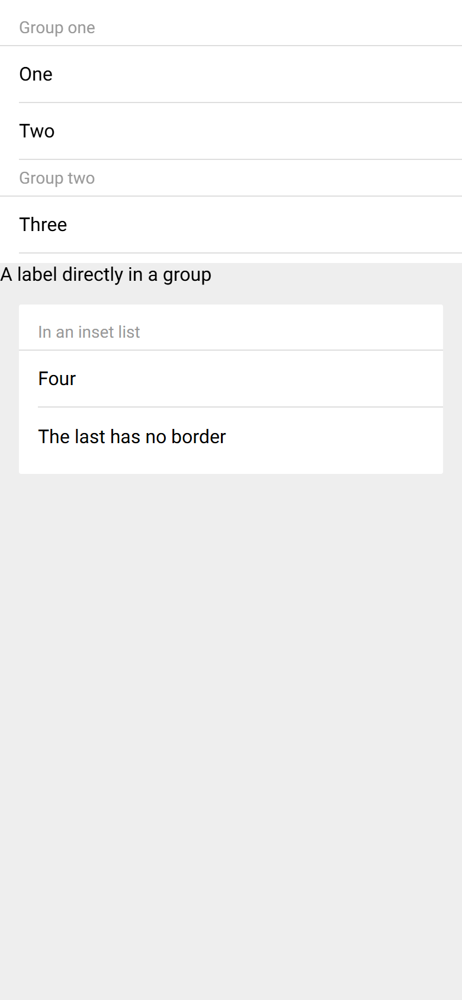
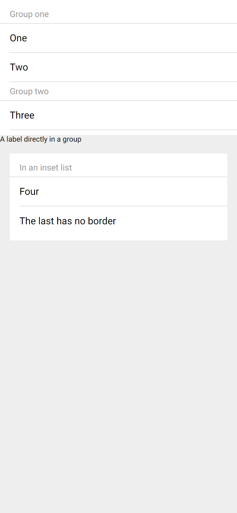

# ion-item-group — Comparison against the web component

> Ionic side, exactly:
>
> ```
> node tools/ionic-ref/render.js ion-item-group --bare --html '<div style="background:#eeeeee;height:844px"><ion-list><ion-item-group><ion-item-divider>Group one</ion-item-divider><ion-item>One</ion-item><ion-item>Two</ion-item></ion-item-group><ion-item-group><ion-item-divider>Group two</ion-item-divider><ion-item>Three</ion-item></ion-item-group></ion-list><ion-item-group><ion-label>A label directly in a group</ion-label></ion-item-group><ion-list inset><ion-item-group><ion-item-divider>In an inset list</ion-item-divider><ion-item>Four</ion-item><ion-item>The last has no border</ion-item></ion-item-group></ion-list></div>'
> ```
>
> (Chromium, md, 390×844@2x) → [`ref/`](ref/).
> Avonic side: `AVONIC_CAPTURE_DIR=… dotnet test` → `AvonicListCaptureTests.Reference_Page_Item_Group` (headless Skia, 2×) →
> [`compare/`](compare/). Tried in a real window on Windows at 125%, with `tools/real-window`, on 2026-11-06. Not on real touch hardware: the `ion-list` page draws as the frames do.

## Frames

| Ionic | Avonic |
|---|---|
|  |  |

From the top: a list of two groups, a label directly in a group, and an inset list holding a group.

**Match,** apart from these visible differences:

- **Text.** Roboto isn't installed on this machine, so Chromium uses Arial and Avalonia uses Segoe UI.
- **A label directly in a group** is 16 in Ionic, from the page, and smaller here, at Avalonia's default. That's the open
  question of the default text size outside a host. The list after it starts higher for the same reason.

## Behaviours

| # | Behaviour | Result |
|---|---|---|
| 1 | Stacks, with nothing of its own | Match: an empty group is 0 high |
| 2 | Role | Match |
| 3 | A label acts as in an item | Match: no margin, the token is read even in a header, and its own colour wins |
| 4 | Tab stops, arrow keys | Match |

## Found here, not by the tests

Nothing.
