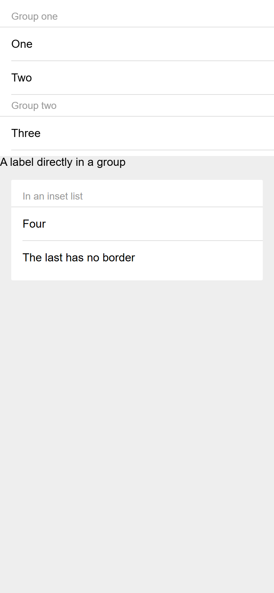
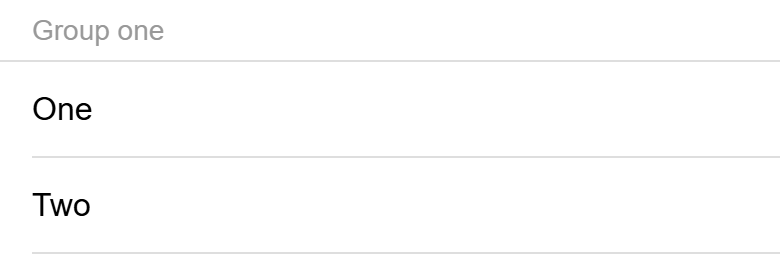

# ion-item-group — reference render (Ionic 8.8.1, md, 390×844@2x)

Generated by `node tools/ionic-ref/render.js ion-item-group --bare --html "<div style=\"background:#eeeeee;height:844px\"><ion-list><ion-item-group><ion-item-divider>Group one</ion-item-divider><ion-item>One</ion-item><ion-item>Two</ion-item></ion-item-group><ion-item-group><ion-item-divider>Group two</ion-item-divider><ion-item>Three</ion-item></ion-item-group></ion-list><ion-item-group><ion-label>A label directly in a group</ion-label></ion-item-group><ion-list inset><ion-item-group><ion-item-divider>In an inset list</ion-item-divider><ion-item>Four</ion-item><ion-item>The last has no border</ion-item></ion-item-group></ion-list></div>"`

```html
<div style="background:#eeeeee;height:844px"><ion-list><ion-item-group><ion-item-divider>Group one</ion-item-divider><ion-item>One</ion-item><ion-item>Two</ion-item></ion-item-group><ion-item-group><ion-item-divider>Group two</ion-item-divider><ion-item>Three</ion-item></ion-item-group></ion-list><ion-item-group><ion-label>A label directly in a group</ion-label></ion-item-group><ion-list inset><ion-item-group><ion-item-divider>In an inset list</ion-item-divider><ion-item>Four</ion-item><ion-item>The last has no border</ion-item></ion-item-group></ion-list></div>
```

 

## Element 1

- attributes: `{"role":"group","class":"md item-group-md item hydrated"}`
- classes: `md item-group-md item hydrated`
- rect: `{"x":0,"y":8,"w":390,"h":127}`

### Host computed

| prop | value |
|---|---|
| display | `block` |
| position | `static` |
| box-sizing | `border-box` |
| width | `390px` |
| height | `127px` |
| min-height | `0px` |
| min-width | `0px` |
| padding | `0px` |
| margin | `0px` |
| border | `0px none rgb(0, 0, 0)` |
| border-radius | `0px` |
| background-color | `rgba(0, 0, 0, 0)` |
| color | `rgb(0, 0, 0)` |
| font-size | `16px` |
| font-weight | `400` |
| font-family | `Roboto, "Helvetica Neue", sans-serif` |
| line-height | `normal` |
| letter-spacing | `normal` |
| text-transform | `none` |
| opacity | `1` |
| overflow | `visible` |
| contain | `none` |
| pointer-events | `auto` |
| transition | `all` |
| transform | `none` |
| box-shadow | `none` |
| outline | `rgb(0, 0, 0) none 0px` |
| cursor | `auto` |

### DOM tree

```
<ion-item-group>
  <ion-item-divider.md.item.hydrated>
    #shadow-root
      <slot name="start">
      <div.item-divider-inner part="inner">
        <div.item-divider-wrapper part="container">
          <slot name="">
        <slot name="end">
  <ion-item.item.md.item-lines-default.in-list.hydrated>
    #shadow-root
      <div.item-native part="native">
        <slot name="start">
        <div.item-inner part="inner">
          <div.input-wrapper part="container">
            <slot name="">
          <slot name="end">
  <ion-item.item.md.item-lines-default.in-list.hydrated>
    #shadow-root
      <div.item-native part="native">
        <slot name="start">
        <div.item-inner part="inner">
          <div.input-wrapper part="container">
            <slot name="">
          <slot name="end">
```

## Element 2

- attributes: `{"role":"group","class":"md item-group-md item hydrated"}`
- classes: `md item-group-md item hydrated`
- rect: `{"x":0,"y":135,"w":390,"h":79}`

### Host computed

| prop | value |
|---|---|
| display | `block` |
| position | `static` |
| box-sizing | `border-box` |
| width | `390px` |
| height | `79px` |
| min-height | `0px` |
| min-width | `0px` |
| padding | `0px` |
| margin | `0px` |
| border | `0px none rgb(0, 0, 0)` |
| border-radius | `0px` |
| background-color | `rgba(0, 0, 0, 0)` |
| color | `rgb(0, 0, 0)` |
| font-size | `16px` |
| font-weight | `400` |
| font-family | `Roboto, "Helvetica Neue", sans-serif` |
| line-height | `normal` |
| letter-spacing | `normal` |
| text-transform | `none` |
| opacity | `1` |
| overflow | `visible` |
| contain | `none` |
| pointer-events | `auto` |
| transition | `all` |
| transform | `none` |
| box-shadow | `none` |
| outline | `rgb(0, 0, 0) none 0px` |
| cursor | `auto` |

### DOM tree

```
<ion-item-group>
  <ion-item-divider.md.item.hydrated>
    #shadow-root
      <slot name="start">
      <div.item-divider-inner part="inner">
        <div.item-divider-wrapper part="container">
          <slot name="">
        <slot name="end">
  <ion-item.item.md.item-lines-default.in-list.hydrated>
    #shadow-root
      <div.item-native part="native">
        <slot name="start">
        <div.item-inner part="inner">
          <div.input-wrapper part="container">
            <slot name="">
          <slot name="end">
```

## Element 3

- attributes: `{"role":"group","class":"md item-group-md item hydrated"}`
- classes: `md item-group-md item hydrated`
- rect: `{"x":0,"y":222,"w":390,"h":18}`

### Host computed

| prop | value |
|---|---|
| display | `block` |
| position | `static` |
| box-sizing | `border-box` |
| width | `390px` |
| height | `18px` |
| min-height | `0px` |
| min-width | `0px` |
| padding | `0px` |
| margin | `0px` |
| border | `0px none rgb(0, 0, 0)` |
| border-radius | `0px` |
| background-color | `rgba(0, 0, 0, 0)` |
| color | `rgb(0, 0, 0)` |
| font-size | `16px` |
| font-weight | `400` |
| font-family | `Roboto, "Helvetica Neue", sans-serif` |
| line-height | `normal` |
| letter-spacing | `normal` |
| text-transform | `none` |
| opacity | `1` |
| overflow | `visible` |
| contain | `none` |
| pointer-events | `auto` |
| transition | `all` |
| transform | `none` |
| box-shadow | `none` |
| outline | `rgb(0, 0, 0) none 0px` |
| cursor | `auto` |

### DOM tree

```
<ion-item-group>
  <ion-label.sc-ion-label-md-h.md.sc-ion-label-md.sc-ion-label-md-s.hydrated>
```

## Element 4

- attributes: `{"role":"group","class":"md item-group-md item hydrated"}`
- classes: `md item-group-md item hydrated`
- rect: `{"x":16,"y":264,"w":358,"h":127}`

### Host computed

| prop | value |
|---|---|
| display | `block` |
| position | `static` |
| box-sizing | `border-box` |
| width | `358px` |
| height | `127px` |
| min-height | `0px` |
| min-width | `0px` |
| padding | `0px` |
| margin | `0px` |
| border | `0px none rgb(0, 0, 0)` |
| border-radius | `0px` |
| background-color | `rgba(0, 0, 0, 0)` |
| color | `rgb(0, 0, 0)` |
| font-size | `16px` |
| font-weight | `400` |
| font-family | `Roboto, "Helvetica Neue", sans-serif` |
| line-height | `normal` |
| letter-spacing | `normal` |
| text-transform | `none` |
| opacity | `1` |
| overflow | `visible` |
| contain | `none` |
| pointer-events | `auto` |
| transition | `all` |
| transform | `none` |
| box-shadow | `none` |
| outline | `rgb(0, 0, 0) none 0px` |
| cursor | `auto` |

### DOM tree

```
<ion-item-group>
  <ion-item-divider.md.item.hydrated>
    #shadow-root
      <slot name="start">
      <div.item-divider-inner part="inner">
        <div.item-divider-wrapper part="container">
          <slot name="">
        <slot name="end">
  <ion-item.item.md.item-lines-default.in-list.hydrated>
    #shadow-root
      <div.item-native part="native">
        <slot name="start">
        <div.item-inner part="inner">
          <div.input-wrapper part="container">
            <slot name="">
          <slot name="end">
  <ion-item.item.md.item-lines-default.in-list.hydrated>
    #shadow-root
      <div.item-native part="native">
        <slot name="start">
        <div.item-inner part="inner">
          <div.input-wrapper part="container">
            <slot name="">
          <slot name="end">
```
