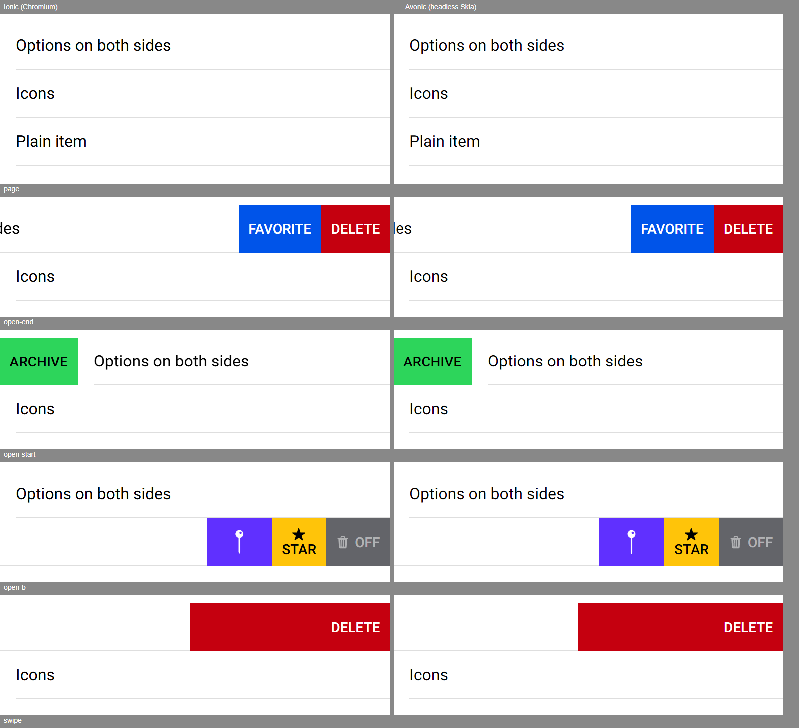

# ion-item-sliding family — Comparison against the web component

> Ionic side: `node tools/ionic-ref/render.js ion-item-sliding --bare --html '<the snippet below>'` (Chromium, md, 390×844@2x)
> → [`ref/`](ref/): `page.png`, `dump.json`, `README.md`, `page.html`. The open and swiped frames (`ref/open-end.png`,
> `open-start.png`, `open-b.png`, `swipe.png`) and every behaviour below were measured with throwaway Playwright scripts on the
> same page, calling `open()` and `close()`, and touching through CDP's `Input.dispatchTouchEvent`.
> Avonic side: `AVONIC_CAPTURE_DIR=… dotnet test` → `AvonicItemSlidingCaptureTests.Reference_Page` (headless Skia, 2×) →
> [`compare/`](compare/). **Not tried in a real window, and not tried on a device.**

```html
<ion-app style="position:static;display:block;contain:none;overflow:visible"><ion-list>
<ion-item-sliding id="a"><ion-item-options side="start"><ion-item-option color="success">Archive</ion-item-option></ion-item-options>
  <ion-item><ion-label>Options on both sides</ion-label></ion-item>
  <ion-item-options side="end"><ion-item-option>Favorite</ion-item-option><ion-item-option color="danger" expandable>Delete</ion-item-option></ion-item-options></ion-item-sliding>
<ion-item-sliding id="b"><ion-item><ion-label>Icons</ion-label></ion-item>
  <ion-item-options side="end"><ion-item-option color="tertiary"><ion-icon slot="icon-only" name="pin"></ion-icon></ion-item-option><ion-item-option color="warning"><ion-icon slot="top" name="star"></ion-icon>Star</ion-item-option><ion-item-option color="medium" disabled><ion-icon slot="start" name="trash"></ion-icon>Off</ion-item-option></ion-item-options></ion-item-sliding>
<ion-item-sliding id="c"><ion-item><ion-label>Plain item</ion-label></ion-item></ion-item-sliding>
</ion-list></ion-app>
```

## Side by side

Ionic on the left, Avonic on the right, the top of each frame: closed; `a.open('end')`; `a.open('start')`; `b.open()`; a full
swipe on `a` from 300 to 40 in 8 px steps, held 700 ms.



| What | Ionic | Avonic | |
|---|---|---|---|
| Rows | 48 high, from y 8 | the same, read off the frame | match |
| End options of `a` | Favorite 238.88 (82.42), Delete 321.3 (68.7); open 151 | Favorite 83.5, Delete 69; open 152.5 | match, within Avalonia's layout rounding of the text |
| Start option of `a` | Archive 0, 77.67; open −78 (rounded by the transform) | 78.5 | match |
| `b`'s options | pin 64.78 (icon 25.19 with 10 each side), Star 54.06 (icon above the text, centred), Off 63.67, its content at 0.5 | pin 65.5, Star 54.5, Off 64.5, read off the frame | match, within the rounding |
| Colours | success, primary, danger, tertiary, warning, medium; white or black contrast text, uppercase, 14 px medium | the same | match |
| The item while open | moved by the open amount, its line with it; the options behind it | the same | match |
| A full swipe held | Delete grown over the row, its text at the right; the item 199.95 open | the same; 205 open | match: Ionic's gesture handles only the first move of each frame and drops the rest, and Chromium's last move (to 40) fell in a frame with another, where the test clock gave every move its own frame |

## Behaviours

| # | Behaviour | Ionic (measured) | Avonic | |
|---|---|---|---|---|
| S1 | The drag from the capturing move | captured at 288 from 300; at 200 the item was at −80 | captured 10 px in; −90 at 200 from 290 | match |
| S2 | Only towards a side with options | `sides` in `onMove` | `S02` | match |
| S3 | Elastic 0.55 | 155.95 at a raw 160, 151 wide | `S03` | match |
| S4 | Full swipe from width + 30 | `item-sliding-active-swipe-end` from 181 | `S04` | match |
| S5 | Release rules | `swipeShouldReset` | `S05` ×3 | match |
| S6 | `ionSwipe` after resting open | `{"side":"end"}` on `ion-item-options`, amount 151, after `ionDrag` 151 | `S04_S06` | match |
| S7 | `ionDrag` | `{amount, ratio}` each move; none for 0 | `S07` | match |
| S8 | 500 ms ease | −80.2 at 89 ms, −134.6 at 189, −151 at 489; close the same way back | `S08` (the curve, and a drag cutting it short) | match |
| S9 | 600 ms close | closing class and the shown options gone at ~617 ms | `S09` | match |
| S10 | The open item takes no tap | the tap's click went to `ion-item-options` | `S10` | match |
| S11 | One open at a time | tapping `b` closed `a` and clicked `b`'s label | `S11` | match |
| S12 | 15 px edge | `canStart` | `S12` ×2 (and RTL) | match |
| S13–S15 | Methods | `open`, `close`, `closeOpened`, amounts and ratio | `S13`–`S15` | match |
| S16 | Options shown only on the open side, `width: 100%`, behind | `display: none`, then `visibility: hidden` but the open side; 390 wide | `S16` | match |
| S17 | RTL | `isEndSide`, `:dir(rtl)` | `S17` | match |
| S18 | Disabled | `gesture.enable(!disabled)`, and the item still clicks | `S18` ×5 | match |
| S19 | Content's `scrollY` off during a drag | `disableContentScrollY` | `S19` ×2 | match |
| S20 | Children found again | `MutationObserver`, `onStart` | `S20` | match |
| S21 | In a scroller | Chromium scrolls a vertical drag and the gesture takes a sideways one | `S21` | match |
| O1 | Packed to their side | as above | `O01` | match |
| O2 | Expandable grows over 600 ms | `padding-left` 118 px, then 390; 0 at once on release | `O02` ×2 | match |
| O3 | Lines in a list | `.list-md-lines-full .item-options-md` | `O03` | match |
| O4–O8 | Option's look, colour, click, disabled, automation | `item-option.md.css`; a native `<button>` | `O04`–`O08` | match |
| O9 | Safe area on the outermost option | read from the CSS: the safe areas are 0 in Chromium | `O09` (LTR and RTL) | match |

## Deliberate differences

- **An app's margin on slotted content adds to the slot's 5 or 10 px** instead of replacing it: the margins are on the slots'
  presenters, so the option's `ControlTheme` holds them and nothing goes in `Styles/`, which every element in an app pays for.
- **`visibility: hidden` is `IsVisible` false** for the options on the closed side, as they're under the item either way and take no
  input or focus in both.
- **One open item per process**, not per document.
- **`disabled` is `Disabled`, not `IsEnabled`,** as Avalonia's inherited `IsEnabled` would disable the item too, where Ionic's
  `disabled` only stops the gesture. `IsEnabled` false, here or on an ancestor, keeps Avalonia's meaning, and also turns the
  gesture off, ending a drag where it is, as a disabled control gets no more moves.
- **A sliding item removed mid-drag gives the content its scrolling back.** Ionic's `destroy()` ends the drag with no `onEnd`,
  which leaves `ion-content`'s `scrollY` off.
- **One close timer at a time.** A drag back past closed ends the drag, whose `onEnd` closes again from inside the first close;
  Ionic then has two timers and can only cancel one, so a later `open()` could be hidden by the other.
- **An options' `Side` or direction changing is followed** by the sliding item. Ionic reads the sides only when the children
  change, and its own `item-options-start` class doesn't follow `dir` either, so it stays consistent, if stale; here the options'
  side follows at once, so the sliding item has to as well.

## Gaps

- `flex-shrink` on options wider than the row; see the README.
- In an inset list, Ionic takes the line off the item in the last sliding item, and keeps it on an item that's last inside its
  sliding item; Avonic's list rule (`Styles/List.axaml`, a shared file) looks at the item's own position. Proposed in the PR.
