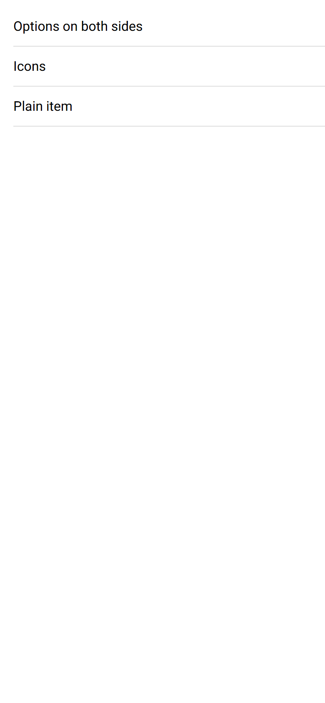
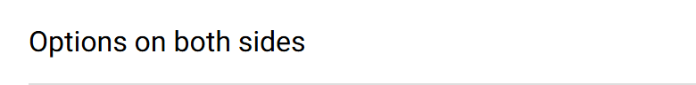

# ion-item-sliding — reference render (Ionic 8.8.1, md, 390×844@2x)

Generated by `node tools/ionic-ref/render.js ion-item-sliding --bare --html "<ion-app style=\"position:static;display:block;contain:none;overflow:visible\"><ion-list><ion-item-sliding id=\"a\"><ion-item-options side=\"start\"><ion-item-option color=\"success\">Archive</ion-item-option></ion-item-options><ion-item><ion-label>Options on both sides</ion-label></ion-item><ion-item-options side=\"end\"><ion-item-option>Favorite</ion-item-option><ion-item-option color=\"danger\" expandable>Delete</ion-item-option></ion-item-options></ion-item-sliding><ion-item-sliding id=\"b\"><ion-item><ion-label>Icons</ion-label></ion-item><ion-item-options side=\"end\"><ion-item-option color=\"tertiary\"><ion-icon slot=\"icon-only\" name=\"pin\"></ion-icon></ion-item-option><ion-item-option color=\"warning\"><ion-icon slot=\"top\" name=\"star\"></ion-icon>Star</ion-item-option><ion-item-option color=\"medium\" disabled><ion-icon slot=\"start\" name=\"trash\"></ion-icon>Off</ion-item-option></ion-item-options></ion-item-sliding><ion-item-sliding id=\"c\"><ion-item><ion-label>Plain item</ion-label></ion-item></ion-item-sliding></ion-list></ion-app>"`

```html
<ion-app style="position:static;display:block;contain:none;overflow:visible"><ion-list><ion-item-sliding id="a"><ion-item-options side="start"><ion-item-option color="success">Archive</ion-item-option></ion-item-options><ion-item><ion-label>Options on both sides</ion-label></ion-item><ion-item-options side="end"><ion-item-option>Favorite</ion-item-option><ion-item-option color="danger" expandable>Delete</ion-item-option></ion-item-options></ion-item-sliding><ion-item-sliding id="b"><ion-item><ion-label>Icons</ion-label></ion-item><ion-item-options side="end"><ion-item-option color="tertiary"><ion-icon slot="icon-only" name="pin"></ion-icon></ion-item-option><ion-item-option color="warning"><ion-icon slot="top" name="star"></ion-icon>Star</ion-item-option><ion-item-option color="medium" disabled><ion-icon slot="start" name="trash"></ion-icon>Off</ion-item-option></ion-item-options></ion-item-sliding><ion-item-sliding id="c"><ion-item><ion-label>Plain item</ion-label></ion-item></ion-item-sliding></ion-list></ion-app>
```

 

## Element 1

- attributes: `{"id":"a","class":"md hydrated"}`
- classes: `md hydrated`
- rect: `{"x":0,"y":8,"w":390,"h":48}`

### Host computed

| prop | value |
|---|---|
| display | `block` |
| position | `relative` |
| box-sizing | `border-box` |
| width | `390px` |
| height | `48px` |
| min-height | `0px` |
| min-width | `0px` |
| padding | `0px` |
| margin | `0px` |
| border | `0px none rgb(0, 0, 0)` |
| border-radius | `0px` |
| background-color | `rgba(0, 0, 0, 0)` |
| color | `rgb(0, 0, 0)` |
| font-size | `16px` |
| font-weight | `400` |
| font-family | `Roboto, "Helvetica Neue", sans-serif` |
| line-height | `normal` |
| letter-spacing | `normal` |
| text-transform | `none` |
| opacity | `1` |
| overflow | `hidden` |
| contain | `none` |
| pointer-events | `auto` |
| transition | `all` |
| transform | `none` |
| box-shadow | `none` |
| outline | `rgb(0, 0, 0) none 0px` |
| cursor | `auto` |

### DOM tree

```
<ion-item-sliding>
  <ion-item-options.md.item-options-md.item-options-start.hydrated>
    <ion-item-option.ion-color.ion-color-success.md.ion-activatable.hydrated>
      #shadow-root
        <button.button-native part="native">
          <span.button-inner part="inner">
            <slot name="top">
            <div.horizontal-wrapper part="container">
              <slot name="start">
              <slot name="icon-only">
              <slot name="">
              <slot name="end">
            <slot name="bottom">
          <ion-ripple-effect.md.hydrated>
            #shadow-root
  <ion-item.item.md.item-lines-default.in-list.hydrated.item-label>
    #shadow-root
      <div.item-native part="native">
        <slot name="start">
        <div.item-inner part="inner">
          <div.input-wrapper part="container">
            <slot name="">
          <slot name="end">
    <ion-label.sc-ion-label-md-h.md.sc-ion-label-md.sc-ion-label-md-s.hydrated>
  <ion-item-options.md.item-options-md.item-options-end.hydrated>
    <ion-item-option.md.ion-activatable.hydrated>
      #shadow-root
        <button.button-native part="native">
          <span.button-inner part="inner">
            <slot name="top">
            <div.horizontal-wrapper part="container">
              <slot name="start">
              <slot name="icon-only">
              <slot name="">
              <slot name="end">
            <slot name="bottom">
          <ion-ripple-effect.md.hydrated>
            #shadow-root
    <ion-item-option.ion-color.ion-color-danger.md.item-option-expandable.ion-activatable.hydrated>
      #shadow-root
        <button.button-native part="native">
          <span.button-inner part="inner">
            <slot name="top">
            <div.horizontal-wrapper part="container">
              <slot name="start">
              <slot name="icon-only">
              <slot name="">
              <slot name="end">
            <slot name="bottom">
          <ion-ripple-effect.md.hydrated>
            #shadow-root
```

## Element 2

- attributes: `{"id":"b","class":"md hydrated"}`
- classes: `md hydrated`
- rect: `{"x":0,"y":56,"w":390,"h":48}`

### Host computed

| prop | value |
|---|---|
| display | `block` |
| position | `relative` |
| box-sizing | `border-box` |
| width | `390px` |
| height | `48px` |
| min-height | `0px` |
| min-width | `0px` |
| padding | `0px` |
| margin | `0px` |
| border | `0px none rgb(0, 0, 0)` |
| border-radius | `0px` |
| background-color | `rgba(0, 0, 0, 0)` |
| color | `rgb(0, 0, 0)` |
| font-size | `16px` |
| font-weight | `400` |
| font-family | `Roboto, "Helvetica Neue", sans-serif` |
| line-height | `normal` |
| letter-spacing | `normal` |
| text-transform | `none` |
| opacity | `1` |
| overflow | `hidden` |
| contain | `none` |
| pointer-events | `auto` |
| transition | `all` |
| transform | `none` |
| box-shadow | `none` |
| outline | `rgb(0, 0, 0) none 0px` |
| cursor | `auto` |

### DOM tree

```
<ion-item-sliding>
  <ion-item.item.md.item-lines-default.in-list.hydrated.item-label>
    #shadow-root
      <div.item-native part="native">
        <slot name="start">
        <div.item-inner part="inner">
          <div.input-wrapper part="container">
            <slot name="">
          <slot name="end">
    <ion-label.sc-ion-label-md-h.md.sc-ion-label-md.sc-ion-label-md-s.hydrated>
  <ion-item-options.md.item-options-md.item-options-end.hydrated>
    <ion-item-option.ion-color.ion-color-tertiary.md.ion-activatable.hydrated>
      #shadow-root
        <button.button-native part="native">
          <span.button-inner part="inner">
            <slot name="top">
            <div.horizontal-wrapper part="container">
              <slot name="start">
              <slot name="icon-only">
              <slot name="">
              <slot name="end">
            <slot name="bottom">
          <ion-ripple-effect.md.hydrated>
            #shadow-root
      <ion-icon.md.hydrated slot="icon-only">
        #shadow-root
          <div.icon-inner>
            <svg>
              <path>
    <ion-item-option.ion-color.ion-color-warning.md.ion-activatable.hydrated>
      #shadow-root
        <button.button-native part="native">
          <span.button-inner part="inner">
            <slot name="top">
            <div.horizontal-wrapper part="container">
              <slot name="start">
              <slot name="icon-only">
              <slot name="">
              <slot name="end">
            <slot name="bottom">
          <ion-ripple-effect.md.hydrated>
            #shadow-root
      <ion-icon.md.hydrated slot="top">
        #shadow-root
          <div.icon-inner>
            <svg>
              <path>
    <ion-item-option.ion-color.ion-color-medium.md.item-option-disabled.ion-activatable.hydrated>
      #shadow-root
        <button.button-native part="native">
          <span.button-inner part="inner">
            <slot name="top">
            <div.horizontal-wrapper part="container">
              <slot name="start">
              <slot name="icon-only">
              <slot name="">
              <slot name="end">
            <slot name="bottom">
          <ion-ripple-effect.md.hydrated>
            #shadow-root
      <ion-icon.md.hydrated slot="start">
        #shadow-root
          <div.icon-inner>
            <svg>
              <path>
              <path>
```

## Element 3

- attributes: `{"id":"c","class":"md hydrated"}`
- classes: `md hydrated`
- rect: `{"x":0,"y":104,"w":390,"h":48}`

### Host computed

| prop | value |
|---|---|
| display | `block` |
| position | `relative` |
| box-sizing | `border-box` |
| width | `390px` |
| height | `48px` |
| min-height | `0px` |
| min-width | `0px` |
| padding | `0px` |
| margin | `0px` |
| border | `0px none rgb(0, 0, 0)` |
| border-radius | `0px` |
| background-color | `rgba(0, 0, 0, 0)` |
| color | `rgb(0, 0, 0)` |
| font-size | `16px` |
| font-weight | `400` |
| font-family | `Roboto, "Helvetica Neue", sans-serif` |
| line-height | `normal` |
| letter-spacing | `normal` |
| text-transform | `none` |
| opacity | `1` |
| overflow | `hidden` |
| contain | `none` |
| pointer-events | `auto` |
| transition | `all` |
| transform | `none` |
| box-shadow | `none` |
| outline | `rgb(0, 0, 0) none 0px` |
| cursor | `auto` |

### DOM tree

```
<ion-item-sliding>
  <ion-item.item.md.item-lines-default.in-list.hydrated.item-label>
    #shadow-root
      <div.item-native part="native">
        <slot name="start">
        <div.item-inner part="inner">
          <div.input-wrapper part="container">
            <slot name="">
          <slot name="end">
    <ion-label.sc-ion-label-md-h.md.sc-ion-label-md.sc-ion-label-md-s.hydrated>
```
