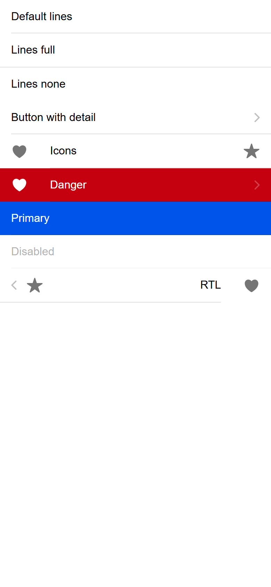
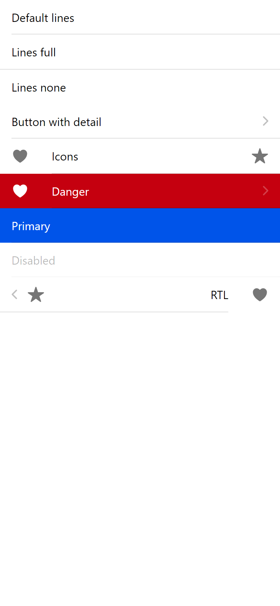
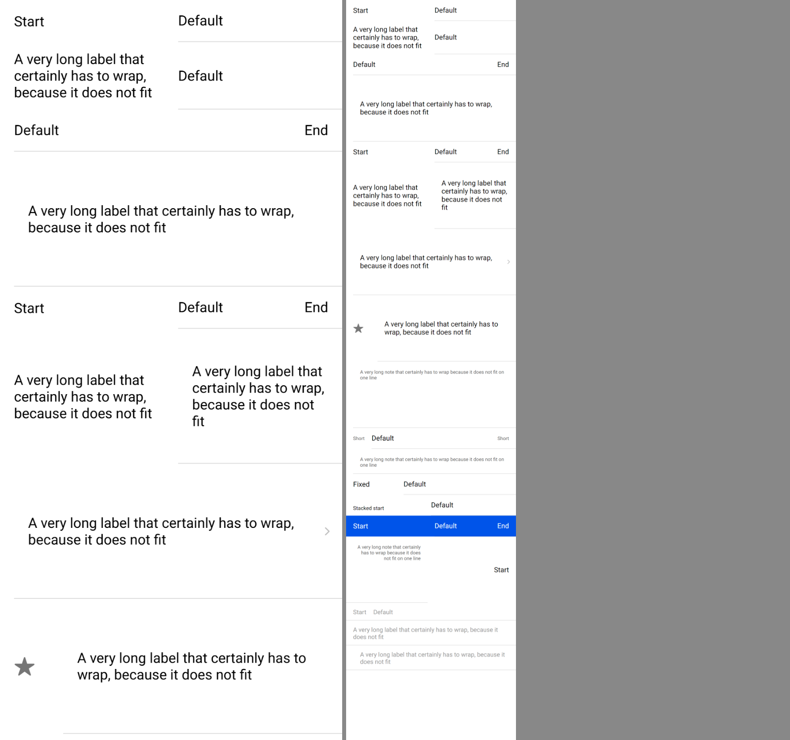
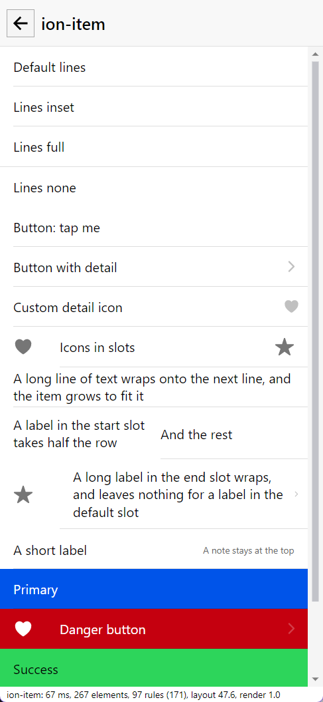

# ion-item — Comparison against the web component

> Ionic side: `node tools/ionic-ref/render.js ion-item --bare --tap` (Chromium, md, 390×844@2x) → [`ref/`](ref/).
> Avonic side: `AVONIC_CAPTURE_DIR=… dotnet test` → `AvonicItemCaptureTests` (headless Skia, 2×) → [`compare/`](compare/).

## Frames

| Ionic | Avonic |
|---|---|
|  |  |

Rows from the top: default lines, full, none, a button with detail, slotted icons, danger, primary, disabled and RTL.
**Match.** Row heights are identical, at 48, 49, 48, 48, 49, 48, 48, 48 and 49.

The text is the one visible difference. Roboto isn't installed on this machine, so each renderer takes its own
fallback: Arial in Chromium and Segoe UI in Avalonia. That also moves the text by about 1 px, as they have different
metrics. Icons and borders are in the same places.

## The flex layout

From #71. The rows from the top are in [PLAN.md](PLAN.md#the-flex-layout-71). Ionic on the left, in Chromium, headless, with the page in
`AvonicItemCaptureTests.Layout_Page` on the right, headless too, from the same `--html` as [`ref/layout/page.html`](ref/layout/page.html):

**Match,** with every box in the same place. The rows are taller here only because Segoe UI's lines are, at 21.3 against Arial's 18:

| Row | Ionic | Avonic |
|---|---|---|
| A long start label, three lines | 74 | 84 |
| Squeezed default label, seven lines | 147 | 170 |
| Plain text squeezed, three lines | 55 | 65 |
| Divider, one line | 40 | 43 |
| Long divider start or end, two lines | 56 | 61.5 |
| Everything else | 48 | 48 |

One row differs for another reason. A stacked label in start beside a plain one is 55 in this page, and was 48 in another: two labels report
to the item, and the last to load wins, which `B5_With_Two_Labels_The_Last_To_Report_Wins` records. The default slot loads last here, so it's 48.

The RTL row's note loses about 1 px at its right edge. A plain `TextBlock` does too, in Avalonia, with no Avonic control: it's [listed](../../infra/avalonia-issues.md).

Each row in the plan has a test in `AvonicItemLayoutTests` named after it, so F1 to F22 are all match, except:

| # | Difference |
|---|---|
| F14, F18 | A long note or `AvonicText` is as wide as its longest line, rather than 342. The text is in the same place |
| F7, F8, F15 | Same layout, with rows that are taller by the font's line height, as above |

## Shared press handling, `Command` and the rest

From #72. The rows are in [PLAN.md](PLAN.md#shared-press-handling-command-and-the-rest-72). Nothing here is drawn differently, except where a ripple is.

| # | Behaviour | Result |
|---|---|---|
| S1 | A finger that moves: clicks at 14, and not at 16 | match, on all three controls |
| S2 | A mouse dragged 60 px clicks | match, on all three. It was a gap on the item and the card |
| S3 | Right and middle button don't | match |
| S4 | A button inside clicks both | match, for a stock `Button` and an `AvonicButton` |
| S5 | A button item's name | match: `Hello inline words`, `Text INNER BTN`, `Seen`, `Lab Not`, and an explicit name beats them. The case is as it's drawn |
| S6 | Roles | match, within one peer: a button item in a list is a button, where Ionic has a button inside a list item |
| S7 | `position` in a divider, a group and a header | match: the same scale, and a move of the same fraction of the height. The heights differ only by the font |
| S8 | An end button's margins | match: `16 7 2 7` and `16 4 2 4` |
| S9 | A button is over the ripple | match, and the ripple is under everything else too, where Ionic's is over it: see the plan |
| S10 | A background under a translucent line | match: `rgb(127, 0, 128)`, within what rounding gives |

## Behaviours

The numbers are from [PLAN.md](PLAN.md#behaviours). Each has tests in `AvonicItemTests`, named after its number. The
Ionic results were measured in Chromium, with `ion-app` for the states, because it's what starts `tap-click` and
`focus-visible`.

| # | Behaviour | Ionic | Result |
|---|---|---|---|
| 1 | `button` is activatable, with a ripple and a pointer cursor | `BUTTON`, `ion-activatable`, ripple, `cursor: pointer` | match |
| 2 | A plain item has none of that | `DIV`, no ripple, overlay stays at 0 on hover | match |
| 3 | A tap on a `button` item clicks; a disabled one doesn't | `btn<-input-wrapper`; `disabled`: nothing | match |
| 4 | A tap on a child inside also clicks | `btn-nested<-inner-btn` | match |
| 5 | Enter and Space activate, and also forward to the first interactive control | `btn<-item-native` for both | match |
| 6 | Tab stops | `btn`, `btn-nodetail`, `color`, `badcolor`, `btn-nested`, `inner-btn`, `inner-btn2` | match: `plain`, `disabled` and `detail` are skipped |
| 7 | Only `detail` true shows the icon | `btn`: none; `detail`: shown | match |
| 8 | The default icon flips in RTL, and a custom one flips by its name | `chevron-down` and `arrow-forward` flip, `heart` doesn't | match |
| 9 | Detail icon box and style | 20×20 at x=360, 0.25, `8px`/`-6px`; 25×25 at 20 px | match |
| 10 | Lines | default and inset: inner 1 px. Full: outer 1 px. None: neither | match |
| 11 | Full lines make it 49 high | 49 | match |
| 12 | Colour | `rgb(197, 0, 15)`, white, borders `rgb(173, 0, 13)` | match |
| 13 | Unknown colour | Transparent, with text in `--color` and borders in the current colour | match. The colour system's known difference for text doesn't apply here, because `Css.Var` can express it |
| 14 | No colour in a coloured ancestor | from the colour system's rule | match |
| 15 | Hover | Black at 0.04; contrast on colour | match. Mouse and pen only |
| 16 | Keyboard focus | Black at 0.12, also while hovered, with `outline: none`. A click clears it | match |
| 17 | Pressing with the mouse | `ion-activated`, overlay stays at 0.04 | match |
| 18 | On colour, the overlay uses contrast | `rgb(255, 255, 255)` at 0.04 and 0.12 | match |
| 19 | Disabled | Opacity 0.3, `pointer-events: none`, `aria-disabled`, not a tab stop | match |
| 20 | Focus inside | `btn-nested` shows it from `inner-btn`; `plain-nested` doesn't | match |
| 21 | `multipleInputs`, `hasCover`, `canActivate`, `isFocusable` | from `item.js` | match, on stub controls |
| 22 | A tap on the padding forwards | from `item.js` | match, on stub controls |
| 23 | A tap on a slotted child doesn't | from `item.js` | match, on stub controls |
| 24 | Pointer cursor class | from `item.js` | match, on stub controls |
| 25 | `ionStyle` to `:item-<key>` | from `item.js` | match, on stub controls |
| 26 | `.item-interactive`, `.item-label-stacked`, `.item-textarea` | Minimum 55, detail icon and start at the top, end margins `7px 0 7px 16px`, stretched slots | match, on stub controls |
| 27 | `.item-interactive-disabled` | from `item.md.css` | match, on stub controls |
| 28 | Box layout | Inner x=16, w=374; container w=358, h=47. With icons: 16,12.5 and 350,12; inner x=72 | match, within layout rounding |
| 29 | Long text wraps | Item grows to 55 | match. The height depends on the font |
| 30 | Font and icon sizes | 16 px, icons 24, or 30 at 20 px, 54% black | match |
| 31 | Slot margins | `16`; icons `0 32 12`, `16 0 12` | match |
| 32 | Only direct children | `::slotted` | match |
| 33 | RTL | Start on the right, inner x=0 | match |
| 34 | Corners clip | `overflow: hidden` | match |
| 35 | Automation | `button`; `aria-disabled` | match |

Behaviours 21–27 can only be checked on stub controls, because the controls they're for don't exist yet. Those issues
compare them for real.

## In the real window

The sample's `ion-item` page, in a real Windows window with real mouse and keyboard input:

| Input | Result |
|---|---|
| Automation invoke on a `Button` row | One click |
| A mouse click, and a double click | One click, and two |
| Press, drag off the row, release | No click |
| A click on a plain row, and on a disabled one | No click, no overlay |
| Hover | The overlay covers the whole row, including the padding |
| Press | Ripple, clipped to the row |
| Enter and Space with focus from a click | One click each, with no focus overlay |
| Tab, and Shift+Tab | Skips plain and disabled rows. Overlay only, with no dashed adorner |
| A letter key | Clears the focus overlay |
| Automation | `Button` rows are buttons that can be invoked, plain rows are groups, and the disabled row reports it |

This found one bug that the headless tests couldn't: the base theme's dashed focus rectangle. Touch hasn't been tried on
real hardware.

The flex layout, from #71, with `tools/real-window` on Windows at 125%, on 2026-11-06: all 51 checks passed, and the sample's item, note, label and list
pages draw as the headless frames do. It found nothing new. Nothing it drives depends on the new rows, so it's their frames that say so:

## Deliberate differences

See [PLAN.md](PLAN.md#deliberate-differences).

## Gaps

None. The differences that remain are in [PLAN.md](PLAN.md#deliberate-differences).
