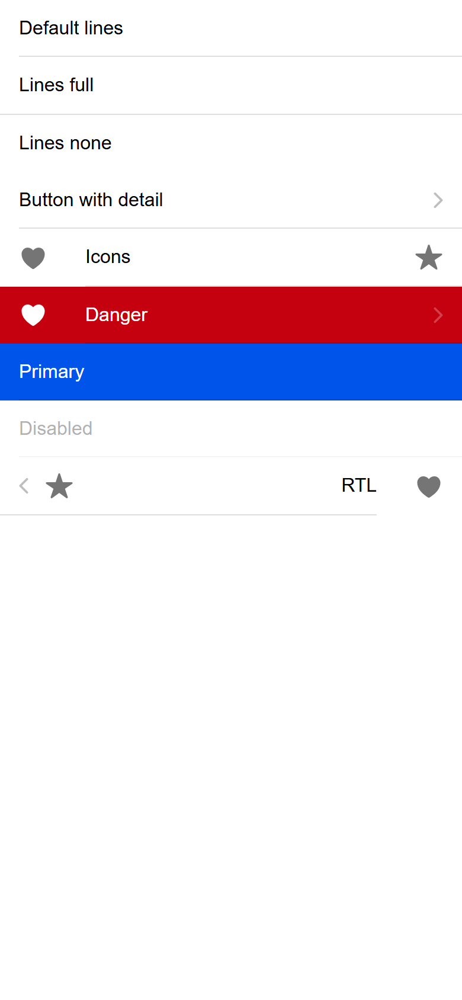
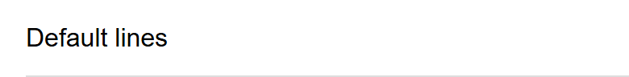
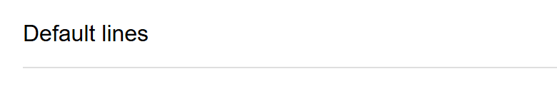

# ion-item — reference render (Ionic 8.8.1, md, 390×844@2x)

Generated by `node tools/ionic-ref/render.js ion-item --bare --tap`

```html
<ion-item>Default lines</ion-item><ion-item lines="full">Lines full</ion-item><ion-item lines="none">Lines none</ion-item><ion-item button detail>Button with detail</ion-item><ion-item><ion-icon name="heart" slot="start"></ion-icon>Icons<ion-icon name="star" slot="end"></ion-icon></ion-item><ion-item color="danger" button detail><ion-icon name="heart" slot="start"></ion-icon>Danger</ion-item><ion-item color="primary">Primary</ion-item><ion-item disabled button>Disabled</ion-item><div dir="rtl"><ion-item detail><ion-icon name="heart" slot="start"></ion-icon>RTL<ion-icon name="star" slot="end"></ion-icon></ion-item></div>
```

 

## Press / release frames

      

## Element 1

- attributes: `{"class":"item md item-lines-default hydrated"}`
- classes: `item md item-lines-default hydrated`
- rect: `{"x":0,"y":0,"w":390,"h":48}`

### CSS custom properties (resolved)

| var | value |
|---|---|
| `--background` | `#fff` |
| `--background-activated` | `transparent` |
| `--background-activated-opacity` | `0` |
| `--background-focused` | `currentColor` |
| `--background-focused-opacity` | `.12` |
| `--background-hover` | `currentColor` |
| `--background-hover-opacity` | `.04` |
| `--border-color` | `rgba(0, 0, 0, 0.13)` |
| `--border-radius` | `0px` |
| `--border-style` | `solid` |
| `--border-width` | `0px` |
| `--color` | `#000` |
| `--color-activated` | `#000` |
| `--color-focused` | `#000` |
| `--color-hover` | `#000` |
| `--detail-icon-color` | `(unset)` |
| `--detail-icon-font-size` | `1.25em` |
| `--detail-icon-opacity` | `0.25` |
| `--inner-border-width` | `0 0 1px 0` |
| `--inner-box-shadow` | `none` |
| `--inner-padding-bottom` | `0px` |
| `--inner-padding-end` | `16px` |
| `--inner-padding-start` | `0px` |
| `--inner-padding-top` | `0px` |
| `--min-height` | `48px` |
| `--padding-bottom` | `0px` |
| `--padding-end` | `0px` |
| `--padding-start` | `16px` |
| `--padding-top` | `0px` |
| `--ripple-color` | `currentColor` |
| `--transition` | `opacity 15ms linear, background-color 15ms linear` |

### Host computed

| prop | value |
|---|---|
| display | `block` |
| position | `relative` |
| box-sizing | `border-box` |
| width | `390px` |
| height | `48px` |
| min-height | `0px` |
| min-width | `0px` |
| padding | `0px` |
| margin | `0px` |
| border | `0px none rgb(0, 0, 0)` |
| border-radius | `0px` |
| background-color | `rgba(0, 0, 0, 0)` |
| color | `rgb(0, 0, 0)` |
| font-size | `16px` |
| font-weight | `400` |
| font-family | `Roboto, "Helvetica Neue", sans-serif` |
| line-height | `normal` |
| letter-spacing | `normal` |
| text-transform | `none` |
| opacity | `1` |
| overflow | `hidden` |
| contain | `none` |
| pointer-events | `auto` |
| transition | `all` |
| transform | `none` |
| box-shadow | `none` |
| outline | `rgb(0, 0, 0) none 0px` |
| cursor | `auto` |

### Shadow parts

#### part="native" (`div`) rect `{"x":0,"y":0,"w":390,"h":48}`

| prop | value |
|---|---|
| display | `flex` |
| position | `relative` |
| box-sizing | `border-box` |
| width | `390px` |
| height | `48px` |
| min-height | `48px` |
| min-width | `0px` |
| padding | `0px 0px 0px 16px` |
| margin | `0px` |
| border | `0px solid rgba(0, 0, 0, 0.13)` |
| border-radius | `0px` |
| background-color | `rgb(255, 255, 255)` |
| color | `rgb(0, 0, 0)` |
| font-size | `16px` |
| font-weight | `400` |
| font-family | `Roboto, "Helvetica Neue", sans-serif` |
| line-height | `normal` |
| letter-spacing | `normal` |
| text-transform | `none` |
| opacity | `1` |
| overflow | `hidden` |
| contain | `none` |
| pointer-events | `auto` |
| transition | `opacity 0.015s linear, background-color 0.015s linear` |
| transform | `none` |
| box-shadow | `none` |
| outline | `rgb(0, 0, 0) none 0px` |
| cursor | `auto` |

#### part="inner" (`div`) rect `{"x":16,"y":0,"w":374,"h":48}`

| prop | value |
|---|---|
| display | `flex` |
| position | `relative` |
| box-sizing | `border-box` |
| width | `374px` |
| height | `48px` |
| min-height | `48px` |
| min-width | `auto` |
| padding | `0px 16px 0px 0px` |
| margin | `0px` |
| border-radius | `0px` |
| background-color | `rgba(0, 0, 0, 0)` |
| color | `rgb(0, 0, 0)` |
| font-size | `16px` |
| font-weight | `400` |
| font-family | `Roboto, "Helvetica Neue", sans-serif` |
| line-height | `normal` |
| letter-spacing | `normal` |
| text-transform | `none` |
| opacity | `1` |
| overflow | `hidden` |
| contain | `none` |
| pointer-events | `auto` |
| transition | `all` |
| transform | `none` |
| box-shadow | `none` |
| outline | `rgb(0, 0, 0) none 0px` |
| cursor | `auto` |

#### part="container" (`div`) rect `{"x":16,"y":0,"w":358,"h":47}`

| prop | value |
|---|---|
| display | `flex` |
| position | `static` |
| box-sizing | `border-box` |
| width | `358px` |
| height | `47px` |
| min-height | `auto` |
| min-width | `auto` |
| padding | `0px` |
| margin | `0px` |
| border | `0px none rgb(0, 0, 0)` |
| border-radius | `0px` |
| background-color | `rgba(0, 0, 0, 0)` |
| color | `rgb(0, 0, 0)` |
| font-size | `16px` |
| font-weight | `400` |
| font-family | `Roboto, "Helvetica Neue", sans-serif` |
| line-height | `normal` |
| letter-spacing | `normal` |
| text-transform | `none` |
| opacity | `1` |
| overflow | `hidden` |
| contain | `none` |
| pointer-events | `auto` |
| transition | `all` |
| transform | `none` |
| box-shadow | `none` |
| outline | `rgb(0, 0, 0) none 0px` |
| cursor | `auto` |

### DOM tree

```
<ion-item>
  #shadow-root
    <div.item-native part="native">
      <slot name="start">
      <div.item-inner part="inner">
        <div.input-wrapper part="container">
          <slot name="">
        <slot name="end">
```

## Element 2

- attributes: `{"lines":"full","class":"item md item-lines-full hydrated"}`
- classes: `item md item-lines-full hydrated`
- rect: `{"x":0,"y":48,"w":390,"h":49}`

### CSS custom properties (resolved)

| var | value |
|---|---|
| `--background` | `#fff` |
| `--background-activated` | `transparent` |
| `--background-activated-opacity` | `0` |
| `--background-focused` | `currentColor` |
| `--background-focused-opacity` | `.12` |
| `--background-hover` | `currentColor` |
| `--background-hover-opacity` | `.04` |
| `--border-color` | `rgba(0, 0, 0, 0.13)` |
| `--border-radius` | `0px` |
| `--border-style` | `solid` |
| `--border-width` | `0 0 1px 0` |
| `--color` | `#000` |
| `--color-activated` | `#000` |
| `--color-focused` | `#000` |
| `--color-hover` | `#000` |
| `--detail-icon-color` | `(unset)` |
| `--detail-icon-font-size` | `1.25em` |
| `--detail-icon-opacity` | `0.25` |
| `--inner-border-width` | `0` |
| `--inner-box-shadow` | `none` |
| `--inner-padding-bottom` | `0px` |
| `--inner-padding-end` | `16px` |
| `--inner-padding-start` | `0px` |
| `--inner-padding-top` | `0px` |
| `--min-height` | `48px` |
| `--padding-bottom` | `0px` |
| `--padding-end` | `0px` |
| `--padding-start` | `16px` |
| `--padding-top` | `0px` |
| `--ripple-color` | `currentColor` |
| `--transition` | `opacity 15ms linear, background-color 15ms linear` |

### Host computed

| prop | value |
|---|---|
| display | `block` |
| position | `relative` |
| box-sizing | `border-box` |
| width | `390px` |
| height | `49px` |
| min-height | `0px` |
| min-width | `0px` |
| padding | `0px` |
| margin | `0px` |
| border | `0px none rgb(0, 0, 0)` |
| border-radius | `0px` |
| background-color | `rgba(0, 0, 0, 0)` |
| color | `rgb(0, 0, 0)` |
| font-size | `16px` |
| font-weight | `400` |
| font-family | `Roboto, "Helvetica Neue", sans-serif` |
| line-height | `normal` |
| letter-spacing | `normal` |
| text-transform | `none` |
| opacity | `1` |
| overflow | `hidden` |
| contain | `none` |
| pointer-events | `auto` |
| transition | `all` |
| transform | `none` |
| box-shadow | `none` |
| outline | `rgb(0, 0, 0) none 0px` |
| cursor | `auto` |

### Shadow parts

#### part="native" (`div`) rect `{"x":0,"y":48,"w":390,"h":49}`

| prop | value |
|---|---|
| display | `flex` |
| position | `relative` |
| box-sizing | `border-box` |
| width | `390px` |
| height | `49px` |
| min-height | `48px` |
| min-width | `0px` |
| padding | `0px 0px 0px 16px` |
| margin | `0px` |
| border-radius | `0px` |
| background-color | `rgb(255, 255, 255)` |
| color | `rgb(0, 0, 0)` |
| font-size | `16px` |
| font-weight | `400` |
| font-family | `Roboto, "Helvetica Neue", sans-serif` |
| line-height | `normal` |
| letter-spacing | `normal` |
| text-transform | `none` |
| opacity | `1` |
| overflow | `hidden` |
| contain | `none` |
| pointer-events | `auto` |
| transition | `opacity 0.015s linear, background-color 0.015s linear` |
| transform | `none` |
| box-shadow | `none` |
| outline | `rgb(0, 0, 0) none 0px` |
| cursor | `auto` |

#### part="inner" (`div`) rect `{"x":16,"y":48,"w":374,"h":48}`

| prop | value |
|---|---|
| display | `flex` |
| position | `relative` |
| box-sizing | `border-box` |
| width | `374px` |
| height | `48px` |
| min-height | `48px` |
| min-width | `auto` |
| padding | `0px 16px 0px 0px` |
| margin | `0px` |
| border | `0px solid rgba(0, 0, 0, 0.13)` |
| border-radius | `0px` |
| background-color | `rgba(0, 0, 0, 0)` |
| color | `rgb(0, 0, 0)` |
| font-size | `16px` |
| font-weight | `400` |
| font-family | `Roboto, "Helvetica Neue", sans-serif` |
| line-height | `normal` |
| letter-spacing | `normal` |
| text-transform | `none` |
| opacity | `1` |
| overflow | `hidden` |
| contain | `none` |
| pointer-events | `auto` |
| transition | `all` |
| transform | `none` |
| box-shadow | `none` |
| outline | `rgb(0, 0, 0) none 0px` |
| cursor | `auto` |

#### part="container" (`div`) rect `{"x":16,"y":48,"w":358,"h":48}`

| prop | value |
|---|---|
| display | `flex` |
| position | `static` |
| box-sizing | `border-box` |
| width | `358px` |
| height | `48px` |
| min-height | `auto` |
| min-width | `auto` |
| padding | `0px` |
| margin | `0px` |
| border | `0px none rgb(0, 0, 0)` |
| border-radius | `0px` |
| background-color | `rgba(0, 0, 0, 0)` |
| color | `rgb(0, 0, 0)` |
| font-size | `16px` |
| font-weight | `400` |
| font-family | `Roboto, "Helvetica Neue", sans-serif` |
| line-height | `normal` |
| letter-spacing | `normal` |
| text-transform | `none` |
| opacity | `1` |
| overflow | `hidden` |
| contain | `none` |
| pointer-events | `auto` |
| transition | `all` |
| transform | `none` |
| box-shadow | `none` |
| outline | `rgb(0, 0, 0) none 0px` |
| cursor | `auto` |

### DOM tree

```
<ion-item>
  #shadow-root
    <div.item-native part="native">
      <slot name="start">
      <div.item-inner part="inner">
        <div.input-wrapper part="container">
          <slot name="">
        <slot name="end">
```

## Element 3

- attributes: `{"lines":"none","class":"item md item-lines-none hydrated"}`
- classes: `item md item-lines-none hydrated`
- rect: `{"x":0,"y":97,"w":390,"h":48}`

### CSS custom properties (resolved)

| var | value |
|---|---|
| `--background` | `#fff` |
| `--background-activated` | `transparent` |
| `--background-activated-opacity` | `0` |
| `--background-focused` | `currentColor` |
| `--background-focused-opacity` | `.12` |
| `--background-hover` | `currentColor` |
| `--background-hover-opacity` | `.04` |
| `--border-color` | `rgba(0, 0, 0, 0.13)` |
| `--border-radius` | `0px` |
| `--border-style` | `solid` |
| `--border-width` | `0` |
| `--color` | `#000` |
| `--color-activated` | `#000` |
| `--color-focused` | `#000` |
| `--color-hover` | `#000` |
| `--detail-icon-color` | `(unset)` |
| `--detail-icon-font-size` | `1.25em` |
| `--detail-icon-opacity` | `0.25` |
| `--inner-border-width` | `0` |
| `--inner-box-shadow` | `none` |
| `--inner-padding-bottom` | `0px` |
| `--inner-padding-end` | `16px` |
| `--inner-padding-start` | `0px` |
| `--inner-padding-top` | `0px` |
| `--min-height` | `48px` |
| `--padding-bottom` | `0px` |
| `--padding-end` | `0px` |
| `--padding-start` | `16px` |
| `--padding-top` | `0px` |
| `--ripple-color` | `currentColor` |
| `--transition` | `opacity 15ms linear, background-color 15ms linear` |

### Host computed

| prop | value |
|---|---|
| display | `block` |
| position | `relative` |
| box-sizing | `border-box` |
| width | `390px` |
| height | `48px` |
| min-height | `0px` |
| min-width | `0px` |
| padding | `0px` |
| margin | `0px` |
| border | `0px none rgb(0, 0, 0)` |
| border-radius | `0px` |
| background-color | `rgba(0, 0, 0, 0)` |
| color | `rgb(0, 0, 0)` |
| font-size | `16px` |
| font-weight | `400` |
| font-family | `Roboto, "Helvetica Neue", sans-serif` |
| line-height | `normal` |
| letter-spacing | `normal` |
| text-transform | `none` |
| opacity | `1` |
| overflow | `hidden` |
| contain | `none` |
| pointer-events | `auto` |
| transition | `all` |
| transform | `none` |
| box-shadow | `none` |
| outline | `rgb(0, 0, 0) none 0px` |
| cursor | `auto` |

### Shadow parts

#### part="native" (`div`) rect `{"x":0,"y":97,"w":390,"h":48}`

| prop | value |
|---|---|
| display | `flex` |
| position | `relative` |
| box-sizing | `border-box` |
| width | `390px` |
| height | `48px` |
| min-height | `48px` |
| min-width | `0px` |
| padding | `0px 0px 0px 16px` |
| margin | `0px` |
| border | `0px solid rgba(0, 0, 0, 0.13)` |
| border-radius | `0px` |
| background-color | `rgb(255, 255, 255)` |
| color | `rgb(0, 0, 0)` |
| font-size | `16px` |
| font-weight | `400` |
| font-family | `Roboto, "Helvetica Neue", sans-serif` |
| line-height | `normal` |
| letter-spacing | `normal` |
| text-transform | `none` |
| opacity | `1` |
| overflow | `hidden` |
| contain | `none` |
| pointer-events | `auto` |
| transition | `opacity 0.015s linear, background-color 0.015s linear` |
| transform | `none` |
| box-shadow | `none` |
| outline | `rgb(0, 0, 0) none 0px` |
| cursor | `auto` |

#### part="inner" (`div`) rect `{"x":16,"y":97,"w":374,"h":48}`

| prop | value |
|---|---|
| display | `flex` |
| position | `relative` |
| box-sizing | `border-box` |
| width | `374px` |
| height | `48px` |
| min-height | `48px` |
| min-width | `auto` |
| padding | `0px 16px 0px 0px` |
| margin | `0px` |
| border | `0px solid rgba(0, 0, 0, 0.13)` |
| border-radius | `0px` |
| background-color | `rgba(0, 0, 0, 0)` |
| color | `rgb(0, 0, 0)` |
| font-size | `16px` |
| font-weight | `400` |
| font-family | `Roboto, "Helvetica Neue", sans-serif` |
| line-height | `normal` |
| letter-spacing | `normal` |
| text-transform | `none` |
| opacity | `1` |
| overflow | `hidden` |
| contain | `none` |
| pointer-events | `auto` |
| transition | `all` |
| transform | `none` |
| box-shadow | `none` |
| outline | `rgb(0, 0, 0) none 0px` |
| cursor | `auto` |

#### part="container" (`div`) rect `{"x":16,"y":97,"w":358,"h":48}`

| prop | value |
|---|---|
| display | `flex` |
| position | `static` |
| box-sizing | `border-box` |
| width | `358px` |
| height | `48px` |
| min-height | `auto` |
| min-width | `auto` |
| padding | `0px` |
| margin | `0px` |
| border | `0px none rgb(0, 0, 0)` |
| border-radius | `0px` |
| background-color | `rgba(0, 0, 0, 0)` |
| color | `rgb(0, 0, 0)` |
| font-size | `16px` |
| font-weight | `400` |
| font-family | `Roboto, "Helvetica Neue", sans-serif` |
| line-height | `normal` |
| letter-spacing | `normal` |
| text-transform | `none` |
| opacity | `1` |
| overflow | `hidden` |
| contain | `none` |
| pointer-events | `auto` |
| transition | `all` |
| transform | `none` |
| box-shadow | `none` |
| outline | `rgb(0, 0, 0) none 0px` |
| cursor | `auto` |

### DOM tree

```
<ion-item>
  #shadow-root
    <div.item-native part="native">
      <slot name="start">
      <div.item-inner part="inner">
        <div.input-wrapper part="container">
          <slot name="">
        <slot name="end">
```

## Element 4

- attributes: `{"button":"","detail":"","class":"item md item-lines-default ion-activatable ion-focusable hydrated"}`
- classes: `item md item-lines-default ion-activatable ion-focusable hydrated`
- rect: `{"x":0,"y":145,"w":390,"h":48}`

### CSS custom properties (resolved)

| var | value |
|---|---|
| `--background` | `#fff` |
| `--background-activated` | `transparent` |
| `--background-activated-opacity` | `0` |
| `--background-focused` | `currentColor` |
| `--background-focused-opacity` | `.12` |
| `--background-hover` | `currentColor` |
| `--background-hover-opacity` | `.04` |
| `--border-color` | `rgba(0, 0, 0, 0.13)` |
| `--border-radius` | `0px` |
| `--border-style` | `solid` |
| `--border-width` | `0px` |
| `--color` | `#000` |
| `--color-activated` | `#000` |
| `--color-focused` | `#000` |
| `--color-hover` | `#000` |
| `--detail-icon-color` | `(unset)` |
| `--detail-icon-font-size` | `1.25em` |
| `--detail-icon-opacity` | `0.25` |
| `--inner-border-width` | `0 0 1px 0` |
| `--inner-box-shadow` | `none` |
| `--inner-padding-bottom` | `0px` |
| `--inner-padding-end` | `16px` |
| `--inner-padding-start` | `0px` |
| `--inner-padding-top` | `0px` |
| `--min-height` | `48px` |
| `--padding-bottom` | `0px` |
| `--padding-end` | `0px` |
| `--padding-start` | `16px` |
| `--padding-top` | `0px` |
| `--ripple-color` | `currentColor` |
| `--transition` | `opacity 15ms linear, background-color 15ms linear` |

### Host computed

| prop | value |
|---|---|
| display | `block` |
| position | `relative` |
| box-sizing | `border-box` |
| width | `390px` |
| height | `48px` |
| min-height | `0px` |
| min-width | `0px` |
| padding | `0px` |
| margin | `0px` |
| border | `0px none rgb(0, 0, 0)` |
| border-radius | `0px` |
| background-color | `rgba(0, 0, 0, 0)` |
| color | `rgb(0, 0, 0)` |
| font-size | `16px` |
| font-weight | `400` |
| font-family | `Roboto, "Helvetica Neue", sans-serif` |
| line-height | `normal` |
| letter-spacing | `normal` |
| text-transform | `none` |
| opacity | `1` |
| overflow | `hidden` |
| contain | `none` |
| pointer-events | `auto` |
| transition | `all` |
| transform | `none` |
| box-shadow | `none` |
| outline | `rgb(0, 0, 0) none 0px` |
| cursor | `auto` |

### Shadow parts

#### part="native" (`button`) rect `{"x":0,"y":145,"w":390,"h":48}`

| prop | value |
|---|---|
| display | `flex` |
| position | `relative` |
| box-sizing | `border-box` |
| width | `390px` |
| height | `48px` |
| min-height | `48px` |
| min-width | `0px` |
| padding | `0px 0px 0px 16px` |
| margin | `0px` |
| border | `0px solid rgba(0, 0, 0, 0.13)` |
| border-radius | `0px` |
| background-color | `rgb(255, 255, 255)` |
| color | `rgb(0, 0, 0)` |
| font-size | `16px` |
| font-weight | `400` |
| font-family | `Roboto, "Helvetica Neue", sans-serif` |
| line-height | `normal` |
| letter-spacing | `normal` |
| text-transform | `none` |
| opacity | `1` |
| overflow | `hidden` |
| contain | `none` |
| pointer-events | `auto` |
| transition | `opacity 0.015s linear, background-color 0.015s linear` |
| transform | `none` |
| box-shadow | `none` |
| outline | `rgb(0, 0, 0) none 0px` |
| cursor | `pointer` |

#### part="inner" (`div`) rect `{"x":16,"y":145,"w":374,"h":48}`

| prop | value |
|---|---|
| display | `flex` |
| position | `relative` |
| box-sizing | `border-box` |
| width | `374px` |
| height | `48px` |
| min-height | `48px` |
| min-width | `auto` |
| padding | `0px 16px 0px 0px` |
| margin | `0px` |
| border-radius | `0px` |
| background-color | `rgba(0, 0, 0, 0)` |
| color | `rgb(0, 0, 0)` |
| font-size | `16px` |
| font-weight | `400` |
| font-family | `Roboto, "Helvetica Neue", sans-serif` |
| line-height | `normal` |
| letter-spacing | `normal` |
| text-transform | `none` |
| opacity | `1` |
| overflow | `hidden` |
| contain | `none` |
| pointer-events | `auto` |
| transition | `all` |
| transform | `none` |
| box-shadow | `none` |
| outline | `rgb(0, 0, 0) none 0px` |
| cursor | `pointer` |

#### part="container" (`div`) rect `{"x":16,"y":145,"w":336,"h":47}`

| prop | value |
|---|---|
| display | `flex` |
| position | `static` |
| box-sizing | `border-box` |
| width | `336px` |
| height | `47px` |
| min-height | `auto` |
| min-width | `auto` |
| padding | `0px` |
| margin | `0px` |
| border | `0px none rgb(0, 0, 0)` |
| border-radius | `0px` |
| background-color | `rgba(0, 0, 0, 0)` |
| color | `rgb(0, 0, 0)` |
| font-size | `16px` |
| font-weight | `400` |
| font-family | `Roboto, "Helvetica Neue", sans-serif` |
| line-height | `normal` |
| letter-spacing | `normal` |
| text-transform | `none` |
| opacity | `1` |
| overflow | `hidden` |
| contain | `none` |
| pointer-events | `auto` |
| transition | `all` |
| transform | `none` |
| box-shadow | `none` |
| outline | `rgb(0, 0, 0) none 0px` |
| cursor | `pointer` |

#### part="detail-icon" (`ion-icon`) rect `{"x":360,"y":158.5,"w":20,"h":20}`

| prop | value |
|---|---|
| display | `block` |
| position | `static` |
| box-sizing | `content-box` |
| width | `20px` |
| height | `20px` |
| min-height | `auto` |
| min-width | `auto` |
| padding | `0px` |
| margin | `0px -6px 0px 8px` |
| border | `0px none rgb(0, 0, 0)` |
| border-radius | `0px` |
| background-color | `rgba(0, 0, 0, 0)` |
| color | `rgb(0, 0, 0)` |
| font-size | `20px` |
| font-weight | `400` |
| font-family | `Roboto, "Helvetica Neue", sans-serif` |
| line-height | `normal` |
| letter-spacing | `normal` |
| text-transform | `none` |
| opacity | `0.25` |
| overflow | `visible` |
| contain | `strict` |
| pointer-events | `auto` |
| transition | `all` |
| transform | `none` |
| box-shadow | `none` |
| outline | `rgb(0, 0, 0) none 0px` |
| cursor | `pointer` |

### DOM tree

```
<ion-item>
  #shadow-root
    <button.item-native part="native">
      <slot name="start">
      <div.item-inner part="inner">
        <div.input-wrapper part="container">
          <slot name="">
        <slot name="end">
        <ion-icon.item-detail-icon.md.flip-rtl.hydrated part="detail-icon">
          #shadow-root
            <div.icon-inner>
              <svg>
                <path>
      <ion-ripple-effect.md.hydrated>
        #shadow-root
```

## Element 5

- attributes: `{"class":"item-has-start-slot item md item-lines-default hydrated"}`
- classes: `item-has-start-slot item md item-lines-default hydrated`
- rect: `{"x":0,"y":193,"w":390,"h":49}`

### CSS custom properties (resolved)

| var | value |
|---|---|
| `--background` | `#fff` |
| `--background-activated` | `transparent` |
| `--background-activated-opacity` | `0` |
| `--background-focused` | `currentColor` |
| `--background-focused-opacity` | `.12` |
| `--background-hover` | `currentColor` |
| `--background-hover-opacity` | `.04` |
| `--border-color` | `rgba(0, 0, 0, 0.13)` |
| `--border-radius` | `0px` |
| `--border-style` | `solid` |
| `--border-width` | `0px` |
| `--color` | `#000` |
| `--color-activated` | `#000` |
| `--color-focused` | `#000` |
| `--color-hover` | `#000` |
| `--detail-icon-color` | `(unset)` |
| `--detail-icon-font-size` | `1.25em` |
| `--detail-icon-opacity` | `0.25` |
| `--inner-border-width` | `0 0 1px 0` |
| `--inner-box-shadow` | `none` |
| `--inner-padding-bottom` | `0px` |
| `--inner-padding-end` | `16px` |
| `--inner-padding-start` | `0px` |
| `--inner-padding-top` | `0px` |
| `--min-height` | `48px` |
| `--padding-bottom` | `0px` |
| `--padding-end` | `0px` |
| `--padding-start` | `16px` |
| `--padding-top` | `0px` |
| `--ripple-color` | `currentColor` |
| `--transition` | `opacity 15ms linear, background-color 15ms linear` |

### Host computed

| prop | value |
|---|---|
| display | `block` |
| position | `relative` |
| box-sizing | `border-box` |
| width | `390px` |
| height | `49px` |
| min-height | `0px` |
| min-width | `0px` |
| padding | `0px` |
| margin | `0px` |
| border | `0px none rgb(0, 0, 0)` |
| border-radius | `0px` |
| background-color | `rgba(0, 0, 0, 0)` |
| color | `rgb(0, 0, 0)` |
| font-size | `16px` |
| font-weight | `400` |
| font-family | `Roboto, "Helvetica Neue", sans-serif` |
| line-height | `normal` |
| letter-spacing | `normal` |
| text-transform | `none` |
| opacity | `1` |
| overflow | `hidden` |
| contain | `none` |
| pointer-events | `auto` |
| transition | `all` |
| transform | `none` |
| box-shadow | `none` |
| outline | `rgb(0, 0, 0) none 0px` |
| cursor | `auto` |

### Shadow parts

#### part="native" (`div`) rect `{"x":0,"y":193,"w":390,"h":49}`

| prop | value |
|---|---|
| display | `flex` |
| position | `relative` |
| box-sizing | `border-box` |
| width | `390px` |
| height | `49px` |
| min-height | `48px` |
| min-width | `0px` |
| padding | `0px 0px 0px 16px` |
| margin | `0px` |
| border | `0px solid rgba(0, 0, 0, 0.13)` |
| border-radius | `0px` |
| background-color | `rgb(255, 255, 255)` |
| color | `rgb(0, 0, 0)` |
| font-size | `16px` |
| font-weight | `400` |
| font-family | `Roboto, "Helvetica Neue", sans-serif` |
| line-height | `normal` |
| letter-spacing | `normal` |
| text-transform | `none` |
| opacity | `1` |
| overflow | `hidden` |
| contain | `none` |
| pointer-events | `auto` |
| transition | `opacity 0.015s linear, background-color 0.015s linear` |
| transform | `none` |
| box-shadow | `none` |
| outline | `rgb(0, 0, 0) none 0px` |
| cursor | `auto` |

#### part="inner" (`div`) rect `{"x":72,"y":193,"w":318,"h":49}`

| prop | value |
|---|---|
| display | `flex` |
| position | `relative` |
| box-sizing | `border-box` |
| width | `318px` |
| height | `49px` |
| min-height | `48px` |
| min-width | `auto` |
| padding | `0px 16px 0px 0px` |
| margin | `0px` |
| border-radius | `0px` |
| background-color | `rgba(0, 0, 0, 0)` |
| color | `rgb(0, 0, 0)` |
| font-size | `16px` |
| font-weight | `400` |
| font-family | `Roboto, "Helvetica Neue", sans-serif` |
| line-height | `normal` |
| letter-spacing | `normal` |
| text-transform | `none` |
| opacity | `1` |
| overflow | `hidden` |
| contain | `none` |
| pointer-events | `auto` |
| transition | `all` |
| transform | `none` |
| box-shadow | `none` |
| outline | `rgb(0, 0, 0) none 0px` |
| cursor | `auto` |

#### part="container" (`div`) rect `{"x":72,"y":193,"w":262,"h":48}`

| prop | value |
|---|---|
| display | `flex` |
| position | `static` |
| box-sizing | `border-box` |
| width | `262px` |
| height | `48px` |
| min-height | `auto` |
| min-width | `auto` |
| padding | `0px` |
| margin | `0px` |
| border | `0px none rgb(0, 0, 0)` |
| border-radius | `0px` |
| background-color | `rgba(0, 0, 0, 0)` |
| color | `rgb(0, 0, 0)` |
| font-size | `16px` |
| font-weight | `400` |
| font-family | `Roboto, "Helvetica Neue", sans-serif` |
| line-height | `normal` |
| letter-spacing | `normal` |
| text-transform | `none` |
| opacity | `1` |
| overflow | `hidden` |
| contain | `none` |
| pointer-events | `auto` |
| transition | `all` |
| transform | `none` |
| box-shadow | `none` |
| outline | `rgb(0, 0, 0) none 0px` |
| cursor | `auto` |

### DOM tree

```
<ion-item>
  #shadow-root
    <div.item-native part="native">
      <slot name="start">
      <div.item-inner part="inner">
        <div.input-wrapper part="container">
          <slot name="">
        <slot name="end">
  <ion-icon.md.hydrated slot="start">
    #shadow-root
      <div.icon-inner>
        <svg>
          <path>
  <ion-icon.md.hydrated slot="end">
    #shadow-root
      <div.icon-inner>
        <svg>
          <path>
```

## Element 6

- attributes: `{"color":"danger","button":"","detail":"","class":"item-has-start-slot ion-color ion-color-danger item md item-lines-default ion-activatable ion-focusable hydrated"}`
- classes: `item-has-start-slot ion-color ion-color-danger item md item-lines-default ion-activatable ion-focusable hydrated`
- rect: `{"x":0,"y":242,"w":390,"h":48}`

### CSS custom properties (resolved)

| var | value |
|---|---|
| `--background` | `#fff` |
| `--background-activated` | `transparent` |
| `--background-activated-opacity` | `0` |
| `--background-focused` | `currentColor` |
| `--background-focused-opacity` | `.12` |
| `--background-hover` | `currentColor` |
| `--background-hover-opacity` | `.04` |
| `--border-color` | `rgba(0, 0, 0, 0.13)` |
| `--border-radius` | `0px` |
| `--border-style` | `solid` |
| `--border-width` | `0px` |
| `--color` | `#000` |
| `--color-activated` | `#000` |
| `--color-focused` | `#000` |
| `--color-hover` | `#000` |
| `--detail-icon-color` | `(unset)` |
| `--detail-icon-font-size` | `1.25em` |
| `--detail-icon-opacity` | `0.25` |
| `--inner-border-width` | `0 0 1px 0` |
| `--inner-box-shadow` | `none` |
| `--inner-padding-bottom` | `0px` |
| `--inner-padding-end` | `16px` |
| `--inner-padding-start` | `0px` |
| `--inner-padding-top` | `0px` |
| `--min-height` | `48px` |
| `--padding-bottom` | `0px` |
| `--padding-end` | `0px` |
| `--padding-start` | `16px` |
| `--padding-top` | `0px` |
| `--ripple-color` | `currentColor` |
| `--transition` | `opacity 15ms linear, background-color 15ms linear` |

### Host computed

| prop | value |
|---|---|
| display | `block` |
| position | `relative` |
| box-sizing | `border-box` |
| width | `390px` |
| height | `48px` |
| min-height | `0px` |
| min-width | `0px` |
| padding | `0px` |
| margin | `0px` |
| border | `0px none rgb(0, 0, 0)` |
| border-radius | `0px` |
| background-color | `rgba(0, 0, 0, 0)` |
| color | `rgb(0, 0, 0)` |
| font-size | `16px` |
| font-weight | `400` |
| font-family | `Roboto, "Helvetica Neue", sans-serif` |
| line-height | `normal` |
| letter-spacing | `normal` |
| text-transform | `none` |
| opacity | `1` |
| overflow | `hidden` |
| contain | `none` |
| pointer-events | `auto` |
| transition | `all` |
| transform | `none` |
| box-shadow | `none` |
| outline | `rgb(0, 0, 0) none 0px` |
| cursor | `auto` |

### Shadow parts

#### part="native" (`button`) rect `{"x":0,"y":242,"w":390,"h":48}`

| prop | value |
|---|---|
| display | `flex` |
| position | `relative` |
| box-sizing | `border-box` |
| width | `390px` |
| height | `48px` |
| min-height | `48px` |
| min-width | `0px` |
| padding | `0px 0px 0px 16px` |
| margin | `0px` |
| border | `0px solid rgb(173, 0, 13)` |
| border-radius | `0px` |
| background-color | `rgb(197, 0, 15)` |
| color | `rgb(255, 255, 255)` |
| font-size | `16px` |
| font-weight | `400` |
| font-family | `Roboto, "Helvetica Neue", sans-serif` |
| line-height | `normal` |
| letter-spacing | `normal` |
| text-transform | `none` |
| opacity | `1` |
| overflow | `hidden` |
| contain | `none` |
| pointer-events | `auto` |
| transition | `opacity 0.015s linear, background-color 0.015s linear` |
| transform | `none` |
| box-shadow | `none` |
| outline | `rgb(255, 255, 255) none 0px` |
| cursor | `pointer` |

#### part="inner" (`div`) rect `{"x":72,"y":242,"w":318,"h":48}`

| prop | value |
|---|---|
| display | `flex` |
| position | `relative` |
| box-sizing | `border-box` |
| width | `318px` |
| height | `48px` |
| min-height | `48px` |
| min-width | `auto` |
| padding | `0px 16px 0px 0px` |
| margin | `0px` |
| border-radius | `0px` |
| background-color | `rgba(0, 0, 0, 0)` |
| color | `rgb(255, 255, 255)` |
| font-size | `16px` |
| font-weight | `400` |
| font-family | `Roboto, "Helvetica Neue", sans-serif` |
| line-height | `normal` |
| letter-spacing | `normal` |
| text-transform | `none` |
| opacity | `1` |
| overflow | `hidden` |
| contain | `none` |
| pointer-events | `auto` |
| transition | `all` |
| transform | `none` |
| box-shadow | `none` |
| outline | `rgb(255, 255, 255) none 0px` |
| cursor | `pointer` |

#### part="container" (`div`) rect `{"x":72,"y":242,"w":280,"h":47}`

| prop | value |
|---|---|
| display | `flex` |
| position | `static` |
| box-sizing | `border-box` |
| width | `280px` |
| height | `47px` |
| min-height | `auto` |
| min-width | `auto` |
| padding | `0px` |
| margin | `0px` |
| border | `0px none rgb(255, 255, 255)` |
| border-radius | `0px` |
| background-color | `rgba(0, 0, 0, 0)` |
| color | `rgb(255, 255, 255)` |
| font-size | `16px` |
| font-weight | `400` |
| font-family | `Roboto, "Helvetica Neue", sans-serif` |
| line-height | `normal` |
| letter-spacing | `normal` |
| text-transform | `none` |
| opacity | `1` |
| overflow | `hidden` |
| contain | `none` |
| pointer-events | `auto` |
| transition | `all` |
| transform | `none` |
| box-shadow | `none` |
| outline | `rgb(255, 255, 255) none 0px` |
| cursor | `pointer` |

#### part="detail-icon" (`ion-icon`) rect `{"x":360,"y":255.5,"w":20,"h":20}`

| prop | value |
|---|---|
| display | `block` |
| position | `static` |
| box-sizing | `content-box` |
| width | `20px` |
| height | `20px` |
| min-height | `auto` |
| min-width | `auto` |
| padding | `0px` |
| margin | `0px -6px 0px 8px` |
| border | `0px none rgb(255, 255, 255)` |
| border-radius | `0px` |
| background-color | `rgba(0, 0, 0, 0)` |
| color | `rgb(255, 255, 255)` |
| font-size | `20px` |
| font-weight | `400` |
| font-family | `Roboto, "Helvetica Neue", sans-serif` |
| line-height | `normal` |
| letter-spacing | `normal` |
| text-transform | `none` |
| opacity | `0.25` |
| overflow | `visible` |
| contain | `strict` |
| pointer-events | `auto` |
| transition | `all` |
| transform | `none` |
| box-shadow | `none` |
| outline | `rgb(255, 255, 255) none 0px` |
| cursor | `pointer` |

### DOM tree

```
<ion-item>
  #shadow-root
    <button.item-native part="native">
      <slot name="start">
      <div.item-inner part="inner">
        <div.input-wrapper part="container">
          <slot name="">
        <slot name="end">
        <ion-icon.item-detail-icon.md.flip-rtl.hydrated part="detail-icon">
          #shadow-root
            <div.icon-inner>
              <svg>
                <path>
      <ion-ripple-effect.md.hydrated>
        #shadow-root
  <ion-icon.md.hydrated slot="start">
    #shadow-root
      <div.icon-inner>
        <svg>
          <path>
```

## Element 7

- attributes: `{"color":"primary","class":"ion-color ion-color-primary item md item-lines-default hydrated"}`
- classes: `ion-color ion-color-primary item md item-lines-default hydrated`
- rect: `{"x":0,"y":290,"w":390,"h":48}`

### CSS custom properties (resolved)

| var | value |
|---|---|
| `--background` | `#fff` |
| `--background-activated` | `transparent` |
| `--background-activated-opacity` | `0` |
| `--background-focused` | `currentColor` |
| `--background-focused-opacity` | `.12` |
| `--background-hover` | `currentColor` |
| `--background-hover-opacity` | `.04` |
| `--border-color` | `rgba(0, 0, 0, 0.13)` |
| `--border-radius` | `0px` |
| `--border-style` | `solid` |
| `--border-width` | `0px` |
| `--color` | `#000` |
| `--color-activated` | `#000` |
| `--color-focused` | `#000` |
| `--color-hover` | `#000` |
| `--detail-icon-color` | `(unset)` |
| `--detail-icon-font-size` | `1.25em` |
| `--detail-icon-opacity` | `0.25` |
| `--inner-border-width` | `0 0 1px 0` |
| `--inner-box-shadow` | `none` |
| `--inner-padding-bottom` | `0px` |
| `--inner-padding-end` | `16px` |
| `--inner-padding-start` | `0px` |
| `--inner-padding-top` | `0px` |
| `--min-height` | `48px` |
| `--padding-bottom` | `0px` |
| `--padding-end` | `0px` |
| `--padding-start` | `16px` |
| `--padding-top` | `0px` |
| `--ripple-color` | `currentColor` |
| `--transition` | `opacity 15ms linear, background-color 15ms linear` |

### Host computed

| prop | value |
|---|---|
| display | `block` |
| position | `relative` |
| box-sizing | `border-box` |
| width | `390px` |
| height | `48px` |
| min-height | `0px` |
| min-width | `0px` |
| padding | `0px` |
| margin | `0px` |
| border | `0px none rgb(0, 0, 0)` |
| border-radius | `0px` |
| background-color | `rgba(0, 0, 0, 0)` |
| color | `rgb(0, 0, 0)` |
| font-size | `16px` |
| font-weight | `400` |
| font-family | `Roboto, "Helvetica Neue", sans-serif` |
| line-height | `normal` |
| letter-spacing | `normal` |
| text-transform | `none` |
| opacity | `1` |
| overflow | `hidden` |
| contain | `none` |
| pointer-events | `auto` |
| transition | `all` |
| transform | `none` |
| box-shadow | `none` |
| outline | `rgb(0, 0, 0) none 0px` |
| cursor | `auto` |

### Shadow parts

#### part="native" (`div`) rect `{"x":0,"y":290,"w":390,"h":48}`

| prop | value |
|---|---|
| display | `flex` |
| position | `relative` |
| box-sizing | `border-box` |
| width | `390px` |
| height | `48px` |
| min-height | `48px` |
| min-width | `0px` |
| padding | `0px 0px 0px 16px` |
| margin | `0px` |
| border | `0px solid rgb(0, 74, 205)` |
| border-radius | `0px` |
| background-color | `rgb(0, 84, 233)` |
| color | `rgb(255, 255, 255)` |
| font-size | `16px` |
| font-weight | `400` |
| font-family | `Roboto, "Helvetica Neue", sans-serif` |
| line-height | `normal` |
| letter-spacing | `normal` |
| text-transform | `none` |
| opacity | `1` |
| overflow | `hidden` |
| contain | `none` |
| pointer-events | `auto` |
| transition | `opacity 0.015s linear, background-color 0.015s linear` |
| transform | `none` |
| box-shadow | `none` |
| outline | `rgb(255, 255, 255) none 0px` |
| cursor | `auto` |

#### part="inner" (`div`) rect `{"x":16,"y":290,"w":374,"h":48}`

| prop | value |
|---|---|
| display | `flex` |
| position | `relative` |
| box-sizing | `border-box` |
| width | `374px` |
| height | `48px` |
| min-height | `48px` |
| min-width | `auto` |
| padding | `0px 16px 0px 0px` |
| margin | `0px` |
| border-radius | `0px` |
| background-color | `rgba(0, 0, 0, 0)` |
| color | `rgb(255, 255, 255)` |
| font-size | `16px` |
| font-weight | `400` |
| font-family | `Roboto, "Helvetica Neue", sans-serif` |
| line-height | `normal` |
| letter-spacing | `normal` |
| text-transform | `none` |
| opacity | `1` |
| overflow | `hidden` |
| contain | `none` |
| pointer-events | `auto` |
| transition | `all` |
| transform | `none` |
| box-shadow | `none` |
| outline | `rgb(255, 255, 255) none 0px` |
| cursor | `auto` |

#### part="container" (`div`) rect `{"x":16,"y":290,"w":358,"h":47}`

| prop | value |
|---|---|
| display | `flex` |
| position | `static` |
| box-sizing | `border-box` |
| width | `358px` |
| height | `47px` |
| min-height | `auto` |
| min-width | `auto` |
| padding | `0px` |
| margin | `0px` |
| border | `0px none rgb(255, 255, 255)` |
| border-radius | `0px` |
| background-color | `rgba(0, 0, 0, 0)` |
| color | `rgb(255, 255, 255)` |
| font-size | `16px` |
| font-weight | `400` |
| font-family | `Roboto, "Helvetica Neue", sans-serif` |
| line-height | `normal` |
| letter-spacing | `normal` |
| text-transform | `none` |
| opacity | `1` |
| overflow | `hidden` |
| contain | `none` |
| pointer-events | `auto` |
| transition | `all` |
| transform | `none` |
| box-shadow | `none` |
| outline | `rgb(255, 255, 255) none 0px` |
| cursor | `auto` |

### DOM tree

```
<ion-item>
  #shadow-root
    <div.item-native part="native">
      <slot name="start">
      <div.item-inner part="inner">
        <div.input-wrapper part="container">
          <slot name="">
        <slot name="end">
```

## Element 8

- attributes: `{"disabled":"","button":"","aria-disabled":"true","class":"item md item-lines-default item-disabled ion-activatable ion-focusable hydrated"}`
- classes: `item md item-lines-default item-disabled ion-activatable ion-focusable hydrated`
- rect: `{"x":0,"y":338,"w":390,"h":48}`

### CSS custom properties (resolved)

| var | value |
|---|---|
| `--background` | `#fff` |
| `--background-activated` | `transparent` |
| `--background-activated-opacity` | `0` |
| `--background-focused` | `currentColor` |
| `--background-focused-opacity` | `.12` |
| `--background-hover` | `currentColor` |
| `--background-hover-opacity` | `.04` |
| `--border-color` | `rgba(0, 0, 0, 0.13)` |
| `--border-radius` | `0px` |
| `--border-style` | `solid` |
| `--border-width` | `0px` |
| `--color` | `#000` |
| `--color-activated` | `#000` |
| `--color-focused` | `#000` |
| `--color-hover` | `#000` |
| `--detail-icon-color` | `(unset)` |
| `--detail-icon-font-size` | `1.25em` |
| `--detail-icon-opacity` | `0.25` |
| `--inner-border-width` | `0 0 1px 0` |
| `--inner-box-shadow` | `none` |
| `--inner-padding-bottom` | `0px` |
| `--inner-padding-end` | `16px` |
| `--inner-padding-start` | `0px` |
| `--inner-padding-top` | `0px` |
| `--min-height` | `48px` |
| `--padding-bottom` | `0px` |
| `--padding-end` | `0px` |
| `--padding-start` | `16px` |
| `--padding-top` | `0px` |
| `--ripple-color` | `currentColor` |
| `--transition` | `opacity 15ms linear, background-color 15ms linear` |

### Host computed

| prop | value |
|---|---|
| display | `block` |
| position | `relative` |
| box-sizing | `border-box` |
| width | `390px` |
| height | `48px` |
| min-height | `0px` |
| min-width | `0px` |
| padding | `0px` |
| margin | `0px` |
| border | `0px none rgb(0, 0, 0)` |
| border-radius | `0px` |
| background-color | `rgba(0, 0, 0, 0)` |
| color | `rgb(0, 0, 0)` |
| font-size | `16px` |
| font-weight | `400` |
| font-family | `Roboto, "Helvetica Neue", sans-serif` |
| line-height | `normal` |
| letter-spacing | `normal` |
| text-transform | `none` |
| opacity | `0.3` |
| overflow | `hidden` |
| contain | `none` |
| pointer-events | `none` |
| transition | `all` |
| transform | `none` |
| box-shadow | `none` |
| outline | `rgb(0, 0, 0) none 0px` |
| cursor | `default` |

### Shadow parts

#### part="native" (`button`) rect `{"x":0,"y":338,"w":390,"h":48}`

| prop | value |
|---|---|
| display | `flex` |
| position | `relative` |
| box-sizing | `border-box` |
| width | `390px` |
| height | `48px` |
| min-height | `48px` |
| min-width | `0px` |
| padding | `0px 0px 0px 16px` |
| margin | `0px` |
| border | `0px solid rgba(0, 0, 0, 0.13)` |
| border-radius | `0px` |
| background-color | `rgb(255, 255, 255)` |
| color | `rgb(0, 0, 0)` |
| font-size | `16px` |
| font-weight | `400` |
| font-family | `Roboto, "Helvetica Neue", sans-serif` |
| line-height | `normal` |
| letter-spacing | `normal` |
| text-transform | `none` |
| opacity | `1` |
| overflow | `hidden` |
| contain | `none` |
| pointer-events | `none` |
| transition | `opacity 0.015s linear, background-color 0.015s linear` |
| transform | `none` |
| box-shadow | `none` |
| outline | `rgb(0, 0, 0) none 0px` |
| cursor | `pointer` |

#### part="inner" (`div`) rect `{"x":16,"y":338,"w":374,"h":48}`

| prop | value |
|---|---|
| display | `flex` |
| position | `relative` |
| box-sizing | `border-box` |
| width | `374px` |
| height | `48px` |
| min-height | `48px` |
| min-width | `auto` |
| padding | `0px 16px 0px 0px` |
| margin | `0px` |
| border-radius | `0px` |
| background-color | `rgba(0, 0, 0, 0)` |
| color | `rgb(0, 0, 0)` |
| font-size | `16px` |
| font-weight | `400` |
| font-family | `Roboto, "Helvetica Neue", sans-serif` |
| line-height | `normal` |
| letter-spacing | `normal` |
| text-transform | `none` |
| opacity | `1` |
| overflow | `hidden` |
| contain | `none` |
| pointer-events | `none` |
| transition | `all` |
| transform | `none` |
| box-shadow | `none` |
| outline | `rgb(0, 0, 0) none 0px` |
| cursor | `pointer` |

#### part="container" (`div`) rect `{"x":16,"y":338,"w":358,"h":47}`

| prop | value |
|---|---|
| display | `flex` |
| position | `static` |
| box-sizing | `border-box` |
| width | `358px` |
| height | `47px` |
| min-height | `auto` |
| min-width | `auto` |
| padding | `0px` |
| margin | `0px` |
| border | `0px none rgb(0, 0, 0)` |
| border-radius | `0px` |
| background-color | `rgba(0, 0, 0, 0)` |
| color | `rgb(0, 0, 0)` |
| font-size | `16px` |
| font-weight | `400` |
| font-family | `Roboto, "Helvetica Neue", sans-serif` |
| line-height | `normal` |
| letter-spacing | `normal` |
| text-transform | `none` |
| opacity | `1` |
| overflow | `hidden` |
| contain | `none` |
| pointer-events | `none` |
| transition | `all` |
| transform | `none` |
| box-shadow | `none` |
| outline | `rgb(0, 0, 0) none 0px` |
| cursor | `pointer` |

### DOM tree

```
<ion-item>
  #shadow-root
    <button.item-native part="native">
      <slot name="start">
      <div.item-inner part="inner">
        <div.input-wrapper part="container">
          <slot name="">
        <slot name="end">
      <ion-ripple-effect.md.hydrated>
        #shadow-root
```

## Element 9

- attributes: `{"detail":"","class":"item-has-start-slot item md item-lines-default hydrated"}`
- classes: `item-has-start-slot item md item-lines-default hydrated`
- rect: `{"x":0,"y":386,"w":390,"h":49}`

### CSS custom properties (resolved)

| var | value |
|---|---|
| `--background` | `#fff` |
| `--background-activated` | `transparent` |
| `--background-activated-opacity` | `0` |
| `--background-focused` | `currentColor` |
| `--background-focused-opacity` | `.12` |
| `--background-hover` | `currentColor` |
| `--background-hover-opacity` | `.04` |
| `--border-color` | `rgba(0, 0, 0, 0.13)` |
| `--border-radius` | `0px` |
| `--border-style` | `solid` |
| `--border-width` | `0px` |
| `--color` | `#000` |
| `--color-activated` | `#000` |
| `--color-focused` | `#000` |
| `--color-hover` | `#000` |
| `--detail-icon-color` | `(unset)` |
| `--detail-icon-font-size` | `1.25em` |
| `--detail-icon-opacity` | `0.25` |
| `--inner-border-width` | `0 0 1px 0` |
| `--inner-box-shadow` | `none` |
| `--inner-padding-bottom` | `0px` |
| `--inner-padding-end` | `16px` |
| `--inner-padding-start` | `0px` |
| `--inner-padding-top` | `0px` |
| `--min-height` | `48px` |
| `--padding-bottom` | `0px` |
| `--padding-end` | `0px` |
| `--padding-start` | `16px` |
| `--padding-top` | `0px` |
| `--ripple-color` | `currentColor` |
| `--transition` | `opacity 15ms linear, background-color 15ms linear` |

### Host computed

| prop | value |
|---|---|
| display | `block` |
| position | `relative` |
| box-sizing | `border-box` |
| width | `390px` |
| height | `49px` |
| min-height | `0px` |
| min-width | `0px` |
| padding | `0px` |
| margin | `0px` |
| border | `0px none rgb(0, 0, 0)` |
| border-radius | `0px` |
| background-color | `rgba(0, 0, 0, 0)` |
| color | `rgb(0, 0, 0)` |
| font-size | `16px` |
| font-weight | `400` |
| font-family | `Roboto, "Helvetica Neue", sans-serif` |
| line-height | `normal` |
| letter-spacing | `normal` |
| text-transform | `none` |
| opacity | `1` |
| overflow | `hidden` |
| contain | `none` |
| pointer-events | `auto` |
| transition | `all` |
| transform | `none` |
| box-shadow | `none` |
| outline | `rgb(0, 0, 0) none 0px` |
| cursor | `auto` |

### Shadow parts

#### part="native" (`div`) rect `{"x":0,"y":386,"w":390,"h":49}`

| prop | value |
|---|---|
| display | `flex` |
| position | `relative` |
| box-sizing | `border-box` |
| width | `390px` |
| height | `49px` |
| min-height | `48px` |
| min-width | `0px` |
| padding | `0px 16px 0px 0px` |
| margin | `0px` |
| border | `0px solid rgba(0, 0, 0, 0.13)` |
| border-radius | `0px` |
| background-color | `rgb(255, 255, 255)` |
| color | `rgb(0, 0, 0)` |
| font-size | `16px` |
| font-weight | `400` |
| font-family | `Roboto, "Helvetica Neue", sans-serif` |
| line-height | `normal` |
| letter-spacing | `normal` |
| text-transform | `none` |
| opacity | `1` |
| overflow | `hidden` |
| contain | `none` |
| pointer-events | `auto` |
| transition | `opacity 0.015s linear, background-color 0.015s linear` |
| transform | `none` |
| box-shadow | `none` |
| outline | `rgb(0, 0, 0) none 0px` |
| cursor | `auto` |

#### part="inner" (`div`) rect `{"x":0,"y":386,"w":318,"h":49}`

| prop | value |
|---|---|
| display | `flex` |
| position | `relative` |
| box-sizing | `border-box` |
| width | `318px` |
| height | `49px` |
| min-height | `48px` |
| min-width | `auto` |
| padding | `0px 0px 0px 16px` |
| margin | `0px` |
| border-radius | `0px` |
| background-color | `rgba(0, 0, 0, 0)` |
| color | `rgb(0, 0, 0)` |
| font-size | `16px` |
| font-weight | `400` |
| font-family | `Roboto, "Helvetica Neue", sans-serif` |
| line-height | `normal` |
| letter-spacing | `normal` |
| text-transform | `none` |
| opacity | `1` |
| overflow | `hidden` |
| contain | `none` |
| pointer-events | `auto` |
| transition | `all` |
| transform | `none` |
| box-shadow | `none` |
| outline | `rgb(0, 0, 0) none 0px` |
| cursor | `auto` |

#### part="container" (`div`) rect `{"x":78,"y":386,"w":240,"h":48}`

| prop | value |
|---|---|
| display | `flex` |
| position | `static` |
| box-sizing | `border-box` |
| width | `240px` |
| height | `48px` |
| min-height | `auto` |
| min-width | `auto` |
| padding | `0px` |
| margin | `0px` |
| border | `0px none rgb(0, 0, 0)` |
| border-radius | `0px` |
| background-color | `rgba(0, 0, 0, 0)` |
| color | `rgb(0, 0, 0)` |
| font-size | `16px` |
| font-weight | `400` |
| font-family | `Roboto, "Helvetica Neue", sans-serif` |
| line-height | `normal` |
| letter-spacing | `normal` |
| text-transform | `none` |
| opacity | `1` |
| overflow | `hidden` |
| contain | `none` |
| pointer-events | `auto` |
| transition | `all` |
| transform | `none` |
| box-shadow | `none` |
| outline | `rgb(0, 0, 0) none 0px` |
| cursor | `auto` |

#### part="detail-icon" (`ion-icon`) rect `{"x":10,"y":400,"w":20,"h":20}`

| prop | value |
|---|---|
| display | `block` |
| position | `static` |
| box-sizing | `content-box` |
| width | `20px` |
| height | `20px` |
| min-height | `auto` |
| min-width | `auto` |
| padding | `0px` |
| margin | `0px 8px 0px -6px` |
| border | `0px none rgb(0, 0, 0)` |
| border-radius | `0px` |
| background-color | `rgba(0, 0, 0, 0)` |
| color | `rgb(0, 0, 0)` |
| font-size | `20px` |
| font-weight | `400` |
| font-family | `Roboto, "Helvetica Neue", sans-serif` |
| line-height | `normal` |
| letter-spacing | `normal` |
| text-transform | `none` |
| opacity | `0.25` |
| overflow | `visible` |
| contain | `strict` |
| pointer-events | `auto` |
| transition | `all` |
| transform | `none` |
| box-shadow | `none` |
| outline | `rgb(0, 0, 0) none 0px` |
| cursor | `auto` |

### DOM tree

```
<ion-item>
  #shadow-root
    <div.item-native part="native">
      <slot name="start">
      <div.item-inner part="inner">
        <div.input-wrapper part="container">
          <slot name="">
        <slot name="end">
        <ion-icon.item-detail-icon.md.flip-rtl.hydrated part="detail-icon">
          #shadow-root
            <div.icon-inner>
              <svg>
                <path>
  <ion-icon.md.hydrated slot="start">
    #shadow-root
      <div.icon-inner>
        <svg>
          <path>
  <ion-icon.md.hydrated slot="end">
    #shadow-root
      <div.icon-inner>
        <svg>
          <path>
```
