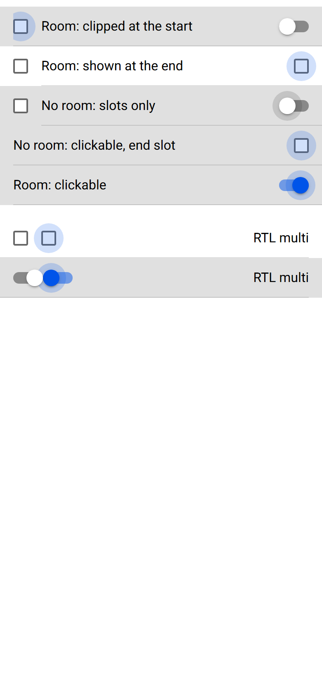
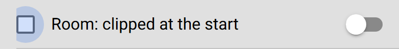

# ion-item — reference render (Ionic 8.8.19, md, 390×844@2x)

Generated by `node tools/ionic-ref/render.js ion-item --bare --html "<ion-app style=\"position:static;display:block;contain:none;overflow:visible\"><ion-list><ion-item class=\"ion-focused\"><ion-checkbox class=\"ion-focused\" label-placement=\"end\">Room: clipped at the start</ion-checkbox><ion-toggle slot=\"end\"></ion-toggle></ion-item><ion-item><ion-checkbox slot=\"start\"></ion-checkbox><ion-checkbox class=\"ion-focused\">Room: shown at the end</ion-checkbox></ion-item><ion-item class=\"ion-focused\"><ion-checkbox slot=\"start\"></ion-checkbox><ion-label>No room: slots only</ion-label><ion-toggle slot=\"end\" class=\"ion-focused\"></ion-toggle></ion-item><ion-item class=\"ion-focused\" button><ion-label>No room: clickable, end slot</ion-label><ion-checkbox slot=\"end\" class=\"ion-focused\"></ion-checkbox></ion-item><ion-item class=\"ion-focused\" button><ion-toggle class=\"ion-focused\" checked>Room: clickable</ion-toggle></ion-item></ion-list><div dir=\"rtl\"><ion-list><ion-item><ion-checkbox class=\"ion-focused\">RTL multi</ion-checkbox><ion-checkbox slot=\"end\"></ion-checkbox></ion-item><ion-item class=\"ion-focused\"><ion-toggle class=\"ion-focused\" checked>RTL multi</ion-toggle><ion-toggle slot=\"end\"></ion-toggle></ion-item></ion-list></div></ion-app>" --out docs/components/ion-item/ref/focus`

```html
<ion-app style="position:static;display:block;contain:none;overflow:visible"><ion-list><ion-item class="ion-focused"><ion-checkbox class="ion-focused" label-placement="end">Room: clipped at the start</ion-checkbox><ion-toggle slot="end"></ion-toggle></ion-item><ion-item><ion-checkbox slot="start"></ion-checkbox><ion-checkbox class="ion-focused">Room: shown at the end</ion-checkbox></ion-item><ion-item class="ion-focused"><ion-checkbox slot="start"></ion-checkbox><ion-label>No room: slots only</ion-label><ion-toggle slot="end" class="ion-focused"></ion-toggle></ion-item><ion-item class="ion-focused" button><ion-label>No room: clickable, end slot</ion-label><ion-checkbox slot="end" class="ion-focused"></ion-checkbox></ion-item><ion-item class="ion-focused" button><ion-toggle class="ion-focused" checked>Room: clickable</ion-toggle></ion-item></ion-list><div dir="rtl"><ion-list><ion-item><ion-checkbox class="ion-focused">RTL multi</ion-checkbox><ion-checkbox slot="end"></ion-checkbox></ion-item><ion-item class="ion-focused"><ion-toggle class="ion-focused" checked>RTL multi</ion-toggle><ion-toggle slot="end"></ion-toggle></ion-item></ion-list></div></ion-app>
```

 

## Element 1

- attributes: `{"class":"ion-focused item md item-lines-default item-control-needs-pointer-cursor in-list ion-focusable hydrated item-multiple-inputs item-focus-indicator-room","role":"listitem"}`
- classes: `ion-focused item md item-lines-default item-control-needs-pointer-cursor in-list ion-focusable hydrated item-multiple-inputs item-focus-indicator-room`
- rect: `{"x":0,"y":8,"w":390,"h":48}`

### CSS custom properties (resolved)

| var | value |
|---|---|
| `--background` | `#fff` |
| `--background-activated` | `transparent` |
| `--background-activated-opacity` | `0` |
| `--background-focused` | `currentColor` |
| `--background-focused-opacity` | `.12` |
| `--background-hover` | `currentColor` |
| `--background-hover-opacity` | `.04` |
| `--border-color` | `rgba(0, 0, 0, 0.13)` |
| `--border-radius` | `0px` |
| `--border-style` | `solid` |
| `--border-width` | `0px` |
| `--color` | `#000` |
| `--color-activated` | `#000` |
| `--color-focused` | `#000` |
| `--color-hover` | `#000` |
| `--detail-icon-color` | `(unset)` |
| `--detail-icon-font-size` | `1.25em` |
| `--detail-icon-opacity` | `0.25` |
| `--inner-border-width` | `0 0 1px 0` |
| `--inner-box-shadow` | `none` |
| `--inner-padding-bottom` | `0px` |
| `--inner-padding-end` | `16px` |
| `--inner-padding-start` | `0px` |
| `--inner-padding-top` | `0px` |
| `--min-height` | `48px` |
| `--padding-bottom` | `0px` |
| `--padding-end` | `0px` |
| `--padding-start` | `16px` |
| `--padding-top` | `0px` |
| `--ripple-color` | `currentColor` |
| `--transition` | `opacity 15ms linear, background-color 15ms linear` |

### Host computed

| prop | value |
|---|---|
| display | `block` |
| position | `relative` |
| box-sizing | `border-box` |
| width | `390px` |
| height | `48px` |
| min-height | `0px` |
| min-width | `0px` |
| padding | `0px` |
| margin | `0px` |
| border | `0px none rgb(0, 0, 0)` |
| border-radius | `0px` |
| background-color | `rgba(0, 0, 0, 0)` |
| color | `rgb(0, 0, 0)` |
| font-size | `16px` |
| font-weight | `400` |
| font-family | `Roboto, "Helvetica Neue", sans-serif` |
| line-height | `normal` |
| letter-spacing | `normal` |
| text-transform | `none` |
| opacity | `1` |
| overflow | `hidden` |
| contain | `none` |
| pointer-events | `auto` |
| transition | `all` |
| transform | `none` |
| box-shadow | `none` |
| outline | `rgb(0, 0, 0) none 0px` |
| cursor | `pointer` |

### Shadow parts

#### part="native" (`div`) rect `{"x":0,"y":8,"w":390,"h":48}`

| prop | value |
|---|---|
| display | `flex` |
| position | `relative` |
| box-sizing | `border-box` |
| width | `390px` |
| height | `48px` |
| min-height | `48px` |
| min-width | `0px` |
| padding | `0px 0px 0px 16px` |
| margin | `0px` |
| border | `0px solid rgba(0, 0, 0, 0.13)` |
| border-radius | `0px` |
| background-color | `rgb(255, 255, 255)` |
| color | `rgb(0, 0, 0)` |
| font-size | `16px` |
| font-weight | `400` |
| font-family | `Roboto, "Helvetica Neue", sans-serif` |
| line-height | `normal` |
| letter-spacing | `normal` |
| text-transform | `none` |
| opacity | `1` |
| overflow | `hidden` |
| contain | `none` |
| pointer-events | `auto` |
| transition | `opacity 0.015s linear, background-color 0.015s linear` |
| transform | `none` |
| box-shadow | `none` |
| outline | `rgb(0, 0, 0) none 0px` |
| cursor | `pointer` |

#### part="inner" (`div`) rect `{"x":16,"y":8,"w":374,"h":48}`

| prop | value |
|---|---|
| display | `flex` |
| position | `relative` |
| box-sizing | `border-box` |
| width | `374px` |
| height | `48px` |
| min-height | `48px` |
| min-width | `auto` |
| padding | `0px 16px 0px 0px` |
| margin | `0px` |
| border-radius | `0px` |
| background-color | `rgba(0, 0, 0, 0)` |
| color | `rgb(0, 0, 0)` |
| font-size | `16px` |
| font-weight | `400` |
| font-family | `Roboto, "Helvetica Neue", sans-serif` |
| line-height | `normal` |
| letter-spacing | `normal` |
| text-transform | `none` |
| opacity | `1` |
| overflow | `hidden` |
| contain | `none` |
| pointer-events | `auto` |
| transition | `all` |
| transform | `none` |
| box-shadow | `none` |
| outline | `rgb(0, 0, 0) none 0px` |
| cursor | `pointer` |

#### part="container" (`div`) rect `{"x":4,"y":8,"w":346,"h":47}`

| prop | value |
|---|---|
| display | `flex` |
| position | `static` |
| box-sizing | `border-box` |
| width | `346px` |
| height | `47px` |
| min-height | `auto` |
| min-width | `auto` |
| padding | `0px 12px` |
| margin | `0px -12px` |
| border | `0px none rgb(0, 0, 0)` |
| border-radius | `0px` |
| background-color | `rgba(0, 0, 0, 0)` |
| color | `rgb(0, 0, 0)` |
| font-size | `16px` |
| font-weight | `400` |
| font-family | `Roboto, "Helvetica Neue", sans-serif` |
| line-height | `normal` |
| letter-spacing | `normal` |
| text-transform | `none` |
| opacity | `1` |
| overflow | `hidden` |
| contain | `none` |
| pointer-events | `auto` |
| transition | `all` |
| transform | `none` |
| box-shadow | `none` |
| outline | `rgb(0, 0, 0) none 0px` |
| cursor | `pointer` |

### DOM tree

```
<ion-item>
  #shadow-root
    <div.item-native part="native">
      <slot name="start">
      <div.item-inner part="inner">
        <div.input-wrapper part="container">
          <slot name="">
        <slot name="end">
  <ion-checkbox.ion-focused.md.in-item.interactive.checkbox-label-placement-end.hydrated.ion-focusable>
    #shadow-root
      <label.checkbox-wrapper>
        <input#ion-cb-0>
        <div#ion-cb-0-lbl.label-text-wrapper part="label">
          <slot name="">
        <div.native-wrapper>
          <svg part="container">
            <path part="mark">
    <input.aux-input>
  <ion-toggle.md.in-item.ion-focusable.toggle-label-placement-start.toggle-ltr.hydrated slot="end">
    #shadow-root
      <label.toggle-wrapper>
        <input#ion-tg-0>
        <div#ion-tg-0-lbl.label-text-wrapper.label-text-wrapper-hidden part="label">
          <slot name="">
        <div.native-wrapper>
          <div.toggle-icon part="track">
            <div.toggle-icon-wrapper>
              <div.toggle-inner part="handle">
    <input.aux-input>
```

## Element 2

- attributes: `{"class":"item-has-start-slot item md item-lines-default item-control-needs-pointer-cursor in-list hydrated item-multiple-inputs item-focus-indicator-room","role":"listitem"}`
- classes: `item-has-start-slot item md item-lines-default item-control-needs-pointer-cursor in-list hydrated item-multiple-inputs item-focus-indicator-room`
- rect: `{"x":0,"y":56,"w":390,"h":48}`

### CSS custom properties (resolved)

| var | value |
|---|---|
| `--background` | `#fff` |
| `--background-activated` | `transparent` |
| `--background-activated-opacity` | `0` |
| `--background-focused` | `currentColor` |
| `--background-focused-opacity` | `.12` |
| `--background-hover` | `currentColor` |
| `--background-hover-opacity` | `.04` |
| `--border-color` | `rgba(0, 0, 0, 0.13)` |
| `--border-radius` | `0px` |
| `--border-style` | `solid` |
| `--border-width` | `0px` |
| `--color` | `#000` |
| `--color-activated` | `#000` |
| `--color-focused` | `#000` |
| `--color-hover` | `#000` |
| `--detail-icon-color` | `(unset)` |
| `--detail-icon-font-size` | `1.25em` |
| `--detail-icon-opacity` | `0.25` |
| `--inner-border-width` | `0 0 1px 0` |
| `--inner-box-shadow` | `none` |
| `--inner-padding-bottom` | `0px` |
| `--inner-padding-end` | `16px` |
| `--inner-padding-start` | `0px` |
| `--inner-padding-top` | `0px` |
| `--min-height` | `48px` |
| `--padding-bottom` | `0px` |
| `--padding-end` | `0px` |
| `--padding-start` | `16px` |
| `--padding-top` | `0px` |
| `--ripple-color` | `currentColor` |
| `--transition` | `opacity 15ms linear, background-color 15ms linear` |

### Host computed

| prop | value |
|---|---|
| display | `block` |
| position | `relative` |
| box-sizing | `border-box` |
| width | `390px` |
| height | `48px` |
| min-height | `0px` |
| min-width | `0px` |
| padding | `0px` |
| margin | `0px` |
| border | `0px none rgb(0, 0, 0)` |
| border-radius | `0px` |
| background-color | `rgba(0, 0, 0, 0)` |
| color | `rgb(0, 0, 0)` |
| font-size | `16px` |
| font-weight | `400` |
| font-family | `Roboto, "Helvetica Neue", sans-serif` |
| line-height | `normal` |
| letter-spacing | `normal` |
| text-transform | `none` |
| opacity | `1` |
| overflow | `hidden` |
| contain | `none` |
| pointer-events | `auto` |
| transition | `all` |
| transform | `none` |
| box-shadow | `none` |
| outline | `rgb(0, 0, 0) none 0px` |
| cursor | `pointer` |

### Shadow parts

#### part="native" (`div`) rect `{"x":0,"y":56,"w":390,"h":48}`

| prop | value |
|---|---|
| display | `flex` |
| position | `relative` |
| box-sizing | `border-box` |
| width | `390px` |
| height | `48px` |
| min-height | `48px` |
| min-width | `0px` |
| padding | `0px 0px 0px 16px` |
| margin | `0px` |
| border | `0px solid rgba(0, 0, 0, 0.13)` |
| border-radius | `0px` |
| background-color | `rgb(255, 255, 255)` |
| color | `rgb(0, 0, 0)` |
| font-size | `16px` |
| font-weight | `400` |
| font-family | `Roboto, "Helvetica Neue", sans-serif` |
| line-height | `normal` |
| letter-spacing | `normal` |
| text-transform | `none` |
| opacity | `1` |
| overflow | `hidden` |
| contain | `none` |
| pointer-events | `auto` |
| transition | `opacity 0.015s linear, background-color 0.015s linear` |
| transform | `none` |
| box-shadow | `none` |
| outline | `rgb(0, 0, 0) none 0px` |
| cursor | `pointer` |

#### part="inner" (`div`) rect `{"x":50,"y":56,"w":340,"h":48}`

| prop | value |
|---|---|
| display | `flex` |
| position | `relative` |
| box-sizing | `border-box` |
| width | `340px` |
| height | `48px` |
| min-height | `48px` |
| min-width | `auto` |
| padding | `0px 16px 0px 0px` |
| margin | `0px` |
| border-radius | `0px` |
| background-color | `rgba(0, 0, 0, 0)` |
| color | `rgb(0, 0, 0)` |
| font-size | `16px` |
| font-weight | `400` |
| font-family | `Roboto, "Helvetica Neue", sans-serif` |
| line-height | `normal` |
| letter-spacing | `normal` |
| text-transform | `none` |
| opacity | `1` |
| overflow | `hidden` |
| contain | `none` |
| pointer-events | `auto` |
| transition | `all` |
| transform | `none` |
| box-shadow | `none` |
| outline | `rgb(0, 0, 0) none 0px` |
| cursor | `pointer` |

#### part="container" (`div`) rect `{"x":38,"y":56,"w":348,"h":47}`

| prop | value |
|---|---|
| display | `flex` |
| position | `static` |
| box-sizing | `border-box` |
| width | `348px` |
| height | `47px` |
| min-height | `auto` |
| min-width | `auto` |
| padding | `0px 12px` |
| margin | `0px -12px` |
| border | `0px none rgb(0, 0, 0)` |
| border-radius | `0px` |
| background-color | `rgba(0, 0, 0, 0)` |
| color | `rgb(0, 0, 0)` |
| font-size | `16px` |
| font-weight | `400` |
| font-family | `Roboto, "Helvetica Neue", sans-serif` |
| line-height | `normal` |
| letter-spacing | `normal` |
| text-transform | `none` |
| opacity | `1` |
| overflow | `hidden` |
| contain | `none` |
| pointer-events | `auto` |
| transition | `all` |
| transform | `none` |
| box-shadow | `none` |
| outline | `rgb(0, 0, 0) none 0px` |
| cursor | `pointer` |

### DOM tree

```
<ion-item>
  #shadow-root
    <div.item-native part="native">
      <slot name="start">
      <div.item-inner part="inner">
        <div.input-wrapper part="container">
          <slot name="">
        <slot name="end">
  <ion-checkbox.md.in-item.interactive.checkbox-label-placement-start.hydrated.ion-focusable slot="start">
    #shadow-root
      <label.checkbox-wrapper>
        <input#ion-cb-1>
        <div#ion-cb-1-lbl.label-text-wrapper.label-text-wrapper-hidden part="label">
          <slot name="">
        <div.native-wrapper>
          <svg part="container">
            <path part="mark">
    <input.aux-input>
  <ion-checkbox.ion-focused.md.in-item.interactive.checkbox-label-placement-start.hydrated.ion-focusable>
    #shadow-root
      <label.checkbox-wrapper>
        <input#ion-cb-2>
        <div#ion-cb-2-lbl.label-text-wrapper part="label">
          <slot name="">
        <div.native-wrapper>
          <svg part="container">
            <path part="mark">
    <input.aux-input>
```

## Element 3

- attributes: `{"class":"ion-focused item-has-start-slot item md item-lines-default item-control-needs-pointer-cursor in-list ion-focusable hydrated item-label item-multiple-inputs","role":"listitem"}`
- classes: `ion-focused item-has-start-slot item md item-lines-default item-control-needs-pointer-cursor in-list ion-focusable hydrated item-label item-multiple-inputs`
- rect: `{"x":0,"y":104,"w":390,"h":48}`

### CSS custom properties (resolved)

| var | value |
|---|---|
| `--background` | `#fff` |
| `--background-activated` | `transparent` |
| `--background-activated-opacity` | `0` |
| `--background-focused` | `currentColor` |
| `--background-focused-opacity` | `.12` |
| `--background-hover` | `currentColor` |
| `--background-hover-opacity` | `.04` |
| `--border-color` | `rgba(0, 0, 0, 0.13)` |
| `--border-radius` | `0px` |
| `--border-style` | `solid` |
| `--border-width` | `0px` |
| `--color` | `#000` |
| `--color-activated` | `#000` |
| `--color-focused` | `#000` |
| `--color-hover` | `#000` |
| `--detail-icon-color` | `(unset)` |
| `--detail-icon-font-size` | `1.25em` |
| `--detail-icon-opacity` | `0.25` |
| `--inner-border-width` | `0 0 1px 0` |
| `--inner-box-shadow` | `none` |
| `--inner-padding-bottom` | `0px` |
| `--inner-padding-end` | `16px` |
| `--inner-padding-start` | `0px` |
| `--inner-padding-top` | `0px` |
| `--min-height` | `48px` |
| `--padding-bottom` | `0px` |
| `--padding-end` | `0px` |
| `--padding-start` | `16px` |
| `--padding-top` | `0px` |
| `--ripple-color` | `currentColor` |
| `--transition` | `opacity 15ms linear, background-color 15ms linear` |

### Host computed

| prop | value |
|---|---|
| display | `block` |
| position | `relative` |
| box-sizing | `border-box` |
| width | `390px` |
| height | `48px` |
| min-height | `0px` |
| min-width | `0px` |
| padding | `0px` |
| margin | `0px` |
| border | `0px none rgb(0, 0, 0)` |
| border-radius | `0px` |
| background-color | `rgba(0, 0, 0, 0)` |
| color | `rgb(0, 0, 0)` |
| font-size | `16px` |
| font-weight | `400` |
| font-family | `Roboto, "Helvetica Neue", sans-serif` |
| line-height | `normal` |
| letter-spacing | `normal` |
| text-transform | `none` |
| opacity | `1` |
| overflow | `hidden` |
| contain | `none` |
| pointer-events | `auto` |
| transition | `all` |
| transform | `none` |
| box-shadow | `none` |
| outline | `rgb(0, 0, 0) none 0px` |
| cursor | `pointer` |

### Shadow parts

#### part="native" (`div`) rect `{"x":0,"y":104,"w":390,"h":48}`

| prop | value |
|---|---|
| display | `flex` |
| position | `relative` |
| box-sizing | `border-box` |
| width | `390px` |
| height | `48px` |
| min-height | `48px` |
| min-width | `0px` |
| padding | `0px 0px 0px 16px` |
| margin | `0px` |
| border | `0px solid rgba(0, 0, 0, 0.13)` |
| border-radius | `0px` |
| background-color | `rgb(255, 255, 255)` |
| color | `rgb(0, 0, 0)` |
| font-size | `16px` |
| font-weight | `400` |
| font-family | `Roboto, "Helvetica Neue", sans-serif` |
| line-height | `normal` |
| letter-spacing | `normal` |
| text-transform | `none` |
| opacity | `1` |
| overflow | `hidden` |
| contain | `none` |
| pointer-events | `auto` |
| transition | `opacity 0.015s linear, background-color 0.015s linear` |
| transform | `none` |
| box-shadow | `none` |
| outline | `rgb(0, 0, 0) none 0px` |
| cursor | `pointer` |

#### part="inner" (`div`) rect `{"x":50,"y":104,"w":340,"h":48}`

| prop | value |
|---|---|
| display | `flex` |
| position | `relative` |
| box-sizing | `border-box` |
| width | `340px` |
| height | `48px` |
| min-height | `48px` |
| min-width | `auto` |
| padding | `0px 16px 0px 0px` |
| margin | `0px` |
| border-radius | `0px` |
| background-color | `rgba(0, 0, 0, 0)` |
| color | `rgb(0, 0, 0)` |
| font-size | `16px` |
| font-weight | `400` |
| font-family | `Roboto, "Helvetica Neue", sans-serif` |
| line-height | `normal` |
| letter-spacing | `normal` |
| text-transform | `none` |
| opacity | `1` |
| overflow | `hidden` |
| contain | `none` |
| pointer-events | `auto` |
| transition | `all` |
| transform | `none` |
| box-shadow | `none` |
| outline | `rgb(0, 0, 0) none 0px` |
| cursor | `pointer` |

#### part="container" (`div`) rect `{"x":50,"y":104,"w":288,"h":47}`

| prop | value |
|---|---|
| display | `flex` |
| position | `static` |
| box-sizing | `border-box` |
| width | `288px` |
| height | `47px` |
| min-height | `auto` |
| min-width | `auto` |
| padding | `0px` |
| margin | `0px` |
| border | `0px none rgb(0, 0, 0)` |
| border-radius | `0px` |
| background-color | `rgba(0, 0, 0, 0)` |
| color | `rgb(0, 0, 0)` |
| font-size | `16px` |
| font-weight | `400` |
| font-family | `Roboto, "Helvetica Neue", sans-serif` |
| line-height | `normal` |
| letter-spacing | `normal` |
| text-transform | `none` |
| opacity | `1` |
| overflow | `hidden` |
| contain | `none` |
| pointer-events | `auto` |
| transition | `all` |
| transform | `none` |
| box-shadow | `none` |
| outline | `rgb(0, 0, 0) none 0px` |
| cursor | `pointer` |

### DOM tree

```
<ion-item>
  #shadow-root
    <div.item-native part="native">
      <slot name="start">
      <div.item-inner part="inner">
        <div.input-wrapper part="container">
          <slot name="">
        <slot name="end">
  <ion-checkbox.md.in-item.interactive.checkbox-label-placement-start.hydrated.ion-focusable slot="start">
    #shadow-root
      <label.checkbox-wrapper>
        <input#ion-cb-3>
        <div#ion-cb-3-lbl.label-text-wrapper.label-text-wrapper-hidden part="label">
          <slot name="">
        <div.native-wrapper>
          <svg part="container">
            <path part="mark">
    <input.aux-input>
  <ion-label.sc-ion-label-md-h.md.sc-ion-label-md.sc-ion-label-md-s.hydrated>
  <ion-toggle.ion-focused.md.in-item.ion-focusable.toggle-label-placement-start.toggle-ltr.hydrated slot="end">
    #shadow-root
      <label.toggle-wrapper>
        <input#ion-tg-1>
        <div#ion-tg-1-lbl.label-text-wrapper.label-text-wrapper-hidden part="label">
          <slot name="">
        <div.native-wrapper>
          <div.toggle-icon part="track">
            <div.toggle-icon-wrapper>
              <div.toggle-inner part="handle">
    <input.aux-input>
```

## Element 4

- attributes: `{"class":"ion-focused item md item-lines-default item-control-needs-pointer-cursor in-list ion-activatable ion-focusable hydrated item-label item-multiple-inputs","button":"","role":"listitem"}`
- classes: `ion-focused item md item-lines-default item-control-needs-pointer-cursor in-list ion-activatable ion-focusable hydrated item-label item-multiple-inputs`
- rect: `{"x":0,"y":152,"w":390,"h":48}`

### CSS custom properties (resolved)

| var | value |
|---|---|
| `--background` | `#fff` |
| `--background-activated` | `transparent` |
| `--background-activated-opacity` | `0` |
| `--background-focused` | `currentColor` |
| `--background-focused-opacity` | `.12` |
| `--background-hover` | `currentColor` |
| `--background-hover-opacity` | `.04` |
| `--border-color` | `rgba(0, 0, 0, 0.13)` |
| `--border-radius` | `0px` |
| `--border-style` | `solid` |
| `--border-width` | `0px` |
| `--color` | `#000` |
| `--color-activated` | `#000` |
| `--color-focused` | `#000` |
| `--color-hover` | `#000` |
| `--detail-icon-color` | `(unset)` |
| `--detail-icon-font-size` | `1.25em` |
| `--detail-icon-opacity` | `0.25` |
| `--inner-border-width` | `0 0 1px 0` |
| `--inner-box-shadow` | `none` |
| `--inner-padding-bottom` | `0px` |
| `--inner-padding-end` | `16px` |
| `--inner-padding-start` | `0px` |
| `--inner-padding-top` | `0px` |
| `--min-height` | `48px` |
| `--padding-bottom` | `0px` |
| `--padding-end` | `0px` |
| `--padding-start` | `16px` |
| `--padding-top` | `0px` |
| `--ripple-color` | `currentColor` |
| `--transition` | `opacity 15ms linear, background-color 15ms linear` |

### Host computed

| prop | value |
|---|---|
| display | `block` |
| position | `relative` |
| box-sizing | `border-box` |
| width | `390px` |
| height | `48px` |
| min-height | `0px` |
| min-width | `0px` |
| padding | `0px` |
| margin | `0px` |
| border | `0px none rgb(0, 0, 0)` |
| border-radius | `0px` |
| background-color | `rgba(0, 0, 0, 0)` |
| color | `rgb(0, 0, 0)` |
| font-size | `16px` |
| font-weight | `400` |
| font-family | `Roboto, "Helvetica Neue", sans-serif` |
| line-height | `normal` |
| letter-spacing | `normal` |
| text-transform | `none` |
| opacity | `1` |
| overflow | `hidden` |
| contain | `none` |
| pointer-events | `auto` |
| transition | `all` |
| transform | `none` |
| box-shadow | `none` |
| outline | `rgb(0, 0, 0) none 0px` |
| cursor | `pointer` |

### Shadow parts

#### part="native" (`button`) rect `{"x":0,"y":152,"w":390,"h":48}`

| prop | value |
|---|---|
| display | `flex` |
| position | `relative` |
| box-sizing | `border-box` |
| width | `390px` |
| height | `48px` |
| min-height | `48px` |
| min-width | `0px` |
| padding | `0px 0px 0px 16px` |
| margin | `0px` |
| border | `0px solid rgba(0, 0, 0, 0.13)` |
| border-radius | `0px` |
| background-color | `rgb(255, 255, 255)` |
| color | `rgb(0, 0, 0)` |
| font-size | `16px` |
| font-weight | `400` |
| font-family | `Roboto, "Helvetica Neue", sans-serif` |
| line-height | `normal` |
| letter-spacing | `normal` |
| text-transform | `none` |
| opacity | `1` |
| overflow | `hidden` |
| contain | `none` |
| pointer-events | `auto` |
| transition | `opacity 0.015s linear, background-color 0.015s linear` |
| transform | `none` |
| box-shadow | `none` |
| outline | `rgb(0, 0, 0) none 0px` |
| cursor | `pointer` |

#### part="inner" (`div`) rect `{"x":16,"y":152,"w":374,"h":48}`

| prop | value |
|---|---|
| display | `flex` |
| position | `relative` |
| box-sizing | `border-box` |
| width | `374px` |
| height | `48px` |
| min-height | `48px` |
| min-width | `auto` |
| padding | `0px 16px 0px 0px` |
| margin | `0px` |
| border-radius | `0px` |
| background-color | `rgba(0, 0, 0, 0)` |
| color | `rgb(0, 0, 0)` |
| font-size | `16px` |
| font-weight | `400` |
| font-family | `Roboto, "Helvetica Neue", sans-serif` |
| line-height | `normal` |
| letter-spacing | `normal` |
| text-transform | `none` |
| opacity | `1` |
| overflow | `hidden` |
| contain | `none` |
| pointer-events | `auto` |
| transition | `all` |
| transform | `none` |
| box-shadow | `none` |
| outline | `rgb(0, 0, 0) none 0px` |
| cursor | `pointer` |

#### part="container" (`div`) rect `{"x":16,"y":152,"w":324,"h":47}`

| prop | value |
|---|---|
| display | `flex` |
| position | `static` |
| box-sizing | `border-box` |
| width | `324px` |
| height | `47px` |
| min-height | `auto` |
| min-width | `auto` |
| padding | `0px` |
| margin | `0px` |
| border | `0px none rgb(0, 0, 0)` |
| border-radius | `0px` |
| background-color | `rgba(0, 0, 0, 0)` |
| color | `rgb(0, 0, 0)` |
| font-size | `16px` |
| font-weight | `400` |
| font-family | `Roboto, "Helvetica Neue", sans-serif` |
| line-height | `normal` |
| letter-spacing | `normal` |
| text-transform | `none` |
| opacity | `1` |
| overflow | `hidden` |
| contain | `none` |
| pointer-events | `auto` |
| transition | `all` |
| transform | `none` |
| box-shadow | `none` |
| outline | `rgb(0, 0, 0) none 0px` |
| cursor | `pointer` |

### DOM tree

```
<ion-item>
  #shadow-root
    <button.item-native part="native">
      <slot name="start">
      <div.item-inner part="inner">
        <div.input-wrapper part="container">
          <slot name="">
        <slot name="end">
      <ion-ripple-effect.md.hydrated>
        #shadow-root
  <ion-label.sc-ion-label-md-h.md.sc-ion-label-md.sc-ion-label-md-s.hydrated>
  <ion-checkbox.ion-focused.md.in-item.interactive.checkbox-label-placement-start.hydrated.ion-focusable slot="end">
    #shadow-root
      <label.checkbox-wrapper>
        <input#ion-cb-4>
        <div#ion-cb-4-lbl.label-text-wrapper.label-text-wrapper-hidden part="label">
          <slot name="">
        <div.native-wrapper>
          <svg part="container">
            <path part="mark">
    <input.aux-input>
```

## Element 5

- attributes: `{"class":"ion-focused item md item-lines-default item-control-needs-pointer-cursor in-list ion-activatable ion-focusable hydrated item-focus-indicator-room","button":"","role":"listitem"}`
- classes: `ion-focused item md item-lines-default item-control-needs-pointer-cursor in-list ion-activatable ion-focusable hydrated item-focus-indicator-room`
- rect: `{"x":0,"y":200,"w":390,"h":48}`

### CSS custom properties (resolved)

| var | value |
|---|---|
| `--background` | `#fff` |
| `--background-activated` | `transparent` |
| `--background-activated-opacity` | `0` |
| `--background-focused` | `currentColor` |
| `--background-focused-opacity` | `.12` |
| `--background-hover` | `currentColor` |
| `--background-hover-opacity` | `.04` |
| `--border-color` | `rgba(0, 0, 0, 0.13)` |
| `--border-radius` | `0px` |
| `--border-style` | `solid` |
| `--border-width` | `0px` |
| `--color` | `#000` |
| `--color-activated` | `#000` |
| `--color-focused` | `#000` |
| `--color-hover` | `#000` |
| `--detail-icon-color` | `(unset)` |
| `--detail-icon-font-size` | `1.25em` |
| `--detail-icon-opacity` | `0.25` |
| `--inner-border-width` | `0 0 1px 0` |
| `--inner-box-shadow` | `none` |
| `--inner-padding-bottom` | `0px` |
| `--inner-padding-end` | `16px` |
| `--inner-padding-start` | `0px` |
| `--inner-padding-top` | `0px` |
| `--min-height` | `48px` |
| `--padding-bottom` | `0px` |
| `--padding-end` | `0px` |
| `--padding-start` | `16px` |
| `--padding-top` | `0px` |
| `--ripple-color` | `currentColor` |
| `--transition` | `opacity 15ms linear, background-color 15ms linear` |

### Host computed

| prop | value |
|---|---|
| display | `block` |
| position | `relative` |
| box-sizing | `border-box` |
| width | `390px` |
| height | `48px` |
| min-height | `0px` |
| min-width | `0px` |
| padding | `0px` |
| margin | `0px` |
| border | `0px none rgb(0, 0, 0)` |
| border-radius | `0px` |
| background-color | `rgba(0, 0, 0, 0)` |
| color | `rgb(0, 0, 0)` |
| font-size | `16px` |
| font-weight | `400` |
| font-family | `Roboto, "Helvetica Neue", sans-serif` |
| line-height | `normal` |
| letter-spacing | `normal` |
| text-transform | `none` |
| opacity | `1` |
| overflow | `hidden` |
| contain | `none` |
| pointer-events | `auto` |
| transition | `all` |
| transform | `none` |
| box-shadow | `none` |
| outline | `rgb(0, 0, 0) none 0px` |
| cursor | `pointer` |

### Shadow parts

#### part="native" (`button`) rect `{"x":0,"y":200,"w":390,"h":48}`

| prop | value |
|---|---|
| display | `flex` |
| position | `relative` |
| box-sizing | `border-box` |
| width | `390px` |
| height | `48px` |
| min-height | `48px` |
| min-width | `0px` |
| padding | `0px 0px 0px 16px` |
| margin | `0px` |
| border | `0px solid rgba(0, 0, 0, 0.13)` |
| border-radius | `0px` |
| background-color | `rgb(255, 255, 255)` |
| color | `rgb(0, 0, 0)` |
| font-size | `16px` |
| font-weight | `400` |
| font-family | `Roboto, "Helvetica Neue", sans-serif` |
| line-height | `normal` |
| letter-spacing | `normal` |
| text-transform | `none` |
| opacity | `1` |
| overflow | `hidden` |
| contain | `none` |
| pointer-events | `auto` |
| transition | `opacity 0.015s linear, background-color 0.015s linear` |
| transform | `none` |
| box-shadow | `none` |
| outline | `rgb(0, 0, 0) none 0px` |
| cursor | `pointer` |

#### part="inner" (`div`) rect `{"x":16,"y":200,"w":374,"h":48}`

| prop | value |
|---|---|
| display | `flex` |
| position | `relative` |
| box-sizing | `border-box` |
| width | `374px` |
| height | `48px` |
| min-height | `48px` |
| min-width | `auto` |
| padding | `0px 16px 0px 0px` |
| margin | `0px` |
| border-radius | `0px` |
| background-color | `rgba(0, 0, 0, 0)` |
| color | `rgb(0, 0, 0)` |
| font-size | `16px` |
| font-weight | `400` |
| font-family | `Roboto, "Helvetica Neue", sans-serif` |
| line-height | `normal` |
| letter-spacing | `normal` |
| text-transform | `none` |
| opacity | `1` |
| overflow | `hidden` |
| contain | `none` |
| pointer-events | `auto` |
| transition | `all` |
| transform | `none` |
| box-shadow | `none` |
| outline | `rgb(0, 0, 0) none 0px` |
| cursor | `pointer` |

#### part="container" (`div`) rect `{"x":4,"y":200,"w":382,"h":47}`

| prop | value |
|---|---|
| display | `flex` |
| position | `static` |
| box-sizing | `border-box` |
| width | `382px` |
| height | `47px` |
| min-height | `auto` |
| min-width | `auto` |
| padding | `0px 12px` |
| margin | `0px -12px` |
| border | `0px none rgb(0, 0, 0)` |
| border-radius | `0px` |
| background-color | `rgba(0, 0, 0, 0)` |
| color | `rgb(0, 0, 0)` |
| font-size | `16px` |
| font-weight | `400` |
| font-family | `Roboto, "Helvetica Neue", sans-serif` |
| line-height | `normal` |
| letter-spacing | `normal` |
| text-transform | `none` |
| opacity | `1` |
| overflow | `hidden` |
| contain | `none` |
| pointer-events | `auto` |
| transition | `all` |
| transform | `none` |
| box-shadow | `none` |
| outline | `rgb(0, 0, 0) none 0px` |
| cursor | `pointer` |

### DOM tree

```
<ion-item>
  #shadow-root
    <button.item-native part="native">
      <slot name="start">
      <div.item-inner part="inner">
        <div.input-wrapper part="container">
          <slot name="">
        <slot name="end">
      <ion-ripple-effect.md.hydrated>
        #shadow-root
  <ion-toggle.ion-focused.md.in-item.ion-focusable.toggle-checked.toggle-label-placement-start.toggle-ltr.hydrated>
    #shadow-root
      <label.toggle-wrapper>
        <input#ion-tg-2>
        <div#ion-tg-2-lbl.label-text-wrapper part="label">
          <slot name="">
        <div.native-wrapper>
          <div.toggle-icon part="track">
            <div.toggle-icon-wrapper>
              <div.toggle-inner part="handle">
    <input.aux-input>
```

## Element 6

- attributes: `{"class":"item md item-lines-default item-control-needs-pointer-cursor in-list hydrated item-multiple-inputs item-focus-indicator-room","role":"listitem"}`
- classes: `item md item-lines-default item-control-needs-pointer-cursor in-list hydrated item-multiple-inputs item-focus-indicator-room`
- rect: `{"x":0,"y":264,"w":390,"h":48}`

### CSS custom properties (resolved)

| var | value |
|---|---|
| `--background` | `#fff` |
| `--background-activated` | `transparent` |
| `--background-activated-opacity` | `0` |
| `--background-focused` | `currentColor` |
| `--background-focused-opacity` | `.12` |
| `--background-hover` | `currentColor` |
| `--background-hover-opacity` | `.04` |
| `--border-color` | `rgba(0, 0, 0, 0.13)` |
| `--border-radius` | `0px` |
| `--border-style` | `solid` |
| `--border-width` | `0px` |
| `--color` | `#000` |
| `--color-activated` | `#000` |
| `--color-focused` | `#000` |
| `--color-hover` | `#000` |
| `--detail-icon-color` | `(unset)` |
| `--detail-icon-font-size` | `1.25em` |
| `--detail-icon-opacity` | `0.25` |
| `--inner-border-width` | `0 0 1px 0` |
| `--inner-box-shadow` | `none` |
| `--inner-padding-bottom` | `0px` |
| `--inner-padding-end` | `16px` |
| `--inner-padding-start` | `0px` |
| `--inner-padding-top` | `0px` |
| `--min-height` | `48px` |
| `--padding-bottom` | `0px` |
| `--padding-end` | `0px` |
| `--padding-start` | `16px` |
| `--padding-top` | `0px` |
| `--ripple-color` | `currentColor` |
| `--transition` | `opacity 15ms linear, background-color 15ms linear` |

### Host computed

| prop | value |
|---|---|
| display | `block` |
| position | `relative` |
| box-sizing | `border-box` |
| width | `390px` |
| height | `48px` |
| min-height | `0px` |
| min-width | `0px` |
| padding | `0px` |
| margin | `0px` |
| border | `0px none rgb(0, 0, 0)` |
| border-radius | `0px` |
| background-color | `rgba(0, 0, 0, 0)` |
| color | `rgb(0, 0, 0)` |
| font-size | `16px` |
| font-weight | `400` |
| font-family | `Roboto, "Helvetica Neue", sans-serif` |
| line-height | `normal` |
| letter-spacing | `normal` |
| text-transform | `none` |
| opacity | `1` |
| overflow | `hidden` |
| contain | `none` |
| pointer-events | `auto` |
| transition | `all` |
| transform | `none` |
| box-shadow | `none` |
| outline | `rgb(0, 0, 0) none 0px` |
| cursor | `pointer` |

### Shadow parts

#### part="native" (`div`) rect `{"x":0,"y":264,"w":390,"h":48}`

| prop | value |
|---|---|
| display | `flex` |
| position | `relative` |
| box-sizing | `border-box` |
| width | `390px` |
| height | `48px` |
| min-height | `48px` |
| min-width | `0px` |
| padding | `0px 16px 0px 0px` |
| margin | `0px` |
| border | `0px solid rgba(0, 0, 0, 0.13)` |
| border-radius | `0px` |
| background-color | `rgb(255, 255, 255)` |
| color | `rgb(0, 0, 0)` |
| font-size | `16px` |
| font-weight | `400` |
| font-family | `Roboto, "Helvetica Neue", sans-serif` |
| line-height | `normal` |
| letter-spacing | `normal` |
| text-transform | `none` |
| opacity | `1` |
| overflow | `hidden` |
| contain | `none` |
| pointer-events | `auto` |
| transition | `opacity 0.015s linear, background-color 0.015s linear` |
| transform | `none` |
| box-shadow | `none` |
| outline | `rgb(0, 0, 0) none 0px` |
| cursor | `pointer` |

#### part="inner" (`div`) rect `{"x":0,"y":264,"w":374,"h":48}`

| prop | value |
|---|---|
| display | `flex` |
| position | `relative` |
| box-sizing | `border-box` |
| width | `374px` |
| height | `48px` |
| min-height | `48px` |
| min-width | `auto` |
| padding | `0px 0px 0px 16px` |
| margin | `0px` |
| border-radius | `0px` |
| background-color | `rgba(0, 0, 0, 0)` |
| color | `rgb(0, 0, 0)` |
| font-size | `16px` |
| font-weight | `400` |
| font-family | `Roboto, "Helvetica Neue", sans-serif` |
| line-height | `normal` |
| letter-spacing | `normal` |
| text-transform | `none` |
| opacity | `1` |
| overflow | `hidden` |
| contain | `none` |
| pointer-events | `auto` |
| transition | `all` |
| transform | `none` |
| box-shadow | `none` |
| outline | `rgb(0, 0, 0) none 0px` |
| cursor | `pointer` |

#### part="container" (`div`) rect `{"x":38,"y":264,"w":348,"h":47}`

| prop | value |
|---|---|
| display | `flex` |
| position | `static` |
| box-sizing | `border-box` |
| width | `348px` |
| height | `47px` |
| min-height | `auto` |
| min-width | `auto` |
| padding | `0px 12px` |
| margin | `0px -12px` |
| border | `0px none rgb(0, 0, 0)` |
| border-radius | `0px` |
| background-color | `rgba(0, 0, 0, 0)` |
| color | `rgb(0, 0, 0)` |
| font-size | `16px` |
| font-weight | `400` |
| font-family | `Roboto, "Helvetica Neue", sans-serif` |
| line-height | `normal` |
| letter-spacing | `normal` |
| text-transform | `none` |
| opacity | `1` |
| overflow | `hidden` |
| contain | `none` |
| pointer-events | `auto` |
| transition | `all` |
| transform | `none` |
| box-shadow | `none` |
| outline | `rgb(0, 0, 0) none 0px` |
| cursor | `pointer` |

### DOM tree

```
<ion-item>
  #shadow-root
    <div.item-native part="native">
      <slot name="start">
      <div.item-inner part="inner">
        <div.input-wrapper part="container">
          <slot name="">
        <slot name="end">
  <ion-checkbox.ion-focused.md.in-item.interactive.checkbox-label-placement-start.hydrated.ion-focusable>
    #shadow-root
      <label.checkbox-wrapper>
        <input#ion-cb-5>
        <div#ion-cb-5-lbl.label-text-wrapper part="label">
          <slot name="">
        <div.native-wrapper>
          <svg part="container">
            <path part="mark">
    <input.aux-input>
  <ion-checkbox.md.in-item.interactive.checkbox-label-placement-start.hydrated.ion-focusable slot="end">
    #shadow-root
      <label.checkbox-wrapper>
        <input#ion-cb-6>
        <div#ion-cb-6-lbl.label-text-wrapper.label-text-wrapper-hidden part="label">
          <slot name="">
        <div.native-wrapper>
          <svg part="container">
            <path part="mark">
    <input.aux-input>
```

## Element 7

- attributes: `{"class":"ion-focused item md item-lines-default item-control-needs-pointer-cursor in-list ion-focusable hydrated item-multiple-inputs item-focus-indicator-room","role":"listitem"}`
- classes: `ion-focused item md item-lines-default item-control-needs-pointer-cursor in-list ion-focusable hydrated item-multiple-inputs item-focus-indicator-room`
- rect: `{"x":0,"y":312,"w":390,"h":48}`

### CSS custom properties (resolved)

| var | value |
|---|---|
| `--background` | `#fff` |
| `--background-activated` | `transparent` |
| `--background-activated-opacity` | `0` |
| `--background-focused` | `currentColor` |
| `--background-focused-opacity` | `.12` |
| `--background-hover` | `currentColor` |
| `--background-hover-opacity` | `.04` |
| `--border-color` | `rgba(0, 0, 0, 0.13)` |
| `--border-radius` | `0px` |
| `--border-style` | `solid` |
| `--border-width` | `0px` |
| `--color` | `#000` |
| `--color-activated` | `#000` |
| `--color-focused` | `#000` |
| `--color-hover` | `#000` |
| `--detail-icon-color` | `(unset)` |
| `--detail-icon-font-size` | `1.25em` |
| `--detail-icon-opacity` | `0.25` |
| `--inner-border-width` | `0 0 1px 0` |
| `--inner-box-shadow` | `none` |
| `--inner-padding-bottom` | `0px` |
| `--inner-padding-end` | `16px` |
| `--inner-padding-start` | `0px` |
| `--inner-padding-top` | `0px` |
| `--min-height` | `48px` |
| `--padding-bottom` | `0px` |
| `--padding-end` | `0px` |
| `--padding-start` | `16px` |
| `--padding-top` | `0px` |
| `--ripple-color` | `currentColor` |
| `--transition` | `opacity 15ms linear, background-color 15ms linear` |

### Host computed

| prop | value |
|---|---|
| display | `block` |
| position | `relative` |
| box-sizing | `border-box` |
| width | `390px` |
| height | `48px` |
| min-height | `0px` |
| min-width | `0px` |
| padding | `0px` |
| margin | `0px` |
| border | `0px none rgb(0, 0, 0)` |
| border-radius | `0px` |
| background-color | `rgba(0, 0, 0, 0)` |
| color | `rgb(0, 0, 0)` |
| font-size | `16px` |
| font-weight | `400` |
| font-family | `Roboto, "Helvetica Neue", sans-serif` |
| line-height | `normal` |
| letter-spacing | `normal` |
| text-transform | `none` |
| opacity | `1` |
| overflow | `hidden` |
| contain | `none` |
| pointer-events | `auto` |
| transition | `all` |
| transform | `none` |
| box-shadow | `none` |
| outline | `rgb(0, 0, 0) none 0px` |
| cursor | `pointer` |

### Shadow parts

#### part="native" (`div`) rect `{"x":0,"y":312,"w":390,"h":48}`

| prop | value |
|---|---|
| display | `flex` |
| position | `relative` |
| box-sizing | `border-box` |
| width | `390px` |
| height | `48px` |
| min-height | `48px` |
| min-width | `0px` |
| padding | `0px 16px 0px 0px` |
| margin | `0px` |
| border | `0px solid rgba(0, 0, 0, 0.13)` |
| border-radius | `0px` |
| background-color | `rgb(255, 255, 255)` |
| color | `rgb(0, 0, 0)` |
| font-size | `16px` |
| font-weight | `400` |
| font-family | `Roboto, "Helvetica Neue", sans-serif` |
| line-height | `normal` |
| letter-spacing | `normal` |
| text-transform | `none` |
| opacity | `1` |
| overflow | `hidden` |
| contain | `none` |
| pointer-events | `auto` |
| transition | `opacity 0.015s linear, background-color 0.015s linear` |
| transform | `none` |
| box-shadow | `none` |
| outline | `rgb(0, 0, 0) none 0px` |
| cursor | `pointer` |

#### part="inner" (`div`) rect `{"x":0,"y":312,"w":374,"h":48}`

| prop | value |
|---|---|
| display | `flex` |
| position | `relative` |
| box-sizing | `border-box` |
| width | `374px` |
| height | `48px` |
| min-height | `48px` |
| min-width | `auto` |
| padding | `0px 0px 0px 16px` |
| margin | `0px` |
| border-radius | `0px` |
| background-color | `rgba(0, 0, 0, 0)` |
| color | `rgb(0, 0, 0)` |
| font-size | `16px` |
| font-weight | `400` |
| font-family | `Roboto, "Helvetica Neue", sans-serif` |
| line-height | `normal` |
| letter-spacing | `normal` |
| text-transform | `none` |
| opacity | `1` |
| overflow | `hidden` |
| contain | `none` |
| pointer-events | `auto` |
| transition | `all` |
| transform | `none` |
| box-shadow | `none` |
| outline | `rgb(0, 0, 0) none 0px` |
| cursor | `pointer` |

#### part="container" (`div`) rect `{"x":40,"y":312,"w":346,"h":47}`

| prop | value |
|---|---|
| display | `flex` |
| position | `static` |
| box-sizing | `border-box` |
| width | `346px` |
| height | `47px` |
| min-height | `auto` |
| min-width | `auto` |
| padding | `0px 12px` |
| margin | `0px -12px` |
| border | `0px none rgb(0, 0, 0)` |
| border-radius | `0px` |
| background-color | `rgba(0, 0, 0, 0)` |
| color | `rgb(0, 0, 0)` |
| font-size | `16px` |
| font-weight | `400` |
| font-family | `Roboto, "Helvetica Neue", sans-serif` |
| line-height | `normal` |
| letter-spacing | `normal` |
| text-transform | `none` |
| opacity | `1` |
| overflow | `hidden` |
| contain | `none` |
| pointer-events | `auto` |
| transition | `all` |
| transform | `none` |
| box-shadow | `none` |
| outline | `rgb(0, 0, 0) none 0px` |
| cursor | `pointer` |

### DOM tree

```
<ion-item>
  #shadow-root
    <div.item-native part="native">
      <slot name="start">
      <div.item-inner part="inner">
        <div.input-wrapper part="container">
          <slot name="">
        <slot name="end">
  <ion-toggle.ion-focused.md.in-item.ion-focusable.toggle-checked.toggle-label-placement-start.toggle-rtl.hydrated>
    #shadow-root
      <label.toggle-wrapper>
        <input#ion-tg-3>
        <div#ion-tg-3-lbl.label-text-wrapper part="label">
          <slot name="">
        <div.native-wrapper>
          <div.toggle-icon part="track">
            <div.toggle-icon-wrapper>
              <div.toggle-inner part="handle">
    <input.aux-input>
  <ion-toggle.md.in-item.ion-focusable.toggle-label-placement-start.toggle-rtl.hydrated slot="end">
    #shadow-root
      <label.toggle-wrapper>
        <input#ion-tg-4>
        <div#ion-tg-4-lbl.label-text-wrapper.label-text-wrapper-hidden part="label">
          <slot name="">
        <div.native-wrapper>
          <div.toggle-icon part="track">
            <div.toggle-icon-wrapper>
              <div.toggle-inner part="handle">
    <input.aux-input>
```
