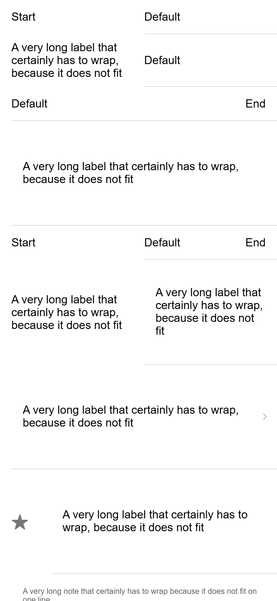

# ion-item — reference render (Ionic 8.8.1, md, 390×844@2x)

Generated by `node tools/ionic-ref/render.js ion-item --bare --html "<ion-item><ion-label slot=\"start\">Start</ion-label><ion-label>Default</ion-label></ion-item><ion-item><ion-label slot=\"start\">A very long label that certainly has to wrap, because it does not fit</ion-label><ion-label>Default</ion-label></ion-item><ion-item><ion-label>Default</ion-label><ion-label slot=\"end\">End</ion-label></ion-item><ion-item><ion-label>Default</ion-label><ion-label slot=\"end\">A very long label that certainly has to wrap, because it does not fit</ion-label></ion-item><ion-item><ion-label slot=\"start\">Start</ion-label><ion-label>Default</ion-label><ion-label slot=\"end\">End</ion-label></ion-item><ion-item><ion-label slot=\"start\">A very long label that certainly has to wrap, because it does not fit</ion-label><ion-label>Default</ion-label><ion-label slot=\"end\">A very long label that certainly has to wrap, because it does not fit</ion-label></ion-item><ion-item detail=\"true\"><ion-label>Default</ion-label><ion-label slot=\"end\">A very long label that certainly has to wrap, because it does not fit</ion-label></ion-item><ion-item><ion-icon name=\"star\" slot=\"start\"></ion-icon><ion-label>Default</ion-label><ion-label slot=\"end\">A very long label that certainly has to wrap, because it does not fit</ion-label></ion-item><ion-item><ion-label>Default</ion-label><ion-note slot=\"end\">A very long note that certainly has to wrap because it does not fit on one line</ion-note></ion-item><ion-item><ion-note slot=\"start\">Short</ion-note><ion-label>Default</ion-label><ion-note slot=\"end\">Short</ion-note></ion-item><ion-item>Plain default words<ion-note slot=\"end\">A very long note that certainly has to wrap because it does not fit on one line</ion-note></ion-item><ion-item><ion-label slot=\"start\" position=\"fixed\">Fixed</ion-label><ion-label>Default</ion-label></ion-item><ion-item><ion-label slot=\"start\" position=\"stacked\">Stacked start</ion-label><ion-label>Default</ion-label></ion-item><ion-item color=\"primary\"><ion-label slot=\"start\">Start</ion-label><ion-label>Default</ion-label><ion-label slot=\"end\">End</ion-label></ion-item><div dir=\"rtl\"><ion-item><ion-label slot=\"start\">Start</ion-label><ion-label>Default</ion-label><ion-note slot=\"end\">A very long note that certainly has to wrap because it does not fit on one line</ion-note></ion-item></div><ion-item-divider><ion-label slot=\"start\">Start</ion-label><ion-label>Default</ion-label></ion-item-divider><ion-item-divider><ion-label slot=\"start\">A very long label that certainly has to wrap, because it does not fit</ion-label><ion-label>Default</ion-label></ion-item-divider><ion-item-divider><ion-label>Default</ion-label><ion-label slot=\"end\">A very long label that certainly has to wrap, because it does not fit</ion-label></ion-item-divider>" --out docs/components/ion-item/ref/layout`

```html
<ion-item><ion-label slot="start">Start</ion-label><ion-label>Default</ion-label></ion-item><ion-item><ion-label slot="start">A very long label that certainly has to wrap, because it does not fit</ion-label><ion-label>Default</ion-label></ion-item><ion-item><ion-label>Default</ion-label><ion-label slot="end">End</ion-label></ion-item><ion-item><ion-label>Default</ion-label><ion-label slot="end">A very long label that certainly has to wrap, because it does not fit</ion-label></ion-item><ion-item><ion-label slot="start">Start</ion-label><ion-label>Default</ion-label><ion-label slot="end">End</ion-label></ion-item><ion-item><ion-label slot="start">A very long label that certainly has to wrap, because it does not fit</ion-label><ion-label>Default</ion-label><ion-label slot="end">A very long label that certainly has to wrap, because it does not fit</ion-label></ion-item><ion-item detail="true"><ion-label>Default</ion-label><ion-label slot="end">A very long label that certainly has to wrap, because it does not fit</ion-label></ion-item><ion-item><ion-icon name="star" slot="start"></ion-icon><ion-label>Default</ion-label><ion-label slot="end">A very long label that certainly has to wrap, because it does not fit</ion-label></ion-item><ion-item><ion-label>Default</ion-label><ion-note slot="end">A very long note that certainly has to wrap because it does not fit on one line</ion-note></ion-item><ion-item><ion-note slot="start">Short</ion-note><ion-label>Default</ion-label><ion-note slot="end">Short</ion-note></ion-item><ion-item>Plain default words<ion-note slot="end">A very long note that certainly has to wrap because it does not fit on one line</ion-note></ion-item><ion-item><ion-label slot="start" position="fixed">Fixed</ion-label><ion-label>Default</ion-label></ion-item><ion-item><ion-label slot="start" position="stacked">Stacked start</ion-label><ion-label>Default</ion-label></ion-item><ion-item color="primary"><ion-label slot="start">Start</ion-label><ion-label>Default</ion-label><ion-label slot="end">End</ion-label></ion-item><div dir="rtl"><ion-item><ion-label slot="start">Start</ion-label><ion-label>Default</ion-label><ion-note slot="end">A very long note that certainly has to wrap because it does not fit on one line</ion-note></ion-item></div><ion-item-divider><ion-label slot="start">Start</ion-label><ion-label>Default</ion-label></ion-item-divider><ion-item-divider><ion-label slot="start">A very long label that certainly has to wrap, because it does not fit</ion-label><ion-label>Default</ion-label></ion-item-divider><ion-item-divider><ion-label>Default</ion-label><ion-label slot="end">A very long label that certainly has to wrap, because it does not fit</ion-label></ion-item-divider>
```

 

## Element 1

- attributes: `{"class":"item-has-start-slot item md item-lines-default hydrated item-label"}`
- classes: `item-has-start-slot item md item-lines-default hydrated item-label`
- rect: `{"x":0,"y":0,"w":390,"h":48}`

### CSS custom properties (resolved)

| var | value |
|---|---|
| `--background` | `#fff` |
| `--background-activated` | `transparent` |
| `--background-activated-opacity` | `0` |
| `--background-focused` | `currentColor` |
| `--background-focused-opacity` | `.12` |
| `--background-hover` | `currentColor` |
| `--background-hover-opacity` | `.04` |
| `--border-color` | `rgba(0, 0, 0, 0.13)` |
| `--border-radius` | `0px` |
| `--border-style` | `solid` |
| `--border-width` | `0px` |
| `--color` | `#000` |
| `--color-activated` | `#000` |
| `--color-focused` | `#000` |
| `--color-hover` | `#000` |
| `--detail-icon-color` | `(unset)` |
| `--detail-icon-font-size` | `1.25em` |
| `--detail-icon-opacity` | `0.25` |
| `--inner-border-width` | `0 0 1px 0` |
| `--inner-box-shadow` | `none` |
| `--inner-padding-bottom` | `0px` |
| `--inner-padding-end` | `16px` |
| `--inner-padding-start` | `0px` |
| `--inner-padding-top` | `0px` |
| `--min-height` | `48px` |
| `--padding-bottom` | `0px` |
| `--padding-end` | `0px` |
| `--padding-start` | `16px` |
| `--padding-top` | `0px` |
| `--ripple-color` | `currentColor` |
| `--transition` | `opacity 15ms linear, background-color 15ms linear` |

### Host computed

| prop | value |
|---|---|
| display | `block` |
| position | `relative` |
| box-sizing | `border-box` |
| width | `390px` |
| height | `48px` |
| min-height | `0px` |
| min-width | `0px` |
| padding | `0px` |
| margin | `0px` |
| border | `0px none rgb(0, 0, 0)` |
| border-radius | `0px` |
| background-color | `rgba(0, 0, 0, 0)` |
| color | `rgb(0, 0, 0)` |
| font-size | `16px` |
| font-weight | `400` |
| font-family | `Roboto, "Helvetica Neue", sans-serif` |
| line-height | `normal` |
| letter-spacing | `normal` |
| text-transform | `none` |
| opacity | `1` |
| overflow | `hidden` |
| contain | `none` |
| pointer-events | `auto` |
| transition | `all` |
| transform | `none` |
| box-shadow | `none` |
| outline | `rgb(0, 0, 0) none 0px` |
| cursor | `auto` |

### Shadow parts

#### part="native" (`div`) rect `{"x":0,"y":0,"w":390,"h":48}`

| prop | value |
|---|---|
| display | `flex` |
| position | `relative` |
| box-sizing | `border-box` |
| width | `390px` |
| height | `48px` |
| min-height | `48px` |
| min-width | `0px` |
| padding | `0px 0px 0px 16px` |
| margin | `0px` |
| border | `0px solid rgba(0, 0, 0, 0.13)` |
| border-radius | `0px` |
| background-color | `rgb(255, 255, 255)` |
| color | `rgb(0, 0, 0)` |
| font-size | `16px` |
| font-weight | `400` |
| font-family | `Roboto, "Helvetica Neue", sans-serif` |
| line-height | `normal` |
| letter-spacing | `normal` |
| text-transform | `none` |
| opacity | `1` |
| overflow | `hidden` |
| contain | `none` |
| pointer-events | `auto` |
| transition | `opacity 0.015s linear, background-color 0.015s linear` |
| transform | `none` |
| box-shadow | `none` |
| outline | `rgb(0, 0, 0) none 0px` |
| cursor | `auto` |

#### part="inner" (`div`) rect `{"x":203,"y":0,"w":187,"h":48}`

| prop | value |
|---|---|
| display | `flex` |
| position | `relative` |
| box-sizing | `border-box` |
| width | `187px` |
| height | `48px` |
| min-height | `48px` |
| min-width | `auto` |
| padding | `0px 16px 0px 0px` |
| margin | `0px` |
| border-radius | `0px` |
| background-color | `rgba(0, 0, 0, 0)` |
| color | `rgb(0, 0, 0)` |
| font-size | `16px` |
| font-weight | `400` |
| font-family | `Roboto, "Helvetica Neue", sans-serif` |
| line-height | `normal` |
| letter-spacing | `normal` |
| text-transform | `none` |
| opacity | `1` |
| overflow | `hidden` |
| contain | `none` |
| pointer-events | `auto` |
| transition | `all` |
| transform | `none` |
| box-shadow | `none` |
| outline | `rgb(0, 0, 0) none 0px` |
| cursor | `auto` |

#### part="container" (`div`) rect `{"x":203,"y":0,"w":171,"h":47}`

| prop | value |
|---|---|
| display | `flex` |
| position | `static` |
| box-sizing | `border-box` |
| width | `171px` |
| height | `47px` |
| min-height | `auto` |
| min-width | `auto` |
| padding | `0px` |
| margin | `0px` |
| border | `0px none rgb(0, 0, 0)` |
| border-radius | `0px` |
| background-color | `rgba(0, 0, 0, 0)` |
| color | `rgb(0, 0, 0)` |
| font-size | `16px` |
| font-weight | `400` |
| font-family | `Roboto, "Helvetica Neue", sans-serif` |
| line-height | `normal` |
| letter-spacing | `normal` |
| text-transform | `none` |
| opacity | `1` |
| overflow | `hidden` |
| contain | `none` |
| pointer-events | `auto` |
| transition | `all` |
| transform | `none` |
| box-shadow | `none` |
| outline | `rgb(0, 0, 0) none 0px` |
| cursor | `auto` |

### DOM tree

```
<ion-item>
  #shadow-root
    <div.item-native part="native">
      <slot name="start">
      <div.item-inner part="inner">
        <div.input-wrapper part="container">
          <slot name="">
        <slot name="end">
  <ion-label.sc-ion-label-md-h.md.sc-ion-label-md.sc-ion-label-md-s.hydrated slot="start">
  <ion-label.sc-ion-label-md-h.md.sc-ion-label-md.sc-ion-label-md-s.hydrated>
```

## Element 2

- attributes: `{"class":"item-has-start-slot item md item-lines-default hydrated item-label"}`
- classes: `item-has-start-slot item md item-lines-default hydrated item-label`
- rect: `{"x":0,"y":48,"w":390,"h":74}`

### CSS custom properties (resolved)

| var | value |
|---|---|
| `--background` | `#fff` |
| `--background-activated` | `transparent` |
| `--background-activated-opacity` | `0` |
| `--background-focused` | `currentColor` |
| `--background-focused-opacity` | `.12` |
| `--background-hover` | `currentColor` |
| `--background-hover-opacity` | `.04` |
| `--border-color` | `rgba(0, 0, 0, 0.13)` |
| `--border-radius` | `0px` |
| `--border-style` | `solid` |
| `--border-width` | `0px` |
| `--color` | `#000` |
| `--color-activated` | `#000` |
| `--color-focused` | `#000` |
| `--color-hover` | `#000` |
| `--detail-icon-color` | `(unset)` |
| `--detail-icon-font-size` | `1.25em` |
| `--detail-icon-opacity` | `0.25` |
| `--inner-border-width` | `0 0 1px 0` |
| `--inner-box-shadow` | `none` |
| `--inner-padding-bottom` | `0px` |
| `--inner-padding-end` | `16px` |
| `--inner-padding-start` | `0px` |
| `--inner-padding-top` | `0px` |
| `--min-height` | `48px` |
| `--padding-bottom` | `0px` |
| `--padding-end` | `0px` |
| `--padding-start` | `16px` |
| `--padding-top` | `0px` |
| `--ripple-color` | `currentColor` |
| `--transition` | `opacity 15ms linear, background-color 15ms linear` |

### Host computed

| prop | value |
|---|---|
| display | `block` |
| position | `relative` |
| box-sizing | `border-box` |
| width | `390px` |
| height | `74px` |
| min-height | `0px` |
| min-width | `0px` |
| padding | `0px` |
| margin | `0px` |
| border | `0px none rgb(0, 0, 0)` |
| border-radius | `0px` |
| background-color | `rgba(0, 0, 0, 0)` |
| color | `rgb(0, 0, 0)` |
| font-size | `16px` |
| font-weight | `400` |
| font-family | `Roboto, "Helvetica Neue", sans-serif` |
| line-height | `normal` |
| letter-spacing | `normal` |
| text-transform | `none` |
| opacity | `1` |
| overflow | `hidden` |
| contain | `none` |
| pointer-events | `auto` |
| transition | `all` |
| transform | `none` |
| box-shadow | `none` |
| outline | `rgb(0, 0, 0) none 0px` |
| cursor | `auto` |

### Shadow parts

#### part="native" (`div`) rect `{"x":0,"y":48,"w":390,"h":74}`

| prop | value |
|---|---|
| display | `flex` |
| position | `relative` |
| box-sizing | `border-box` |
| width | `390px` |
| height | `74px` |
| min-height | `48px` |
| min-width | `0px` |
| padding | `0px 0px 0px 16px` |
| margin | `0px` |
| border | `0px solid rgba(0, 0, 0, 0.13)` |
| border-radius | `0px` |
| background-color | `rgb(255, 255, 255)` |
| color | `rgb(0, 0, 0)` |
| font-size | `16px` |
| font-weight | `400` |
| font-family | `Roboto, "Helvetica Neue", sans-serif` |
| line-height | `normal` |
| letter-spacing | `normal` |
| text-transform | `none` |
| opacity | `1` |
| overflow | `hidden` |
| contain | `none` |
| pointer-events | `auto` |
| transition | `opacity 0.015s linear, background-color 0.015s linear` |
| transform | `none` |
| box-shadow | `none` |
| outline | `rgb(0, 0, 0) none 0px` |
| cursor | `auto` |

#### part="inner" (`div`) rect `{"x":203,"y":48,"w":187,"h":74}`

| prop | value |
|---|---|
| display | `flex` |
| position | `relative` |
| box-sizing | `border-box` |
| width | `187px` |
| height | `74px` |
| min-height | `48px` |
| min-width | `auto` |
| padding | `0px 16px 0px 0px` |
| margin | `0px` |
| border-radius | `0px` |
| background-color | `rgba(0, 0, 0, 0)` |
| color | `rgb(0, 0, 0)` |
| font-size | `16px` |
| font-weight | `400` |
| font-family | `Roboto, "Helvetica Neue", sans-serif` |
| line-height | `normal` |
| letter-spacing | `normal` |
| text-transform | `none` |
| opacity | `1` |
| overflow | `hidden` |
| contain | `none` |
| pointer-events | `auto` |
| transition | `all` |
| transform | `none` |
| box-shadow | `none` |
| outline | `rgb(0, 0, 0) none 0px` |
| cursor | `auto` |

#### part="container" (`div`) rect `{"x":203,"y":48,"w":171,"h":73}`

| prop | value |
|---|---|
| display | `flex` |
| position | `static` |
| box-sizing | `border-box` |
| width | `171px` |
| height | `73px` |
| min-height | `auto` |
| min-width | `auto` |
| padding | `0px` |
| margin | `0px` |
| border | `0px none rgb(0, 0, 0)` |
| border-radius | `0px` |
| background-color | `rgba(0, 0, 0, 0)` |
| color | `rgb(0, 0, 0)` |
| font-size | `16px` |
| font-weight | `400` |
| font-family | `Roboto, "Helvetica Neue", sans-serif` |
| line-height | `normal` |
| letter-spacing | `normal` |
| text-transform | `none` |
| opacity | `1` |
| overflow | `hidden` |
| contain | `none` |
| pointer-events | `auto` |
| transition | `all` |
| transform | `none` |
| box-shadow | `none` |
| outline | `rgb(0, 0, 0) none 0px` |
| cursor | `auto` |

### DOM tree

```
<ion-item>
  #shadow-root
    <div.item-native part="native">
      <slot name="start">
      <div.item-inner part="inner">
        <div.input-wrapper part="container">
          <slot name="">
        <slot name="end">
  <ion-label.sc-ion-label-md-h.md.sc-ion-label-md.sc-ion-label-md-s.hydrated slot="start">
  <ion-label.sc-ion-label-md-h.md.sc-ion-label-md.sc-ion-label-md-s.hydrated>
```

## Element 3

- attributes: `{"class":"item md item-lines-default hydrated item-label"}`
- classes: `item md item-lines-default hydrated item-label`
- rect: `{"x":0,"y":122,"w":390,"h":48}`

### CSS custom properties (resolved)

| var | value |
|---|---|
| `--background` | `#fff` |
| `--background-activated` | `transparent` |
| `--background-activated-opacity` | `0` |
| `--background-focused` | `currentColor` |
| `--background-focused-opacity` | `.12` |
| `--background-hover` | `currentColor` |
| `--background-hover-opacity` | `.04` |
| `--border-color` | `rgba(0, 0, 0, 0.13)` |
| `--border-radius` | `0px` |
| `--border-style` | `solid` |
| `--border-width` | `0px` |
| `--color` | `#000` |
| `--color-activated` | `#000` |
| `--color-focused` | `#000` |
| `--color-hover` | `#000` |
| `--detail-icon-color` | `(unset)` |
| `--detail-icon-font-size` | `1.25em` |
| `--detail-icon-opacity` | `0.25` |
| `--inner-border-width` | `0 0 1px 0` |
| `--inner-box-shadow` | `none` |
| `--inner-padding-bottom` | `0px` |
| `--inner-padding-end` | `16px` |
| `--inner-padding-start` | `0px` |
| `--inner-padding-top` | `0px` |
| `--min-height` | `48px` |
| `--padding-bottom` | `0px` |
| `--padding-end` | `0px` |
| `--padding-start` | `16px` |
| `--padding-top` | `0px` |
| `--ripple-color` | `currentColor` |
| `--transition` | `opacity 15ms linear, background-color 15ms linear` |

### Host computed

| prop | value |
|---|---|
| display | `block` |
| position | `relative` |
| box-sizing | `border-box` |
| width | `390px` |
| height | `48px` |
| min-height | `0px` |
| min-width | `0px` |
| padding | `0px` |
| margin | `0px` |
| border | `0px none rgb(0, 0, 0)` |
| border-radius | `0px` |
| background-color | `rgba(0, 0, 0, 0)` |
| color | `rgb(0, 0, 0)` |
| font-size | `16px` |
| font-weight | `400` |
| font-family | `Roboto, "Helvetica Neue", sans-serif` |
| line-height | `normal` |
| letter-spacing | `normal` |
| text-transform | `none` |
| opacity | `1` |
| overflow | `hidden` |
| contain | `none` |
| pointer-events | `auto` |
| transition | `all` |
| transform | `none` |
| box-shadow | `none` |
| outline | `rgb(0, 0, 0) none 0px` |
| cursor | `auto` |

### Shadow parts

#### part="native" (`div`) rect `{"x":0,"y":122,"w":390,"h":48}`

| prop | value |
|---|---|
| display | `flex` |
| position | `relative` |
| box-sizing | `border-box` |
| width | `390px` |
| height | `48px` |
| min-height | `48px` |
| min-width | `0px` |
| padding | `0px 0px 0px 16px` |
| margin | `0px` |
| border | `0px solid rgba(0, 0, 0, 0.13)` |
| border-radius | `0px` |
| background-color | `rgb(255, 255, 255)` |
| color | `rgb(0, 0, 0)` |
| font-size | `16px` |
| font-weight | `400` |
| font-family | `Roboto, "Helvetica Neue", sans-serif` |
| line-height | `normal` |
| letter-spacing | `normal` |
| text-transform | `none` |
| opacity | `1` |
| overflow | `hidden` |
| contain | `none` |
| pointer-events | `auto` |
| transition | `opacity 0.015s linear, background-color 0.015s linear` |
| transform | `none` |
| box-shadow | `none` |
| outline | `rgb(0, 0, 0) none 0px` |
| cursor | `auto` |

#### part="inner" (`div`) rect `{"x":16,"y":122,"w":374,"h":48}`

| prop | value |
|---|---|
| display | `flex` |
| position | `relative` |
| box-sizing | `border-box` |
| width | `374px` |
| height | `48px` |
| min-height | `48px` |
| min-width | `auto` |
| padding | `0px 16px 0px 0px` |
| margin | `0px` |
| border-radius | `0px` |
| background-color | `rgba(0, 0, 0, 0)` |
| color | `rgb(0, 0, 0)` |
| font-size | `16px` |
| font-weight | `400` |
| font-family | `Roboto, "Helvetica Neue", sans-serif` |
| line-height | `normal` |
| letter-spacing | `normal` |
| text-transform | `none` |
| opacity | `1` |
| overflow | `hidden` |
| contain | `none` |
| pointer-events | `auto` |
| transition | `all` |
| transform | `none` |
| box-shadow | `none` |
| outline | `rgb(0, 0, 0) none 0px` |
| cursor | `auto` |

#### part="container" (`div`) rect `{"x":16,"y":122,"w":313.53,"h":47}`

| prop | value |
|---|---|
| display | `flex` |
| position | `static` |
| box-sizing | `border-box` |
| width | `313.531px` |
| height | `47px` |
| min-height | `auto` |
| min-width | `auto` |
| padding | `0px` |
| margin | `0px` |
| border | `0px none rgb(0, 0, 0)` |
| border-radius | `0px` |
| background-color | `rgba(0, 0, 0, 0)` |
| color | `rgb(0, 0, 0)` |
| font-size | `16px` |
| font-weight | `400` |
| font-family | `Roboto, "Helvetica Neue", sans-serif` |
| line-height | `normal` |
| letter-spacing | `normal` |
| text-transform | `none` |
| opacity | `1` |
| overflow | `hidden` |
| contain | `none` |
| pointer-events | `auto` |
| transition | `all` |
| transform | `none` |
| box-shadow | `none` |
| outline | `rgb(0, 0, 0) none 0px` |
| cursor | `auto` |

### DOM tree

```
<ion-item>
  #shadow-root
    <div.item-native part="native">
      <slot name="start">
      <div.item-inner part="inner">
        <div.input-wrapper part="container">
          <slot name="">
        <slot name="end">
  <ion-label.sc-ion-label-md-h.md.sc-ion-label-md.sc-ion-label-md-s.hydrated>
  <ion-label.sc-ion-label-md-h.md.sc-ion-label-md.sc-ion-label-md-s.hydrated slot="end">
```

## Element 4

- attributes: `{"class":"item md item-lines-default hydrated item-label"}`
- classes: `item md item-lines-default hydrated item-label`
- rect: `{"x":0,"y":170,"w":390,"h":147}`

### CSS custom properties (resolved)

| var | value |
|---|---|
| `--background` | `#fff` |
| `--background-activated` | `transparent` |
| `--background-activated-opacity` | `0` |
| `--background-focused` | `currentColor` |
| `--background-focused-opacity` | `.12` |
| `--background-hover` | `currentColor` |
| `--background-hover-opacity` | `.04` |
| `--border-color` | `rgba(0, 0, 0, 0.13)` |
| `--border-radius` | `0px` |
| `--border-style` | `solid` |
| `--border-width` | `0px` |
| `--color` | `#000` |
| `--color-activated` | `#000` |
| `--color-focused` | `#000` |
| `--color-hover` | `#000` |
| `--detail-icon-color` | `(unset)` |
| `--detail-icon-font-size` | `1.25em` |
| `--detail-icon-opacity` | `0.25` |
| `--inner-border-width` | `0 0 1px 0` |
| `--inner-box-shadow` | `none` |
| `--inner-padding-bottom` | `0px` |
| `--inner-padding-end` | `16px` |
| `--inner-padding-start` | `0px` |
| `--inner-padding-top` | `0px` |
| `--min-height` | `48px` |
| `--padding-bottom` | `0px` |
| `--padding-end` | `0px` |
| `--padding-start` | `16px` |
| `--padding-top` | `0px` |
| `--ripple-color` | `currentColor` |
| `--transition` | `opacity 15ms linear, background-color 15ms linear` |

### Host computed

| prop | value |
|---|---|
| display | `block` |
| position | `relative` |
| box-sizing | `border-box` |
| width | `390px` |
| height | `147px` |
| min-height | `0px` |
| min-width | `0px` |
| padding | `0px` |
| margin | `0px` |
| border | `0px none rgb(0, 0, 0)` |
| border-radius | `0px` |
| background-color | `rgba(0, 0, 0, 0)` |
| color | `rgb(0, 0, 0)` |
| font-size | `16px` |
| font-weight | `400` |
| font-family | `Roboto, "Helvetica Neue", sans-serif` |
| line-height | `normal` |
| letter-spacing | `normal` |
| text-transform | `none` |
| opacity | `1` |
| overflow | `hidden` |
| contain | `none` |
| pointer-events | `auto` |
| transition | `all` |
| transform | `none` |
| box-shadow | `none` |
| outline | `rgb(0, 0, 0) none 0px` |
| cursor | `auto` |

### Shadow parts

#### part="native" (`div`) rect `{"x":0,"y":170,"w":390,"h":147}`

| prop | value |
|---|---|
| display | `flex` |
| position | `relative` |
| box-sizing | `border-box` |
| width | `390px` |
| height | `147px` |
| min-height | `48px` |
| min-width | `0px` |
| padding | `0px 0px 0px 16px` |
| margin | `0px` |
| border | `0px solid rgba(0, 0, 0, 0.13)` |
| border-radius | `0px` |
| background-color | `rgb(255, 255, 255)` |
| color | `rgb(0, 0, 0)` |
| font-size | `16px` |
| font-weight | `400` |
| font-family | `Roboto, "Helvetica Neue", sans-serif` |
| line-height | `normal` |
| letter-spacing | `normal` |
| text-transform | `none` |
| opacity | `1` |
| overflow | `hidden` |
| contain | `none` |
| pointer-events | `auto` |
| transition | `opacity 0.015s linear, background-color 0.015s linear` |
| transform | `none` |
| box-shadow | `none` |
| outline | `rgb(0, 0, 0) none 0px` |
| cursor | `auto` |

#### part="inner" (`div`) rect `{"x":16,"y":170,"w":374,"h":147}`

| prop | value |
|---|---|
| display | `flex` |
| position | `relative` |
| box-sizing | `border-box` |
| width | `374px` |
| height | `147px` |
| min-height | `48px` |
| min-width | `auto` |
| padding | `0px 16px 0px 0px` |
| margin | `0px` |
| border-radius | `0px` |
| background-color | `rgba(0, 0, 0, 0)` |
| color | `rgb(0, 0, 0)` |
| font-size | `16px` |
| font-weight | `400` |
| font-family | `Roboto, "Helvetica Neue", sans-serif` |
| line-height | `normal` |
| letter-spacing | `normal` |
| text-transform | `none` |
| opacity | `1` |
| overflow | `hidden` |
| contain | `none` |
| pointer-events | `auto` |
| transition | `all` |
| transform | `none` |
| box-shadow | `none` |
| outline | `rgb(0, 0, 0) none 0px` |
| cursor | `auto` |

#### part="container" (`div`) rect `{"x":16,"y":170,"w":0,"h":146}`

| prop | value |
|---|---|
| display | `flex` |
| position | `static` |
| box-sizing | `border-box` |
| width | `0px` |
| height | `146px` |
| min-height | `auto` |
| min-width | `auto` |
| padding | `0px` |
| margin | `0px` |
| border | `0px none rgb(0, 0, 0)` |
| border-radius | `0px` |
| background-color | `rgba(0, 0, 0, 0)` |
| color | `rgb(0, 0, 0)` |
| font-size | `16px` |
| font-weight | `400` |
| font-family | `Roboto, "Helvetica Neue", sans-serif` |
| line-height | `normal` |
| letter-spacing | `normal` |
| text-transform | `none` |
| opacity | `1` |
| overflow | `hidden` |
| contain | `none` |
| pointer-events | `auto` |
| transition | `all` |
| transform | `none` |
| box-shadow | `none` |
| outline | `rgb(0, 0, 0) none 0px` |
| cursor | `auto` |

### DOM tree

```
<ion-item>
  #shadow-root
    <div.item-native part="native">
      <slot name="start">
      <div.item-inner part="inner">
        <div.input-wrapper part="container">
          <slot name="">
        <slot name="end">
  <ion-label.sc-ion-label-md-h.md.sc-ion-label-md.sc-ion-label-md-s.hydrated>
  <ion-label.sc-ion-label-md-h.md.sc-ion-label-md.sc-ion-label-md-s.hydrated slot="end">
```

## Element 5

- attributes: `{"class":"item-has-start-slot item md item-lines-default hydrated item-label"}`
- classes: `item-has-start-slot item md item-lines-default hydrated item-label`
- rect: `{"x":0,"y":317,"w":390,"h":48}`

### CSS custom properties (resolved)

| var | value |
|---|---|
| `--background` | `#fff` |
| `--background-activated` | `transparent` |
| `--background-activated-opacity` | `0` |
| `--background-focused` | `currentColor` |
| `--background-focused-opacity` | `.12` |
| `--background-hover` | `currentColor` |
| `--background-hover-opacity` | `.04` |
| `--border-color` | `rgba(0, 0, 0, 0.13)` |
| `--border-radius` | `0px` |
| `--border-style` | `solid` |
| `--border-width` | `0px` |
| `--color` | `#000` |
| `--color-activated` | `#000` |
| `--color-focused` | `#000` |
| `--color-hover` | `#000` |
| `--detail-icon-color` | `(unset)` |
| `--detail-icon-font-size` | `1.25em` |
| `--detail-icon-opacity` | `0.25` |
| `--inner-border-width` | `0 0 1px 0` |
| `--inner-box-shadow` | `none` |
| `--inner-padding-bottom` | `0px` |
| `--inner-padding-end` | `16px` |
| `--inner-padding-start` | `0px` |
| `--inner-padding-top` | `0px` |
| `--min-height` | `48px` |
| `--padding-bottom` | `0px` |
| `--padding-end` | `0px` |
| `--padding-start` | `16px` |
| `--padding-top` | `0px` |
| `--ripple-color` | `currentColor` |
| `--transition` | `opacity 15ms linear, background-color 15ms linear` |

### Host computed

| prop | value |
|---|---|
| display | `block` |
| position | `relative` |
| box-sizing | `border-box` |
| width | `390px` |
| height | `48px` |
| min-height | `0px` |
| min-width | `0px` |
| padding | `0px` |
| margin | `0px` |
| border | `0px none rgb(0, 0, 0)` |
| border-radius | `0px` |
| background-color | `rgba(0, 0, 0, 0)` |
| color | `rgb(0, 0, 0)` |
| font-size | `16px` |
| font-weight | `400` |
| font-family | `Roboto, "Helvetica Neue", sans-serif` |
| line-height | `normal` |
| letter-spacing | `normal` |
| text-transform | `none` |
| opacity | `1` |
| overflow | `hidden` |
| contain | `none` |
| pointer-events | `auto` |
| transition | `all` |
| transform | `none` |
| box-shadow | `none` |
| outline | `rgb(0, 0, 0) none 0px` |
| cursor | `auto` |

### Shadow parts

#### part="native" (`div`) rect `{"x":0,"y":317,"w":390,"h":48}`

| prop | value |
|---|---|
| display | `flex` |
| position | `relative` |
| box-sizing | `border-box` |
| width | `390px` |
| height | `48px` |
| min-height | `48px` |
| min-width | `0px` |
| padding | `0px 0px 0px 16px` |
| margin | `0px` |
| border | `0px solid rgba(0, 0, 0, 0.13)` |
| border-radius | `0px` |
| background-color | `rgb(255, 255, 255)` |
| color | `rgb(0, 0, 0)` |
| font-size | `16px` |
| font-weight | `400` |
| font-family | `Roboto, "Helvetica Neue", sans-serif` |
| line-height | `normal` |
| letter-spacing | `normal` |
| text-transform | `none` |
| opacity | `1` |
| overflow | `hidden` |
| contain | `none` |
| pointer-events | `auto` |
| transition | `opacity 0.015s linear, background-color 0.015s linear` |
| transform | `none` |
| box-shadow | `none` |
| outline | `rgb(0, 0, 0) none 0px` |
| cursor | `auto` |

#### part="inner" (`div`) rect `{"x":203,"y":317,"w":187,"h":48}`

| prop | value |
|---|---|
| display | `flex` |
| position | `relative` |
| box-sizing | `border-box` |
| width | `187px` |
| height | `48px` |
| min-height | `48px` |
| min-width | `auto` |
| padding | `0px 16px 0px 0px` |
| margin | `0px` |
| border-radius | `0px` |
| background-color | `rgba(0, 0, 0, 0)` |
| color | `rgb(0, 0, 0)` |
| font-size | `16px` |
| font-weight | `400` |
| font-family | `Roboto, "Helvetica Neue", sans-serif` |
| line-height | `normal` |
| letter-spacing | `normal` |
| text-transform | `none` |
| opacity | `1` |
| overflow | `hidden` |
| contain | `none` |
| pointer-events | `auto` |
| transition | `all` |
| transform | `none` |
| box-shadow | `none` |
| outline | `rgb(0, 0, 0) none 0px` |
| cursor | `auto` |

#### part="container" (`div`) rect `{"x":203,"y":317,"w":126.53,"h":47}`

| prop | value |
|---|---|
| display | `flex` |
| position | `static` |
| box-sizing | `border-box` |
| width | `126.531px` |
| height | `47px` |
| min-height | `auto` |
| min-width | `auto` |
| padding | `0px` |
| margin | `0px` |
| border | `0px none rgb(0, 0, 0)` |
| border-radius | `0px` |
| background-color | `rgba(0, 0, 0, 0)` |
| color | `rgb(0, 0, 0)` |
| font-size | `16px` |
| font-weight | `400` |
| font-family | `Roboto, "Helvetica Neue", sans-serif` |
| line-height | `normal` |
| letter-spacing | `normal` |
| text-transform | `none` |
| opacity | `1` |
| overflow | `hidden` |
| contain | `none` |
| pointer-events | `auto` |
| transition | `all` |
| transform | `none` |
| box-shadow | `none` |
| outline | `rgb(0, 0, 0) none 0px` |
| cursor | `auto` |

### DOM tree

```
<ion-item>
  #shadow-root
    <div.item-native part="native">
      <slot name="start">
      <div.item-inner part="inner">
        <div.input-wrapper part="container">
          <slot name="">
        <slot name="end">
  <ion-label.sc-ion-label-md-h.md.sc-ion-label-md.sc-ion-label-md-s.hydrated slot="start">
  <ion-label.sc-ion-label-md-h.md.sc-ion-label-md.sc-ion-label-md-s.hydrated>
  <ion-label.sc-ion-label-md-h.md.sc-ion-label-md.sc-ion-label-md-s.hydrated slot="end">
```

## Element 6

- attributes: `{"class":"item-has-start-slot item md item-lines-default hydrated item-label"}`
- classes: `item-has-start-slot item md item-lines-default hydrated item-label`
- rect: `{"x":0,"y":365,"w":390,"h":147}`

### CSS custom properties (resolved)

| var | value |
|---|---|
| `--background` | `#fff` |
| `--background-activated` | `transparent` |
| `--background-activated-opacity` | `0` |
| `--background-focused` | `currentColor` |
| `--background-focused-opacity` | `.12` |
| `--background-hover` | `currentColor` |
| `--background-hover-opacity` | `.04` |
| `--border-color` | `rgba(0, 0, 0, 0.13)` |
| `--border-radius` | `0px` |
| `--border-style` | `solid` |
| `--border-width` | `0px` |
| `--color` | `#000` |
| `--color-activated` | `#000` |
| `--color-focused` | `#000` |
| `--color-hover` | `#000` |
| `--detail-icon-color` | `(unset)` |
| `--detail-icon-font-size` | `1.25em` |
| `--detail-icon-opacity` | `0.25` |
| `--inner-border-width` | `0 0 1px 0` |
| `--inner-box-shadow` | `none` |
| `--inner-padding-bottom` | `0px` |
| `--inner-padding-end` | `16px` |
| `--inner-padding-start` | `0px` |
| `--inner-padding-top` | `0px` |
| `--min-height` | `48px` |
| `--padding-bottom` | `0px` |
| `--padding-end` | `0px` |
| `--padding-start` | `16px` |
| `--padding-top` | `0px` |
| `--ripple-color` | `currentColor` |
| `--transition` | `opacity 15ms linear, background-color 15ms linear` |

### Host computed

| prop | value |
|---|---|
| display | `block` |
| position | `relative` |
| box-sizing | `border-box` |
| width | `390px` |
| height | `147px` |
| min-height | `0px` |
| min-width | `0px` |
| padding | `0px` |
| margin | `0px` |
| border | `0px none rgb(0, 0, 0)` |
| border-radius | `0px` |
| background-color | `rgba(0, 0, 0, 0)` |
| color | `rgb(0, 0, 0)` |
| font-size | `16px` |
| font-weight | `400` |
| font-family | `Roboto, "Helvetica Neue", sans-serif` |
| line-height | `normal` |
| letter-spacing | `normal` |
| text-transform | `none` |
| opacity | `1` |
| overflow | `hidden` |
| contain | `none` |
| pointer-events | `auto` |
| transition | `all` |
| transform | `none` |
| box-shadow | `none` |
| outline | `rgb(0, 0, 0) none 0px` |
| cursor | `auto` |

### Shadow parts

#### part="native" (`div`) rect `{"x":0,"y":365,"w":390,"h":147}`

| prop | value |
|---|---|
| display | `flex` |
| position | `relative` |
| box-sizing | `border-box` |
| width | `390px` |
| height | `147px` |
| min-height | `48px` |
| min-width | `0px` |
| padding | `0px 0px 0px 16px` |
| margin | `0px` |
| border | `0px solid rgba(0, 0, 0, 0.13)` |
| border-radius | `0px` |
| background-color | `rgb(255, 255, 255)` |
| color | `rgb(0, 0, 0)` |
| font-size | `16px` |
| font-weight | `400` |
| font-family | `Roboto, "Helvetica Neue", sans-serif` |
| line-height | `normal` |
| letter-spacing | `normal` |
| text-transform | `none` |
| opacity | `1` |
| overflow | `hidden` |
| contain | `none` |
| pointer-events | `auto` |
| transition | `opacity 0.015s linear, background-color 0.015s linear` |
| transform | `none` |
| box-shadow | `none` |
| outline | `rgb(0, 0, 0) none 0px` |
| cursor | `auto` |

#### part="inner" (`div`) rect `{"x":203,"y":365,"w":187,"h":147}`

| prop | value |
|---|---|
| display | `flex` |
| position | `relative` |
| box-sizing | `border-box` |
| width | `187px` |
| height | `147px` |
| min-height | `48px` |
| min-width | `auto` |
| padding | `0px 16px 0px 0px` |
| margin | `0px` |
| border-radius | `0px` |
| background-color | `rgba(0, 0, 0, 0)` |
| color | `rgb(0, 0, 0)` |
| font-size | `16px` |
| font-weight | `400` |
| font-family | `Roboto, "Helvetica Neue", sans-serif` |
| line-height | `normal` |
| letter-spacing | `normal` |
| text-transform | `none` |
| opacity | `1` |
| overflow | `hidden` |
| contain | `none` |
| pointer-events | `auto` |
| transition | `all` |
| transform | `none` |
| box-shadow | `none` |
| outline | `rgb(0, 0, 0) none 0px` |
| cursor | `auto` |

#### part="container" (`div`) rect `{"x":203,"y":365,"w":0,"h":146}`

| prop | value |
|---|---|
| display | `flex` |
| position | `static` |
| box-sizing | `border-box` |
| width | `0px` |
| height | `146px` |
| min-height | `auto` |
| min-width | `auto` |
| padding | `0px` |
| margin | `0px` |
| border | `0px none rgb(0, 0, 0)` |
| border-radius | `0px` |
| background-color | `rgba(0, 0, 0, 0)` |
| color | `rgb(0, 0, 0)` |
| font-size | `16px` |
| font-weight | `400` |
| font-family | `Roboto, "Helvetica Neue", sans-serif` |
| line-height | `normal` |
| letter-spacing | `normal` |
| text-transform | `none` |
| opacity | `1` |
| overflow | `hidden` |
| contain | `none` |
| pointer-events | `auto` |
| transition | `all` |
| transform | `none` |
| box-shadow | `none` |
| outline | `rgb(0, 0, 0) none 0px` |
| cursor | `auto` |

### DOM tree

```
<ion-item>
  #shadow-root
    <div.item-native part="native">
      <slot name="start">
      <div.item-inner part="inner">
        <div.input-wrapper part="container">
          <slot name="">
        <slot name="end">
  <ion-label.sc-ion-label-md-h.md.sc-ion-label-md.sc-ion-label-md-s.hydrated slot="start">
  <ion-label.sc-ion-label-md-h.md.sc-ion-label-md.sc-ion-label-md-s.hydrated>
  <ion-label.sc-ion-label-md-h.md.sc-ion-label-md.sc-ion-label-md-s.hydrated slot="end">
```

## Element 7

- attributes: `{"detail":"true","class":"item md item-lines-default hydrated item-label"}`
- classes: `item md item-lines-default hydrated item-label`
- rect: `{"x":0,"y":512,"w":390,"h":147}`

### CSS custom properties (resolved)

| var | value |
|---|---|
| `--background` | `#fff` |
| `--background-activated` | `transparent` |
| `--background-activated-opacity` | `0` |
| `--background-focused` | `currentColor` |
| `--background-focused-opacity` | `.12` |
| `--background-hover` | `currentColor` |
| `--background-hover-opacity` | `.04` |
| `--border-color` | `rgba(0, 0, 0, 0.13)` |
| `--border-radius` | `0px` |
| `--border-style` | `solid` |
| `--border-width` | `0px` |
| `--color` | `#000` |
| `--color-activated` | `#000` |
| `--color-focused` | `#000` |
| `--color-hover` | `#000` |
| `--detail-icon-color` | `(unset)` |
| `--detail-icon-font-size` | `1.25em` |
| `--detail-icon-opacity` | `0.25` |
| `--inner-border-width` | `0 0 1px 0` |
| `--inner-box-shadow` | `none` |
| `--inner-padding-bottom` | `0px` |
| `--inner-padding-end` | `16px` |
| `--inner-padding-start` | `0px` |
| `--inner-padding-top` | `0px` |
| `--min-height` | `48px` |
| `--padding-bottom` | `0px` |
| `--padding-end` | `0px` |
| `--padding-start` | `16px` |
| `--padding-top` | `0px` |
| `--ripple-color` | `currentColor` |
| `--transition` | `opacity 15ms linear, background-color 15ms linear` |

### Host computed

| prop | value |
|---|---|
| display | `block` |
| position | `relative` |
| box-sizing | `border-box` |
| width | `390px` |
| height | `147px` |
| min-height | `0px` |
| min-width | `0px` |
| padding | `0px` |
| margin | `0px` |
| border | `0px none rgb(0, 0, 0)` |
| border-radius | `0px` |
| background-color | `rgba(0, 0, 0, 0)` |
| color | `rgb(0, 0, 0)` |
| font-size | `16px` |
| font-weight | `400` |
| font-family | `Roboto, "Helvetica Neue", sans-serif` |
| line-height | `normal` |
| letter-spacing | `normal` |
| text-transform | `none` |
| opacity | `1` |
| overflow | `hidden` |
| contain | `none` |
| pointer-events | `auto` |
| transition | `all` |
| transform | `none` |
| box-shadow | `none` |
| outline | `rgb(0, 0, 0) none 0px` |
| cursor | `auto` |

### Shadow parts

#### part="native" (`div`) rect `{"x":0,"y":512,"w":390,"h":147}`

| prop | value |
|---|---|
| display | `flex` |
| position | `relative` |
| box-sizing | `border-box` |
| width | `390px` |
| height | `147px` |
| min-height | `48px` |
| min-width | `0px` |
| padding | `0px 0px 0px 16px` |
| margin | `0px` |
| border | `0px solid rgba(0, 0, 0, 0.13)` |
| border-radius | `0px` |
| background-color | `rgb(255, 255, 255)` |
| color | `rgb(0, 0, 0)` |
| font-size | `16px` |
| font-weight | `400` |
| font-family | `Roboto, "Helvetica Neue", sans-serif` |
| line-height | `normal` |
| letter-spacing | `normal` |
| text-transform | `none` |
| opacity | `1` |
| overflow | `hidden` |
| contain | `none` |
| pointer-events | `auto` |
| transition | `opacity 0.015s linear, background-color 0.015s linear` |
| transform | `none` |
| box-shadow | `none` |
| outline | `rgb(0, 0, 0) none 0px` |
| cursor | `auto` |

#### part="inner" (`div`) rect `{"x":16,"y":512,"w":374,"h":147}`

| prop | value |
|---|---|
| display | `flex` |
| position | `relative` |
| box-sizing | `border-box` |
| width | `374px` |
| height | `147px` |
| min-height | `48px` |
| min-width | `auto` |
| padding | `0px 16px 0px 0px` |
| margin | `0px` |
| border-radius | `0px` |
| background-color | `rgba(0, 0, 0, 0)` |
| color | `rgb(0, 0, 0)` |
| font-size | `16px` |
| font-weight | `400` |
| font-family | `Roboto, "Helvetica Neue", sans-serif` |
| line-height | `normal` |
| letter-spacing | `normal` |
| text-transform | `none` |
| opacity | `1` |
| overflow | `hidden` |
| contain | `none` |
| pointer-events | `auto` |
| transition | `all` |
| transform | `none` |
| box-shadow | `none` |
| outline | `rgb(0, 0, 0) none 0px` |
| cursor | `auto` |

#### part="container" (`div`) rect `{"x":16,"y":512,"w":0,"h":146}`

| prop | value |
|---|---|
| display | `flex` |
| position | `static` |
| box-sizing | `border-box` |
| width | `0px` |
| height | `146px` |
| min-height | `auto` |
| min-width | `auto` |
| padding | `0px` |
| margin | `0px` |
| border | `0px none rgb(0, 0, 0)` |
| border-radius | `0px` |
| background-color | `rgba(0, 0, 0, 0)` |
| color | `rgb(0, 0, 0)` |
| font-size | `16px` |
| font-weight | `400` |
| font-family | `Roboto, "Helvetica Neue", sans-serif` |
| line-height | `normal` |
| letter-spacing | `normal` |
| text-transform | `none` |
| opacity | `1` |
| overflow | `hidden` |
| contain | `none` |
| pointer-events | `auto` |
| transition | `all` |
| transform | `none` |
| box-shadow | `none` |
| outline | `rgb(0, 0, 0) none 0px` |
| cursor | `auto` |

#### part="detail-icon" (`ion-icon`) rect `{"x":365.95,"y":575,"w":14.05,"h":20}`

| prop | value |
|---|---|
| display | `block` |
| position | `static` |
| box-sizing | `content-box` |
| width | `14.0469px` |
| height | `20px` |
| min-height | `auto` |
| min-width | `auto` |
| padding | `0px` |
| margin | `0px -6px 0px 8px` |
| border | `0px none rgb(0, 0, 0)` |
| border-radius | `0px` |
| background-color | `rgba(0, 0, 0, 0)` |
| color | `rgb(0, 0, 0)` |
| font-size | `20px` |
| font-weight | `400` |
| font-family | `Roboto, "Helvetica Neue", sans-serif` |
| line-height | `normal` |
| letter-spacing | `normal` |
| text-transform | `none` |
| opacity | `0.25` |
| overflow | `visible` |
| contain | `strict` |
| pointer-events | `auto` |
| transition | `all` |
| transform | `none` |
| box-shadow | `none` |
| outline | `rgb(0, 0, 0) none 0px` |
| cursor | `auto` |

### DOM tree

```
<ion-item>
  #shadow-root
    <div.item-native part="native">
      <slot name="start">
      <div.item-inner part="inner">
        <div.input-wrapper part="container">
          <slot name="">
        <slot name="end">
        <ion-icon.item-detail-icon.md.flip-rtl.hydrated part="detail-icon">
          #shadow-root
            <div.icon-inner>
              <svg>
                <path>
  <ion-label.sc-ion-label-md-h.md.sc-ion-label-md.sc-ion-label-md-s.hydrated>
  <ion-label.sc-ion-label-md-h.md.sc-ion-label-md.sc-ion-label-md-s.hydrated slot="end">
```

## Element 8

- attributes: `{"class":"item-has-start-slot item md item-lines-default hydrated item-label"}`
- classes: `item-has-start-slot item md item-lines-default hydrated item-label`
- rect: `{"x":0,"y":659,"w":390,"h":147}`

### CSS custom properties (resolved)

| var | value |
|---|---|
| `--background` | `#fff` |
| `--background-activated` | `transparent` |
| `--background-activated-opacity` | `0` |
| `--background-focused` | `currentColor` |
| `--background-focused-opacity` | `.12` |
| `--background-hover` | `currentColor` |
| `--background-hover-opacity` | `.04` |
| `--border-color` | `rgba(0, 0, 0, 0.13)` |
| `--border-radius` | `0px` |
| `--border-style` | `solid` |
| `--border-width` | `0px` |
| `--color` | `#000` |
| `--color-activated` | `#000` |
| `--color-focused` | `#000` |
| `--color-hover` | `#000` |
| `--detail-icon-color` | `(unset)` |
| `--detail-icon-font-size` | `1.25em` |
| `--detail-icon-opacity` | `0.25` |
| `--inner-border-width` | `0 0 1px 0` |
| `--inner-box-shadow` | `none` |
| `--inner-padding-bottom` | `0px` |
| `--inner-padding-end` | `16px` |
| `--inner-padding-start` | `0px` |
| `--inner-padding-top` | `0px` |
| `--min-height` | `48px` |
| `--padding-bottom` | `0px` |
| `--padding-end` | `0px` |
| `--padding-start` | `16px` |
| `--padding-top` | `0px` |
| `--ripple-color` | `currentColor` |
| `--transition` | `opacity 15ms linear, background-color 15ms linear` |

### Host computed

| prop | value |
|---|---|
| display | `block` |
| position | `relative` |
| box-sizing | `border-box` |
| width | `390px` |
| height | `147px` |
| min-height | `0px` |
| min-width | `0px` |
| padding | `0px` |
| margin | `0px` |
| border | `0px none rgb(0, 0, 0)` |
| border-radius | `0px` |
| background-color | `rgba(0, 0, 0, 0)` |
| color | `rgb(0, 0, 0)` |
| font-size | `16px` |
| font-weight | `400` |
| font-family | `Roboto, "Helvetica Neue", sans-serif` |
| line-height | `normal` |
| letter-spacing | `normal` |
| text-transform | `none` |
| opacity | `1` |
| overflow | `hidden` |
| contain | `none` |
| pointer-events | `auto` |
| transition | `all` |
| transform | `none` |
| box-shadow | `none` |
| outline | `rgb(0, 0, 0) none 0px` |
| cursor | `auto` |

### Shadow parts

#### part="native" (`div`) rect `{"x":0,"y":659,"w":390,"h":147}`

| prop | value |
|---|---|
| display | `flex` |
| position | `relative` |
| box-sizing | `border-box` |
| width | `390px` |
| height | `147px` |
| min-height | `48px` |
| min-width | `0px` |
| padding | `0px 0px 0px 16px` |
| margin | `0px` |
| border | `0px solid rgba(0, 0, 0, 0.13)` |
| border-radius | `0px` |
| background-color | `rgb(255, 255, 255)` |
| color | `rgb(0, 0, 0)` |
| font-size | `16px` |
| font-weight | `400` |
| font-family | `Roboto, "Helvetica Neue", sans-serif` |
| line-height | `normal` |
| letter-spacing | `normal` |
| text-transform | `none` |
| opacity | `1` |
| overflow | `hidden` |
| contain | `none` |
| pointer-events | `auto` |
| transition | `opacity 0.015s linear, background-color 0.015s linear` |
| transform | `none` |
| box-shadow | `none` |
| outline | `rgb(0, 0, 0) none 0px` |
| cursor | `auto` |

#### part="inner" (`div`) rect `{"x":72,"y":659,"w":318,"h":147}`

| prop | value |
|---|---|
| display | `flex` |
| position | `relative` |
| box-sizing | `border-box` |
| width | `318px` |
| height | `147px` |
| min-height | `48px` |
| min-width | `auto` |
| padding | `0px 16px 0px 0px` |
| margin | `0px` |
| border-radius | `0px` |
| background-color | `rgba(0, 0, 0, 0)` |
| color | `rgb(0, 0, 0)` |
| font-size | `16px` |
| font-weight | `400` |
| font-family | `Roboto, "Helvetica Neue", sans-serif` |
| line-height | `normal` |
| letter-spacing | `normal` |
| text-transform | `none` |
| opacity | `1` |
| overflow | `hidden` |
| contain | `none` |
| pointer-events | `auto` |
| transition | `all` |
| transform | `none` |
| box-shadow | `none` |
| outline | `rgb(0, 0, 0) none 0px` |
| cursor | `auto` |

#### part="container" (`div`) rect `{"x":72,"y":659,"w":0,"h":146}`

| prop | value |
|---|---|
| display | `flex` |
| position | `static` |
| box-sizing | `border-box` |
| width | `0px` |
| height | `146px` |
| min-height | `auto` |
| min-width | `auto` |
| padding | `0px` |
| margin | `0px` |
| border | `0px none rgb(0, 0, 0)` |
| border-radius | `0px` |
| background-color | `rgba(0, 0, 0, 0)` |
| color | `rgb(0, 0, 0)` |
| font-size | `16px` |
| font-weight | `400` |
| font-family | `Roboto, "Helvetica Neue", sans-serif` |
| line-height | `normal` |
| letter-spacing | `normal` |
| text-transform | `none` |
| opacity | `1` |
| overflow | `hidden` |
| contain | `none` |
| pointer-events | `auto` |
| transition | `all` |
| transform | `none` |
| box-shadow | `none` |
| outline | `rgb(0, 0, 0) none 0px` |
| cursor | `auto` |

### DOM tree

```
<ion-item>
  #shadow-root
    <div.item-native part="native">
      <slot name="start">
      <div.item-inner part="inner">
        <div.input-wrapper part="container">
          <slot name="">
        <slot name="end">
  <ion-icon.md.hydrated slot="start">
    #shadow-root
      <div.icon-inner>
        <svg>
          <path>
  <ion-label.sc-ion-label-md-h.md.sc-ion-label-md.sc-ion-label-md-s.hydrated>
  <ion-label.sc-ion-label-md-h.md.sc-ion-label-md.sc-ion-label-md-s.hydrated slot="end">
```

## Element 9

- attributes: `{"class":"item md item-lines-default hydrated item-label"}`
- classes: `item md item-lines-default hydrated item-label`
- rect: `{"x":0,"y":806,"w":390,"h":147}`

### CSS custom properties (resolved)

| var | value |
|---|---|
| `--background` | `#fff` |
| `--background-activated` | `transparent` |
| `--background-activated-opacity` | `0` |
| `--background-focused` | `currentColor` |
| `--background-focused-opacity` | `.12` |
| `--background-hover` | `currentColor` |
| `--background-hover-opacity` | `.04` |
| `--border-color` | `rgba(0, 0, 0, 0.13)` |
| `--border-radius` | `0px` |
| `--border-style` | `solid` |
| `--border-width` | `0px` |
| `--color` | `#000` |
| `--color-activated` | `#000` |
| `--color-focused` | `#000` |
| `--color-hover` | `#000` |
| `--detail-icon-color` | `(unset)` |
| `--detail-icon-font-size` | `1.25em` |
| `--detail-icon-opacity` | `0.25` |
| `--inner-border-width` | `0 0 1px 0` |
| `--inner-box-shadow` | `none` |
| `--inner-padding-bottom` | `0px` |
| `--inner-padding-end` | `16px` |
| `--inner-padding-start` | `0px` |
| `--inner-padding-top` | `0px` |
| `--min-height` | `48px` |
| `--padding-bottom` | `0px` |
| `--padding-end` | `0px` |
| `--padding-start` | `16px` |
| `--padding-top` | `0px` |
| `--ripple-color` | `currentColor` |
| `--transition` | `opacity 15ms linear, background-color 15ms linear` |

### Host computed

| prop | value |
|---|---|
| display | `block` |
| position | `relative` |
| box-sizing | `border-box` |
| width | `390px` |
| height | `147px` |
| min-height | `0px` |
| min-width | `0px` |
| padding | `0px` |
| margin | `0px` |
| border | `0px none rgb(0, 0, 0)` |
| border-radius | `0px` |
| background-color | `rgba(0, 0, 0, 0)` |
| color | `rgb(0, 0, 0)` |
| font-size | `16px` |
| font-weight | `400` |
| font-family | `Roboto, "Helvetica Neue", sans-serif` |
| line-height | `normal` |
| letter-spacing | `normal` |
| text-transform | `none` |
| opacity | `1` |
| overflow | `hidden` |
| contain | `none` |
| pointer-events | `auto` |
| transition | `all` |
| transform | `none` |
| box-shadow | `none` |
| outline | `rgb(0, 0, 0) none 0px` |
| cursor | `auto` |

### Shadow parts

#### part="native" (`div`) rect `{"x":0,"y":806,"w":390,"h":147}`

| prop | value |
|---|---|
| display | `flex` |
| position | `relative` |
| box-sizing | `border-box` |
| width | `390px` |
| height | `147px` |
| min-height | `48px` |
| min-width | `0px` |
| padding | `0px 0px 0px 16px` |
| margin | `0px` |
| border | `0px solid rgba(0, 0, 0, 0.13)` |
| border-radius | `0px` |
| background-color | `rgb(255, 255, 255)` |
| color | `rgb(0, 0, 0)` |
| font-size | `16px` |
| font-weight | `400` |
| font-family | `Roboto, "Helvetica Neue", sans-serif` |
| line-height | `normal` |
| letter-spacing | `normal` |
| text-transform | `none` |
| opacity | `1` |
| overflow | `hidden` |
| contain | `none` |
| pointer-events | `auto` |
| transition | `opacity 0.015s linear, background-color 0.015s linear` |
| transform | `none` |
| box-shadow | `none` |
| outline | `rgb(0, 0, 0) none 0px` |
| cursor | `auto` |

#### part="inner" (`div`) rect `{"x":16,"y":806,"w":374,"h":147}`

| prop | value |
|---|---|
| display | `flex` |
| position | `relative` |
| box-sizing | `border-box` |
| width | `374px` |
| height | `147px` |
| min-height | `48px` |
| min-width | `auto` |
| padding | `0px 16px 0px 0px` |
| margin | `0px` |
| border-radius | `0px` |
| background-color | `rgba(0, 0, 0, 0)` |
| color | `rgb(0, 0, 0)` |
| font-size | `16px` |
| font-weight | `400` |
| font-family | `Roboto, "Helvetica Neue", sans-serif` |
| line-height | `normal` |
| letter-spacing | `normal` |
| text-transform | `none` |
| opacity | `1` |
| overflow | `hidden` |
| contain | `none` |
| pointer-events | `auto` |
| transition | `all` |
| transform | `none` |
| box-shadow | `none` |
| outline | `rgb(0, 0, 0) none 0px` |
| cursor | `auto` |

#### part="container" (`div`) rect `{"x":16,"y":806,"w":0,"h":146}`

| prop | value |
|---|---|
| display | `flex` |
| position | `static` |
| box-sizing | `border-box` |
| width | `0px` |
| height | `146px` |
| min-height | `auto` |
| min-width | `auto` |
| padding | `0px` |
| margin | `0px` |
| border | `0px none rgb(0, 0, 0)` |
| border-radius | `0px` |
| background-color | `rgba(0, 0, 0, 0)` |
| color | `rgb(0, 0, 0)` |
| font-size | `16px` |
| font-weight | `400` |
| font-family | `Roboto, "Helvetica Neue", sans-serif` |
| line-height | `normal` |
| letter-spacing | `normal` |
| text-transform | `none` |
| opacity | `1` |
| overflow | `hidden` |
| contain | `none` |
| pointer-events | `auto` |
| transition | `all` |
| transform | `none` |
| box-shadow | `none` |
| outline | `rgb(0, 0, 0) none 0px` |
| cursor | `auto` |

### DOM tree

```
<ion-item>
  #shadow-root
    <div.item-native part="native">
      <slot name="start">
      <div.item-inner part="inner">
        <div.input-wrapper part="container">
          <slot name="">
        <slot name="end">
  <ion-label.sc-ion-label-md-h.md.sc-ion-label-md.sc-ion-label-md-s.hydrated>
  <ion-note.md.hydrated slot="end">
    #shadow-root
      <slot name="">
```

## Element 10

- attributes: `{"class":"item-has-start-slot item md item-lines-default hydrated item-label"}`
- classes: `item-has-start-slot item md item-lines-default hydrated item-label`
- rect: `{"x":0,"y":953,"w":390,"h":48}`

### CSS custom properties (resolved)

| var | value |
|---|---|
| `--background` | `#fff` |
| `--background-activated` | `transparent` |
| `--background-activated-opacity` | `0` |
| `--background-focused` | `currentColor` |
| `--background-focused-opacity` | `.12` |
| `--background-hover` | `currentColor` |
| `--background-hover-opacity` | `.04` |
| `--border-color` | `rgba(0, 0, 0, 0.13)` |
| `--border-radius` | `0px` |
| `--border-style` | `solid` |
| `--border-width` | `0px` |
| `--color` | `#000` |
| `--color-activated` | `#000` |
| `--color-focused` | `#000` |
| `--color-hover` | `#000` |
| `--detail-icon-color` | `(unset)` |
| `--detail-icon-font-size` | `1.25em` |
| `--detail-icon-opacity` | `0.25` |
| `--inner-border-width` | `0 0 1px 0` |
| `--inner-box-shadow` | `none` |
| `--inner-padding-bottom` | `0px` |
| `--inner-padding-end` | `16px` |
| `--inner-padding-start` | `0px` |
| `--inner-padding-top` | `0px` |
| `--min-height` | `48px` |
| `--padding-bottom` | `0px` |
| `--padding-end` | `0px` |
| `--padding-start` | `16px` |
| `--padding-top` | `0px` |
| `--ripple-color` | `currentColor` |
| `--transition` | `opacity 15ms linear, background-color 15ms linear` |

### Host computed

| prop | value |
|---|---|
| display | `block` |
| position | `relative` |
| box-sizing | `border-box` |
| width | `390px` |
| height | `48px` |
| min-height | `0px` |
| min-width | `0px` |
| padding | `0px` |
| margin | `0px` |
| border | `0px none rgb(0, 0, 0)` |
| border-radius | `0px` |
| background-color | `rgba(0, 0, 0, 0)` |
| color | `rgb(0, 0, 0)` |
| font-size | `16px` |
| font-weight | `400` |
| font-family | `Roboto, "Helvetica Neue", sans-serif` |
| line-height | `normal` |
| letter-spacing | `normal` |
| text-transform | `none` |
| opacity | `1` |
| overflow | `hidden` |
| contain | `none` |
| pointer-events | `auto` |
| transition | `all` |
| transform | `none` |
| box-shadow | `none` |
| outline | `rgb(0, 0, 0) none 0px` |
| cursor | `auto` |

### Shadow parts

#### part="native" (`div`) rect `{"x":0,"y":953,"w":390,"h":48}`

| prop | value |
|---|---|
| display | `flex` |
| position | `relative` |
| box-sizing | `border-box` |
| width | `390px` |
| height | `48px` |
| min-height | `48px` |
| min-width | `0px` |
| padding | `0px 0px 0px 16px` |
| margin | `0px` |
| border | `0px solid rgba(0, 0, 0, 0.13)` |
| border-radius | `0px` |
| background-color | `rgb(255, 255, 255)` |
| color | `rgb(0, 0, 0)` |
| font-size | `16px` |
| font-weight | `400` |
| font-family | `Roboto, "Helvetica Neue", sans-serif` |
| line-height | `normal` |
| letter-spacing | `normal` |
| text-transform | `none` |
| opacity | `1` |
| overflow | `hidden` |
| contain | `none` |
| pointer-events | `auto` |
| transition | `opacity 0.015s linear, background-color 0.015s linear` |
| transform | `none` |
| box-shadow | `none` |
| outline | `rgb(0, 0, 0) none 0px` |
| cursor | `auto` |

#### part="inner" (`div`) rect `{"x":58.3,"y":953,"w":331.7,"h":48}`

| prop | value |
|---|---|
| display | `flex` |
| position | `relative` |
| box-sizing | `border-box` |
| width | `331.703px` |
| height | `48px` |
| min-height | `48px` |
| min-width | `auto` |
| padding | `0px 16px 0px 0px` |
| margin | `0px` |
| border-radius | `0px` |
| background-color | `rgba(0, 0, 0, 0)` |
| color | `rgb(0, 0, 0)` |
| font-size | `16px` |
| font-weight | `400` |
| font-family | `Roboto, "Helvetica Neue", sans-serif` |
| line-height | `normal` |
| letter-spacing | `normal` |
| text-transform | `none` |
| opacity | `1` |
| overflow | `hidden` |
| contain | `none` |
| pointer-events | `auto` |
| transition | `all` |
| transform | `none` |
| box-shadow | `none` |
| outline | `rgb(0, 0, 0) none 0px` |
| cursor | `auto` |

#### part="container" (`div`) rect `{"x":58.3,"y":953,"w":273.41,"h":47}`

| prop | value |
|---|---|
| display | `flex` |
| position | `static` |
| box-sizing | `border-box` |
| width | `273.406px` |
| height | `47px` |
| min-height | `auto` |
| min-width | `auto` |
| padding | `0px` |
| margin | `0px` |
| border | `0px none rgb(0, 0, 0)` |
| border-radius | `0px` |
| background-color | `rgba(0, 0, 0, 0)` |
| color | `rgb(0, 0, 0)` |
| font-size | `16px` |
| font-weight | `400` |
| font-family | `Roboto, "Helvetica Neue", sans-serif` |
| line-height | `normal` |
| letter-spacing | `normal` |
| text-transform | `none` |
| opacity | `1` |
| overflow | `hidden` |
| contain | `none` |
| pointer-events | `auto` |
| transition | `all` |
| transform | `none` |
| box-shadow | `none` |
| outline | `rgb(0, 0, 0) none 0px` |
| cursor | `auto` |

### DOM tree

```
<ion-item>
  #shadow-root
    <div.item-native part="native">
      <slot name="start">
      <div.item-inner part="inner">
        <div.input-wrapper part="container">
          <slot name="">
        <slot name="end">
  <ion-note.md.hydrated slot="start">
    #shadow-root
      <slot name="">
  <ion-label.sc-ion-label-md-h.md.sc-ion-label-md.sc-ion-label-md-s.hydrated>
  <ion-note.md.hydrated slot="end">
    #shadow-root
      <slot name="">
```

## Element 11

- attributes: `{"class":"item md item-lines-default hydrated"}`
- classes: `item md item-lines-default hydrated`
- rect: `{"x":0,"y":1001,"w":390,"h":55}`

### CSS custom properties (resolved)

| var | value |
|---|---|
| `--background` | `#fff` |
| `--background-activated` | `transparent` |
| `--background-activated-opacity` | `0` |
| `--background-focused` | `currentColor` |
| `--background-focused-opacity` | `.12` |
| `--background-hover` | `currentColor` |
| `--background-hover-opacity` | `.04` |
| `--border-color` | `rgba(0, 0, 0, 0.13)` |
| `--border-radius` | `0px` |
| `--border-style` | `solid` |
| `--border-width` | `0px` |
| `--color` | `#000` |
| `--color-activated` | `#000` |
| `--color-focused` | `#000` |
| `--color-hover` | `#000` |
| `--detail-icon-color` | `(unset)` |
| `--detail-icon-font-size` | `1.25em` |
| `--detail-icon-opacity` | `0.25` |
| `--inner-border-width` | `0 0 1px 0` |
| `--inner-box-shadow` | `none` |
| `--inner-padding-bottom` | `0px` |
| `--inner-padding-end` | `16px` |
| `--inner-padding-start` | `0px` |
| `--inner-padding-top` | `0px` |
| `--min-height` | `48px` |
| `--padding-bottom` | `0px` |
| `--padding-end` | `0px` |
| `--padding-start` | `16px` |
| `--padding-top` | `0px` |
| `--ripple-color` | `currentColor` |
| `--transition` | `opacity 15ms linear, background-color 15ms linear` |

### Host computed

| prop | value |
|---|---|
| display | `block` |
| position | `relative` |
| box-sizing | `border-box` |
| width | `390px` |
| height | `55px` |
| min-height | `0px` |
| min-width | `0px` |
| padding | `0px` |
| margin | `0px` |
| border | `0px none rgb(0, 0, 0)` |
| border-radius | `0px` |
| background-color | `rgba(0, 0, 0, 0)` |
| color | `rgb(0, 0, 0)` |
| font-size | `16px` |
| font-weight | `400` |
| font-family | `Roboto, "Helvetica Neue", sans-serif` |
| line-height | `normal` |
| letter-spacing | `normal` |
| text-transform | `none` |
| opacity | `1` |
| overflow | `hidden` |
| contain | `none` |
| pointer-events | `auto` |
| transition | `all` |
| transform | `none` |
| box-shadow | `none` |
| outline | `rgb(0, 0, 0) none 0px` |
| cursor | `auto` |

### Shadow parts

#### part="native" (`div`) rect `{"x":0,"y":1001,"w":390,"h":55}`

| prop | value |
|---|---|
| display | `flex` |
| position | `relative` |
| box-sizing | `border-box` |
| width | `390px` |
| height | `55px` |
| min-height | `48px` |
| min-width | `0px` |
| padding | `0px 0px 0px 16px` |
| margin | `0px` |
| border | `0px solid rgba(0, 0, 0, 0.13)` |
| border-radius | `0px` |
| background-color | `rgb(255, 255, 255)` |
| color | `rgb(0, 0, 0)` |
| font-size | `16px` |
| font-weight | `400` |
| font-family | `Roboto, "Helvetica Neue", sans-serif` |
| line-height | `normal` |
| letter-spacing | `normal` |
| text-transform | `none` |
| opacity | `1` |
| overflow | `hidden` |
| contain | `none` |
| pointer-events | `auto` |
| transition | `opacity 0.015s linear, background-color 0.015s linear` |
| transform | `none` |
| box-shadow | `none` |
| outline | `rgb(0, 0, 0) none 0px` |
| cursor | `auto` |

#### part="inner" (`div`) rect `{"x":16,"y":1001,"w":374,"h":55}`

| prop | value |
|---|---|
| display | `flex` |
| position | `relative` |
| box-sizing | `border-box` |
| width | `374px` |
| height | `55px` |
| min-height | `48px` |
| min-width | `auto` |
| padding | `0px 16px 0px 0px` |
| margin | `0px` |
| border-radius | `0px` |
| background-color | `rgba(0, 0, 0, 0)` |
| color | `rgb(0, 0, 0)` |
| font-size | `16px` |
| font-weight | `400` |
| font-family | `Roboto, "Helvetica Neue", sans-serif` |
| line-height | `normal` |
| letter-spacing | `normal` |
| text-transform | `none` |
| opacity | `1` |
| overflow | `hidden` |
| contain | `none` |
| pointer-events | `auto` |
| transition | `all` |
| transform | `none` |
| box-shadow | `none` |
| outline | `rgb(0, 0, 0) none 0px` |
| cursor | `auto` |

#### part="container" (`div`) rect `{"x":16,"y":1001,"w":0,"h":54}`

| prop | value |
|---|---|
| display | `flex` |
| position | `static` |
| box-sizing | `border-box` |
| width | `0px` |
| height | `54px` |
| min-height | `auto` |
| min-width | `auto` |
| padding | `0px` |
| margin | `0px` |
| border | `0px none rgb(0, 0, 0)` |
| border-radius | `0px` |
| background-color | `rgba(0, 0, 0, 0)` |
| color | `rgb(0, 0, 0)` |
| font-size | `16px` |
| font-weight | `400` |
| font-family | `Roboto, "Helvetica Neue", sans-serif` |
| line-height | `normal` |
| letter-spacing | `normal` |
| text-transform | `none` |
| opacity | `1` |
| overflow | `hidden` |
| contain | `none` |
| pointer-events | `auto` |
| transition | `all` |
| transform | `none` |
| box-shadow | `none` |
| outline | `rgb(0, 0, 0) none 0px` |
| cursor | `auto` |

### DOM tree

```
<ion-item>
  #shadow-root
    <div.item-native part="native">
      <slot name="start">
      <div.item-inner part="inner">
        <div.input-wrapper part="container">
          <slot name="">
        <slot name="end">
  <ion-note.md.hydrated slot="end">
    #shadow-root
      <slot name="">
```

## Element 12

- attributes: `{"class":"item-has-start-slot item md item-lines-default hydrated item-label"}`
- classes: `item-has-start-slot item md item-lines-default hydrated item-label`
- rect: `{"x":0,"y":1056,"w":390,"h":48}`

### CSS custom properties (resolved)

| var | value |
|---|---|
| `--background` | `#fff` |
| `--background-activated` | `transparent` |
| `--background-activated-opacity` | `0` |
| `--background-focused` | `currentColor` |
| `--background-focused-opacity` | `.12` |
| `--background-hover` | `currentColor` |
| `--background-hover-opacity` | `.04` |
| `--border-color` | `rgba(0, 0, 0, 0.13)` |
| `--border-radius` | `0px` |
| `--border-style` | `solid` |
| `--border-width` | `0px` |
| `--color` | `#000` |
| `--color-activated` | `#000` |
| `--color-focused` | `#000` |
| `--color-hover` | `#000` |
| `--detail-icon-color` | `(unset)` |
| `--detail-icon-font-size` | `1.25em` |
| `--detail-icon-opacity` | `0.25` |
| `--inner-border-width` | `0 0 1px 0` |
| `--inner-box-shadow` | `none` |
| `--inner-padding-bottom` | `0px` |
| `--inner-padding-end` | `16px` |
| `--inner-padding-start` | `0px` |
| `--inner-padding-top` | `0px` |
| `--min-height` | `48px` |
| `--padding-bottom` | `0px` |
| `--padding-end` | `0px` |
| `--padding-start` | `16px` |
| `--padding-top` | `0px` |
| `--ripple-color` | `currentColor` |
| `--transition` | `opacity 15ms linear, background-color 15ms linear` |

### Host computed

| prop | value |
|---|---|
| display | `block` |
| position | `relative` |
| box-sizing | `border-box` |
| width | `390px` |
| height | `48px` |
| min-height | `0px` |
| min-width | `0px` |
| padding | `0px` |
| margin | `0px` |
| border | `0px none rgb(0, 0, 0)` |
| border-radius | `0px` |
| background-color | `rgba(0, 0, 0, 0)` |
| color | `rgb(0, 0, 0)` |
| font-size | `16px` |
| font-weight | `400` |
| font-family | `Roboto, "Helvetica Neue", sans-serif` |
| line-height | `normal` |
| letter-spacing | `normal` |
| text-transform | `none` |
| opacity | `1` |
| overflow | `hidden` |
| contain | `none` |
| pointer-events | `auto` |
| transition | `all` |
| transform | `none` |
| box-shadow | `none` |
| outline | `rgb(0, 0, 0) none 0px` |
| cursor | `auto` |

### Shadow parts

#### part="native" (`div`) rect `{"x":0,"y":1056,"w":390,"h":48}`

| prop | value |
|---|---|
| display | `flex` |
| position | `relative` |
| box-sizing | `border-box` |
| width | `390px` |
| height | `48px` |
| min-height | `48px` |
| min-width | `0px` |
| padding | `0px 0px 0px 16px` |
| margin | `0px` |
| border | `0px solid rgba(0, 0, 0, 0.13)` |
| border-radius | `0px` |
| background-color | `rgb(255, 255, 255)` |
| color | `rgb(0, 0, 0)` |
| font-size | `16px` |
| font-weight | `400` |
| font-family | `Roboto, "Helvetica Neue", sans-serif` |
| line-height | `normal` |
| letter-spacing | `normal` |
| text-transform | `none` |
| opacity | `1` |
| overflow | `hidden` |
| contain | `none` |
| pointer-events | `auto` |
| transition | `opacity 0.015s linear, background-color 0.015s linear` |
| transform | `none` |
| box-shadow | `none` |
| outline | `rgb(0, 0, 0) none 0px` |
| cursor | `auto` |

#### part="inner" (`div`) rect `{"x":132,"y":1056,"w":258,"h":48}`

| prop | value |
|---|---|
| display | `flex` |
| position | `relative` |
| box-sizing | `border-box` |
| width | `258px` |
| height | `48px` |
| min-height | `48px` |
| min-width | `auto` |
| padding | `0px 16px 0px 0px` |
| margin | `0px` |
| border-radius | `0px` |
| background-color | `rgba(0, 0, 0, 0)` |
| color | `rgb(0, 0, 0)` |
| font-size | `16px` |
| font-weight | `400` |
| font-family | `Roboto, "Helvetica Neue", sans-serif` |
| line-height | `normal` |
| letter-spacing | `normal` |
| text-transform | `none` |
| opacity | `1` |
| overflow | `hidden` |
| contain | `none` |
| pointer-events | `auto` |
| transition | `all` |
| transform | `none` |
| box-shadow | `none` |
| outline | `rgb(0, 0, 0) none 0px` |
| cursor | `auto` |

#### part="container" (`div`) rect `{"x":132,"y":1056,"w":242,"h":47}`

| prop | value |
|---|---|
| display | `flex` |
| position | `static` |
| box-sizing | `border-box` |
| width | `242px` |
| height | `47px` |
| min-height | `auto` |
| min-width | `auto` |
| padding | `0px` |
| margin | `0px` |
| border | `0px none rgb(0, 0, 0)` |
| border-radius | `0px` |
| background-color | `rgba(0, 0, 0, 0)` |
| color | `rgb(0, 0, 0)` |
| font-size | `16px` |
| font-weight | `400` |
| font-family | `Roboto, "Helvetica Neue", sans-serif` |
| line-height | `normal` |
| letter-spacing | `normal` |
| text-transform | `none` |
| opacity | `1` |
| overflow | `hidden` |
| contain | `none` |
| pointer-events | `auto` |
| transition | `all` |
| transform | `none` |
| box-shadow | `none` |
| outline | `rgb(0, 0, 0) none 0px` |
| cursor | `auto` |

### DOM tree

```
<ion-item>
  #shadow-root
    <div.item-native part="native">
      <slot name="start">
      <div.item-inner part="inner">
        <div.input-wrapper part="container">
          <slot name="">
        <slot name="end">
  <ion-label.sc-ion-label-md-h.md.label-fixed.sc-ion-label-md.sc-ion-label-md-s.hydrated slot="start">
  <ion-label.sc-ion-label-md-h.md.sc-ion-label-md.sc-ion-label-md-s.hydrated>
```

## Element 13

- attributes: `{"class":"item-has-start-slot item md item-lines-default hydrated item-label item-label-stacked"}`
- classes: `item-has-start-slot item md item-lines-default hydrated item-label item-label-stacked`
- rect: `{"x":0,"y":1104,"w":390,"h":55}`

### CSS custom properties (resolved)

| var | value |
|---|---|
| `--background` | `#fff` |
| `--background-activated` | `transparent` |
| `--background-activated-opacity` | `0` |
| `--background-focused` | `currentColor` |
| `--background-focused-opacity` | `.12` |
| `--background-hover` | `currentColor` |
| `--background-hover-opacity` | `.04` |
| `--border-color` | `rgba(0, 0, 0, 0.13)` |
| `--border-radius` | `0px` |
| `--border-style` | `solid` |
| `--border-width` | `0px` |
| `--color` | `#000` |
| `--color-activated` | `#000` |
| `--color-focused` | `#000` |
| `--color-hover` | `#000` |
| `--detail-icon-color` | `(unset)` |
| `--detail-icon-font-size` | `1.25em` |
| `--detail-icon-opacity` | `0.25` |
| `--inner-border-width` | `0 0 1px 0` |
| `--inner-box-shadow` | `none` |
| `--inner-padding-bottom` | `0px` |
| `--inner-padding-end` | `16px` |
| `--inner-padding-start` | `0px` |
| `--inner-padding-top` | `0px` |
| `--min-height` | `55px` |
| `--padding-bottom` | `0px` |
| `--padding-end` | `0px` |
| `--padding-start` | `16px` |
| `--padding-top` | `0px` |
| `--ripple-color` | `currentColor` |
| `--transition` | `opacity 15ms linear, background-color 15ms linear` |

### Host computed

| prop | value |
|---|---|
| display | `block` |
| position | `relative` |
| box-sizing | `border-box` |
| width | `390px` |
| height | `55px` |
| min-height | `0px` |
| min-width | `0px` |
| padding | `0px` |
| margin | `0px` |
| border | `0px none rgb(0, 0, 0)` |
| border-radius | `0px` |
| background-color | `rgba(0, 0, 0, 0)` |
| color | `rgb(0, 0, 0)` |
| font-size | `16px` |
| font-weight | `400` |
| font-family | `Roboto, "Helvetica Neue", sans-serif` |
| line-height | `normal` |
| letter-spacing | `normal` |
| text-transform | `none` |
| opacity | `1` |
| overflow | `hidden` |
| contain | `none` |
| pointer-events | `auto` |
| transition | `all` |
| transform | `none` |
| box-shadow | `none` |
| outline | `rgb(0, 0, 0) none 0px` |
| cursor | `auto` |

### Shadow parts

#### part="native" (`div`) rect `{"x":0,"y":1104,"w":390,"h":55}`

| prop | value |
|---|---|
| display | `flex` |
| position | `relative` |
| box-sizing | `border-box` |
| width | `390px` |
| height | `55px` |
| min-height | `55px` |
| min-width | `0px` |
| padding | `0px 0px 0px 16px` |
| margin | `0px` |
| border | `0px solid rgba(0, 0, 0, 0.13)` |
| border-radius | `0px` |
| background-color | `rgb(255, 255, 255)` |
| color | `rgb(0, 0, 0)` |
| font-size | `16px` |
| font-weight | `400` |
| font-family | `Roboto, "Helvetica Neue", sans-serif` |
| line-height | `normal` |
| letter-spacing | `normal` |
| text-transform | `none` |
| opacity | `1` |
| overflow | `hidden` |
| contain | `none` |
| pointer-events | `auto` |
| transition | `opacity 0.015s linear, background-color 0.015s linear` |
| transform | `none` |
| box-shadow | `none` |
| outline | `rgb(0, 0, 0) none 0px` |
| cursor | `auto` |

#### part="inner" (`div`) rect `{"x":195,"y":1104,"w":195,"h":55}`

| prop | value |
|---|---|
| display | `flex` |
| position | `relative` |
| box-sizing | `border-box` |
| width | `195px` |
| height | `55px` |
| min-height | `55px` |
| min-width | `auto` |
| padding | `0px 16px 0px 0px` |
| margin | `0px` |
| border-radius | `0px` |
| background-color | `rgba(0, 0, 0, 0)` |
| color | `rgb(0, 0, 0)` |
| font-size | `16px` |
| font-weight | `400` |
| font-family | `Roboto, "Helvetica Neue", sans-serif` |
| line-height | `normal` |
| letter-spacing | `normal` |
| text-transform | `none` |
| opacity | `1` |
| overflow | `hidden` |
| contain | `none` |
| pointer-events | `auto` |
| transition | `all` |
| transform | `none` |
| box-shadow | `none` |
| outline | `rgb(0, 0, 0) none 0px` |
| cursor | `auto` |

#### part="container" (`div`) rect `{"x":195,"y":1104,"w":179,"h":54}`

| prop | value |
|---|---|
| display | `flex` |
| position | `static` |
| box-sizing | `border-box` |
| width | `179px` |
| height | `54px` |
| min-height | `auto` |
| min-width | `auto` |
| padding | `0px` |
| margin | `0px` |
| border | `0px none rgb(0, 0, 0)` |
| border-radius | `0px` |
| background-color | `rgba(0, 0, 0, 0)` |
| color | `rgb(0, 0, 0)` |
| font-size | `16px` |
| font-weight | `400` |
| font-family | `Roboto, "Helvetica Neue", sans-serif` |
| line-height | `normal` |
| letter-spacing | `normal` |
| text-transform | `none` |
| opacity | `1` |
| overflow | `hidden` |
| contain | `none` |
| pointer-events | `auto` |
| transition | `all` |
| transform | `none` |
| box-shadow | `none` |
| outline | `rgb(0, 0, 0) none 0px` |
| cursor | `auto` |

### DOM tree

```
<ion-item>
  #shadow-root
    <div.item-native part="native">
      <slot name="start">
      <div.item-inner part="inner">
        <div.input-wrapper part="container">
          <slot name="">
        <slot name="end">
  <ion-label.sc-ion-label-md-h.md.label-stacked.sc-ion-label-md.sc-ion-label-md-s.hydrated slot="start">
  <ion-label.sc-ion-label-md-h.md.sc-ion-label-md.sc-ion-label-md-s.hydrated>
```

## Element 14

- attributes: `{"color":"primary","class":"item-has-start-slot ion-color ion-color-primary item md item-lines-default hydrated item-label"}`
- classes: `item-has-start-slot ion-color ion-color-primary item md item-lines-default hydrated item-label`
- rect: `{"x":0,"y":1159,"w":390,"h":48}`

### CSS custom properties (resolved)

| var | value |
|---|---|
| `--background` | `#fff` |
| `--background-activated` | `transparent` |
| `--background-activated-opacity` | `0` |
| `--background-focused` | `currentColor` |
| `--background-focused-opacity` | `.12` |
| `--background-hover` | `currentColor` |
| `--background-hover-opacity` | `.04` |
| `--border-color` | `rgba(0, 0, 0, 0.13)` |
| `--border-radius` | `0px` |
| `--border-style` | `solid` |
| `--border-width` | `0px` |
| `--color` | `#000` |
| `--color-activated` | `#000` |
| `--color-focused` | `#000` |
| `--color-hover` | `#000` |
| `--detail-icon-color` | `(unset)` |
| `--detail-icon-font-size` | `1.25em` |
| `--detail-icon-opacity` | `0.25` |
| `--inner-border-width` | `0 0 1px 0` |
| `--inner-box-shadow` | `none` |
| `--inner-padding-bottom` | `0px` |
| `--inner-padding-end` | `16px` |
| `--inner-padding-start` | `0px` |
| `--inner-padding-top` | `0px` |
| `--min-height` | `48px` |
| `--padding-bottom` | `0px` |
| `--padding-end` | `0px` |
| `--padding-start` | `16px` |
| `--padding-top` | `0px` |
| `--ripple-color` | `currentColor` |
| `--transition` | `opacity 15ms linear, background-color 15ms linear` |

### Host computed

| prop | value |
|---|---|
| display | `block` |
| position | `relative` |
| box-sizing | `border-box` |
| width | `390px` |
| height | `48px` |
| min-height | `0px` |
| min-width | `0px` |
| padding | `0px` |
| margin | `0px` |
| border | `0px none rgb(0, 0, 0)` |
| border-radius | `0px` |
| background-color | `rgba(0, 0, 0, 0)` |
| color | `rgb(0, 0, 0)` |
| font-size | `16px` |
| font-weight | `400` |
| font-family | `Roboto, "Helvetica Neue", sans-serif` |
| line-height | `normal` |
| letter-spacing | `normal` |
| text-transform | `none` |
| opacity | `1` |
| overflow | `hidden` |
| contain | `none` |
| pointer-events | `auto` |
| transition | `all` |
| transform | `none` |
| box-shadow | `none` |
| outline | `rgb(0, 0, 0) none 0px` |
| cursor | `auto` |

### Shadow parts

#### part="native" (`div`) rect `{"x":0,"y":1159,"w":390,"h":48}`

| prop | value |
|---|---|
| display | `flex` |
| position | `relative` |
| box-sizing | `border-box` |
| width | `390px` |
| height | `48px` |
| min-height | `48px` |
| min-width | `0px` |
| padding | `0px 0px 0px 16px` |
| margin | `0px` |
| border | `0px solid rgb(0, 74, 205)` |
| border-radius | `0px` |
| background-color | `rgb(0, 84, 233)` |
| color | `rgb(255, 255, 255)` |
| font-size | `16px` |
| font-weight | `400` |
| font-family | `Roboto, "Helvetica Neue", sans-serif` |
| line-height | `normal` |
| letter-spacing | `normal` |
| text-transform | `none` |
| opacity | `1` |
| overflow | `hidden` |
| contain | `none` |
| pointer-events | `auto` |
| transition | `opacity 0.015s linear, background-color 0.015s linear` |
| transform | `none` |
| box-shadow | `none` |
| outline | `rgb(255, 255, 255) none 0px` |
| cursor | `auto` |

#### part="inner" (`div`) rect `{"x":203,"y":1159,"w":187,"h":48}`

| prop | value |
|---|---|
| display | `flex` |
| position | `relative` |
| box-sizing | `border-box` |
| width | `187px` |
| height | `48px` |
| min-height | `48px` |
| min-width | `auto` |
| padding | `0px 16px 0px 0px` |
| margin | `0px` |
| border-radius | `0px` |
| background-color | `rgba(0, 0, 0, 0)` |
| color | `rgb(255, 255, 255)` |
| font-size | `16px` |
| font-weight | `400` |
| font-family | `Roboto, "Helvetica Neue", sans-serif` |
| line-height | `normal` |
| letter-spacing | `normal` |
| text-transform | `none` |
| opacity | `1` |
| overflow | `hidden` |
| contain | `none` |
| pointer-events | `auto` |
| transition | `all` |
| transform | `none` |
| box-shadow | `none` |
| outline | `rgb(255, 255, 255) none 0px` |
| cursor | `auto` |

#### part="container" (`div`) rect `{"x":203,"y":1159,"w":126.53,"h":47}`

| prop | value |
|---|---|
| display | `flex` |
| position | `static` |
| box-sizing | `border-box` |
| width | `126.531px` |
| height | `47px` |
| min-height | `auto` |
| min-width | `auto` |
| padding | `0px` |
| margin | `0px` |
| border | `0px none rgb(255, 255, 255)` |
| border-radius | `0px` |
| background-color | `rgba(0, 0, 0, 0)` |
| color | `rgb(255, 255, 255)` |
| font-size | `16px` |
| font-weight | `400` |
| font-family | `Roboto, "Helvetica Neue", sans-serif` |
| line-height | `normal` |
| letter-spacing | `normal` |
| text-transform | `none` |
| opacity | `1` |
| overflow | `hidden` |
| contain | `none` |
| pointer-events | `auto` |
| transition | `all` |
| transform | `none` |
| box-shadow | `none` |
| outline | `rgb(255, 255, 255) none 0px` |
| cursor | `auto` |

### DOM tree

```
<ion-item>
  #shadow-root
    <div.item-native part="native">
      <slot name="start">
      <div.item-inner part="inner">
        <div.input-wrapper part="container">
          <slot name="">
        <slot name="end">
  <ion-label.sc-ion-label-md-h.md.in-item-color.sc-ion-label-md.sc-ion-label-md-s.hydrated slot="start">
  <ion-label.sc-ion-label-md-h.md.in-item-color.sc-ion-label-md.sc-ion-label-md-s.hydrated>
  <ion-label.sc-ion-label-md-h.md.in-item-color.sc-ion-label-md.sc-ion-label-md-s.hydrated slot="end">
```

## Element 15

- attributes: `{"class":"item-has-start-slot item md item-lines-default hydrated item-label"}`
- classes: `item-has-start-slot item md item-lines-default hydrated item-label`
- rect: `{"x":0,"y":1207,"w":390,"h":147}`

### CSS custom properties (resolved)

| var | value |
|---|---|
| `--background` | `#fff` |
| `--background-activated` | `transparent` |
| `--background-activated-opacity` | `0` |
| `--background-focused` | `currentColor` |
| `--background-focused-opacity` | `.12` |
| `--background-hover` | `currentColor` |
| `--background-hover-opacity` | `.04` |
| `--border-color` | `rgba(0, 0, 0, 0.13)` |
| `--border-radius` | `0px` |
| `--border-style` | `solid` |
| `--border-width` | `0px` |
| `--color` | `#000` |
| `--color-activated` | `#000` |
| `--color-focused` | `#000` |
| `--color-hover` | `#000` |
| `--detail-icon-color` | `(unset)` |
| `--detail-icon-font-size` | `1.25em` |
| `--detail-icon-opacity` | `0.25` |
| `--inner-border-width` | `0 0 1px 0` |
| `--inner-box-shadow` | `none` |
| `--inner-padding-bottom` | `0px` |
| `--inner-padding-end` | `16px` |
| `--inner-padding-start` | `0px` |
| `--inner-padding-top` | `0px` |
| `--min-height` | `48px` |
| `--padding-bottom` | `0px` |
| `--padding-end` | `0px` |
| `--padding-start` | `16px` |
| `--padding-top` | `0px` |
| `--ripple-color` | `currentColor` |
| `--transition` | `opacity 15ms linear, background-color 15ms linear` |

### Host computed

| prop | value |
|---|---|
| display | `block` |
| position | `relative` |
| box-sizing | `border-box` |
| width | `390px` |
| height | `147px` |
| min-height | `0px` |
| min-width | `0px` |
| padding | `0px` |
| margin | `0px` |
| border | `0px none rgb(0, 0, 0)` |
| border-radius | `0px` |
| background-color | `rgba(0, 0, 0, 0)` |
| color | `rgb(0, 0, 0)` |
| font-size | `16px` |
| font-weight | `400` |
| font-family | `Roboto, "Helvetica Neue", sans-serif` |
| line-height | `normal` |
| letter-spacing | `normal` |
| text-transform | `none` |
| opacity | `1` |
| overflow | `hidden` |
| contain | `none` |
| pointer-events | `auto` |
| transition | `all` |
| transform | `none` |
| box-shadow | `none` |
| outline | `rgb(0, 0, 0) none 0px` |
| cursor | `auto` |

### Shadow parts

#### part="native" (`div`) rect `{"x":0,"y":1207,"w":390,"h":147}`

| prop | value |
|---|---|
| display | `flex` |
| position | `relative` |
| box-sizing | `border-box` |
| width | `390px` |
| height | `147px` |
| min-height | `48px` |
| min-width | `0px` |
| padding | `0px 16px 0px 0px` |
| margin | `0px` |
| border | `0px solid rgba(0, 0, 0, 0.13)` |
| border-radius | `0px` |
| background-color | `rgb(255, 255, 255)` |
| color | `rgb(0, 0, 0)` |
| font-size | `16px` |
| font-weight | `400` |
| font-family | `Roboto, "Helvetica Neue", sans-serif` |
| line-height | `normal` |
| letter-spacing | `normal` |
| text-transform | `none` |
| opacity | `1` |
| overflow | `hidden` |
| contain | `none` |
| pointer-events | `auto` |
| transition | `opacity 0.015s linear, background-color 0.015s linear` |
| transform | `none` |
| box-shadow | `none` |
| outline | `rgb(0, 0, 0) none 0px` |
| cursor | `auto` |

#### part="inner" (`div`) rect `{"x":0,"y":1207,"w":187,"h":147}`

| prop | value |
|---|---|
| display | `flex` |
| position | `relative` |
| box-sizing | `border-box` |
| width | `187px` |
| height | `147px` |
| min-height | `48px` |
| min-width | `auto` |
| padding | `0px 0px 0px 16px` |
| margin | `0px` |
| border-radius | `0px` |
| background-color | `rgba(0, 0, 0, 0)` |
| color | `rgb(0, 0, 0)` |
| font-size | `16px` |
| font-weight | `400` |
| font-family | `Roboto, "Helvetica Neue", sans-serif` |
| line-height | `normal` |
| letter-spacing | `normal` |
| text-transform | `none` |
| opacity | `1` |
| overflow | `hidden` |
| contain | `none` |
| pointer-events | `auto` |
| transition | `all` |
| transform | `none` |
| box-shadow | `none` |
| outline | `rgb(0, 0, 0) none 0px` |
| cursor | `auto` |

#### part="container" (`div`) rect `{"x":187,"y":1207,"w":0,"h":146}`

| prop | value |
|---|---|
| display | `flex` |
| position | `static` |
| box-sizing | `border-box` |
| width | `0px` |
| height | `146px` |
| min-height | `auto` |
| min-width | `auto` |
| padding | `0px` |
| margin | `0px` |
| border | `0px none rgb(0, 0, 0)` |
| border-radius | `0px` |
| background-color | `rgba(0, 0, 0, 0)` |
| color | `rgb(0, 0, 0)` |
| font-size | `16px` |
| font-weight | `400` |
| font-family | `Roboto, "Helvetica Neue", sans-serif` |
| line-height | `normal` |
| letter-spacing | `normal` |
| text-transform | `none` |
| opacity | `1` |
| overflow | `hidden` |
| contain | `none` |
| pointer-events | `auto` |
| transition | `all` |
| transform | `none` |
| box-shadow | `none` |
| outline | `rgb(0, 0, 0) none 0px` |
| cursor | `auto` |

### DOM tree

```
<ion-item>
  #shadow-root
    <div.item-native part="native">
      <slot name="start">
      <div.item-inner part="inner">
        <div.input-wrapper part="container">
          <slot name="">
        <slot name="end">
  <ion-label.sc-ion-label-md-h.md.sc-ion-label-md.sc-ion-label-md-s.hydrated slot="start">
  <ion-label.sc-ion-label-md-h.md.sc-ion-label-md.sc-ion-label-md-s.hydrated>
  <ion-note.md.hydrated slot="end">
    #shadow-root
      <slot name="">
```
