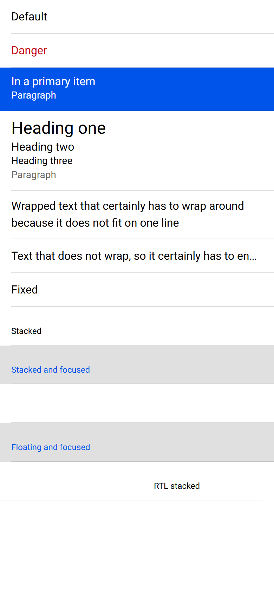
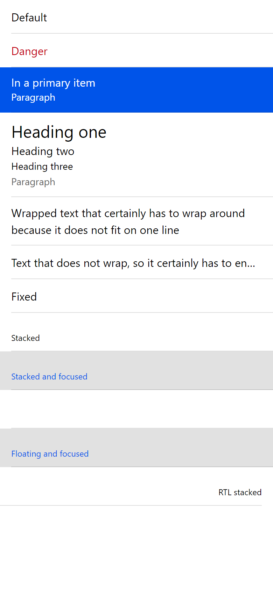

# ion-label — Comparison against the web component

> Ionic side: `node tools/ionic-ref/render.js ion-label --bare` (Chromium, md, 390×844@2x) → [`ref/`](ref/).
> Avonic side: `AVONIC_CAPTURE_DIR=… dotnet test` → `AvonicLabelCaptureTests` (headless Skia, 2×) → [`compare/`](compare/).

## Frames

| Ionic | Avonic |
|---|---|
|  |  |

Rows from the top: default, danger, in a primary item with a paragraph, headings, `ion-text-wrap`, `ion-text-nowrap`,
fixed, stacked, stacked and focused, floating (pushed out of its row, in both), floating and focused, and RTL.

**Match,** apart from these visible differences:

- **Text.** Roboto isn't installed on this machine, so Chromium uses Arial and Avalonia uses Segoe UI. Segoe UI's lines
  are taller, so rows that grow with their text are too: the primary row is 65 against 61, and the headings row is
  121 against 113, of which 4 is the difference below.
- **Margins between headings** add up to 4 where CSS collapses them to 2. See the plan.
- **RTL,** the last row. The reference sets `dir` on a `div`, and Ionic's `label-rtl` only reads `document.dir`, so its
  text shrinks to the left, ending at x = 284. With `dir` on the document, Ionic measures 105.5 to 374, which is what
  Avonic draws. `FlowDirection` has no separate document level.

## Found here, not by the tests

- **Descenders were cut off.** A `TextBlock` clips to its line height, so the `g` in "Heading" lost its tail at 28.8.
  CSS `line-height` never clips. Fixed in `Styles/Label.axaml`, with a pixel test.
- **The label clipped its content.** A `ContentControl` does by default, where CSS shows overflow. Found by
  `B9_Without_The_Class_There_Is_No_Ellipsis`, because I'd assumed the default was off. Fixed in the stub.

## Behaviours

The numbers are from [PLAN.md](PLAN.md#behaviours). Each has tests in `AvonicLabelTests`, named after its number. The
Ionic results were measured in Chromium with `ion-app`. For rules no Ionic 8 component triggers, such as
`item-has-focus`, an `ionStyle` event was sent to the real item by hand.

| # | Behaviour | Ionic | Result |
|---|---|---|---|
| 1 | Alone, it inherits and ignores the token and `position` | `alone-var` stays black; `alone-stacked` is unmoved | match |
| 2 | `color` paints the text | `rgb(197, 0, 15)`, in and out of an item | match |
| 3 | An unknown colour inherits, or shows a coloured item's base | black; `rgb(0, 84, 233)` in a primary item | match |
| 4 | In an item: token, item colour, `color` over the token, token font | `rgb(18, 52, 86)`, white, `rgb(197, 0, 15)` | match |
| 5 | `ionStyle` on attach and on a position change | `item-label`, `item-label-stacked`, 48 → 55 → 48 | match. See below for a moved label |
| 6 | Not inside a range | `inRange` | match, against a stub range |
| 7 | Margins per slot | `0 10`, `0 10 16 10`, `16 10 0 10`, or `16 7 0 7` beside a stacked label | match |
| 8 | Long text wraps and grows the item | 3 lines of 18, row 75 | match. The height depends on the font |
| 9 | `ion-text-nowrap` | one line, ellipsis, `overflow: hidden`, also on `h2` and `p` | match |
| 10 | `ion-text-wrap` | 24 per line, 48 for 32 px text; `h2` 19.2 and `p` 20 keep theirs | match, except a sized `TextBlock` deeper than a panel. See the plan |
| 11 | `h1`–`h6`, `p` | 24, 16, 14, 14, 14, 14, 14; weight 400; 28.8, 19.2, normal, 20 | match directly or in a panel, but not deeper. See the plan. Layout rounding makes a 19.2 line 20 high |
| 12 | `p` colour by depth | `rgb(102, 102, 102)` direct; black nested | match. A panel directly in the label counts as direct |
| 13 | `p` in a coloured item | white; `rgb(197, 0, 15)` in a coloured label; grey in a coloured label in a plain item | match |
| 14 | Fixed | x = 16, width 100, wraps; x = 274 in RTL | match |
| 15 | Stacked | `matrix(0.75, 0, 0, 0.75, 0, 27)`, at (16, 27), 268.5 × 40.5; colour easing | match |
| 16 | Fills its slot | 54 alone; 30 beside a 24 input; 54 in the end slot, where other content is 18 at the top | match, with `Grid RowDefinitions="*,Auto"` for the second |
| 17 | Floating | `matrix(1, 0, 0, 1, 0, 28.8)` for a 30 high label; colour and transform ease | match. Three transitions here, because the percentage and the scale ease separately, which is what CSS's interpolation does |
| 18 | Floating rises | `matrix(0.75, …, 27)` on each state; not with `item-input` | match |
| 19 | No transitions in the first second | `true`/`0s` until 1108 ms, sampled every 100 ms; a later change eases | match, at exactly 1000 ms on the test clock |
| 20 | Focus colours | primary; white; black for an unknown colour; `rgb(45, 213, 91)` for a label's own; plain and fixed unchanged | match |
| 21 | `ion-invalid` and `ion-touched` | black, even focused and with the token; `ion-invalid` alone stays primary | match |
| 22 | `item-interactive-disabled` | opacity 0.3, `pointer-events: none`, `cursor: default` | match. `item-multiple-inputs` is tested with two real inputs, because the item's own state overrides a sent one |
| 23 | `item-input` | max 200, no input; 358 wide if stacked or floating, at its own height | match, except `min-content`. See the plan |
| 24 | `item-textarea`, `item-skeleton-text` | top of the row, or filling it if stacked; `overflow: hidden` | match |
| 25 | A tap on the label doesn't forward, even on the blank part; the padding does | toggle stays off, then flips | match |
| 26 | A tap on a label in a button item clicks it | | match |
| 27 | RTL | 105.5 to 374 with `dir` on the document | match. See above for a subtree |
| 28 | A button item's automation name | from its content | match |

## Deliberate differences and known gaps

All in [PLAN.md](PLAN.md#deliberate-differences), measured where they have a number. One is a real gap, which is the
item's to fix: a long label in `StartContent` or `EndContent` doesn't wrap, and the item cuts it off.

## Real window

Tried on Windows at 125%, with `tools/real-window`, on 2026-11-06. Not on real touch hardware. The page draws as the frames do. Tab raises a floating label and colours a stacked one, as an item takes focus. The input it
adds to the item is one transparent background, and that's covered by `B25`.
