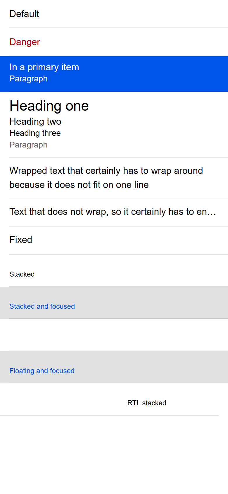

# ion-label — reference render (Ionic 8.8.1, md, 390×844@2x)

Generated by `node tools/ionic-ref/render.js ion-label --bare`

```html
<ion-item><ion-label>Default</ion-label></ion-item><ion-item><ion-label color="danger">Danger</ion-label></ion-item><ion-item color="primary"><ion-label>In a primary item<p>Paragraph</p></ion-label></ion-item><ion-item><ion-label><h1>Heading one</h1><h2>Heading two</h2><h3>Heading three</h3><p>Paragraph</p></ion-label></ion-item><ion-item><ion-label class="ion-text-wrap">Wrapped text that certainly has to wrap around because it does not fit on one line</ion-label></ion-item><ion-item><ion-label class="ion-text-nowrap">Text that does not wrap, so it certainly has to end with an ellipsis instead</ion-label></ion-item><ion-item><ion-label position="fixed">Fixed</ion-label></ion-item><ion-item><ion-label position="stacked">Stacked</ion-label></ion-item><ion-item class="ion-focused"><ion-label position="stacked">Stacked and focused</ion-label></ion-item><ion-item><ion-label position="floating">Floating, pushed out of the row</ion-label></ion-item><ion-item class="ion-focused"><ion-label position="floating">Floating and focused</ion-label></ion-item><div dir="rtl"><ion-item><ion-label position="stacked">RTL stacked</ion-label></ion-item></div>
```

 

## Element 1

- attributes: `{"class":"sc-ion-label-md-h md sc-ion-label-md sc-ion-label-md-s hydrated"}`
- classes: `sc-ion-label-md-h md sc-ion-label-md sc-ion-label-md-s hydrated`
- rect: `{"x":16,"y":14.5,"w":358,"h":18}`

### CSS custom properties (resolved)

| var | value |
|---|---|
| `--color` | `(unset)` |

### Host computed

| prop | value |
|---|---|
| display | `block` |
| position | `static` |
| box-sizing | `border-box` |
| width | `358px` |
| height | `18px` |
| min-height | `auto` |
| min-width | `auto` |
| padding | `0px` |
| margin | `10px 0px` |
| border | `0px none rgb(0, 0, 0)` |
| border-radius | `0px` |
| background-color | `rgba(0, 0, 0, 0)` |
| color | `rgb(0, 0, 0)` |
| font-size | `16px` |
| font-weight | `400` |
| font-family | `Roboto, "Helvetica Neue", sans-serif` |
| line-height | `normal` |
| letter-spacing | `normal` |
| text-transform | `none` |
| opacity | `1` |
| overflow | `visible` |
| contain | `none` |
| pointer-events | `auto` |
| transition | `all` |
| transform | `none` |
| box-shadow | `none` |
| outline | `rgb(0, 0, 0) none 0px` |
| cursor | `auto` |

### DOM tree

```
<ion-label>

```

## Element 2

- attributes: `{"color":"danger","class":"sc-ion-label-md-h ion-color ion-color-danger md sc-ion-label-md sc-ion-label-md-s hydrated"}`
- classes: `sc-ion-label-md-h ion-color ion-color-danger md sc-ion-label-md sc-ion-label-md-s hydrated`
- rect: `{"x":16,"y":62.5,"w":358,"h":18}`

### CSS custom properties (resolved)

| var | value |
|---|---|
| `--color` | `(unset)` |

### Host computed

| prop | value |
|---|---|
| display | `block` |
| position | `static` |
| box-sizing | `border-box` |
| width | `358px` |
| height | `18px` |
| min-height | `auto` |
| min-width | `auto` |
| padding | `0px` |
| margin | `10px 0px` |
| border | `0px none rgb(197, 0, 15)` |
| border-radius | `0px` |
| background-color | `rgba(0, 0, 0, 0)` |
| color | `rgb(197, 0, 15)` |
| font-size | `16px` |
| font-weight | `400` |
| font-family | `Roboto, "Helvetica Neue", sans-serif` |
| line-height | `normal` |
| letter-spacing | `normal` |
| text-transform | `none` |
| opacity | `1` |
| overflow | `visible` |
| contain | `none` |
| pointer-events | `auto` |
| transition | `all` |
| transform | `none` |
| box-shadow | `none` |
| outline | `rgb(197, 0, 15) none 0px` |
| cursor | `auto` |

### DOM tree

```
<ion-label>

```

## Element 3

- attributes: `{"class":"sc-ion-label-md-h md in-item-color sc-ion-label-md sc-ion-label-md-s hydrated"}`
- classes: `sc-ion-label-md-h md in-item-color sc-ion-label-md sc-ion-label-md-s hydrated`
- rect: `{"x":16,"y":106,"w":358,"h":40}`

### CSS custom properties (resolved)

| var | value |
|---|---|
| `--color` | `(unset)` |

### Host computed

| prop | value |
|---|---|
| display | `block` |
| position | `static` |
| box-sizing | `border-box` |
| width | `358px` |
| height | `40px` |
| min-height | `auto` |
| min-width | `auto` |
| padding | `0px` |
| margin | `10px 0px` |
| border | `0px none rgb(255, 255, 255)` |
| border-radius | `0px` |
| background-color | `rgba(0, 0, 0, 0)` |
| color | `rgb(255, 255, 255)` |
| font-size | `16px` |
| font-weight | `400` |
| font-family | `Roboto, "Helvetica Neue", sans-serif` |
| line-height | `normal` |
| letter-spacing | `normal` |
| text-transform | `none` |
| opacity | `1` |
| overflow | `visible` |
| contain | `none` |
| pointer-events | `auto` |
| transition | `all` |
| transform | `none` |
| box-shadow | `none` |
| outline | `rgb(255, 255, 255) none 0px` |
| cursor | `auto` |

### DOM tree

```
<ion-label>
  <p>
```

## Element 4

- attributes: `{"class":"sc-ion-label-md-h md sc-ion-label-md sc-ion-label-md-s hydrated"}`
- classes: `sc-ion-label-md-h md sc-ion-label-md sc-ion-label-md-s hydrated`
- rect: `{"x":16,"y":167,"w":358,"h":91.98}`

### CSS custom properties (resolved)

| var | value |
|---|---|
| `--color` | `(unset)` |

### Host computed

| prop | value |
|---|---|
| display | `block` |
| position | `static` |
| box-sizing | `border-box` |
| width | `358px` |
| height | `91.9844px` |
| min-height | `auto` |
| min-width | `auto` |
| padding | `0px` |
| margin | `10px 0px` |
| border | `0px none rgb(0, 0, 0)` |
| border-radius | `0px` |
| background-color | `rgba(0, 0, 0, 0)` |
| color | `rgb(0, 0, 0)` |
| font-size | `16px` |
| font-weight | `400` |
| font-family | `Roboto, "Helvetica Neue", sans-serif` |
| line-height | `normal` |
| letter-spacing | `normal` |
| text-transform | `none` |
| opacity | `1` |
| overflow | `visible` |
| contain | `none` |
| pointer-events | `auto` |
| transition | `all` |
| transform | `none` |
| box-shadow | `none` |
| outline | `rgb(0, 0, 0) none 0px` |
| cursor | `auto` |

### DOM tree

```
<ion-label>
  <h1>
  <h2>
  <h3>
  <p>
```

## Element 5

- attributes: `{"class":"ion-text-wrap sc-ion-label-md-h md sc-ion-label-md sc-ion-label-md-s hydrated"}`
- classes: `ion-text-wrap sc-ion-label-md-h md sc-ion-label-md sc-ion-label-md-s hydrated`
- rect: `{"x":16,"y":279.98,"w":358,"h":48}`

### CSS custom properties (resolved)

| var | value |
|---|---|
| `--color` | `(unset)` |

### Host computed

| prop | value |
|---|---|
| display | `block` |
| position | `static` |
| box-sizing | `border-box` |
| width | `358px` |
| height | `48px` |
| min-height | `auto` |
| min-width | `auto` |
| padding | `0px` |
| margin | `10px 0px` |
| border | `0px none rgb(0, 0, 0)` |
| border-radius | `0px` |
| background-color | `rgba(0, 0, 0, 0)` |
| color | `rgb(0, 0, 0)` |
| font-size | `16px` |
| font-weight | `400` |
| font-family | `Roboto, "Helvetica Neue", sans-serif` |
| line-height | `24px` |
| letter-spacing | `normal` |
| text-transform | `none` |
| opacity | `1` |
| overflow | `visible` |
| contain | `none` |
| pointer-events | `auto` |
| transition | `all` |
| transform | `none` |
| box-shadow | `none` |
| outline | `rgb(0, 0, 0) none 0px` |
| cursor | `auto` |

### DOM tree

```
<ion-label>

```

## Element 6

- attributes: `{"class":"ion-text-nowrap sc-ion-label-md-h md sc-ion-label-md sc-ion-label-md-s hydrated"}`
- classes: `ion-text-nowrap sc-ion-label-md-h md sc-ion-label-md sc-ion-label-md-s hydrated`
- rect: `{"x":16,"y":353.48,"w":358,"h":18}`

### CSS custom properties (resolved)

| var | value |
|---|---|
| `--color` | `(unset)` |

### Host computed

| prop | value |
|---|---|
| display | `block` |
| position | `static` |
| box-sizing | `border-box` |
| width | `358px` |
| height | `18px` |
| min-height | `auto` |
| min-width | `auto` |
| padding | `0px` |
| margin | `10px 0px` |
| border | `0px none rgb(0, 0, 0)` |
| border-radius | `0px` |
| background-color | `rgba(0, 0, 0, 0)` |
| color | `rgb(0, 0, 0)` |
| font-size | `16px` |
| font-weight | `400` |
| font-family | `Roboto, "Helvetica Neue", sans-serif` |
| line-height | `normal` |
| letter-spacing | `normal` |
| text-transform | `none` |
| opacity | `1` |
| overflow | `hidden` |
| contain | `none` |
| pointer-events | `auto` |
| transition | `all` |
| transform | `none` |
| box-shadow | `none` |
| outline | `rgb(0, 0, 0) none 0px` |
| cursor | `auto` |

### DOM tree

```
<ion-label>

```

## Element 7

- attributes: `{"position":"fixed","class":"sc-ion-label-md-h md label-fixed sc-ion-label-md sc-ion-label-md-s hydrated"}`
- classes: `sc-ion-label-md-h md label-fixed sc-ion-label-md sc-ion-label-md-s hydrated`
- rect: `{"x":16,"y":401.48,"w":100,"h":18}`

### CSS custom properties (resolved)

| var | value |
|---|---|
| `--color` | `(unset)` |

### Host computed

| prop | value |
|---|---|
| display | `block` |
| position | `static` |
| box-sizing | `border-box` |
| width | `100px` |
| height | `18px` |
| min-height | `auto` |
| min-width | `100px` |
| padding | `0px` |
| margin | `10px 0px` |
| border | `0px none rgb(0, 0, 0)` |
| border-radius | `0px` |
| background-color | `rgba(0, 0, 0, 0)` |
| color | `rgb(0, 0, 0)` |
| font-size | `16px` |
| font-weight | `400` |
| font-family | `Roboto, "Helvetica Neue", sans-serif` |
| line-height | `normal` |
| letter-spacing | `normal` |
| text-transform | `none` |
| opacity | `1` |
| overflow | `visible` |
| contain | `none` |
| pointer-events | `auto` |
| transition | `all` |
| transform | `none` |
| box-shadow | `none` |
| outline | `rgb(0, 0, 0) none 0px` |
| cursor | `auto` |

### DOM tree

```
<ion-label>

```

## Element 8

- attributes: `{"position":"stacked","class":"sc-ion-label-md-h md label-stacked sc-ion-label-md sc-ion-label-md-s hydrated"}`
- classes: `sc-ion-label-md-h md label-stacked sc-ion-label-md sc-ion-label-md-s hydrated`
- rect: `{"x":16,"y":461.98,"w":268.5,"h":40.5}`

### CSS custom properties (resolved)

| var | value |
|---|---|
| `--color` | `(unset)` |

### Host computed

| prop | value |
|---|---|
| display | `block` |
| position | `static` |
| box-sizing | `border-box` |
| width | `358px` |
| height | `54px` |
| min-height | `auto` |
| min-width | `auto` |
| padding | `0px` |
| margin | `0px` |
| border | `0px none rgb(0, 0, 0)` |
| border-radius | `0px` |
| background-color | `rgba(0, 0, 0, 0)` |
| color | `rgb(0, 0, 0)` |
| font-size | `16px` |
| font-weight | `400` |
| font-family | `Roboto, "Helvetica Neue", sans-serif` |
| line-height | `normal` |
| letter-spacing | `normal` |
| text-transform | `none` |
| opacity | `1` |
| overflow | `visible` |
| contain | `none` |
| pointer-events | `auto` |
| transition | `color 0.15s cubic-bezier(0.4, 0, 0.2, 1)` |
| transform | `matrix(0.75, 0, 0, 0.75, 0, 27)` |
| box-shadow | `none` |
| outline | `rgb(0, 0, 0) none 0px` |
| cursor | `auto` |

### DOM tree

```
<ion-label>

```

## Element 9

- attributes: `{"position":"stacked","class":"sc-ion-label-md-h md label-stacked sc-ion-label-md sc-ion-label-md-s hydrated"}`
- classes: `sc-ion-label-md-h md label-stacked sc-ion-label-md sc-ion-label-md-s hydrated`
- rect: `{"x":16,"y":516.98,"w":268.5,"h":40.5}`

### CSS custom properties (resolved)

| var | value |
|---|---|
| `--color` | `(unset)` |

### Host computed

| prop | value |
|---|---|
| display | `block` |
| position | `static` |
| box-sizing | `border-box` |
| width | `358px` |
| height | `54px` |
| min-height | `auto` |
| min-width | `auto` |
| padding | `0px` |
| margin | `0px` |
| border | `0px none rgb(0, 84, 233)` |
| border-radius | `0px` |
| background-color | `rgba(0, 0, 0, 0)` |
| color | `rgb(0, 84, 233)` |
| font-size | `16px` |
| font-weight | `400` |
| font-family | `Roboto, "Helvetica Neue", sans-serif` |
| line-height | `normal` |
| letter-spacing | `normal` |
| text-transform | `none` |
| opacity | `1` |
| overflow | `visible` |
| contain | `none` |
| pointer-events | `auto` |
| transition | `color 0.15s cubic-bezier(0.4, 0, 0.2, 1)` |
| transform | `matrix(0.75, 0, 0, 0.75, 0, 27)` |
| box-shadow | `none` |
| outline | `rgb(0, 84, 233) none 0px` |
| cursor | `auto` |

### DOM tree

```
<ion-label>

```

## Element 10

- attributes: `{"position":"floating","class":"sc-ion-label-md-h md label-floating label-no-animate sc-ion-label-md sc-ion-label-md-s hydrated"}`
- classes: `sc-ion-label-md-h md label-floating label-no-animate sc-ion-label-md sc-ion-label-md-s hydrated`
- rect: `{"x":16,"y":596.82,"w":358,"h":54}`

### CSS custom properties (resolved)

| var | value |
|---|---|
| `--color` | `(unset)` |

### Host computed

| prop | value |
|---|---|
| display | `block` |
| position | `static` |
| box-sizing | `border-box` |
| width | `358px` |
| height | `54px` |
| min-height | `auto` |
| min-width | `auto` |
| padding | `0px` |
| margin | `0px` |
| border | `0px none rgb(0, 0, 0)` |
| border-radius | `0px` |
| background-color | `rgba(0, 0, 0, 0)` |
| color | `rgb(0, 0, 0)` |
| font-size | `16px` |
| font-weight | `400` |
| font-family | `Roboto, "Helvetica Neue", sans-serif` |
| line-height | `normal` |
| letter-spacing | `normal` |
| text-transform | `none` |
| opacity | `1` |
| overflow | `visible` |
| contain | `none` |
| pointer-events | `auto` |
| transition | `none` |
| transform | `matrix(1, 0, 0, 1, 0, 51.84)` |
| box-shadow | `none` |
| outline | `rgb(0, 0, 0) none 0px` |
| cursor | `auto` |

### DOM tree

```
<ion-label>

```

## Element 11

- attributes: `{"position":"floating","class":"sc-ion-label-md-h md label-floating label-no-animate sc-ion-label-md sc-ion-label-md-s hydrated"}`
- classes: `sc-ion-label-md-h md label-floating label-no-animate sc-ion-label-md sc-ion-label-md-s hydrated`
- rect: `{"x":16,"y":626.98,"w":268.5,"h":40.5}`

### CSS custom properties (resolved)

| var | value |
|---|---|
| `--color` | `(unset)` |

### Host computed

| prop | value |
|---|---|
| display | `block` |
| position | `static` |
| box-sizing | `border-box` |
| width | `358px` |
| height | `54px` |
| min-height | `auto` |
| min-width | `auto` |
| padding | `0px` |
| margin | `0px` |
| border | `0px none rgb(0, 84, 233)` |
| border-radius | `0px` |
| background-color | `rgba(0, 0, 0, 0)` |
| color | `rgb(0, 84, 233)` |
| font-size | `16px` |
| font-weight | `400` |
| font-family | `Roboto, "Helvetica Neue", sans-serif` |
| line-height | `normal` |
| letter-spacing | `normal` |
| text-transform | `none` |
| opacity | `1` |
| overflow | `visible` |
| contain | `none` |
| pointer-events | `auto` |
| transition | `none` |
| transform | `matrix(0.75, 0, 0, 0.75, 0, 27)` |
| box-shadow | `none` |
| outline | `rgb(0, 84, 233) none 0px` |
| cursor | `auto` |

### DOM tree

```
<ion-label>

```

## Element 12

- attributes: `{"position":"stacked","class":"sc-ion-label-md-h md label-stacked sc-ion-label-md sc-ion-label-md-s hydrated"}`
- classes: `sc-ion-label-md-h md label-stacked sc-ion-label-md sc-ion-label-md-s hydrated`
- rect: `{"x":16,"y":681.98,"w":268.5,"h":40.5}`

### CSS custom properties (resolved)

| var | value |
|---|---|
| `--color` | `(unset)` |

### Host computed

| prop | value |
|---|---|
| display | `block` |
| position | `static` |
| box-sizing | `border-box` |
| width | `358px` |
| height | `54px` |
| min-height | `auto` |
| min-width | `auto` |
| padding | `0px` |
| margin | `0px` |
| border | `0px none rgb(0, 0, 0)` |
| border-radius | `0px` |
| background-color | `rgba(0, 0, 0, 0)` |
| color | `rgb(0, 0, 0)` |
| font-size | `16px` |
| font-weight | `400` |
| font-family | `Roboto, "Helvetica Neue", sans-serif` |
| line-height | `normal` |
| letter-spacing | `normal` |
| text-transform | `none` |
| opacity | `1` |
| overflow | `visible` |
| contain | `none` |
| pointer-events | `auto` |
| transition | `color 0.15s cubic-bezier(0.4, 0, 0.2, 1)` |
| transform | `matrix(0.75, 0, 0, 0.75, 0, 27)` |
| box-shadow | `none` |
| outline | `rgb(0, 0, 0) none 0px` |
| cursor | `auto` |

### DOM tree

```
<ion-label>

```
