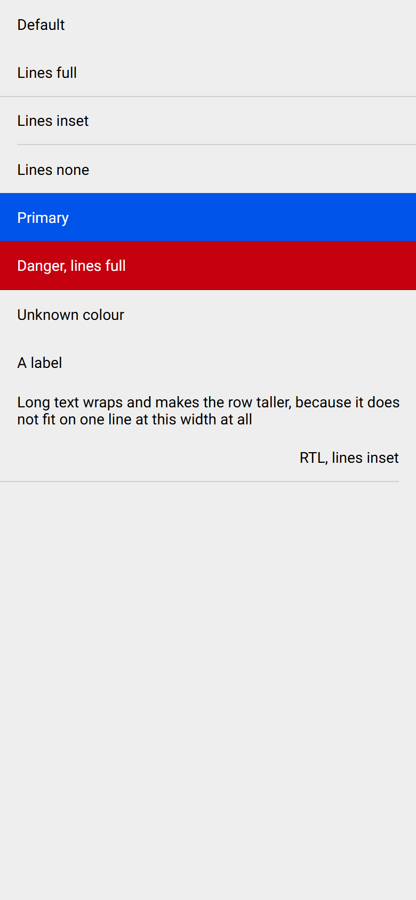
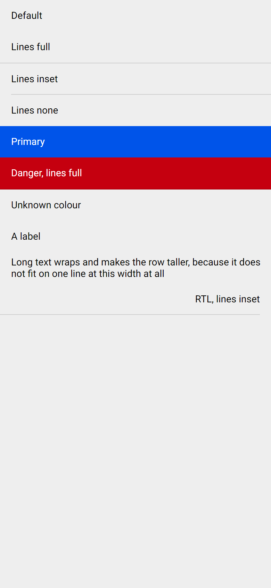

# ion-list-header — Comparison against the web component

> Ionic side, exactly:
>
> ```
> node tools/ionic-ref/render.js ion-list-header --bare --html '<div style="background:#eeeeee;height:844px"><ion-list-header>Default</ion-list-header><ion-list-header lines="full">Lines full</ion-list-header><ion-list-header lines="inset">Lines inset</ion-list-header><ion-list-header lines="none">Lines none</ion-list-header><ion-list-header color="primary">Primary</ion-list-header><ion-list-header color="danger" lines="full">Danger, lines full</ion-list-header><ion-list-header color="nonexistent">Unknown colour</ion-list-header><ion-list-header><ion-label>A label</ion-label></ion-list-header><ion-list-header>Long text wraps and makes the row taller, because it does not fit on one line at this width at all</ion-list-header><div dir="rtl"><ion-list-header lines="inset">RTL, lines inset</ion-list-header></div></div>'
> ```
>
> (Chromium, md, 390×844@2x) → [`ref/`](ref/).
> Avonic side: `AVONIC_CAPTURE_DIR=… dotnet test` → `AvonicListCaptureTests.Reference_Page_List_Header` (headless Skia, 2×) →
> [`compare/`](compare/). Tried in a real window on Windows at 125%, with `tools/real-window`, on 2026-11-06. Not on real touch hardware: the `ion-list` page draws as the frames do.

## Frames

| Ionic | Avonic |
|---|---|
|  |  |

Rows from the top: default, full, inset, none, primary, danger with a full line, an unknown colour, a label, long text, and RTL with an inset line.

**Match.** The first eight rows' heights are the same: 45, 46, 45, 45, 45, 46, 45 and 45, measured on both. Text is drawn
from the same Roboto files on both sides since #100 ([`tools/fonts/roboto/`](../../../tools/fonts/roboto/README.md)).

## Behaviours

| # | Behaviour | Result |
|---|---|---|
| 1 | Size, padding, text | Match |
| 2 | `Lines` | Match: 45, 46 with a 45 inner, 45, 45 |
| 3 | Border colours | Match: 13% black, even in a colour |
| 4 | `Color`, and an unknown one | Match: `rgb(0, 73, 203)` where the line is over primary |
| 5 | Tokens | Match |
| 6 | A label | Match: 374 wide, no margin, inherits, no `--color`, no ellipsis |
| 7 | Long text | Match: to the end of the row, with no end padding |
| 8 | Clips | Match |
| 9 | RTL | Match: the inner box is 0 to 374 |
| 10 | A label beside something else | **Deliberate difference:** a `Grid`, because a slot holds one child. Same result |
| 11 | `PART_Inner` | Match |

## Found here, not by the tests

- **A translucent border over a colour looked lighter.** In the danger row, Avonic's line was paler than the red, where
  Ionic's is darker. CSS's `background-clip` is `border-box`, so the background runs under the border, and Avalonia's default
  stops short of that. Fixed with `BackgroundSizing="OuterBorderEdge"`, with a pixel test.
