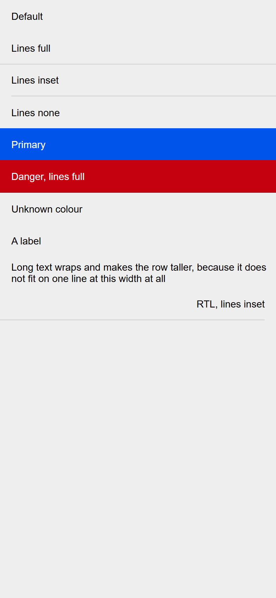
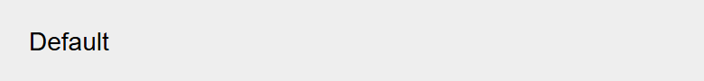

# ion-list-header — reference render (Ionic 8.8.1, md, 390×844@2x)

Generated by `node tools/ionic-ref/render.js ion-list-header --bare --html "<div style=\"background:#eeeeee;height:844px\"><ion-list-header>Default</ion-list-header><ion-list-header lines=\"full\">Lines full</ion-list-header><ion-list-header lines=\"inset\">Lines inset</ion-list-header><ion-list-header lines=\"none\">Lines none</ion-list-header><ion-list-header color=\"primary\">Primary</ion-list-header><ion-list-header color=\"danger\" lines=\"full\">Danger, lines full</ion-list-header><ion-list-header color=\"nonexistent\">Unknown colour</ion-list-header><ion-list-header><ion-label>A label</ion-label></ion-list-header><ion-list-header>Long text wraps and makes the row taller, because it does not fit on one line at this width at all</ion-list-header><div dir=\"rtl\"><ion-list-header lines=\"inset\">RTL, lines inset</ion-list-header></div></div>"`

```html
<div style="background:#eeeeee;height:844px"><ion-list-header>Default</ion-list-header><ion-list-header lines="full">Lines full</ion-list-header><ion-list-header lines="inset">Lines inset</ion-list-header><ion-list-header lines="none">Lines none</ion-list-header><ion-list-header color="primary">Primary</ion-list-header><ion-list-header color="danger" lines="full">Danger, lines full</ion-list-header><ion-list-header color="nonexistent">Unknown colour</ion-list-header><ion-list-header><ion-label>A label</ion-label></ion-list-header><ion-list-header>Long text wraps and makes the row taller, because it does not fit on one line at this width at all</ion-list-header><div dir="rtl"><ion-list-header lines="inset">RTL, lines inset</ion-list-header></div></div>
```

 

## Element 1

- attributes: `{"class":"md hydrated"}`
- classes: `md hydrated`
- rect: `{"x":0,"y":0,"w":390,"h":45}`

### CSS custom properties (resolved)

| var | value |
|---|---|
| `--background` | `transparent` |
| `--border-color` | `rgba(0, 0, 0, 0.13)` |
| `--border-style` | `solid` |
| `--border-width` | `0` |
| `--color` | `#000` |
| `--inner-border-width` | `0` |

### Host computed

| prop | value |
|---|---|
| display | `flex` |
| position | `static` |
| box-sizing | `border-box` |
| width | `390px` |
| height | `45px` |
| min-height | `45px` |
| min-width | `0px` |
| padding | `0px 0px 0px 16px` |
| margin | `0px` |
| border | `0px solid rgba(0, 0, 0, 0.13)` |
| border-radius | `0px` |
| background-color | `rgba(0, 0, 0, 0)` |
| color | `rgb(0, 0, 0)` |
| font-size | `14px` |
| font-weight | `400` |
| font-family | `Roboto, "Helvetica Neue", sans-serif` |
| line-height | `normal` |
| letter-spacing | `normal` |
| text-transform | `none` |
| opacity | `1` |
| overflow | `hidden` |
| contain | `none` |
| pointer-events | `auto` |
| transition | `all` |
| transform | `none` |
| box-shadow | `none` |
| outline | `rgb(0, 0, 0) none 0px` |
| cursor | `auto` |

### Shadow parts

#### part="inner" (`div`) rect `{"x":16,"y":0,"w":374,"h":45}`

| prop | value |
|---|---|
| display | `flex` |
| position | `relative` |
| box-sizing | `border-box` |
| width | `374px` |
| height | `45px` |
| min-height | `45px` |
| min-width | `auto` |
| padding | `0px` |
| margin | `0px` |
| border | `0px solid rgba(0, 0, 0, 0.13)` |
| border-radius | `0px` |
| background-color | `rgba(0, 0, 0, 0)` |
| color | `rgb(0, 0, 0)` |
| font-size | `14px` |
| font-weight | `400` |
| font-family | `Roboto, "Helvetica Neue", sans-serif` |
| line-height | `normal` |
| letter-spacing | `normal` |
| text-transform | `none` |
| opacity | `1` |
| overflow | `hidden` |
| contain | `none` |
| pointer-events | `auto` |
| transition | `all` |
| transform | `none` |
| box-shadow | `none` |
| outline | `rgb(0, 0, 0) none 0px` |
| cursor | `auto` |

### DOM tree

```
<ion-list-header>
  #shadow-root
    <div.list-header-inner part="inner">
      <slot name="">
```

## Element 2

- attributes: `{"lines":"full","class":"md list-header-lines-full hydrated"}`
- classes: `md list-header-lines-full hydrated`
- rect: `{"x":0,"y":45,"w":390,"h":46}`

### CSS custom properties (resolved)

| var | value |
|---|---|
| `--background` | `transparent` |
| `--border-color` | `rgba(0, 0, 0, 0.13)` |
| `--border-style` | `solid` |
| `--border-width` | `0 0 1px 0` |
| `--color` | `#000` |
| `--inner-border-width` | `0` |

### Host computed

| prop | value |
|---|---|
| display | `flex` |
| position | `static` |
| box-sizing | `border-box` |
| width | `390px` |
| height | `46px` |
| min-height | `45px` |
| min-width | `0px` |
| padding | `0px 0px 0px 16px` |
| margin | `0px` |
| border-radius | `0px` |
| background-color | `rgba(0, 0, 0, 0)` |
| color | `rgb(0, 0, 0)` |
| font-size | `14px` |
| font-weight | `400` |
| font-family | `Roboto, "Helvetica Neue", sans-serif` |
| line-height | `normal` |
| letter-spacing | `normal` |
| text-transform | `none` |
| opacity | `1` |
| overflow | `hidden` |
| contain | `none` |
| pointer-events | `auto` |
| transition | `all` |
| transform | `none` |
| box-shadow | `none` |
| outline | `rgb(0, 0, 0) none 0px` |
| cursor | `auto` |

### Shadow parts

#### part="inner" (`div`) rect `{"x":16,"y":45,"w":374,"h":45}`

| prop | value |
|---|---|
| display | `flex` |
| position | `relative` |
| box-sizing | `border-box` |
| width | `374px` |
| height | `45px` |
| min-height | `45px` |
| min-width | `auto` |
| padding | `0px` |
| margin | `0px` |
| border | `0px solid rgba(0, 0, 0, 0.13)` |
| border-radius | `0px` |
| background-color | `rgba(0, 0, 0, 0)` |
| color | `rgb(0, 0, 0)` |
| font-size | `14px` |
| font-weight | `400` |
| font-family | `Roboto, "Helvetica Neue", sans-serif` |
| line-height | `normal` |
| letter-spacing | `normal` |
| text-transform | `none` |
| opacity | `1` |
| overflow | `hidden` |
| contain | `none` |
| pointer-events | `auto` |
| transition | `all` |
| transform | `none` |
| box-shadow | `none` |
| outline | `rgb(0, 0, 0) none 0px` |
| cursor | `auto` |

### DOM tree

```
<ion-list-header>
  #shadow-root
    <div.list-header-inner part="inner">
      <slot name="">
```

## Element 3

- attributes: `{"lines":"inset","class":"md list-header-lines-inset hydrated"}`
- classes: `md list-header-lines-inset hydrated`
- rect: `{"x":0,"y":91,"w":390,"h":45}`

### CSS custom properties (resolved)

| var | value |
|---|---|
| `--background` | `transparent` |
| `--border-color` | `rgba(0, 0, 0, 0.13)` |
| `--border-style` | `solid` |
| `--border-width` | `0` |
| `--color` | `#000` |
| `--inner-border-width` | `0 0 1px 0` |

### Host computed

| prop | value |
|---|---|
| display | `flex` |
| position | `static` |
| box-sizing | `border-box` |
| width | `390px` |
| height | `45px` |
| min-height | `45px` |
| min-width | `0px` |
| padding | `0px 0px 0px 16px` |
| margin | `0px` |
| border | `0px solid rgba(0, 0, 0, 0.13)` |
| border-radius | `0px` |
| background-color | `rgba(0, 0, 0, 0)` |
| color | `rgb(0, 0, 0)` |
| font-size | `14px` |
| font-weight | `400` |
| font-family | `Roboto, "Helvetica Neue", sans-serif` |
| line-height | `normal` |
| letter-spacing | `normal` |
| text-transform | `none` |
| opacity | `1` |
| overflow | `hidden` |
| contain | `none` |
| pointer-events | `auto` |
| transition | `all` |
| transform | `none` |
| box-shadow | `none` |
| outline | `rgb(0, 0, 0) none 0px` |
| cursor | `auto` |

### Shadow parts

#### part="inner" (`div`) rect `{"x":16,"y":91,"w":374,"h":45}`

| prop | value |
|---|---|
| display | `flex` |
| position | `relative` |
| box-sizing | `border-box` |
| width | `374px` |
| height | `45px` |
| min-height | `45px` |
| min-width | `auto` |
| padding | `0px` |
| margin | `0px` |
| border-radius | `0px` |
| background-color | `rgba(0, 0, 0, 0)` |
| color | `rgb(0, 0, 0)` |
| font-size | `14px` |
| font-weight | `400` |
| font-family | `Roboto, "Helvetica Neue", sans-serif` |
| line-height | `normal` |
| letter-spacing | `normal` |
| text-transform | `none` |
| opacity | `1` |
| overflow | `hidden` |
| contain | `none` |
| pointer-events | `auto` |
| transition | `all` |
| transform | `none` |
| box-shadow | `none` |
| outline | `rgb(0, 0, 0) none 0px` |
| cursor | `auto` |

### DOM tree

```
<ion-list-header>
  #shadow-root
    <div.list-header-inner part="inner">
      <slot name="">
```

## Element 4

- attributes: `{"lines":"none","class":"md list-header-lines-none hydrated"}`
- classes: `md list-header-lines-none hydrated`
- rect: `{"x":0,"y":136,"w":390,"h":45}`

### CSS custom properties (resolved)

| var | value |
|---|---|
| `--background` | `transparent` |
| `--border-color` | `rgba(0, 0, 0, 0.13)` |
| `--border-style` | `solid` |
| `--border-width` | `0` |
| `--color` | `#000` |
| `--inner-border-width` | `0` |

### Host computed

| prop | value |
|---|---|
| display | `flex` |
| position | `static` |
| box-sizing | `border-box` |
| width | `390px` |
| height | `45px` |
| min-height | `45px` |
| min-width | `0px` |
| padding | `0px 0px 0px 16px` |
| margin | `0px` |
| border | `0px solid rgba(0, 0, 0, 0.13)` |
| border-radius | `0px` |
| background-color | `rgba(0, 0, 0, 0)` |
| color | `rgb(0, 0, 0)` |
| font-size | `14px` |
| font-weight | `400` |
| font-family | `Roboto, "Helvetica Neue", sans-serif` |
| line-height | `normal` |
| letter-spacing | `normal` |
| text-transform | `none` |
| opacity | `1` |
| overflow | `hidden` |
| contain | `none` |
| pointer-events | `auto` |
| transition | `all` |
| transform | `none` |
| box-shadow | `none` |
| outline | `rgb(0, 0, 0) none 0px` |
| cursor | `auto` |

### Shadow parts

#### part="inner" (`div`) rect `{"x":16,"y":136,"w":374,"h":45}`

| prop | value |
|---|---|
| display | `flex` |
| position | `relative` |
| box-sizing | `border-box` |
| width | `374px` |
| height | `45px` |
| min-height | `45px` |
| min-width | `auto` |
| padding | `0px` |
| margin | `0px` |
| border | `0px solid rgba(0, 0, 0, 0.13)` |
| border-radius | `0px` |
| background-color | `rgba(0, 0, 0, 0)` |
| color | `rgb(0, 0, 0)` |
| font-size | `14px` |
| font-weight | `400` |
| font-family | `Roboto, "Helvetica Neue", sans-serif` |
| line-height | `normal` |
| letter-spacing | `normal` |
| text-transform | `none` |
| opacity | `1` |
| overflow | `hidden` |
| contain | `none` |
| pointer-events | `auto` |
| transition | `all` |
| transform | `none` |
| box-shadow | `none` |
| outline | `rgb(0, 0, 0) none 0px` |
| cursor | `auto` |

### DOM tree

```
<ion-list-header>
  #shadow-root
    <div.list-header-inner part="inner">
      <slot name="">
```

## Element 5

- attributes: `{"color":"primary","class":"ion-color ion-color-primary md hydrated"}`
- classes: `ion-color ion-color-primary md hydrated`
- rect: `{"x":0,"y":181,"w":390,"h":45}`

### CSS custom properties (resolved)

| var | value |
|---|---|
| `--background` | `transparent` |
| `--border-color` | `rgba(0, 0, 0, 0.13)` |
| `--border-style` | `solid` |
| `--border-width` | `0` |
| `--color` | `#000` |
| `--inner-border-width` | `0` |

### Host computed

| prop | value |
|---|---|
| display | `flex` |
| position | `static` |
| box-sizing | `border-box` |
| width | `390px` |
| height | `45px` |
| min-height | `45px` |
| min-width | `0px` |
| padding | `0px 0px 0px 16px` |
| margin | `0px` |
| border | `0px solid rgba(0, 0, 0, 0.13)` |
| border-radius | `0px` |
| background-color | `rgb(0, 84, 233)` |
| color | `rgb(255, 255, 255)` |
| font-size | `14px` |
| font-weight | `400` |
| font-family | `Roboto, "Helvetica Neue", sans-serif` |
| line-height | `normal` |
| letter-spacing | `normal` |
| text-transform | `none` |
| opacity | `1` |
| overflow | `hidden` |
| contain | `none` |
| pointer-events | `auto` |
| transition | `all` |
| transform | `none` |
| box-shadow | `none` |
| outline | `rgb(255, 255, 255) none 0px` |
| cursor | `auto` |

### Shadow parts

#### part="inner" (`div`) rect `{"x":16,"y":181,"w":374,"h":45}`

| prop | value |
|---|---|
| display | `flex` |
| position | `relative` |
| box-sizing | `border-box` |
| width | `374px` |
| height | `45px` |
| min-height | `45px` |
| min-width | `auto` |
| padding | `0px` |
| margin | `0px` |
| border | `0px solid rgba(0, 0, 0, 0.13)` |
| border-radius | `0px` |
| background-color | `rgba(0, 0, 0, 0)` |
| color | `rgb(255, 255, 255)` |
| font-size | `14px` |
| font-weight | `400` |
| font-family | `Roboto, "Helvetica Neue", sans-serif` |
| line-height | `normal` |
| letter-spacing | `normal` |
| text-transform | `none` |
| opacity | `1` |
| overflow | `hidden` |
| contain | `none` |
| pointer-events | `auto` |
| transition | `all` |
| transform | `none` |
| box-shadow | `none` |
| outline | `rgb(255, 255, 255) none 0px` |
| cursor | `auto` |

### DOM tree

```
<ion-list-header>
  #shadow-root
    <div.list-header-inner part="inner">
      <slot name="">
```

## Element 6

- attributes: `{"color":"danger","lines":"full","class":"ion-color ion-color-danger md list-header-lines-full hydrated"}`
- classes: `ion-color ion-color-danger md list-header-lines-full hydrated`
- rect: `{"x":0,"y":226,"w":390,"h":46}`

### CSS custom properties (resolved)

| var | value |
|---|---|
| `--background` | `transparent` |
| `--border-color` | `rgba(0, 0, 0, 0.13)` |
| `--border-style` | `solid` |
| `--border-width` | `0 0 1px 0` |
| `--color` | `#000` |
| `--inner-border-width` | `0` |

### Host computed

| prop | value |
|---|---|
| display | `flex` |
| position | `static` |
| box-sizing | `border-box` |
| width | `390px` |
| height | `46px` |
| min-height | `45px` |
| min-width | `0px` |
| padding | `0px 0px 0px 16px` |
| margin | `0px` |
| border-radius | `0px` |
| background-color | `rgb(197, 0, 15)` |
| color | `rgb(255, 255, 255)` |
| font-size | `14px` |
| font-weight | `400` |
| font-family | `Roboto, "Helvetica Neue", sans-serif` |
| line-height | `normal` |
| letter-spacing | `normal` |
| text-transform | `none` |
| opacity | `1` |
| overflow | `hidden` |
| contain | `none` |
| pointer-events | `auto` |
| transition | `all` |
| transform | `none` |
| box-shadow | `none` |
| outline | `rgb(255, 255, 255) none 0px` |
| cursor | `auto` |

### Shadow parts

#### part="inner" (`div`) rect `{"x":16,"y":226,"w":374,"h":45}`

| prop | value |
|---|---|
| display | `flex` |
| position | `relative` |
| box-sizing | `border-box` |
| width | `374px` |
| height | `45px` |
| min-height | `45px` |
| min-width | `auto` |
| padding | `0px` |
| margin | `0px` |
| border | `0px solid rgba(0, 0, 0, 0.13)` |
| border-radius | `0px` |
| background-color | `rgba(0, 0, 0, 0)` |
| color | `rgb(255, 255, 255)` |
| font-size | `14px` |
| font-weight | `400` |
| font-family | `Roboto, "Helvetica Neue", sans-serif` |
| line-height | `normal` |
| letter-spacing | `normal` |
| text-transform | `none` |
| opacity | `1` |
| overflow | `hidden` |
| contain | `none` |
| pointer-events | `auto` |
| transition | `all` |
| transform | `none` |
| box-shadow | `none` |
| outline | `rgb(255, 255, 255) none 0px` |
| cursor | `auto` |

### DOM tree

```
<ion-list-header>
  #shadow-root
    <div.list-header-inner part="inner">
      <slot name="">
```

## Element 7

- attributes: `{"color":"nonexistent","class":"ion-color ion-color-nonexistent md hydrated"}`
- classes: `ion-color ion-color-nonexistent md hydrated`
- rect: `{"x":0,"y":272,"w":390,"h":45}`

### CSS custom properties (resolved)

| var | value |
|---|---|
| `--background` | `transparent` |
| `--border-color` | `rgba(0, 0, 0, 0.13)` |
| `--border-style` | `solid` |
| `--border-width` | `0` |
| `--color` | `#000` |
| `--inner-border-width` | `0` |

### Host computed

| prop | value |
|---|---|
| display | `flex` |
| position | `static` |
| box-sizing | `border-box` |
| width | `390px` |
| height | `45px` |
| min-height | `45px` |
| min-width | `0px` |
| padding | `0px 0px 0px 16px` |
| margin | `0px` |
| border | `0px solid rgba(0, 0, 0, 0.13)` |
| border-radius | `0px` |
| background-color | `rgba(0, 0, 0, 0)` |
| color | `rgb(0, 0, 0)` |
| font-size | `14px` |
| font-weight | `400` |
| font-family | `Roboto, "Helvetica Neue", sans-serif` |
| line-height | `normal` |
| letter-spacing | `normal` |
| text-transform | `none` |
| opacity | `1` |
| overflow | `hidden` |
| contain | `none` |
| pointer-events | `auto` |
| transition | `all` |
| transform | `none` |
| box-shadow | `none` |
| outline | `rgb(0, 0, 0) none 0px` |
| cursor | `auto` |

### Shadow parts

#### part="inner" (`div`) rect `{"x":16,"y":272,"w":374,"h":45}`

| prop | value |
|---|---|
| display | `flex` |
| position | `relative` |
| box-sizing | `border-box` |
| width | `374px` |
| height | `45px` |
| min-height | `45px` |
| min-width | `auto` |
| padding | `0px` |
| margin | `0px` |
| border | `0px solid rgba(0, 0, 0, 0.13)` |
| border-radius | `0px` |
| background-color | `rgba(0, 0, 0, 0)` |
| color | `rgb(0, 0, 0)` |
| font-size | `14px` |
| font-weight | `400` |
| font-family | `Roboto, "Helvetica Neue", sans-serif` |
| line-height | `normal` |
| letter-spacing | `normal` |
| text-transform | `none` |
| opacity | `1` |
| overflow | `hidden` |
| contain | `none` |
| pointer-events | `auto` |
| transition | `all` |
| transform | `none` |
| box-shadow | `none` |
| outline | `rgb(0, 0, 0) none 0px` |
| cursor | `auto` |

### DOM tree

```
<ion-list-header>
  #shadow-root
    <div.list-header-inner part="inner">
      <slot name="">
```

## Element 8

- attributes: `{"class":"md hydrated"}`
- classes: `md hydrated`
- rect: `{"x":0,"y":317,"w":390,"h":45}`

### CSS custom properties (resolved)

| var | value |
|---|---|
| `--background` | `transparent` |
| `--border-color` | `rgba(0, 0, 0, 0.13)` |
| `--border-style` | `solid` |
| `--border-width` | `0` |
| `--color` | `#000` |
| `--inner-border-width` | `0` |

### Host computed

| prop | value |
|---|---|
| display | `flex` |
| position | `static` |
| box-sizing | `border-box` |
| width | `390px` |
| height | `45px` |
| min-height | `45px` |
| min-width | `0px` |
| padding | `0px 0px 0px 16px` |
| margin | `0px` |
| border | `0px solid rgba(0, 0, 0, 0.13)` |
| border-radius | `0px` |
| background-color | `rgba(0, 0, 0, 0)` |
| color | `rgb(0, 0, 0)` |
| font-size | `14px` |
| font-weight | `400` |
| font-family | `Roboto, "Helvetica Neue", sans-serif` |
| line-height | `normal` |
| letter-spacing | `normal` |
| text-transform | `none` |
| opacity | `1` |
| overflow | `hidden` |
| contain | `none` |
| pointer-events | `auto` |
| transition | `all` |
| transform | `none` |
| box-shadow | `none` |
| outline | `rgb(0, 0, 0) none 0px` |
| cursor | `auto` |

### Shadow parts

#### part="inner" (`div`) rect `{"x":16,"y":317,"w":374,"h":45}`

| prop | value |
|---|---|
| display | `flex` |
| position | `relative` |
| box-sizing | `border-box` |
| width | `374px` |
| height | `45px` |
| min-height | `45px` |
| min-width | `auto` |
| padding | `0px` |
| margin | `0px` |
| border | `0px solid rgba(0, 0, 0, 0.13)` |
| border-radius | `0px` |
| background-color | `rgba(0, 0, 0, 0)` |
| color | `rgb(0, 0, 0)` |
| font-size | `14px` |
| font-weight | `400` |
| font-family | `Roboto, "Helvetica Neue", sans-serif` |
| line-height | `normal` |
| letter-spacing | `normal` |
| text-transform | `none` |
| opacity | `1` |
| overflow | `hidden` |
| contain | `none` |
| pointer-events | `auto` |
| transition | `all` |
| transform | `none` |
| box-shadow | `none` |
| outline | `rgb(0, 0, 0) none 0px` |
| cursor | `auto` |

### DOM tree

```
<ion-list-header>
  #shadow-root
    <div.list-header-inner part="inner">
      <slot name="">
  <ion-label.sc-ion-label-md-h.md.sc-ion-label-md.sc-ion-label-md-s.hydrated>
```

## Element 9

- attributes: `{"class":"md hydrated"}`
- classes: `md hydrated`
- rect: `{"x":0,"y":362,"w":390,"h":45}`

### CSS custom properties (resolved)

| var | value |
|---|---|
| `--background` | `transparent` |
| `--border-color` | `rgba(0, 0, 0, 0.13)` |
| `--border-style` | `solid` |
| `--border-width` | `0` |
| `--color` | `#000` |
| `--inner-border-width` | `0` |

### Host computed

| prop | value |
|---|---|
| display | `flex` |
| position | `static` |
| box-sizing | `border-box` |
| width | `390px` |
| height | `45px` |
| min-height | `45px` |
| min-width | `0px` |
| padding | `0px 0px 0px 16px` |
| margin | `0px` |
| border | `0px solid rgba(0, 0, 0, 0.13)` |
| border-radius | `0px` |
| background-color | `rgba(0, 0, 0, 0)` |
| color | `rgb(0, 0, 0)` |
| font-size | `14px` |
| font-weight | `400` |
| font-family | `Roboto, "Helvetica Neue", sans-serif` |
| line-height | `normal` |
| letter-spacing | `normal` |
| text-transform | `none` |
| opacity | `1` |
| overflow | `hidden` |
| contain | `none` |
| pointer-events | `auto` |
| transition | `all` |
| transform | `none` |
| box-shadow | `none` |
| outline | `rgb(0, 0, 0) none 0px` |
| cursor | `auto` |

### Shadow parts

#### part="inner" (`div`) rect `{"x":16,"y":362,"w":374,"h":45}`

| prop | value |
|---|---|
| display | `flex` |
| position | `relative` |
| box-sizing | `border-box` |
| width | `374px` |
| height | `45px` |
| min-height | `45px` |
| min-width | `auto` |
| padding | `0px` |
| margin | `0px` |
| border | `0px solid rgba(0, 0, 0, 0.13)` |
| border-radius | `0px` |
| background-color | `rgba(0, 0, 0, 0)` |
| color | `rgb(0, 0, 0)` |
| font-size | `14px` |
| font-weight | `400` |
| font-family | `Roboto, "Helvetica Neue", sans-serif` |
| line-height | `normal` |
| letter-spacing | `normal` |
| text-transform | `none` |
| opacity | `1` |
| overflow | `hidden` |
| contain | `none` |
| pointer-events | `auto` |
| transition | `all` |
| transform | `none` |
| box-shadow | `none` |
| outline | `rgb(0, 0, 0) none 0px` |
| cursor | `auto` |

### DOM tree

```
<ion-list-header>
  #shadow-root
    <div.list-header-inner part="inner">
      <slot name="">
```

## Element 10

- attributes: `{"lines":"inset","class":"md list-header-lines-inset hydrated"}`
- classes: `md list-header-lines-inset hydrated`
- rect: `{"x":0,"y":407,"w":390,"h":45}`

### CSS custom properties (resolved)

| var | value |
|---|---|
| `--background` | `transparent` |
| `--border-color` | `rgba(0, 0, 0, 0.13)` |
| `--border-style` | `solid` |
| `--border-width` | `0` |
| `--color` | `#000` |
| `--inner-border-width` | `0 0 1px 0` |

### Host computed

| prop | value |
|---|---|
| display | `flex` |
| position | `static` |
| box-sizing | `border-box` |
| width | `390px` |
| height | `45px` |
| min-height | `45px` |
| min-width | `0px` |
| padding | `0px 16px 0px 0px` |
| margin | `0px` |
| border | `0px solid rgba(0, 0, 0, 0.13)` |
| border-radius | `0px` |
| background-color | `rgba(0, 0, 0, 0)` |
| color | `rgb(0, 0, 0)` |
| font-size | `14px` |
| font-weight | `400` |
| font-family | `Roboto, "Helvetica Neue", sans-serif` |
| line-height | `normal` |
| letter-spacing | `normal` |
| text-transform | `none` |
| opacity | `1` |
| overflow | `hidden` |
| contain | `none` |
| pointer-events | `auto` |
| transition | `all` |
| transform | `none` |
| box-shadow | `none` |
| outline | `rgb(0, 0, 0) none 0px` |
| cursor | `auto` |

### Shadow parts

#### part="inner" (`div`) rect `{"x":0,"y":407,"w":374,"h":45}`

| prop | value |
|---|---|
| display | `flex` |
| position | `relative` |
| box-sizing | `border-box` |
| width | `374px` |
| height | `45px` |
| min-height | `45px` |
| min-width | `auto` |
| padding | `0px` |
| margin | `0px` |
| border-radius | `0px` |
| background-color | `rgba(0, 0, 0, 0)` |
| color | `rgb(0, 0, 0)` |
| font-size | `14px` |
| font-weight | `400` |
| font-family | `Roboto, "Helvetica Neue", sans-serif` |
| line-height | `normal` |
| letter-spacing | `normal` |
| text-transform | `none` |
| opacity | `1` |
| overflow | `hidden` |
| contain | `none` |
| pointer-events | `auto` |
| transition | `all` |
| transform | `none` |
| box-shadow | `none` |
| outline | `rgb(0, 0, 0) none 0px` |
| cursor | `auto` |

### DOM tree

```
<ion-list-header>
  #shadow-root
    <div.list-header-inner part="inner">
      <slot name="">
```
