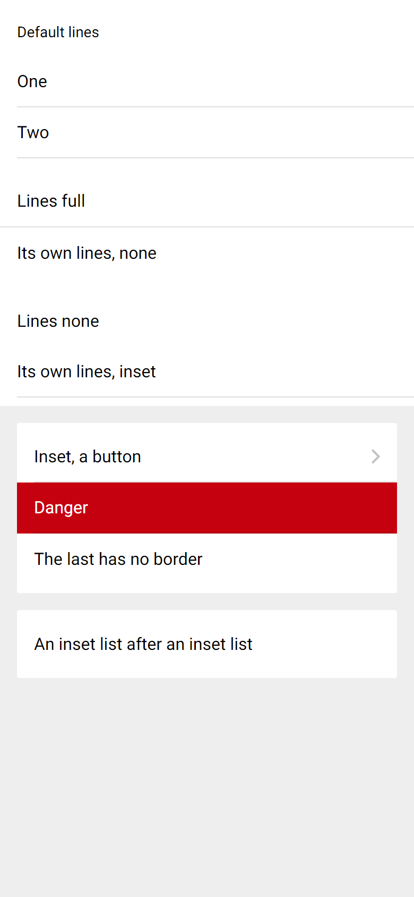

# ion-list — Comparison against the web component

> Ionic side, exactly:
>
> ```
> node tools/ionic-ref/render.js ion-list --bare --html '<div style="background:#eeeeee;height:844px"><ion-list><ion-list-header>Default lines</ion-list-header><ion-item>One</ion-item><ion-item>Two</ion-item></ion-list><ion-list lines="full"><ion-item>Lines full</ion-item><ion-item lines="none">Its own lines, none</ion-item></ion-list><ion-list lines="none"><ion-item>Lines none</ion-item><ion-item lines="inset">Its own lines, inset</ion-item></ion-list><ion-list inset><ion-item button detail>Inset, a button</ion-item><ion-item color="danger">Danger</ion-item><ion-item>The last has no border</ion-item></ion-list><ion-list inset><ion-item>An inset list after an inset list</ion-item></ion-list></div>'
> ```
>
> (Chromium, md, 390×844@2x) → [`ref/`](ref/).
> Avonic side: `AVONIC_CAPTURE_DIR=… dotnet test` → `AvonicListCaptureTests.Reference_Page_List` (headless Skia, 2×) →
> [`compare/`](compare/). Tried in a real window on Windows at 125%: the page draws as the frames do.

## Frames

| Ionic | Avonic |
|---|---|
|  |  |

Lists from the top: default lines with a header, lines full with an item's own none, lines none with an item's own inset,
inset with a button, a colour and a last item, then an inset list straight after it.

**Match.** The five lists' heights are the same: 157, 113, 112, 160 and 64, measured on both, and the capture test holds them.
Text is drawn from the same Roboto files on both sides since #100 ([`tools/fonts/roboto/`](../../../tools/fonts/roboto/README.md)).

## Behaviours

| # | Behaviour | Result |
|---|---|---|
| 1 | Items stack in 8 of padding, on the item background | Match: 112 high |
| 2 | `None` | Match |
| 3 | `Full`: 49 | Match |
| 4 | `Inset`: 48 | Match |
| 5 | An item's own `Lines` wins | Match |
| 6 | Beats an interactive item's borders | Match, with `:item-interactive` set directly, since Avonic has no input yet |
| 7 | Reaches any depth | Match |
| 8 | Nested lists: the order in the CSS decides | Match |
| 9 | Changes live | Ionic re-renders. Match |
| 10 | From a template | No equivalent in Ionic. Works |
| 11 | Inset: margin, radius, clip | Match: 16, 2, and the corner pixels are clipped |
| 12 | The last item in an inset list | **Deliberate difference** in two cases. Measured: `[header, item]` and `[divider, item]` keep the border in Ionic and lose it here, and `[item, item, header]` loses it on the second item in Ionic and keeps it here. Everything else measured matches |
| 13 | A plain list's last item | Match |
| 14 | `+` rule | Match: 16 between each |
| 15 | Tab stops, arrow keys | Match |
| 16 | Roles | Match for the list and a plain item. **Deliberate difference:** a button item is a `Button`, not a `ListItem` |
| 17 | Doesn't scroll | Match |
| 18 | Virtualising | No equivalent in Ionic. Tested at 10,000 items |

## Found here, not by the tests

Nothing on this page. Reading the CSS and measuring it first found the two surprises: nested lists are decided by order, and
`:last-of-type` isn't the last child.
