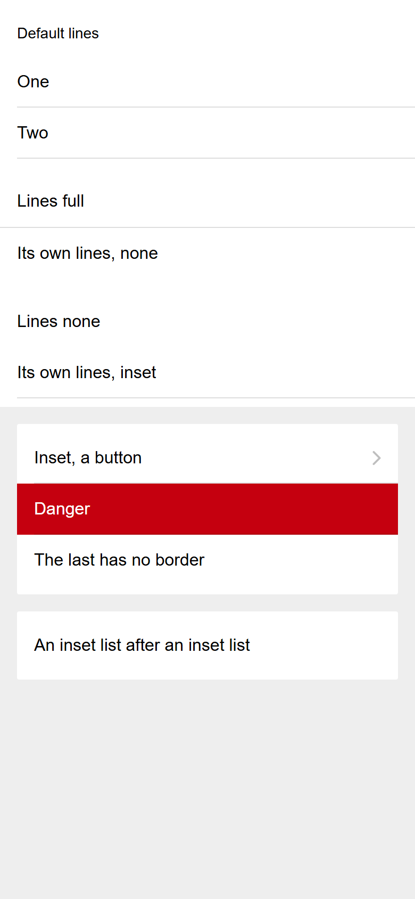
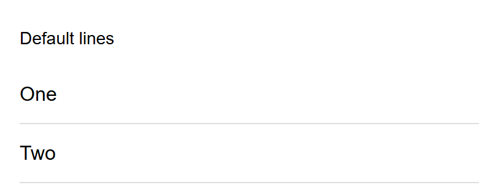

# ion-list — reference render (Ionic 8.8.1, md, 390×844@2x)

Generated by `node tools/ionic-ref/render.js ion-list --bare --html "<div style=\"background:#eeeeee;height:844px\"><ion-list><ion-list-header>Default lines</ion-list-header><ion-item>One</ion-item><ion-item>Two</ion-item></ion-list><ion-list lines=\"full\"><ion-item>Lines full</ion-item><ion-item lines=\"none\">Its own lines, none</ion-item></ion-list><ion-list lines=\"none\"><ion-item>Lines none</ion-item><ion-item lines=\"inset\">Its own lines, inset</ion-item></ion-list><ion-list inset><ion-item button detail>Inset, a button</ion-item><ion-item color=\"danger\">Danger</ion-item><ion-item>The last has no border</ion-item></ion-list><ion-list inset><ion-item>An inset list after an inset list</ion-item></ion-list></div>"`

```html
<div style="background:#eeeeee;height:844px"><ion-list><ion-list-header>Default lines</ion-list-header><ion-item>One</ion-item><ion-item>Two</ion-item></ion-list><ion-list lines="full"><ion-item>Lines full</ion-item><ion-item lines="none">Its own lines, none</ion-item></ion-list><ion-list lines="none"><ion-item>Lines none</ion-item><ion-item lines="inset">Its own lines, inset</ion-item></ion-list><ion-list inset><ion-item button detail>Inset, a button</ion-item><ion-item color="danger">Danger</ion-item><ion-item>The last has no border</ion-item></ion-list><ion-list inset><ion-item>An inset list after an inset list</ion-item></ion-list></div>
```

 

## Element 1

- attributes: `{"role":"list","class":"md list-md hydrated"}`
- classes: `md list-md hydrated`
- rect: `{"x":0,"y":0,"w":390,"h":157}`

### Host computed

| prop | value |
|---|---|
| display | `block` |
| position | `static` |
| box-sizing | `border-box` |
| width | `390px` |
| height | `157px` |
| min-height | `0px` |
| min-width | `0px` |
| padding | `8px 0px` |
| margin | `0px` |
| border | `0px none rgb(0, 0, 0)` |
| border-radius | `0px` |
| background-color | `rgb(255, 255, 255)` |
| color | `rgb(0, 0, 0)` |
| font-size | `16px` |
| font-weight | `400` |
| font-family | `Roboto, "Helvetica Neue", sans-serif` |
| line-height | `normal` |
| letter-spacing | `normal` |
| text-transform | `none` |
| opacity | `1` |
| overflow | `visible` |
| contain | `content` |
| pointer-events | `auto` |
| transition | `all` |
| transform | `none` |
| box-shadow | `none` |
| outline | `rgb(0, 0, 0) none 0px` |
| cursor | `auto` |

### DOM tree

```
<ion-list>
  <ion-list-header.md.hydrated>
    #shadow-root
      <div.list-header-inner part="inner">
        <slot name="">
  <ion-item.item.md.item-lines-default.in-list.hydrated>
    #shadow-root
      <div.item-native part="native">
        <slot name="start">
        <div.item-inner part="inner">
          <div.input-wrapper part="container">
            <slot name="">
          <slot name="end">
  <ion-item.item.md.item-lines-default.in-list.hydrated>
    #shadow-root
      <div.item-native part="native">
        <slot name="start">
        <div.item-inner part="inner">
          <div.input-wrapper part="container">
            <slot name="">
          <slot name="end">
```

## Element 2

- attributes: `{"lines":"full","role":"list","class":"md list-md list-lines-full list-md-lines-full hydrated"}`
- classes: `md list-md list-lines-full list-md-lines-full hydrated`
- rect: `{"x":0,"y":157,"w":390,"h":113}`

### Host computed

| prop | value |
|---|---|
| display | `block` |
| position | `static` |
| box-sizing | `border-box` |
| width | `390px` |
| height | `113px` |
| min-height | `0px` |
| min-width | `0px` |
| padding | `8px 0px` |
| margin | `0px` |
| border | `0px none rgb(0, 0, 0)` |
| border-radius | `0px` |
| background-color | `rgb(255, 255, 255)` |
| color | `rgb(0, 0, 0)` |
| font-size | `16px` |
| font-weight | `400` |
| font-family | `Roboto, "Helvetica Neue", sans-serif` |
| line-height | `normal` |
| letter-spacing | `normal` |
| text-transform | `none` |
| opacity | `1` |
| overflow | `visible` |
| contain | `content` |
| pointer-events | `auto` |
| transition | `all` |
| transform | `none` |
| box-shadow | `none` |
| outline | `rgb(0, 0, 0) none 0px` |
| cursor | `auto` |

### DOM tree

```
<ion-list>
  <ion-item.item.md.item-lines-default.in-list.hydrated>
    #shadow-root
      <div.item-native part="native">
        <slot name="start">
        <div.item-inner part="inner">
          <div.input-wrapper part="container">
            <slot name="">
          <slot name="end">
  <ion-item.item.md.item-lines-none.in-list.hydrated>
    #shadow-root
      <div.item-native part="native">
        <slot name="start">
        <div.item-inner part="inner">
          <div.input-wrapper part="container">
            <slot name="">
          <slot name="end">
```

## Element 3

- attributes: `{"lines":"none","role":"list","class":"md list-md list-lines-none list-md-lines-none hydrated"}`
- classes: `md list-md list-lines-none list-md-lines-none hydrated`
- rect: `{"x":0,"y":270,"w":390,"h":112}`

### Host computed

| prop | value |
|---|---|
| display | `block` |
| position | `static` |
| box-sizing | `border-box` |
| width | `390px` |
| height | `112px` |
| min-height | `0px` |
| min-width | `0px` |
| padding | `8px 0px` |
| margin | `0px` |
| border | `0px none rgb(0, 0, 0)` |
| border-radius | `0px` |
| background-color | `rgb(255, 255, 255)` |
| color | `rgb(0, 0, 0)` |
| font-size | `16px` |
| font-weight | `400` |
| font-family | `Roboto, "Helvetica Neue", sans-serif` |
| line-height | `normal` |
| letter-spacing | `normal` |
| text-transform | `none` |
| opacity | `1` |
| overflow | `visible` |
| contain | `content` |
| pointer-events | `auto` |
| transition | `all` |
| transform | `none` |
| box-shadow | `none` |
| outline | `rgb(0, 0, 0) none 0px` |
| cursor | `auto` |

### DOM tree

```
<ion-list>
  <ion-item.item.md.item-lines-default.in-list.hydrated>
    #shadow-root
      <div.item-native part="native">
        <slot name="start">
        <div.item-inner part="inner">
          <div.input-wrapper part="container">
            <slot name="">
          <slot name="end">
  <ion-item.item.md.item-lines-inset.in-list.hydrated>
    #shadow-root
      <div.item-native part="native">
        <slot name="start">
        <div.item-inner part="inner">
          <div.input-wrapper part="container">
            <slot name="">
          <slot name="end">
```

## Element 4

- attributes: `{"inset":"","role":"list","class":"md list-md list-inset hydrated"}`
- classes: `md list-md list-inset hydrated`
- rect: `{"x":16,"y":398,"w":358,"h":160}`

### Host computed

| prop | value |
|---|---|
| display | `block` |
| position | `static` |
| box-sizing | `border-box` |
| width | `358px` |
| height | `160px` |
| min-height | `0px` |
| min-width | `0px` |
| padding | `8px 0px` |
| margin | `16px` |
| border | `0px none rgb(0, 0, 0)` |
| border-radius | `2px` |
| background-color | `rgb(255, 255, 255)` |
| color | `rgb(0, 0, 0)` |
| font-size | `16px` |
| font-weight | `400` |
| font-family | `Roboto, "Helvetica Neue", sans-serif` |
| line-height | `normal` |
| letter-spacing | `normal` |
| text-transform | `none` |
| opacity | `1` |
| overflow | `hidden` |
| contain | `content` |
| pointer-events | `auto` |
| transition | `all` |
| transform | `matrix(1, 0, 0, 1, 0, 0)` |
| box-shadow | `none` |
| outline | `rgb(0, 0, 0) none 0px` |
| cursor | `auto` |

### DOM tree

```
<ion-list>
  <ion-item.item.md.item-lines-default.in-list.ion-activatable.ion-focusable.hydrated>
    #shadow-root
      <button.item-native part="native">
        <slot name="start">
        <div.item-inner part="inner">
          <div.input-wrapper part="container">
            <slot name="">
          <slot name="end">
          <ion-icon.item-detail-icon.md.flip-rtl.hydrated part="detail-icon">
            #shadow-root
              <div.icon-inner>
                <svg>
                  <path>
        <ion-ripple-effect.md.hydrated>
          #shadow-root
  <ion-item.ion-color.ion-color-danger.item.md.item-lines-default.in-list.hydrated>
    #shadow-root
      <div.item-native part="native">
        <slot name="start">
        <div.item-inner part="inner">
          <div.input-wrapper part="container">
            <slot name="">
          <slot name="end">
  <ion-item.item.md.item-lines-default.in-list.hydrated>
    #shadow-root
      <div.item-native part="native">
        <slot name="start">
        <div.item-inner part="inner">
          <div.input-wrapper part="container">
            <slot name="">
          <slot name="end">
```

## Element 5

- attributes: `{"inset":"","role":"list","class":"md list-md list-inset hydrated"}`
- classes: `md list-md list-inset hydrated`
- rect: `{"x":16,"y":574,"w":358,"h":64}`

### Host computed

| prop | value |
|---|---|
| display | `block` |
| position | `static` |
| box-sizing | `border-box` |
| width | `358px` |
| height | `64px` |
| min-height | `0px` |
| min-width | `0px` |
| padding | `8px 0px` |
| margin | `0px 16px 16px` |
| border | `0px none rgb(0, 0, 0)` |
| border-radius | `2px` |
| background-color | `rgb(255, 255, 255)` |
| color | `rgb(0, 0, 0)` |
| font-size | `16px` |
| font-weight | `400` |
| font-family | `Roboto, "Helvetica Neue", sans-serif` |
| line-height | `normal` |
| letter-spacing | `normal` |
| text-transform | `none` |
| opacity | `1` |
| overflow | `hidden` |
| contain | `content` |
| pointer-events | `auto` |
| transition | `all` |
| transform | `matrix(1, 0, 0, 1, 0, 0)` |
| box-shadow | `none` |
| outline | `rgb(0, 0, 0) none 0px` |
| cursor | `auto` |

### DOM tree

```
<ion-list>
  <ion-item.item.md.item-lines-default.in-list.hydrated>
    #shadow-root
      <div.item-native part="native">
        <slot name="start">
        <div.item-inner part="inner">
          <div.input-wrapper part="container">
            <slot name="">
          <slot name="end">
```
