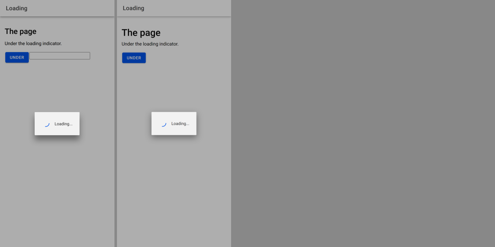
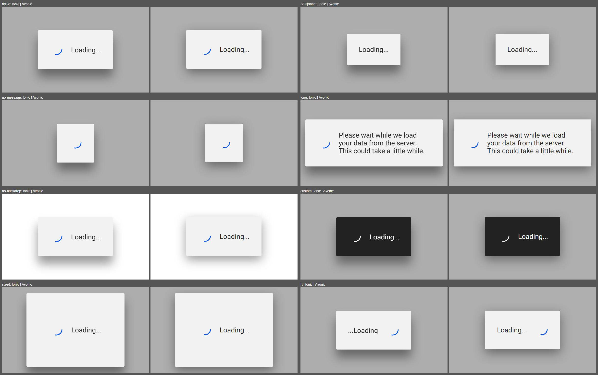
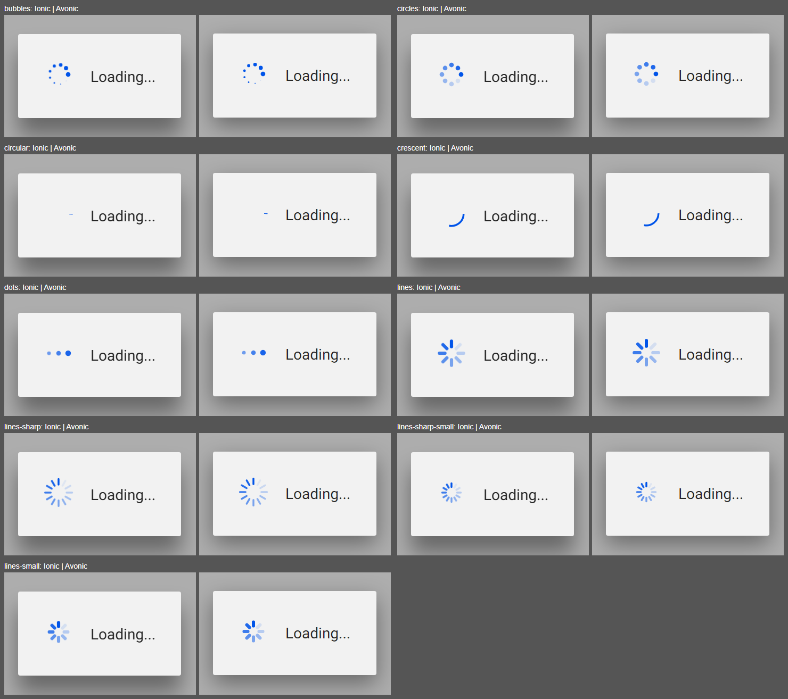

# ion-loading — Comparison

Ionic 9.0.11, md, headless Chromium, beside Avonic headless (Skia) at the same size and 2x. A loading's `spinner: null`,
`htmlAttributes` and `cssClass`'s variables are JavaScript and CSS that `render.js --html` can't set, so the Ionic side comes from one
measurement script on `render.js`'s phone (390 x 844 at 2x, mobile and touch, Roboto from `tools/fonts/roboto/`), which waits as
`render.js` does (`tools/ionic-ref/settle.js`). It makes an `ion-loading` from script in an `ion-app` page with a toolbar, a heading,
a paragraph, a button and an input, sets its properties, and presents it, as the controller does. For the frames each spinner is paused
at 0 through its shadow root. The raw output is [`ref/measure.json`](ref/measure.json): boxes, colours and attributes of each case,
the enter and leave paused at times, and the behaviour scenarios with real taps and keys; a frame of each case is in [`ref/`](ref/).
The script isn't in the repo, as the swarm brief asks; its cases are the `M` rows of [PLAN.md](PLAN.md#measured). A basic frame from
`render.js` itself is reproducible with:

```
node tools/ionic-ref/render.js ion-loading --html '<ion-loading is-open="true" message="Loading..."></ion-loading>'
```

Avonic's frames are `AvonicLoadingCaptureTests`, saved in [`compare/`](compare/), each asserting the boxes beside them within 0.5 px,
with the spinners paused at 0 too. Not tried in a real window: `tools/real-window/drive.ps1` has an `ion-loading` section for the
batch's runner.



The wrapper of each case, Ionic's on the left of each pair:



Every spinner name:



The page under the loading differs a little (Ionic's `h1` from `typography.css`, and its `<input>`); the loading is what's compared.

## Visual

Boxes are x, y, width, height in the window. The capture tests assert them within 0.5 px at 2x; `AvonicLoadingTests` within 1 at 1x,
where Avalonia rounds the layout to whole pixels and a text 61.11 wide is 62.

| | Ionic | Avonic | |
|---|---|---|---|
| Basic: wrapper | 118.44, 382.5, 153.11 x 79 | the same | Match (asserted) |
| Spinner box, spinner | 142.44, 406.5, 28 x 31; the spinner 28 x 28 at its top | the same (a `Border` with 3 below) | Match (asserted) |
| Message | 186.44, 414, 61.11 x 16 (`line-height: normal`, 16) | the same (`LineHeight` 16) | Match (asserted) |
| No spinner | 140.44, 390, 109.11 x 64 | the same | Match (asserted) |
| No message | 157, 382.5, 76 x 79 | the same | Match (asserted) |
| `message: ''` | 149, 382.5, 92 x 79; an empty content 0 x 0 at 217, 422 | the same | Match (asserted) |
| A long message | 55, 374, 280 x 96; the content 123, 398, 188 x 48, three lines | the same; the same line breaks | Match (asserted) |
| `--width: 200px; --min-height: 150px` | 95, 347, 200 x 150, the row centred both ways | the same | Match (asserted) |
| Each of the nine spinners | 28 x 28, the same boxes | the same | Match (asserted) |
| RTL: spinner, message | 219.56 and 142.44: mirrored | the same | Match (asserted) |
| RTL: the message's text | `...Loading`: the trailing full stops resolve to the paragraph's direction | `Loading...` | **Gap**: Avalonia's `TextBlock` keeps them at the end, where its own `TextLayout` doesn't ([avalonia-issues.md](../../infra/avalonia-issues.md)) |
| Colours | wrapper `#f2f2f2`, text `#262626`, spinner `#0054e9`, backdrop black at 0.32 | the same keys | Match (asserted) |
| `cssClass` with `--background: #222; --spinner-color: #fff; color: #fff` | dark wrapper, white text and spinner | the same, through the loading's keys and `Foreground` | Match |
| Radius, padding | 2, 24 | the same | Match (asserted) |
| Shadow | `0 16px 20px rgba(0, 0, 0, 0.4)` | the same CSS, through `{b:CssShadow}`; straight below the wrapper at 2x it's lighter, 178 against 159 at the edge, as if moved up 8 | **Known gap**: Avalonia doesn't scale a `BoxShadow`'s offset at 2x ([avalonia-issues.md](../../infra/avalonia-issues.md), [box-shadow](../../infra/box-shadow/README.md)) |
| `showBackdrop: false` | transparent | transparent | Match (asserted by pixel) |
| `translucent` | nothing different in md | not declared | Deliberate (ios only) |

## Behaviour

| # | Behaviour | Ionic | Avonic | |
|---|---|---|---|---|
| B1 | Enter | M1: 200 ms `ease-in-out`; wrapper 0.01 to 1 and scale 1.1 to 1 (0.505 and 1.05 at 100 ms); backdrop 0.01 to 0.32 (0.165 at 100 ms); the backdrop's `pointer-events: none` until the end | The same values at each frame of the test clock, from `CubicBezierEasing(0.42, 0, 0.58, 1)`, which gives Chromium's values at 25, 50, 100 and 150 ms | Match |
| B2 | Leave | M2: 200 ms; wrapper 0.99 to 0 and scale 1 to 0.9; backdrop to 0; at rest the wrapper is `opacity: 0` | The same; the wrapper rests at 0 | Match |
| B3 | Events | M3: `ionLoadingWillPresent`, `willPresent`, `ionLoadingDidPresent`, `didPresent`, then the dismiss pair with `{data, role}`; `dismiss()` before a present is `false` | The same order, each bubbling; `false` | Match |
| B4 | Focus | M13: the host at present; back after; `keyboardClose: false`: blurred, nothing focused; Tab stays on the host | The same | Match |
| B5 | Backdrop, Escape, back | M15: by default none dismisses; with `backdropDismiss` each does, with `backdrop`; a tap on the wrapper never | The same (back as Alt+Left, Avalonia's back request) | Match |
| B6 | No backdrop | M9, M15: transparent, still covering: a button under it isn't clicked; with `backdropDismiss` a tap dismisses | The same | Match |
| B7 | Duration | M16: `willDismiss` 516 ms after `didPresent` for 500 (500 + 10, and a frame), no role; a dismiss first stops it | 510 after, no role; the same | Match |
| B7 | A second `present()` | starts a second timer, which can dismiss a later presentation | starts none | **Deliberate** (ADR 0005, [ionic-issues.md](../../infra/ionic-issues.md)) |
| B8 | `spinner` | M14: unset is `config.get('loadingSpinner', config.get('spinner', 'crescent'))`; `null` none; `aria-hidden`; `--spinner-color` | `AvonicConfig.LoadingSpinner`, then `AvonicConfig.Spinner`, then `Crescent`, at the first attach, only if unset; null none; `AccessibilityView.Raw`; `Avonic.Loading.SpinnerColor` | Match |
| B9 | Message | M5, M6: undefined: no content and no gap; `''`: an empty one after the gap; wraps within the wrapper | The same; content other than a string is shown as it is (Ionic's HTML) | Match |
| B10 | Sizes | M7: the variables, `90%` the window's height at most | The keys, as numbers or CSS strings | Match |
| B11 | Look | M4, M11 | The keys | Match |
| B12 | Automation | M17: `role="dialog"`, `aria-modal`, `aria-labelledby` the message, else `aria-label`; `htmlAttributes.id` | A `Window` peer named by the message, else `aria-label`, else its own name, raising a name change; `AutomationId` from `id` | Match, as far as Avalonia has a dialog |
| B13 | `cssClass` | classes on the host | style classes, taken off when it changes | Match |
| B14 | `isOpen`, `trigger`, changes while open | M18, M19 | The same, through the base | Match |
| B15 | Stacking | M17: `z-index: 40000 + index` | `ZIndex` 40000 plus the index: over an alert, under a toast | Match |

## Not compared

- **`aria-modal` and the root's `aria-hidden`** while it's open: the overlay system's deferral (#65).
- **A real window**: not tried. The drive section checks the presents by name and region, Escape and the backdrop, a click through the
  transparent backdrop, `IsOpen`, the trigger and the duration.
