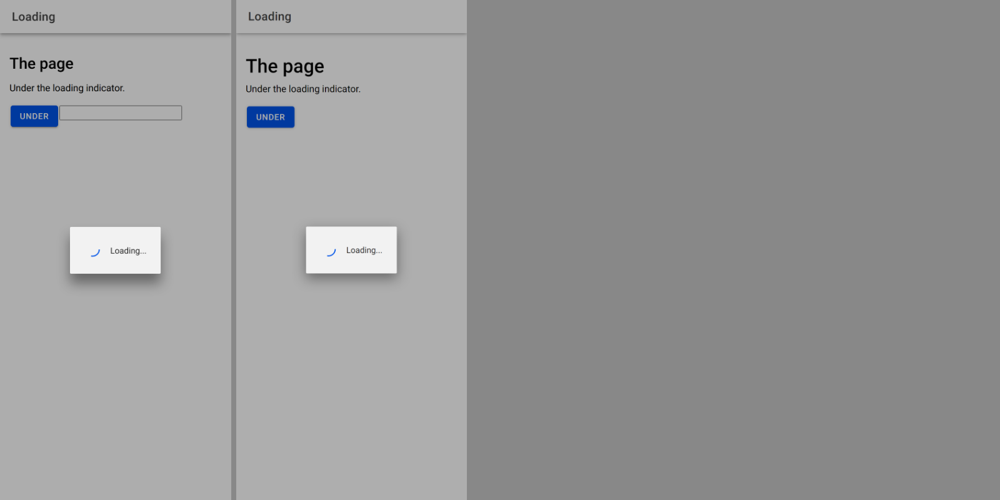

# ion-loading

Status: done · [#41](https://github.com/wdcossey/Avonic/issues/41)

`AvonicLoading`, Ionic's `ion-loading`, md: a spinner and a message in a box at the centre of the window, over a backdrop, which
keeps the page from being used while something loads, on the [overlay system](../../infra/overlays/README.md). Plan:
[PLAN.md](PLAN.md); comparison: [COMPARISON.md](COMPARISON.md).



## Usage

In code, as Ionic's `loadingController.create`:

```csharp
var loading = new AvonicLoading { Message = "Loading..." };
await loading.Present();
await LoadTheData();
await loading.Dismiss();
```

With a `Duration` it dismisses itself, `Duration + 10` ms after the present, with no role:

```csharp
await new AvonicLoading { Message = "Saving...", Duration = 3000, Spinner = SpinnerName.Dots }.Present();
```

In a page, opened by a trigger or `IsOpen` (which a dismiss doesn't set back):

```xml
<c:AvonicButton Name="Load" Content="Load" />
<c:AvonicLoading Trigger="Load" Message="Loading..." Duration="2000" />
```

`Spinner` left unset is `AvonicConfig.LoadingSpinner`, else `AvonicConfig.Spinner`, else `Crescent`, read when the loading is first
attached; `Spinner = null` (or a config of `ConfigSpinner.None`) shows none. `Message` null shows no message, and a string is plain
text; anything else is shown as content, in place of the HTML Ionic can be set to take. A tap on the backdrop, Escape and the back
button do nothing unless `BackdropDismiss` is true, when they dismiss with the `backdrop` role. `ShowBackdrop = false` makes the
backdrop transparent, and it still covers the page.

## Checklist

`node tools/ionic-api.js ion-loading`, as built.

### Props

| ✓ | Ionic | Avonic | Notes |
|---|---|---|---|
| [x] | `animated` | `Animated` | The overlay's |
| [x] | `backdropDismiss` | `BackdropDismiss` | `false` |
| [x] | `cssClass` | `CssClass` | Style classes on the loading |
| [x] | `duration` | `Duration` | ms; 0 never |
| [x] | `enterAnimation`, `leaveAnimation` | `EnterAnimation`, `LeaveAnimation` | The overlay's |
| [x] | `htmlAttributes` | `HtmlAttributes` | `id` (its `AutomationId`) and `aria-label` (its name with no message); others ignored |
| [x] | `isOpen`, `trigger` | `IsOpen`, `Trigger` | The overlay's |
| [x] | `keyboardClose` | `KeyboardClose` | The overlay's |
| [x] | `message` | `Message` | `object?`: a string is text, anything else content |
| [ ] | `mode` | none | Not exposed (ADR 0001) |
| [x] | `showBackdrop` | `ShowBackdrop` | `true` |
| [x] | `spinner` | `Spinner` | `SpinnerName?`; the config's when unset at the first attach |
| [ ] | `translucent` | none | ios only: md draws nothing different, so it would be a dead prop |

### Events, methods

| ✓ | Ionic | Avonic |
|---|---|---|
| [x] | `ionLoadingWillPresent`, `ionLoadingDidPresent`, `ionLoadingWillDismiss`, `ionLoadingDidDismiss` | `IonLoadingWillPresent` and the rest, each before the generic one |
| [x] | `willPresent`, `didPresent`, `willDismiss`, `didDismiss` | the overlay's |
| [x] | `present()`, `dismiss(data, role)`, `onWillDismiss()`, `onDidDismiss()` | `Present()`, `Dismiss(data, role)`, `OnWillDismiss()`, `OnDidDismiss()` |

### Resource keys

| ✓ | Ionic | Avonic resource key | md default |
|---|---|---|---|
| [x] | `--backdrop-opacity` | `Avonic.Loading.BackdropOpacity` | unset: `Avonic.BackdropOpacity`, 0.32 |
| [x] | `--background` | `Avonic.Loading.Background` | unset: `Avonic.BackgroundColorStep50Brush` (`#f2f2f2`) |
| [x] | `--width` | `Avonic.Loading.Width` | `auto` |
| [x] | `--min-width` | `Avonic.Loading.MinWidth` | `auto` |
| [x] | `--max-width` | `Avonic.Loading.MaxWidth` | 280 |
| [x] | `--height` | `Avonic.Loading.Height` | `auto` |
| [x] | `--min-height` | `Avonic.Loading.MinHeight` | `auto` |
| [x] | `--max-height` | `Avonic.Loading.MaxHeight` | `90%` |
| [x] | `--spinner-color` | `Avonic.Loading.SpinnerColor` | unset: `Avonic.Color.PrimaryBrush` |

A size takes a number (px) or a CSS string: px, `%`, `vw` and `vh` (of the window), a sum or difference, `calc()`, `min(a, b)`,
`auto`, `none`. Not an Ionic variable: `Avonic.Loading.Md.BoxShadow`, the wrapper's `0 16px 20px rgba(0, 0, 0, 0.4)`. The text is
the loading's `Foreground` (`Avonic.TextColorStep150Brush`), 14 px.

The template's parts: `PART_Backdrop`, `PART_SentinelStart` and `PART_SentinelEnd` (the focus trap's), `PART_Panel` (an
`AlertPanel`), `PART_Wrapper` (`.loading-wrapper`), `PART_Row` (a `FlexRow`), `PART_SpinnerBox` (`.loading-spinner`), `PART_Spinner`,
`PART_Content` (`.loading-content`) and `PART_MessagePresenter`.

## Behaviours

B1 to B15 in [PLAN.md](PLAN.md), each tested in `AvonicLoadingTests` and `AvonicLoadingCaptureTests` on the test clock: md's enter
and leave frame by frame, the events in order, focus at present and Tab, the backdrop, Escape and back with and without
`BackdropDismiss`, the transparent backdrop that still covers the page, the duration and its 10 ms, the spinner's config and its
colour, the message's three states and wrapping, the measured boxes, the colours, automation, `CssClass`, `IsOpen`, `Trigger`,
changes while open, and stacking.

## Extensions

No Ionic member is shadowed or added. `Present(TopLevel)` is the overlay's. For the theme, three public converters, as
`AvonicAlert.HasMessage` is: `AvonicLoading.HasText` (a message with text), `NormalLineHeight` (Chromium's `line-height: normal` for a
string message, from the font) and `SpinnerBaselineDrop` (the font's rounded descent below the spinner).

## Known gaps

- **RTL**: a message ending in punctuation shows it at the end (`Loading...`), where Chromium shows `...Loading`: Avalonia's
  `TextBlock` ([avalonia-issues.md](../../infra/avalonia-issues.md)).
- **The shadow** is lighter straight below the wrapper at 2x, as Avalonia doesn't scale a `BoxShadow`'s offset
  ([box-shadow](../../infra/box-shadow/README.md)).
- **A message that's content** names the dialog by its own automation name, or its text when it's set; a later change of that
  text inside it isn't raised as a name change, as the loading doesn't watch the content (a new `Message` is).
- **A font with a line gap**: the line height and the spinner's drop are the rounded ascent and descent, as `TextareaNativeInput`
  works out `line-height: normal`, measured only with Roboto, whose gap is 0. Where a gap goes for another font isn't measured.
- **Root `aria-hidden`** while it's open, the overlay system's deferral (#65).
- **Not copied:** Ionic's second `present()` starts a second duration timer, and a `duration` past 2^31 - 1 ms (`Infinity`)
  dismisses at once, where Avonic's never comes ([ionic-issues.md](../../infra/ionic-issues.md)).
- Not tried in a real window: `tools/real-window/drive.ps1` has an `ion-loading` section for the batch's runner.
