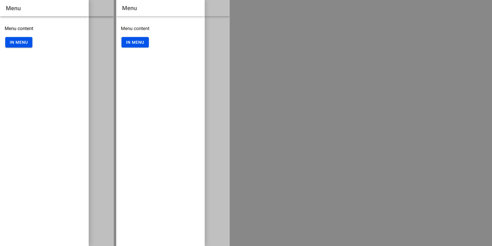
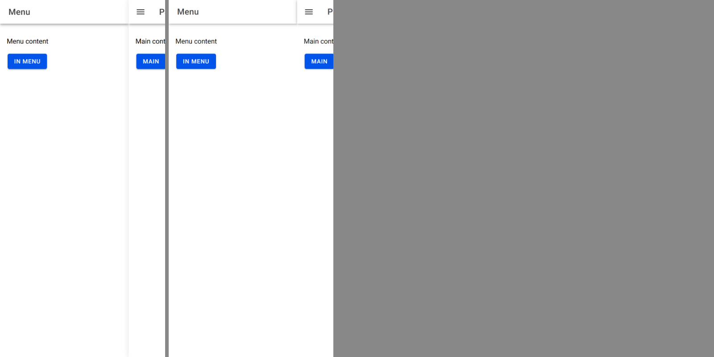
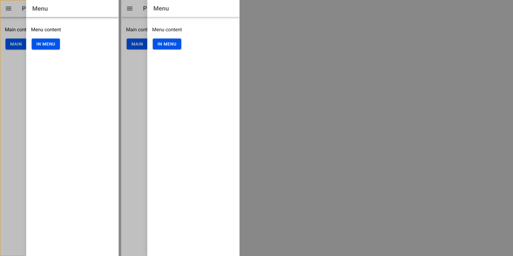

# ion-menu — Comparison

`ion-menu`, `ion-menu-button`, `ion-menu-toggle` and `menuController`. Ionic 9.0.11, md, headless Chromium, beside Avonic headless
(Skia) at the same size and 2x. Not tried in a real window: `tools/real-window/drive.ps1` has a section for the sample page
(`Menu`), not run here.

**The reference.** `render.js` can't click or open a menu, so the menu's frames and numbers come from four throwaway Playwright
scripts on `render.js`'s phone (390 x 844 at 2x, mobile, touch; `tools/ionic-ref/phone.js`, `settle.js` and the Roboto in
`tools/fonts/roboto/`), each run as `node <script> <repo> <outdir>`:

| Script | What it wrote |
|---|---|
| `measure.js` | [`ref/measurements.txt`](ref/measurements.txt): M1 to M13 and M15. Each state's boxes, transforms, shadows, classes, `aria-*`, focus, and every Web Animation's keyframes, easing and duration, read from `getAnimations()`, with the events' times |
| `extra.js` | [`ref/extra.txt`](ref/extra.txt): M10, M14, M16 to M18, and the button's hover, Enter and Escape |
| `focus.js` | [`ref/focus.txt`](ref/focus.txt): M11, the trap with three buttons in the menu, Tab and Shift+Tab, mobile and desktop |
| `frames.js` | `ref/closed.png`, `open-overlay.png`, `open-push.png`, `open-reveal.png`, `open-end.png`: the page `AvonicMenuCaptureTests` builds, each menu opened by a mouse click on the menu button (the end menu by `open()` after a click on the page) |

The button's and the toggle's own render is `render.js`'s, its command at the top of [`ref/button/README.md`](ref/button/README.md)
and [`ref/toggle/README.md`](ref/toggle/README.md):

```
node tools/ionic-ref/render.js ion-menu-button --bare --out docs/components/ion-menu/ref/button --html "<ion-app style=\"position:static;display:block;contain:none;overflow:visible\"><ion-menu content-id=\"main\"><ion-content>Menu</ion-content></ion-menu><div class=\"ion-page\" id=\"main\"><ion-header><ion-toolbar><ion-buttons slot=\"start\"><ion-menu-button></ion-menu-button></ion-buttons><ion-title>Page</ion-title></ion-toolbar></ion-header><ion-content class=\"ion-padding\"><ion-menu-toggle><ion-button>Toggle</ion-button></ion-menu-toggle></ion-content></div></ion-app>"
```

(the toggle's is the same with `ion-menu-toggle` and `--out docs/components/ion-menu/ref/toggle`).

Avonic's frames are `AvonicMenuCaptureTests`, with `AVONIC_CAPTURE_DIR` set, in [`compare/`](compare/); the side-by-side frames are
`node tools/ionic-ref/side.js ref/<frame>.png compare/avonic-<frame>.png compare/side-<frame>.png 800`. Ionic's is on the left of
each.

| Closed | Overlay | Push |
|---|---|---|
|  |  |  |

| Reveal | The end side |
|---|---|
|  |  |

The sample page, closed, with its start menu open, and with its end menu open: [`compare/avonic-sample.png`](compare/avonic-sample.png),
[`compare/avonic-sample-open.png`](compare/avonic-sample-open.png), [`compare/avonic-sample-end.png`](compare/avonic-sample-end.png).

## Visual

| | Ionic | Avonic | |
|---|---|---|---|
| The menu button | M1: 48 x 48 at 4, 4 in the toolbar's start buttons; the `menu-sharp` icon 24 at 16, 16; (66, 66, 66), the toolbar's colour | The same box (asserted in `Reference_Closed` and `B21_It_Is_48_Square_At_4_4…`), icon and colour | Match |
| The overlay menu, open | M2: the inner 0, 0, 304 x 844, white, `4px 0px 16px rgba(0,0,0,0.18)`; the backdrop over the rest at 0.25 | The container 0, 0, 304 x 844 (asserted), the same shadow through [box-shadow](../../infra/box-shadow/README.md)'s conversion, the backdrop at 0.25 (asserted) | Match |
| Push | M3: the inner at 0, the content at 304 with its shadow, no backdrop | The content at 304 (asserted), its shadow drawn by `PART_ContentShadow` on its box | Match |
| Reveal | M4: the content at 304, the inner at 0 the whole time | The same (asserted) | Match |
| The end side | M5: the inner at 86, its shadow still `4px 0px` (physical) | At 86 (asserted), the same shadow | Match. Ionic's frame has a one-pixel orange line down the left: Chromium's focus ring on the page the script clicked before `open()`, not Ionic's |
| Up to 340 wide | M6: the inner 264 wide | 264 (`B5_Up_To_340_Wide…`) | Match |
| The button in a primary toolbar, `color="danger"`, disabled, focused, hovered | M15: white; the native colour (197, 0, 15); 0.5; the colour at 0.12; md's hover at 0.04 (`extra.txt`'s hover reads 0 on a touch phone, which has no hover) | The same (`B21_*`, `B20_Disabled…`) | Match |
| The toggle | No look of its own (`display: inline`, its content's) | A `ContentControl` with no theme of its own | Match |

## Behaviour

| # | Behaviour | Ionic | Avonic | |
|---|---|---|---|---|
| B1 | Open | M2: shown at the call, `ionWillOpen` then `ionDidOpen` about 316 ms later, `open()` true | The same on the clock: `ionWillOpen@0`, `ionDidOpen@320` (the frame that ends the 300 ms) | Match |
| B2 | Overlay animation | M2: the inner `translateX(-312px)` to 0, the backdrop 0.01 to 0.25, 300 ms, `cubic-bezier(0, 0, 0.2, 1)`; closing the same reversed on `cubic-bezier(0.4, 0, 0.6, 1)`; `animated: false` in the config: duration 0 | The same values at each frame | Match |
| B3 | Push, reveal | M3, M4: the keyframes above; push's backdrop animated to 0.32 but `display: none` | The same; no backdrop shown | Match |
| B4 | End side, RTL | M5: from `translateX(312px)`; RTL makes start the far edge, and the transforms are physical | The same; the template is left to right and the content takes the menu's direction back | Match |
| B5 | Sizes | 304, 264 up to 340 wide; the six size variables | The keys, read as CSS lengths | Match |
| B6 | Roles | M7: `backdrop` from a click outside and from Escape; `close(…, role)` carried to both events; M8: no role when another menu opens | The same | Match |
| B7 | One at a time | M8: the open one closes at once, both events in the same ms, then the other opens; M18: a second click 50 ms later refused | The same | Match |
| B7 | Two menus opened in one tick | M9: `[true, false, true]`: both open, as the controller's `isAnimating` check comes before an `await` | The second is refused: the check and the start are one synchronous step | Deliberate difference (below) |
| B8 | Disabled | M10: `ionDidClose { role: 'gesture' }` with no will event, open or closed, and twice when disabled at load; `open()` false | The same, the double event included | Match |
| B9 | Backdrop click | M7: a click outside the inner closes with `backdrop`; inside, nothing; push and reveal: the content's place, which takes no pointer | The same; and nothing within 100 ms of a swipe's end, by the events' times | Match |
| B10 | The content while shown | `pointer-events: none`, `aria-hidden="true"` | `IsHitTestVisible` false and `IsOffscreenBehavior.Offscreen`, at style priority | Match for input. Automation: see the gaps |
| B11 | Escape | M7: `close(undefined, 'backdrop')` | The same | Match |
| B12 | Focus | M11: the button that had focus blurred; `ion-menu` focused once open; Tab through the menu's buttons, then held on the last; focus sent to the content lands on the last; `body` after a close | The same (`B12_*`); an overlay on top keeps its own focus | Match |
| B12 | Shift+Tab from the menu itself | `focus.txt`: to `body`, then the last button | The last button at once | Gap, forced: see below |
| B13 | Back | `ionBackButton` at `MENU_BACK_BUTTON_PRIORITY`, 99, under an overlay's 100 | `HardwareBackButton` at 99; without an `AvonicApp`, `BackRequested` unless an overlay takes it | Match |
| B14 | Swipe to open | M12: captured at 10 px; `-312 + 312 × delta / 304`; from 49 opens, from 51 not; `max-edge-start="100"` from 90; the end side from 380 | The same numbers; off with `SwipeGesture` false, disabled, another menu open or a modal presented | Match |
| B15 | Swipe to close | M13: from anywhere, the first move at `-0.0312` (the step clamped to 0.9999); M14: a short one goes back open, `ionWillClose` then `ionDidOpen` | The same | Match |
| B16 | Type | Undefined takes `menuType`, md's `overlay`; a change makes the next animation the new type's | The same (`ConfigOnLoad.IfUnset`) | Match; a change while it's shown: see the deliberate differences |
| B17 | Removed while open | M17: closed at once with no events reaching `document`; the content's state cleared; the button not hidden | The same | Match |
| B18 | No `content-id` | M16: an error logged; not registered, so the button hides; `open()` still opens it | The same, through `Logger` | Match |
| B19 | Controller | `get` by side (enabled first), by `menuId`, or the first enabled; the rest | The same | Match |
| B20 | Button | A click toggles; Enter on the focused button too (`extra.txt`); hidden with `display: none`, `aria-hidden` when its menu isn't active; shown with `auto-hide="false"`; disabled: no click | The same; Space too, as a native `<button>` clicks on Space (`extra.txt`'s Space reached no button: `page.focus()` on the host doesn't focus its shadow `<button>`) | Match |
| B21 | Button look | M1, M15 | The same | Match |
| B22 | Button automation | `aria-label="menu"` on the native button | A `Button` peer named `menu`, the app's name first; invoking it toggles | Match |
| B23 | Toggle | A DOM `click` from anything inside toggles; hidden like the button | The same, a stock `Button` or `AvonicButton` inside clicking from a key too | Match |
| B24 | Menu automation | `role="navigation"`, `aria-label` or `menu` | A `Navigation` landmark named `menu`, the app's name first | Match |

## Deliberate differences

- **M9, two menus opened in one tick.** Ionic's `_setOpen` checks `isAnimating` before `await getOpen()`, so two calls in the same
  tick both pass the check and both menus end open, which the controller's one-open rule means to prevent. Here the check and the
  start of the animation are synchronous, so the second call returns false.
- **`Type` set to null after load** is Ionic's `undefined`: opening throws "animation not registered", as Ionic's controller does.
- **Where Ionic would be left animating.** Ionic's menu can be left "animating" for good, and then the controller refuses every
  menu: a type or side changed while it plays (its animation is dropped, and a destroyed one never ends its play), a menu removed
  while it plays, a menu disabled during a swipe (`operationCancelled` is cleared only in `setOpen`, which a swipe never reaches,
  so the next `open()` returns false), or a type with no animation (it throws after `beforeAnimation`). A page here is detached and
  attached far more often than an element is removed from a document, so Avonic doesn't copy these: an animation that's playing or
  holds the open menu is kept, marked stale, until the next open or close makes the new one; a menu detached while it plays is closed
  at once, and the call awaiting it returns false; the cancel is cleared at the start of each opening or closing, and a swipe's
  animation is made again after one; and a type with no animation faults the task, as Ionic's promise rejects, with the menu put
  back as it was and the did event of that state (a swipe the same, logged), and a menu button or toggle logs the failure. Each
  has a test (`B16_A_Type_Changed_While_*`, `B17_Detached_While_Opening_*`, `B8_Disabled_During_A_Swipe_*`, `B16_With_No_Animation_*`,
  `B20_A_Button_Whose_Menu_Has_No_Animation_*`).
- **A swipe while another menu is opening.** Ionic's `canStart` refuses a swipe while another menu is open, not while it's still
  opening, so a swipe then ends with two menus open. Here it's refused while any menu animates, as the controller refuses an open
  (`B14_Nothing_Starts_While_Another_Menu_Is_Opening`).
- **A type changed while the menu is open** keeps the old type's animation, and so the menu where it is, until the close, which plays
  the new type's and stops both. Ionic's is left on the elements, `fill: both`, after the close too.

## Gaps

- **`aria-hidden` on the content hides only the content itself** from automation (`IsOffscreen`), not its subtree: Avalonia has no
  inherited hidden state for automation, and a screen reader can still walk into the content's children. Input is blocked, and
  focus is trapped in the menu, so a keyboard or a pointer can't reach them.
- **Shift+Tab from the menu itself** goes to the menu's last element. In Chromium it goes first to `body`, the browser's own stop
  outside the page, then to the last element: a window has no such stop, and Avalonia's tab navigation wraps.
- **One controller per process.** Ionic's `menuController` is one per document; `MenuController` is one per process, so menus in
  two windows are kept to one open between them, and one animating in one window refuses an open in the other. The back button is
  per window.
