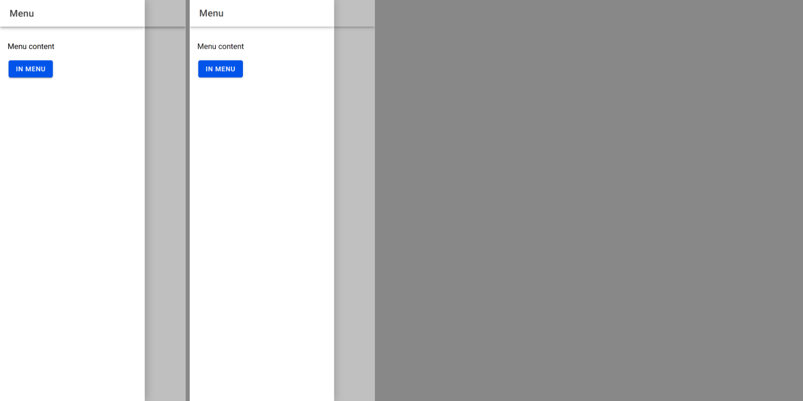
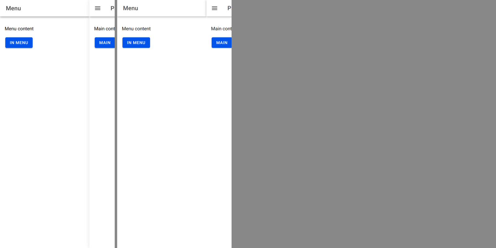
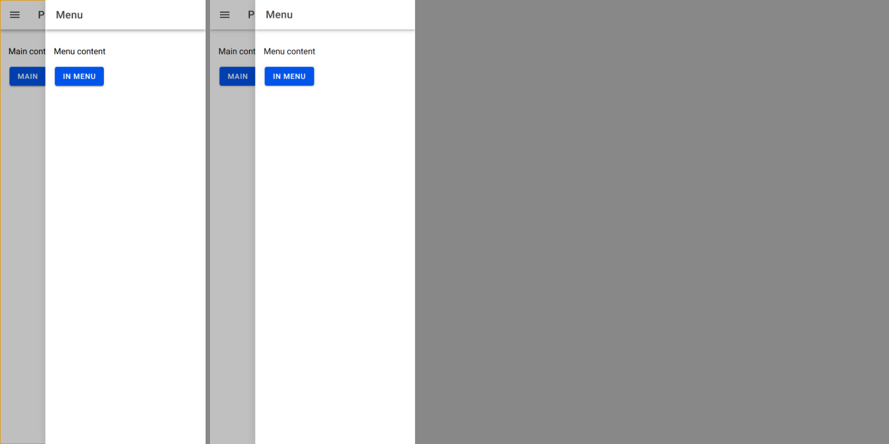

# ion-menu

Status: done · [#44](https://github.com/wdcossey/Avonic/issues/44)

`AvonicMenu`, `AvonicMenuButton`, `AvonicMenuToggle` and `MenuController`: Ionic's `ion-menu`, `ion-menu-button`,
`ion-menu-toggle` and `menuController`, md. A side menu over (or beside) the page's main content, opened by its button, a toggle,
code or a swipe from the window's edge, and kept to one open at a time. Plan: [PLAN.md](PLAN.md); comparison:
[COMPARISON.md](COMPARISON.md). The button's and the toggle's pages, [ion-menu-button](../ion-menu-button/README.md) and
[ion-menu-toggle](../ion-menu-toggle/README.md), point here.

| Overlay | Push | The end side |
|---|---|---|
|  |  |  |

## Usage

The menu and the main content are siblings, the menu first, as in Ionic. `ContentId` names the main content, looked up in the
menu's name scope when the menu is attached:

```xml
<Grid>
    <c:AvonicMenu MenuId="main-menu" ContentId="MainContent">
        <DockPanel>
            <c:AvonicHeader DockPanel.Dock="Top">
                <c:AvonicToolbar>
                    <c:AvonicTitle Content="Menu" />
                </c:AvonicToolbar>
            </c:AvonicHeader>
            <c:AvonicContent>
                <c:AvonicList>
                    <!-- A toggle closes the menu when anything in it is clicked. -->
                    <c:AvonicMenuToggle>
                        <c:AvonicItem Button="True" Content="Inbox" />
                    </c:AvonicMenuToggle>
                </c:AvonicList>
            </c:AvonicContent>
        </DockPanel>
    </c:AvonicMenu>

    <DockPanel Name="MainContent">
        <c:AvonicHeader DockPanel.Dock="Top">
            <c:AvonicToolbar>
                <c:AvonicToolbar.StartContent>
                    <c:AvonicButtons>
                        <c:AvonicMenuButton />
                    </c:AvonicButtons>
                </c:AvonicToolbar.StartContent>
                <c:AvonicTitle Content="Page" />
            </c:AvonicToolbar>
        </c:AvonicHeader>
        <c:AvonicContent />
    </DockPanel>
</Grid>
```

`Type="Push"` or `"Reveal"` moves the main content aside instead; `Side="End"` puts the menu at the far edge. From code:

```csharp
await MenuController.Open("main-menu");    // by MenuId, or "start" / "end", or the first enabled menu with none
await menu.Close(animated: true, role: "selected");
MenuController.Enable(false, "main-menu"); // closes it, and hides its buttons
```

`MenuController.RegisterAnimation(MenuType.Push, ctx => …)` replaces a type's animation; the builder is given a
`MenuAnimationContext`, Ionic's `MenuI` as the animations see it (the menu, its container, backdrop and content, its width and side).

## Checklist

From `node tools/ionic-api.js ion-menu`, `ion-menu-button` and `ion-menu-toggle`; `menuController` isn't in `core.json`, so its
list is from `utils/menu-controller`. Every row is in [PLAN.md](PLAN.md#fidelity-checklist), with its notes.

### ion-menu

| ✓ | Ionic | Avonic |
|---|---|---|
| [x] | `contentId` | `ContentId` |
| [x] | `disabled` | `IsEnabled` (inverted), the menu's own |
| [x] | `maxEdgeStart` | `MaxEdgeStart`, 50 |
| [x] | `menuId` | `MenuId` |
| [x] | `side` | `Side`: `MenuSide.Start`, `End` |
| [x] | `swipeGesture` | `MenuSwipeGesture`, as `InputElement.SwipeGesture` is an event |
| [x] | `type` | `Type`: `MenuType?`, `Overlay`, `Reveal`, `Push`; null takes `AvonicConfig.MenuType` at the first attach |
| [x] | `ionWillOpen`, `ionDidOpen` | `IonWillOpen`, `IonDidOpen` |
| [x] | `ionWillClose`, `ionDidClose` | `IonWillClose`, `IonDidClose`, with `MenuCloseEventArgs.Role` |
| [x] | `ionMenuChange` (internal) | `MenuController.MenuChanged`, internal |
| [x] | `isOpen()`, `isActive()` | `IsOpen()`, `IsActive()` |
| [x] | `open()`, `close()`, `toggle()`, `setOpen()` | `Open`, `Close`, `Toggle`, `SetOpen`: `Task<bool>` |
| [x] | default slot | `Content` |
| [x] | `container`, `backdrop` parts | `PART_Container`, `PART_Backdrop` |
| [x] | `--background`, `--width`, `--min-width`, `--max-width`, `--height`, `--min-height`, `--max-height` | the keys below |

### ion-menu-button

| ✓ | Ionic | Avonic |
|---|---|---|
| [x] | `autoHide` | `AutoHide`, true |
| [x] | `color` | `Color` |
| [x] | `disabled` | `IsEnabled` (inverted) |
| [x] | `menu` | `Menu`: a `MenuId`, `start` or `end` |
| [ ] | `mode` | not exposed (ADR 0001) |
| [ ] | `type` | not applicable: HTML form |
| [x] | default slot | `Content`; empty, the menu icon |
| [x] | `native`, `icon` parts | `PART_Native`, `PART_Icon` |
| [x] | its 13 variables | the keys below |

### ion-menu-toggle

| ✓ | Ionic | Avonic |
|---|---|---|
| [x] | `autoHide` | `AutoHide`, true |
| [x] | `menu` | `Menu` |
| [x] | default slot | `Content` |

### menuController

| ✓ | Ionic | Avonic |
|---|---|---|
| [x] | `open`, `close`, `toggle` | `Open`, `Close`, `Toggle` |
| [x] | `enable`, `swipeGesture` | `Enable`, `SwipeGesture` |
| [x] | `isOpen`, `isEnabled`, `isAnimating` | `IsOpen`, `IsEnabled`, `IsAnimating` |
| [x] | `get`, `getOpen`, `getMenus` | `Get`, `GetOpen`, `GetMenus`, synchronous |
| [x] | `registerAnimation` | `RegisterAnimation(MenuType, builder)` |

## Behaviour

- **Open and close**: shown at the call, `IonWillOpen` (or `IonWillClose` with its role), then 300 ms of md's animation, then
  `IonDidOpen` (`IonDidClose`) and the task's `true`. Opening eases on `cubic-bezier(0, 0, 0.2, 1)`, closing plays it back on
  `cubic-bezier(0.4, 0, 0.6, 1)`. `AvonicConfig.Animated` off makes it 0 ms.
- **Types**: overlay slides the 304-wide container in from `-(width + 8)` over a backdrop at 0.25 with a shadow; push slides the
  container in and the content out by its width, the content with a shadow; reveal moves only the content. The end side is the far
  edge, and in right to left the start side is; the movement is physical, as Ionic's `translateX`. Up to 340 wide the container
  is 264.
- **One at a time**: opening a menu closes an open one at once, with no role; while any menu animates, `Open`, `Close` and
  `Toggle` return false.
- **Closing**: a click outside the container (`backdrop`; not within 100 ms of a swipe's end), Escape on the menu (`backdrop`),
  the hardware back button at priority 99, under an overlay's 100 (with an `AvonicApp`; without one, `BackRequested` unless an
  overlay takes it), a swipe (`gesture`), a toggle or the button, or code with a role of the app's.
- **Disabled** (`IsEnabled` false, `MenuController.Enable(false)`): closed at once with `IonDidClose` `gesture` and no will event,
  even when it was closed, as Ionic's; `Open` returns false; its buttons and toggles hide while `AutoHide` is on.
- **Swipe**: from within `MaxEdgeStart` of the window's edge on the menu's side, the menu follows the finger linearly from the
  10 px threshold, and completes past half its width or on a flick faster than 0.2 px/ms; a short slow one goes back. An open
  menu swipes closed from anywhere. Nothing starts with `MenuSwipeGesture` off, while another menu is open or opening, or while a modal is
  presented.
- **The main content** while the menu is shown takes no input and is offscreen to automation.
- **Focus**: opening clears it; the menu takes it once open; Tab stays in the menu, and focus sent outside comes back to its last
  element, as Ionic's trap; an overlay on top keeps its own; focus isn't given back after the close.
- **No content**: a `ContentId` not found logs an error, and the menu isn't registered (its buttons hide, it has no swipe), but
  `Open()` still opens it. Removed while open, it closes at once with no events and leaves the controller.
- **The button** toggles its menu on a click, Enter or Space; 48 x 48, the `menu-sharp` icon (`AvonicConfig.MenuIcon`) unless it
  has content; the toolbar's colour, or `Color`'s; an unbounded ripple; hover 0.04 and keyboard focus 0.12 of its colour; disabled,
  0.5 and no click. Automation: a button named `menu` unless the app names it.
- **The toggle** toggles its menu on any click inside it, a stock `Button` or an `AvonicButton` from a key too; no look of its own.
- **Automation**: the menu is a `Navigation` landmark named `menu` unless the app names it.
- **In an `AvonicSplitPane`** ([ion-split-pane](../ion-split-pane/README.md), #78): a menu that is its side, not in its main
  content, is `:split-pane-side`; while the pane shows it's `:menu-pane-visible`, shown beside the main content and not active
  (`IsActive()` and `Open()` false, no swipe; one that was open closes with the `gesture` role), and its buttons and toggles hide.

## Resource keys

A size takes a number (px) or a CSS string: `304px`, a percentage of the menu's host, `vw`, `vh`, `calc()`, `min()` or `auto`.

| Ionic | Key (`Tokens/Menu.axaml`) | md |
|---|---|---|
| `--background` | `Avonic.Menu.Background` | unset: `Avonic.BackgroundColorBrush` |
| `--width` | `Avonic.Menu.Width` | 304; up to 340 wide, `Avonic.Menu.Md.WidthSmall` (264) |
| `--min-width`, `--max-width` | `Avonic.Menu.MinWidth`, `.MaxWidth` | `auto` |
| `--height`, `--min-height`, `--max-height` | `Avonic.Menu.Height`, `.MinHeight`, `.MaxHeight` | `100%`, `auto`, `auto` |
| (no variable) the overlay's shadow | `Avonic.Menu.Md.BoxShadow` | `4px 0px 16px rgba(0, 0, 0, 0.18)` |
| (no variable) push's and reveal's content shadow | `Avonic.Menu.Md.ContentBoxShadow` | the same |

| Ionic | Key (`Tokens/MenuButton.axaml`) | md |
|---|---|---|
| `--background` | `Avonic.MenuButton.Background` | transparent |
| `--background-focused`, `--background-hover` | `Avonic.MenuButton.BackgroundFocused`, `.BackgroundHover` | unset: its colour |
| `--background-focused-opacity`, `--background-hover-opacity` | `Avonic.MenuButton.BackgroundFocusedOpacity`, `.BackgroundHoverOpacity` | 0.12, 0.04 |
| `--border-radius` | `Avonic.MenuButton.BorderRadius` | `50%` |
| `--color`, `--color-focused`, `--color-hover` | `Avonic.MenuButton.Color`, `.ColorFocused`, `.ColorHover` | unset: inherited |
| `--padding-start`, `--padding-end`, `--padding-top`, `--padding-bottom` | `Avonic.MenuButton.PaddingStart`, `.PaddingEnd`, `.PaddingTop`, `.PaddingBottom` | 8, 8, 0, 0 |

The button's 48 x 48 and its 24 font size have no variable: they're in the theme.

## Extensions

None. `MenuController` is Ionic's `menuController`, and `MenuAnimationContext` its `MenuI`.

## Known gaps

- **The content's `aria-hidden`** hides only the content itself from automation (`IsOffscreen`), not what's in it: Avalonia has no
  inherited hidden state. Input is blocked and focus is trapped, so only a screen reader's own navigation can reach it.
- **Shift+Tab from the menu itself** goes to its last element; Chromium goes to `body`, the browser's stop outside the page, first.
- **Where Ionic's menu would be left animating** (a type or side changed while it plays, removed while it plays, disabled during a
  swipe, a type with no animation), and then refuse every menu, Avonic's isn't; and a swipe is refused while another menu is still
  opening. See [COMPARISON.md](COMPARISON.md#deliberate-differences).
- **Two menus opened in one tick**: the second is refused, where Ionic's race opens both. See
  [COMPARISON.md](COMPARISON.md#deliberate-differences).
- **One `MenuController` per process**, where Ionic's is one per document: menus in two windows are kept to one open between them.
- **The Android TalkBack workaround** (`aria-hidden` on the menu while it animates) isn't here.
- Not tried in a real window: `tools/real-window/drive.ps1` has an `ion-menu` section, not run.
