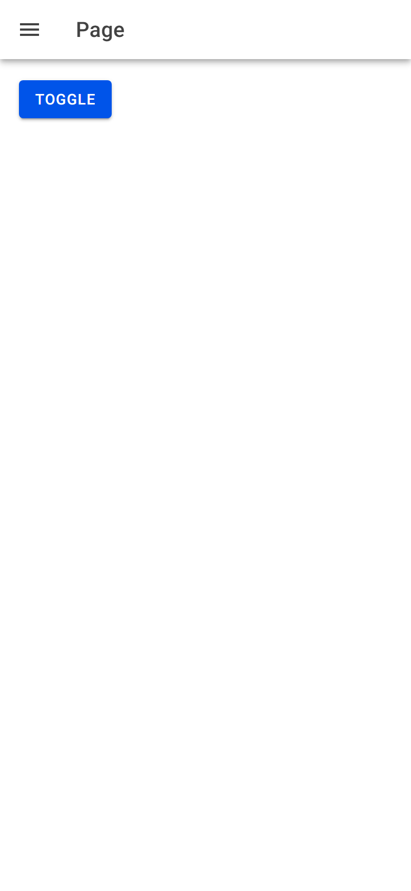

# ion-menu-button — reference render (Ionic 9.0.11, md, 390×844@2x)

Generated by `node tools/ionic-ref/render.js ion-menu-button --bare --out docs/components/ion-menu/ref/button --html "<ion-app style=\"position:static;display:block;contain:none;overflow:visible\"><ion-menu content-id=\"main\"><ion-content>Menu</ion-content></ion-menu><div class=\"ion-page\" id=\"main\"><ion-header><ion-toolbar><ion-buttons slot=\"start\"><ion-menu-button></ion-menu-button></ion-buttons><ion-title>Page</ion-title></ion-toolbar></ion-header><ion-content class=\"ion-padding\"><ion-menu-toggle><ion-button>Toggle</ion-button></ion-menu-toggle></ion-content></div></ion-app>"`

```html
<ion-app style="position:static;display:block;contain:none;overflow:visible"><ion-menu content-id="main"><ion-content>Menu</ion-content></ion-menu><div class="ion-page" id="main"><ion-header><ion-toolbar><ion-buttons slot="start"><ion-menu-button></ion-menu-button></ion-buttons><ion-title>Page</ion-title></ion-toolbar></ion-header><ion-content class="ion-padding"><ion-menu-toggle><ion-button>Toggle</ion-button></ion-menu-toggle></ion-content></div></ion-app>
```

 

## Element 1

- attributes: `{"class":"md button in-toolbar ion-activatable ion-focusable hydrated"}`
- classes: `md button in-toolbar ion-activatable ion-focusable hydrated`
- rect: `{"x":4,"y":4,"w":48,"h":48}`

### CSS custom properties (resolved)

| var | value |
|---|---|
| `--background` | `transparent` |
| `--background-focused` | `currentColor` |
| `--background-focused-opacity` | `.12` |
| `--background-hover` | `currentColor` |
| `--background-hover-opacity` | `.04` |
| `--border-radius` | `50%` |
| `--color` | `(unset)` |
| `--color-focused` | `currentColor` |
| `--color-hover` | `(unset)` |
| `--padding-bottom` | `0` |
| `--padding-end` | `8px` |
| `--padding-start` | `8px` |
| `--padding-top` | `0` |

### Host computed

| prop | value |
|---|---|
| display | `block` |
| position | `static` |
| box-sizing | `border-box` |
| width | `48px` |
| height | `48px` |
| min-height | `auto` |
| min-width | `auto` |
| padding | `0px` |
| margin | `0px` |
| border | `0px none rgb(66, 66, 66)` |
| border-radius | `0px` |
| background-color | `rgba(0, 0, 0, 0)` |
| color | `rgb(66, 66, 66)` |
| font-size | `24px` |
| font-weight | `400` |
| font-family | `Roboto, "Helvetica Neue", sans-serif` |
| line-height | `normal` |
| letter-spacing | `normal` |
| text-transform | `none` |
| opacity | `1` |
| overflow | `visible` |
| contain | `none` |
| pointer-events | `auto` |
| transition | `all` |
| transform | `none` |
| box-shadow | `none` |
| outline | `rgb(66, 66, 66) none 0px` |
| cursor | `auto` |

### Shadow parts

#### part="native" (`button`) rect `{"x":4,"y":4,"w":48,"h":48}`

| prop | value |
|---|---|
| display | `flex` |
| position | `relative` |
| box-sizing | `border-box` |
| width | `48px` |
| height | `48px` |
| min-height | `0px` |
| min-width | `0px` |
| padding | `0px 8px` |
| margin | `0px` |
| border | `0px none rgb(66, 66, 66)` |
| border-radius | `50%` |
| background-color | `rgba(0, 0, 0, 0)` |
| color | `rgb(66, 66, 66)` |
| font-size | `24px` |
| font-weight | `400` |
| font-family | `Roboto, "Helvetica Neue", sans-serif` |
| line-height | `24px` |
| letter-spacing | `normal` |
| text-transform | `none` |
| opacity | `1` |
| overflow | `hidden` |
| contain | `none` |
| pointer-events | `auto` |
| transition | `all` |
| transform | `none` |
| box-shadow | `none` |
| outline | `rgb(66, 66, 66) none 0px` |
| cursor | `pointer` |

#### part="icon" (`ion-icon`) rect `{"x":16,"y":16,"w":24,"h":24}`

| prop | value |
|---|---|
| display | `block` |
| position | `static` |
| box-sizing | `content-box` |
| width | `24px` |
| height | `24px` |
| min-height | `auto` |
| min-width | `auto` |
| padding | `0px` |
| margin | `0px` |
| border | `0px none rgb(66, 66, 66)` |
| border-radius | `0px` |
| background-color | `rgba(0, 0, 0, 0)` |
| color | `rgb(66, 66, 66)` |
| font-size | `24px` |
| font-weight | `400` |
| font-family | `Roboto, "Helvetica Neue", sans-serif` |
| line-height | `24px` |
| letter-spacing | `normal` |
| text-transform | `none` |
| opacity | `1` |
| overflow | `visible` |
| contain | `layout style` |
| pointer-events | `none` |
| transition | `all` |
| transform | `none` |
| box-shadow | `none` |
| outline | `rgb(66, 66, 66) none 0px` |
| cursor | `pointer` |

### DOM tree

```
<ion-menu-button>
  #shadow-root
    <button.button-native part="native">
      <span.button-inner>
        <slot name="">
          <ion-icon.md.hydrated part="icon">
            #shadow-root
              <div.icon-inner>
                <svg>
                  <path>
      <ion-ripple-effect.md.unbounded.hydrated>
        #shadow-root
```
