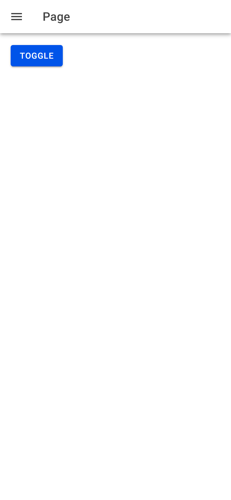

# ion-menu-toggle — reference render (Ionic 9.0.11, md, 390×844@2x)

Generated by `node tools/ionic-ref/render.js ion-menu-toggle --bare --out docs/components/ion-menu/ref/toggle --html "<ion-app style=\"position:static;display:block;contain:none;overflow:visible\"><ion-menu content-id=\"main\"><ion-content>Menu</ion-content></ion-menu><div class=\"ion-page\" id=\"main\"><ion-header><ion-toolbar><ion-buttons slot=\"start\"><ion-menu-button></ion-menu-button></ion-buttons><ion-title>Page</ion-title></ion-toolbar></ion-header><ion-content class=\"ion-padding\"><ion-menu-toggle><ion-button>Toggle</ion-button></ion-menu-toggle></ion-content></div></ion-app>"`

```html
<ion-app style="position:static;display:block;contain:none;overflow:visible"><ion-menu content-id="main"><ion-content>Menu</ion-content></ion-menu><div class="ion-page" id="main"><ion-header><ion-toolbar><ion-buttons slot="start"><ion-menu-button></ion-menu-button></ion-buttons><ion-title>Page</ion-title></ion-toolbar></ion-header><ion-content class="ion-padding"><ion-menu-toggle><ion-button>Toggle</ion-button></ion-menu-toggle></ion-content></div></ion-app>
```

 

## Element 1

- attributes: `{"class":"md hydrated"}`
- classes: `md hydrated`
- rect: `{"x":16,"y":79,"w":92.36,"h":19}`

### Host computed

| prop | value |
|---|---|
| display | `inline` |
| position | `static` |
| box-sizing | `border-box` |
| width | `auto` |
| height | `auto` |
| min-height | `0px` |
| min-width | `0px` |
| padding | `0px` |
| margin | `0px` |
| border | `0px none rgb(0, 0, 0)` |
| border-radius | `0px` |
| background-color | `rgba(0, 0, 0, 0)` |
| color | `rgb(0, 0, 0)` |
| font-size | `16px` |
| font-weight | `400` |
| font-family | `Roboto, "Helvetica Neue", sans-serif` |
| line-height | `normal` |
| letter-spacing | `normal` |
| text-transform | `none` |
| opacity | `1` |
| overflow | `visible` |
| contain | `none` |
| pointer-events | `auto` |
| transition | `all` |
| transform | `none` |
| box-shadow | `none` |
| outline | `rgb(0, 0, 0) none 0px` |
| cursor | `auto` |

### DOM tree

```
<ion-menu-toggle>
  #shadow-root
    <slot name="">
  <ion-button.md.button.button-solid.ion-activatable.ion-focusable.hydrated>
    #shadow-root
      <button.button-native part="native">
        <span.button-inner>
          <slot name="icon-only">
          <slot name="start">
          <slot name="">
          <slot name="end">
        <ion-ripple-effect.md.hydrated>
          #shadow-root
```
