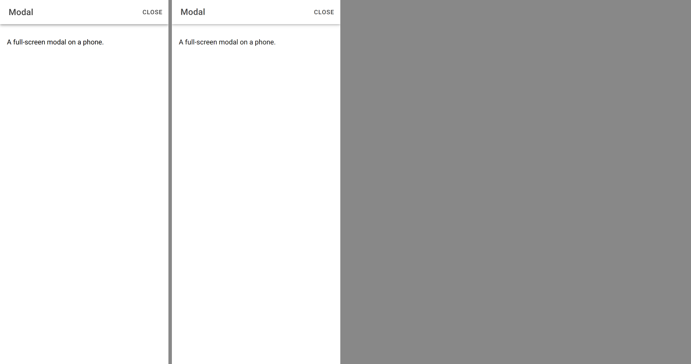
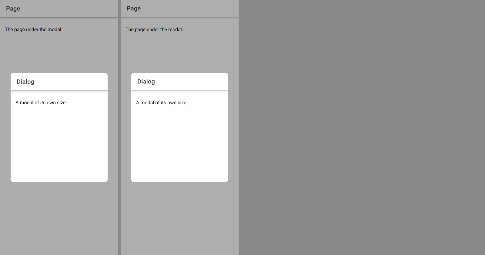
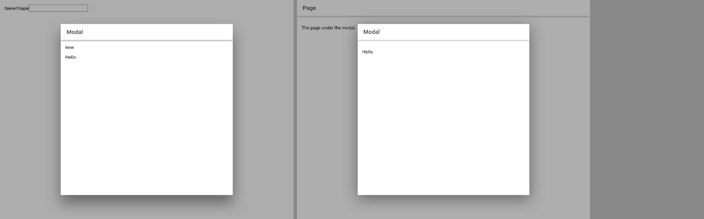
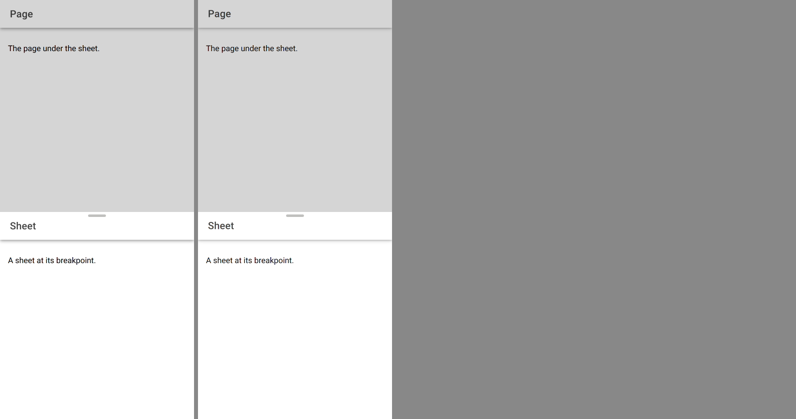
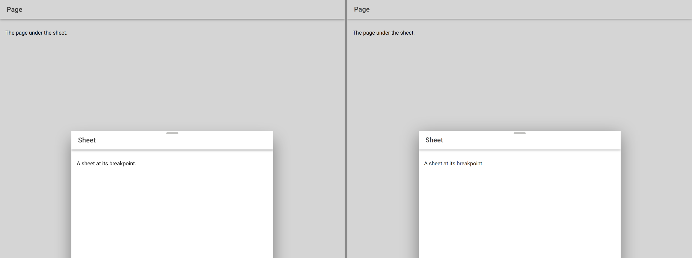
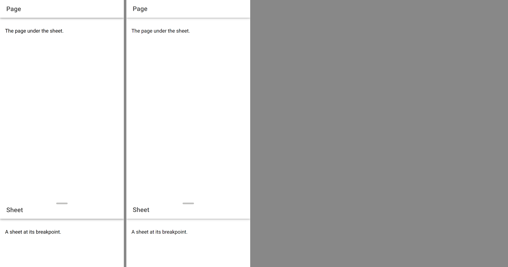

# ion-modal — Comparison

Ionic 9.0.11, md, headless Chromium, beside Avonic headless (Skia) at the same size and 2x. The phone frames are 390 x 844, from
`render.js`:

```
node tools/ionic-ref/render.js ion-modal --bare --html '<ion-app style="position:static;display:block;contain:none;overflow:visible"><div class="ion-page"><ion-header><ion-toolbar><ion-title>Page</ion-title></ion-toolbar></ion-header><ion-content class="ion-padding"><p>Under the modal</p></ion-content></div><ion-modal is-open="true"><ion-header><ion-toolbar><ion-title>Modal</ion-title><ion-buttons slot="end"><ion-button>Close</ion-button></ion-buttons></ion-toolbar></ion-header><ion-content class="ion-padding"><p>A full-screen modal on a phone.</p></ion-content></ion-modal></ion-app>'
node tools/ionic-ref/render.js ion-modal --bare --out docs/components/ion-modal/ref/dialog --html '<ion-app style="position:static;display:block;contain:none;overflow:visible"><div class="ion-page"><ion-header><ion-toolbar><ion-title>Page</ion-title></ion-toolbar></ion-header><ion-content class="ion-padding"><p>The page under the modal.</p></ion-content></div><ion-modal is-open="true" style="--width:320px;--height:360px;--border-radius:8px"><ion-header><ion-toolbar><ion-title>Dialog</ion-title></ion-toolbar></ion-header><ion-content class="ion-padding"><p>A modal of its own size.</p></ion-content></ion-modal></ion-app>'
```

The tablet frame, [`ref/tablet.png`](ref/tablet.png), is 1024 x 768 from the measurement script behind
[`ref/measurements.txt`](ref/measurements.txt) (`render.js` has only the phone), whose page is a few bare buttons and a modal
with a header and a paragraph. Avonic's frames are `AvonicModalCaptureTests` (`Reference_Full_Screen`, `Reference_Dialog`,
`Reference_Tablet`), saved in [`compare/`](compare/). Not tried in a real window: `tools/real-window/drive.ps1` has a section for
the sample page, for the batch's runner.

| Full screen, 390 x 844 | A dialog of its own size | Tablet, 1024 x 768 |
|---|---|---|
|  |  |  |

Ionic's on the left of each.

## Visual

| | Ionic | Avonic | |
|---|---|---|---|
| Full screen: the wrapper | 0, 0, 390 x 844, white, no radius or shadow | the same | Match (asserted) |
| Its header, title, Close and paragraph | | the same places | Match |
| A dialog with `--width: 320px; --height: 360px; --border-radius: 8px` | 35, 242, 320 x 360, radius 8 | the same | Match (asserted) |
| The backdrop at 0.32, over the page (a blank pixel) | 173 | 174 | Match, to a level: as `ion-backdrop`'s comparison found |
| Tablet: the wrapper | 212, 84, 600 x 600, radius 2 | the same | Match (asserted) |
| Tablet: md's shadow, `0 28px 48px rgba(0,0,0,0.4)`, 6 px under the wrapper's middle | 116 | 131 | **Deliberate difference, best effort:** the shadow is converted to Avalonia's blur as [box-shadow](../../infra/box-shadow/README.md) says, measured there within 1 to 3 levels for small blurs; at a 48 px blur and 28 px offset it's 15 lighter next to the edge, 6 at 56 px down, and 1 at the sides (152 and 151 at 200, 400). Ionic's other shadows are a few px |

## Behaviour

| # | Behaviour | Ionic | Avonic | |
|---|---|---|---|---|
| B1 | Enter | M1: 280 ms, `cubic-bezier(0.36,0.66,0.04,1)`, backdrop 0.01 to 0.32 and `pointer-events: none` until the end; wrapper 0.01 and 40 px to 1 and 0 | The same values at each frame of the test clock, from Chromium's solved curve | Match |
| B2 | Leave | M2: 200 ms, `cubic-bezier(0.47,0,0.745,0.715)`, to 0 and 40 px | The same | Match |
| B3 | Events | M3: `ionModalWillPresent`, `willPresent`, … each pair in the same task | The same order, each bubbling | Match |
| B4 | `canDismiss` | M6: false keeps it; a function decides; `handler` skips it | The same; Escape and the backdrop go through it | Match |
| B5 | `isOpen` | M6: false to true presents, the reverse dismisses, a dismiss leaves it true, true at load presents at the next frame | The same | Match |
| B6 | `trigger` | M7: a click on the element with that id | A click on the control with that name in the modal's name scope: its own `Click` (a stock `Button`'s, an `AvonicButton`'s, …), or a tap on it, as a plain item or card raises no `Click` | Match, by name for id |
| B7 | Inline | M7: teleported to `ion-app`, a comment in its place, back after | Moved to the overlay layer, an invisible placeholder in its place, back after; the page's `DataContext` kept | Match; the `DataContext` is Avalonia's binding scope, kept as a framework's bindings are |
| B8 | Nested modals | M7: `parent-dismissed` | The same | Match |
| B9 | Parent removed | M7: `parent-removed` | The same, when the placeholder leaves the visual tree | Match |
| B10 | Backdrop | A tap dismisses with `backdrop`; `backdropDismiss` false stops the tap, Escape and back; `showBackdrop` false is transparent and still takes the tap | The same | Match |
| B11 | Focus | M4, M8: the wrapper (`[role="dialog"][tabindex]`), then back to the opener | The wrapper, then back | Match |
| B12 | `focusTrap` | `ion-disable-focus-trap` turns the trap off | The overlay's trap, off with `FocusTrap` false | Match |
| B13 | `keepContentsMounted` | A framework's inline modal mounts its content at present and unmounts it after, unless set | The content is in the visual tree only while presented, unless set, then from attach on | Match, by the mapping in the plan: XAML makes the content up front, so mounted is in the visual tree |
| B14 | Sizes | M5 | The same at 390 x 844, 1024 x 768, 1024 x 700, 767 x 1000, 800 x 599; an app's key wins at every size; `%`, px, content sizes; max then min | Match |
| B15 | Safe area | M5: `inherit` at every edge on a phone, `0px` at every edge in the tablet dialog | `Avonic.SafeArea*` the app's on a phone, 0 inside the tablet dialog | Match |
| B16 | Accessibility | `role="dialog"`, `aria-modal`, `tabindex="-1"`, the host's `aria-label` | A `Window` peer named from the host; focusable, not a tab stop | Match, as near as Avalonia's control types go |
| B17 | Look | white, black text, no border | The same; the keys change it | Match |

## Gaps

| Gap | Why | Measured |
|---|---|---|
| A full-screen modal's content isn't padded by the bottom safe area (`--internal-content-safe-area-padding-bottom`) | `AvonicContent` has no such padding, and it's another control's file. Proposed in the PR | Ionic sets it on an `ion-content` with no `ion-footer`; `Avonic.SafeAreaBottom` is 0 unless an app fills it, so it matters only to an app that does |
| `--border-style` other than none or solid | Avalonia's `Border` draws only solid lines | |
| The page lifecycle events on the content (`ionViewWillEnter` and the rest) | `ion-nav`'s ([#130](https://github.com/wdcossey/Avonic/issues/130)) | |
| `parent-removed` for every inline overlay | Ionic does it only for the modal; the placement here is shared by every overlay | |
| The page's own `Styles` and `Resources` don't reach an inline modal while it's presented | It's moved out of the page's logical tree, as Ionic moves it out of its parent; a document's global CSS still applies in Ionic, as the app's and window's do here. `DataContext` is kept | |

---

# The sheet

Ionic's frames are from a script in Chromium, as `render.js` can't set an array prop (`breakpoints`): the page above, its button
taken out, and a modal with a header `Sheet` and a paragraph, presented with `breakpoints [0, 0.25, 0.5, 0.75, 1]` and
`initialBreakpoint 0.5`; the same at 1024 x 768; and `breakpoints [0.25, 0.5, 0.75]`, `initialBreakpoint 0.25`,
`backdropBreakpoint 0.5`. They're in [`ref/sheet/`](ref/sheet/), and the numbers behind the plan in
[`ref/sheet-measurements.txt`](ref/sheet-measurements.txt). Avonic's are `AvonicModalCaptureTests` (`Reference_Sheet`,
`Reference_Sheet_Tablet`, `Reference_Sheet_Backdrop_Breakpoint`), in [`compare/`](compare/). Headless; not tried in a real window:
`tools/real-window/drive.ps1` has a section for it.

| At 0.5, 390 x 844 | Tablet, 1024 x 768 | `backdropBreakpoint 0.5`, at 0.25 |
|---|---|---|
|  |  |  |

Ionic's on the left of each. The sample page's sheet: [`compare/avonic-sample-sheet.png`](compare/avonic-sample-sheet.png).

## Visual

| | Ionic | Avonic | |
|---|---|---|---|
| The wrapper at 0.5 | 0, 427, 390 x 834 | the same | Match (asserted) |
| The handle | 177, 432, 36 x 5, radius 8, `rgb(192, 192, 190)` | the same | Match (asserted) |
| The backdrop at rest at 0.5 | 0.165 | 0.165 | Match (asserted) |
| Tablet | 212, 389, 600 x 758, radius 2, md's shadow | the same | Match (asserted); the shadow as the dialog's |
| `backdropBreakpoint 0.5` at 0.25 | 0, 635.5; no backdrop | the same | Match (asserted) |

## Behaviour

Frames: the tests assert the same keyframes on the same curves, frame by frame on the test clock. Fitting those formulas to
Chromium's sampled frames (their start time fitted), the wrapper is within 3 px (enter), 1.2 px (`setCurrentBreakpoint(1)`) and
2.2 px (leave) of Chromium's, and the backdrop within 0.001: under 0.7% of the move in each, the jitter of reading a frame by
`requestAnimationFrame`. The spring of a drag blocked by `canDismiss` is Chromium's to 0.001 px at every move.

| # | Behaviour | Ionic | Avonic | |
|---|---|---|---|---|
| S1 | Box | 834 high, 10 down, at the bottom, centred; `--ion-modal-offset-top` from the root's top safe area; an app's `--height` wins | The same, from `Avonic.ModalOffsetTop`, which follows the root's `Avonic.SafeAreaTop`; `Avonic.Modal.Height` wins | Match |
| S2 | Enter | 280 ms md curve, 100% to 50%; the backdrop 0 to 0.16, not hit until the end; then 0.165 | The same | Match |
| S3 | Leave | 200 ms md leave curve, 50% to 100%, the backdrop 0.16 to 0 | The same | Match |
| S4 | Drag | 1:1 on the wrapper's height; the backdrop on the full run; `ionDragMove` with `progress` and `snapBreakpoint` | The same, on the ported gesture (10 px, priority 40) | Match |
| S5 | Snap | The nearest breakpoint 350 ms ahead; 500 ms `cubic-bezier(0.32,0.72,0,1)`; `ionBreakpointDidChange` a frame after; no drag meanwhile | The same | Match |
| S6 | Swipe to close | `gesture`, no leave, `ionBreakpointDidChange` 0 first; other dismisses refused meanwhile | The same | Match |
| S7 | `canDismiss` | false: the spring, back; a function asked with `gesture`, `handler` after the snap back | The same | Match |
| S8 | `setCurrentBreakpoint` | The 500 ms move, the event, then the promise; nothing for the current, a warning for one not listed or no sheet; 0 dismisses | The same, a `Task`; warnings in Avalonia's log | Match |
| S9 | Handle | Cycle skips 0 and wraps; not during a move; `none`: nothing, `tabindex` -1; 4 px tap area | The same; a `ModalHandle` with `NativeButton` (click, Enter, Space), a `Button` to automation with Ionic's label | Match |
| S10 | `backdropBreakpoint` | At or below: 0, `pointer-events: none` on host and backdrop, `ion-disable-focus-trap`; above: the backdrop by `getBackdropValueForSheet` | The backdrop not hit-testable (the host draws nothing and takes no input of its own), the focus trap off; above, the same values | Match |
| S11 | `expandToScroll` | The first content's `scrollY` false below the top, back at the top, after a drag and at the dismiss; false: scrolls at every breakpoint, `.ion-page` `max-height` follows | The same, on `AvonicContent.ScrollY` and the content presenter's `MaxHeight` in `ModalPagePanel` | Match |
| S11 | A drag up on content that scrolls (fully open, at 1, or `expandToScroll` false) | The passive gesture captures it and does nothing to the sheet (or, with `expandToScroll` false and the content at its top, snaps from a stale offset), and the browser scrolls the content | The gesture lets go, and the content's `ScrollViewer` scrolls; no drag events | **Deliberate difference:** Avalonia gives a pointer to one owner, as the refresher found |
| S12 | Backdrop tap during a move | Ignored | Ignored | Match |
| S13 | Focus | The host `tabindex` 0 with a cycling handle; a focus on it from outside goes to the handle; a drag focuses the host | The same (`IsTabStop`) | Match |
| S14 | Safe area | top, left, right `0px`, bottom `inherit` | The same | Match |
| S15 | Again | Starts at `initialBreakpoint`; a missing one warns at load | The same | Match |
| S16 | `initialBreakpoint` alone | The sheet's enter, no handle or gesture, held at 50% | The same | Match |
| S17 | Keyboard | `ionKeyboardDidShow` turns the gesture off for a frame | The same, from `KeyboardAssist` | Match |

## Gaps

| Gap | Why | Measured |
|---|---|---|
| `swapFooterPosition` | Ionic pins an `ion-footer` to the body while a sheet with `expandToScroll` false is dragged, so that it doesn't shake as layout lags the transform; Avalonia lays out and draws in the same frame | |
| An upward drag on scrolling content raises no drag events | As S11 above | |
