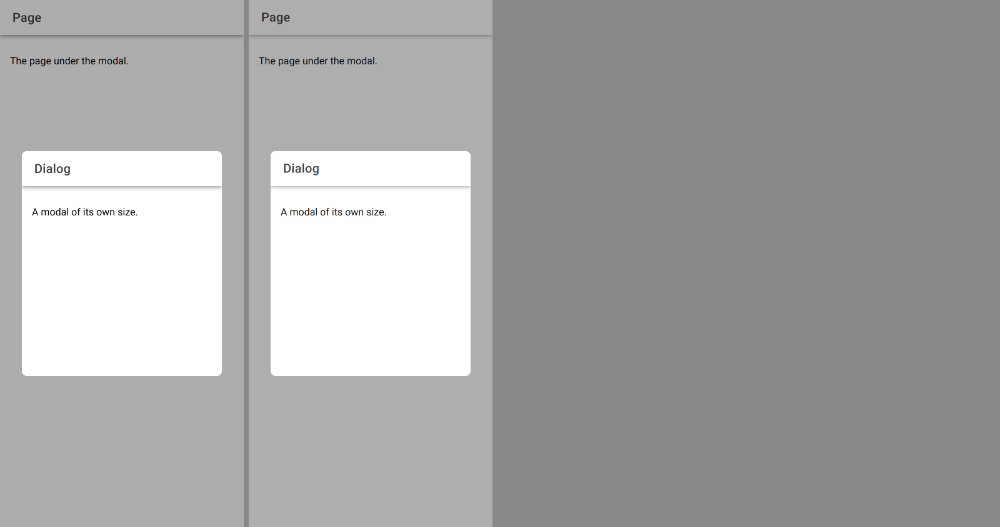
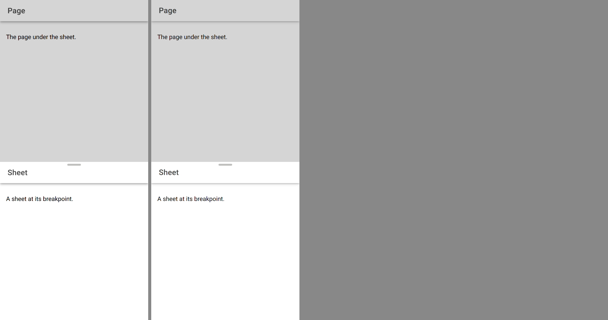

# ion-modal

Status: done · [#42](https://github.com/wdcossey/Avonic/issues/42)

`AvonicModal`, Ionic's `ion-modal`, md: full screen on a phone and a centred 600 by 500 or 600 dialog on a tablet, over a
backdrop, on the [overlay system](../../infra/overlays/README.md); or a sheet, dragged between breakpoints. Plan:
[PLAN.md](PLAN.md); comparison: [COMPARISON.md](COMPARISON.md).

| A dialog | A sheet |
|---|---|
|  |  |

## Usage

Inline, opened by a trigger, or by `IsOpen`:

```xml
<StackPanel>
    <c:AvonicButton Name="Open" Content="Open" />
    <c:AvonicModal Name="Modal" Trigger="Open">
        <Grid RowDefinitions="Auto,*">
            <c:AvonicHeader>
                <c:AvonicToolbar>
                    <c:AvonicTitle Content="Modal" />
                    <c:AvonicToolbar.EndContent>
                        <c:AvonicButtons>
                            <c:AvonicButton Content="Close" Click="OnClose" />
                        </c:AvonicButtons>
                    </c:AvonicToolbar.EndContent>
                </c:AvonicToolbar>
            </c:AvonicHeader>
            <c:AvonicContent Grid.Row="1">…</c:AvonicContent>
        </Grid>
    </c:AvonicModal>
</StackPanel>
```

```csharp
private void OnClose(object? sender, RoutedEventArgs e) => Modal.Dismiss(null, "cancel");
```

While it's presented, an inline modal is moved to the overlay layer, with an invisible placeholder in its place, and moved back
after, as Ionic teleports it to `ion-app`. It has to be in a `Panel`, a `Decorator` or a `ContentControl`. It keeps the page's
`DataContext`, so its bindings go on working; its own `DataContext` wins. If its place leaves the tree while it's presented, it
dismisses with the role `parent-removed`.

Or in code, as Ionic's controller:

```csharp
var modal = new AvonicModal { Content = new MyView(), CanDismiss = new ModalCanDismiss((data, role) => ConfirmAsync()) };
await modal.Present();
var detail = await modal.OnDidDismiss();   // detail.Data, detail.Role
```

`IsOpen` isn't set back to false by a dismiss: an app that binds it sets it back from `DidDismiss`, as Ionic's docs say.

### A sheet

With `Breakpoints` and `InitialBreakpoint` it's a sheet: at the bottom, at a fraction of its height (1 is open, 0 closed), with a
handle. The user drags it between breakpoints, by its handle, its header, or its content below the top breakpoint; presses the
handle to go to the next; and drags it down and away if 0 is a breakpoint.

```xml
<c:AvonicModal Trigger="Open" Breakpoints="0, 0.25, 0.5, 0.75, 1" InitialBreakpoint="0.5"
               IonBreakpointDidChange="OnBreakpoint">
    <DockPanel>
        <c:AvonicHeader DockPanel.Dock="Top">…</c:AvonicHeader>
        <c:AvonicContent>…</c:AvonicContent>
    </DockPanel>
</c:AvonicModal>
```

```csharp
await modal.SetCurrentBreakpoint(1);      // completes when it's there
double? at = modal.GetCurrentBreakpoint(); // null when it isn't presented
```

`BackdropBreakpoint="0.5"` leaves the page behind usable at 0.5 and below; `ExpandToScroll="False"` lets the content scroll at every
breakpoint, and the sheet move only by its header and handle; `HandleBehavior="None"` makes the handle decoration.

## Checklist

| ✓ | Ionic | Avonic | Default | |
|---|---|---|---|---|
| [x] | `animated` | `Animated` | `true` | |
| [x] | `backdropDismiss` | `BackdropDismiss` | `true` | The backdrop's tap, Escape and back |
| [x] | `canDismiss` | `CanDismiss` | `true` | `ModalCanDismiss`: a `bool` or a `Func<object?, string?, Task<bool>>`; `True`/`False` in XAML. The role `handler` (`OverlayRoles.Handler`) skips it |
| [x] | `enterAnimation`, `leaveAnimation` | `EnterAnimation`, `LeaveAnimation` | | `AnimationBuilder` |
| [x] | `focusTrap` | `FocusTrap` | `true` | |
| [ ] | `htmlAttributes` | none | | Not applicable: set the control's properties, `Classes` and `AutomationProperties` |
| [x] | `isOpen` | `IsOpen` | `false` | On `AvonicOverlay`. Takes effect once it's attached; true then presents at the next frame |
| [x] | `keepContentsMounted` | `KeepContentsMounted` | `false` | The content is in the visual tree only while presented; true, from attach on, and after |
| [x] | `keyboardClose` | `KeyboardClose` | `true` | |
| [ ] | `mode` | none | | Not exposed (ADR 0001) |
| [ ] | `presentingElement` | none | | Not applicable: ios only, the card modal |
| [x] | `showBackdrop` | `ShowBackdrop` | `true` | False: transparent, and it still takes the tap |
| [x] | `trigger` | `Trigger` | | On `AvonicOverlay`: the name of a control in its name scope, whose `Click`, or a tap, presents it |
| [x] | `breakpoints` | `Breakpoints` | | `AvaloniaList<double>?`, `"0, 0.5, 1"` in XAML; kept sorted |
| [x] | `initialBreakpoint` | `InitialBreakpoint` | | `double?`; with `Breakpoints`, a sheet |
| [x] | `backdropBreakpoint` | `BackdropBreakpoint` | `0` | |
| [x] | `handle` | `Handle` | | `bool?`: null (Ionic's `undefined`) shows it on a sheet |
| [x] | `handleBehavior` | `HandleBehavior` | `Cycle` | `ModalHandleBehavior`: `None`, `Cycle` |
| [x] | `expandToScroll` | `ExpandToScroll` | `true` | |
| [x] | `ionModalWillPresent`, `ionModalDidPresent`, `ionModalWillDismiss`, `ionModalDidDismiss` | `IonModalWillPresent`, … | | Routed, bubbling, each just before the generic one |
| [x] | `willPresent`, `didPresent`, `willDismiss`, `didDismiss` | `WillPresent`, … | | The overlay's |
| [x] | `ionBreakpointDidChange` | `IonBreakpointDidChange` | | `ModalBreakpointChangeEventArgs.Breakpoint` |
| [x] | `ionDragStart`, `ionDragMove`, `ionDragEnd` | `IonDragStart`, `IonDragMove`, `IonDragEnd` | | `ModalDragEventArgs`: `CurrentY`, `DeltaY`, `VelocityY`, `Progress`, `SnapBreakpoint`, and `IsDismissing` at the end |
| [x] | `present()`, `dismiss()`, `onDidDismiss()`, `onWillDismiss()` | `Present()`, `Dismiss(data, role)`, `OnDidDismiss()`, `OnWillDismiss()` | | `Present(TopLevel)` too, the overlay's extension |
| [x] | `setCurrentBreakpoint()`, `getCurrentBreakpoint()` | `SetCurrentBreakpoint(b)`, `GetCurrentBreakpoint()` | | A `Task`; a `double?`, synchronous |
| [x] | default slot | `Content`, `ContentTemplate` | | |
| [x] | `backdrop`, `content` parts | `PART_Backdrop`, `PART_Content` | | An `AvonicBackdrop`; a `ModalWrapper` |
| [x] | `handle` part | `PART_Handle` | | A `ModalHandle`, a native button |

## Behaviour

- **Present**: the md enter animation, 280 ms, `cubic-bezier(0.36, 0.66, 0.04, 1)`: the backdrop from 0.01 to its opacity, not
  hit until it ends, and the wrapper up 40 px from 0.01 to 1. `IonModalWillPresent`, `WillPresent`, then `IonModalDidPresent`,
  `DidPresent`. Focus goes to the wrapper, which is a dialog to automation, named from the modal's
  `AutomationProperties.Name`; back to what had it after the dismiss.
- **Dismiss**: modals presented inside this one are dismissed with `parent-dismissed`; then `CanDismiss`; then the md leave
  animation, 200 ms, `cubic-bezier(0.47, 0, 0.745, 0.715)`, the dismiss events, and it's removed.
- **Size**: full screen, and from a window of 768 by 600 (`:inset-small`) 600 by 500 with a radius of 2 and md's shadow; from 768
  by 768 (`:inset-large`) 600 by 600. An app's `Avonic.Modal.Width` and the rest win at every size.
- **Safe area**: inside the modal, `Avonic.SafeArea<Edge>` is 0 for an edge the wrapper doesn't reach, as Ionic's host style
  does, so a centred dialog's header isn't padded for a notch.
- Escape and back dismiss it with `backdrop`, as every overlay's do, through `CanDismiss`.

The sheet (`:sheet`):

- **Box**: `100% - (Avonic.SafeAreaTop + 10)` high, at the bottom, centred across (600 wide on a tablet), held down by
  `(1 - breakpoint)` of its height. Its safe area is 0 at the top, left and right, the app's at the bottom.
- **Present**: md's sheet enter, 280 ms, `cubic-bezier(0.36,0.66,0.04,1)`, up from below to the breakpoint, the backdrop to
  `--backdrop-opacity × breakpoint` if that's above `BackdropBreakpoint`. Then a 500 ms `cubic-bezier(0.32,0.72,0,1)` animation
  that the gesture drives holds it: the backdrop rests on its line from `--backdrop-opacity` to 0.01, 0.165 at 0.5.
- **Drag**: on the wrapper, vertical, 10 px to start: it follows the finger, and on release snaps over 500 ms to the breakpoint
  nearest where it would be 350 ms later at its speed. `IonBreakpointDidChange` a frame after it's there. At 0 it dismisses with
  `gesture`, with no leave animation. `CanDismiss` other than true keeps it from 0 with a spring, and a function is asked with
  `gesture`, and true dismisses it with `handler` once it's snapped back.
- **Handle**: 36 by 5, 5 from the top; `Cycle` goes to the next breakpoint other than 0, wrapping, on a click, Enter or Space,
  not while it's moving; its tap area is 4 px around it. With a cycling handle the modal is a tab stop, and a focus on it from
  outside goes to the handle.
- **Backdrop**: at or below `BackdropBreakpoint` it's clear and takes no input, so the page behind does, and the focus trap is
  off; `ShowBackdrop` or `FocusTrap` false keep it that way.
- **Content**: the first `AvonicContent` inside doesn't scroll below the top breakpoint, so that a drag on it moves the sheet, and
  is given its scrolling back at the top and after the dismiss. With `ExpandToScroll` false it scrolls at every breakpoint and
  is only as tall as what shows. A drag up on content that can scroll, at the top breakpoint or with `ExpandToScroll` false,
  scrolls it.

## Resource keys

In `Tokens/Modal.axaml`. A size takes a number (px) or a CSS string: `100%`, `600px`, `auto`, `fit-content`, `max-content`,
`min-content`, or `none` for a maximum.

| Key | Ionic | Default |
|---|---|---|
| `Avonic.Modal.BackdropOpacity` | `--backdrop-opacity` | unset: `Avonic.BackdropOpacity`, 0.32 |
| `Avonic.Modal.Background` | `--background` | unset: `Avonic.BackgroundColorBrush` |
| `Avonic.Modal.BorderColor` | `--border-color` | transparent |
| `Avonic.Modal.BorderRadius` | `--border-radius` | unset: `Avonic.Modal.Md.BorderRadius` 0, `…Md.BorderRadiusInset` 2 |
| `Avonic.Modal.BorderStyle` | `--border-style` | `none`; any other style is solid |
| `Avonic.Modal.BorderWidth` | `--border-width` | 0 |
| `Avonic.Modal.Width` | `--width` | unset: `…Md.Width` `100%`, `…Md.WidthInset` 600 |
| `Avonic.Modal.Height` | `--height` | unset: `…Md.Height` `100%`, `…Md.HeightInsetSmall` 500, `…Md.HeightInsetLarge` 600 |
| `Avonic.Modal.MinWidth`, `MaxWidth`, `MinHeight`, `MaxHeight` | `--min-width` and the rest | `auto`, `auto`, `auto`, `100%` |
| `Avonic.Modal.BoxShadow` | `--box-shadow` (not in `core.json`) | unset: `…Md.BoxShadow` none, `…Md.BoxShadowInset` `0 28px 48px rgba(0, 0, 0, 0.4)` |

| `Avonic.Modal.Md.HandleBackground` (+ `Brush`) | `.modal-handle`'s `var(--ion-color-step-350, var(--ion-background-color-step-350, #c0c0be))` | `#C0C0BE`; `Palettes/Dark.axaml` points the brush at `Avonic.BackgroundColorStep350`, as dark sets the step (#656565) |
| `Avonic.ModalOffsetTop` | `--ion-modal-offset-top` (internal, global, hence no `Modal.` part) | 0; the modal sets it to the root's `Avonic.SafeAreaTop` while a sheet is presented |

The host's text is `Avonic.TextColorBrush`. A sheet's height reads `Avonic.Modal.Height` first, then the 10 px gap, a literal in
the theme.

## Extensions

None of the modal's own. On `AvonicOverlay`, which every overlay gets: inline overlays keep the page's `DataContext`, and
`parent-removed` applies to every inline overlay, where Ionic has it only on the modal. `ModalAnimationOptions`, what an
`EnterAnimation` or `LeaveAnimation` is given, is Ionic's `ModalAnimationOptions` without `presentingEl`.

## Known gaps

- A full-screen modal with an `AvonicContent` and no footer doesn't pad the content's end by the bottom safe area, as Ionic 9's
  does: `AvonicContent` has no such padding yet.
- While an inline modal is presented, it's out of its page's logical tree, so the page's own `Styles` and `Resources` don't reach it (the app's and the window's do), as an ancestor's scoped style wouldn't in a browser. Its `DataContext` is kept. Put what it needs in the modal's own `Styles` and `Resources`, or the app's.
- `Avonic.Modal.BorderStyle`: Avalonia's `Border` draws only solid lines.
- md's tablet shadow, `0 28px 48px`, is up to 15 levels lighter just under the wrapper than Chromium's (box-shadow is best effort).
- The page lifecycle (`ionViewWillEnter` and the rest on the content) waits for `ion-nav` (#130).
- A drag up on the sheet's content where the content scrolls (at the top breakpoint, or with `ExpandToScroll` false) scrolls it
  and raises no drag events: Ionic's passive gesture follows that drag as well as the browser scrolling, and Avalonia gives a
  pointer to one owner.
- `ExpandToScroll` false: Ionic moves an `ion-footer` to the body while the sheet is dragged, so that it doesn't shake as the
  browser's layout lags the transform; Avalonia lays out and draws in the same frame, so the footer stays in the content.
- Not tried in a real window: `tools/real-window/drive.ps1`'s `ion-modal` sections are for the batch's runner.
