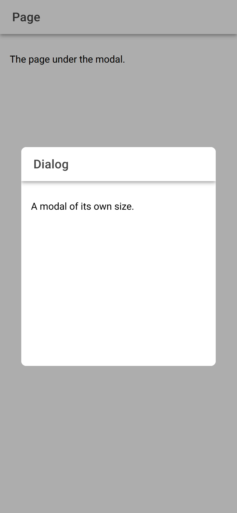

# ion-modal — reference render (Ionic 9.0.11, md, 390×844@2x)

Generated by `node tools/ionic-ref/render.js ion-modal --bare --out docs/components/ion-modal/ref/dialog --html "<ion-app style=\"position:static;display:block;contain:none;overflow:visible\"><div class=\"ion-page\"><ion-header><ion-toolbar><ion-title>Page</ion-title></ion-toolbar></ion-header><ion-content class=\"ion-padding\"><p>The page under the modal.</p></ion-content></div><ion-modal is-open=\"true\" style=\"--width:320px;--height:360px;--border-radius:8px\"><ion-header><ion-toolbar><ion-title>Dialog</ion-title></ion-toolbar></ion-header><ion-content class=\"ion-padding\"><p>A modal of its own size.</p></ion-content></ion-modal></ion-app>"`

```html
<ion-app style="position:static;display:block;contain:none;overflow:visible"><div class="ion-page"><ion-header><ion-toolbar><ion-title>Page</ion-title></ion-toolbar></ion-header><ion-content class="ion-padding"><p>The page under the modal.</p></ion-content></div><ion-modal is-open="true" style="--width:320px;--height:360px;--border-radius:8px"><ion-header><ion-toolbar><ion-title>Dialog</ion-title></ion-toolbar></ion-header><ion-content class="ion-padding"><p>A modal of its own size.</p></ion-content></ion-modal></ion-app>
```

 

## Element 1

- attributes: `{"is-open":"true","style":"--width: 320px; --height: 360px; --border-radius: 8px; z-index: 20002; --ion-safe-area-top: 0px; --ion-safe-area-bottom: 0px; --ion-safe-area-left: 0px; --ion-safe-area-right: 0px;","id":"ion-overlay-1","no-router":"","tabindex":"-1","class":"md modal-default hydrated show-modal"}`
- classes: `md modal-default hydrated show-modal`
- rect: `{"x":0,"y":0,"w":390,"h":844}`

### CSS custom properties (resolved)

| var | value |
|---|---|
| `--backdrop-opacity` | `0.32` |
| `--background` | `#fff` |
| `--border-color` | `transparent` |
| `--border-radius` | `8px` |
| `--border-style` | `none` |
| `--border-width` | `0` |
| `--height` | `360px` |
| `--max-height` | `100%` |
| `--max-width` | `auto` |
| `--min-height` | `auto` |
| `--min-width` | `auto` |
| `--width` | `320px` |

### Host computed

| prop | value |
|---|---|
| display | `flex` |
| position | `absolute` |
| box-sizing | `border-box` |
| width | `390px` |
| height | `844px` |
| min-height | `0px` |
| min-width | `0px` |
| padding | `0px` |
| margin | `0px` |
| border | `0px none rgb(0, 0, 0)` |
| border-radius | `0px` |
| background-color | `rgba(0, 0, 0, 0)` |
| color | `rgb(0, 0, 0)` |
| font-size | `16px` |
| font-weight | `400` |
| font-family | `Roboto, "Helvetica Neue", sans-serif` |
| line-height | `normal` |
| letter-spacing | `normal` |
| text-transform | `none` |
| opacity | `1` |
| overflow | `visible` |
| contain | `strict` |
| pointer-events | `auto` |
| transition | `all` |
| transform | `none` |
| box-shadow | `none` |
| outline | `rgb(0, 0, 0) none 0px` |
| cursor | `auto` |

### Shadow parts

#### part="backdrop" (`ion-backdrop`) rect `{"x":0,"y":0,"w":390,"h":844}`

| prop | value |
|---|---|
| display | `block` |
| position | `absolute` |
| box-sizing | `content-box` |
| width | `390px` |
| height | `844px` |
| min-height | `0px` |
| min-width | `0px` |
| padding | `0px` |
| margin | `0px` |
| border | `0px none rgb(0, 0, 0)` |
| border-radius | `0px` |
| background-color | `rgb(0, 0, 0)` |
| color | `rgb(0, 0, 0)` |
| font-size | `16px` |
| font-weight | `400` |
| font-family | `Roboto, "Helvetica Neue", sans-serif` |
| line-height | `normal` |
| letter-spacing | `normal` |
| text-transform | `none` |
| opacity | `0.32` |
| overflow | `visible` |
| contain | `strict` |
| pointer-events | `auto` |
| transition | `all` |
| transform | `matrix(1, 0, 0, 1, 0, 0)` |
| box-shadow | `none` |
| outline | `rgb(0, 0, 0) none 0px` |
| cursor | `pointer` |

#### part="content" (`div`) rect `{"x":35,"y":242,"w":320,"h":360}`

| prop | value |
|---|---|
| display | `flex` |
| position | `static` |
| box-sizing | `content-box` |
| width | `320px` |
| height | `360px` |
| min-height | `auto` |
| min-width | `auto` |
| padding | `0px` |
| margin | `0px` |
| border | `0px none rgba(0, 0, 0, 0)` |
| border-radius | `8px` |
| background-color | `rgb(255, 255, 255)` |
| color | `rgb(0, 0, 0)` |
| font-size | `16px` |
| font-weight | `400` |
| font-family | `Roboto, "Helvetica Neue", sans-serif` |
| line-height | `normal` |
| letter-spacing | `normal` |
| text-transform | `none` |
| opacity | `1` |
| overflow | `hidden` |
| contain | `none` |
| pointer-events | `auto` |
| transition | `all` |
| transform | `matrix(1, 0, 0, 1, 0, 0)` |
| box-shadow | `none` |
| outline | `rgb(0, 0, 0) none 0px` |
| cursor | `auto` |

### DOM tree

```
<ion-modal>
  #shadow-root
    <ion-backdrop.md.hydrated part="backdrop">
      #shadow-root
    <div.modal-wrapper.ion-overlay-wrapper part="content">
      <slot name="">
  <div.ion-delegate-host.ion-page>
    <ion-header.md.header-md.header-collapse-none.hydrated>
      <ion-toolbar.md.in-toolbar.hydrated.toolbar-title-default>
        #shadow-root
          <div.toolbar-background part="background">
          <div.toolbar-container part="container">
            <slot name="start">
            <slot name="secondary">
            <div.toolbar-content part="content">
              <slot name="">
            <slot name="primary">
            <slot name="end">
        <ion-title.md.title-default.hydrated>
          #shadow-root
            <div.toolbar-title>
              <slot name="">
    <ion-content.ion-padding.md.content-ltr.hydrated>
      #shadow-root
        <div#background-content part="background">
        <div.inner-scroll.scroll-y part="scroll">
          <slot name="">
        <slot name="fixed">
      <p>
  <div>
```
