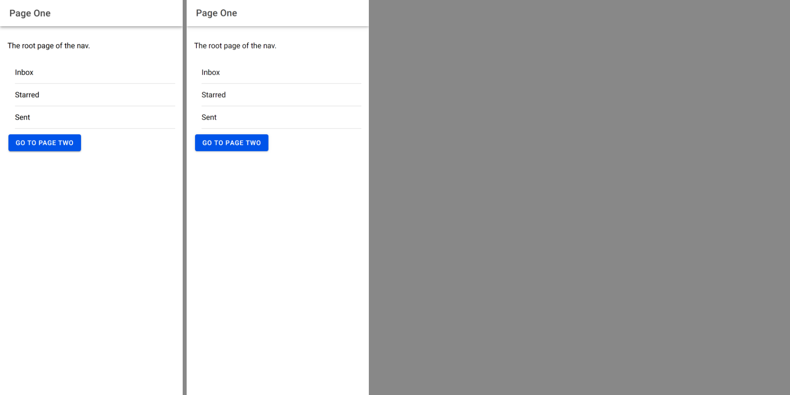
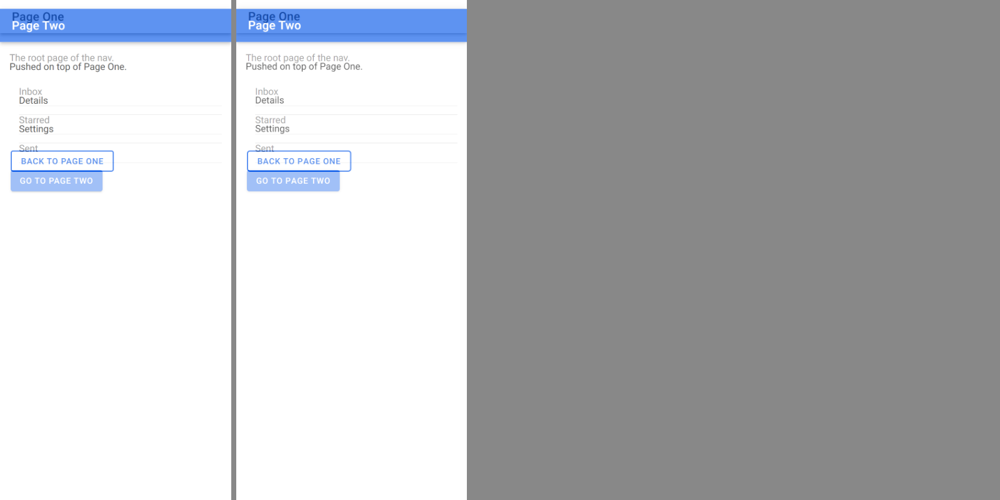
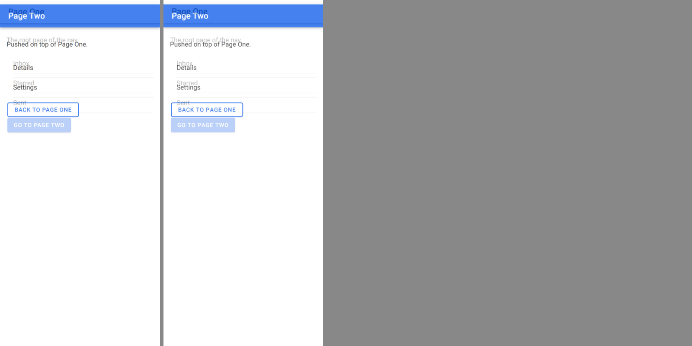
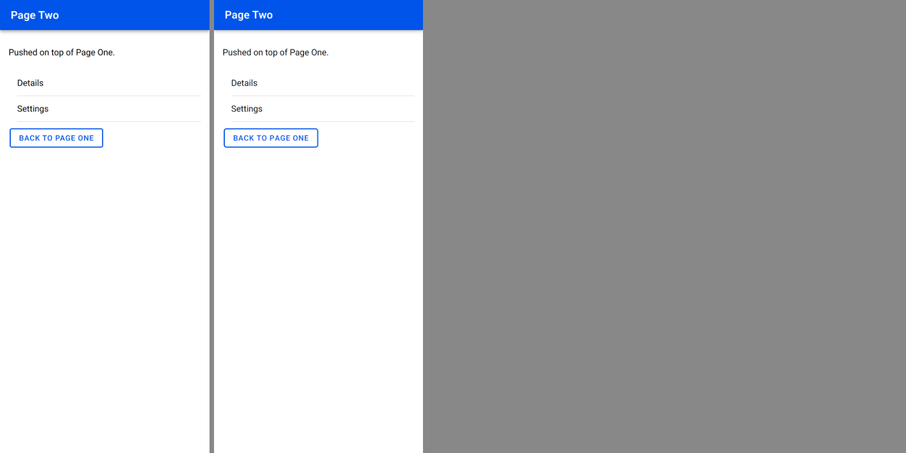

# ion-nav — Comparison

`ion-nav` and `ion-nav-link`, Ionic 9.0.11, md, headless Chromium, beside Avonic headless (Skia) at the same size and 2x. Not tried in
a real window: `tools/real-window/drive.ps1` has a section for the sample page (`ion-nav`), not run here.

**The reference.** The root page is `render.js`'s, its command at the top of [`ref/README.md`](ref/README.md): two plain custom
elements as pages, Page One (a paragraph, three items and a link that pushes Page Two) and Page Two (a primary toolbar, two items and a
back link). The rest comes from five throwaway Playwright scripts on `render.js`'s phone (390 x 844 at 2x, mobile, touch;
`tools/ionic-ref/phone.js`, `settle.js` and the Roboto in `tools/fonts/roboto/`), each run as `node <script> <repo> <outdir>`:

| Script | What it wrote |
|---|---|
| `measure.js` | [`ref/measurements.txt`](ref/measurements.txt): M1 to M20. Every event with its time from the call, each page's classes, `z-index`, `pointer-events`, `aria-hidden`, display, opacity and transform after each step and in every frame of a transition, and every Web Animation's keyframes, easing and duration from `getAnimations()` |
| `extra.js`, `extra2.js` | [`ref/extra.txt`](ref/extra.txt): X1 to X6, a failure and the queue behind it, keys on a button in a link, focus, a tap mid-transition, a push before load, an empty nav |
| `modal.js` | `ref/extra.txt`: X7 and X8, a nav in an inline `ion-modal`, and a nav moved in the DOM |
| `frames.js` | `ref/push-*.png`, `ref/pop-*.png`, `ref/pushed.png`: the reference's pages, the transition paused with the Web Animations API (`pause()`, `currentTime = t`) at the local times in the names |

Avonic's frames are `AvonicNavCaptureTests`, with `AVONIC_CAPTURE_DIR` set, in [`compare/`](compare/); the push's local time t is
the frame at 32 + t on the test clock and the pop's 16 + t (the push waits a frame for its page), so the frames are at multiples of
16, as Chromium's were taken. The side-by-side frames are `node tools/ionic-ref/side.js ref/<frame>.png compare/avonic-<frame>.png
compare/side-<frame>.png 800`. Ionic's is on the left of each.

## Frames

| Frame | Side by side | Result |
|---|---|---|
| Page One, the root |  | Match. The nav adds nothing to the page; the button is 2 px wider in Avonic, `AvonicButton`'s, not the nav's |
| A push, 64 ms in |  | Match: Page Two at opacity 0.63, 14.8 px down, as one picture over Page One, which hasn't moved |
| A push, 144 ms in |  | Match: 0.95, 2.2 px |
| A pop, 96 ms in |  | Match: Page Two at opacity 0.73, 10.7 px down, over Page One |
| After the push |  | Match |

The others (`push-000ms`, `push-208ms`, `push-280ms`, `pop-000ms`, `pop-048ms`, `pop-144ms`, `pop-192ms`) were each looked at side by
side, and match; Avonic's are in `compare/`.

**The fade is a group.** Avalonia's `Opacity` fades each part of a page on its own, so where the page's parts overlap (the content's
background under its text) the page under it was hidden more than in Chromium, and a white title on the toolbar showed less: first
seen in the 64 ms frame. The nav's pages now take a transition's `opacity` as an `OpacityMask` of a solid brush
(`AnimationGroupOpacity`), which is a group, as `docs/infra/avalonia-issues.md` records for the toggle; the frames above are after it.

## Behaviours

| # | Behaviour | Ionic (measured) | Avonic | Result |
|---|---|---|---|---|
| N1 | Root at load | Unanimated: will-change, will-enter, did-enter, did-change, two frames on (M1) | The same, a frame on (Ionic's second frame is its own components loading) | Match |
| N2 | `root` changed after load; `rootParams` alone | `setRoot`, unanimated; nothing (M15) | The same | Match |
| N3 | Page forms | Tag name, element, `ViewController`; a function needs a framework | `Type`, `Control`, `ViewController`; `Func<Control>` and a view model through data templates | Deliberate: Avalonia's equivalents, decided at the plan |
| N4 | Props set before the page is attached | `Object.assign` before `appendChild` (M2) | By name, Avalonia then CLR property, before it's added | Match |
| N5 | Push: events, keyframes, timing | Will-change in the call; two frames invisible; will-leave, will-enter, then 40 px to 0 and 0.01 to 1 over 280 ms; did-enter, did-leave, did-change, resolve (M2) | The same order and values; will-events a frame after the call; the animation from the frame after | Match (one frame earlier, as above) |
| N6 | Pop | Leaving page 0 to 40 px, 1 to 0, 200 ms; did-enter, did-leave, will-unload, did-change; page removed (M3) | The same | Match |
| N7 | Ready before it moves | A page that takes 150 ms to build, or 400 items to lay out, starts its animation at its first frame, at `currentTime` 0 (M18) | The page is laid out (`UpdateLayout`) before the will-events and `Play`, whose clock starts at the next frame | Match |
| N8 | `z-index`, `pointer-events` | 101 / 100 forward, 99 / 100 back; neither page takes a tap mid-transition (X4) | `ZIndex` the same; `IsHitTestVisible` false at style priority during it | Match |
| N9 | `can-go-back` | On the entering page when one is under it (M2) | `:can-go-back` | Match |
| N10 | Queue, `skipIfBusy` | One at a time; `skipIfBusy` false at once (M5) | The same | Match |
| N11 | Failures | Rejects with the message, a warning, will-change but no did-change; nav works after (M4, X6) | Faulted task, the same message and warning | Match |
| N12 | Middle views removed | Will-leave, did-leave, will-unload at once, before the transition (M6, M7) | The same | Match |
| N13 | `insert` in the middle; `insertPages` | No transition; only the last page built; one with no page built when entered (M7, M8) | The same; an inserted middle page left at opacity 0 under the top one, as Ionic leaves it | Match |
| N14 | `setRoot`, `setPages` | Unanimated unless `animated: true` (M9) | The same | Match |
| N15 | Animations off | Events in one go, two frames on (M13) | In one go, a frame on | Match |
| N16 | `duration`, `direction`, builders | 1000 replaces 280; back on a push runs the back animation (M14) | The same; a pop back uses the builder the page was left with | Match |
| N18 | Pages under the top | `display: none`, `aria-hidden`; scroll kept (M11) | Not visible (out of layout and automation); scroll kept | Match |
| N19 | Events bubble? | No (M16) | `Direct` | Match |
| N20 | Detached and attached | Every view unloaded; a nav in an inline modal is empty (X7, X8) | The stack is kept | Deliberate (ADR 0005) |
| N21 | Calls behind a failure | Dropped, never settle (X1b) | Dropped, complete false | Deliberate (ADR 0005) |
| N22 | A bare form in a list | `TypeError` on a string (M8) | Taken | Deliberate (ADR 0005) |
| N23 | Swipe back | Off in md (M20); in iOS from the edge, linear, Ionic's end rule | Off by default; offered under md, with Ionic's rule | Deliberate: offered (Avonic's choice) |
| N24 | Hardware back | The nav doesn't take it (M19) | Pops at priority 0 while it can go back (`HandleBackButton`) | Extension |
| L1 | Link directions | Forward, back, root, `skipIfBusy` (M17) | The same | Match |
| L2 | Clicks in the link | A click on its text; Space and Enter on a native button in it; a double click pushes once (M17, X2c) | The same, through `NativeButton` | Match |
| L3 | No nav, no component | Nothing | Nothing | Match |
| L4 | Focus, role | Not focusable, no role (X2b) | Not focusable, `NoneAutomationPeer` | Match |

## Performance

**Ionic** (M2, M18, on the desktop's Chromium): a light page's push is two frames to its first animated frame (+44 ms) and 327 ms
in all. A page that takes 150 ms to build, or 400 items to lay out, starts its animation on the frame after the build or the layout,
at its first value: a slow page starts late, and the animation is never cut short.

**Avonic** does the same: the page is built in the call, the nav waits a frame, lays the page out (`UpdateLayout`), raises the
will-events, and plays; `AvonicAnimation`'s clock starts at the frame after `Play`, after that layout, so the first frame shown is the
start however long the layout took (N7). Measured headless (Skia), Release, on the desktop, with a throwaway test that pushes three of
the sample's pages by a factory on the test clock and times each step with a `Stopwatch`; six rounds, the first dropped as warm-up,
the median of five (ms):

| Page pushed | Elements (#248) | Build (the call) | The frame to will-enter: the layout | First render |
|---|---:|---:|---:|---:|
| The nav sample's inbox (`NavInboxView`) | not counted | 1.0 | 11.4 | 9.2 |
| `ion-button`'s sample page | 453 | 6.6 | 49.7 | 7.2 |
| `ion-range`'s sample page | 619 | 0.9 | 95.7 | 17.6 |

Nearly all of a push is the page's own first layout (styles, templates, measure), the cost #248 measured for opening a page, which
on a Pixel 8 is 150 to 200 ms for a typical page; the nav waits for it, as Ionic does, then animates for 280 ms. What the nav adds is
small: an instruction and its task, one frame's wait, and per frame of the animation, two bindings (the page's mask and transform);
the pages under the top are hidden, so they cost nothing to lay out. The phone itself wasn't used (no device run here), so these are
desktop headless numbers: read them as the shape, not the phone's time.
