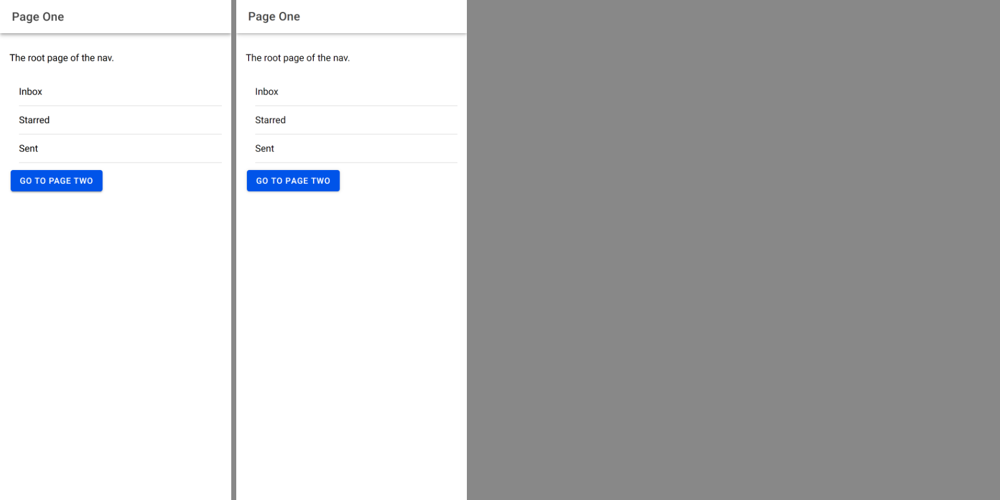
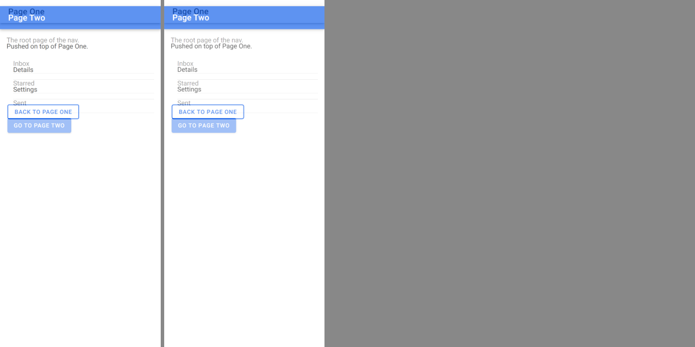
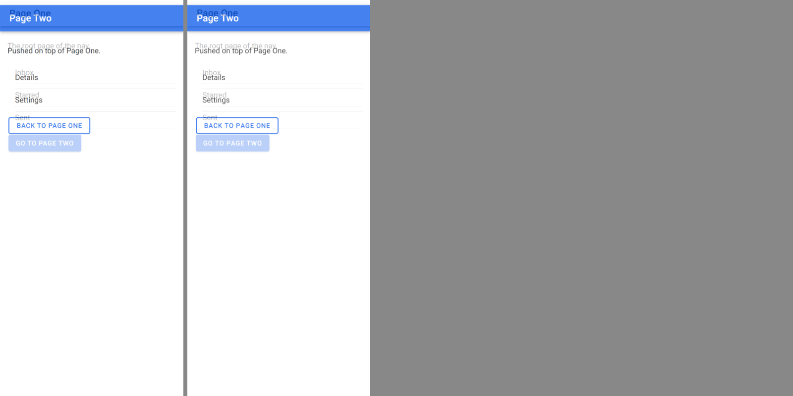

# ion-nav

Status: done · [#130](https://github.com/wdcossey/Avonic/issues/130)

`AvonicNav` and `AvonicNavLink`: Ionic's `ion-nav` and `ion-nav-link`, md. A stack of pages, the top one shown, with md's page
transition, every call queued and run one at a time; and an element that pushes, sets the root or pops on the closest nav when it's
clicked. It's the navigation contract `ion-back-button` (#47) builds on. Plan: [PLAN.md](PLAN.md); comparison:
[COMPARISON.md](COMPARISON.md).

| Page One | A push, 64 ms in | A pop, 96 ms in |
|---|---|---|
|  |  |  |

## Usage

```xml
<c:AvonicNav Root="{x:Type pages:InboxPage}">
    <c:AvonicNav.DataTemplates>
        <!-- A view model pushed on the nav gets its page from a data template, with the view model as its DataContext. -->
        <DataTemplate DataType="vm:SettingsViewModel">
            <pages:SettingsPage />
        </DataTemplate>
    </c:AvonicNav.DataTemplates>
</c:AvonicNav>
```

On a page:

```xml
<c:AvonicNavLink Component="{x:Type pages:MessagePage}">
    <c:AvonicItem Button="True" Detail="True">
        <c:AvonicLabel Content="Open the message" />
    </c:AvonicItem>
</c:AvonicNavLink>
<c:AvonicNavLink RouterDirection="Back">
    <c:AvonicButton Content="Back to the inbox" />
</c:AvonicNavLink>
```

In code:

```csharp
await nav.Push(typeof(MessagePage), new Dictionary<string, object?> { ["subject"] = "Lunch on Friday" });
await nav.Push(() => new DraftPage(store));          // a factory: constructor arguments, DI
await nav.Push(new SettingsViewModel());              // a view model, through the data templates
await nav.Pop();
await nav.PopToRoot();
```

### What a page is

Ionic's `NavComponent` (a tag name, an element, a framework's component, or a `ViewController`) is, here, any of:

| Form | Built | Ionic's |
|---|---|---|
| A `Control` | used as it is; it can be pushed again after it's popped | an `HTMLElement` |
| A `Type` of control with a parameterless constructor | when it's first entered | a tag name |
| A `Func<Control>` | called when it's first entered | a framework's `Function` component |
| A `ViewController` | its own component | a `ViewController` |
| Any other object, a view model | by the nav's data templates (its own, its ancestors', the application's, where an app's view locator is), with the object as the page's `DataContext` | a framework's component through its delegate |

A page gets class `ion-page` (an `AvonicContent` in it takes it as its page), fills the nav, and inherits the nav's `DataContext`
unless its form sets one. `GetActive().Component` is the form it was pushed as: the view model, for one.

**`componentProps`** (`Push`'s, the link's `ComponentProps`, `RootParams`) are set on the page by name before it's attached, as
`Object.assign` sets them on the element: each key the page's Avalonia property, camelCase or PascalCase, or else a public settable
CLR property, the value converted as XAML converts a string. A key with neither is ignored. **Trimming:** a CLR property is found
by reflection, so a trimmed app (Android's head is) can lose a page's property that no code of its own sets; an Avalonia property
is registered, and always found. Props given with a view model go to the page built for it.

**Lifetime**, as Ionic's: a page is built when it's first entered (`InsertPages` builds only the last), kept and hidden under the
pages above it, with its state and scroll position, and removed from the nav when it's popped or replaced.

**Lifecycle events** come on the page, and don't bubble: `AvonicNav.AddIonViewWillEnterHandler(page, …)` and the same for
`IonViewDidEnter`, `IonViewWillLeave`, `IonViewDidLeave` and `IonViewWillUnload`.

## Checklist

### ion-nav

| ✓ | Ionic | Avonic | Notes |
|---|---|---|---|
| [x] | `animated` | `Animated` (`bool`, true) | Off: the pages change at the next frame with their events, no animation. `AvonicConfig.Animated` off too |
| [x] | `animation` | `Animation` (`AnimationBuilder?`) | Given the nav and a `NavTransitionOptions` |
| [x] | `root` | `Root` (`object?`) | A page form; set unanimated at the first attach, and again at each change |
| [x] | `rootParams` | `RootParams` | `Root`'s props; a change of its own does nothing |
| [x] | `swipeGesture` | `NavSwipeGesture` (`bool?`) | Named as `SegmentSwipeGesture` is. Null takes `AvonicConfig.SwipeBackEnabled` (false) at the first attach. See [Swipe back](#swipe-back) |
| [x] | `ionNavWillChange`, `ionNavDidChange` | `IonNavWillChange`, `IonNavDidChange` | `Direct`, as they don't bubble |
| [x] | `push`, `insert`, `insertPages`, `pop`, `popTo`, `popToRoot`, `removeIndex`, `setRoot`, `setPages` | the same, PascalCase | `Task<bool>`, with Ionic's `opts` (`NavOptions`) and `done` (`TransitionDoneFn`). A failure faults the task with Ionic's message |
| [x] | `getActive`, `getByIndex`, `canGoBack`, `getPrevious`, `getLength` | the same | Synchronous, as Ionic's are `async` wrappers of synchronous reads |
| [x] | `(default)` slot | none | The nav's children are the pages it makes |
| — | `setRouteId`, `getRouteId` | none | Not in Ionic 9: removed with `ion-router` support ("as of Ionic 9 ion-nav is no longer a router outlet") |
| — | `delegate`, `ionNavWillLoad` | none | `@internal`; the page forms play the delegate's part |

`NavOptions`: `Animated`, `AnimationBuilder`, `Duration`, `Direction`, `SkipIfBusy`, `ShowGoBack`, `DeepWait`, `ViewIsReady`,
`ProgressAnimation`. `ViewController`: `Component`, `Params`, `Element`, `Nav`. `NavComponentWithProps` for the lists.

### ion-nav-link

| ✓ | Ionic | Avonic | Notes |
|---|---|---|---|
| [x] | `component` | `Component` (`object?`) | A page form, for `Forward` and `Root` |
| [x] | `componentProps` | `ComponentProps` | |
| [x] | `routerAnimation` | `RouterAnimation` | |
| [x] | `routerDirection` | `RouterDirection` (`NavLinkRouterDirection`, `Forward`) | `Back` pops, `Forward` pushes, `Root` sets the root; each skipped while the nav is busy |

## Behaviours

- **The transition (md).** A push builds the page, waits a frame for it, lays it out, and only then starts: the entering page rises
  40 px and fades in over 280 ms, `cubic-bezier(0.36,0.66,0.04,1)`, over the leaving page, which doesn't move. A pop: the leaving page
  sinks 40 px and fades out over 200 ms, `cubic-bezier(0.47,0,0.745,0.715)`, over the page under it. The fade is the page's as one
  picture (an opacity mask), as CSS's `opacity` is.
- **The queue.** Calls run one at a time, in order; `SkipIfBusy` while one runs gives false at once. A failure (a pop at the root:
  `navigation stack needs at least one root page`) faults its task and drops the calls behind it, which complete false.
- **The pages.** Hidden under the top (out of layout and automation), not hit-testable during a transition; `ZIndex` 101 for a
  page coming forward, 99 going back, 100 for the one leaving; `:can-go-back` on a page with one under it, which #47's back button
  reads.
- **Events.** `IonNavWillChange` inside the call that starts a transition; the page's will-leave and will-enter as it starts;
  did-enter, did-leave (then will-unload for a popped page) and `IonNavDidChange` at its end, before an awaiting caller continues.
- **The link.** A press on anything in it, or a button in it clicked by a key, does its direction on the closest nav once (a
  double tap pushes once). It isn't focusable and has no automation element of its own.

## Extensions

- **The hardware back button pops the nav.** Ionic's core nav doesn't listen to it (measured); Ionic leaves it to a framework's
  router outlet, which goes back at priority 0. Here the nav does: while it can go back and is shown, a back request (Android's back,
  a mouse's back button, Alt+Left) pops it, at priority 0 inside an `AvonicApp`, so an overlay (100) and a menu (99) come first; of
  several navs, the innermost. At its root it leaves the request alone, for the platform (Android leaves the app) or the app's own
  handler. An app that wants it for itself can:
  - set **`HandleBackButton="False"`** on the nav, which then never takes a back request; or
  - register on **`HardwareBackButton.IonBackButtonEvent`** above priority 0 (`e.Register(1, …)`), which comes first, inside an
    `AvonicApp`.

## Swipe back

Ionic's `swipeGesture`, off by default as md has it (Ionic turns it on only in iOS mode), and Avonic's choice to offer under md: with
`NavSwipeGesture="True"`, or `AvonicConfig.SwipeBackEnabled = true` for navs that don't set it, a drag that starts within 50 of the
window's start edge (the right one in right-to-left) drives the back transition, held at the drag's share of the window's width, and
completes it when it ends moving forward faster than 0.2 px/ms or past half the width; otherwise it plays back to the page it left.
With animations off it pops at the end. **On Android** a drag from the left edge is also the system's back gesture, which the system
(on either edge) takes first where gesture navigation is on, so there the nav may never see the drag; it works where the
system's gesture is off (three-button navigation).

## Resource keys

None: `nav.css` sets only the host's position, and there's no `nav.md.css` or CSS variable. The transition's numbers are constants
in Components; an app replaces the transition with `Animation`.

## Deliberate differences

Ionic bugs Avonic doesn't copy (ADR 0005), each in [`docs/infra/ionic-issues.md`](../../infra/ionic-issues.md):

- A bare page form in `InsertPages` or `SetPages` works; Ionic throws a `TypeError` on a string there.
- Calls dropped behind a failure complete false; Ionic's never settle.
- The stack is kept when the nav is detached and attached again; Ionic empties it, so a nav in an inline modal shows nothing.

## Known gaps

- **Measured headless and on the desktop only.** The phone's build and layout cost (#248) isn't measured here; the nav waits for
  the page's layout before it starts the animation, as Ionic does, so a slow page starts late rather than jumping.
- `focusManagerPriority`, Ionic's experimental focus manager, isn't built: it's off by default, and then does nothing.
- Not tried in a real window: `tools/real-window/drive.ps1` has an `ion-nav` section, not run here.
