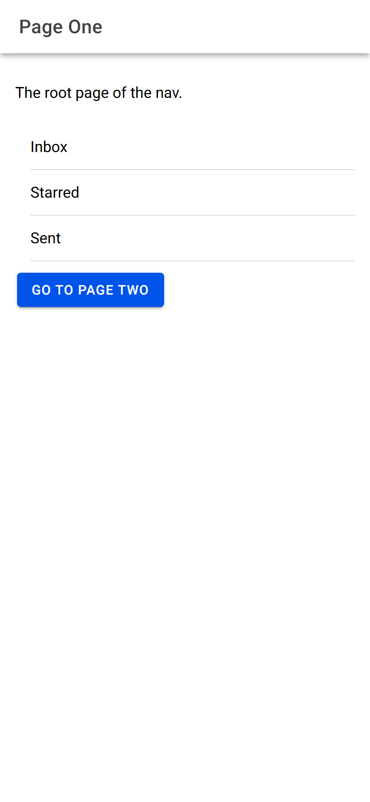

# ion-nav — reference render (Ionic 9.0.11, md, 390×844@2x)

Generated by `node tools/ionic-ref/render.js ion-nav --bare --html "<script>customElements.define(\"nav-page-one\",class extends HTMLElement{connectedCallback(){if(this.innerHTML)return;this.innerHTML='<ion-header><ion-toolbar><ion-title>Page One</ion-title></ion-toolbar></ion-header><ion-content class=\"ion-padding\"><p>The root page of the nav.</p><ion-list><ion-item><ion-label>Inbox</ion-label></ion-item><ion-item><ion-label>Starred</ion-label></ion-item><ion-item><ion-label>Sent</ion-label></ion-item></ion-list><ion-nav-link router-direction=\"forward\" component=\"nav-page-two\"><ion-button id=\"go\">Go to Page Two</ion-button></ion-nav-link></ion-content>'}});customElements.define(\"nav-page-two\",class extends HTMLElement{connectedCallback(){if(this.innerHTML)return;this.innerHTML='<ion-header><ion-toolbar color=\"primary\"><ion-title>Page Two</ion-title></ion-toolbar></ion-header><ion-content class=\"ion-padding\"><p>Pushed on top of Page One.</p><ion-list><ion-item><ion-label>Details</ion-label></ion-item><ion-item><ion-label>Settings</ion-label></ion-item></ion-list><ion-nav-link router-direction=\"back\"><ion-button id=\"back\" fill=\"outline\">Back to Page One</ion-button></ion-nav-link></ion-content>'}});</script><ion-app><ion-nav root=\"nav-page-one\"></ion-nav></ion-app>"`

```html
<script>customElements.define("nav-page-one",class extends HTMLElement{connectedCallback(){if(this.innerHTML)return;this.innerHTML='<ion-header><ion-toolbar><ion-title>Page One</ion-title></ion-toolbar></ion-header><ion-content class="ion-padding"><p>The root page of the nav.</p><ion-list><ion-item><ion-label>Inbox</ion-label></ion-item><ion-item><ion-label>Starred</ion-label></ion-item><ion-item><ion-label>Sent</ion-label></ion-item></ion-list><ion-nav-link router-direction="forward" component="nav-page-two"><ion-button id="go">Go to Page Two</ion-button></ion-nav-link></ion-content>'}});customElements.define("nav-page-two",class extends HTMLElement{connectedCallback(){if(this.innerHTML)return;this.innerHTML='<ion-header><ion-toolbar color="primary"><ion-title>Page Two</ion-title></ion-toolbar></ion-header><ion-content class="ion-padding"><p>Pushed on top of Page One.</p><ion-list><ion-item><ion-label>Details</ion-label></ion-item><ion-item><ion-label>Settings</ion-label></ion-item></ion-list><ion-nav-link router-direction="back"><ion-button id="back" fill="outline">Back to Page One</ion-button></ion-nav-link></ion-content>'}});</script><ion-app><ion-nav root="nav-page-one"></ion-nav></ion-app>
```

 

## Element 1

- attributes: `{"root":"nav-page-one","class":"hydrated"}`
- classes: `hydrated`
- rect: `{"x":0,"y":0,"w":390,"h":844}`

### Host computed

| prop | value |
|---|---|
| display | `block` |
| position | `absolute` |
| box-sizing | `border-box` |
| width | `390px` |
| height | `844px` |
| min-height | `0px` |
| min-width | `0px` |
| padding | `0px` |
| margin | `0px` |
| border | `0px none rgb(0, 0, 0)` |
| border-radius | `0px` |
| background-color | `rgba(0, 0, 0, 0)` |
| color | `rgb(0, 0, 0)` |
| font-size | `16px` |
| font-weight | `400` |
| font-family | `Roboto, "Helvetica Neue", sans-serif` |
| line-height | `normal` |
| letter-spacing | `normal` |
| text-transform | `none` |
| opacity | `1` |
| overflow | `visible` |
| contain | `size layout style` |
| pointer-events | `auto` |
| transition | `all` |
| transform | `none` |
| box-shadow | `none` |
| outline | `rgb(0, 0, 0) none 0px` |
| cursor | `auto` |

### DOM tree

```
<ion-nav>
  #shadow-root
    <slot name="">
  <nav-page-one.ion-page>
    <ion-header.md.header-md.header-collapse-none.hydrated>
      <ion-toolbar.toolbar-title-default.md.in-toolbar.hydrated>
        #shadow-root
          <div.toolbar-background part="background">
          <div.toolbar-container part="container">
            <slot name="start">
            <slot name="secondary">
            <div.toolbar-content part="content">
              <slot name="">
            <slot name="primary">
            <slot name="end">
        <ion-title.md.title-default.hydrated>
          #shadow-root
            <div.toolbar-title>
              <slot name="">
    <ion-content.ion-padding.md.content-ltr.hydrated>
      #shadow-root
        <div#background-content part="background">
        <div.inner-scroll.scroll-y part="scroll">
          <slot name="">
        <slot name="fixed">
      <p>
      <ion-list.md.list-md.hydrated>
        <ion-item.item.md.item-lines-default.in-list.hydrated.item-label>
          #shadow-root
            <div.item-native part="native">
              <slot name="start">
              <div.item-inner part="inner">
                <div.input-wrapper part="container">
                  <slot name="">
                <slot name="end">
          <ion-label.sc-ion-label-md-h.md.sc-ion-label-md.sc-ion-label-md-s.hydrated>
        <ion-item.item.md.item-lines-default.in-list.hydrated.item-label>
          #shadow-root
            <div.item-native part="native">
              <slot name="start">
              <div.item-inner part="inner">
                <div.input-wrapper part="container">
                  <slot name="">
                <slot name="end">
          <ion-label.sc-ion-label-md-h.md.sc-ion-label-md.sc-ion-label-md-s.hydrated>
        <ion-item.item.md.item-lines-default.in-list.hydrated.item-label>
          #shadow-root
            <div.item-native part="native">
              <slot name="start">
              <div.item-inner part="inner">
                <div.input-wrapper part="container">
                  <slot name="">
                <slot name="end">
          <ion-label.sc-ion-label-md-h.md.sc-ion-label-md.sc-ion-label-md-s.hydrated>
      <ion-nav-link.hydrated>
        <ion-button#go.md.button.button-solid.ion-activatable.ion-focusable.hydrated>
          #shadow-root
            <button.button-native part="native">
              <span.button-inner>
                <slot name="icon-only">
                <slot name="start">
                <slot name="">
                <slot name="end">
              <ion-ripple-effect.md.hydrated>
                #shadow-root
```
