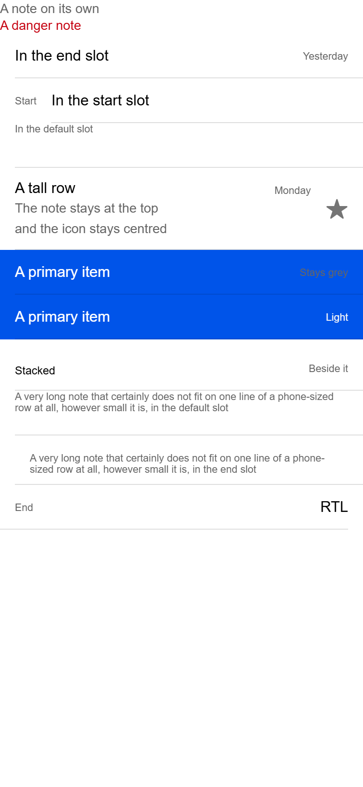
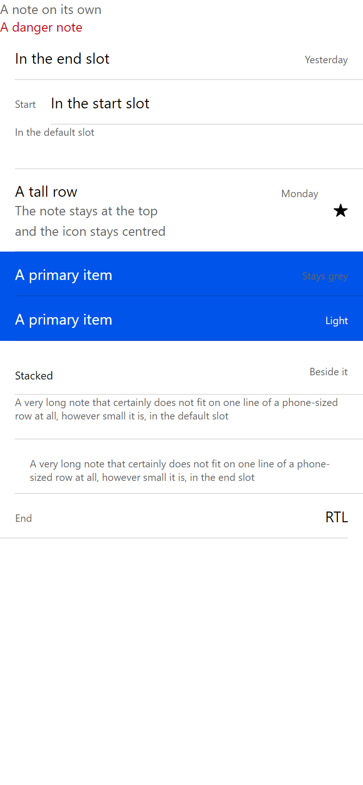

# ion-note — Comparison against the web component

> Ionic side (Chromium, md, 390×844@2x) → [`ref/`](ref/). The exact command:
>
> ```
> node tools/ionic-ref/render.js ion-note --bare --html '<div><ion-note>A note on its own</ion-note></div><div><ion-note color="danger">A danger note</ion-note></div><ion-item><ion-label>In the end slot</ion-label><ion-note slot="end">Yesterday</ion-note></ion-item><ion-item><ion-note slot="start">Start</ion-note><ion-label>In the start slot</ion-label></ion-item><ion-item><ion-note>In the default slot</ion-note></ion-item><ion-item><ion-label><h2>A tall row</h2><p>The note stays at the top</p><p>and the icon stays centred</p></ion-label><ion-note slot="end">Monday</ion-note><ion-icon name="star" slot="end"></ion-icon></ion-item><ion-item color="primary"><ion-label>A primary item</ion-label><ion-note slot="end">Stays grey</ion-note></ion-item><ion-item color="primary"><ion-label>A primary item</ion-label><ion-note slot="end" color="light">Light</ion-note></ion-item><ion-item><ion-label position="stacked">Stacked</ion-label><ion-note slot="end">Beside it</ion-note></ion-item><ion-item><ion-note>A very long note that certainly does not fit on one line of a phone-sized row at all, however small it is, in the default slot</ion-note></ion-item><ion-item><ion-note slot="end">A very long note that certainly does not fit on one line of a phone-sized row at all, however small it is, in the end slot</ion-note></ion-item><div dir="rtl"><ion-item><ion-label>RTL</ion-label><ion-note slot="end">End</ion-note></ion-item></div>'
> ```
>
> Avonic side: `AVONIC_CAPTURE_DIR=… dotnet test` → `AvonicNoteCaptureTests` (headless Skia, 2×) → [`compare/`](compare/).
> Measurements for the behaviours came from a separate scene, wrapped in `ion-app`, at 390 wide.

## Frames

| Ionic | Avonic |
|---|---|
|  |  |

Rows from the top: alone, danger, in the end slot, in the start slot, in the default slot, a tall row with an icon,
grey in a primary item, light in a primary item, beside a stacked label, long in the default slot, long in the end slot,
and RTL.

**Match,** apart from these visible differences:

- **Text.** Roboto isn't installed on this machine, so Chromium uses Arial and Avalonia uses Segoe UI. Segoe UI's lines are
  taller: an 11 px line is 15 against 12, so the row beside a stacked label is 58 against 55.
- **Long in the end slot.** It wraps within 342, as Ionic's does, since #71. As it's aligned left, its box is as wide as its longest line, where Ionic's is 342. The text is in the same place.
- **The icon in the tall row** is smaller and black, because `Styles/Item.axaml`'s `::slotted(ion-icon)` rules only reach
  an icon directly in a slot. A note and an icon in one slot have to be in a panel here. That belongs to the item, and it's
  listed in the PR. The note itself, and the icon's being centred, match.

## Found here, not by the tests

Nothing in the frames needed a fix. The measurements did change the design before any code: without them, I'd have
treated `align-self: flex-start` as `VerticalAlignment="Top"`, which does nothing in a centred presenter.

Breaking each behaviour on purpose found tests that couldn't fail: a stretched `TextBlock` has the same centre and the same
width as its parent, so "centred" and "as wide as its text" passed with the rules gone. The tests now check sizes too.
Code review found the stub's `Wrap` stopping `.ion-text-nowrap`, measured it, and fixed it, along with a vertical stack
sitting at the top of the row.

## Behaviours

The numbers are from [PLAN.md](PLAN.md#behaviours). Each has tests in `AvonicNoteTests`, named after its number.

| # | Behaviour | Ionic | Result |
|---|---|---|---|
| 1 | Alone: its own colour, size and font | `rgb(102, 102, 102)`, 14 px, Roboto first, in a 30 px serif `rgb(1,2,3)` parent | match |
| 2 | `color` paints the text | `rgb(197, 0, 15)`, in and out of an item | match |
| 3 | An unknown colour inherits, or shows a coloured item's base | `rgb(1, 2, 3)`; `rgb(0, 84, 233)` in a primary item | match |
| 4 | The token sets the text, and `color` beats it | `rgb(18, 52, 86)`; `rgb(197, 0, 15)` | match |
| 5 | A coloured item doesn't change it | `rgb(102, 102, 102)` | match |
| 6 | 11 px in any slot, whatever the item's size. 14 deeper or in a label | `def`, `start`, `end`, `sized` at 11; `in-div`, `in-label` at 14 | match, except a panel directly in a slot, which counts as the slot. See the plan |
| 7 | 18 above and 10 below, in the start and end slots only | 40 high in those slots, 12 in the default slot | match. The heights depend on the font |
| 8 | At the top of the row, however tall | y = 0 in rows of 48 and 88, in all three slots | match |
| 9 | The item's slot margins | `0 0 16 0`, `16 0 0 0`, y = 7 beside a stacked label | match |
| 10 | As wide as its text | 55 wide in the default slot, at x = 16 | match |
| 11 | Long text wraps | 4 lines in 200 wide; 358 wide in the default slot | match in those. See the gap for the other slots |
| 12 | A tap on it doesn't forward, even on its padding, and a tap on the item's padding does | toggle stays off, then flips | match, against a stub toggle |
| 13 | A button item's name includes its text | native `<button>` | match |
| 14 | RTL | an end note at x = 16, with its margin on the right | match |
| 15 | In a nowrap label | `white-space: nowrap`, cut off by the label | match, with the class on the note or on a label. See the plan |

## Deliberate differences and known gaps

All in [PLAN.md](PLAN.md#deliberate-differences).

## Real window

Tried on Windows at 125%, with `tools/real-window`, on 2026-11-06. Not on real touch hardware. The page draws as the frames do. It takes no input, so nothing else was driven. The input it
adds to the item is one transparent background, and that's covered by `B12`.
