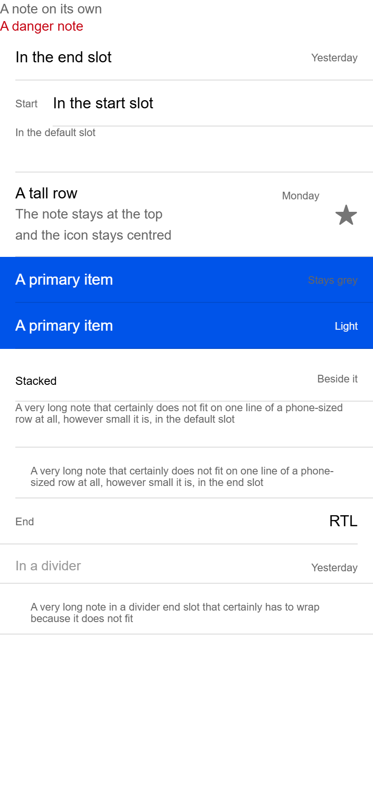

# ion-note — reference render (Ionic 8.8.1, md, 390×844@2x)

Generated by `node tools/ionic-ref/render.js ion-note --bare --html "<div><ion-note>A note on its own</ion-note></div><div><ion-note color=\"danger\">A danger note</ion-note></div><ion-item><ion-label>In the end slot</ion-label><ion-note slot=\"end\">Yesterday</ion-note></ion-item><ion-item><ion-note slot=\"start\">Start</ion-note><ion-label>In the start slot</ion-label></ion-item><ion-item><ion-note>In the default slot</ion-note></ion-item><ion-item><ion-label><h2>A tall row</h2><p>The note stays at the top</p><p>and the icon stays centred</p></ion-label><ion-note slot=\"end\">Monday</ion-note><ion-icon name=\"star\" slot=\"end\"></ion-icon></ion-item><ion-item color=\"primary\"><ion-label>A primary item</ion-label><ion-note slot=\"end\">Stays grey</ion-note></ion-item><ion-item color=\"primary\"><ion-label>A primary item</ion-label><ion-note slot=\"end\" color=\"light\">Light</ion-note></ion-item><ion-item><ion-label position=\"stacked\">Stacked</ion-label><ion-note slot=\"end\">Beside it</ion-note></ion-item><ion-item><ion-note>A very long note that certainly does not fit on one line of a phone-sized row at all, however small it is, in the default slot</ion-note></ion-item><ion-item><ion-note slot=\"end\">A very long note that certainly does not fit on one line of a phone-sized row at all, however small it is, in the end slot</ion-note></ion-item><div dir=\"rtl\"><ion-item><ion-label>RTL</ion-label><ion-note slot=\"end\">End</ion-note></ion-item></div><ion-item-divider><ion-label>In a divider</ion-label><ion-note slot=\"end\">Yesterday</ion-note></ion-item-divider><ion-item-divider><ion-label>Default</ion-label><ion-note slot=\"end\">A very long note in a divider end slot that certainly has to wrap because it does not fit</ion-note></ion-item-divider>"`

```html
<div><ion-note>A note on its own</ion-note></div><div><ion-note color="danger">A danger note</ion-note></div><ion-item><ion-label>In the end slot</ion-label><ion-note slot="end">Yesterday</ion-note></ion-item><ion-item><ion-note slot="start">Start</ion-note><ion-label>In the start slot</ion-label></ion-item><ion-item><ion-note>In the default slot</ion-note></ion-item><ion-item><ion-label><h2>A tall row</h2><p>The note stays at the top</p><p>and the icon stays centred</p></ion-label><ion-note slot="end">Monday</ion-note><ion-icon name="star" slot="end"></ion-icon></ion-item><ion-item color="primary"><ion-label>A primary item</ion-label><ion-note slot="end">Stays grey</ion-note></ion-item><ion-item color="primary"><ion-label>A primary item</ion-label><ion-note slot="end" color="light">Light</ion-note></ion-item><ion-item><ion-label position="stacked">Stacked</ion-label><ion-note slot="end">Beside it</ion-note></ion-item><ion-item><ion-note>A very long note that certainly does not fit on one line of a phone-sized row at all, however small it is, in the default slot</ion-note></ion-item><ion-item><ion-note slot="end">A very long note that certainly does not fit on one line of a phone-sized row at all, however small it is, in the end slot</ion-note></ion-item><div dir="rtl"><ion-item><ion-label>RTL</ion-label><ion-note slot="end">End</ion-note></ion-item></div><ion-item-divider><ion-label>In a divider</ion-label><ion-note slot="end">Yesterday</ion-note></ion-item-divider><ion-item-divider><ion-label>Default</ion-label><ion-note slot="end">A very long note in a divider end slot that certainly has to wrap because it does not fit</ion-note></ion-item-divider>
```

 

## Element 1

- attributes: `{"class":"md hydrated"}`
- classes: `md hydrated`
- rect: `{"x":0,"y":1,"w":106.64,"h":16}`

### CSS custom properties (resolved)

| var | value |
|---|---|
| `--color` | `#666666` |

### Host computed

| prop | value |
|---|---|
| display | `inline` |
| position | `static` |
| box-sizing | `border-box` |
| width | `auto` |
| height | `auto` |
| min-height | `0px` |
| min-width | `0px` |
| padding | `0px` |
| margin | `0px` |
| border | `0px none rgb(102, 102, 102)` |
| border-radius | `0px` |
| background-color | `rgba(0, 0, 0, 0)` |
| color | `rgb(102, 102, 102)` |
| font-size | `14px` |
| font-weight | `400` |
| font-family | `Roboto, "Helvetica Neue", sans-serif` |
| line-height | `normal` |
| letter-spacing | `normal` |
| text-transform | `none` |
| opacity | `1` |
| overflow | `visible` |
| contain | `none` |
| pointer-events | `auto` |
| transition | `all` |
| transform | `none` |
| box-shadow | `none` |
| outline | `rgb(102, 102, 102) none 0px` |
| cursor | `auto` |

### DOM tree

```
<ion-note>
  #shadow-root
    <slot name="">
```

## Element 2

- attributes: `{"color":"danger","class":"ion-color ion-color-danger md hydrated"}`
- classes: `ion-color ion-color-danger md hydrated`
- rect: `{"x":0,"y":19,"w":87.19,"h":16}`

### CSS custom properties (resolved)

| var | value |
|---|---|
| `--color` | `#666666` |

### Host computed

| prop | value |
|---|---|
| display | `inline` |
| position | `static` |
| box-sizing | `border-box` |
| width | `auto` |
| height | `auto` |
| min-height | `0px` |
| min-width | `0px` |
| padding | `0px` |
| margin | `0px` |
| border | `0px none rgb(197, 0, 15)` |
| border-radius | `0px` |
| background-color | `rgba(0, 0, 0, 0)` |
| color | `rgb(197, 0, 15)` |
| font-size | `14px` |
| font-weight | `400` |
| font-family | `Roboto, "Helvetica Neue", sans-serif` |
| line-height | `normal` |
| letter-spacing | `normal` |
| text-transform | `none` |
| opacity | `1` |
| overflow | `visible` |
| contain | `none` |
| pointer-events | `auto` |
| transition | `all` |
| transform | `none` |
| box-shadow | `none` |
| outline | `rgb(197, 0, 15) none 0px` |
| cursor | `auto` |

### DOM tree

```
<ion-note>
  #shadow-root
    <slot name="">
```

## Element 3

- attributes: `{"slot":"end","class":"md hydrated"}`
- classes: `md hydrated`
- rect: `{"x":325.47,"y":36,"w":48.53,"h":40}`

### CSS custom properties (resolved)

| var | value |
|---|---|
| `--color` | `#666666` |

### Host computed

| prop | value |
|---|---|
| display | `block` |
| position | `static` |
| box-sizing | `border-box` |
| width | `48.5312px` |
| height | `40px` |
| min-height | `auto` |
| min-width | `auto` |
| padding | `18px 0px 10px` |
| margin | `0px 0px 0px 16px` |
| border | `0px none rgb(102, 102, 102)` |
| border-radius | `0px` |
| background-color | `rgba(0, 0, 0, 0)` |
| color | `rgb(102, 102, 102)` |
| font-size | `11px` |
| font-weight | `400` |
| font-family | `Roboto, "Helvetica Neue", sans-serif` |
| line-height | `normal` |
| letter-spacing | `normal` |
| text-transform | `none` |
| opacity | `1` |
| overflow | `visible` |
| contain | `none` |
| pointer-events | `auto` |
| transition | `all` |
| transform | `none` |
| box-shadow | `none` |
| outline | `rgb(102, 102, 102) none 0px` |
| cursor | `auto` |

### DOM tree

```
<ion-note>
  #shadow-root
    <slot name="">
```

## Element 4

- attributes: `{"slot":"start","class":"md hydrated"}`
- classes: `md hydrated`
- rect: `{"x":16,"y":84,"w":23.23,"h":40}`

### CSS custom properties (resolved)

| var | value |
|---|---|
| `--color` | `#666666` |

### Host computed

| prop | value |
|---|---|
| display | `block` |
| position | `static` |
| box-sizing | `border-box` |
| width | `23.2344px` |
| height | `40px` |
| min-height | `auto` |
| min-width | `auto` |
| padding | `18px 0px 10px` |
| margin | `0px 16px 0px 0px` |
| border | `0px none rgb(102, 102, 102)` |
| border-radius | `0px` |
| background-color | `rgba(0, 0, 0, 0)` |
| color | `rgb(102, 102, 102)` |
| font-size | `11px` |
| font-weight | `400` |
| font-family | `Roboto, "Helvetica Neue", sans-serif` |
| line-height | `normal` |
| letter-spacing | `normal` |
| text-transform | `none` |
| opacity | `1` |
| overflow | `visible` |
| contain | `none` |
| pointer-events | `auto` |
| transition | `all` |
| transform | `none` |
| box-shadow | `none` |
| outline | `rgb(102, 102, 102) none 0px` |
| cursor | `auto` |

### DOM tree

```
<ion-note>
  #shadow-root
    <slot name="">
```

## Element 5

- attributes: `{"class":"md hydrated"}`
- classes: `md hydrated`
- rect: `{"x":16,"y":132,"w":83.78,"h":12}`

### CSS custom properties (resolved)

| var | value |
|---|---|
| `--color` | `#666666` |

### Host computed

| prop | value |
|---|---|
| display | `block` |
| position | `static` |
| box-sizing | `border-box` |
| width | `83.7812px` |
| height | `12px` |
| min-height | `auto` |
| min-width | `auto` |
| padding | `0px` |
| margin | `0px` |
| border | `0px none rgb(102, 102, 102)` |
| border-radius | `0px` |
| background-color | `rgba(0, 0, 0, 0)` |
| color | `rgb(102, 102, 102)` |
| font-size | `11px` |
| font-weight | `400` |
| font-family | `Roboto, "Helvetica Neue", sans-serif` |
| line-height | `normal` |
| letter-spacing | `normal` |
| text-transform | `none` |
| opacity | `1` |
| overflow | `visible` |
| contain | `none` |
| pointer-events | `auto` |
| transition | `all` |
| transform | `none` |
| box-shadow | `none` |
| outline | `rgb(102, 102, 102) none 0px` |
| cursor | `auto` |

### DOM tree

```
<ion-note>
  #shadow-root
    <slot name="">
```

## Element 6

- attributes: `{"slot":"end","class":"md hydrated"}`
- classes: `md hydrated`
- rect: `{"x":294.86,"y":180,"w":39.14,"h":40}`

### CSS custom properties (resolved)

| var | value |
|---|---|
| `--color` | `#666666` |

### Host computed

| prop | value |
|---|---|
| display | `block` |
| position | `static` |
| box-sizing | `border-box` |
| width | `39.1406px` |
| height | `40px` |
| min-height | `auto` |
| min-width | `auto` |
| padding | `18px 0px 10px` |
| margin | `0px 0px 0px 16px` |
| border | `0px none rgb(102, 102, 102)` |
| border-radius | `0px` |
| background-color | `rgba(0, 0, 0, 0)` |
| color | `rgb(102, 102, 102)` |
| font-size | `11px` |
| font-weight | `400` |
| font-family | `Roboto, "Helvetica Neue", sans-serif` |
| line-height | `normal` |
| letter-spacing | `normal` |
| text-transform | `none` |
| opacity | `1` |
| overflow | `visible` |
| contain | `none` |
| pointer-events | `auto` |
| transition | `all` |
| transform | `none` |
| box-shadow | `none` |
| outline | `rgb(102, 102, 102) none 0px` |
| cursor | `auto` |

### DOM tree

```
<ion-note>
  #shadow-root
    <slot name="">
```

## Element 7

- attributes: `{"slot":"end","class":"md hydrated"}`
- classes: `md hydrated`
- rect: `{"x":322.03,"y":268.19,"w":51.97,"h":40}`

### CSS custom properties (resolved)

| var | value |
|---|---|
| `--color` | `#666666` |

### Host computed

| prop | value |
|---|---|
| display | `block` |
| position | `static` |
| box-sizing | `border-box` |
| width | `51.9688px` |
| height | `40px` |
| min-height | `auto` |
| min-width | `auto` |
| padding | `18px 0px 10px` |
| margin | `0px 0px 0px 16px` |
| border | `0px none rgb(102, 102, 102)` |
| border-radius | `0px` |
| background-color | `rgba(0, 0, 0, 0)` |
| color | `rgb(102, 102, 102)` |
| font-size | `11px` |
| font-weight | `400` |
| font-family | `Roboto, "Helvetica Neue", sans-serif` |
| line-height | `normal` |
| letter-spacing | `normal` |
| text-transform | `none` |
| opacity | `1` |
| overflow | `visible` |
| contain | `none` |
| pointer-events | `auto` |
| transition | `all` |
| transform | `none` |
| box-shadow | `none` |
| outline | `rgb(102, 102, 102) none 0px` |
| cursor | `auto` |

### DOM tree

```
<ion-note>
  #shadow-root
    <slot name="">
```

## Element 8

- attributes: `{"slot":"end","color":"light","class":"ion-color ion-color-light md hydrated"}`
- classes: `ion-color ion-color-light md hydrated`
- rect: `{"x":350.14,"y":316.19,"w":23.86,"h":40}`

### CSS custom properties (resolved)

| var | value |
|---|---|
| `--color` | `#666666` |

### Host computed

| prop | value |
|---|---|
| display | `block` |
| position | `static` |
| box-sizing | `border-box` |
| width | `23.8594px` |
| height | `40px` |
| min-height | `auto` |
| min-width | `auto` |
| padding | `18px 0px 10px` |
| margin | `0px 0px 0px 16px` |
| border | `0px none rgb(244, 245, 248)` |
| border-radius | `0px` |
| background-color | `rgba(0, 0, 0, 0)` |
| color | `rgb(244, 245, 248)` |
| font-size | `11px` |
| font-weight | `400` |
| font-family | `Roboto, "Helvetica Neue", sans-serif` |
| line-height | `normal` |
| letter-spacing | `normal` |
| text-transform | `none` |
| opacity | `1` |
| overflow | `visible` |
| contain | `none` |
| pointer-events | `auto` |
| transition | `all` |
| transform | `none` |
| box-shadow | `none` |
| outline | `rgb(244, 245, 248) none 0px` |
| cursor | `auto` |

### DOM tree

```
<ion-note>
  #shadow-root
    <slot name="">
```

## Element 9

- attributes: `{"slot":"end","class":"md hydrated"}`
- classes: `md hydrated`
- rect: `{"x":331.8,"y":371.19,"w":42.2,"h":40}`

### CSS custom properties (resolved)

| var | value |
|---|---|
| `--color` | `#666666` |

### Host computed

| prop | value |
|---|---|
| display | `block` |
| position | `static` |
| box-sizing | `border-box` |
| width | `42.2031px` |
| height | `40px` |
| min-height | `auto` |
| min-width | `auto` |
| padding | `18px 0px 10px` |
| margin | `7px 0px 7px 16px` |
| border | `0px none rgb(102, 102, 102)` |
| border-radius | `0px` |
| background-color | `rgba(0, 0, 0, 0)` |
| color | `rgb(102, 102, 102)` |
| font-size | `11px` |
| font-weight | `400` |
| font-family | `Roboto, "Helvetica Neue", sans-serif` |
| line-height | `normal` |
| letter-spacing | `normal` |
| text-transform | `none` |
| opacity | `1` |
| overflow | `visible` |
| contain | `none` |
| pointer-events | `auto` |
| transition | `all` |
| transform | `none` |
| box-shadow | `none` |
| outline | `rgb(102, 102, 102) none 0px` |
| cursor | `auto` |

### DOM tree

```
<ion-note>
  #shadow-root
    <slot name="">
```

## Element 10

- attributes: `{"class":"md hydrated"}`
- classes: `md hydrated`
- rect: `{"x":16,"y":419.19,"w":358,"h":24}`

### CSS custom properties (resolved)

| var | value |
|---|---|
| `--color` | `#666666` |

### Host computed

| prop | value |
|---|---|
| display | `block` |
| position | `static` |
| box-sizing | `border-box` |
| width | `358px` |
| height | `24px` |
| min-height | `auto` |
| min-width | `auto` |
| padding | `0px` |
| margin | `0px` |
| border | `0px none rgb(102, 102, 102)` |
| border-radius | `0px` |
| background-color | `rgba(0, 0, 0, 0)` |
| color | `rgb(102, 102, 102)` |
| font-size | `11px` |
| font-weight | `400` |
| font-family | `Roboto, "Helvetica Neue", sans-serif` |
| line-height | `normal` |
| letter-spacing | `normal` |
| text-transform | `none` |
| opacity | `1` |
| overflow | `visible` |
| contain | `none` |
| pointer-events | `auto` |
| transition | `all` |
| transform | `none` |
| box-shadow | `none` |
| outline | `rgb(102, 102, 102) none 0px` |
| cursor | `auto` |

### DOM tree

```
<ion-note>
  #shadow-root
    <slot name="">
```

## Element 11

- attributes: `{"slot":"end","class":"md hydrated"}`
- classes: `md hydrated`
- rect: `{"x":32,"y":467.19,"w":342,"h":52}`

### CSS custom properties (resolved)

| var | value |
|---|---|
| `--color` | `#666666` |

### Host computed

| prop | value |
|---|---|
| display | `block` |
| position | `static` |
| box-sizing | `border-box` |
| width | `342px` |
| height | `52px` |
| min-height | `auto` |
| min-width | `auto` |
| padding | `18px 0px 10px` |
| margin | `0px 0px 0px 16px` |
| border | `0px none rgb(102, 102, 102)` |
| border-radius | `0px` |
| background-color | `rgba(0, 0, 0, 0)` |
| color | `rgb(102, 102, 102)` |
| font-size | `11px` |
| font-weight | `400` |
| font-family | `Roboto, "Helvetica Neue", sans-serif` |
| line-height | `normal` |
| letter-spacing | `normal` |
| text-transform | `none` |
| opacity | `1` |
| overflow | `visible` |
| contain | `none` |
| pointer-events | `auto` |
| transition | `all` |
| transform | `none` |
| box-shadow | `none` |
| outline | `rgb(102, 102, 102) none 0px` |
| cursor | `auto` |

### DOM tree

```
<ion-note>
  #shadow-root
    <slot name="">
```

## Element 12

- attributes: `{"slot":"end","class":"md hydrated"}`
- classes: `md hydrated`
- rect: `{"x":16,"y":520.19,"w":19.58,"h":40}`

### CSS custom properties (resolved)

| var | value |
|---|---|
| `--color` | `#666666` |

### Host computed

| prop | value |
|---|---|
| display | `block` |
| position | `static` |
| box-sizing | `border-box` |
| width | `19.5781px` |
| height | `40px` |
| min-height | `auto` |
| min-width | `auto` |
| padding | `18px 0px 10px` |
| margin | `0px 16px 0px 0px` |
| border | `0px none rgb(102, 102, 102)` |
| border-radius | `0px` |
| background-color | `rgba(0, 0, 0, 0)` |
| color | `rgb(102, 102, 102)` |
| font-size | `11px` |
| font-weight | `400` |
| font-family | `Roboto, "Helvetica Neue", sans-serif` |
| line-height | `normal` |
| letter-spacing | `normal` |
| text-transform | `none` |
| opacity | `1` |
| overflow | `visible` |
| contain | `none` |
| pointer-events | `auto` |
| transition | `all` |
| transform | `none` |
| box-shadow | `none` |
| outline | `rgb(102, 102, 102) none 0px` |
| cursor | `auto` |

### DOM tree

```
<ion-note>
  #shadow-root
    <slot name="">
```

## Element 13

- attributes: `{"slot":"end","class":"md hydrated"}`
- classes: `md hydrated`
- rect: `{"x":325.47,"y":568.19,"w":48.53,"h":40}`

### CSS custom properties (resolved)

| var | value |
|---|---|
| `--color` | `#666666` |

### Host computed

| prop | value |
|---|---|
| display | `block` |
| position | `static` |
| box-sizing | `border-box` |
| width | `48.5312px` |
| height | `40px` |
| min-height | `auto` |
| min-width | `auto` |
| padding | `18px 0px 10px` |
| margin | `0px 0px 0px 16px` |
| border | `0px none rgb(102, 102, 102)` |
| border-radius | `0px` |
| background-color | `rgba(0, 0, 0, 0)` |
| color | `rgb(102, 102, 102)` |
| font-size | `11px` |
| font-weight | `400` |
| font-family | `Roboto, "Helvetica Neue", sans-serif` |
| line-height | `normal` |
| letter-spacing | `normal` |
| text-transform | `none` |
| opacity | `1` |
| overflow | `visible` |
| contain | `none` |
| pointer-events | `auto` |
| transition | `all` |
| transform | `none` |
| box-shadow | `none` |
| outline | `rgb(102, 102, 102) none 0px` |
| cursor | `auto` |

### DOM tree

```
<ion-note>
  #shadow-root
    <slot name="">
```

## Element 14

- attributes: `{"slot":"end","class":"md hydrated"}`
- classes: `md hydrated`
- rect: `{"x":32,"y":609.19,"w":342,"h":52}`

### CSS custom properties (resolved)

| var | value |
|---|---|
| `--color` | `#666666` |

### Host computed

| prop | value |
|---|---|
| display | `block` |
| position | `static` |
| box-sizing | `border-box` |
| width | `342px` |
| height | `52px` |
| min-height | `auto` |
| min-width | `auto` |
| padding | `18px 0px 10px` |
| margin | `0px 0px 0px 16px` |
| border | `0px none rgb(102, 102, 102)` |
| border-radius | `0px` |
| background-color | `rgba(0, 0, 0, 0)` |
| color | `rgb(102, 102, 102)` |
| font-size | `11px` |
| font-weight | `400` |
| font-family | `Roboto, "Helvetica Neue", sans-serif` |
| line-height | `normal` |
| letter-spacing | `normal` |
| text-transform | `none` |
| opacity | `1` |
| overflow | `visible` |
| contain | `none` |
| pointer-events | `auto` |
| transition | `all` |
| transform | `none` |
| box-shadow | `none` |
| outline | `rgb(102, 102, 102) none 0px` |
| cursor | `auto` |

### DOM tree

```
<ion-note>
  #shadow-root
    <slot name="">
```
