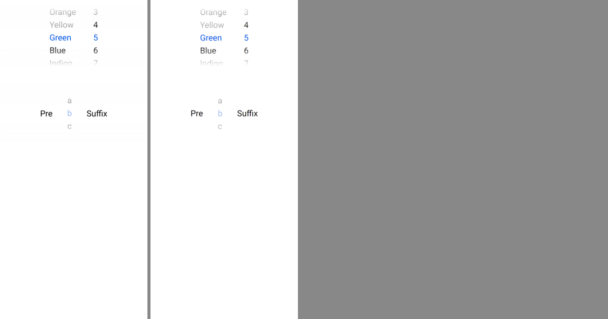

# ion-picker family — Comparison against the web component

> Ionic side: `node tools/ionic-ref/render.js ion-picker --bare --html '<the snippet below>'` (Chromium, md, 390×844@2x) → [`ref/`](ref/).
> `ref/README.md` holds the exact command, and `ref/page.html` the page.
> Avonic side: `AVONIC_CAPTURE_DIR=… dotnet test` → `AvonicPickerTests.Reference_Page` (headless Skia, 2×) → [`compare/`](compare/).
> Not tried in a real window (real-window run queued), and not tried on a device.

```html
<ion-picker>
  <ion-picker-column value="Green">Red, Orange, Yellow (disabled), Green, Blue, Indigo, Violet</ion-picker-column>
  <ion-picker-column value="5">1 … 12</ion-picker-column>
</ion-picker>
<ion-picker>
  <ion-picker-column value="b" disabled><div slot="prefix">Pre</div>a, b (disabled), c<div slot="suffix">Suffix</div></ion-picker-column>
</ion-picker>
```

(Each option is `<ion-picker-column-option value="X">X</ion-picker-column-option>`; the real command is in `ref/README.md`.)
`Reference_Page` lays out the same content in a `StackPanel`.

The behaviours were measured with throwaway Playwright scripts on pages like it, at 390 wide, wrapped in `ion-app`, with a mouse
and the keyboard: `scrollTop` at load and every frame of a programmatic change, a wheel notch, a click two rows down, the keys,
a value with no option (at load and later), a click on a disabled option, a disabled column given a value from code, and numeric
input with two numeric columns (a tap in the highlight, typing, two wheels, a tap outside, Enter).

## Visual



Ionic (left) and Avonic (right), headless. They match: the columns' places and widths (Avonic's first column is 103 wide where
Chromium's is 102.3, as text measures a little differently, and so starts 0.7 to the left), the active option in primary, the
disabled option and column at 0.4, the fades, and the prefix and suffix. Avonic's text sits up to 1 px lower in its row.

| Box | Chromium | Avonic |
|---|---|---|
| Picker | 390 × 200 | 390 × 200 |
| Highlight | 8, 83, 374 × 34, radius 8, transparent | same |
| Fades | 0–83, white 20 % → clear 90 %; 116–200, white 30 % → clear 90 % (from the bottom) | same |
| Columns | 102.3 and 58 wide, from 114.84 | 103 and 58, from 114 |
| Option rows | 34 high, three empty rows above and below; `scrollHeight` 442 for 7 options | same; extent 442 |
| Disabled column with prefix and suffix | 64.8 + 58 + 86.89 = 209.69 | `Pre` and `Suffix` measure within a pixel |

## Behaviours

| # | Behaviour | Chromium | Avonic | Result |
|---|---|---|---|---|
| C1 | At load, centred on its value, active in primary, no `ionChange` | `scrollTop` 121 | 121 | match |
| C2 | A value from code scrolls smoothly, no `ionChange` | 155 → 291 in about 200 ms, eased | √136 / 60 = 194 ms, the same easing as the segment's measured smooth scroll | match |
| C3 | The active option follows the centre; the value is set 250 ms after the last scroll, with one `ionChange` | `ionChange` 251 ms after the last scroll event | at 250 ms | match |
| C3 | A disabled option at the centre is never active, nor the value | — (from the code) | tested | match |
| C4 | A wheel notch scrolls 100 px and snaps to the nearest | 121 → 221 → 223 | 121 → 223 | match (Avonic jumps; Chromium headless jumped too, then eased the last 2 px) |
| C4 | A drag rests centred on an enabled option | `scroll-snap-type: y mandatory` | Avalonia's `Mandatory` snap points from `PickerColumnPanel` | deliberate difference: Avalonia's snap after a fling and on release, which jumps where Chromium eases |
| C5 | A click sets the value at once, then scrolls | `ionChange` at 7 ms, scroll after | at once, then smooth | match |
| C6 | Disabled column: no wheel, click, key or focus; options at 0.4; its disabled option with the value is active | measured | tested | match |
| C6 | A disabled column given a value from code scrolls there, and then no option is active | 87, none active | 87, none active | match |
| C7 | A disabled option is at 0.4 and skipped by the keys | 0.4 | 0.4 | match |
| C7 | A click on a disabled option | `ionChange` b, then `ionChange` a: the value goes to the first option | nothing | deliberate difference: see the README's "Decided" |
| C8 | Keys: 11 → ↓ 12 → ↑ 11 → PgUp 6 → Home 1 → End 12 → PgUp 7 | measured on a desktop | the same; reversed on Android and iOS | match |
| C9 | A value with no option: kept at load (first option at the centre, none active); set while visible, it becomes the first option's with `ionChange` | `scrollTop` 19; `a` | 19; `a` at the next frame | match |
| C10 | Focused: the scroller has the colour's base at 0.2 | `rgba(0, 84, 233, 0.2)` | a primary brush at opacity 0.2; none on Android and iOS | match |
| C3 | `aria-valuetext` while the user scrolls | Ionic 8.8.1 writes it to `assistiveFocusable`, which nothing sets, so nothing changes until the render after the value | the peer's value changes at the render after the value | match |
| C11 | `setFocus()` | does nothing in 8.8.1: `assistiveFocusable` is never set | focuses the column | deliberate difference: see "Decided" |
| C12 | An option added later centres the column | from the code | tested | match |
| C13 | A hidden column doesn't scroll for a value, and centres when shown | from the code | tested | match |
| P1 | Highlight, fades, columns centred, left to right in RTL | measured | tested | match |
| P2 | First column's text at the start, last at the end, a lone one centred | measured `text-align` | tested | match |
| P3 | A tap in the highlight with two numeric columns: both active, the hidden input focused; "1230" → 12 and 30 | measured | tested | match |
| P3 | Wheels in input mode leave it on | measured: both columns stay active | tested, with why | match |
| P3 | A tap outside the highlight leaves input mode (and clicks the option there) | measured | tested | match |
| P3 | Enter leaves input mode and blurs the input | measured | tested | match |
| P3 | A column focused by the keyboard takes digits for itself; a second's pause starts again | from the code | tested | match |
| P3 | With one numeric column, a tap on an option in the highlight | from the code: the option becomes the input mode's column, and typing selects nothing | that column takes digits | deliberate difference: see the README's "Decided" |
| P4 | A touch on the picker doesn't reach a gesture outside it (`touchstart` `stopPropagation`) | read from `picker.js`, not measured | `Gesture.StopsTouchStart` on the picker: a sideways drag on a column in an `AvonicItemSliding` doesn't open it (#131, `P4_…`) | match; a mouse press still reaches them, as only `touchstart` is stopped |
| — | Haptics | iOS only, so none in md | none | match (Avonic has no haptics) |
