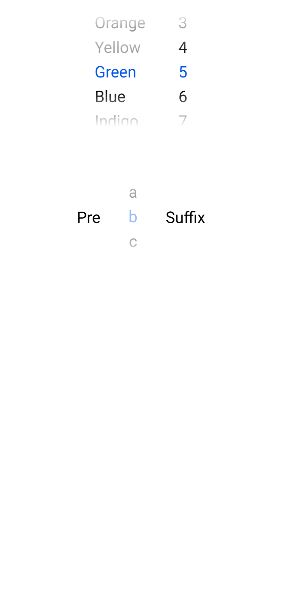
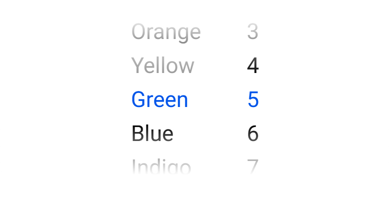

# ion-picker — reference render (Ionic 8.8.1, md, 390×844@2x)

Generated by `node tools/ionic-ref/render.js ion-picker --bare --html "<ion-picker><ion-picker-column value=\"Green\"><ion-picker-column-option value=\"Red\">Red</ion-picker-column-option><ion-picker-column-option value=\"Orange\">Orange</ion-picker-column-option><ion-picker-column-option value=\"Yellow\" disabled>Yellow</ion-picker-column-option><ion-picker-column-option value=\"Green\">Green</ion-picker-column-option><ion-picker-column-option value=\"Blue\">Blue</ion-picker-column-option><ion-picker-column-option value=\"Indigo\">Indigo</ion-picker-column-option><ion-picker-column-option value=\"Violet\">Violet</ion-picker-column-option></ion-picker-column><ion-picker-column value=\"5\"><ion-picker-column-option value=\"1\">1</ion-picker-column-option><ion-picker-column-option value=\"2\">2</ion-picker-column-option><ion-picker-column-option value=\"3\">3</ion-picker-column-option><ion-picker-column-option value=\"4\">4</ion-picker-column-option><ion-picker-column-option value=\"5\">5</ion-picker-column-option><ion-picker-column-option value=\"6\">6</ion-picker-column-option><ion-picker-column-option value=\"7\">7</ion-picker-column-option><ion-picker-column-option value=\"8\">8</ion-picker-column-option><ion-picker-column-option value=\"9\">9</ion-picker-column-option><ion-picker-column-option value=\"10\">10</ion-picker-column-option><ion-picker-column-option value=\"11\">11</ion-picker-column-option><ion-picker-column-option value=\"12\">12</ion-picker-column-option></ion-picker-column></ion-picker><ion-picker><ion-picker-column value=\"b\" disabled><div slot=\"prefix\">Pre</div><ion-picker-column-option value=\"a\">a</ion-picker-column-option><ion-picker-column-option value=\"b\" disabled>b</ion-picker-column-option><ion-picker-column-option value=\"c\">c</ion-picker-column-option><div slot=\"suffix\">Suffix</div></ion-picker-column></ion-picker>" --out docs/components/ion-picker/ref`

```html
<ion-picker><ion-picker-column value="Green"><ion-picker-column-option value="Red">Red</ion-picker-column-option><ion-picker-column-option value="Orange">Orange</ion-picker-column-option><ion-picker-column-option value="Yellow" disabled>Yellow</ion-picker-column-option><ion-picker-column-option value="Green">Green</ion-picker-column-option><ion-picker-column-option value="Blue">Blue</ion-picker-column-option><ion-picker-column-option value="Indigo">Indigo</ion-picker-column-option><ion-picker-column-option value="Violet">Violet</ion-picker-column-option></ion-picker-column><ion-picker-column value="5"><ion-picker-column-option value="1">1</ion-picker-column-option><ion-picker-column-option value="2">2</ion-picker-column-option><ion-picker-column-option value="3">3</ion-picker-column-option><ion-picker-column-option value="4">4</ion-picker-column-option><ion-picker-column-option value="5">5</ion-picker-column-option><ion-picker-column-option value="6">6</ion-picker-column-option><ion-picker-column-option value="7">7</ion-picker-column-option><ion-picker-column-option value="8">8</ion-picker-column-option><ion-picker-column-option value="9">9</ion-picker-column-option><ion-picker-column-option value="10">10</ion-picker-column-option><ion-picker-column-option value="11">11</ion-picker-column-option><ion-picker-column-option value="12">12</ion-picker-column-option></ion-picker-column></ion-picker><ion-picker><ion-picker-column value="b" disabled><div slot="prefix">Pre</div><ion-picker-column-option value="a">a</ion-picker-column-option><ion-picker-column-option value="b" disabled>b</ion-picker-column-option><ion-picker-column-option value="c">c</ion-picker-column-option><div slot="suffix">Suffix</div></ion-picker-column></ion-picker>
```

 

## Element 1

- attributes: `{"class":"hydrated"}`
- classes: `hydrated`
- rect: `{"x":0,"y":0,"w":390,"h":200}`

### CSS custom properties (resolved)

| var | value |
|---|---|
| `--fade-background-rgb` | `(unset)` |
| `--highlight-background` | `(unset)` |
| `--highlight-border-radius` | `(unset)` |

### Host computed

| prop | value |
|---|---|
| display | `flex` |
| position | `relative` |
| box-sizing | `border-box` |
| width | `390px` |
| height | `200px` |
| min-height | `0px` |
| min-width | `0px` |
| padding | `0px` |
| margin | `0px` |
| border | `0px none rgb(0, 0, 0)` |
| border-radius | `0px` |
| background-color | `rgba(0, 0, 0, 0)` |
| color | `rgb(0, 0, 0)` |
| font-size | `16px` |
| font-weight | `400` |
| font-family | `Roboto, "Helvetica Neue", sans-serif` |
| line-height | `normal` |
| letter-spacing | `normal` |
| text-transform | `none` |
| opacity | `1` |
| overflow | `visible` |
| contain | `none` |
| pointer-events | `auto` |
| transition | `all` |
| transform | `none` |
| box-shadow | `none` |
| outline | `rgb(0, 0, 0) none 0px` |
| cursor | `auto` |

### DOM tree

```
<ion-picker>
  #shadow-root
    <input>
    <div.picker-before>
    <div.picker-after>
    <div.picker-highlight>
    <slot name="">
  <ion-picker-column.ion-color.ion-color-primary.md.hydrated>
    #shadow-root
      <slot name="prefix">
      <div.picker-opts>
        <div.picker-item-empty>
        <div.picker-item-empty>
        <div.picker-item-empty>
        <slot name="">
        <div.picker-item-empty>
        <div.picker-item-empty>
        <div.picker-item-empty>
      <slot name="suffix">
    <ion-picker-column-option.ion-color.ion-color-primary.md.hydrated>
      #shadow-root
        <div.picker-column-option-button>
          <slot name="">
    <ion-picker-column-option.ion-color.ion-color-primary.md.hydrated>
      #shadow-root
        <div.picker-column-option-button>
          <slot name="">
    <ion-picker-column-option.ion-color.ion-color-primary.md.option-disabled.hydrated>
      #shadow-root
        <div.picker-column-option-button>
          <slot name="">
    <ion-picker-column-option.ion-color.ion-color-primary.md.hydrated.option-active>
      #shadow-root
        <div.picker-column-option-button>
          <slot name="">
    <ion-picker-column-option.ion-color.ion-color-primary.md.hydrated>
      #shadow-root
        <div.picker-column-option-button>
          <slot name="">
    <ion-picker-column-option.ion-color.ion-color-primary.md.hydrated>
      #shadow-root
        <div.picker-column-option-button>
          <slot name="">
    <ion-picker-column-option.ion-color.ion-color-primary.md.hydrated>
      #shadow-root
        <div.picker-column-option-button>
          <slot name="">
  <ion-picker-column.ion-color.ion-color-primary.md.hydrated>
    #shadow-root
      <slot name="prefix">
      <div.picker-opts>
        <div.picker-item-empty>
        <div.picker-item-empty>
        <div.picker-item-empty>
        <slot name="">
        <div.picker-item-empty>
        <div.picker-item-empty>
        <div.picker-item-empty>
      <slot name="suffix">
    <ion-picker-column-option.ion-color.ion-color-primary.md.hydrated>
      #shadow-root
        <div.picker-column-option-button>
          <slot name="">
    <ion-picker-column-option.ion-color.ion-color-primary.md.hydrated>
      #shadow-root
        <div.picker-column-option-button>
          <slot name="">
    <ion-picker-column-option.ion-color.ion-color-primary.md.hydrated>
      #shadow-root
        <div.picker-column-option-button>
          <slot name="">
    <ion-picker-column-option.ion-color.ion-color-primary.md.hydrated>
      #shadow-root
        <div.picker-column-option-button>
          <slot name="">
    <ion-picker-column-option.ion-color.ion-color-primary.md.hydrated.option-active>
      #shadow-root
        <div.picker-column-option-button>
          <slot name="">
    <ion-picker-column-option.ion-color.ion-color-primary.md.hydrated>
      #shadow-root
        <div.picker-column-option-button>
          <slot name="">
    <ion-picker-column-option.ion-color.ion-color-primary.md.hydrated>
      #shadow-root
        <div.picker-column-option-button>
          <slot name="">
    <ion-picker-column-option.ion-color.ion-color-primary.md.hydrated>
      #shadow-root
        <div.picker-column-option-button>
          <slot name="">
    <ion-picker-column-option.ion-color.ion-color-primary.md.hydrated>
      #shadow-root
        <div.picker-column-option-button>
          <slot name="">
    <ion-picker-column-option.ion-color.ion-color-primary.md.hydrated>
      #shadow-root
        <div.picker-column-option-button>
          <slot name="">
    <ion-picker-column-option.ion-color.ion-color-primary.md.hydrated>
      #shadow-root
        <div.picker-column-option-button>
          <slot name="">
    <ion-picker-column-option.ion-color.ion-color-primary.md.hydrated>
      #shadow-root
        <div.picker-column-option-button>
          <slot name="">
```

## Element 2

- attributes: `{"class":"hydrated"}`
- classes: `hydrated`
- rect: `{"x":0,"y":200,"w":390,"h":200}`

### CSS custom properties (resolved)

| var | value |
|---|---|
| `--fade-background-rgb` | `(unset)` |
| `--highlight-background` | `(unset)` |
| `--highlight-border-radius` | `(unset)` |

### Host computed

| prop | value |
|---|---|
| display | `flex` |
| position | `relative` |
| box-sizing | `border-box` |
| width | `390px` |
| height | `200px` |
| min-height | `0px` |
| min-width | `0px` |
| padding | `0px` |
| margin | `0px` |
| border | `0px none rgb(0, 0, 0)` |
| border-radius | `0px` |
| background-color | `rgba(0, 0, 0, 0)` |
| color | `rgb(0, 0, 0)` |
| font-size | `16px` |
| font-weight | `400` |
| font-family | `Roboto, "Helvetica Neue", sans-serif` |
| line-height | `normal` |
| letter-spacing | `normal` |
| text-transform | `none` |
| opacity | `1` |
| overflow | `visible` |
| contain | `none` |
| pointer-events | `auto` |
| transition | `all` |
| transform | `none` |
| box-shadow | `none` |
| outline | `rgb(0, 0, 0) none 0px` |
| cursor | `auto` |

### DOM tree

```
<ion-picker>
  #shadow-root
    <input>
    <div.picker-before>
    <div.picker-after>
    <div.picker-highlight>
    <slot name="">
  <ion-picker-column.ion-color.ion-color-primary.md.picker-column-disabled.hydrated>
    #shadow-root
      <slot name="prefix">
      <div.picker-opts>
        <div.picker-item-empty>
        <div.picker-item-empty>
        <div.picker-item-empty>
        <slot name="">
        <div.picker-item-empty>
        <div.picker-item-empty>
        <div.picker-item-empty>
      <slot name="suffix">
    <div slot="prefix">
    <ion-picker-column-option.ion-color.ion-color-primary.md.hydrated>
      #shadow-root
        <div.picker-column-option-button>
          <slot name="">
    <ion-picker-column-option.ion-color.ion-color-primary.md.option-disabled.hydrated.option-active>
      #shadow-root
        <div.picker-column-option-button>
          <slot name="">
    <ion-picker-column-option.ion-color.ion-color-primary.md.hydrated>
      #shadow-root
        <div.picker-column-option-button>
          <slot name="">
    <div slot="suffix">
```
