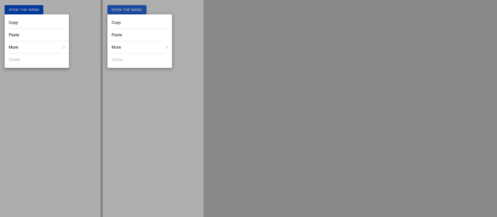
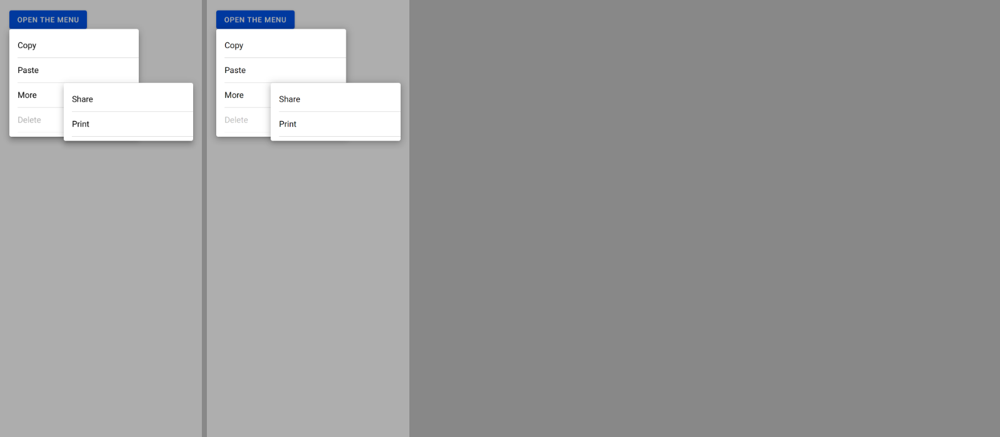

# ion-popover — Comparison

Ionic 9.0.11, md, headless Chromium, beside Avonic headless (Skia) at the same size and 2x. The reference render, of a popover
with `is-open` and no event, centred, is `render.js`'s:

```
node tools/ionic-ref/render.js ion-popover --bare --html '<ion-popover is-open="true"><ion-list><ion-item button detail="false">One</ion-item><ion-item button detail="false">Two</ion-item><ion-item button detail="false">Three</ion-item></ion-list></ion-popover>'
```

`render.js` can't click, so the menu frames, [`ref/menu.png`](ref/menu.png) and [`ref/submenu.png`](ref/submenu.png), come from
the measurement scripts behind [`ref/measurements.txt`](ref/measurements.txt), on `render.js`'s phone (390 x 844 at 2x, mobile,
touch): the sample's menu, an `ion-button` opening an `ion-popover` with four button items, the fourth disabled, and a nested
popover (side `end`) on the third, each `dismiss-on-select`, clicked open with the mouse. Avonic's frames are
`AvonicPopoverCaptureTests.Reference_Menu_And_Submenu`, saved in [`compare/`](compare/), with the submenu presented in code, as a
click's ripple fades on a real-time transition in a headless test. Not tried in a real window: `tools/real-window/drive.ps1` has
a section for the sample page, for the batch's runner.

| The menu | Its submenu |
|---|---|
|  |  |

Ionic's on the left of each.

## Visual

| | Ionic | Avonic | |
|---|---|---|---|
| The menu's box | 18, 56, 250 x 208: at the button's left, under it | at the button's left, under it, 250 x 208 | Match (asserted) |
| The submenu's box | 123, 160, 250 x 112: beside More, pushed in to 12 from the right, then `--offset-x` -5 | 123, level with More, 250 x 112 | Match (asserted) |
| Radius 4, md's three shadows, white, text black | | the same keys | Match; the shadow through [box-shadow](../../infra/box-shadow/README.md)'s conversion, which it measured within 1 to 3 levels of Chromium from a 4 px blur up |
| The items, their lines, the disabled one's text | | the same | Match (`AvonicItem`, `AvonicList`) |
| The backdrop at 0.32 | | the same | Match |

## Behaviour

| # | Behaviour | Ionic | Avonic | |
|---|---|---|---|---|
| B1 | Enter | M1: 300 ms on `cubic-bezier(0.36,0.66,0.04,1)`; the backdrop 0.01 to 0.32, `pointer-events: none` until the end; the wrapper 0.01 to 1 over 150 ms; the content 0.8 to 1 from its origin | The same values at each frame of the test clock | Match |
| B1 | Not animated | M1b: the backdrop and scale at their ends at once, the wrapper still over 150 ms | The same | Match |
| B1 | The viewport's fade | M1: `.popover-viewport` stays 1: the animation looks for it in the shadow root, where it isn't | Nothing animates it | Match |
| B2 | Leave | M2: 150 ms, `ease`, the backdrop to 0, the wrapper 0.99 to 0; the place stays until the end | The same; the place, the origin and cover's width go after | Match |
| B3 | Events | M3: `ionPopoverWillDismiss`, `willDismiss`, then the did pair at the end | The same order, each bubbling | Match |
| B4, B5 | Positions | M5: 108 cases, every side and alignment at six places | Each to the pixel, from the same maths (`PopoverPosition`) | Match (108 tests, generated from the measurements) |
| B5 | Tall content | M5: stretched to 12 from the bottom (392 high), flipped (at 195), 90% high (759.59) | The same, 760 for 759.59 | Match, to Avalonia's whole pixels at a scale of 1 |
| B5 | Safe areas | `getSafeAreaInsets`: added where the clamp is, none with cover | `Avonic.SafeArea*` from the window, 0 inside | Match (from the code; Chromium's safe areas are 0) |
| B5 | Pulled up | `calculateWindowAdjustment`: a stretched box starting past the bottom padding moves to the top | The same | Match (from the code, not measured) |
| B6 | No event | M5: centred, 70, 362, origin `left top` | The same | Match |
| B6 | `reference="event"` | M5, M9: at the point, plus 1 down, pushed in at the edges; a right click at 247.25, 41 opens it at 128, 42 | The same | Match |
| B7 | `size="cover"` | M5: the trigger's 180, no padding | The same | Match |
| B8 | `--offset-x`, `--offset-y` | M5: 7 and -3 move it to 135, 437 | The same, through `Avonic.Popover.OffsetX` and `OffsetY` | Match |
| B9 | Click trigger | presents with the click | The same: the trigger's own `Click`, or a tap | Match |
| B9 | Hover trigger | M8: 108 ms after the pointer comes, nothing if it leaves first, open while it's over the backdrop | 116 ms on the clock (100 and a 16 ms frame) | Match |
| B9 | Context-menu trigger | M9: the right click opens it, the platform's menu prevented | `ContextRequested`, handled | Match |
| B10 | `dismissOnSelect` | M7: a click in it dismisses it, no role | A tap, or a key's click, the same | Match |
| B11 | Backdrop | `backdropDismiss`, `showBackdrop` | The same | Match |
| B12 | Keys | M6: ArrowDown from the host to the first, End to the last enabled, the ends stay | The same, at the next frame | Match |
| B12 | Enter, Space on a trigger item | M6b: as ArrowRight, the parent stays | The same | Match |
| B12 | Submenu by key | M6: ArrowRight on More opens it with focus on Share; ArrowLeft closes it alone, focus back on More | The same | Match |
| B13 | Nested | M7: no backdrop; Escape: child then parent, both `backdrop`; the parent's backdrop: parent `backdrop`, then the child with none; a click in the child: child then parent; a click trigger in a `dismiss-on-select` parent leaves the parent | The same, in the same order | Match |
| B13 | Hover child, the pointer back in the parent | dismissed unless `elementFromPoint` is the trigger itself | dismissed unless the point is in the trigger | **Deliberate difference:** below |
| B14 | Focus | the host at present; the first focusable after a key; back after | The same | Match |
| B16 | RTL | M5: `start` and `end` swap; places are left to right | The same, also in a right-to-left window | Match |
| B18 | Long content | `overflow: auto`; an `ion-content` shrinks to the box and scrolls | The same | Match |

## Deliberate differences

- **The hover child's trigger, back in the parent.** Ionic keeps a hover submenu open when the pointer comes back into the parent's
  content over its trigger, by `document.elementFromPoint() === triggerEl`. That's the deepest element, retargeted out of shadow
  roots, so it's the item when the pointer is over its own padding, but its `ion-label` when it's over a label: the submenu closes,
  and opens again 100 ms later. Avalonia's hit test always finds the deepest visual, a text block inside the item's template, so
  "the trigger itself" has no equivalent; anything inside the trigger counts as it, which is what the check is for.
- **A finger on a hover trigger.** Chromium gives a tap compatibility mouse events, a `mouseenter` and no `mouseleave` until the next
  tap elsewhere, so a tap on a hover trigger opens it after 100 ms. Avalonia's pointer leaves at a touch's release; the popover
  takes a touch's enter as Chromium does, and ignores its leave.
- **A submenu's dismiss while it isn't shown.** Ionic's `dismiss()` dismisses the parent first, presented or not. Here one tap can come
  as a tap and an item's click, two dismisses where Ionic has one click; the second, coming once the first is done, would dismiss
  the parent again, and could close a menu opened again meanwhile. So the parent is dismissed only by a dismiss of a submenu that's
  shown. An app's `Dismiss()` on a closed submenu leaves its parent open.
- **Layout to whole pixels.** Avalonia rounds layout to device pixels (whole ones at a scale of 1): 90% of 844 is 760 here, 759.59
  in Chromium at 2x.

## Known gaps

- **A context menu or flyout of the trigger's own.** Ionic's `preventDefault` keeps the browser's menu away. Here the request is
  handled in the popover's own handler, which runs after the class handlers that open an Avalonia `ContextMenu` or `ContextFlyout`
  set on the trigger: don't give a context-menu trigger one. Not tried.
- Not tried in a real window: the driver's `ion-popover` section is for the batch's runner.
