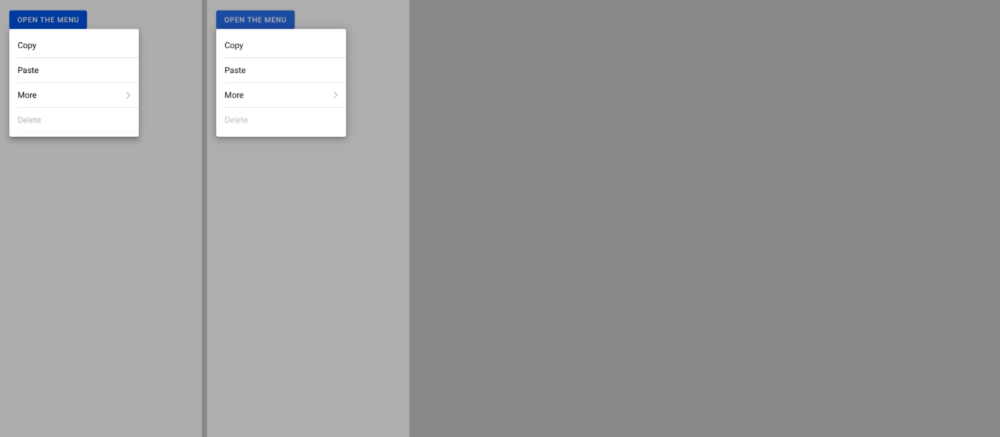
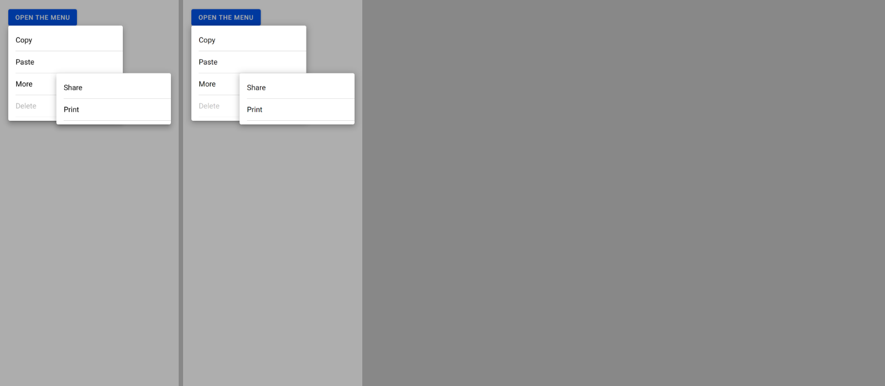

# ion-popover

Status: done · [#43](https://github.com/wdcossey/Avonic/issues/43)

`AvonicPopover`, Ionic's `ion-popover`, md: content in a 250-wide box beside a reference, over a backdrop, on the
[overlay system](../../infra/overlays/README.md); opened by a click, a hover or a context menu on its trigger, or in code with an
event; with submenus, and the arrow keys through its items. Plan: [PLAN.md](PLAN.md); comparison: [COMPARISON.md](COMPARISON.md).

| A menu | Its submenu |
|---|---|
|  |  |

## Usage

Inline, opened by its trigger, which by default is a click on the control of that name in the page's name scope:

```xml
<StackPanel>
    <c:AvonicButton Name="OpenMenu" Content="Open the menu" />
    <c:AvonicPopover Trigger="OpenMenu" DismissOnSelect="True">
        <StackPanel>
            <c:AvonicList>
                <c:AvonicItem Button="True" Detail="False" Content="Copy" />
                <c:AvonicItem Name="More" Button="True" Detail="True" Content="More" />
            </c:AvonicList>
            <!-- A submenu: a popover in another's content, with no backdrop of its own. -->
            <c:AvonicPopover Trigger="More" Side="End" DismissOnSelect="True">
                <c:AvonicList>
                    <c:AvonicItem Button="True" Detail="False" Content="Share" />
                </c:AvonicList>
            </c:AvonicPopover>
        </StackPanel>
    </c:AvonicPopover>
</StackPanel>
```

`TriggerAction="Hover"` opens it when the pointer rests on the trigger for 100 ms, and `TriggerAction="ContextMenu"` on a right
click, a long press or the menu key, with `Reference="Event"` at the pointer. While it's presented an inline popover is moved to
the overlay layer, with a placeholder in its place, as the modal is; it has to be in a `Panel`, a `Decorator` or a
`ContentControl`.

In code, with the event that opened it, which places it beside the event's source (or at its point with `Reference="Event"`):

```csharp
private void OnOpen(object? sender, RoutedEventArgs e) =>
    new AvonicPopover { Content = new MyMenu() }.Present(PopoverEvent.From(e));
```

`PopoverEvent` is Ionic's `event`: a target, the element to place it by, and a point in the target's top level. `From` takes a
routed event's source (a breadcrumb's collapsed click gives its indicator, Ionic's `ionShadowTarget`) and a pointer's, tap's or
context request's point; `new PopoverEvent(element)` places it by any element, as the select will.

## Checklist

### Props

| Ionic | Avonic | |
|---|---|---|
| `alignment` | `Alignment` | `PopoverAlignment`: `Start` (md's), `Center`, `End` |
| `animated` | `Animated` | the overlay's; false still fades the wrapper over its own 150 ms, as Ionic's does |
| `arrow` | none | ios only: md draws none |
| `backdropDismiss` | `BackdropDismiss` | true: a tap on the backdrop, Escape and back dismiss it |
| `component`, `componentProps` | none | `Content` is the slot |
| `dismissOnSelect` | `DismissOnSelect` | a click in the content dismisses it, with no role |
| `enterAnimation`, `leaveAnimation` | the same | the overlay's; md's places the popover, so a replacement leaves it centred, as Ionic's does |
| `event` | `Event` | `PopoverEvent?`: what `Present()` uses when it's given none |
| `focusTrap` | `FocusTrap` | true |
| `htmlAttributes` | none | not applicable |
| `isOpen` | `IsOpen` | the overlay's |
| `keepContentsMounted` | `KeepContentsMounted` | the content stays in the visual tree, from its first attach |
| `keyboardClose` | `KeyboardClose` | the overlay's |
| `mode` | none | ADR 0001 |
| `reference` | `Reference` | `PopoverReference`: `Trigger` (the trigger's box, else the event's target's), `Event` (the event's point) |
| `showBackdrop` | `ShowBackdrop` | true: the backdrop darkens; it takes a tap either way |
| `side` | `Side` | `PopoverSide`: `Top`, `Right`, `Bottom` (default), `Left`, `Start`, `End`; the last two follow the direction |
| `size` | `Size` | `PopoverSize`: `Auto` (`Avonic.Popover.Width`), `Cover` (the reference's width) |
| `translucent` | none | ios only |
| `trigger` | `Trigger` | the overlay's: a name in the page's name scope |
| `triggerAction` | `TriggerAction` | `PopoverTriggerAction`: `Click`, `Hover`, `ContextMenu` |

### Events and methods

| Ionic | Avonic |
|---|---|
| `ionPopoverWillPresent`, `ionPopoverDidPresent`, `ionPopoverWillDismiss`, `ionPopoverDidDismiss` | `IonPopoverWillPresent` and the rest, each just before the generic one, bubbling |
| `willPresent`, `didPresent`, `willDismiss`, `didDismiss` | the overlay's |
| `present(event?)` | `Present()`, `Present(PopoverEvent?)`, and the overlay's `Present(TopLevel)` |
| `dismiss(data?, role?, dismissParentPopover?)` | `Dismiss(data, role)` (the overlay's, with the parent), `Dismiss(data, role, dismissParentPopover)` |
| `onWillDismiss()`, `onDidDismiss()` | the overlay's |

### Slots and parts

| Ionic | Avonic |
|---|---|
| default slot | `Content`, `ContentTemplate` |
| `backdrop` | `PART_Backdrop`, an `AvonicBackdrop`; hidden in a nested popover |
| `content` | `PART_Content`, a `Border`, placed by `PART_Wrapper`, a `PopoverPanel` (`.popover-wrapper`) |
| `arrow` | none: ios only |

## Behaviour

- **Where it goes**: `md.enter.js`'s maths, line for line in `PopoverPosition`: the side and alignment along the reference, kept
  12 px inside the window and its safe area (`Avonic.SafeArea*`), flipped above when there's no room below, or stretched to 12
  from the bottom when there's no room either way. Measured at 108 places in Chromium, and matched to the pixel.
- **Enter and leave**: md's: 300 ms, the content scaling from 0.8 out of the corner the side and alignment give; 150 ms out.
- **Triggers**: a click presents it beside the trigger; a hover after 100 ms and a frame, cancelled if the pointer leaves first,
  and dismissed if it leaves for something outside the popover; a context request (right click, long press, menu key) at its point.
  A click on a hover or context-menu trigger goes no further, so a menu around it isn't dismissed by `DismissOnSelect`.
- **Keys**, while it's presented, from the popover or an item in it: Down and Up to the next and previous enabled button item,
  Home and End to the first and last, at the next frame; Right, Space or Enter on an item that's a submenu's trigger opens it and
  focuses its first item; Left closes a submenu.
- **Submenus**: a popover in another's content has no backdrop, and sits 5 px back over its side (`Avonic.Popover.Md.NestedOffsetX`).
  Dismissing the parent dismisses it; dismissing it dismisses the parent too, unless `dismissParentPopover` is false (Left, a click
  elsewhere in the parent, the pointer back in the parent off its trigger). A click on its trigger never dismisses the parent.
- **Focus**: the popover at present; the first focusable in it after a keyboard activation; back to what had it after.
- **Content**: 250 wide, as tall as its content up to 90% of the window; longer content scrolls in the box, and an
  `AvonicContent` fits the box and scrolls itself. The safe areas are 0 inside.

## Resource keys

In `Tokens/Popover.axaml`. A size takes a number (px) or a CSS string: a percentage of the window, `250px`, `auto`, or `none`
for a maximum.

| Ionic | Key | md |
|---|---|---|
| `--backdrop-opacity` | `Avonic.Popover.BackdropOpacity` | unset: `Avonic.BackdropOpacity`, then 0.32 |
| `--background` | `Avonic.Popover.Background` | unset: `Avonic.BackgroundColorBrush` |
| `--box-shadow` | `Avonic.Popover.BoxShadow` | `0 5px 5px -3px rgba(0, 0, 0, 0.2), 0 8px 10px 1px rgba(0, 0, 0, 0.14), 0 3px 14px 2px rgba(0, 0, 0, 0.12)` |
| `--width` | `Avonic.Popover.Width` | 250 |
| `--min-width`, `--max-width` | `Avonic.Popover.MinWidth`, `.MaxWidth` | 0, `auto` |
| `--height`, `--min-height`, `--max-height` | `Avonic.Popover.Height`, `.MinHeight`, `.MaxHeight` | `auto`, 0, `90%` |
| `--offset-x` | `Avonic.Popover.OffsetX` | unset: `Avonic.Popover.Md.OffsetX` 0; nested, `Avonic.Popover.Md.NestedOffsetX` 5, signed by the side |
| `--offset-y` | `Avonic.Popover.OffsetY` | 0 |

The radius, 4, has no variable: it's in the theme.

## Extensions

None. `PopoverEvent` is Ionic's `event` given a type; `Present(TopLevel)` is the overlay's.

## Known gaps

- **A hover submenu's trigger**: Ionic keeps it open when the pointer comes back over its trigger's own box but not over a child
  element of the trigger (an `ion-label`); here, anywhere in the trigger. See [COMPARISON.md](COMPARISON.md#deliberate-differences).
- **A trigger with its own `ContextMenu` or `ContextFlyout`**: Avalonia opens it before the popover handles the request. Not tried.
- `arrow`, `translucent`: ios only. The page lifecycle events on the content (`ionViewWillEnter` and the rest) are `ion-nav`'s.
- Not tried in a real window: `tools/real-window/drive.ps1` has an `ion-popover` section for the batch's runner.
