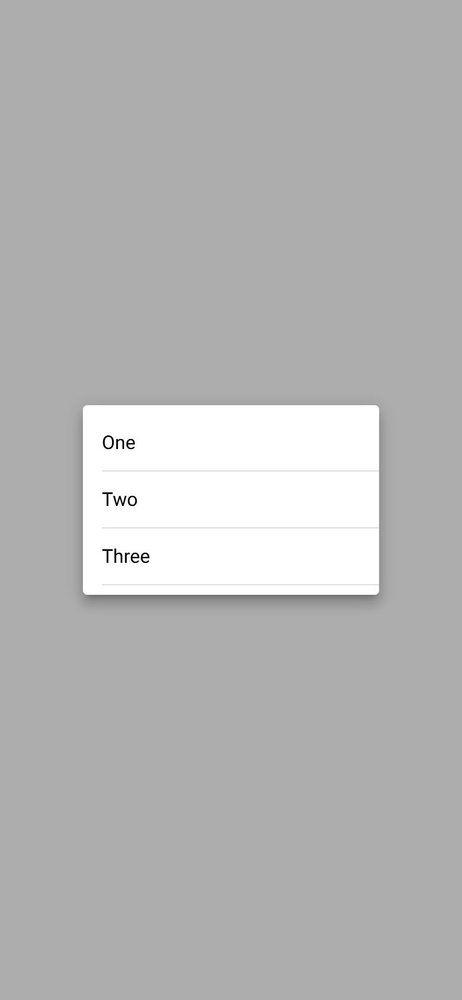

# ion-popover — reference render (Ionic 9.0.11, md, 390×844@2x)

Generated by `node tools/ionic-ref/render.js ion-popover --bare --html "<ion-popover is-open=\"true\"><ion-list><ion-item button detail=\"false\">One</ion-item><ion-item button detail=\"false\">Two</ion-item><ion-item button detail=\"false\">Three</ion-item></ion-list></ion-popover>"`

```html
<ion-popover is-open="true"><ion-list><ion-item button detail="false">One</ion-item><ion-item button detail="false">Two</ion-item><ion-item button detail="false">Three</ion-item></ion-list></ion-popover>
```

 

## Element 1

- attributes: `{"is-open":"true","id":"ion-overlay-1","aria-modal":"true","no-router":"","tabindex":"-1","class":"md popover-side-bottom hydrated","dir":"ltr","style":"z-index: 20002;"}`
- classes: `md popover-side-bottom hydrated`
- rect: `{"x":0,"y":0,"w":390,"h":844}`

### CSS custom properties (resolved)

| var | value |
|---|---|
| `--backdrop-opacity` | `0.32` |
| `--background` | `#fff` |
| `--box-shadow` | `0 5px 5px -3px rgba(0, 0, 0, 0.2), 0 8px 10px 1px rgba(0, 0, 0, 0.14), 0 3px 14px 2px rgba(0, 0, 0, 0.12)` |
| `--height` | `auto` |
| `--max-height` | `90%` |
| `--max-width` | `auto` |
| `--min-height` | `0` |
| `--min-width` | `0` |
| `--offset-x` | `0px` |
| `--offset-y` | `0px` |
| `--width` | `250px` |

### Host computed

| prop | value |
|---|---|
| display | `flex` |
| position | `fixed` |
| box-sizing | `border-box` |
| width | `390px` |
| height | `844px` |
| min-height | `0px` |
| min-width | `0px` |
| padding | `0px` |
| margin | `0px` |
| border | `0px none rgb(0, 0, 0)` |
| border-radius | `0px` |
| background-color | `rgba(0, 0, 0, 0)` |
| color | `rgb(0, 0, 0)` |
| font-size | `16px` |
| font-weight | `400` |
| font-family | `Roboto, "Helvetica Neue", sans-serif` |
| line-height | `normal` |
| letter-spacing | `normal` |
| text-transform | `none` |
| opacity | `1` |
| overflow | `visible` |
| contain | `none` |
| pointer-events | `auto` |
| transition | `all` |
| transform | `none` |
| box-shadow | `none` |
| outline | `rgb(0, 0, 0) none 0px` |
| cursor | `auto` |

### Shadow parts

#### part="backdrop" (`ion-backdrop`) rect `{"x":0,"y":0,"w":390,"h":844}`

| prop | value |
|---|---|
| display | `block` |
| position | `absolute` |
| box-sizing | `content-box` |
| width | `390px` |
| height | `844px` |
| min-height | `0px` |
| min-width | `0px` |
| padding | `0px` |
| margin | `0px` |
| border | `0px none rgb(0, 0, 0)` |
| border-radius | `0px` |
| background-color | `rgb(0, 0, 0)` |
| color | `rgb(0, 0, 0)` |
| font-size | `16px` |
| font-weight | `400` |
| font-family | `Roboto, "Helvetica Neue", sans-serif` |
| line-height | `normal` |
| letter-spacing | `normal` |
| text-transform | `none` |
| opacity | `0.32` |
| overflow | `visible` |
| contain | `strict` |
| pointer-events | `auto` |
| transition | `all` |
| transform | `matrix(1, 0, 0, 1, 0, 0)` |
| box-shadow | `none` |
| outline | `rgb(0, 0, 0) none 0px` |
| cursor | `pointer` |

#### part="arrow" (`div`) rect `{"x":195,"y":422,"w":0,"h":0}`

| prop | value |
|---|---|
| display | `block` |
| position | `static` |
| box-sizing | `content-box` |
| width | `0px` |
| height | `0px` |
| min-height | `0px` |
| min-width | `0px` |
| padding | `0px` |
| margin | `0px` |
| border | `0px none rgb(0, 0, 0)` |
| border-radius | `0px` |
| background-color | `rgba(0, 0, 0, 0)` |
| color | `rgb(0, 0, 0)` |
| font-size | `16px` |
| font-weight | `400` |
| font-family | `Roboto, "Helvetica Neue", sans-serif` |
| line-height | `normal` |
| letter-spacing | `normal` |
| text-transform | `none` |
| opacity | `1` |
| overflow | `visible` |
| contain | `none` |
| pointer-events | `auto` |
| transition | `all` |
| transform | `none` |
| box-shadow | `none` |
| outline | `rgb(0, 0, 0) none 0px` |
| cursor | `auto` |

#### part="content" (`div`) rect `{"x":70,"y":342,"w":250,"h":160}`

| prop | value |
|---|---|
| display | `flex` |
| position | `absolute` |
| box-sizing | `content-box` |
| width | `250px` |
| height | `160px` |
| min-height | `0px` |
| min-width | `0px` |
| padding | `0px` |
| margin | `0px` |
| border | `0px none rgb(0, 0, 0)` |
| border-radius | `4px` |
| background-color | `rgb(255, 255, 255)` |
| color | `rgb(0, 0, 0)` |
| font-size | `16px` |
| font-weight | `400` |
| font-family | `Roboto, "Helvetica Neue", sans-serif` |
| line-height | `normal` |
| letter-spacing | `normal` |
| text-transform | `none` |
| opacity | `1` |
| overflow | `auto` |
| contain | `none` |
| pointer-events | `auto` |
| transition | `all` |
| transform | `matrix(1, 0, 0, 1, 0, 0)` |
| box-shadow | `rgba(0, 0, 0, 0.2) 0px 5px 5px -3px, rgba(0, 0, 0, 0.14) 0px 8px 10px 1px, rgba(0, 0, 0, 0.12) 0px 3px 14px 2px` |
| outline | `rgb(0, 0, 0) none 0px` |
| cursor | `auto` |

### DOM tree

```
<ion-popover>
  #shadow-root
    <ion-backdrop.md.hydrated part="backdrop">
      #shadow-root
    <div.popover-wrapper.ion-overlay-wrapper>
      <div.popover-arrow part="arrow">
      <div.popover-content part="content">
        <slot name="">
  <div.ion-delegate-host.popover-viewport>
    <ion-list.md.list-md.hydrated>
      <ion-item.item.md.item-lines-default.in-list.ion-activatable.ion-focusable.hydrated>
        #shadow-root
          <button.item-native part="native">
            <slot name="start">
            <div.item-inner part="inner">
              <div.input-wrapper part="container">
                <slot name="">
              <slot name="end">
            <ion-ripple-effect.md.hydrated>
              #shadow-root
      <ion-item.item.md.item-lines-default.in-list.ion-activatable.ion-focusable.hydrated>
        #shadow-root
          <button.item-native part="native">
            <slot name="start">
            <div.item-inner part="inner">
              <div.input-wrapper part="container">
                <slot name="">
              <slot name="end">
            <ion-ripple-effect.md.hydrated>
              #shadow-root
      <ion-item.item.md.item-lines-default.in-list.ion-activatable.ion-focusable.hydrated>
        #shadow-root
          <button.item-native part="native">
            <slot name="start">
            <div.item-inner part="inner">
              <div.input-wrapper part="container">
                <slot name="">
              <slot name="end">
            <ion-ripple-effect.md.hydrated>
              #shadow-root
```
