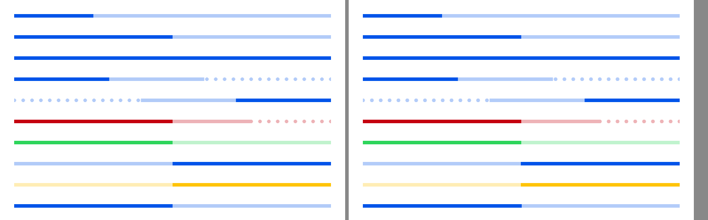
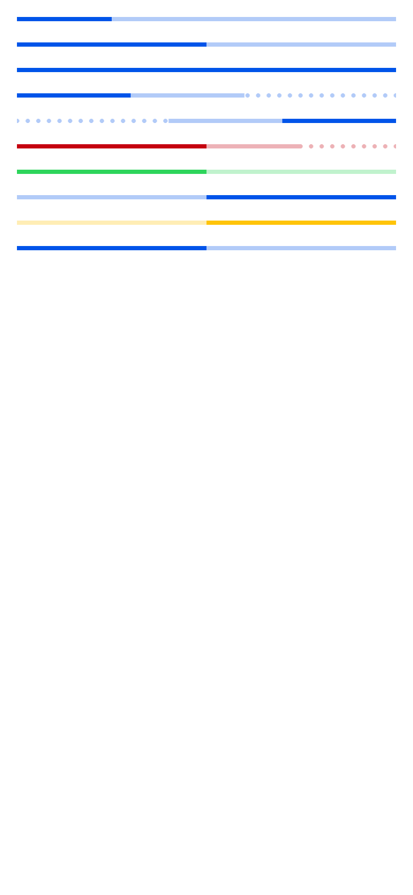
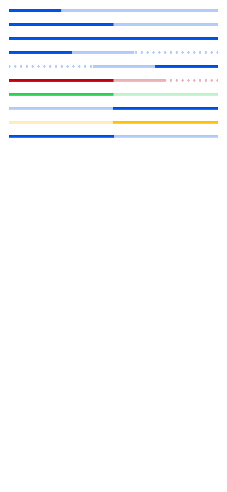

# ion-progress-bar — Comparison against the web component

> Ionic side (Chromium, md, 390×844@2x) → [`ref/`](ref/). The exact command:
>
> ```
> node tools/ionic-ref/render.js ion-progress-bar --bare --html '<div style="padding:16px;display:flex;flex-direction:column;gap:20px"><ion-progress-bar value="0.25"></ion-progress-bar><ion-progress-bar value="0.5"></ion-progress-bar><ion-progress-bar value="1"></ion-progress-bar><ion-progress-bar value="0.3" buffer="0.6"></ion-progress-bar><ion-progress-bar value="0.3" buffer="0.6" reversed="true"></ion-progress-bar><ion-progress-bar value="0.5" buffer="0.75" color="danger"></ion-progress-bar><ion-progress-bar value="0.5" color="success"></ion-progress-bar><ion-progress-bar type="indeterminate"></ion-progress-bar><ion-progress-bar type="indeterminate" color="warning"></ion-progress-bar><ion-progress-bar type="indeterminate" reversed="true"></ion-progress-bar></div>'
> ```
>
> `ref/page.png` is that render, with the animations wherever they were when it was taken. `ref/page-1000ms.png` is the same
> page, `ref/page.html`, with every animation in every bar paused at 1000 ms through the Web Animations API
> (`animation.pause(); animation.currentTime = 1000` on each `shadowRoot.getAnimations()`), by a throwaway `playwright-core`
> script, so that the two sides are in phase.
>
> Avonic side: `AVONIC_CAPTURE_DIR=… dotnet test` → `AvonicProgressBarCaptureTests` (headless Skia, 2×), with `TestClock` at
> 1000 ms. It writes `avonic-progress-bar-page.png`, as capture tests share the folder, which is copied to
> [`compare/avonic-page.png`](compare/avonic-page.png); `compare/side.png` is the top 250 px of each, side by side. Measurements for the behaviours came from separate scenes of one bar, 358 wide.

## Frames

At 1000 ms, the top 250 px of each. Ionic on the left, Avonic on the right:



| Ionic, paused at 1000 ms | Avonic, at 1000 ms on `TestClock` |
|---|---|
|  |  |

Rows from the top: 0.25, 0.5, 1, 0.3 with a buffer of 0.6, the same reversed, danger at 0.5 with a buffer of 0.75, success at
0.5, indeterminate, warning indeterminate, and indeterminate reversed.

**Match.** The dots are in the same places, 2.2 px left of 0, 10, 20, … as 1000 ms is 100 ms into the 450 ms stream, and the
indeterminate secondary bar covers 178.5 to 358 on both. The primary bar is off the left edge at 1000 ms on both. The one
visible difference is the dots' edges, which are a little softer here, as Skia anti-aliases an ellipse and Chromium draws the
gradient's hard stop.

## Found here, not by the tests

The plan said a change of type re-renders without a transition. Measuring it while building the tests showed otherwise: Stencil
keeps the first `div` and changes its class, so the progress becomes the indeterminate track and eases from 89.5 to 358 over
150 ms, and back. The plan, the control and `B9` were changed to match.

The second review found that a value set just after the bar attached eased from 0. Measured in Chromium: a value set in the
task that appends `ion-progress-bar` is drawn at once, and one set a frame or more later eases from 0. So a change before the
bar's first frame doesn't ease, with `B6`.

The reversing shortening factor was also measured, not assumed: going back to 0.2 from 0.45 of the way took about 67 ms in
Chromium, so it's in `CssTransition`, with `B6`.

## Behaviours

The numbers are from [PLAN.md](PLAN.md#behaviours). Each has tests in `AvonicProgressBarTests`, named after its number.

| # | Behaviour | Ionic | Result |
|---|---|---|---|
| 1 | Host, and accessibility | 358 × 4, `overflow: hidden`; `role="progressbar"`, min 0, max 1, `aria-valuenow` raw, gone when indeterminate | match. `ProgressBar` peer with a read-only range |
| 2 | Progress from the left | 0.25 → 0..89.5 | match |
| 3 | Clamped for display only | 1.5 draws 358 and reports 1.5; −1 draws 0 | match. NaN keeps the scale, from the CSSOM, not measured |
| 4 | The buffer, and the dots after it | track 0..268.5 at 0.75; dot centres at 280, 290, … at time 0 | match |
| 5 | The stream | 10 px left every 450 ms; `buffering` at 1567 ms when a bar at buffer 1 for a second gets 0.5 | match |
| 6 | Value transitions | 150 ms linear; a new target restarts from the value shown; going back is shortened; a value set in the task that appends the bar isn't eased, and one a frame later is | match |
| 7 | Buffer transitions | the window moves, the circles stay at −10 | match |
| 8 | Indeterminate | the spans at 125 ms steps in [PLAN.md](PLAN.md#measured) | match, within 0.5 px, at all eight times and at 3000 ms |
| 9 | A change of type | the kept element eases, the bars and the stream start at 0; 67 ms in, the track at 208.8 and the secondary bar at −17.6..6.7 | match, within 1 px |
| 10 | Reversed | progress 250.6..358, track 143.2..358, dots 0..143.2 | match, and the stream runs right |
| 11 | RTL | `document.dir="rtl"` reverses; `reversed` puts it back | match, through the inherited `FlowDirection`. See the plan |
| 12 | Colour | danger: progress `rgb(197, 0, 15)`, track and dots at 0.3 | match. An unknown colour draws nothing, from the CSS |
| 13 | Host classes | `progress-bar-determinate`, `-indeterminate`, `-reversed`, `-solid` | match, as pseudoclasses |
| 14 | `AvonicConfig.Animated` off | `progress-paused` holds the animations | a deliberate difference. See the plan |
| 15 | The two keys | `--background`, `--progress-background` | match |
| 16 | Detach and attach, hide and show | a re-created element starts its animations at 0, and `display: none` stops them | match. Measured: `display: none` and back in one task keeps every `currentTime`, on the bar or an ancestor, and across a frame restarts them at 0 |
| 17 | Frames only while something moves | — | Avonic's own |

## Deliberate differences and known gaps

All in [PLAN.md](PLAN.md#deliberate-differences).

## Real window

Not tried in a real window. The frames above are headless.
