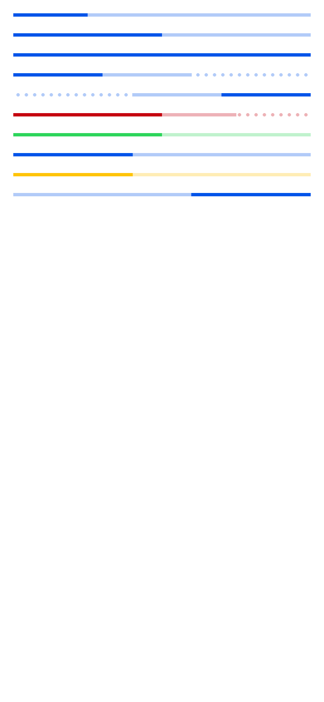

# ion-progress-bar — reference render (Ionic 8.8.1, md, 390×844@2x)

Generated by `node tools/ionic-ref/render.js ion-progress-bar --bare --html "<div style=\"padding:16px;display:flex;flex-direction:column;gap:20px\"><ion-progress-bar value=\"0.25\"></ion-progress-bar><ion-progress-bar value=\"0.5\"></ion-progress-bar><ion-progress-bar value=\"1\"></ion-progress-bar><ion-progress-bar value=\"0.3\" buffer=\"0.6\"></ion-progress-bar><ion-progress-bar value=\"0.3\" buffer=\"0.6\" reversed=\"true\"></ion-progress-bar><ion-progress-bar value=\"0.5\" buffer=\"0.75\" color=\"danger\"></ion-progress-bar><ion-progress-bar value=\"0.5\" color=\"success\"></ion-progress-bar><ion-progress-bar type=\"indeterminate\"></ion-progress-bar><ion-progress-bar type=\"indeterminate\" color=\"warning\"></ion-progress-bar><ion-progress-bar type=\"indeterminate\" reversed=\"true\"></ion-progress-bar></div>"`

```html
<div style="padding:16px;display:flex;flex-direction:column;gap:20px"><ion-progress-bar value="0.25"></ion-progress-bar><ion-progress-bar value="0.5"></ion-progress-bar><ion-progress-bar value="1"></ion-progress-bar><ion-progress-bar value="0.3" buffer="0.6"></ion-progress-bar><ion-progress-bar value="0.3" buffer="0.6" reversed="true"></ion-progress-bar><ion-progress-bar value="0.5" buffer="0.75" color="danger"></ion-progress-bar><ion-progress-bar value="0.5" color="success"></ion-progress-bar><ion-progress-bar type="indeterminate"></ion-progress-bar><ion-progress-bar type="indeterminate" color="warning"></ion-progress-bar><ion-progress-bar type="indeterminate" reversed="true"></ion-progress-bar></div>
```

 

## Element 1

- attributes: `{"value":"0.25","role":"progressbar","aria-valuenow":"0.25","aria-valuemin":"0","aria-valuemax":"1","class":"md progress-bar-determinate progress-bar-solid hydrated"}`
- classes: `md progress-bar-determinate progress-bar-solid hydrated`
- rect: `{"x":16,"y":16,"w":358,"h":4}`

### CSS custom properties (resolved)

| var | value |
|---|---|
| `--background` | `rgba(0,84,233, 0.3)` |
| `--progress-background` | `#0054e9` |

### Host computed

| prop | value |
|---|---|
| display | `block` |
| position | `relative` |
| box-sizing | `border-box` |
| width | `358px` |
| height | `4px` |
| min-height | `auto` |
| min-width | `auto` |
| padding | `0px` |
| margin | `0px` |
| border | `0px none rgb(0, 0, 0)` |
| border-radius | `0px` |
| background-color | `rgba(0, 0, 0, 0)` |
| color | `rgb(0, 0, 0)` |
| font-size | `16px` |
| font-weight | `400` |
| font-family | `Roboto, "Helvetica Neue", sans-serif` |
| line-height | `normal` |
| letter-spacing | `normal` |
| text-transform | `none` |
| opacity | `1` |
| overflow | `hidden` |
| contain | `strict` |
| pointer-events | `auto` |
| transition | `all` |
| transform | `none` |
| box-shadow | `none` |
| outline | `rgb(0, 0, 0) none 0px` |
| cursor | `auto` |

### Shadow parts

#### part="progress" (`div`) rect `{"x":16,"y":16,"w":89.5,"h":4}`

| prop | value |
|---|---|
| display | `block` |
| position | `absolute` |
| box-sizing | `content-box` |
| width | `358px` |
| height | `4px` |
| min-height | `0px` |
| min-width | `0px` |
| padding | `0px` |
| margin | `0px` |
| border | `0px none rgb(0, 0, 0)` |
| border-radius | `0px` |
| background-color | `rgb(0, 84, 233)` |
| color | `rgb(0, 0, 0)` |
| font-size | `16px` |
| font-weight | `400` |
| font-family | `Roboto, "Helvetica Neue", sans-serif` |
| line-height | `normal` |
| letter-spacing | `normal` |
| text-transform | `none` |
| opacity | `1` |
| overflow | `visible` |
| contain | `none` |
| pointer-events | `auto` |
| transition | `transform 0.15s linear, -webkit-transform 0.15s linear` |
| transform | `matrix(0.25, 0, 0, 1, 0, 0)` |
| box-shadow | `none` |
| outline | `rgb(0, 0, 0) none 0px` |
| cursor | `auto` |

#### part="stream" (`div`) rect `{"x":-0.67,"y":16,"w":378,"h":4}`

| prop | value |
|---|---|
| display | `block` |
| position | `absolute` |
| box-sizing | `content-box` |
| width | `378px` |
| height | `4px` |
| min-height | `0px` |
| min-width | `0px` |
| padding | `0px` |
| margin | `0px` |
| border | `0px none rgb(0, 0, 0)` |
| border-radius | `0px` |
| background-color | `rgba(0, 0, 0, 0)` |
| color | `rgb(0, 0, 0)` |
| font-size | `16px` |
| font-weight | `400` |
| font-family | `Roboto, "Helvetica Neue", sans-serif` |
| line-height | `normal` |
| letter-spacing | `normal` |
| text-transform | `none` |
| opacity | `1` |
| overflow | `visible` |
| contain | `none` |
| pointer-events | `auto` |
| transition | `all` |
| transform | `matrix(1, 0, 0, 1, -6.66653, 0)` |
| box-shadow | `none` |
| outline | `rgb(0, 0, 0) none 0px` |
| cursor | `auto` |

#### part="track" (`div`) rect `{"x":16,"y":16,"w":358,"h":4}`

| prop | value |
|---|---|
| display | `block` |
| position | `absolute` |
| box-sizing | `content-box` |
| width | `358px` |
| height | `4px` |
| min-height | `0px` |
| min-width | `0px` |
| padding | `0px` |
| margin | `0px` |
| border | `0px none rgb(0, 0, 0)` |
| border-radius | `0px` |
| background-color | `rgba(0, 84, 233, 0.3)` |
| color | `rgb(0, 0, 0)` |
| font-size | `16px` |
| font-weight | `400` |
| font-family | `Roboto, "Helvetica Neue", sans-serif` |
| line-height | `normal` |
| letter-spacing | `normal` |
| text-transform | `none` |
| opacity | `1` |
| overflow | `visible` |
| contain | `none` |
| pointer-events | `auto` |
| transition | `transform 0.15s linear, -webkit-transform 0.15s linear` |
| transform | `matrix(1, 0, 0, 1, 0, 0)` |
| box-shadow | `none` |
| outline | `rgb(0, 0, 0) none 0px` |
| cursor | `auto` |

### DOM tree

```
<ion-progress-bar>
  #shadow-root
    <div.progress part="progress">
    <div.buffer-circles-container.ion-hide>
      <div.buffer-circles-container>
        <div.buffer-circles part="stream">
    <div.progress-buffer-bar part="track">
```

## Element 2

- attributes: `{"value":"0.5","role":"progressbar","aria-valuenow":"0.5","aria-valuemin":"0","aria-valuemax":"1","class":"md progress-bar-determinate progress-bar-solid hydrated"}`
- classes: `md progress-bar-determinate progress-bar-solid hydrated`
- rect: `{"x":16,"y":40,"w":358,"h":4}`

### CSS custom properties (resolved)

| var | value |
|---|---|
| `--background` | `rgba(0,84,233, 0.3)` |
| `--progress-background` | `#0054e9` |

### Host computed

| prop | value |
|---|---|
| display | `block` |
| position | `relative` |
| box-sizing | `border-box` |
| width | `358px` |
| height | `4px` |
| min-height | `auto` |
| min-width | `auto` |
| padding | `0px` |
| margin | `0px` |
| border | `0px none rgb(0, 0, 0)` |
| border-radius | `0px` |
| background-color | `rgba(0, 0, 0, 0)` |
| color | `rgb(0, 0, 0)` |
| font-size | `16px` |
| font-weight | `400` |
| font-family | `Roboto, "Helvetica Neue", sans-serif` |
| line-height | `normal` |
| letter-spacing | `normal` |
| text-transform | `none` |
| opacity | `1` |
| overflow | `hidden` |
| contain | `strict` |
| pointer-events | `auto` |
| transition | `all` |
| transform | `none` |
| box-shadow | `none` |
| outline | `rgb(0, 0, 0) none 0px` |
| cursor | `auto` |

### Shadow parts

#### part="progress" (`div`) rect `{"x":16,"y":40,"w":179,"h":4}`

| prop | value |
|---|---|
| display | `block` |
| position | `absolute` |
| box-sizing | `content-box` |
| width | `358px` |
| height | `4px` |
| min-height | `0px` |
| min-width | `0px` |
| padding | `0px` |
| margin | `0px` |
| border | `0px none rgb(0, 0, 0)` |
| border-radius | `0px` |
| background-color | `rgb(0, 84, 233)` |
| color | `rgb(0, 0, 0)` |
| font-size | `16px` |
| font-weight | `400` |
| font-family | `Roboto, "Helvetica Neue", sans-serif` |
| line-height | `normal` |
| letter-spacing | `normal` |
| text-transform | `none` |
| opacity | `1` |
| overflow | `visible` |
| contain | `none` |
| pointer-events | `auto` |
| transition | `transform 0.15s linear, -webkit-transform 0.15s linear` |
| transform | `matrix(0.5, 0, 0, 1, 0, 0)` |
| box-shadow | `none` |
| outline | `rgb(0, 0, 0) none 0px` |
| cursor | `auto` |

#### part="stream" (`div`) rect `{"x":-0.67,"y":40,"w":378,"h":4}`

| prop | value |
|---|---|
| display | `block` |
| position | `absolute` |
| box-sizing | `content-box` |
| width | `378px` |
| height | `4px` |
| min-height | `0px` |
| min-width | `0px` |
| padding | `0px` |
| margin | `0px` |
| border | `0px none rgb(0, 0, 0)` |
| border-radius | `0px` |
| background-color | `rgba(0, 0, 0, 0)` |
| color | `rgb(0, 0, 0)` |
| font-size | `16px` |
| font-weight | `400` |
| font-family | `Roboto, "Helvetica Neue", sans-serif` |
| line-height | `normal` |
| letter-spacing | `normal` |
| text-transform | `none` |
| opacity | `1` |
| overflow | `visible` |
| contain | `none` |
| pointer-events | `auto` |
| transition | `all` |
| transform | `matrix(1, 0, 0, 1, -6.66653, 0)` |
| box-shadow | `none` |
| outline | `rgb(0, 0, 0) none 0px` |
| cursor | `auto` |

#### part="track" (`div`) rect `{"x":16,"y":40,"w":358,"h":4}`

| prop | value |
|---|---|
| display | `block` |
| position | `absolute` |
| box-sizing | `content-box` |
| width | `358px` |
| height | `4px` |
| min-height | `0px` |
| min-width | `0px` |
| padding | `0px` |
| margin | `0px` |
| border | `0px none rgb(0, 0, 0)` |
| border-radius | `0px` |
| background-color | `rgba(0, 84, 233, 0.3)` |
| color | `rgb(0, 0, 0)` |
| font-size | `16px` |
| font-weight | `400` |
| font-family | `Roboto, "Helvetica Neue", sans-serif` |
| line-height | `normal` |
| letter-spacing | `normal` |
| text-transform | `none` |
| opacity | `1` |
| overflow | `visible` |
| contain | `none` |
| pointer-events | `auto` |
| transition | `transform 0.15s linear, -webkit-transform 0.15s linear` |
| transform | `matrix(1, 0, 0, 1, 0, 0)` |
| box-shadow | `none` |
| outline | `rgb(0, 0, 0) none 0px` |
| cursor | `auto` |

### DOM tree

```
<ion-progress-bar>
  #shadow-root
    <div.progress part="progress">
    <div.buffer-circles-container.ion-hide>
      <div.buffer-circles-container>
        <div.buffer-circles part="stream">
    <div.progress-buffer-bar part="track">
```

## Element 3

- attributes: `{"value":"1","role":"progressbar","aria-valuenow":"1","aria-valuemin":"0","aria-valuemax":"1","class":"md progress-bar-determinate progress-bar-solid hydrated"}`
- classes: `md progress-bar-determinate progress-bar-solid hydrated`
- rect: `{"x":16,"y":64,"w":358,"h":4}`

### CSS custom properties (resolved)

| var | value |
|---|---|
| `--background` | `rgba(0,84,233, 0.3)` |
| `--progress-background` | `#0054e9` |

### Host computed

| prop | value |
|---|---|
| display | `block` |
| position | `relative` |
| box-sizing | `border-box` |
| width | `358px` |
| height | `4px` |
| min-height | `auto` |
| min-width | `auto` |
| padding | `0px` |
| margin | `0px` |
| border | `0px none rgb(0, 0, 0)` |
| border-radius | `0px` |
| background-color | `rgba(0, 0, 0, 0)` |
| color | `rgb(0, 0, 0)` |
| font-size | `16px` |
| font-weight | `400` |
| font-family | `Roboto, "Helvetica Neue", sans-serif` |
| line-height | `normal` |
| letter-spacing | `normal` |
| text-transform | `none` |
| opacity | `1` |
| overflow | `hidden` |
| contain | `strict` |
| pointer-events | `auto` |
| transition | `all` |
| transform | `none` |
| box-shadow | `none` |
| outline | `rgb(0, 0, 0) none 0px` |
| cursor | `auto` |

### Shadow parts

#### part="progress" (`div`) rect `{"x":16,"y":64,"w":358,"h":4}`

| prop | value |
|---|---|
| display | `block` |
| position | `absolute` |
| box-sizing | `content-box` |
| width | `358px` |
| height | `4px` |
| min-height | `0px` |
| min-width | `0px` |
| padding | `0px` |
| margin | `0px` |
| border | `0px none rgb(0, 0, 0)` |
| border-radius | `0px` |
| background-color | `rgb(0, 84, 233)` |
| color | `rgb(0, 0, 0)` |
| font-size | `16px` |
| font-weight | `400` |
| font-family | `Roboto, "Helvetica Neue", sans-serif` |
| line-height | `normal` |
| letter-spacing | `normal` |
| text-transform | `none` |
| opacity | `1` |
| overflow | `visible` |
| contain | `none` |
| pointer-events | `auto` |
| transition | `transform 0.15s linear, -webkit-transform 0.15s linear` |
| transform | `matrix(1, 0, 0, 1, 0, 0)` |
| box-shadow | `none` |
| outline | `rgb(0, 0, 0) none 0px` |
| cursor | `auto` |

#### part="stream" (`div`) rect `{"x":-0.67,"y":64,"w":378,"h":4}`

| prop | value |
|---|---|
| display | `block` |
| position | `absolute` |
| box-sizing | `content-box` |
| width | `378px` |
| height | `4px` |
| min-height | `0px` |
| min-width | `0px` |
| padding | `0px` |
| margin | `0px` |
| border | `0px none rgb(0, 0, 0)` |
| border-radius | `0px` |
| background-color | `rgba(0, 0, 0, 0)` |
| color | `rgb(0, 0, 0)` |
| font-size | `16px` |
| font-weight | `400` |
| font-family | `Roboto, "Helvetica Neue", sans-serif` |
| line-height | `normal` |
| letter-spacing | `normal` |
| text-transform | `none` |
| opacity | `1` |
| overflow | `visible` |
| contain | `none` |
| pointer-events | `auto` |
| transition | `all` |
| transform | `matrix(1, 0, 0, 1, -6.66653, 0)` |
| box-shadow | `none` |
| outline | `rgb(0, 0, 0) none 0px` |
| cursor | `auto` |

#### part="track" (`div`) rect `{"x":16,"y":64,"w":358,"h":4}`

| prop | value |
|---|---|
| display | `block` |
| position | `absolute` |
| box-sizing | `content-box` |
| width | `358px` |
| height | `4px` |
| min-height | `0px` |
| min-width | `0px` |
| padding | `0px` |
| margin | `0px` |
| border | `0px none rgb(0, 0, 0)` |
| border-radius | `0px` |
| background-color | `rgba(0, 84, 233, 0.3)` |
| color | `rgb(0, 0, 0)` |
| font-size | `16px` |
| font-weight | `400` |
| font-family | `Roboto, "Helvetica Neue", sans-serif` |
| line-height | `normal` |
| letter-spacing | `normal` |
| text-transform | `none` |
| opacity | `1` |
| overflow | `visible` |
| contain | `none` |
| pointer-events | `auto` |
| transition | `transform 0.15s linear, -webkit-transform 0.15s linear` |
| transform | `matrix(1, 0, 0, 1, 0, 0)` |
| box-shadow | `none` |
| outline | `rgb(0, 0, 0) none 0px` |
| cursor | `auto` |

### DOM tree

```
<ion-progress-bar>
  #shadow-root
    <div.progress part="progress">
    <div.buffer-circles-container.ion-hide>
      <div.buffer-circles-container>
        <div.buffer-circles part="stream">
    <div.progress-buffer-bar part="track">
```

## Element 4

- attributes: `{"value":"0.3","buffer":"0.6","role":"progressbar","aria-valuenow":"0.3","aria-valuemin":"0","aria-valuemax":"1","class":"md progress-bar-determinate hydrated"}`
- classes: `md progress-bar-determinate hydrated`
- rect: `{"x":16,"y":88,"w":358,"h":4}`

### CSS custom properties (resolved)

| var | value |
|---|---|
| `--background` | `rgba(0,84,233, 0.3)` |
| `--progress-background` | `#0054e9` |

### Host computed

| prop | value |
|---|---|
| display | `block` |
| position | `relative` |
| box-sizing | `border-box` |
| width | `358px` |
| height | `4px` |
| min-height | `auto` |
| min-width | `auto` |
| padding | `0px` |
| margin | `0px` |
| border | `0px none rgb(0, 0, 0)` |
| border-radius | `0px` |
| background-color | `rgba(0, 0, 0, 0)` |
| color | `rgb(0, 0, 0)` |
| font-size | `16px` |
| font-weight | `400` |
| font-family | `Roboto, "Helvetica Neue", sans-serif` |
| line-height | `normal` |
| letter-spacing | `normal` |
| text-transform | `none` |
| opacity | `1` |
| overflow | `hidden` |
| contain | `strict` |
| pointer-events | `auto` |
| transition | `all` |
| transform | `none` |
| box-shadow | `none` |
| outline | `rgb(0, 0, 0) none 0px` |
| cursor | `auto` |

### Shadow parts

#### part="progress" (`div`) rect `{"x":16,"y":88,"w":107.4,"h":4}`

| prop | value |
|---|---|
| display | `block` |
| position | `absolute` |
| box-sizing | `content-box` |
| width | `358px` |
| height | `4px` |
| min-height | `0px` |
| min-width | `0px` |
| padding | `0px` |
| margin | `0px` |
| border | `0px none rgb(0, 0, 0)` |
| border-radius | `0px` |
| background-color | `rgb(0, 84, 233)` |
| color | `rgb(0, 0, 0)` |
| font-size | `16px` |
| font-weight | `400` |
| font-family | `Roboto, "Helvetica Neue", sans-serif` |
| line-height | `normal` |
| letter-spacing | `normal` |
| text-transform | `none` |
| opacity | `1` |
| overflow | `visible` |
| contain | `none` |
| pointer-events | `auto` |
| transition | `transform 0.15s linear, -webkit-transform 0.15s linear` |
| transform | `matrix(0.3, 0, 0, 1, 0, 0)` |
| box-shadow | `none` |
| outline | `rgb(0, 0, 0) none 0px` |
| cursor | `auto` |

#### part="stream" (`div`) rect `{"x":-0.67,"y":88,"w":378,"h":4}`

| prop | value |
|---|---|
| display | `block` |
| position | `absolute` |
| box-sizing | `content-box` |
| width | `378px` |
| height | `4px` |
| min-height | `0px` |
| min-width | `0px` |
| padding | `0px` |
| margin | `0px` |
| border | `0px none rgb(0, 0, 0)` |
| border-radius | `0px` |
| background-color | `rgba(0, 0, 0, 0)` |
| color | `rgb(0, 0, 0)` |
| font-size | `16px` |
| font-weight | `400` |
| font-family | `Roboto, "Helvetica Neue", sans-serif` |
| line-height | `normal` |
| letter-spacing | `normal` |
| text-transform | `none` |
| opacity | `1` |
| overflow | `visible` |
| contain | `none` |
| pointer-events | `auto` |
| transition | `all` |
| transform | `matrix(1, 0, 0, 1, -6.66653, 0)` |
| box-shadow | `none` |
| outline | `rgb(0, 0, 0) none 0px` |
| cursor | `auto` |

#### part="track" (`div`) rect `{"x":16,"y":88,"w":214.8,"h":4}`

| prop | value |
|---|---|
| display | `block` |
| position | `absolute` |
| box-sizing | `content-box` |
| width | `358px` |
| height | `4px` |
| min-height | `0px` |
| min-width | `0px` |
| padding | `0px` |
| margin | `0px` |
| border | `0px none rgb(0, 0, 0)` |
| border-radius | `0px` |
| background-color | `rgba(0, 84, 233, 0.3)` |
| color | `rgb(0, 0, 0)` |
| font-size | `16px` |
| font-weight | `400` |
| font-family | `Roboto, "Helvetica Neue", sans-serif` |
| line-height | `normal` |
| letter-spacing | `normal` |
| text-transform | `none` |
| opacity | `1` |
| overflow | `visible` |
| contain | `none` |
| pointer-events | `auto` |
| transition | `transform 0.15s linear, -webkit-transform 0.15s linear` |
| transform | `matrix(0.6, 0, 0, 1, 0, 0)` |
| box-shadow | `none` |
| outline | `rgb(0, 0, 0) none 0px` |
| cursor | `auto` |

### DOM tree

```
<ion-progress-bar>
  #shadow-root
    <div.progress part="progress">
    <div.buffer-circles-container>
      <div.buffer-circles-container>
        <div.buffer-circles part="stream">
    <div.progress-buffer-bar part="track">
```

## Element 5

- attributes: `{"value":"0.3","buffer":"0.6","reversed":"true","role":"progressbar","aria-valuenow":"0.3","aria-valuemin":"0","aria-valuemax":"1","class":"md progress-bar-determinate progress-bar-reversed hydrated"}`
- classes: `md progress-bar-determinate progress-bar-reversed hydrated`
- rect: `{"x":16,"y":112,"w":358,"h":4}`

### CSS custom properties (resolved)

| var | value |
|---|---|
| `--background` | `rgba(0,84,233, 0.3)` |
| `--progress-background` | `#0054e9` |

### Host computed

| prop | value |
|---|---|
| display | `block` |
| position | `relative` |
| box-sizing | `border-box` |
| width | `358px` |
| height | `4px` |
| min-height | `auto` |
| min-width | `auto` |
| padding | `0px` |
| margin | `0px` |
| border | `0px none rgb(0, 0, 0)` |
| border-radius | `0px` |
| background-color | `rgba(0, 0, 0, 0)` |
| color | `rgb(0, 0, 0)` |
| font-size | `16px` |
| font-weight | `400` |
| font-family | `Roboto, "Helvetica Neue", sans-serif` |
| line-height | `normal` |
| letter-spacing | `normal` |
| text-transform | `none` |
| opacity | `1` |
| overflow | `hidden` |
| contain | `strict` |
| pointer-events | `auto` |
| transition | `all` |
| transform | `matrix(-1, 0, 0, 1, 0, 0)` |
| box-shadow | `none` |
| outline | `rgb(0, 0, 0) none 0px` |
| cursor | `auto` |

### Shadow parts

#### part="progress" (`div`) rect `{"x":266.6,"y":112,"w":107.4,"h":4}`

| prop | value |
|---|---|
| display | `block` |
| position | `absolute` |
| box-sizing | `content-box` |
| width | `358px` |
| height | `4px` |
| min-height | `0px` |
| min-width | `0px` |
| padding | `0px` |
| margin | `0px` |
| border | `0px none rgb(0, 0, 0)` |
| border-radius | `0px` |
| background-color | `rgb(0, 84, 233)` |
| color | `rgb(0, 0, 0)` |
| font-size | `16px` |
| font-weight | `400` |
| font-family | `Roboto, "Helvetica Neue", sans-serif` |
| line-height | `normal` |
| letter-spacing | `normal` |
| text-transform | `none` |
| opacity | `1` |
| overflow | `visible` |
| contain | `none` |
| pointer-events | `auto` |
| transition | `transform 0.15s linear, -webkit-transform 0.15s linear` |
| transform | `matrix(0.3, 0, 0, 1, 0, 0)` |
| box-shadow | `none` |
| outline | `rgb(0, 0, 0) none 0px` |
| cursor | `auto` |

#### part="stream" (`div`) rect `{"x":12.67,"y":112,"w":378,"h":4}`

| prop | value |
|---|---|
| display | `block` |
| position | `absolute` |
| box-sizing | `content-box` |
| width | `378px` |
| height | `4px` |
| min-height | `0px` |
| min-width | `0px` |
| padding | `0px` |
| margin | `0px` |
| border | `0px none rgb(0, 0, 0)` |
| border-radius | `0px` |
| background-color | `rgba(0, 0, 0, 0)` |
| color | `rgb(0, 0, 0)` |
| font-size | `16px` |
| font-weight | `400` |
| font-family | `Roboto, "Helvetica Neue", sans-serif` |
| line-height | `normal` |
| letter-spacing | `normal` |
| text-transform | `none` |
| opacity | `1` |
| overflow | `visible` |
| contain | `none` |
| pointer-events | `auto` |
| transition | `all` |
| transform | `matrix(1, 0, 0, 1, -6.66653, 0)` |
| box-shadow | `none` |
| outline | `rgb(0, 0, 0) none 0px` |
| cursor | `auto` |

#### part="track" (`div`) rect `{"x":159.2,"y":112,"w":214.8,"h":4}`

| prop | value |
|---|---|
| display | `block` |
| position | `absolute` |
| box-sizing | `content-box` |
| width | `358px` |
| height | `4px` |
| min-height | `0px` |
| min-width | `0px` |
| padding | `0px` |
| margin | `0px` |
| border | `0px none rgb(0, 0, 0)` |
| border-radius | `0px` |
| background-color | `rgba(0, 84, 233, 0.3)` |
| color | `rgb(0, 0, 0)` |
| font-size | `16px` |
| font-weight | `400` |
| font-family | `Roboto, "Helvetica Neue", sans-serif` |
| line-height | `normal` |
| letter-spacing | `normal` |
| text-transform | `none` |
| opacity | `1` |
| overflow | `visible` |
| contain | `none` |
| pointer-events | `auto` |
| transition | `transform 0.15s linear, -webkit-transform 0.15s linear` |
| transform | `matrix(0.6, 0, 0, 1, 0, 0)` |
| box-shadow | `none` |
| outline | `rgb(0, 0, 0) none 0px` |
| cursor | `auto` |

### DOM tree

```
<ion-progress-bar>
  #shadow-root
    <div.progress part="progress">
    <div.buffer-circles-container>
      <div.buffer-circles-container>
        <div.buffer-circles part="stream">
    <div.progress-buffer-bar part="track">
```

## Element 6

- attributes: `{"value":"0.5","buffer":"0.75","color":"danger","role":"progressbar","aria-valuenow":"0.5","aria-valuemin":"0","aria-valuemax":"1","class":"ion-color ion-color-danger md progress-bar-determinate hydrated"}`
- classes: `ion-color ion-color-danger md progress-bar-determinate hydrated`
- rect: `{"x":16,"y":136,"w":358,"h":4}`

### CSS custom properties (resolved)

| var | value |
|---|---|
| `--background` | `rgba(0,84,233, 0.3)` |
| `--progress-background` | `#0054e9` |

### Host computed

| prop | value |
|---|---|
| display | `block` |
| position | `relative` |
| box-sizing | `border-box` |
| width | `358px` |
| height | `4px` |
| min-height | `auto` |
| min-width | `auto` |
| padding | `0px` |
| margin | `0px` |
| border | `0px none rgb(0, 0, 0)` |
| border-radius | `0px` |
| background-color | `rgba(0, 0, 0, 0)` |
| color | `rgb(0, 0, 0)` |
| font-size | `16px` |
| font-weight | `400` |
| font-family | `Roboto, "Helvetica Neue", sans-serif` |
| line-height | `normal` |
| letter-spacing | `normal` |
| text-transform | `none` |
| opacity | `1` |
| overflow | `hidden` |
| contain | `strict` |
| pointer-events | `auto` |
| transition | `all` |
| transform | `none` |
| box-shadow | `none` |
| outline | `rgb(0, 0, 0) none 0px` |
| cursor | `auto` |

### Shadow parts

#### part="progress" (`div`) rect `{"x":16,"y":136,"w":179,"h":4}`

| prop | value |
|---|---|
| display | `block` |
| position | `absolute` |
| box-sizing | `content-box` |
| width | `358px` |
| height | `4px` |
| min-height | `0px` |
| min-width | `0px` |
| padding | `0px` |
| margin | `0px` |
| border | `0px none rgb(0, 0, 0)` |
| border-radius | `0px` |
| background-color | `rgb(197, 0, 15)` |
| color | `rgb(0, 0, 0)` |
| font-size | `16px` |
| font-weight | `400` |
| font-family | `Roboto, "Helvetica Neue", sans-serif` |
| line-height | `normal` |
| letter-spacing | `normal` |
| text-transform | `none` |
| opacity | `1` |
| overflow | `visible` |
| contain | `none` |
| pointer-events | `auto` |
| transition | `transform 0.15s linear, -webkit-transform 0.15s linear` |
| transform | `matrix(0.5, 0, 0, 1, 0, 0)` |
| box-shadow | `none` |
| outline | `rgb(0, 0, 0) none 0px` |
| cursor | `auto` |

#### part="stream" (`div`) rect `{"x":-0.67,"y":136,"w":378,"h":4}`

| prop | value |
|---|---|
| display | `block` |
| position | `absolute` |
| box-sizing | `content-box` |
| width | `378px` |
| height | `4px` |
| min-height | `0px` |
| min-width | `0px` |
| padding | `0px` |
| margin | `0px` |
| border | `0px none rgb(0, 0, 0)` |
| border-radius | `0px` |
| background-color | `rgba(0, 0, 0, 0)` |
| color | `rgb(0, 0, 0)` |
| font-size | `16px` |
| font-weight | `400` |
| font-family | `Roboto, "Helvetica Neue", sans-serif` |
| line-height | `normal` |
| letter-spacing | `normal` |
| text-transform | `none` |
| opacity | `1` |
| overflow | `visible` |
| contain | `none` |
| pointer-events | `auto` |
| transition | `all` |
| transform | `matrix(1, 0, 0, 1, -6.66653, 0)` |
| box-shadow | `none` |
| outline | `rgb(0, 0, 0) none 0px` |
| cursor | `auto` |

#### part="track" (`div`) rect `{"x":16,"y":136,"w":268.5,"h":4}`

| prop | value |
|---|---|
| display | `block` |
| position | `absolute` |
| box-sizing | `content-box` |
| width | `358px` |
| height | `4px` |
| min-height | `0px` |
| min-width | `0px` |
| padding | `0px` |
| margin | `0px` |
| border | `0px none rgb(0, 0, 0)` |
| border-radius | `0px` |
| background-color | `rgba(197, 0, 15, 0.3)` |
| color | `rgb(0, 0, 0)` |
| font-size | `16px` |
| font-weight | `400` |
| font-family | `Roboto, "Helvetica Neue", sans-serif` |
| line-height | `normal` |
| letter-spacing | `normal` |
| text-transform | `none` |
| opacity | `1` |
| overflow | `visible` |
| contain | `none` |
| pointer-events | `auto` |
| transition | `transform 0.15s linear, -webkit-transform 0.15s linear` |
| transform | `matrix(0.75, 0, 0, 1, 0, 0)` |
| box-shadow | `none` |
| outline | `rgb(0, 0, 0) none 0px` |
| cursor | `auto` |

### DOM tree

```
<ion-progress-bar>
  #shadow-root
    <div.progress part="progress">
    <div.buffer-circles-container>
      <div.buffer-circles-container>
        <div.buffer-circles part="stream">
    <div.progress-buffer-bar part="track">
```

## Element 7

- attributes: `{"value":"0.5","color":"success","role":"progressbar","aria-valuenow":"0.5","aria-valuemin":"0","aria-valuemax":"1","class":"ion-color ion-color-success md progress-bar-determinate progress-bar-solid hydrated"}`
- classes: `ion-color ion-color-success md progress-bar-determinate progress-bar-solid hydrated`
- rect: `{"x":16,"y":160,"w":358,"h":4}`

### CSS custom properties (resolved)

| var | value |
|---|---|
| `--background` | `rgba(0,84,233, 0.3)` |
| `--progress-background` | `#0054e9` |

### Host computed

| prop | value |
|---|---|
| display | `block` |
| position | `relative` |
| box-sizing | `border-box` |
| width | `358px` |
| height | `4px` |
| min-height | `auto` |
| min-width | `auto` |
| padding | `0px` |
| margin | `0px` |
| border | `0px none rgb(0, 0, 0)` |
| border-radius | `0px` |
| background-color | `rgba(0, 0, 0, 0)` |
| color | `rgb(0, 0, 0)` |
| font-size | `16px` |
| font-weight | `400` |
| font-family | `Roboto, "Helvetica Neue", sans-serif` |
| line-height | `normal` |
| letter-spacing | `normal` |
| text-transform | `none` |
| opacity | `1` |
| overflow | `hidden` |
| contain | `strict` |
| pointer-events | `auto` |
| transition | `all` |
| transform | `none` |
| box-shadow | `none` |
| outline | `rgb(0, 0, 0) none 0px` |
| cursor | `auto` |

### Shadow parts

#### part="progress" (`div`) rect `{"x":16,"y":160,"w":179,"h":4}`

| prop | value |
|---|---|
| display | `block` |
| position | `absolute` |
| box-sizing | `content-box` |
| width | `358px` |
| height | `4px` |
| min-height | `0px` |
| min-width | `0px` |
| padding | `0px` |
| margin | `0px` |
| border | `0px none rgb(0, 0, 0)` |
| border-radius | `0px` |
| background-color | `rgb(45, 213, 91)` |
| color | `rgb(0, 0, 0)` |
| font-size | `16px` |
| font-weight | `400` |
| font-family | `Roboto, "Helvetica Neue", sans-serif` |
| line-height | `normal` |
| letter-spacing | `normal` |
| text-transform | `none` |
| opacity | `1` |
| overflow | `visible` |
| contain | `none` |
| pointer-events | `auto` |
| transition | `transform 0.15s linear, -webkit-transform 0.15s linear` |
| transform | `matrix(0.5, 0, 0, 1, 0, 0)` |
| box-shadow | `none` |
| outline | `rgb(0, 0, 0) none 0px` |
| cursor | `auto` |

#### part="stream" (`div`) rect `{"x":-0.67,"y":160,"w":378,"h":4}`

| prop | value |
|---|---|
| display | `block` |
| position | `absolute` |
| box-sizing | `content-box` |
| width | `378px` |
| height | `4px` |
| min-height | `0px` |
| min-width | `0px` |
| padding | `0px` |
| margin | `0px` |
| border | `0px none rgb(0, 0, 0)` |
| border-radius | `0px` |
| background-color | `rgba(0, 0, 0, 0)` |
| color | `rgb(0, 0, 0)` |
| font-size | `16px` |
| font-weight | `400` |
| font-family | `Roboto, "Helvetica Neue", sans-serif` |
| line-height | `normal` |
| letter-spacing | `normal` |
| text-transform | `none` |
| opacity | `1` |
| overflow | `visible` |
| contain | `none` |
| pointer-events | `auto` |
| transition | `all` |
| transform | `matrix(1, 0, 0, 1, -6.66653, 0)` |
| box-shadow | `none` |
| outline | `rgb(0, 0, 0) none 0px` |
| cursor | `auto` |

#### part="track" (`div`) rect `{"x":16,"y":160,"w":358,"h":4}`

| prop | value |
|---|---|
| display | `block` |
| position | `absolute` |
| box-sizing | `content-box` |
| width | `358px` |
| height | `4px` |
| min-height | `0px` |
| min-width | `0px` |
| padding | `0px` |
| margin | `0px` |
| border | `0px none rgb(0, 0, 0)` |
| border-radius | `0px` |
| background-color | `rgba(45, 213, 91, 0.3)` |
| color | `rgb(0, 0, 0)` |
| font-size | `16px` |
| font-weight | `400` |
| font-family | `Roboto, "Helvetica Neue", sans-serif` |
| line-height | `normal` |
| letter-spacing | `normal` |
| text-transform | `none` |
| opacity | `1` |
| overflow | `visible` |
| contain | `none` |
| pointer-events | `auto` |
| transition | `transform 0.15s linear, -webkit-transform 0.15s linear` |
| transform | `matrix(1, 0, 0, 1, 0, 0)` |
| box-shadow | `none` |
| outline | `rgb(0, 0, 0) none 0px` |
| cursor | `auto` |

### DOM tree

```
<ion-progress-bar>
  #shadow-root
    <div.progress part="progress">
    <div.buffer-circles-container.ion-hide>
      <div.buffer-circles-container>
        <div.buffer-circles part="stream">
    <div.progress-buffer-bar part="track">
```

## Element 8

- attributes: `{"type":"indeterminate","role":"progressbar","aria-valuemin":"0","aria-valuemax":"1","class":"md progress-bar-indeterminate progress-bar-solid hydrated"}`
- classes: `md progress-bar-indeterminate progress-bar-solid hydrated`
- rect: `{"x":16,"y":184,"w":358,"h":4}`

### CSS custom properties (resolved)

| var | value |
|---|---|
| `--background` | `rgba(0,84,233, 0.3)` |
| `--progress-background` | `#0054e9` |

### Host computed

| prop | value |
|---|---|
| display | `block` |
| position | `relative` |
| box-sizing | `border-box` |
| width | `358px` |
| height | `4px` |
| min-height | `auto` |
| min-width | `auto` |
| padding | `0px` |
| margin | `0px` |
| border | `0px none rgb(0, 0, 0)` |
| border-radius | `0px` |
| background-color | `rgba(0, 0, 0, 0)` |
| color | `rgb(0, 0, 0)` |
| font-size | `16px` |
| font-weight | `400` |
| font-family | `Roboto, "Helvetica Neue", sans-serif` |
| line-height | `normal` |
| letter-spacing | `normal` |
| text-transform | `none` |
| opacity | `1` |
| overflow | `hidden` |
| contain | `strict` |
| pointer-events | `auto` |
| transition | `all` |
| transform | `none` |
| box-shadow | `none` |
| outline | `rgb(0, 0, 0) none 0px` |
| cursor | `auto` |

### Shadow parts

#### part="track" (`div`) rect `{"x":16,"y":184,"w":358,"h":4}`

| prop | value |
|---|---|
| display | `block` |
| position | `absolute` |
| box-sizing | `content-box` |
| width | `358px` |
| height | `4px` |
| min-height | `0px` |
| min-width | `0px` |
| padding | `0px` |
| margin | `0px` |
| border | `0px none rgb(0, 0, 0)` |
| border-radius | `0px` |
| background-color | `rgba(0, 84, 233, 0.3)` |
| color | `rgb(0, 0, 0)` |
| font-size | `16px` |
| font-weight | `400` |
| font-family | `Roboto, "Helvetica Neue", sans-serif` |
| line-height | `normal` |
| letter-spacing | `normal` |
| text-transform | `none` |
| opacity | `1` |
| overflow | `visible` |
| contain | `none` |
| pointer-events | `auto` |
| transition | `transform 0.15s linear, -webkit-transform 0.15s linear` |
| transform | `none` |
| box-shadow | `none` |
| outline | `rgb(0, 0, 0) none 0px` |
| cursor | `auto` |

#### part="progress" (`span`) rect `{"x":-339.01,"y":184,"w":28.64,"h":4}`

| prop | value |
|---|---|
| display | `block` |
| position | `absolute` |
| box-sizing | `content-box` |
| width | `358px` |
| height | `4px` |
| min-height | `0px` |
| min-width | `0px` |
| padding | `0px` |
| margin | `0px` |
| border | `0px none rgb(0, 0, 0)` |
| border-radius | `0px` |
| background-color | `rgb(0, 84, 233)` |
| color | `rgb(0, 0, 0)` |
| font-size | `16px` |
| font-weight | `400` |
| font-family | `Roboto, "Helvetica Neue", sans-serif` |
| line-height | `normal` |
| letter-spacing | `normal` |
| text-transform | `none` |
| opacity | `1` |
| overflow | `visible` |
| contain | `none` |
| pointer-events | `auto` |
| transition | `all` |
| transform | `matrix(0.08, 0, 0, 1, 0, 0)` |
| box-shadow | `none` |
| outline | `rgb(0, 0, 0) none 0px` |
| cursor | `auto` |

#### part="progress" (`span`) rect `{"x":5.84,"y":184,"w":126.96,"h":4}`

| prop | value |
|---|---|
| display | `block` |
| position | `absolute` |
| box-sizing | `content-box` |
| width | `358px` |
| height | `4px` |
| min-height | `0px` |
| min-width | `0px` |
| padding | `0px` |
| margin | `0px` |
| border | `0px none rgb(0, 0, 0)` |
| border-radius | `0px` |
| background-color | `rgb(0, 84, 233)` |
| color | `rgb(0, 0, 0)` |
| font-size | `16px` |
| font-weight | `400` |
| font-family | `Roboto, "Helvetica Neue", sans-serif` |
| line-height | `normal` |
| letter-spacing | `normal` |
| text-transform | `none` |
| opacity | `1` |
| overflow | `visible` |
| contain | `none` |
| pointer-events | `auto` |
| transition | `all` |
| transform | `matrix(0.354635, 0, 0, 1, 0, 0)` |
| box-shadow | `none` |
| outline | `rgb(0, 0, 0) none 0px` |
| cursor | `auto` |

### DOM tree

```
<ion-progress-bar>
  #shadow-root
    <div.progress-buffer-bar part="track">
      <div.indeterminate-bar-primary>
        <span.progress-indeterminate part="progress">
      <div.indeterminate-bar-secondary>
        <span.progress-indeterminate part="progress">
```

## Element 9

- attributes: `{"type":"indeterminate","color":"warning","role":"progressbar","aria-valuemin":"0","aria-valuemax":"1","class":"ion-color ion-color-warning md progress-bar-indeterminate progress-bar-solid hydrated"}`
- classes: `ion-color ion-color-warning md progress-bar-indeterminate progress-bar-solid hydrated`
- rect: `{"x":16,"y":208,"w":358,"h":4}`

### CSS custom properties (resolved)

| var | value |
|---|---|
| `--background` | `rgba(0,84,233, 0.3)` |
| `--progress-background` | `#0054e9` |

### Host computed

| prop | value |
|---|---|
| display | `block` |
| position | `relative` |
| box-sizing | `border-box` |
| width | `358px` |
| height | `4px` |
| min-height | `auto` |
| min-width | `auto` |
| padding | `0px` |
| margin | `0px` |
| border | `0px none rgb(0, 0, 0)` |
| border-radius | `0px` |
| background-color | `rgba(0, 0, 0, 0)` |
| color | `rgb(0, 0, 0)` |
| font-size | `16px` |
| font-weight | `400` |
| font-family | `Roboto, "Helvetica Neue", sans-serif` |
| line-height | `normal` |
| letter-spacing | `normal` |
| text-transform | `none` |
| opacity | `1` |
| overflow | `hidden` |
| contain | `strict` |
| pointer-events | `auto` |
| transition | `all` |
| transform | `none` |
| box-shadow | `none` |
| outline | `rgb(0, 0, 0) none 0px` |
| cursor | `auto` |

### Shadow parts

#### part="track" (`div`) rect `{"x":16,"y":208,"w":358,"h":4}`

| prop | value |
|---|---|
| display | `block` |
| position | `absolute` |
| box-sizing | `content-box` |
| width | `358px` |
| height | `4px` |
| min-height | `0px` |
| min-width | `0px` |
| padding | `0px` |
| margin | `0px` |
| border | `0px none rgb(0, 0, 0)` |
| border-radius | `0px` |
| background-color | `rgba(255, 196, 9, 0.3)` |
| color | `rgb(0, 0, 0)` |
| font-size | `16px` |
| font-weight | `400` |
| font-family | `Roboto, "Helvetica Neue", sans-serif` |
| line-height | `normal` |
| letter-spacing | `normal` |
| text-transform | `none` |
| opacity | `1` |
| overflow | `visible` |
| contain | `none` |
| pointer-events | `auto` |
| transition | `transform 0.15s linear, -webkit-transform 0.15s linear` |
| transform | `none` |
| box-shadow | `none` |
| outline | `rgb(0, 0, 0) none 0px` |
| cursor | `auto` |

#### part="progress" (`span`) rect `{"x":-339.01,"y":208,"w":28.64,"h":4}`

| prop | value |
|---|---|
| display | `block` |
| position | `absolute` |
| box-sizing | `content-box` |
| width | `358px` |
| height | `4px` |
| min-height | `0px` |
| min-width | `0px` |
| padding | `0px` |
| margin | `0px` |
| border | `0px none rgb(0, 0, 0)` |
| border-radius | `0px` |
| background-color | `rgb(255, 196, 9)` |
| color | `rgb(0, 0, 0)` |
| font-size | `16px` |
| font-weight | `400` |
| font-family | `Roboto, "Helvetica Neue", sans-serif` |
| line-height | `normal` |
| letter-spacing | `normal` |
| text-transform | `none` |
| opacity | `1` |
| overflow | `visible` |
| contain | `none` |
| pointer-events | `auto` |
| transition | `all` |
| transform | `matrix(0.08, 0, 0, 1, 0, 0)` |
| box-shadow | `none` |
| outline | `rgb(0, 0, 0) none 0px` |
| cursor | `auto` |

#### part="progress" (`span`) rect `{"x":5.84,"y":208,"w":126.96,"h":4}`

| prop | value |
|---|---|
| display | `block` |
| position | `absolute` |
| box-sizing | `content-box` |
| width | `358px` |
| height | `4px` |
| min-height | `0px` |
| min-width | `0px` |
| padding | `0px` |
| margin | `0px` |
| border | `0px none rgb(0, 0, 0)` |
| border-radius | `0px` |
| background-color | `rgb(255, 196, 9)` |
| color | `rgb(0, 0, 0)` |
| font-size | `16px` |
| font-weight | `400` |
| font-family | `Roboto, "Helvetica Neue", sans-serif` |
| line-height | `normal` |
| letter-spacing | `normal` |
| text-transform | `none` |
| opacity | `1` |
| overflow | `visible` |
| contain | `none` |
| pointer-events | `auto` |
| transition | `all` |
| transform | `matrix(0.354635, 0, 0, 1, 0, 0)` |
| box-shadow | `none` |
| outline | `rgb(0, 0, 0) none 0px` |
| cursor | `auto` |

### DOM tree

```
<ion-progress-bar>
  #shadow-root
    <div.progress-buffer-bar part="track">
      <div.indeterminate-bar-primary>
        <span.progress-indeterminate part="progress">
      <div.indeterminate-bar-secondary>
        <span.progress-indeterminate part="progress">
```

## Element 10

- attributes: `{"type":"indeterminate","reversed":"true","role":"progressbar","aria-valuemin":"0","aria-valuemax":"1","class":"md progress-bar-indeterminate progress-bar-reversed progress-bar-solid hydrated"}`
- classes: `md progress-bar-indeterminate progress-bar-reversed progress-bar-solid hydrated`
- rect: `{"x":16,"y":232,"w":358,"h":4}`

### CSS custom properties (resolved)

| var | value |
|---|---|
| `--background` | `rgba(0,84,233, 0.3)` |
| `--progress-background` | `#0054e9` |

### Host computed

| prop | value |
|---|---|
| display | `block` |
| position | `relative` |
| box-sizing | `border-box` |
| width | `358px` |
| height | `4px` |
| min-height | `auto` |
| min-width | `auto` |
| padding | `0px` |
| margin | `0px` |
| border | `0px none rgb(0, 0, 0)` |
| border-radius | `0px` |
| background-color | `rgba(0, 0, 0, 0)` |
| color | `rgb(0, 0, 0)` |
| font-size | `16px` |
| font-weight | `400` |
| font-family | `Roboto, "Helvetica Neue", sans-serif` |
| line-height | `normal` |
| letter-spacing | `normal` |
| text-transform | `none` |
| opacity | `1` |
| overflow | `hidden` |
| contain | `strict` |
| pointer-events | `auto` |
| transition | `all` |
| transform | `matrix(-1, 0, 0, 1, 0, 0)` |
| box-shadow | `none` |
| outline | `rgb(0, 0, 0) none 0px` |
| cursor | `auto` |

### Shadow parts

#### part="track" (`div`) rect `{"x":16,"y":232,"w":358,"h":4}`

| prop | value |
|---|---|
| display | `block` |
| position | `absolute` |
| box-sizing | `content-box` |
| width | `358px` |
| height | `4px` |
| min-height | `0px` |
| min-width | `0px` |
| padding | `0px` |
| margin | `0px` |
| border | `0px none rgb(0, 0, 0)` |
| border-radius | `0px` |
| background-color | `rgba(0, 84, 233, 0.3)` |
| color | `rgb(0, 0, 0)` |
| font-size | `16px` |
| font-weight | `400` |
| font-family | `Roboto, "Helvetica Neue", sans-serif` |
| line-height | `normal` |
| letter-spacing | `normal` |
| text-transform | `none` |
| opacity | `1` |
| overflow | `visible` |
| contain | `none` |
| pointer-events | `auto` |
| transition | `transform 0.15s linear, -webkit-transform 0.15s linear` |
| transform | `none` |
| box-shadow | `none` |
| outline | `rgb(0, 0, 0) none 0px` |
| cursor | `auto` |

#### part="progress" (`span`) rect `{"x":700.37,"y":232,"w":28.64,"h":4}`

| prop | value |
|---|---|
| display | `block` |
| position | `absolute` |
| box-sizing | `content-box` |
| width | `358px` |
| height | `4px` |
| min-height | `0px` |
| min-width | `0px` |
| padding | `0px` |
| margin | `0px` |
| border | `0px none rgb(0, 0, 0)` |
| border-radius | `0px` |
| background-color | `rgb(0, 84, 233)` |
| color | `rgb(0, 0, 0)` |
| font-size | `16px` |
| font-weight | `400` |
| font-family | `Roboto, "Helvetica Neue", sans-serif` |
| line-height | `normal` |
| letter-spacing | `normal` |
| text-transform | `none` |
| opacity | `1` |
| overflow | `visible` |
| contain | `none` |
| pointer-events | `auto` |
| transition | `all` |
| transform | `matrix(0.08, 0, 0, 1, 0, 0)` |
| box-shadow | `none` |
| outline | `rgb(0, 0, 0) none 0px` |
| cursor | `auto` |

#### part="progress" (`span`) rect `{"x":257.2,"y":232,"w":126.96,"h":4}`

| prop | value |
|---|---|
| display | `block` |
| position | `absolute` |
| box-sizing | `content-box` |
| width | `358px` |
| height | `4px` |
| min-height | `0px` |
| min-width | `0px` |
| padding | `0px` |
| margin | `0px` |
| border | `0px none rgb(0, 0, 0)` |
| border-radius | `0px` |
| background-color | `rgb(0, 84, 233)` |
| color | `rgb(0, 0, 0)` |
| font-size | `16px` |
| font-weight | `400` |
| font-family | `Roboto, "Helvetica Neue", sans-serif` |
| line-height | `normal` |
| letter-spacing | `normal` |
| text-transform | `none` |
| opacity | `1` |
| overflow | `visible` |
| contain | `none` |
| pointer-events | `auto` |
| transition | `all` |
| transform | `matrix(0.354635, 0, 0, 1, 0, 0)` |
| box-shadow | `none` |
| outline | `rgb(0, 0, 0) none 0px` |
| cursor | `auto` |

### DOM tree

```
<ion-progress-bar>
  #shadow-root
    <div.progress-buffer-bar part="track">
      <div.indeterminate-bar-primary>
        <span.progress-indeterminate part="progress">
      <div.indeterminate-bar-secondary>
        <span.progress-indeterminate part="progress">
```
