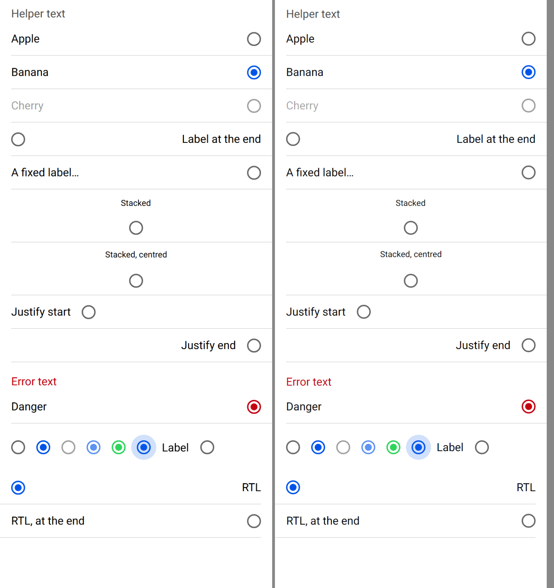
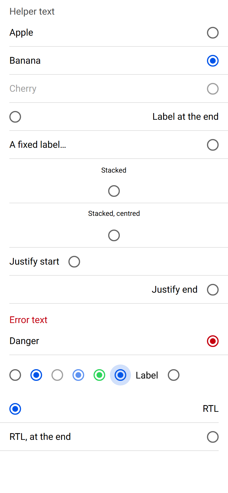
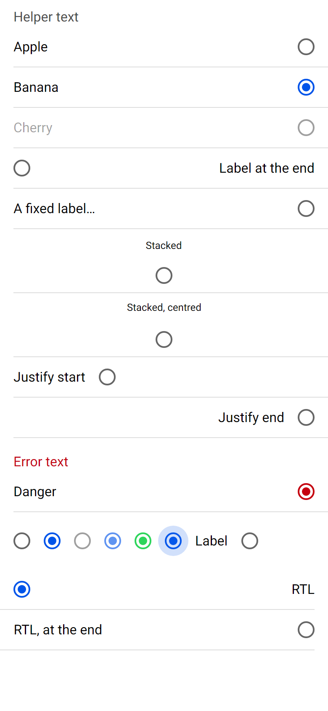

# ion-radio and ion-radio-group — Comparison against the web component

> Ionic side: `node tools/ionic-ref/render.js ion-radio --bare --html '<the snippet below>'` (Chromium, md, 390×844@2x) → [`ref/`](ref/).
> `ref/README.md` holds the exact command, and `ref/page.html` the page.
> Avonic side: `AVONIC_CAPTURE_DIR=… dotnet test` → `AvonicRadioCaptureTests.Reference_Page` (headless Skia, 2×) → [`compare/`](compare/).
> Not tried in a real window (real-window run queued), and not tried on a device.

```html
<ion-app style="position:static;display:block;contain:none;overflow:visible">
<ion-list><ion-radio-group value="b" helper-text="Helper text">
<ion-item><ion-radio value="a">Apple</ion-radio></ion-item>
<ion-item><ion-radio value="b">Banana</ion-radio></ion-item>
<ion-item><ion-radio value="c" disabled>Cherry</ion-radio></ion-item>
<ion-item><ion-radio value="d" label-placement="end">Label at the end</ion-radio></ion-item>
<ion-item><ion-radio value="e" label-placement="fixed">A fixed label that is far too long</ion-radio></ion-item>
<ion-item><ion-radio value="f" label-placement="stacked">Stacked</ion-radio></ion-item>
<ion-item><ion-radio value="g" label-placement="stacked" alignment="center">Stacked, centred</ion-radio></ion-item>
<ion-item><ion-radio value="h" justify="start">Justify start</ion-radio></ion-item>
<ion-item><ion-radio value="i" justify="end">Justify end</ion-radio></ion-item></ion-radio-group></ion-list>
<ion-list><ion-radio-group value="x" class="ion-touched ion-invalid" helper-text="Helper text" error-text="Error text">
<ion-item><ion-radio value="x" color="danger">Danger</ion-radio></ion-item></ion-radio-group></ion-list>
<div style="padding:16px"><ion-radio-group value="x">
<div style="display:flex;gap:16px;align-items:center"><ion-radio value="y"></ion-radio><ion-radio value="x"></ion-radio><ion-radio value="y" disabled></ion-radio><ion-radio value="x" disabled></ion-radio><ion-radio value="x" color="success"></ion-radio><ion-radio value="x" class="ion-focused"></ion-radio><ion-radio value="y">Label</ion-radio></div></ion-radio-group></div>
<div dir="rtl">
<ion-list><ion-radio-group value="r">
<ion-item><ion-radio value="r">RTL</ion-radio></ion-item>
<ion-item><ion-radio value="s" label-placement="end">RTL, at the end</ion-radio></ion-item></ion-radio-group></ion-list></div></ion-app>
```

(One line in the real command.) `Reference_Page` lays out the same content: the flex row is a horizontal `StackPanel` with a spacing of
16, `dir="rtl"` is `FlowDirection`, and the page has the browser's 16 px Roboto, which the hint and a radio outside an item inherit.

The behaviours were measured with a throwaway Playwright script on the same page, at 390 wide: two clicks on a radio outside a group,
clicks on the first radio, a click on an item's padding, focus, the arrows, Space and Enter, Tab and Shift+Tab, and the mark's
transform sampled about every 70 ms. A second page measured a radio with no label at the start and at the end of an item,
`alignment="start"` in a row and stacked, a radio in an item's start slot, and one with `justify` outside an item.

## Frames

Ionic on the left, Avonic on the right:



| Ionic | Avonic |
|---|---|
|  |  |

The rows, the rings, the marks, the colours, the disabled fades, every placement, `justify`, the error text and RTL line up. Text is
Roboto on both sides; Skia and Chromium rasterise it a little differently.

## Found here, not by the tests

- **The focus circle was a square, then a pill.** A `TemplatedControl` clips to its bounds, where CSS doesn't: first the radio's
  20 px box clipped the 36 px circle, then the group's row. Both now turn `ClipToBounds` off by default, and `R9_The_Circle_Is_Not_Clipped…`
  holds it.
- **The hint and a radio's label outside an item were 12 px.** Nothing in Ionic sets their size: they inherit the page's, which is a
  browser's 16. The capture page sets 16 as a browser does, and the theme doesn't set a size, as Ionic doesn't.

## Found by the tests

- **An `ItemsControl` takes the arrow keys first.** Its `OnKeyDown` moves focus between containers and handles the key, so the group's
  own handler never saw them. The group overrides `OnKeyDown`, and doesn't call the base class: Ionic's group moves nothing else.
- **A dictionary as the group's value was read as a list of its entries.** `Array.isArray` is only true of an array, so only an
  `IList` is.

## Found by the reviews

First `/code-review` at high effort:

| Finding | Outcome |
|---|---|
| The group's `Value` was one-way, so a bound view model never heard the user's choice | Fixed: two-way by default, as Avalonia's own selection is. `G1_A_Bound_Value_Hears_The_Users_Choice` |
| An `ItemsControl` is one tab stop that remembers the last focused child, so Tab would skip a button in the group and come back to a radio that was no longer the choice | Wrong, for Avalonia 12: the tests written for it, `R7_Tab_Goes_On…` and `R7_Tab_Comes_Back_To_The_Choice…`, pass without setting `TabNavigation`, and the breakage run showed the setting did nothing, so it went. The tests stay |
| `Select()` from automation on the checked radio cleared the value with `AllowEmptySelection` | Fixed: selecting a selected radio does nothing; activation of an unchecked one is still a click. `R10_Selecting_The_Checked_Radio…` |
| `compareOptions` also checks a radio whose own value is an array holding the group's | Fixed. `R3_A_Radio_Whose_Value_Is_An_Array…` |
| A fixed label shrank below 100 in a narrow line, where `flex: 0 0 100px` keeps it | Fixed: it keeps 100, and the line overflows. `V5_A_Fixed_Label_Keeps…` |
| `Activatable` and `FocusVisible` were set as local values, over an app's own | Fixed: at style priority. `R8_An_Apps_Own_Activatable…` |
| The item's role in a group should be in `AvonicItem`'s peer, which is ours, not a global style | Waived for this PR: the brief keeps another control's files out of a parallel PR, so it's the mapping's rule for a control that isn't this one's, and it's under "Proposed for shared files", which would take the budget back to 243 |
| Radios added after the group has loaded don't get a tab stop until the value changes | Waived: it's what Ionic does, as `setRadioTabindex` only runs on load and on a change of value. Under "For you to decide" |
| The group walks its visual tree for its radios on each key and change, and reads a property by reflection each time | Waived: a key press and a change are a person's pace, and a group holds a handful of radios |
| `:slot-start` and `:slot-end` are only worked out in an item, where Ionic's `[slot]` rule applies in any host | Waived: the rule only undoes an item's `flex: 1` and `width: 100%`, which nothing else sets |

Second `/code-review` at high effort, on the fixed code:

| Finding | Outcome |
|---|---|
| `:disabled` is also an ancestor's, so a radio in a disabled item was faded twice, and the arrows skipped it, where Ionic reads the radio's own `disabled` | Fixed: the fade, the keys and the tab stop read the radio's own `IsEnabled`. `V4_A_Radio_In_A_Disabled_Item…`, `G3_A_Radio_In_A_Disabled_Item…` |
| A change of the hint wasn't announced, and the texts weren't live, where Ionic has `aria-live="polite"` and `role="alert"` | Fixed: `LiveSetting` `Polite` and `Assertive`, and the peer raises a change of `HelpText`. `G7_The_Hint_Is_Live…`, `G7_The_Themes_Hint_Is_Live_Too` |
| `line-height: 1.5` was a fixed 24 | Fixed: `Css.Em` of the font size. `G6_The_Line_Is_One_And_A_Half…` |
| `[slot=start]` applies in any host, a toolbar's too | `:slot-start` and `:slot-end` are now set in any host. The `width: auto` rule written for it did nothing, as the breakage run showed: a toolbar's slot already gives its child its own width, which `R8_In_A_Toolbars_Start_Slot…` holds. So the rule went |
| The style-priority frames were made again on every attach | Fixed: only when the context changes. `AvonicItem`'s helper for it is private, in a file this PR doesn't touch |
| The item's role in a group belongs in its peer | Waived, as in the first review |
| `Equals` on boxed numbers needs the same type, where JavaScript has one kind of number | Waived: `Equals` is .NET's strict equality, and an app gets back the type it gives |
| The visual walk for the radios | Waived, as in the first review |
| README.md and COMPARISON.md were missing | Wrong at the time: written, and not yet committed. They are now |

## Behaviours

| # | Behaviour | Result | Test |
|---|---|---|---|
| R1 | Alone, a click checks it for good | match | `R1_…` |
| R2 | Checked when its value is the group's, both ways, also for a radio added later or deep in an item | match | `R2_…` |
| R3 | `compareWith` as a function or a property name; an array checks each radio in it | match | `R3_…` |
| R4 | A unique value when none is set | match: `ion-rb-N` | `R4_…` |
| R5 | Disabled: no click, from a press or automation | match | `R5_…` |
| R6 | `ionFocus` and `ionBlur` for the radio itself; a click focuses it | match | `R6_…` |
| R7 | One tab stop in a group, following the value; none alone | match | `R7_…` |
| R8 | In an item: the item is the cover, a tap on its padding clicks the radio, 358 by 47; in the start slot 45.5 by 39 | match | `R8_…` |
| R9 | Keyboard focus shows the 36 px circle, `rgb(26, 101, 235)` at 0.2; no outline | match | `R9_…` |
| R10 | A radio button, named from its label, selected when checked, `Select()` is a click | match | `R10_…` |
| R11 | No label: just the ring, 20 by 20 | match | `R11_…` |
| V1 | 20 ring, border 2 at `rgba(0, 0, 0, 0.6)`, 10 mark centred, both round | match | `V1_…` |
| V2 | Checked: primary ring, the mark from 0 to 1 over 280 ms, `cubic-bezier(0.4, 0, 0.2, 1)`, none on the first frame | match | `V2_…` |
| V3 | `Color`: mark and checked ring in the base | match | `V3_…` |
| V4 | Disabled: label 0.38, ring 0.63 | match | `V4_…` |
| V5 | Start, end, fixed, stacked, stacked with `alignment` | match, to the half pixel with boxes for text | `V5_…` |
| V6 | `justify`; as wide as its content alone, a block with `justify` or `alignment`; no label at the start or, for end, the end | match | `V6_…` |
| V7 | `alignment="start"` in a row: both at the top | match | `V7_…` |
| V9 | RTL | match | `V9_…` |
| V10 | One line, ellipsis | match | `V5_Fixed…` |
| G1 | A click sets the value and raises `ionChange` once; the checked one does nothing, or clears with `allowEmptySelection` | match | `G1_…` |
| G2 | No `ionChange` for a value set in code | match | `G2_…` |
| G3 | Arrows: next or previous enabled radio, wrapping, focused by key and checked | match | `G3_…` |
| G4 | Space checks, or clears with `allowEmptySelection`, whichever radio is focused; Enter does nothing | match | `G4_…` |
| G5 | Only a key on one of its radios; a radio alone takes no keys | match | `G5_…` |
| G6 | Helper text, error text when touched and invalid, 16 at the sides in a list, a 24 line | match | `G6_…` |
| G7 | A group, described by its hint, labelled by its header or divider | match | `G7_…` |
| G8 | An item in a group isn't a list item | match | `G8_…` |

## Deliberate differences

- **`ionChange` has no `event`.** Ionic's detail carries the DOM event that caused the change. A click here comes through
  `NativeButton`, which has no single event to give, and the routed event's `Source` says where it came from.
- **`name` isn't declared** on either control: it's for an HTML form.
- **No label is no content, or an empty string.** Ionic hides the label's wrapper when the radio's `textContent` is empty, so an icon
  alone would hide it. Here any control counts as a label, as most have text, and reading a control's text needs it laid out first.
- **A radio belongs to its nearest group.** Ionic's group takes every `ion-radio` inside it, a nested group's too, for its keys and its
  tab stop. Nested radio groups aren't a real layout, and this keeps each radio in one group.
- **`aria-invalid`** has no automation property in Avalonia, so it isn't given.
- **An arrow onto a radio in a disabled item** checks it, as Ionic does, but focus stays where it was: Avalonia doesn't focus a control
  inside a disabled one.
- **Space raises `ionChange` when it changes the value.** Ionic also raises it whenever `allowEmptySelection` is on, but then the value
  always changes, as a radio always has a value, so the condition was dead and the breakage run couldn't tell it apart.

## Gaps

- `ion-select`'s popover and modal, which stop the arrows from changing the value, don't exist yet.
- Not tried in a real window, nor on a device.
