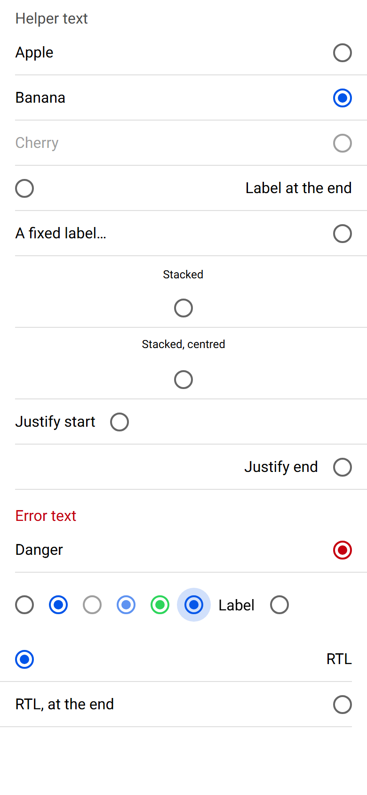
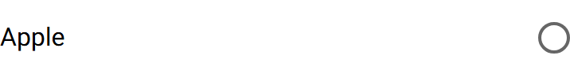

# ion-radio — reference render (Ionic 8.8.1, md, 390×844@2x)

Generated by `node tools/ionic-ref/render.js ion-radio --bare --html "<ion-app style=\"position:static;display:block;contain:none;overflow:visible\"><ion-list><ion-radio-group value=\"b\" helper-text=\"Helper text\"><ion-item><ion-radio value=\"a\">Apple</ion-radio></ion-item><ion-item><ion-radio value=\"b\">Banana</ion-radio></ion-item><ion-item><ion-radio value=\"c\" disabled>Cherry</ion-radio></ion-item><ion-item><ion-radio value=\"d\" label-placement=\"end\">Label at the end</ion-radio></ion-item><ion-item><ion-radio value=\"e\" label-placement=\"fixed\">A fixed label that is far too long</ion-radio></ion-item><ion-item><ion-radio value=\"f\" label-placement=\"stacked\">Stacked</ion-radio></ion-item><ion-item><ion-radio value=\"g\" label-placement=\"stacked\" alignment=\"center\">Stacked, centred</ion-radio></ion-item><ion-item><ion-radio value=\"h\" justify=\"start\">Justify start</ion-radio></ion-item><ion-item><ion-radio value=\"i\" justify=\"end\">Justify end</ion-radio></ion-item></ion-radio-group></ion-list><ion-list><ion-radio-group value=\"x\" class=\"ion-touched ion-invalid\" helper-text=\"Helper text\" error-text=\"Error text\"><ion-item><ion-radio value=\"x\" color=\"danger\">Danger</ion-radio></ion-item></ion-radio-group></ion-list><div style=\"padding:16px\"><ion-radio-group value=\"x\"><div style=\"display:flex;gap:16px;align-items:center\"><ion-radio value=\"y\"></ion-radio><ion-radio value=\"x\"></ion-radio><ion-radio value=\"y\" disabled></ion-radio><ion-radio value=\"x\" disabled></ion-radio><ion-radio value=\"x\" color=\"success\"></ion-radio><ion-radio value=\"x\" class=\"ion-focused\"></ion-radio><ion-radio value=\"y\">Label</ion-radio></div></ion-radio-group></div><div dir=\"rtl\"><ion-list><ion-radio-group value=\"r\"><ion-item><ion-radio value=\"r\">RTL</ion-radio></ion-item><ion-item><ion-radio value=\"s\" label-placement=\"end\">RTL, at the end</ion-radio></ion-item></ion-radio-group></ion-list></div></ion-app>"`

```html
<ion-app style="position:static;display:block;contain:none;overflow:visible"><ion-list><ion-radio-group value="b" helper-text="Helper text"><ion-item><ion-radio value="a">Apple</ion-radio></ion-item><ion-item><ion-radio value="b">Banana</ion-radio></ion-item><ion-item><ion-radio value="c" disabled>Cherry</ion-radio></ion-item><ion-item><ion-radio value="d" label-placement="end">Label at the end</ion-radio></ion-item><ion-item><ion-radio value="e" label-placement="fixed">A fixed label that is far too long</ion-radio></ion-item><ion-item><ion-radio value="f" label-placement="stacked">Stacked</ion-radio></ion-item><ion-item><ion-radio value="g" label-placement="stacked" alignment="center">Stacked, centred</ion-radio></ion-item><ion-item><ion-radio value="h" justify="start">Justify start</ion-radio></ion-item><ion-item><ion-radio value="i" justify="end">Justify end</ion-radio></ion-item></ion-radio-group></ion-list><ion-list><ion-radio-group value="x" class="ion-touched ion-invalid" helper-text="Helper text" error-text="Error text"><ion-item><ion-radio value="x" color="danger">Danger</ion-radio></ion-item></ion-radio-group></ion-list><div style="padding:16px"><ion-radio-group value="x"><div style="display:flex;gap:16px;align-items:center"><ion-radio value="y"></ion-radio><ion-radio value="x"></ion-radio><ion-radio value="y" disabled></ion-radio><ion-radio value="x" disabled></ion-radio><ion-radio value="x" color="success"></ion-radio><ion-radio value="x" class="ion-focused"></ion-radio><ion-radio value="y">Label</ion-radio></div></ion-radio-group></div><div dir="rtl"><ion-list><ion-radio-group value="r"><ion-item><ion-radio value="r">RTL</ion-radio></ion-item><ion-item><ion-radio value="s" label-placement="end">RTL, at the end</ion-radio></ion-item></ion-radio-group></ion-list></div></ion-app>
```

 

## Element 1

- attributes: `{"value":"a","class":"md in-item radio-label-placement-start hydrated","role":"radio","aria-checked":"false","tabindex":"-1"}`
- classes: `md in-item radio-label-placement-start hydrated`
- rect: `{"x":16,"y":32,"w":358,"h":47}`

### CSS custom properties (resolved)

| var | value |
|---|---|
| `--border-radius` | `50%` |
| `--color` | `rgb(0, 0, 0, 0.6)` |
| `--color-checked` | `#0054e9` |
| `--inner-border-radius` | `50%` |

### Host computed

| prop | value |
|---|---|
| display | `block` |
| position | `relative` |
| box-sizing | `border-box` |
| width | `358px` |
| height | `47px` |
| min-height | `auto` |
| min-width | `auto` |
| padding | `0px` |
| margin | `0px` |
| border | `0px none rgb(0, 0, 0)` |
| border-radius | `0px` |
| background-color | `rgba(0, 0, 0, 0)` |
| color | `rgb(0, 0, 0)` |
| font-size | `16px` |
| font-weight | `400` |
| font-family | `Roboto, "Helvetica Neue", sans-serif` |
| line-height | `normal` |
| letter-spacing | `normal` |
| text-transform | `none` |
| opacity | `1` |
| overflow | `visible` |
| contain | `none` |
| pointer-events | `auto` |
| transition | `all` |
| transform | `none` |
| box-shadow | `none` |
| outline | `rgb(0, 0, 0) none 0px` |
| cursor | `pointer` |

### Shadow parts

#### part="label" (`div`) rect `{"x":16,"y":46,"w":40.78,"h":19}`

| prop | value |
|---|---|
| display | `block` |
| position | `static` |
| box-sizing | `content-box` |
| width | `40.7812px` |
| height | `19px` |
| min-height | `auto` |
| min-width | `auto` |
| padding | `0px` |
| margin | `10px 16px 10px 0px` |
| border | `0px none rgb(0, 0, 0)` |
| border-radius | `0px` |
| background-color | `rgba(0, 0, 0, 0)` |
| color | `rgb(0, 0, 0)` |
| font-size | `16px` |
| font-weight | `400` |
| font-family | `Roboto, "Helvetica Neue", sans-serif` |
| line-height | `normal` |
| letter-spacing | `normal` |
| text-transform | `none` |
| opacity | `1` |
| overflow | `hidden` |
| contain | `none` |
| pointer-events | `auto` |
| transition | `all` |
| transform | `none` |
| box-shadow | `none` |
| outline | `rgb(0, 0, 0) none 0px` |
| cursor | `pointer` |

#### part="container" (`div`) rect `{"x":354,"y":45.5,"w":20,"h":20}`

| prop | value |
|---|---|
| display | `flex` |
| position | `static` |
| box-sizing | `border-box` |
| width | `20px` |
| height | `20px` |
| min-height | `auto` |
| min-width | `auto` |
| padding | `0px` |
| margin | `0px` |
| border | `2px solid rgba(0, 0, 0, 0.6)` |
| border-radius | `50%` |
| background-color | `rgba(0, 0, 0, 0)` |
| color | `rgb(0, 0, 0)` |
| font-size | `16px` |
| font-weight | `400` |
| font-family | `Roboto, "Helvetica Neue", sans-serif` |
| line-height | `normal` |
| letter-spacing | `normal` |
| text-transform | `none` |
| opacity | `1` |
| overflow | `visible` |
| contain | `size layout style` |
| pointer-events | `auto` |
| transition | `all` |
| transform | `none` |
| box-shadow | `none` |
| outline | `rgb(0, 0, 0) none 0px` |
| cursor | `pointer` |

#### part="mark" (`div`) rect `{"x":364,"y":55.5,"w":0,"h":0}`

| prop | value |
|---|---|
| display | `block` |
| position | `static` |
| box-sizing | `border-box` |
| width | `10px` |
| height | `10px` |
| min-height | `auto` |
| min-width | `auto` |
| padding | `0px` |
| margin | `0px` |
| border | `0px none rgb(0, 0, 0)` |
| border-radius | `50%` |
| background-color | `rgb(0, 84, 233)` |
| color | `rgb(0, 0, 0)` |
| font-size | `16px` |
| font-weight | `400` |
| font-family | `Roboto, "Helvetica Neue", sans-serif` |
| line-height | `normal` |
| letter-spacing | `normal` |
| text-transform | `none` |
| opacity | `1` |
| overflow | `visible` |
| contain | `none` |
| pointer-events | `auto` |
| transition | `transform 0.28s cubic-bezier(0.4, 0, 0.2, 1), -webkit-transform 0.28s cubic-bezier(0.4, 0, 0.2, 1)` |
| transform | `matrix3d(0, 0, 0, 0, 0, 0, 0, 0, 0, 0, 0, 0, 0, 0, 0, 1)` |
| box-shadow | `none` |
| outline | `rgb(0, 0, 0) none 0px` |
| cursor | `pointer` |

### DOM tree

```
<ion-radio>
  #shadow-root
    <label.radio-wrapper>
      <div.label-text-wrapper part="label">
        <slot name="">
      <div.native-wrapper>
        <div.radio-icon part="container">
          <div.radio-inner part="mark">
          <div.radio-ripple>
```

## Element 2

- attributes: `{"value":"b","class":"md in-item radio-checked radio-label-placement-start hydrated","role":"radio","aria-checked":"true","tabindex":"0"}`
- classes: `md in-item radio-checked radio-label-placement-start hydrated`
- rect: `{"x":16,"y":80,"w":358,"h":47}`

### CSS custom properties (resolved)

| var | value |
|---|---|
| `--border-radius` | `50%` |
| `--color` | `rgb(0, 0, 0, 0.6)` |
| `--color-checked` | `#0054e9` |
| `--inner-border-radius` | `50%` |

### Host computed

| prop | value |
|---|---|
| display | `block` |
| position | `relative` |
| box-sizing | `border-box` |
| width | `358px` |
| height | `47px` |
| min-height | `auto` |
| min-width | `auto` |
| padding | `0px` |
| margin | `0px` |
| border | `0px none rgb(0, 0, 0)` |
| border-radius | `0px` |
| background-color | `rgba(0, 0, 0, 0)` |
| color | `rgb(0, 0, 0)` |
| font-size | `16px` |
| font-weight | `400` |
| font-family | `Roboto, "Helvetica Neue", sans-serif` |
| line-height | `normal` |
| letter-spacing | `normal` |
| text-transform | `none` |
| opacity | `1` |
| overflow | `visible` |
| contain | `none` |
| pointer-events | `auto` |
| transition | `all` |
| transform | `none` |
| box-shadow | `none` |
| outline | `rgb(0, 0, 0) none 0px` |
| cursor | `pointer` |

### Shadow parts

#### part="label" (`div`) rect `{"x":16,"y":94,"w":53.75,"h":19}`

| prop | value |
|---|---|
| display | `block` |
| position | `static` |
| box-sizing | `content-box` |
| width | `53.75px` |
| height | `19px` |
| min-height | `auto` |
| min-width | `auto` |
| padding | `0px` |
| margin | `10px 16px 10px 0px` |
| border | `0px none rgb(0, 0, 0)` |
| border-radius | `0px` |
| background-color | `rgba(0, 0, 0, 0)` |
| color | `rgb(0, 0, 0)` |
| font-size | `16px` |
| font-weight | `400` |
| font-family | `Roboto, "Helvetica Neue", sans-serif` |
| line-height | `normal` |
| letter-spacing | `normal` |
| text-transform | `none` |
| opacity | `1` |
| overflow | `hidden` |
| contain | `none` |
| pointer-events | `auto` |
| transition | `all` |
| transform | `none` |
| box-shadow | `none` |
| outline | `rgb(0, 0, 0) none 0px` |
| cursor | `pointer` |

#### part="container" (`div`) rect `{"x":354,"y":93.5,"w":20,"h":20}`

| prop | value |
|---|---|
| display | `flex` |
| position | `static` |
| box-sizing | `border-box` |
| width | `20px` |
| height | `20px` |
| min-height | `auto` |
| min-width | `auto` |
| padding | `0px` |
| margin | `0px` |
| border | `2px solid rgb(0, 84, 233)` |
| border-radius | `50%` |
| background-color | `rgba(0, 0, 0, 0)` |
| color | `rgb(0, 0, 0)` |
| font-size | `16px` |
| font-weight | `400` |
| font-family | `Roboto, "Helvetica Neue", sans-serif` |
| line-height | `normal` |
| letter-spacing | `normal` |
| text-transform | `none` |
| opacity | `1` |
| overflow | `visible` |
| contain | `size layout style` |
| pointer-events | `auto` |
| transition | `all` |
| transform | `none` |
| box-shadow | `none` |
| outline | `rgb(0, 0, 0) none 0px` |
| cursor | `pointer` |

#### part="mark" (`div`) rect `{"x":359,"y":98.5,"w":10,"h":10}`

| prop | value |
|---|---|
| display | `block` |
| position | `static` |
| box-sizing | `border-box` |
| width | `10px` |
| height | `10px` |
| min-height | `auto` |
| min-width | `auto` |
| padding | `0px` |
| margin | `0px` |
| border | `0px none rgb(0, 0, 0)` |
| border-radius | `50%` |
| background-color | `rgb(0, 84, 233)` |
| color | `rgb(0, 0, 0)` |
| font-size | `16px` |
| font-weight | `400` |
| font-family | `Roboto, "Helvetica Neue", sans-serif` |
| line-height | `normal` |
| letter-spacing | `normal` |
| text-transform | `none` |
| opacity | `1` |
| overflow | `visible` |
| contain | `none` |
| pointer-events | `auto` |
| transition | `transform 0.28s cubic-bezier(0.4, 0, 0.2, 1), -webkit-transform 0.28s cubic-bezier(0.4, 0, 0.2, 1)` |
| transform | `matrix(1, 0, 0, 1, 0, 0)` |
| box-shadow | `none` |
| outline | `rgb(0, 0, 0) none 0px` |
| cursor | `pointer` |

### DOM tree

```
<ion-radio>
  #shadow-root
    <label.radio-wrapper>
      <div.label-text-wrapper part="label">
        <slot name="">
      <div.native-wrapper>
        <div.radio-icon part="container">
          <div.radio-inner part="mark">
          <div.radio-ripple>
```

## Element 3

- attributes: `{"value":"c","disabled":"","class":"md in-item radio-disabled radio-label-placement-start hydrated","role":"radio","aria-checked":"false","aria-disabled":"true","tabindex":"-1"}`
- classes: `md in-item radio-disabled radio-label-placement-start hydrated`
- rect: `{"x":16,"y":128,"w":358,"h":47}`

### CSS custom properties (resolved)

| var | value |
|---|---|
| `--border-radius` | `50%` |
| `--color` | `rgb(0, 0, 0, 0.6)` |
| `--color-checked` | `#0054e9` |
| `--inner-border-radius` | `50%` |

### Host computed

| prop | value |
|---|---|
| display | `block` |
| position | `relative` |
| box-sizing | `border-box` |
| width | `358px` |
| height | `47px` |
| min-height | `auto` |
| min-width | `auto` |
| padding | `0px` |
| margin | `0px` |
| border | `0px none rgb(0, 0, 0)` |
| border-radius | `0px` |
| background-color | `rgba(0, 0, 0, 0)` |
| color | `rgb(0, 0, 0)` |
| font-size | `16px` |
| font-weight | `400` |
| font-family | `Roboto, "Helvetica Neue", sans-serif` |
| line-height | `normal` |
| letter-spacing | `normal` |
| text-transform | `none` |
| opacity | `1` |
| overflow | `visible` |
| contain | `none` |
| pointer-events | `none` |
| transition | `all` |
| transform | `none` |
| box-shadow | `none` |
| outline | `rgb(0, 0, 0) none 0px` |
| cursor | `pointer` |

### Shadow parts

#### part="label" (`div`) rect `{"x":16,"y":142,"w":46.27,"h":19}`

| prop | value |
|---|---|
| display | `block` |
| position | `static` |
| box-sizing | `content-box` |
| width | `46.2656px` |
| height | `19px` |
| min-height | `auto` |
| min-width | `auto` |
| padding | `0px` |
| margin | `10px 16px 10px 0px` |
| border | `0px none rgb(0, 0, 0)` |
| border-radius | `0px` |
| background-color | `rgba(0, 0, 0, 0)` |
| color | `rgb(0, 0, 0)` |
| font-size | `16px` |
| font-weight | `400` |
| font-family | `Roboto, "Helvetica Neue", sans-serif` |
| line-height | `normal` |
| letter-spacing | `normal` |
| text-transform | `none` |
| opacity | `0.38` |
| overflow | `hidden` |
| contain | `none` |
| pointer-events | `none` |
| transition | `all` |
| transform | `none` |
| box-shadow | `none` |
| outline | `rgb(0, 0, 0) none 0px` |
| cursor | `pointer` |

#### part="container" (`div`) rect `{"x":354,"y":141.5,"w":20,"h":20}`

| prop | value |
|---|---|
| display | `flex` |
| position | `static` |
| box-sizing | `border-box` |
| width | `20px` |
| height | `20px` |
| min-height | `auto` |
| min-width | `auto` |
| padding | `0px` |
| margin | `0px` |
| border | `2px solid rgba(0, 0, 0, 0.6)` |
| border-radius | `50%` |
| background-color | `rgba(0, 0, 0, 0)` |
| color | `rgb(0, 0, 0)` |
| font-size | `16px` |
| font-weight | `400` |
| font-family | `Roboto, "Helvetica Neue", sans-serif` |
| line-height | `normal` |
| letter-spacing | `normal` |
| text-transform | `none` |
| opacity | `1` |
| overflow | `visible` |
| contain | `size layout style` |
| pointer-events | `none` |
| transition | `all` |
| transform | `none` |
| box-shadow | `none` |
| outline | `rgb(0, 0, 0) none 0px` |
| cursor | `pointer` |

#### part="mark" (`div`) rect `{"x":364,"y":151.5,"w":0,"h":0}`

| prop | value |
|---|---|
| display | `block` |
| position | `static` |
| box-sizing | `border-box` |
| width | `10px` |
| height | `10px` |
| min-height | `auto` |
| min-width | `auto` |
| padding | `0px` |
| margin | `0px` |
| border | `0px none rgb(0, 0, 0)` |
| border-radius | `50%` |
| background-color | `rgb(0, 84, 233)` |
| color | `rgb(0, 0, 0)` |
| font-size | `16px` |
| font-weight | `400` |
| font-family | `Roboto, "Helvetica Neue", sans-serif` |
| line-height | `normal` |
| letter-spacing | `normal` |
| text-transform | `none` |
| opacity | `1` |
| overflow | `visible` |
| contain | `none` |
| pointer-events | `none` |
| transition | `transform 0.28s cubic-bezier(0.4, 0, 0.2, 1), -webkit-transform 0.28s cubic-bezier(0.4, 0, 0.2, 1)` |
| transform | `matrix3d(0, 0, 0, 0, 0, 0, 0, 0, 0, 0, 0, 0, 0, 0, 0, 1)` |
| box-shadow | `none` |
| outline | `rgb(0, 0, 0) none 0px` |
| cursor | `pointer` |

### DOM tree

```
<ion-radio>
  #shadow-root
    <label.radio-wrapper>
      <div.label-text-wrapper part="label">
        <slot name="">
      <div.native-wrapper>
        <div.radio-icon part="container">
          <div.radio-inner part="mark">
          <div.radio-ripple>
```

## Element 4

- attributes: `{"value":"d","label-placement":"end","class":"md in-item radio-label-placement-end hydrated","role":"radio","aria-checked":"false","tabindex":"-1"}`
- classes: `md in-item radio-label-placement-end hydrated`
- rect: `{"x":16,"y":176,"w":358,"h":47}`

### CSS custom properties (resolved)

| var | value |
|---|---|
| `--border-radius` | `50%` |
| `--color` | `rgb(0, 0, 0, 0.6)` |
| `--color-checked` | `#0054e9` |
| `--inner-border-radius` | `50%` |

### Host computed

| prop | value |
|---|---|
| display | `block` |
| position | `relative` |
| box-sizing | `border-box` |
| width | `358px` |
| height | `47px` |
| min-height | `auto` |
| min-width | `auto` |
| padding | `0px` |
| margin | `0px` |
| border | `0px none rgb(0, 0, 0)` |
| border-radius | `0px` |
| background-color | `rgba(0, 0, 0, 0)` |
| color | `rgb(0, 0, 0)` |
| font-size | `16px` |
| font-weight | `400` |
| font-family | `Roboto, "Helvetica Neue", sans-serif` |
| line-height | `normal` |
| letter-spacing | `normal` |
| text-transform | `none` |
| opacity | `1` |
| overflow | `visible` |
| contain | `none` |
| pointer-events | `auto` |
| transition | `all` |
| transform | `none` |
| box-shadow | `none` |
| outline | `rgb(0, 0, 0) none 0px` |
| cursor | `pointer` |

### Shadow parts

#### part="label" (`div`) rect `{"x":260.59,"y":190,"w":113.41,"h":19}`

| prop | value |
|---|---|
| display | `block` |
| position | `static` |
| box-sizing | `content-box` |
| width | `113.406px` |
| height | `19px` |
| min-height | `auto` |
| min-width | `auto` |
| padding | `0px` |
| margin | `10px 0px 10px 16px` |
| border | `0px none rgb(0, 0, 0)` |
| border-radius | `0px` |
| background-color | `rgba(0, 0, 0, 0)` |
| color | `rgb(0, 0, 0)` |
| font-size | `16px` |
| font-weight | `400` |
| font-family | `Roboto, "Helvetica Neue", sans-serif` |
| line-height | `normal` |
| letter-spacing | `normal` |
| text-transform | `none` |
| opacity | `1` |
| overflow | `hidden` |
| contain | `none` |
| pointer-events | `auto` |
| transition | `all` |
| transform | `none` |
| box-shadow | `none` |
| outline | `rgb(0, 0, 0) none 0px` |
| cursor | `pointer` |

#### part="container" (`div`) rect `{"x":16,"y":189.5,"w":20,"h":20}`

| prop | value |
|---|---|
| display | `flex` |
| position | `static` |
| box-sizing | `border-box` |
| width | `20px` |
| height | `20px` |
| min-height | `auto` |
| min-width | `auto` |
| padding | `0px` |
| margin | `0px` |
| border | `2px solid rgba(0, 0, 0, 0.6)` |
| border-radius | `50%` |
| background-color | `rgba(0, 0, 0, 0)` |
| color | `rgb(0, 0, 0)` |
| font-size | `16px` |
| font-weight | `400` |
| font-family | `Roboto, "Helvetica Neue", sans-serif` |
| line-height | `normal` |
| letter-spacing | `normal` |
| text-transform | `none` |
| opacity | `1` |
| overflow | `visible` |
| contain | `size layout style` |
| pointer-events | `auto` |
| transition | `all` |
| transform | `none` |
| box-shadow | `none` |
| outline | `rgb(0, 0, 0) none 0px` |
| cursor | `pointer` |

#### part="mark" (`div`) rect `{"x":26,"y":199.5,"w":0,"h":0}`

| prop | value |
|---|---|
| display | `block` |
| position | `static` |
| box-sizing | `border-box` |
| width | `10px` |
| height | `10px` |
| min-height | `auto` |
| min-width | `auto` |
| padding | `0px` |
| margin | `0px` |
| border | `0px none rgb(0, 0, 0)` |
| border-radius | `50%` |
| background-color | `rgb(0, 84, 233)` |
| color | `rgb(0, 0, 0)` |
| font-size | `16px` |
| font-weight | `400` |
| font-family | `Roboto, "Helvetica Neue", sans-serif` |
| line-height | `normal` |
| letter-spacing | `normal` |
| text-transform | `none` |
| opacity | `1` |
| overflow | `visible` |
| contain | `none` |
| pointer-events | `auto` |
| transition | `transform 0.28s cubic-bezier(0.4, 0, 0.2, 1), -webkit-transform 0.28s cubic-bezier(0.4, 0, 0.2, 1)` |
| transform | `matrix3d(0, 0, 0, 0, 0, 0, 0, 0, 0, 0, 0, 0, 0, 0, 0, 1)` |
| box-shadow | `none` |
| outline | `rgb(0, 0, 0) none 0px` |
| cursor | `pointer` |

### DOM tree

```
<ion-radio>
  #shadow-root
    <label.radio-wrapper>
      <div.label-text-wrapper part="label">
        <slot name="">
      <div.native-wrapper>
        <div.radio-icon part="container">
          <div.radio-inner part="mark">
          <div.radio-ripple>
```

## Element 5

- attributes: `{"value":"e","label-placement":"fixed","class":"md in-item radio-label-placement-fixed hydrated","role":"radio","aria-checked":"false","tabindex":"-1"}`
- classes: `md in-item radio-label-placement-fixed hydrated`
- rect: `{"x":16,"y":224,"w":358,"h":47}`

### CSS custom properties (resolved)

| var | value |
|---|---|
| `--border-radius` | `50%` |
| `--color` | `rgb(0, 0, 0, 0.6)` |
| `--color-checked` | `#0054e9` |
| `--inner-border-radius` | `50%` |

### Host computed

| prop | value |
|---|---|
| display | `block` |
| position | `relative` |
| box-sizing | `border-box` |
| width | `358px` |
| height | `47px` |
| min-height | `auto` |
| min-width | `auto` |
| padding | `0px` |
| margin | `0px` |
| border | `0px none rgb(0, 0, 0)` |
| border-radius | `0px` |
| background-color | `rgba(0, 0, 0, 0)` |
| color | `rgb(0, 0, 0)` |
| font-size | `16px` |
| font-weight | `400` |
| font-family | `Roboto, "Helvetica Neue", sans-serif` |
| line-height | `normal` |
| letter-spacing | `normal` |
| text-transform | `none` |
| opacity | `1` |
| overflow | `visible` |
| contain | `none` |
| pointer-events | `auto` |
| transition | `all` |
| transform | `none` |
| box-shadow | `none` |
| outline | `rgb(0, 0, 0) none 0px` |
| cursor | `pointer` |

### Shadow parts

#### part="label" (`div`) rect `{"x":16,"y":238,"w":100,"h":19}`

| prop | value |
|---|---|
| display | `block` |
| position | `static` |
| box-sizing | `content-box` |
| width | `100px` |
| height | `19px` |
| min-height | `auto` |
| min-width | `100px` |
| padding | `0px` |
| margin | `10px 16px 10px 0px` |
| border | `0px none rgb(0, 0, 0)` |
| border-radius | `0px` |
| background-color | `rgba(0, 0, 0, 0)` |
| color | `rgb(0, 0, 0)` |
| font-size | `16px` |
| font-weight | `400` |
| font-family | `Roboto, "Helvetica Neue", sans-serif` |
| line-height | `normal` |
| letter-spacing | `normal` |
| text-transform | `none` |
| opacity | `1` |
| overflow | `hidden` |
| contain | `none` |
| pointer-events | `auto` |
| transition | `all` |
| transform | `none` |
| box-shadow | `none` |
| outline | `rgb(0, 0, 0) none 0px` |
| cursor | `pointer` |

#### part="container" (`div`) rect `{"x":354,"y":237.5,"w":20,"h":20}`

| prop | value |
|---|---|
| display | `flex` |
| position | `static` |
| box-sizing | `border-box` |
| width | `20px` |
| height | `20px` |
| min-height | `auto` |
| min-width | `auto` |
| padding | `0px` |
| margin | `0px` |
| border | `2px solid rgba(0, 0, 0, 0.6)` |
| border-radius | `50%` |
| background-color | `rgba(0, 0, 0, 0)` |
| color | `rgb(0, 0, 0)` |
| font-size | `16px` |
| font-weight | `400` |
| font-family | `Roboto, "Helvetica Neue", sans-serif` |
| line-height | `normal` |
| letter-spacing | `normal` |
| text-transform | `none` |
| opacity | `1` |
| overflow | `visible` |
| contain | `size layout style` |
| pointer-events | `auto` |
| transition | `all` |
| transform | `none` |
| box-shadow | `none` |
| outline | `rgb(0, 0, 0) none 0px` |
| cursor | `pointer` |

#### part="mark" (`div`) rect `{"x":364,"y":247.5,"w":0,"h":0}`

| prop | value |
|---|---|
| display | `block` |
| position | `static` |
| box-sizing | `border-box` |
| width | `10px` |
| height | `10px` |
| min-height | `auto` |
| min-width | `auto` |
| padding | `0px` |
| margin | `0px` |
| border | `0px none rgb(0, 0, 0)` |
| border-radius | `50%` |
| background-color | `rgb(0, 84, 233)` |
| color | `rgb(0, 0, 0)` |
| font-size | `16px` |
| font-weight | `400` |
| font-family | `Roboto, "Helvetica Neue", sans-serif` |
| line-height | `normal` |
| letter-spacing | `normal` |
| text-transform | `none` |
| opacity | `1` |
| overflow | `visible` |
| contain | `none` |
| pointer-events | `auto` |
| transition | `transform 0.28s cubic-bezier(0.4, 0, 0.2, 1), -webkit-transform 0.28s cubic-bezier(0.4, 0, 0.2, 1)` |
| transform | `matrix3d(0, 0, 0, 0, 0, 0, 0, 0, 0, 0, 0, 0, 0, 0, 0, 1)` |
| box-shadow | `none` |
| outline | `rgb(0, 0, 0) none 0px` |
| cursor | `pointer` |

### DOM tree

```
<ion-radio>
  #shadow-root
    <label.radio-wrapper>
      <div.label-text-wrapper part="label">
        <slot name="">
      <div.native-wrapper>
        <div.radio-icon part="container">
          <div.radio-inner part="mark">
          <div.radio-ripple>
```

## Element 6

- attributes: `{"value":"f","label-placement":"stacked","class":"md in-item radio-label-placement-stacked hydrated","role":"radio","aria-checked":"false","tabindex":"-1"}`
- classes: `md in-item radio-label-placement-stacked hydrated`
- rect: `{"x":16,"y":272,"w":358,"h":75}`

### CSS custom properties (resolved)

| var | value |
|---|---|
| `--border-radius` | `50%` |
| `--color` | `rgb(0, 0, 0, 0.6)` |
| `--color-checked` | `#0054e9` |
| `--inner-border-radius` | `50%` |

### Host computed

| prop | value |
|---|---|
| display | `block` |
| position | `relative` |
| box-sizing | `border-box` |
| width | `358px` |
| height | `75px` |
| min-height | `auto` |
| min-width | `auto` |
| padding | `0px` |
| margin | `0px` |
| border | `0px none rgb(0, 0, 0)` |
| border-radius | `0px` |
| background-color | `rgba(0, 0, 0, 0)` |
| color | `rgb(0, 0, 0)` |
| font-size | `16px` |
| font-weight | `400` |
| font-family | `Roboto, "Helvetica Neue", sans-serif` |
| line-height | `normal` |
| letter-spacing | `normal` |
| text-transform | `none` |
| opacity | `1` |
| overflow | `visible` |
| contain | `none` |
| pointer-events | `auto` |
| transition | `all` |
| transform | `none` |
| box-shadow | `none` |
| outline | `rgb(0, 0, 0) none 0px` |
| cursor | `pointer` |

### Shadow parts

#### part="label" (`div`) rect `{"x":173.52,"y":284.38,"w":42.96,"h":14.25}`

| prop | value |
|---|---|
| display | `block` |
| position | `static` |
| box-sizing | `content-box` |
| width | `57.2812px` |
| height | `19px` |
| min-height | `auto` |
| min-width | `auto` |
| padding | `0px` |
| margin | `10px 0px 16px` |
| border | `0px none rgb(0, 0, 0)` |
| border-radius | `0px` |
| background-color | `rgba(0, 0, 0, 0)` |
| color | `rgb(0, 0, 0)` |
| font-size | `16px` |
| font-weight | `400` |
| font-family | `Roboto, "Helvetica Neue", sans-serif` |
| line-height | `normal` |
| letter-spacing | `normal` |
| text-transform | `none` |
| opacity | `1` |
| overflow | `hidden` |
| contain | `none` |
| pointer-events | `auto` |
| transition | `all` |
| transform | `matrix(0.75, 0, 0, 0.75, 0, 0)` |
| box-shadow | `none` |
| outline | `rgb(0, 0, 0) none 0px` |
| cursor | `pointer` |

#### part="container" (`div`) rect `{"x":185,"y":317,"w":20,"h":20}`

| prop | value |
|---|---|
| display | `flex` |
| position | `static` |
| box-sizing | `border-box` |
| width | `20px` |
| height | `20px` |
| min-height | `auto` |
| min-width | `auto` |
| padding | `0px` |
| margin | `0px` |
| border | `2px solid rgba(0, 0, 0, 0.6)` |
| border-radius | `50%` |
| background-color | `rgba(0, 0, 0, 0)` |
| color | `rgb(0, 0, 0)` |
| font-size | `16px` |
| font-weight | `400` |
| font-family | `Roboto, "Helvetica Neue", sans-serif` |
| line-height | `normal` |
| letter-spacing | `normal` |
| text-transform | `none` |
| opacity | `1` |
| overflow | `visible` |
| contain | `size layout style` |
| pointer-events | `auto` |
| transition | `all` |
| transform | `none` |
| box-shadow | `none` |
| outline | `rgb(0, 0, 0) none 0px` |
| cursor | `pointer` |

#### part="mark" (`div`) rect `{"x":195,"y":327,"w":0,"h":0}`

| prop | value |
|---|---|
| display | `block` |
| position | `static` |
| box-sizing | `border-box` |
| width | `10px` |
| height | `10px` |
| min-height | `auto` |
| min-width | `auto` |
| padding | `0px` |
| margin | `0px` |
| border | `0px none rgb(0, 0, 0)` |
| border-radius | `50%` |
| background-color | `rgb(0, 84, 233)` |
| color | `rgb(0, 0, 0)` |
| font-size | `16px` |
| font-weight | `400` |
| font-family | `Roboto, "Helvetica Neue", sans-serif` |
| line-height | `normal` |
| letter-spacing | `normal` |
| text-transform | `none` |
| opacity | `1` |
| overflow | `visible` |
| contain | `none` |
| pointer-events | `auto` |
| transition | `transform 0.28s cubic-bezier(0.4, 0, 0.2, 1), -webkit-transform 0.28s cubic-bezier(0.4, 0, 0.2, 1)` |
| transform | `matrix3d(0, 0, 0, 0, 0, 0, 0, 0, 0, 0, 0, 0, 0, 0, 0, 1)` |
| box-shadow | `none` |
| outline | `rgb(0, 0, 0) none 0px` |
| cursor | `pointer` |

### DOM tree

```
<ion-radio>
  #shadow-root
    <label.radio-wrapper>
      <div.label-text-wrapper part="label">
        <slot name="">
      <div.native-wrapper>
        <div.radio-icon part="container">
          <div.radio-inner part="mark">
          <div.radio-ripple>
```

## Element 7

- attributes: `{"value":"g","label-placement":"stacked","alignment":"center","class":"md in-item radio-alignment-center radio-label-placement-stacked hydrated","role":"radio","aria-checked":"false","tabindex":"-1"}`
- classes: `md in-item radio-alignment-center radio-label-placement-stacked hydrated`
- rect: `{"x":16,"y":348,"w":358,"h":75}`

### CSS custom properties (resolved)

| var | value |
|---|---|
| `--border-radius` | `50%` |
| `--color` | `rgb(0, 0, 0, 0.6)` |
| `--color-checked` | `#0054e9` |
| `--inner-border-radius` | `50%` |

### Host computed

| prop | value |
|---|---|
| display | `block` |
| position | `relative` |
| box-sizing | `border-box` |
| width | `358px` |
| height | `75px` |
| min-height | `auto` |
| min-width | `auto` |
| padding | `0px` |
| margin | `0px` |
| border | `0px none rgb(0, 0, 0)` |
| border-radius | `0px` |
| background-color | `rgba(0, 0, 0, 0)` |
| color | `rgb(0, 0, 0)` |
| font-size | `16px` |
| font-weight | `400` |
| font-family | `Roboto, "Helvetica Neue", sans-serif` |
| line-height | `normal` |
| letter-spacing | `normal` |
| text-transform | `none` |
| opacity | `1` |
| overflow | `visible` |
| contain | `none` |
| pointer-events | `auto` |
| transition | `all` |
| transform | `none` |
| box-shadow | `none` |
| outline | `rgb(0, 0, 0) none 0px` |
| cursor | `pointer` |

### Shadow parts

#### part="label" (`div`) rect `{"x":150.7,"y":358,"w":88.58,"h":14.25}`

| prop | value |
|---|---|
| display | `block` |
| position | `static` |
| box-sizing | `content-box` |
| width | `118.109px` |
| height | `19px` |
| min-height | `auto` |
| min-width | `auto` |
| padding | `0px` |
| margin | `10px 0px 16px` |
| border | `0px none rgb(0, 0, 0)` |
| border-radius | `0px` |
| background-color | `rgba(0, 0, 0, 0)` |
| color | `rgb(0, 0, 0)` |
| font-size | `16px` |
| font-weight | `400` |
| font-family | `Roboto, "Helvetica Neue", sans-serif` |
| line-height | `normal` |
| letter-spacing | `normal` |
| text-transform | `none` |
| opacity | `1` |
| overflow | `hidden` |
| contain | `none` |
| pointer-events | `auto` |
| transition | `all` |
| transform | `matrix(0.75, 0, 0, 0.75, 0, 0)` |
| box-shadow | `none` |
| outline | `rgb(0, 0, 0) none 0px` |
| cursor | `pointer` |

#### part="container" (`div`) rect `{"x":185,"y":393,"w":20,"h":20}`

| prop | value |
|---|---|
| display | `flex` |
| position | `static` |
| box-sizing | `border-box` |
| width | `20px` |
| height | `20px` |
| min-height | `auto` |
| min-width | `auto` |
| padding | `0px` |
| margin | `0px` |
| border | `2px solid rgba(0, 0, 0, 0.6)` |
| border-radius | `50%` |
| background-color | `rgba(0, 0, 0, 0)` |
| color | `rgb(0, 0, 0)` |
| font-size | `16px` |
| font-weight | `400` |
| font-family | `Roboto, "Helvetica Neue", sans-serif` |
| line-height | `normal` |
| letter-spacing | `normal` |
| text-transform | `none` |
| opacity | `1` |
| overflow | `visible` |
| contain | `size layout style` |
| pointer-events | `auto` |
| transition | `all` |
| transform | `none` |
| box-shadow | `none` |
| outline | `rgb(0, 0, 0) none 0px` |
| cursor | `pointer` |

#### part="mark" (`div`) rect `{"x":195,"y":403,"w":0,"h":0}`

| prop | value |
|---|---|
| display | `block` |
| position | `static` |
| box-sizing | `border-box` |
| width | `10px` |
| height | `10px` |
| min-height | `auto` |
| min-width | `auto` |
| padding | `0px` |
| margin | `0px` |
| border | `0px none rgb(0, 0, 0)` |
| border-radius | `50%` |
| background-color | `rgb(0, 84, 233)` |
| color | `rgb(0, 0, 0)` |
| font-size | `16px` |
| font-weight | `400` |
| font-family | `Roboto, "Helvetica Neue", sans-serif` |
| line-height | `normal` |
| letter-spacing | `normal` |
| text-transform | `none` |
| opacity | `1` |
| overflow | `visible` |
| contain | `none` |
| pointer-events | `auto` |
| transition | `transform 0.28s cubic-bezier(0.4, 0, 0.2, 1), -webkit-transform 0.28s cubic-bezier(0.4, 0, 0.2, 1)` |
| transform | `matrix3d(0, 0, 0, 0, 0, 0, 0, 0, 0, 0, 0, 0, 0, 0, 0, 1)` |
| box-shadow | `none` |
| outline | `rgb(0, 0, 0) none 0px` |
| cursor | `pointer` |

### DOM tree

```
<ion-radio>
  #shadow-root
    <label.radio-wrapper>
      <div.label-text-wrapper part="label">
        <slot name="">
      <div.native-wrapper>
        <div.radio-icon part="container">
          <div.radio-inner part="mark">
          <div.radio-ripple>
```

## Element 8

- attributes: `{"value":"h","justify":"start","class":"md in-item radio-justify-start radio-label-placement-start hydrated","role":"radio","aria-checked":"false","tabindex":"-1"}`
- classes: `md in-item radio-justify-start radio-label-placement-start hydrated`
- rect: `{"x":16,"y":424,"w":358,"h":47}`

### CSS custom properties (resolved)

| var | value |
|---|---|
| `--border-radius` | `50%` |
| `--color` | `rgb(0, 0, 0, 0.6)` |
| `--color-checked` | `#0054e9` |
| `--inner-border-radius` | `50%` |

### Host computed

| prop | value |
|---|---|
| display | `block` |
| position | `relative` |
| box-sizing | `border-box` |
| width | `358px` |
| height | `47px` |
| min-height | `auto` |
| min-width | `auto` |
| padding | `0px` |
| margin | `0px` |
| border | `0px none rgb(0, 0, 0)` |
| border-radius | `0px` |
| background-color | `rgba(0, 0, 0, 0)` |
| color | `rgb(0, 0, 0)` |
| font-size | `16px` |
| font-weight | `400` |
| font-family | `Roboto, "Helvetica Neue", sans-serif` |
| line-height | `normal` |
| letter-spacing | `normal` |
| text-transform | `none` |
| opacity | `1` |
| overflow | `visible` |
| contain | `none` |
| pointer-events | `auto` |
| transition | `all` |
| transform | `none` |
| box-shadow | `none` |
| outline | `rgb(0, 0, 0) none 0px` |
| cursor | `pointer` |

### Shadow parts

#### part="label" (`div`) rect `{"x":16,"y":438,"w":85.38,"h":19}`

| prop | value |
|---|---|
| display | `block` |
| position | `static` |
| box-sizing | `content-box` |
| width | `85.375px` |
| height | `19px` |
| min-height | `auto` |
| min-width | `auto` |
| padding | `0px` |
| margin | `10px 16px 10px 0px` |
| border | `0px none rgb(0, 0, 0)` |
| border-radius | `0px` |
| background-color | `rgba(0, 0, 0, 0)` |
| color | `rgb(0, 0, 0)` |
| font-size | `16px` |
| font-weight | `400` |
| font-family | `Roboto, "Helvetica Neue", sans-serif` |
| line-height | `normal` |
| letter-spacing | `normal` |
| text-transform | `none` |
| opacity | `1` |
| overflow | `hidden` |
| contain | `none` |
| pointer-events | `auto` |
| transition | `all` |
| transform | `none` |
| box-shadow | `none` |
| outline | `rgb(0, 0, 0) none 0px` |
| cursor | `pointer` |

#### part="container" (`div`) rect `{"x":117.38,"y":437.5,"w":20,"h":20}`

| prop | value |
|---|---|
| display | `flex` |
| position | `static` |
| box-sizing | `border-box` |
| width | `20px` |
| height | `20px` |
| min-height | `auto` |
| min-width | `auto` |
| padding | `0px` |
| margin | `0px` |
| border | `2px solid rgba(0, 0, 0, 0.6)` |
| border-radius | `50%` |
| background-color | `rgba(0, 0, 0, 0)` |
| color | `rgb(0, 0, 0)` |
| font-size | `16px` |
| font-weight | `400` |
| font-family | `Roboto, "Helvetica Neue", sans-serif` |
| line-height | `normal` |
| letter-spacing | `normal` |
| text-transform | `none` |
| opacity | `1` |
| overflow | `visible` |
| contain | `size layout style` |
| pointer-events | `auto` |
| transition | `all` |
| transform | `none` |
| box-shadow | `none` |
| outline | `rgb(0, 0, 0) none 0px` |
| cursor | `pointer` |

#### part="mark" (`div`) rect `{"x":127.38,"y":447.5,"w":0,"h":0}`

| prop | value |
|---|---|
| display | `block` |
| position | `static` |
| box-sizing | `border-box` |
| width | `10px` |
| height | `10px` |
| min-height | `auto` |
| min-width | `auto` |
| padding | `0px` |
| margin | `0px` |
| border | `0px none rgb(0, 0, 0)` |
| border-radius | `50%` |
| background-color | `rgb(0, 84, 233)` |
| color | `rgb(0, 0, 0)` |
| font-size | `16px` |
| font-weight | `400` |
| font-family | `Roboto, "Helvetica Neue", sans-serif` |
| line-height | `normal` |
| letter-spacing | `normal` |
| text-transform | `none` |
| opacity | `1` |
| overflow | `visible` |
| contain | `none` |
| pointer-events | `auto` |
| transition | `transform 0.28s cubic-bezier(0.4, 0, 0.2, 1), -webkit-transform 0.28s cubic-bezier(0.4, 0, 0.2, 1)` |
| transform | `matrix3d(0, 0, 0, 0, 0, 0, 0, 0, 0, 0, 0, 0, 0, 0, 0, 1)` |
| box-shadow | `none` |
| outline | `rgb(0, 0, 0) none 0px` |
| cursor | `pointer` |

### DOM tree

```
<ion-radio>
  #shadow-root
    <label.radio-wrapper>
      <div.label-text-wrapper part="label">
        <slot name="">
      <div.native-wrapper>
        <div.radio-icon part="container">
          <div.radio-inner part="mark">
          <div.radio-ripple>
```

## Element 9

- attributes: `{"value":"i","justify":"end","class":"md in-item radio-justify-end radio-label-placement-start hydrated","role":"radio","aria-checked":"false","tabindex":"-1"}`
- classes: `md in-item radio-justify-end radio-label-placement-start hydrated`
- rect: `{"x":16,"y":472,"w":358,"h":47}`

### CSS custom properties (resolved)

| var | value |
|---|---|
| `--border-radius` | `50%` |
| `--color` | `rgb(0, 0, 0, 0.6)` |
| `--color-checked` | `#0054e9` |
| `--inner-border-radius` | `50%` |

### Host computed

| prop | value |
|---|---|
| display | `block` |
| position | `relative` |
| box-sizing | `border-box` |
| width | `358px` |
| height | `47px` |
| min-height | `auto` |
| min-width | `auto` |
| padding | `0px` |
| margin | `0px` |
| border | `0px none rgb(0, 0, 0)` |
| border-radius | `0px` |
| background-color | `rgba(0, 0, 0, 0)` |
| color | `rgb(0, 0, 0)` |
| font-size | `16px` |
| font-weight | `400` |
| font-family | `Roboto, "Helvetica Neue", sans-serif` |
| line-height | `normal` |
| letter-spacing | `normal` |
| text-transform | `none` |
| opacity | `1` |
| overflow | `visible` |
| contain | `none` |
| pointer-events | `auto` |
| transition | `all` |
| transform | `none` |
| box-shadow | `none` |
| outline | `rgb(0, 0, 0) none 0px` |
| cursor | `pointer` |

### Shadow parts

#### part="label" (`div`) rect `{"x":259.52,"y":486,"w":78.48,"h":19}`

| prop | value |
|---|---|
| display | `block` |
| position | `static` |
| box-sizing | `content-box` |
| width | `78.4844px` |
| height | `19px` |
| min-height | `auto` |
| min-width | `auto` |
| padding | `0px` |
| margin | `10px 16px 10px 0px` |
| border | `0px none rgb(0, 0, 0)` |
| border-radius | `0px` |
| background-color | `rgba(0, 0, 0, 0)` |
| color | `rgb(0, 0, 0)` |
| font-size | `16px` |
| font-weight | `400` |
| font-family | `Roboto, "Helvetica Neue", sans-serif` |
| line-height | `normal` |
| letter-spacing | `normal` |
| text-transform | `none` |
| opacity | `1` |
| overflow | `hidden` |
| contain | `none` |
| pointer-events | `auto` |
| transition | `all` |
| transform | `none` |
| box-shadow | `none` |
| outline | `rgb(0, 0, 0) none 0px` |
| cursor | `pointer` |

#### part="container" (`div`) rect `{"x":354,"y":485.5,"w":20,"h":20}`

| prop | value |
|---|---|
| display | `flex` |
| position | `static` |
| box-sizing | `border-box` |
| width | `20px` |
| height | `20px` |
| min-height | `auto` |
| min-width | `auto` |
| padding | `0px` |
| margin | `0px` |
| border | `2px solid rgba(0, 0, 0, 0.6)` |
| border-radius | `50%` |
| background-color | `rgba(0, 0, 0, 0)` |
| color | `rgb(0, 0, 0)` |
| font-size | `16px` |
| font-weight | `400` |
| font-family | `Roboto, "Helvetica Neue", sans-serif` |
| line-height | `normal` |
| letter-spacing | `normal` |
| text-transform | `none` |
| opacity | `1` |
| overflow | `visible` |
| contain | `size layout style` |
| pointer-events | `auto` |
| transition | `all` |
| transform | `none` |
| box-shadow | `none` |
| outline | `rgb(0, 0, 0) none 0px` |
| cursor | `pointer` |

#### part="mark" (`div`) rect `{"x":364,"y":495.5,"w":0,"h":0}`

| prop | value |
|---|---|
| display | `block` |
| position | `static` |
| box-sizing | `border-box` |
| width | `10px` |
| height | `10px` |
| min-height | `auto` |
| min-width | `auto` |
| padding | `0px` |
| margin | `0px` |
| border | `0px none rgb(0, 0, 0)` |
| border-radius | `50%` |
| background-color | `rgb(0, 84, 233)` |
| color | `rgb(0, 0, 0)` |
| font-size | `16px` |
| font-weight | `400` |
| font-family | `Roboto, "Helvetica Neue", sans-serif` |
| line-height | `normal` |
| letter-spacing | `normal` |
| text-transform | `none` |
| opacity | `1` |
| overflow | `visible` |
| contain | `none` |
| pointer-events | `auto` |
| transition | `transform 0.28s cubic-bezier(0.4, 0, 0.2, 1), -webkit-transform 0.28s cubic-bezier(0.4, 0, 0.2, 1)` |
| transform | `matrix3d(0, 0, 0, 0, 0, 0, 0, 0, 0, 0, 0, 0, 0, 0, 0, 1)` |
| box-shadow | `none` |
| outline | `rgb(0, 0, 0) none 0px` |
| cursor | `pointer` |

### DOM tree

```
<ion-radio>
  #shadow-root
    <label.radio-wrapper>
      <div.label-text-wrapper part="label">
        <slot name="">
      <div.native-wrapper>
        <div.radio-icon part="container">
          <div.radio-inner part="mark">
          <div.radio-ripple>
```

## Element 10

- attributes: `{"value":"x","color":"danger","class":"ion-color ion-color-danger md in-item radio-checked radio-label-placement-start hydrated","role":"radio","aria-checked":"true","tabindex":"0"}`
- classes: `ion-color ion-color-danger md in-item radio-checked radio-label-placement-start hydrated`
- rect: `{"x":16,"y":560,"w":358,"h":47}`

### CSS custom properties (resolved)

| var | value |
|---|---|
| `--border-radius` | `50%` |
| `--color` | `rgb(0, 0, 0, 0.6)` |
| `--color-checked` | `#0054e9` |
| `--inner-border-radius` | `50%` |

### Host computed

| prop | value |
|---|---|
| display | `block` |
| position | `relative` |
| box-sizing | `border-box` |
| width | `358px` |
| height | `47px` |
| min-height | `auto` |
| min-width | `auto` |
| padding | `0px` |
| margin | `0px` |
| border | `0px none rgb(0, 0, 0)` |
| border-radius | `0px` |
| background-color | `rgba(0, 0, 0, 0)` |
| color | `rgb(0, 0, 0)` |
| font-size | `16px` |
| font-weight | `400` |
| font-family | `Roboto, "Helvetica Neue", sans-serif` |
| line-height | `normal` |
| letter-spacing | `normal` |
| text-transform | `none` |
| opacity | `1` |
| overflow | `visible` |
| contain | `none` |
| pointer-events | `auto` |
| transition | `all` |
| transform | `none` |
| box-shadow | `none` |
| outline | `rgb(0, 0, 0) none 0px` |
| cursor | `pointer` |

### Shadow parts

#### part="label" (`div`) rect `{"x":16,"y":574,"w":50.94,"h":19}`

| prop | value |
|---|---|
| display | `block` |
| position | `static` |
| box-sizing | `content-box` |
| width | `50.9375px` |
| height | `19px` |
| min-height | `auto` |
| min-width | `auto` |
| padding | `0px` |
| margin | `10px 16px 10px 0px` |
| border | `0px none rgb(0, 0, 0)` |
| border-radius | `0px` |
| background-color | `rgba(0, 0, 0, 0)` |
| color | `rgb(0, 0, 0)` |
| font-size | `16px` |
| font-weight | `400` |
| font-family | `Roboto, "Helvetica Neue", sans-serif` |
| line-height | `normal` |
| letter-spacing | `normal` |
| text-transform | `none` |
| opacity | `1` |
| overflow | `hidden` |
| contain | `none` |
| pointer-events | `auto` |
| transition | `all` |
| transform | `none` |
| box-shadow | `none` |
| outline | `rgb(0, 0, 0) none 0px` |
| cursor | `pointer` |

#### part="container" (`div`) rect `{"x":354,"y":573.5,"w":20,"h":20}`

| prop | value |
|---|---|
| display | `flex` |
| position | `static` |
| box-sizing | `border-box` |
| width | `20px` |
| height | `20px` |
| min-height | `auto` |
| min-width | `auto` |
| padding | `0px` |
| margin | `0px` |
| border | `2px solid rgb(197, 0, 15)` |
| border-radius | `50%` |
| background-color | `rgba(0, 0, 0, 0)` |
| color | `rgb(0, 0, 0)` |
| font-size | `16px` |
| font-weight | `400` |
| font-family | `Roboto, "Helvetica Neue", sans-serif` |
| line-height | `normal` |
| letter-spacing | `normal` |
| text-transform | `none` |
| opacity | `1` |
| overflow | `visible` |
| contain | `size layout style` |
| pointer-events | `auto` |
| transition | `all` |
| transform | `none` |
| box-shadow | `none` |
| outline | `rgb(0, 0, 0) none 0px` |
| cursor | `pointer` |

#### part="mark" (`div`) rect `{"x":359,"y":578.5,"w":10,"h":10}`

| prop | value |
|---|---|
| display | `block` |
| position | `static` |
| box-sizing | `border-box` |
| width | `10px` |
| height | `10px` |
| min-height | `auto` |
| min-width | `auto` |
| padding | `0px` |
| margin | `0px` |
| border | `0px none rgb(0, 0, 0)` |
| border-radius | `50%` |
| background-color | `rgb(197, 0, 15)` |
| color | `rgb(0, 0, 0)` |
| font-size | `16px` |
| font-weight | `400` |
| font-family | `Roboto, "Helvetica Neue", sans-serif` |
| line-height | `normal` |
| letter-spacing | `normal` |
| text-transform | `none` |
| opacity | `1` |
| overflow | `visible` |
| contain | `none` |
| pointer-events | `auto` |
| transition | `transform 0.28s cubic-bezier(0.4, 0, 0.2, 1), -webkit-transform 0.28s cubic-bezier(0.4, 0, 0.2, 1)` |
| transform | `matrix(1, 0, 0, 1, 0, 0)` |
| box-shadow | `none` |
| outline | `rgb(0, 0, 0) none 0px` |
| cursor | `pointer` |

### DOM tree

```
<ion-radio>
  #shadow-root
    <label.radio-wrapper>
      <div.label-text-wrapper part="label">
        <slot name="">
      <div.native-wrapper>
        <div.radio-icon part="container">
          <div.radio-inner part="mark">
          <div.radio-ripple>
```

## Element 11

- attributes: `{"value":"y","class":"md radio-label-placement-start ion-activatable ion-focusable hydrated","role":"radio","aria-checked":"false","tabindex":"-1"}`
- classes: `md radio-label-placement-start ion-activatable ion-focusable hydrated`
- rect: `{"x":16,"y":632,"w":20,"h":20}`

### CSS custom properties (resolved)

| var | value |
|---|---|
| `--border-radius` | `50%` |
| `--color` | `rgb(0, 0, 0, 0.6)` |
| `--color-checked` | `#0054e9` |
| `--inner-border-radius` | `50%` |

### Host computed

| prop | value |
|---|---|
| display | `block` |
| position | `relative` |
| box-sizing | `border-box` |
| width | `20px` |
| height | `20px` |
| min-height | `auto` |
| min-width | `auto` |
| padding | `0px` |
| margin | `0px` |
| border | `0px none rgb(0, 0, 0)` |
| border-radius | `0px` |
| background-color | `rgba(0, 0, 0, 0)` |
| color | `rgb(0, 0, 0)` |
| font-size | `16px` |
| font-weight | `400` |
| font-family | `Roboto, "Helvetica Neue", sans-serif` |
| line-height | `normal` |
| letter-spacing | `normal` |
| text-transform | `none` |
| opacity | `1` |
| overflow | `visible` |
| contain | `none` |
| pointer-events | `auto` |
| transition | `all` |
| transform | `none` |
| box-shadow | `none` |
| outline | `rgb(0, 0, 0) none 0px` |
| cursor | `pointer` |

### Shadow parts

#### part="label" (`div`) rect `{"x":0,"y":0,"w":0,"h":0}`

| prop | value |
|---|---|
| display | `none` |
| position | `static` |
| box-sizing | `content-box` |
| width | `auto` |
| height | `auto` |
| min-height | `0px` |
| min-width | `0px` |
| padding | `0px` |
| margin | `0px 16px 0px 0px` |
| border | `0px none rgb(0, 0, 0)` |
| border-radius | `0px` |
| background-color | `rgba(0, 0, 0, 0)` |
| color | `rgb(0, 0, 0)` |
| font-size | `16px` |
| font-weight | `400` |
| font-family | `Roboto, "Helvetica Neue", sans-serif` |
| line-height | `normal` |
| letter-spacing | `normal` |
| text-transform | `none` |
| opacity | `1` |
| overflow | `hidden` |
| contain | `none` |
| pointer-events | `auto` |
| transition | `all` |
| transform | `none` |
| box-shadow | `none` |
| outline | `rgb(0, 0, 0) none 0px` |
| cursor | `pointer` |

#### part="container" (`div`) rect `{"x":16,"y":632,"w":20,"h":20}`

| prop | value |
|---|---|
| display | `flex` |
| position | `static` |
| box-sizing | `border-box` |
| width | `20px` |
| height | `20px` |
| min-height | `auto` |
| min-width | `auto` |
| padding | `0px` |
| margin | `0px` |
| border | `2px solid rgba(0, 0, 0, 0.6)` |
| border-radius | `50%` |
| background-color | `rgba(0, 0, 0, 0)` |
| color | `rgb(0, 0, 0)` |
| font-size | `16px` |
| font-weight | `400` |
| font-family | `Roboto, "Helvetica Neue", sans-serif` |
| line-height | `normal` |
| letter-spacing | `normal` |
| text-transform | `none` |
| opacity | `1` |
| overflow | `visible` |
| contain | `size layout style` |
| pointer-events | `auto` |
| transition | `all` |
| transform | `none` |
| box-shadow | `none` |
| outline | `rgb(0, 0, 0) none 0px` |
| cursor | `pointer` |

#### part="mark" (`div`) rect `{"x":26,"y":642,"w":0,"h":0}`

| prop | value |
|---|---|
| display | `block` |
| position | `static` |
| box-sizing | `border-box` |
| width | `10px` |
| height | `10px` |
| min-height | `auto` |
| min-width | `auto` |
| padding | `0px` |
| margin | `0px` |
| border | `0px none rgb(0, 0, 0)` |
| border-radius | `50%` |
| background-color | `rgb(0, 84, 233)` |
| color | `rgb(0, 0, 0)` |
| font-size | `16px` |
| font-weight | `400` |
| font-family | `Roboto, "Helvetica Neue", sans-serif` |
| line-height | `normal` |
| letter-spacing | `normal` |
| text-transform | `none` |
| opacity | `1` |
| overflow | `visible` |
| contain | `none` |
| pointer-events | `auto` |
| transition | `transform 0.28s cubic-bezier(0.4, 0, 0.2, 1), -webkit-transform 0.28s cubic-bezier(0.4, 0, 0.2, 1)` |
| transform | `matrix3d(0, 0, 0, 0, 0, 0, 0, 0, 0, 0, 0, 0, 0, 0, 0, 1)` |
| box-shadow | `none` |
| outline | `rgb(0, 0, 0) none 0px` |
| cursor | `pointer` |

### DOM tree

```
<ion-radio>
  #shadow-root
    <label.radio-wrapper>
      <div.label-text-wrapper.label-text-wrapper-hidden part="label">
        <slot name="">
      <div.native-wrapper>
        <div.radio-icon part="container">
          <div.radio-inner part="mark">
          <div.radio-ripple>
```

## Element 12

- attributes: `{"value":"x","class":"md radio-checked radio-label-placement-start ion-activatable ion-focusable hydrated","role":"radio","aria-checked":"true","tabindex":"0"}`
- classes: `md radio-checked radio-label-placement-start ion-activatable ion-focusable hydrated`
- rect: `{"x":52,"y":632,"w":20,"h":20}`

### CSS custom properties (resolved)

| var | value |
|---|---|
| `--border-radius` | `50%` |
| `--color` | `rgb(0, 0, 0, 0.6)` |
| `--color-checked` | `#0054e9` |
| `--inner-border-radius` | `50%` |

### Host computed

| prop | value |
|---|---|
| display | `block` |
| position | `relative` |
| box-sizing | `border-box` |
| width | `20px` |
| height | `20px` |
| min-height | `auto` |
| min-width | `auto` |
| padding | `0px` |
| margin | `0px` |
| border | `0px none rgb(0, 0, 0)` |
| border-radius | `0px` |
| background-color | `rgba(0, 0, 0, 0)` |
| color | `rgb(0, 0, 0)` |
| font-size | `16px` |
| font-weight | `400` |
| font-family | `Roboto, "Helvetica Neue", sans-serif` |
| line-height | `normal` |
| letter-spacing | `normal` |
| text-transform | `none` |
| opacity | `1` |
| overflow | `visible` |
| contain | `none` |
| pointer-events | `auto` |
| transition | `all` |
| transform | `none` |
| box-shadow | `none` |
| outline | `rgb(0, 0, 0) none 0px` |
| cursor | `pointer` |

### Shadow parts

#### part="label" (`div`) rect `{"x":0,"y":0,"w":0,"h":0}`

| prop | value |
|---|---|
| display | `none` |
| position | `static` |
| box-sizing | `content-box` |
| width | `auto` |
| height | `auto` |
| min-height | `0px` |
| min-width | `0px` |
| padding | `0px` |
| margin | `0px 16px 0px 0px` |
| border | `0px none rgb(0, 0, 0)` |
| border-radius | `0px` |
| background-color | `rgba(0, 0, 0, 0)` |
| color | `rgb(0, 0, 0)` |
| font-size | `16px` |
| font-weight | `400` |
| font-family | `Roboto, "Helvetica Neue", sans-serif` |
| line-height | `normal` |
| letter-spacing | `normal` |
| text-transform | `none` |
| opacity | `1` |
| overflow | `hidden` |
| contain | `none` |
| pointer-events | `auto` |
| transition | `all` |
| transform | `none` |
| box-shadow | `none` |
| outline | `rgb(0, 0, 0) none 0px` |
| cursor | `pointer` |

#### part="container" (`div`) rect `{"x":52,"y":632,"w":20,"h":20}`

| prop | value |
|---|---|
| display | `flex` |
| position | `static` |
| box-sizing | `border-box` |
| width | `20px` |
| height | `20px` |
| min-height | `auto` |
| min-width | `auto` |
| padding | `0px` |
| margin | `0px` |
| border | `2px solid rgb(0, 84, 233)` |
| border-radius | `50%` |
| background-color | `rgba(0, 0, 0, 0)` |
| color | `rgb(0, 0, 0)` |
| font-size | `16px` |
| font-weight | `400` |
| font-family | `Roboto, "Helvetica Neue", sans-serif` |
| line-height | `normal` |
| letter-spacing | `normal` |
| text-transform | `none` |
| opacity | `1` |
| overflow | `visible` |
| contain | `size layout style` |
| pointer-events | `auto` |
| transition | `all` |
| transform | `none` |
| box-shadow | `none` |
| outline | `rgb(0, 0, 0) none 0px` |
| cursor | `pointer` |

#### part="mark" (`div`) rect `{"x":57,"y":637,"w":10,"h":10}`

| prop | value |
|---|---|
| display | `block` |
| position | `static` |
| box-sizing | `border-box` |
| width | `10px` |
| height | `10px` |
| min-height | `auto` |
| min-width | `auto` |
| padding | `0px` |
| margin | `0px` |
| border | `0px none rgb(0, 0, 0)` |
| border-radius | `50%` |
| background-color | `rgb(0, 84, 233)` |
| color | `rgb(0, 0, 0)` |
| font-size | `16px` |
| font-weight | `400` |
| font-family | `Roboto, "Helvetica Neue", sans-serif` |
| line-height | `normal` |
| letter-spacing | `normal` |
| text-transform | `none` |
| opacity | `1` |
| overflow | `visible` |
| contain | `none` |
| pointer-events | `auto` |
| transition | `transform 0.28s cubic-bezier(0.4, 0, 0.2, 1), -webkit-transform 0.28s cubic-bezier(0.4, 0, 0.2, 1)` |
| transform | `matrix(1, 0, 0, 1, 0, 0)` |
| box-shadow | `none` |
| outline | `rgb(0, 0, 0) none 0px` |
| cursor | `pointer` |

### DOM tree

```
<ion-radio>
  #shadow-root
    <label.radio-wrapper>
      <div.label-text-wrapper.label-text-wrapper-hidden part="label">
        <slot name="">
      <div.native-wrapper>
        <div.radio-icon part="container">
          <div.radio-inner part="mark">
          <div.radio-ripple>
```

## Element 13

- attributes: `{"value":"y","disabled":"","class":"md radio-disabled radio-label-placement-start ion-activatable ion-focusable hydrated","role":"radio","aria-checked":"false","aria-disabled":"true","tabindex":"-1"}`
- classes: `md radio-disabled radio-label-placement-start ion-activatable ion-focusable hydrated`
- rect: `{"x":88,"y":632,"w":20,"h":20}`

### CSS custom properties (resolved)

| var | value |
|---|---|
| `--border-radius` | `50%` |
| `--color` | `rgb(0, 0, 0, 0.6)` |
| `--color-checked` | `#0054e9` |
| `--inner-border-radius` | `50%` |

### Host computed

| prop | value |
|---|---|
| display | `block` |
| position | `relative` |
| box-sizing | `border-box` |
| width | `20px` |
| height | `20px` |
| min-height | `auto` |
| min-width | `auto` |
| padding | `0px` |
| margin | `0px` |
| border | `0px none rgb(0, 0, 0)` |
| border-radius | `0px` |
| background-color | `rgba(0, 0, 0, 0)` |
| color | `rgb(0, 0, 0)` |
| font-size | `16px` |
| font-weight | `400` |
| font-family | `Roboto, "Helvetica Neue", sans-serif` |
| line-height | `normal` |
| letter-spacing | `normal` |
| text-transform | `none` |
| opacity | `1` |
| overflow | `visible` |
| contain | `none` |
| pointer-events | `none` |
| transition | `all` |
| transform | `none` |
| box-shadow | `none` |
| outline | `rgb(0, 0, 0) none 0px` |
| cursor | `pointer` |

### Shadow parts

#### part="label" (`div`) rect `{"x":0,"y":0,"w":0,"h":0}`

| prop | value |
|---|---|
| display | `none` |
| position | `static` |
| box-sizing | `content-box` |
| width | `auto` |
| height | `auto` |
| min-height | `0px` |
| min-width | `0px` |
| padding | `0px` |
| margin | `0px 16px 0px 0px` |
| border | `0px none rgb(0, 0, 0)` |
| border-radius | `0px` |
| background-color | `rgba(0, 0, 0, 0)` |
| color | `rgb(0, 0, 0)` |
| font-size | `16px` |
| font-weight | `400` |
| font-family | `Roboto, "Helvetica Neue", sans-serif` |
| line-height | `normal` |
| letter-spacing | `normal` |
| text-transform | `none` |
| opacity | `0.38` |
| overflow | `hidden` |
| contain | `none` |
| pointer-events | `none` |
| transition | `all` |
| transform | `none` |
| box-shadow | `none` |
| outline | `rgb(0, 0, 0) none 0px` |
| cursor | `pointer` |

#### part="container" (`div`) rect `{"x":88,"y":632,"w":20,"h":20}`

| prop | value |
|---|---|
| display | `flex` |
| position | `static` |
| box-sizing | `border-box` |
| width | `20px` |
| height | `20px` |
| min-height | `auto` |
| min-width | `auto` |
| padding | `0px` |
| margin | `0px` |
| border | `2px solid rgba(0, 0, 0, 0.6)` |
| border-radius | `50%` |
| background-color | `rgba(0, 0, 0, 0)` |
| color | `rgb(0, 0, 0)` |
| font-size | `16px` |
| font-weight | `400` |
| font-family | `Roboto, "Helvetica Neue", sans-serif` |
| line-height | `normal` |
| letter-spacing | `normal` |
| text-transform | `none` |
| opacity | `1` |
| overflow | `visible` |
| contain | `size layout style` |
| pointer-events | `none` |
| transition | `all` |
| transform | `none` |
| box-shadow | `none` |
| outline | `rgb(0, 0, 0) none 0px` |
| cursor | `pointer` |

#### part="mark" (`div`) rect `{"x":98,"y":642,"w":0,"h":0}`

| prop | value |
|---|---|
| display | `block` |
| position | `static` |
| box-sizing | `border-box` |
| width | `10px` |
| height | `10px` |
| min-height | `auto` |
| min-width | `auto` |
| padding | `0px` |
| margin | `0px` |
| border | `0px none rgb(0, 0, 0)` |
| border-radius | `50%` |
| background-color | `rgb(0, 84, 233)` |
| color | `rgb(0, 0, 0)` |
| font-size | `16px` |
| font-weight | `400` |
| font-family | `Roboto, "Helvetica Neue", sans-serif` |
| line-height | `normal` |
| letter-spacing | `normal` |
| text-transform | `none` |
| opacity | `1` |
| overflow | `visible` |
| contain | `none` |
| pointer-events | `none` |
| transition | `transform 0.28s cubic-bezier(0.4, 0, 0.2, 1), -webkit-transform 0.28s cubic-bezier(0.4, 0, 0.2, 1)` |
| transform | `matrix3d(0, 0, 0, 0, 0, 0, 0, 0, 0, 0, 0, 0, 0, 0, 0, 1)` |
| box-shadow | `none` |
| outline | `rgb(0, 0, 0) none 0px` |
| cursor | `pointer` |

### DOM tree

```
<ion-radio>
  #shadow-root
    <label.radio-wrapper>
      <div.label-text-wrapper.label-text-wrapper-hidden part="label">
        <slot name="">
      <div.native-wrapper>
        <div.radio-icon part="container">
          <div.radio-inner part="mark">
          <div.radio-ripple>
```

## Element 14

- attributes: `{"value":"x","disabled":"","class":"md radio-checked radio-disabled radio-label-placement-start ion-activatable ion-focusable hydrated","role":"radio","aria-checked":"true","aria-disabled":"true","tabindex":"-1"}`
- classes: `md radio-checked radio-disabled radio-label-placement-start ion-activatable ion-focusable hydrated`
- rect: `{"x":124,"y":632,"w":20,"h":20}`

### CSS custom properties (resolved)

| var | value |
|---|---|
| `--border-radius` | `50%` |
| `--color` | `rgb(0, 0, 0, 0.6)` |
| `--color-checked` | `#0054e9` |
| `--inner-border-radius` | `50%` |

### Host computed

| prop | value |
|---|---|
| display | `block` |
| position | `relative` |
| box-sizing | `border-box` |
| width | `20px` |
| height | `20px` |
| min-height | `auto` |
| min-width | `auto` |
| padding | `0px` |
| margin | `0px` |
| border | `0px none rgb(0, 0, 0)` |
| border-radius | `0px` |
| background-color | `rgba(0, 0, 0, 0)` |
| color | `rgb(0, 0, 0)` |
| font-size | `16px` |
| font-weight | `400` |
| font-family | `Roboto, "Helvetica Neue", sans-serif` |
| line-height | `normal` |
| letter-spacing | `normal` |
| text-transform | `none` |
| opacity | `1` |
| overflow | `visible` |
| contain | `none` |
| pointer-events | `none` |
| transition | `all` |
| transform | `none` |
| box-shadow | `none` |
| outline | `rgb(0, 0, 0) none 0px` |
| cursor | `pointer` |

### Shadow parts

#### part="label" (`div`) rect `{"x":0,"y":0,"w":0,"h":0}`

| prop | value |
|---|---|
| display | `none` |
| position | `static` |
| box-sizing | `content-box` |
| width | `auto` |
| height | `auto` |
| min-height | `0px` |
| min-width | `0px` |
| padding | `0px` |
| margin | `0px 16px 0px 0px` |
| border | `0px none rgb(0, 0, 0)` |
| border-radius | `0px` |
| background-color | `rgba(0, 0, 0, 0)` |
| color | `rgb(0, 0, 0)` |
| font-size | `16px` |
| font-weight | `400` |
| font-family | `Roboto, "Helvetica Neue", sans-serif` |
| line-height | `normal` |
| letter-spacing | `normal` |
| text-transform | `none` |
| opacity | `0.38` |
| overflow | `hidden` |
| contain | `none` |
| pointer-events | `none` |
| transition | `all` |
| transform | `none` |
| box-shadow | `none` |
| outline | `rgb(0, 0, 0) none 0px` |
| cursor | `pointer` |

#### part="container" (`div`) rect `{"x":124,"y":632,"w":20,"h":20}`

| prop | value |
|---|---|
| display | `flex` |
| position | `static` |
| box-sizing | `border-box` |
| width | `20px` |
| height | `20px` |
| min-height | `auto` |
| min-width | `auto` |
| padding | `0px` |
| margin | `0px` |
| border | `2px solid rgb(0, 84, 233)` |
| border-radius | `50%` |
| background-color | `rgba(0, 0, 0, 0)` |
| color | `rgb(0, 0, 0)` |
| font-size | `16px` |
| font-weight | `400` |
| font-family | `Roboto, "Helvetica Neue", sans-serif` |
| line-height | `normal` |
| letter-spacing | `normal` |
| text-transform | `none` |
| opacity | `1` |
| overflow | `visible` |
| contain | `size layout style` |
| pointer-events | `none` |
| transition | `all` |
| transform | `none` |
| box-shadow | `none` |
| outline | `rgb(0, 0, 0) none 0px` |
| cursor | `pointer` |

#### part="mark" (`div`) rect `{"x":129,"y":637,"w":10,"h":10}`

| prop | value |
|---|---|
| display | `block` |
| position | `static` |
| box-sizing | `border-box` |
| width | `10px` |
| height | `10px` |
| min-height | `auto` |
| min-width | `auto` |
| padding | `0px` |
| margin | `0px` |
| border | `0px none rgb(0, 0, 0)` |
| border-radius | `50%` |
| background-color | `rgb(0, 84, 233)` |
| color | `rgb(0, 0, 0)` |
| font-size | `16px` |
| font-weight | `400` |
| font-family | `Roboto, "Helvetica Neue", sans-serif` |
| line-height | `normal` |
| letter-spacing | `normal` |
| text-transform | `none` |
| opacity | `1` |
| overflow | `visible` |
| contain | `none` |
| pointer-events | `none` |
| transition | `transform 0.28s cubic-bezier(0.4, 0, 0.2, 1), -webkit-transform 0.28s cubic-bezier(0.4, 0, 0.2, 1)` |
| transform | `matrix(1, 0, 0, 1, 0, 0)` |
| box-shadow | `none` |
| outline | `rgb(0, 0, 0) none 0px` |
| cursor | `pointer` |

### DOM tree

```
<ion-radio>
  #shadow-root
    <label.radio-wrapper>
      <div.label-text-wrapper.label-text-wrapper-hidden part="label">
        <slot name="">
      <div.native-wrapper>
        <div.radio-icon part="container">
          <div.radio-inner part="mark">
          <div.radio-ripple>
```

## Element 15

- attributes: `{"value":"x","color":"success","class":"ion-color ion-color-success md radio-checked radio-label-placement-start ion-activatable ion-focusable hydrated","role":"radio","aria-checked":"true","tabindex":"-1"}`
- classes: `ion-color ion-color-success md radio-checked radio-label-placement-start ion-activatable ion-focusable hydrated`
- rect: `{"x":160,"y":632,"w":20,"h":20}`

### CSS custom properties (resolved)

| var | value |
|---|---|
| `--border-radius` | `50%` |
| `--color` | `rgb(0, 0, 0, 0.6)` |
| `--color-checked` | `#0054e9` |
| `--inner-border-radius` | `50%` |

### Host computed

| prop | value |
|---|---|
| display | `block` |
| position | `relative` |
| box-sizing | `border-box` |
| width | `20px` |
| height | `20px` |
| min-height | `auto` |
| min-width | `auto` |
| padding | `0px` |
| margin | `0px` |
| border | `0px none rgb(0, 0, 0)` |
| border-radius | `0px` |
| background-color | `rgba(0, 0, 0, 0)` |
| color | `rgb(0, 0, 0)` |
| font-size | `16px` |
| font-weight | `400` |
| font-family | `Roboto, "Helvetica Neue", sans-serif` |
| line-height | `normal` |
| letter-spacing | `normal` |
| text-transform | `none` |
| opacity | `1` |
| overflow | `visible` |
| contain | `none` |
| pointer-events | `auto` |
| transition | `all` |
| transform | `none` |
| box-shadow | `none` |
| outline | `rgb(0, 0, 0) none 0px` |
| cursor | `pointer` |

### Shadow parts

#### part="label" (`div`) rect `{"x":0,"y":0,"w":0,"h":0}`

| prop | value |
|---|---|
| display | `none` |
| position | `static` |
| box-sizing | `content-box` |
| width | `auto` |
| height | `auto` |
| min-height | `0px` |
| min-width | `0px` |
| padding | `0px` |
| margin | `0px 16px 0px 0px` |
| border | `0px none rgb(0, 0, 0)` |
| border-radius | `0px` |
| background-color | `rgba(0, 0, 0, 0)` |
| color | `rgb(0, 0, 0)` |
| font-size | `16px` |
| font-weight | `400` |
| font-family | `Roboto, "Helvetica Neue", sans-serif` |
| line-height | `normal` |
| letter-spacing | `normal` |
| text-transform | `none` |
| opacity | `1` |
| overflow | `hidden` |
| contain | `none` |
| pointer-events | `auto` |
| transition | `all` |
| transform | `none` |
| box-shadow | `none` |
| outline | `rgb(0, 0, 0) none 0px` |
| cursor | `pointer` |

#### part="container" (`div`) rect `{"x":160,"y":632,"w":20,"h":20}`

| prop | value |
|---|---|
| display | `flex` |
| position | `static` |
| box-sizing | `border-box` |
| width | `20px` |
| height | `20px` |
| min-height | `auto` |
| min-width | `auto` |
| padding | `0px` |
| margin | `0px` |
| border | `2px solid rgb(45, 213, 91)` |
| border-radius | `50%` |
| background-color | `rgba(0, 0, 0, 0)` |
| color | `rgb(0, 0, 0)` |
| font-size | `16px` |
| font-weight | `400` |
| font-family | `Roboto, "Helvetica Neue", sans-serif` |
| line-height | `normal` |
| letter-spacing | `normal` |
| text-transform | `none` |
| opacity | `1` |
| overflow | `visible` |
| contain | `size layout style` |
| pointer-events | `auto` |
| transition | `all` |
| transform | `none` |
| box-shadow | `none` |
| outline | `rgb(0, 0, 0) none 0px` |
| cursor | `pointer` |

#### part="mark" (`div`) rect `{"x":165,"y":637,"w":10,"h":10}`

| prop | value |
|---|---|
| display | `block` |
| position | `static` |
| box-sizing | `border-box` |
| width | `10px` |
| height | `10px` |
| min-height | `auto` |
| min-width | `auto` |
| padding | `0px` |
| margin | `0px` |
| border | `0px none rgb(0, 0, 0)` |
| border-radius | `50%` |
| background-color | `rgb(45, 213, 91)` |
| color | `rgb(0, 0, 0)` |
| font-size | `16px` |
| font-weight | `400` |
| font-family | `Roboto, "Helvetica Neue", sans-serif` |
| line-height | `normal` |
| letter-spacing | `normal` |
| text-transform | `none` |
| opacity | `1` |
| overflow | `visible` |
| contain | `none` |
| pointer-events | `auto` |
| transition | `transform 0.28s cubic-bezier(0.4, 0, 0.2, 1), -webkit-transform 0.28s cubic-bezier(0.4, 0, 0.2, 1)` |
| transform | `matrix(1, 0, 0, 1, 0, 0)` |
| box-shadow | `none` |
| outline | `rgb(0, 0, 0) none 0px` |
| cursor | `pointer` |

### DOM tree

```
<ion-radio>
  #shadow-root
    <label.radio-wrapper>
      <div.label-text-wrapper.label-text-wrapper-hidden part="label">
        <slot name="">
      <div.native-wrapper>
        <div.radio-icon part="container">
          <div.radio-inner part="mark">
          <div.radio-ripple>
```

## Element 16

- attributes: `{"value":"x","class":"ion-focused md radio-checked radio-label-placement-start ion-activatable ion-focusable hydrated","role":"radio","aria-checked":"true","tabindex":"-1"}`
- classes: `ion-focused md radio-checked radio-label-placement-start ion-activatable ion-focusable hydrated`
- rect: `{"x":196,"y":632,"w":20,"h":20}`

### CSS custom properties (resolved)

| var | value |
|---|---|
| `--border-radius` | `50%` |
| `--color` | `rgb(0, 0, 0, 0.6)` |
| `--color-checked` | `#0054e9` |
| `--inner-border-radius` | `50%` |

### Host computed

| prop | value |
|---|---|
| display | `block` |
| position | `relative` |
| box-sizing | `border-box` |
| width | `20px` |
| height | `20px` |
| min-height | `auto` |
| min-width | `auto` |
| padding | `0px` |
| margin | `0px` |
| border | `0px none rgb(0, 0, 0)` |
| border-radius | `0px` |
| background-color | `rgba(0, 0, 0, 0)` |
| color | `rgb(0, 0, 0)` |
| font-size | `16px` |
| font-weight | `400` |
| font-family | `Roboto, "Helvetica Neue", sans-serif` |
| line-height | `normal` |
| letter-spacing | `normal` |
| text-transform | `none` |
| opacity | `1` |
| overflow | `visible` |
| contain | `none` |
| pointer-events | `auto` |
| transition | `all` |
| transform | `none` |
| box-shadow | `none` |
| outline | `rgb(0, 0, 0) none 0px` |
| cursor | `pointer` |

### Shadow parts

#### part="label" (`div`) rect `{"x":0,"y":0,"w":0,"h":0}`

| prop | value |
|---|---|
| display | `none` |
| position | `static` |
| box-sizing | `content-box` |
| width | `auto` |
| height | `auto` |
| min-height | `0px` |
| min-width | `0px` |
| padding | `0px` |
| margin | `0px 16px 0px 0px` |
| border | `0px none rgb(0, 0, 0)` |
| border-radius | `0px` |
| background-color | `rgba(0, 0, 0, 0)` |
| color | `rgb(0, 0, 0)` |
| font-size | `16px` |
| font-weight | `400` |
| font-family | `Roboto, "Helvetica Neue", sans-serif` |
| line-height | `normal` |
| letter-spacing | `normal` |
| text-transform | `none` |
| opacity | `1` |
| overflow | `hidden` |
| contain | `none` |
| pointer-events | `auto` |
| transition | `all` |
| transform | `none` |
| box-shadow | `none` |
| outline | `rgb(0, 0, 0) none 0px` |
| cursor | `pointer` |

#### part="container" (`div`) rect `{"x":196,"y":632,"w":20,"h":20}`

| prop | value |
|---|---|
| display | `flex` |
| position | `static` |
| box-sizing | `border-box` |
| width | `20px` |
| height | `20px` |
| min-height | `auto` |
| min-width | `auto` |
| padding | `0px` |
| margin | `0px` |
| border | `2px solid rgb(0, 84, 233)` |
| border-radius | `50%` |
| background-color | `rgba(0, 0, 0, 0)` |
| color | `rgb(0, 0, 0)` |
| font-size | `16px` |
| font-weight | `400` |
| font-family | `Roboto, "Helvetica Neue", sans-serif` |
| line-height | `normal` |
| letter-spacing | `normal` |
| text-transform | `none` |
| opacity | `1` |
| overflow | `visible` |
| contain | `size layout style` |
| pointer-events | `auto` |
| transition | `all` |
| transform | `none` |
| box-shadow | `none` |
| outline | `rgb(0, 0, 0) none 0px` |
| cursor | `pointer` |

#### part="mark" (`div`) rect `{"x":201,"y":637,"w":10,"h":10}`

| prop | value |
|---|---|
| display | `block` |
| position | `static` |
| box-sizing | `border-box` |
| width | `10px` |
| height | `10px` |
| min-height | `auto` |
| min-width | `auto` |
| padding | `0px` |
| margin | `0px` |
| border | `0px none rgb(0, 0, 0)` |
| border-radius | `50%` |
| background-color | `rgb(0, 84, 233)` |
| color | `rgb(0, 0, 0)` |
| font-size | `16px` |
| font-weight | `400` |
| font-family | `Roboto, "Helvetica Neue", sans-serif` |
| line-height | `normal` |
| letter-spacing | `normal` |
| text-transform | `none` |
| opacity | `1` |
| overflow | `visible` |
| contain | `none` |
| pointer-events | `auto` |
| transition | `transform 0.28s cubic-bezier(0.4, 0, 0.2, 1), -webkit-transform 0.28s cubic-bezier(0.4, 0, 0.2, 1)` |
| transform | `matrix(1, 0, 0, 1, 0, 0)` |
| box-shadow | `none` |
| outline | `rgb(0, 0, 0) none 0px` |
| cursor | `pointer` |

### DOM tree

```
<ion-radio>
  #shadow-root
    <label.radio-wrapper>
      <div.label-text-wrapper.label-text-wrapper-hidden part="label">
        <slot name="">
      <div.native-wrapper>
        <div.radio-icon part="container">
          <div.radio-inner part="mark">
          <div.radio-ripple>
```

## Element 17

- attributes: `{"value":"y","class":"md radio-label-placement-start ion-activatable ion-focusable hydrated","role":"radio","aria-checked":"false","tabindex":"-1"}`
- classes: `md radio-label-placement-start ion-activatable ion-focusable hydrated`
- rect: `{"x":232,"y":632,"w":74.69,"h":20}`

### CSS custom properties (resolved)

| var | value |
|---|---|
| `--border-radius` | `50%` |
| `--color` | `rgb(0, 0, 0, 0.6)` |
| `--color-checked` | `#0054e9` |
| `--inner-border-radius` | `50%` |

### Host computed

| prop | value |
|---|---|
| display | `block` |
| position | `relative` |
| box-sizing | `border-box` |
| width | `74.6875px` |
| height | `20px` |
| min-height | `auto` |
| min-width | `auto` |
| padding | `0px` |
| margin | `0px` |
| border | `0px none rgb(0, 0, 0)` |
| border-radius | `0px` |
| background-color | `rgba(0, 0, 0, 0)` |
| color | `rgb(0, 0, 0)` |
| font-size | `16px` |
| font-weight | `400` |
| font-family | `Roboto, "Helvetica Neue", sans-serif` |
| line-height | `normal` |
| letter-spacing | `normal` |
| text-transform | `none` |
| opacity | `1` |
| overflow | `visible` |
| contain | `none` |
| pointer-events | `auto` |
| transition | `all` |
| transform | `none` |
| box-shadow | `none` |
| outline | `rgb(0, 0, 0) none 0px` |
| cursor | `pointer` |

### Shadow parts

#### part="label" (`div`) rect `{"x":232,"y":632.5,"w":38.69,"h":19}`

| prop | value |
|---|---|
| display | `block` |
| position | `static` |
| box-sizing | `content-box` |
| width | `38.6875px` |
| height | `19px` |
| min-height | `auto` |
| min-width | `auto` |
| padding | `0px` |
| margin | `0px 16px 0px 0px` |
| border | `0px none rgb(0, 0, 0)` |
| border-radius | `0px` |
| background-color | `rgba(0, 0, 0, 0)` |
| color | `rgb(0, 0, 0)` |
| font-size | `16px` |
| font-weight | `400` |
| font-family | `Roboto, "Helvetica Neue", sans-serif` |
| line-height | `normal` |
| letter-spacing | `normal` |
| text-transform | `none` |
| opacity | `1` |
| overflow | `hidden` |
| contain | `none` |
| pointer-events | `auto` |
| transition | `all` |
| transform | `none` |
| box-shadow | `none` |
| outline | `rgb(0, 0, 0) none 0px` |
| cursor | `pointer` |

#### part="container" (`div`) rect `{"x":286.69,"y":632,"w":20,"h":20}`

| prop | value |
|---|---|
| display | `flex` |
| position | `static` |
| box-sizing | `border-box` |
| width | `20px` |
| height | `20px` |
| min-height | `auto` |
| min-width | `auto` |
| padding | `0px` |
| margin | `0px` |
| border | `2px solid rgba(0, 0, 0, 0.6)` |
| border-radius | `50%` |
| background-color | `rgba(0, 0, 0, 0)` |
| color | `rgb(0, 0, 0)` |
| font-size | `16px` |
| font-weight | `400` |
| font-family | `Roboto, "Helvetica Neue", sans-serif` |
| line-height | `normal` |
| letter-spacing | `normal` |
| text-transform | `none` |
| opacity | `1` |
| overflow | `visible` |
| contain | `size layout style` |
| pointer-events | `auto` |
| transition | `all` |
| transform | `none` |
| box-shadow | `none` |
| outline | `rgb(0, 0, 0) none 0px` |
| cursor | `pointer` |

#### part="mark" (`div`) rect `{"x":296.69,"y":642,"w":0,"h":0}`

| prop | value |
|---|---|
| display | `block` |
| position | `static` |
| box-sizing | `border-box` |
| width | `10px` |
| height | `10px` |
| min-height | `auto` |
| min-width | `auto` |
| padding | `0px` |
| margin | `0px` |
| border | `0px none rgb(0, 0, 0)` |
| border-radius | `50%` |
| background-color | `rgb(0, 84, 233)` |
| color | `rgb(0, 0, 0)` |
| font-size | `16px` |
| font-weight | `400` |
| font-family | `Roboto, "Helvetica Neue", sans-serif` |
| line-height | `normal` |
| letter-spacing | `normal` |
| text-transform | `none` |
| opacity | `1` |
| overflow | `visible` |
| contain | `none` |
| pointer-events | `auto` |
| transition | `transform 0.28s cubic-bezier(0.4, 0, 0.2, 1), -webkit-transform 0.28s cubic-bezier(0.4, 0, 0.2, 1)` |
| transform | `matrix3d(0, 0, 0, 0, 0, 0, 0, 0, 0, 0, 0, 0, 0, 0, 0, 1)` |
| box-shadow | `none` |
| outline | `rgb(0, 0, 0) none 0px` |
| cursor | `pointer` |

### DOM tree

```
<ion-radio>
  #shadow-root
    <label.radio-wrapper>
      <div.label-text-wrapper part="label">
        <slot name="">
      <div.native-wrapper>
        <div.radio-icon part="container">
          <div.radio-inner part="mark">
          <div.radio-ripple>
```

## Element 18

- attributes: `{"value":"r","class":"md in-item radio-checked radio-label-placement-start hydrated","role":"radio","aria-checked":"true","tabindex":"0"}`
- classes: `md in-item radio-checked radio-label-placement-start hydrated`
- rect: `{"x":16,"y":676,"w":358,"h":47}`

### CSS custom properties (resolved)

| var | value |
|---|---|
| `--border-radius` | `50%` |
| `--color` | `rgb(0, 0, 0, 0.6)` |
| `--color-checked` | `#0054e9` |
| `--inner-border-radius` | `50%` |

### Host computed

| prop | value |
|---|---|
| display | `block` |
| position | `relative` |
| box-sizing | `border-box` |
| width | `358px` |
| height | `47px` |
| min-height | `auto` |
| min-width | `auto` |
| padding | `0px` |
| margin | `0px` |
| border | `0px none rgb(0, 0, 0)` |
| border-radius | `0px` |
| background-color | `rgba(0, 0, 0, 0)` |
| color | `rgb(0, 0, 0)` |
| font-size | `16px` |
| font-weight | `400` |
| font-family | `Roboto, "Helvetica Neue", sans-serif` |
| line-height | `normal` |
| letter-spacing | `normal` |
| text-transform | `none` |
| opacity | `1` |
| overflow | `visible` |
| contain | `none` |
| pointer-events | `auto` |
| transition | `all` |
| transform | `none` |
| box-shadow | `none` |
| outline | `rgb(0, 0, 0) none 0px` |
| cursor | `pointer` |

### Shadow parts

#### part="label" (`div`) rect `{"x":346.59,"y":690,"w":27.41,"h":19}`

| prop | value |
|---|---|
| display | `block` |
| position | `static` |
| box-sizing | `content-box` |
| width | `27.4062px` |
| height | `19px` |
| min-height | `auto` |
| min-width | `auto` |
| padding | `0px` |
| margin | `10px 0px 10px 16px` |
| border | `0px none rgb(0, 0, 0)` |
| border-radius | `0px` |
| background-color | `rgba(0, 0, 0, 0)` |
| color | `rgb(0, 0, 0)` |
| font-size | `16px` |
| font-weight | `400` |
| font-family | `Roboto, "Helvetica Neue", sans-serif` |
| line-height | `normal` |
| letter-spacing | `normal` |
| text-transform | `none` |
| opacity | `1` |
| overflow | `hidden` |
| contain | `none` |
| pointer-events | `auto` |
| transition | `all` |
| transform | `none` |
| box-shadow | `none` |
| outline | `rgb(0, 0, 0) none 0px` |
| cursor | `pointer` |

#### part="container" (`div`) rect `{"x":16,"y":689.5,"w":20,"h":20}`

| prop | value |
|---|---|
| display | `flex` |
| position | `static` |
| box-sizing | `border-box` |
| width | `20px` |
| height | `20px` |
| min-height | `auto` |
| min-width | `auto` |
| padding | `0px` |
| margin | `0px` |
| border | `2px solid rgb(0, 84, 233)` |
| border-radius | `50%` |
| background-color | `rgba(0, 0, 0, 0)` |
| color | `rgb(0, 0, 0)` |
| font-size | `16px` |
| font-weight | `400` |
| font-family | `Roboto, "Helvetica Neue", sans-serif` |
| line-height | `normal` |
| letter-spacing | `normal` |
| text-transform | `none` |
| opacity | `1` |
| overflow | `visible` |
| contain | `size layout style` |
| pointer-events | `auto` |
| transition | `all` |
| transform | `none` |
| box-shadow | `none` |
| outline | `rgb(0, 0, 0) none 0px` |
| cursor | `pointer` |

#### part="mark" (`div`) rect `{"x":21,"y":694.5,"w":10,"h":10}`

| prop | value |
|---|---|
| display | `block` |
| position | `static` |
| box-sizing | `border-box` |
| width | `10px` |
| height | `10px` |
| min-height | `auto` |
| min-width | `auto` |
| padding | `0px` |
| margin | `0px` |
| border | `0px none rgb(0, 0, 0)` |
| border-radius | `50%` |
| background-color | `rgb(0, 84, 233)` |
| color | `rgb(0, 0, 0)` |
| font-size | `16px` |
| font-weight | `400` |
| font-family | `Roboto, "Helvetica Neue", sans-serif` |
| line-height | `normal` |
| letter-spacing | `normal` |
| text-transform | `none` |
| opacity | `1` |
| overflow | `visible` |
| contain | `none` |
| pointer-events | `auto` |
| transition | `transform 0.28s cubic-bezier(0.4, 0, 0.2, 1), -webkit-transform 0.28s cubic-bezier(0.4, 0, 0.2, 1)` |
| transform | `matrix(1, 0, 0, 1, 0, 0)` |
| box-shadow | `none` |
| outline | `rgb(0, 0, 0) none 0px` |
| cursor | `pointer` |

### DOM tree

```
<ion-radio>
  #shadow-root
    <label.radio-wrapper>
      <div.label-text-wrapper part="label">
        <slot name="">
      <div.native-wrapper>
        <div.radio-icon part="container">
          <div.radio-inner part="mark">
          <div.radio-ripple>
```

## Element 19

- attributes: `{"value":"s","label-placement":"end","class":"md in-item radio-label-placement-end hydrated","role":"radio","aria-checked":"false","tabindex":"-1"}`
- classes: `md in-item radio-label-placement-end hydrated`
- rect: `{"x":16,"y":724,"w":358,"h":47}`

### CSS custom properties (resolved)

| var | value |
|---|---|
| `--border-radius` | `50%` |
| `--color` | `rgb(0, 0, 0, 0.6)` |
| `--color-checked` | `#0054e9` |
| `--inner-border-radius` | `50%` |

### Host computed

| prop | value |
|---|---|
| display | `block` |
| position | `relative` |
| box-sizing | `border-box` |
| width | `358px` |
| height | `47px` |
| min-height | `auto` |
| min-width | `auto` |
| padding | `0px` |
| margin | `0px` |
| border | `0px none rgb(0, 0, 0)` |
| border-radius | `0px` |
| background-color | `rgba(0, 0, 0, 0)` |
| color | `rgb(0, 0, 0)` |
| font-size | `16px` |
| font-weight | `400` |
| font-family | `Roboto, "Helvetica Neue", sans-serif` |
| line-height | `normal` |
| letter-spacing | `normal` |
| text-transform | `none` |
| opacity | `1` |
| overflow | `visible` |
| contain | `none` |
| pointer-events | `auto` |
| transition | `all` |
| transform | `none` |
| box-shadow | `none` |
| outline | `rgb(0, 0, 0) none 0px` |
| cursor | `pointer` |

### Shadow parts

#### part="label" (`div`) rect `{"x":16,"y":738,"w":105.27,"h":19}`

| prop | value |
|---|---|
| display | `block` |
| position | `static` |
| box-sizing | `content-box` |
| width | `105.266px` |
| height | `19px` |
| min-height | `auto` |
| min-width | `auto` |
| padding | `0px` |
| margin | `10px 16px 10px 0px` |
| border | `0px none rgb(0, 0, 0)` |
| border-radius | `0px` |
| background-color | `rgba(0, 0, 0, 0)` |
| color | `rgb(0, 0, 0)` |
| font-size | `16px` |
| font-weight | `400` |
| font-family | `Roboto, "Helvetica Neue", sans-serif` |
| line-height | `normal` |
| letter-spacing | `normal` |
| text-transform | `none` |
| opacity | `1` |
| overflow | `hidden` |
| contain | `none` |
| pointer-events | `auto` |
| transition | `all` |
| transform | `none` |
| box-shadow | `none` |
| outline | `rgb(0, 0, 0) none 0px` |
| cursor | `pointer` |

#### part="container" (`div`) rect `{"x":354,"y":737.5,"w":20,"h":20}`

| prop | value |
|---|---|
| display | `flex` |
| position | `static` |
| box-sizing | `border-box` |
| width | `20px` |
| height | `20px` |
| min-height | `auto` |
| min-width | `auto` |
| padding | `0px` |
| margin | `0px` |
| border | `2px solid rgba(0, 0, 0, 0.6)` |
| border-radius | `50%` |
| background-color | `rgba(0, 0, 0, 0)` |
| color | `rgb(0, 0, 0)` |
| font-size | `16px` |
| font-weight | `400` |
| font-family | `Roboto, "Helvetica Neue", sans-serif` |
| line-height | `normal` |
| letter-spacing | `normal` |
| text-transform | `none` |
| opacity | `1` |
| overflow | `visible` |
| contain | `size layout style` |
| pointer-events | `auto` |
| transition | `all` |
| transform | `none` |
| box-shadow | `none` |
| outline | `rgb(0, 0, 0) none 0px` |
| cursor | `pointer` |

#### part="mark" (`div`) rect `{"x":364,"y":747.5,"w":0,"h":0}`

| prop | value |
|---|---|
| display | `block` |
| position | `static` |
| box-sizing | `border-box` |
| width | `10px` |
| height | `10px` |
| min-height | `auto` |
| min-width | `auto` |
| padding | `0px` |
| margin | `0px` |
| border | `0px none rgb(0, 0, 0)` |
| border-radius | `50%` |
| background-color | `rgb(0, 84, 233)` |
| color | `rgb(0, 0, 0)` |
| font-size | `16px` |
| font-weight | `400` |
| font-family | `Roboto, "Helvetica Neue", sans-serif` |
| line-height | `normal` |
| letter-spacing | `normal` |
| text-transform | `none` |
| opacity | `1` |
| overflow | `visible` |
| contain | `none` |
| pointer-events | `auto` |
| transition | `transform 0.28s cubic-bezier(0.4, 0, 0.2, 1), -webkit-transform 0.28s cubic-bezier(0.4, 0, 0.2, 1)` |
| transform | `matrix3d(0, 0, 0, 0, 0, 0, 0, 0, 0, 0, 0, 0, 0, 0, 0, 1)` |
| box-shadow | `none` |
| outline | `rgb(0, 0, 0) none 0px` |
| cursor | `pointer` |

### DOM tree

```
<ion-radio>
  #shadow-root
    <label.radio-wrapper>
      <div.label-text-wrapper part="label">
        <slot name="">
      <div.native-wrapper>
        <div.radio-icon part="container">
          <div.radio-inner part="mark">
          <div.radio-ripple>
```
