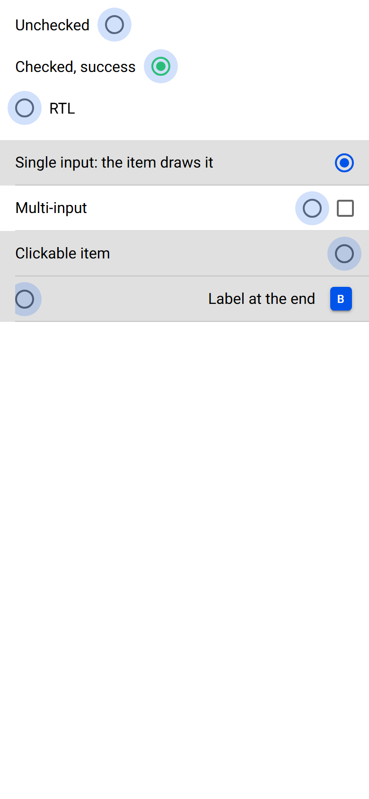

# ion-radio — reference render (Ionic 8.8.19, md, 390×844@2x)

Generated by `node tools/ionic-ref/render.js ion-radio --bare --html "<ion-app style=\"position:static;display:block;contain:none;overflow:visible\"><ion-radio-group value=\"x\"><div style=\"padding:16px;display:flex;flex-direction:column;gap:24px;align-items:flex-start\"><ion-radio class=\"ion-focused\" value=\"y\">Unchecked</ion-radio><ion-radio class=\"ion-focused\" value=\"x\" color=\"success\">Checked, success</ion-radio><div dir=\"rtl\"><ion-radio class=\"ion-focused\" value=\"z\">RTL</ion-radio></div></div></ion-radio-group><ion-list><ion-radio-group value=\"a\"><ion-item class=\"ion-focused\"><ion-radio value=\"a\">Single input: the item draws it</ion-radio></ion-item><ion-item><ion-radio class=\"ion-focused\" value=\"b\">Multi-input</ion-radio><ion-checkbox slot=\"end\"></ion-checkbox></ion-item><ion-item class=\"ion-focused\" button><ion-radio class=\"ion-focused\" value=\"c\">Clickable item</ion-radio></ion-item><ion-item class=\"ion-focused\"><ion-radio class=\"ion-focused\" value=\"d\" label-placement=\"end\">Label at the end</ion-radio><ion-button slot=\"end\">B</ion-button></ion-item></ion-radio-group></ion-list></ion-app>" --out docs/components/ion-radio/ref/focus`

```html
<ion-app style="position:static;display:block;contain:none;overflow:visible"><ion-radio-group value="x"><div style="padding:16px;display:flex;flex-direction:column;gap:24px;align-items:flex-start"><ion-radio class="ion-focused" value="y">Unchecked</ion-radio><ion-radio class="ion-focused" value="x" color="success">Checked, success</ion-radio><div dir="rtl"><ion-radio class="ion-focused" value="z">RTL</ion-radio></div></div></ion-radio-group><ion-list><ion-radio-group value="a"><ion-item class="ion-focused"><ion-radio value="a">Single input: the item draws it</ion-radio></ion-item><ion-item><ion-radio class="ion-focused" value="b">Multi-input</ion-radio><ion-checkbox slot="end"></ion-checkbox></ion-item><ion-item class="ion-focused" button><ion-radio class="ion-focused" value="c">Clickable item</ion-radio></ion-item><ion-item class="ion-focused"><ion-radio class="ion-focused" value="d" label-placement="end">Label at the end</ion-radio><ion-button slot="end">B</ion-button></ion-item></ion-radio-group></ion-list></ion-app>
```

 

## Element 1

- attributes: `{"class":"ion-focused md radio-label-placement-start ion-activatable ion-focusable hydrated","value":"y","role":"radio","aria-checked":"false","tabindex":"-1"}`
- classes: `ion-focused md radio-label-placement-start ion-activatable ion-focusable hydrated`
- rect: `{"x":16,"y":16,"w":114.72,"h":20}`

### CSS custom properties (resolved)

| var | value |
|---|---|
| `--border-radius` | `50%` |
| `--color` | `rgb(0, 0, 0, 0.6)` |
| `--color-checked` | `#0054e9` |
| `--inner-border-radius` | `50%` |

### Host computed

| prop | value |
|---|---|
| display | `block` |
| position | `relative` |
| box-sizing | `border-box` |
| width | `114.719px` |
| height | `20px` |
| min-height | `auto` |
| min-width | `auto` |
| padding | `0px` |
| margin | `0px` |
| border | `0px none rgb(0, 0, 0)` |
| border-radius | `0px` |
| background-color | `rgba(0, 0, 0, 0)` |
| color | `rgb(0, 0, 0)` |
| font-size | `16px` |
| font-weight | `400` |
| font-family | `Roboto, "Helvetica Neue", sans-serif` |
| line-height | `normal` |
| letter-spacing | `normal` |
| text-transform | `none` |
| opacity | `1` |
| overflow | `visible` |
| contain | `none` |
| pointer-events | `auto` |
| transition | `all` |
| transform | `none` |
| box-shadow | `none` |
| outline | `rgb(0, 0, 0) none 0px` |
| cursor | `pointer` |

### Shadow parts

#### part="label" (`div`) rect `{"x":16,"y":16.5,"w":78.72,"h":19}`

| prop | value |
|---|---|
| display | `block` |
| position | `static` |
| box-sizing | `content-box` |
| width | `78.7188px` |
| height | `19px` |
| min-height | `auto` |
| min-width | `auto` |
| padding | `0px` |
| margin | `0px 16px 0px 0px` |
| border | `0px none rgb(0, 0, 0)` |
| border-radius | `0px` |
| background-color | `rgba(0, 0, 0, 0)` |
| color | `rgb(0, 0, 0)` |
| font-size | `16px` |
| font-weight | `400` |
| font-family | `Roboto, "Helvetica Neue", sans-serif` |
| line-height | `normal` |
| letter-spacing | `normal` |
| text-transform | `none` |
| opacity | `1` |
| overflow | `hidden` |
| contain | `none` |
| pointer-events | `auto` |
| transition | `all` |
| transform | `none` |
| box-shadow | `none` |
| outline | `rgb(0, 0, 0) none 0px` |
| cursor | `pointer` |

#### part="container" (`div`) rect `{"x":110.72,"y":16,"w":20,"h":20}`

| prop | value |
|---|---|
| display | `flex` |
| position | `static` |
| box-sizing | `border-box` |
| width | `20px` |
| height | `20px` |
| min-height | `auto` |
| min-width | `auto` |
| padding | `0px` |
| margin | `0px` |
| border | `2px solid rgba(0, 0, 0, 0.6)` |
| border-radius | `50%` |
| background-color | `rgba(0, 0, 0, 0)` |
| color | `rgb(0, 0, 0)` |
| font-size | `16px` |
| font-weight | `400` |
| font-family | `Roboto, "Helvetica Neue", sans-serif` |
| line-height | `normal` |
| letter-spacing | `normal` |
| text-transform | `none` |
| opacity | `1` |
| overflow | `visible` |
| contain | `size layout style` |
| pointer-events | `auto` |
| transition | `all` |
| transform | `none` |
| box-shadow | `none` |
| outline | `rgb(0, 0, 0) none 0px` |
| cursor | `pointer` |

#### part="mark" (`div`) rect `{"x":120.72,"y":26,"w":0,"h":0}`

| prop | value |
|---|---|
| display | `block` |
| position | `static` |
| box-sizing | `border-box` |
| width | `10px` |
| height | `10px` |
| min-height | `auto` |
| min-width | `auto` |
| padding | `0px` |
| margin | `0px` |
| border | `0px none rgb(0, 0, 0)` |
| border-radius | `50%` |
| background-color | `rgb(0, 84, 233)` |
| color | `rgb(0, 0, 0)` |
| font-size | `16px` |
| font-weight | `400` |
| font-family | `Roboto, "Helvetica Neue", sans-serif` |
| line-height | `normal` |
| letter-spacing | `normal` |
| text-transform | `none` |
| opacity | `1` |
| overflow | `visible` |
| contain | `none` |
| pointer-events | `auto` |
| transition | `transform 0.28s cubic-bezier(0.4, 0, 0.2, 1), -webkit-transform 0.28s cubic-bezier(0.4, 0, 0.2, 1)` |
| transform | `matrix3d(0, 0, 0, 0, 0, 0, 0, 0, 0, 0, 0, 0, 0, 0, 0, 1)` |
| box-shadow | `none` |
| outline | `rgb(0, 0, 0) none 0px` |
| cursor | `pointer` |

### DOM tree

```
<ion-radio>
  #shadow-root
    <label.radio-wrapper>
      <div.label-text-wrapper part="label">
        <slot name="">
      <div.native-wrapper>
        <div.radio-icon part="container">
          <div.radio-inner part="mark">
          <div.radio-ripple>
```

## Element 2

- attributes: `{"class":"ion-focused ion-color ion-color-success md radio-checked radio-label-placement-start ion-activatable ion-focusable hydrated","value":"x","color":"success","role":"radio","aria-checked":"true","tabindex":"0"}`
- classes: `ion-focused ion-color ion-color-success md radio-checked radio-label-placement-start ion-activatable ion-focusable hydrated`
- rect: `{"x":16,"y":60,"w":163.5,"h":20}`

### CSS custom properties (resolved)

| var | value |
|---|---|
| `--border-radius` | `50%` |
| `--color` | `rgb(0, 0, 0, 0.6)` |
| `--color-checked` | `#0054e9` |
| `--inner-border-radius` | `50%` |

### Host computed

| prop | value |
|---|---|
| display | `block` |
| position | `relative` |
| box-sizing | `border-box` |
| width | `163.5px` |
| height | `20px` |
| min-height | `auto` |
| min-width | `auto` |
| padding | `0px` |
| margin | `0px` |
| border | `0px none rgb(0, 0, 0)` |
| border-radius | `0px` |
| background-color | `rgba(0, 0, 0, 0)` |
| color | `rgb(0, 0, 0)` |
| font-size | `16px` |
| font-weight | `400` |
| font-family | `Roboto, "Helvetica Neue", sans-serif` |
| line-height | `normal` |
| letter-spacing | `normal` |
| text-transform | `none` |
| opacity | `1` |
| overflow | `visible` |
| contain | `none` |
| pointer-events | `auto` |
| transition | `all` |
| transform | `none` |
| box-shadow | `none` |
| outline | `rgb(0, 0, 0) none 0px` |
| cursor | `pointer` |

### Shadow parts

#### part="label" (`div`) rect `{"x":16,"y":60.5,"w":127.5,"h":19}`

| prop | value |
|---|---|
| display | `block` |
| position | `static` |
| box-sizing | `content-box` |
| width | `127.5px` |
| height | `19px` |
| min-height | `auto` |
| min-width | `auto` |
| padding | `0px` |
| margin | `0px 16px 0px 0px` |
| border | `0px none rgb(0, 0, 0)` |
| border-radius | `0px` |
| background-color | `rgba(0, 0, 0, 0)` |
| color | `rgb(0, 0, 0)` |
| font-size | `16px` |
| font-weight | `400` |
| font-family | `Roboto, "Helvetica Neue", sans-serif` |
| line-height | `normal` |
| letter-spacing | `normal` |
| text-transform | `none` |
| opacity | `1` |
| overflow | `hidden` |
| contain | `none` |
| pointer-events | `auto` |
| transition | `all` |
| transform | `none` |
| box-shadow | `none` |
| outline | `rgb(0, 0, 0) none 0px` |
| cursor | `pointer` |

#### part="container" (`div`) rect `{"x":159.5,"y":60,"w":20,"h":20}`

| prop | value |
|---|---|
| display | `flex` |
| position | `static` |
| box-sizing | `border-box` |
| width | `20px` |
| height | `20px` |
| min-height | `auto` |
| min-width | `auto` |
| padding | `0px` |
| margin | `0px` |
| border | `2px solid rgb(45, 213, 91)` |
| border-radius | `50%` |
| background-color | `rgba(0, 0, 0, 0)` |
| color | `rgb(0, 0, 0)` |
| font-size | `16px` |
| font-weight | `400` |
| font-family | `Roboto, "Helvetica Neue", sans-serif` |
| line-height | `normal` |
| letter-spacing | `normal` |
| text-transform | `none` |
| opacity | `1` |
| overflow | `visible` |
| contain | `size layout style` |
| pointer-events | `auto` |
| transition | `all` |
| transform | `none` |
| box-shadow | `none` |
| outline | `rgb(0, 0, 0) none 0px` |
| cursor | `pointer` |

#### part="mark" (`div`) rect `{"x":164.5,"y":65,"w":10,"h":10}`

| prop | value |
|---|---|
| display | `block` |
| position | `static` |
| box-sizing | `border-box` |
| width | `10px` |
| height | `10px` |
| min-height | `auto` |
| min-width | `auto` |
| padding | `0px` |
| margin | `0px` |
| border | `0px none rgb(0, 0, 0)` |
| border-radius | `50%` |
| background-color | `rgb(45, 213, 91)` |
| color | `rgb(0, 0, 0)` |
| font-size | `16px` |
| font-weight | `400` |
| font-family | `Roboto, "Helvetica Neue", sans-serif` |
| line-height | `normal` |
| letter-spacing | `normal` |
| text-transform | `none` |
| opacity | `1` |
| overflow | `visible` |
| contain | `none` |
| pointer-events | `auto` |
| transition | `transform 0.28s cubic-bezier(0.4, 0, 0.2, 1), -webkit-transform 0.28s cubic-bezier(0.4, 0, 0.2, 1)` |
| transform | `matrix(1, 0, 0, 1, 0, 0)` |
| box-shadow | `none` |
| outline | `rgb(0, 0, 0) none 0px` |
| cursor | `pointer` |

### DOM tree

```
<ion-radio>
  #shadow-root
    <label.radio-wrapper>
      <div.label-text-wrapper part="label">
        <slot name="">
      <div.native-wrapper>
        <div.radio-icon part="container">
          <div.radio-inner part="mark">
          <div.radio-ripple>
```

## Element 3

- attributes: `{"class":"ion-focused md radio-label-placement-start ion-activatable ion-focusable hydrated","value":"z","role":"radio","aria-checked":"false","tabindex":"-1"}`
- classes: `ion-focused md radio-label-placement-start ion-activatable ion-focusable hydrated`
- rect: `{"x":16,"y":104,"w":63.41,"h":20}`

### CSS custom properties (resolved)

| var | value |
|---|---|
| `--border-radius` | `50%` |
| `--color` | `rgb(0, 0, 0, 0.6)` |
| `--color-checked` | `#0054e9` |
| `--inner-border-radius` | `50%` |

### Host computed

| prop | value |
|---|---|
| display | `inline-block` |
| position | `relative` |
| box-sizing | `border-box` |
| width | `63.4062px` |
| height | `20px` |
| min-height | `0px` |
| min-width | `0px` |
| padding | `0px` |
| margin | `0px` |
| border | `0px none rgb(0, 0, 0)` |
| border-radius | `0px` |
| background-color | `rgba(0, 0, 0, 0)` |
| color | `rgb(0, 0, 0)` |
| font-size | `16px` |
| font-weight | `400` |
| font-family | `Roboto, "Helvetica Neue", sans-serif` |
| line-height | `normal` |
| letter-spacing | `normal` |
| text-transform | `none` |
| opacity | `1` |
| overflow | `visible` |
| contain | `none` |
| pointer-events | `auto` |
| transition | `all` |
| transform | `none` |
| box-shadow | `none` |
| outline | `rgb(0, 0, 0) none 0px` |
| cursor | `pointer` |

### Shadow parts

#### part="label" (`div`) rect `{"x":52,"y":104.5,"w":27.41,"h":19}`

| prop | value |
|---|---|
| display | `block` |
| position | `static` |
| box-sizing | `content-box` |
| width | `27.4062px` |
| height | `19px` |
| min-height | `auto` |
| min-width | `auto` |
| padding | `0px` |
| margin | `0px 0px 0px 16px` |
| border | `0px none rgb(0, 0, 0)` |
| border-radius | `0px` |
| background-color | `rgba(0, 0, 0, 0)` |
| color | `rgb(0, 0, 0)` |
| font-size | `16px` |
| font-weight | `400` |
| font-family | `Roboto, "Helvetica Neue", sans-serif` |
| line-height | `normal` |
| letter-spacing | `normal` |
| text-transform | `none` |
| opacity | `1` |
| overflow | `hidden` |
| contain | `none` |
| pointer-events | `auto` |
| transition | `all` |
| transform | `none` |
| box-shadow | `none` |
| outline | `rgb(0, 0, 0) none 0px` |
| cursor | `pointer` |

#### part="container" (`div`) rect `{"x":16,"y":104,"w":20,"h":20}`

| prop | value |
|---|---|
| display | `flex` |
| position | `static` |
| box-sizing | `border-box` |
| width | `20px` |
| height | `20px` |
| min-height | `auto` |
| min-width | `auto` |
| padding | `0px` |
| margin | `0px` |
| border | `2px solid rgba(0, 0, 0, 0.6)` |
| border-radius | `50%` |
| background-color | `rgba(0, 0, 0, 0)` |
| color | `rgb(0, 0, 0)` |
| font-size | `16px` |
| font-weight | `400` |
| font-family | `Roboto, "Helvetica Neue", sans-serif` |
| line-height | `normal` |
| letter-spacing | `normal` |
| text-transform | `none` |
| opacity | `1` |
| overflow | `visible` |
| contain | `size layout style` |
| pointer-events | `auto` |
| transition | `all` |
| transform | `none` |
| box-shadow | `none` |
| outline | `rgb(0, 0, 0) none 0px` |
| cursor | `pointer` |

#### part="mark" (`div`) rect `{"x":26,"y":114,"w":0,"h":0}`

| prop | value |
|---|---|
| display | `block` |
| position | `static` |
| box-sizing | `border-box` |
| width | `10px` |
| height | `10px` |
| min-height | `auto` |
| min-width | `auto` |
| padding | `0px` |
| margin | `0px` |
| border | `0px none rgb(0, 0, 0)` |
| border-radius | `50%` |
| background-color | `rgb(0, 84, 233)` |
| color | `rgb(0, 0, 0)` |
| font-size | `16px` |
| font-weight | `400` |
| font-family | `Roboto, "Helvetica Neue", sans-serif` |
| line-height | `normal` |
| letter-spacing | `normal` |
| text-transform | `none` |
| opacity | `1` |
| overflow | `visible` |
| contain | `none` |
| pointer-events | `auto` |
| transition | `transform 0.28s cubic-bezier(0.4, 0, 0.2, 1), -webkit-transform 0.28s cubic-bezier(0.4, 0, 0.2, 1)` |
| transform | `matrix3d(0, 0, 0, 0, 0, 0, 0, 0, 0, 0, 0, 0, 0, 0, 0, 1)` |
| box-shadow | `none` |
| outline | `rgb(0, 0, 0) none 0px` |
| cursor | `pointer` |

### DOM tree

```
<ion-radio>
  #shadow-root
    <label.radio-wrapper>
      <div.label-text-wrapper part="label">
        <slot name="">
      <div.native-wrapper>
        <div.radio-icon part="container">
          <div.radio-inner part="mark">
          <div.radio-ripple>
```

## Element 4

- attributes: `{"value":"a","class":"md in-item radio-checked radio-label-placement-start hydrated","role":"radio","aria-checked":"true","tabindex":"0"}`
- classes: `md in-item radio-checked radio-label-placement-start hydrated`
- rect: `{"x":16,"y":148,"w":358,"h":47}`

### CSS custom properties (resolved)

| var | value |
|---|---|
| `--border-radius` | `50%` |
| `--color` | `rgb(0, 0, 0, 0.6)` |
| `--color-checked` | `#0054e9` |
| `--inner-border-radius` | `50%` |

### Host computed

| prop | value |
|---|---|
| display | `block` |
| position | `relative` |
| box-sizing | `border-box` |
| width | `358px` |
| height | `47px` |
| min-height | `auto` |
| min-width | `auto` |
| padding | `0px` |
| margin | `0px` |
| border | `0px none rgb(0, 0, 0)` |
| border-radius | `0px` |
| background-color | `rgba(0, 0, 0, 0)` |
| color | `rgb(0, 0, 0)` |
| font-size | `16px` |
| font-weight | `400` |
| font-family | `Roboto, "Helvetica Neue", sans-serif` |
| line-height | `normal` |
| letter-spacing | `normal` |
| text-transform | `none` |
| opacity | `1` |
| overflow | `visible` |
| contain | `none` |
| pointer-events | `auto` |
| transition | `all` |
| transform | `none` |
| box-shadow | `none` |
| outline | `rgb(0, 0, 0) none 0px` |
| cursor | `pointer` |

### Shadow parts

#### part="label" (`div`) rect `{"x":16,"y":162,"w":209.48,"h":19}`

| prop | value |
|---|---|
| display | `block` |
| position | `static` |
| box-sizing | `content-box` |
| width | `209.484px` |
| height | `19px` |
| min-height | `auto` |
| min-width | `auto` |
| padding | `0px` |
| margin | `10px 16px 10px 0px` |
| border | `0px none rgb(0, 0, 0)` |
| border-radius | `0px` |
| background-color | `rgba(0, 0, 0, 0)` |
| color | `rgb(0, 0, 0)` |
| font-size | `16px` |
| font-weight | `400` |
| font-family | `Roboto, "Helvetica Neue", sans-serif` |
| line-height | `normal` |
| letter-spacing | `normal` |
| text-transform | `none` |
| opacity | `1` |
| overflow | `hidden` |
| contain | `none` |
| pointer-events | `auto` |
| transition | `all` |
| transform | `none` |
| box-shadow | `none` |
| outline | `rgb(0, 0, 0) none 0px` |
| cursor | `pointer` |

#### part="container" (`div`) rect `{"x":354,"y":161.5,"w":20,"h":20}`

| prop | value |
|---|---|
| display | `flex` |
| position | `static` |
| box-sizing | `border-box` |
| width | `20px` |
| height | `20px` |
| min-height | `auto` |
| min-width | `auto` |
| padding | `0px` |
| margin | `0px` |
| border | `2px solid rgb(0, 84, 233)` |
| border-radius | `50%` |
| background-color | `rgba(0, 0, 0, 0)` |
| color | `rgb(0, 0, 0)` |
| font-size | `16px` |
| font-weight | `400` |
| font-family | `Roboto, "Helvetica Neue", sans-serif` |
| line-height | `normal` |
| letter-spacing | `normal` |
| text-transform | `none` |
| opacity | `1` |
| overflow | `visible` |
| contain | `size layout style` |
| pointer-events | `auto` |
| transition | `all` |
| transform | `none` |
| box-shadow | `none` |
| outline | `rgb(0, 0, 0) none 0px` |
| cursor | `pointer` |

#### part="mark" (`div`) rect `{"x":359,"y":166.5,"w":10,"h":10}`

| prop | value |
|---|---|
| display | `block` |
| position | `static` |
| box-sizing | `border-box` |
| width | `10px` |
| height | `10px` |
| min-height | `auto` |
| min-width | `auto` |
| padding | `0px` |
| margin | `0px` |
| border | `0px none rgb(0, 0, 0)` |
| border-radius | `50%` |
| background-color | `rgb(0, 84, 233)` |
| color | `rgb(0, 0, 0)` |
| font-size | `16px` |
| font-weight | `400` |
| font-family | `Roboto, "Helvetica Neue", sans-serif` |
| line-height | `normal` |
| letter-spacing | `normal` |
| text-transform | `none` |
| opacity | `1` |
| overflow | `visible` |
| contain | `none` |
| pointer-events | `auto` |
| transition | `transform 0.28s cubic-bezier(0.4, 0, 0.2, 1), -webkit-transform 0.28s cubic-bezier(0.4, 0, 0.2, 1)` |
| transform | `matrix(1, 0, 0, 1, 0, 0)` |
| box-shadow | `none` |
| outline | `rgb(0, 0, 0) none 0px` |
| cursor | `pointer` |

### DOM tree

```
<ion-radio>
  #shadow-root
    <label.radio-wrapper>
      <div.label-text-wrapper part="label">
        <slot name="">
      <div.native-wrapper>
        <div.radio-icon part="container">
          <div.radio-inner part="mark">
          <div.radio-ripple>
```

## Element 5

- attributes: `{"class":"ion-focused md in-item radio-label-placement-start hydrated ion-focusable","value":"b","role":"radio","aria-checked":"false","tabindex":"-1"}`
- classes: `ion-focused md in-item radio-label-placement-start hydrated ion-focusable`
- rect: `{"x":16,"y":196,"w":324,"h":47}`

### CSS custom properties (resolved)

| var | value |
|---|---|
| `--border-radius` | `50%` |
| `--color` | `rgb(0, 0, 0, 0.6)` |
| `--color-checked` | `#0054e9` |
| `--inner-border-radius` | `50%` |

### Host computed

| prop | value |
|---|---|
| display | `block` |
| position | `relative` |
| box-sizing | `border-box` |
| width | `324px` |
| height | `47px` |
| min-height | `auto` |
| min-width | `auto` |
| padding | `0px` |
| margin | `0px` |
| border | `0px none rgb(0, 0, 0)` |
| border-radius | `0px` |
| background-color | `rgba(0, 0, 0, 0)` |
| color | `rgb(0, 0, 0)` |
| font-size | `16px` |
| font-weight | `400` |
| font-family | `Roboto, "Helvetica Neue", sans-serif` |
| line-height | `normal` |
| letter-spacing | `normal` |
| text-transform | `none` |
| opacity | `1` |
| overflow | `visible` |
| contain | `none` |
| pointer-events | `auto` |
| transition | `all` |
| transform | `none` |
| box-shadow | `none` |
| outline | `rgb(0, 0, 0) none 0px` |
| cursor | `pointer` |

### Shadow parts

#### part="label" (`div`) rect `{"x":16,"y":210,"w":76,"h":19}`

| prop | value |
|---|---|
| display | `block` |
| position | `static` |
| box-sizing | `content-box` |
| width | `76px` |
| height | `19px` |
| min-height | `auto` |
| min-width | `auto` |
| padding | `0px` |
| margin | `10px 16px 10px 0px` |
| border | `0px none rgb(0, 0, 0)` |
| border-radius | `0px` |
| background-color | `rgba(0, 0, 0, 0)` |
| color | `rgb(0, 0, 0)` |
| font-size | `16px` |
| font-weight | `400` |
| font-family | `Roboto, "Helvetica Neue", sans-serif` |
| line-height | `normal` |
| letter-spacing | `normal` |
| text-transform | `none` |
| opacity | `1` |
| overflow | `hidden` |
| contain | `none` |
| pointer-events | `auto` |
| transition | `all` |
| transform | `none` |
| box-shadow | `none` |
| outline | `rgb(0, 0, 0) none 0px` |
| cursor | `pointer` |

#### part="container" (`div`) rect `{"x":320,"y":209.5,"w":20,"h":20}`

| prop | value |
|---|---|
| display | `flex` |
| position | `static` |
| box-sizing | `border-box` |
| width | `20px` |
| height | `20px` |
| min-height | `auto` |
| min-width | `auto` |
| padding | `0px` |
| margin | `0px` |
| border | `2px solid rgba(0, 0, 0, 0.6)` |
| border-radius | `50%` |
| background-color | `rgba(0, 0, 0, 0)` |
| color | `rgb(0, 0, 0)` |
| font-size | `16px` |
| font-weight | `400` |
| font-family | `Roboto, "Helvetica Neue", sans-serif` |
| line-height | `normal` |
| letter-spacing | `normal` |
| text-transform | `none` |
| opacity | `1` |
| overflow | `visible` |
| contain | `size layout style` |
| pointer-events | `auto` |
| transition | `all` |
| transform | `none` |
| box-shadow | `none` |
| outline | `rgb(0, 0, 0) none 0px` |
| cursor | `pointer` |

#### part="mark" (`div`) rect `{"x":330,"y":219.5,"w":0,"h":0}`

| prop | value |
|---|---|
| display | `block` |
| position | `static` |
| box-sizing | `border-box` |
| width | `10px` |
| height | `10px` |
| min-height | `auto` |
| min-width | `auto` |
| padding | `0px` |
| margin | `0px` |
| border | `0px none rgb(0, 0, 0)` |
| border-radius | `50%` |
| background-color | `rgb(0, 84, 233)` |
| color | `rgb(0, 0, 0)` |
| font-size | `16px` |
| font-weight | `400` |
| font-family | `Roboto, "Helvetica Neue", sans-serif` |
| line-height | `normal` |
| letter-spacing | `normal` |
| text-transform | `none` |
| opacity | `1` |
| overflow | `visible` |
| contain | `none` |
| pointer-events | `auto` |
| transition | `transform 0.28s cubic-bezier(0.4, 0, 0.2, 1), -webkit-transform 0.28s cubic-bezier(0.4, 0, 0.2, 1)` |
| transform | `matrix3d(0, 0, 0, 0, 0, 0, 0, 0, 0, 0, 0, 0, 0, 0, 0, 1)` |
| box-shadow | `none` |
| outline | `rgb(0, 0, 0) none 0px` |
| cursor | `pointer` |

### DOM tree

```
<ion-radio>
  #shadow-root
    <label.radio-wrapper>
      <div.label-text-wrapper part="label">
        <slot name="">
      <div.native-wrapper>
        <div.radio-icon part="container">
          <div.radio-inner part="mark">
          <div.radio-ripple>
```

## Element 6

- attributes: `{"class":"ion-focused md in-item radio-label-placement-start hydrated ion-focusable","value":"c","role":"radio","aria-checked":"false","tabindex":"-1"}`
- classes: `ion-focused md in-item radio-label-placement-start hydrated ion-focusable`
- rect: `{"x":16,"y":244,"w":358,"h":47}`

### CSS custom properties (resolved)

| var | value |
|---|---|
| `--border-radius` | `50%` |
| `--color` | `rgb(0, 0, 0, 0.6)` |
| `--color-checked` | `#0054e9` |
| `--inner-border-radius` | `50%` |

### Host computed

| prop | value |
|---|---|
| display | `block` |
| position | `relative` |
| box-sizing | `border-box` |
| width | `358px` |
| height | `47px` |
| min-height | `auto` |
| min-width | `auto` |
| padding | `0px` |
| margin | `0px` |
| border | `0px none rgb(0, 0, 0)` |
| border-radius | `0px` |
| background-color | `rgba(0, 0, 0, 0)` |
| color | `rgb(0, 0, 0)` |
| font-size | `16px` |
| font-weight | `400` |
| font-family | `Roboto, "Helvetica Neue", sans-serif` |
| line-height | `normal` |
| letter-spacing | `normal` |
| text-transform | `none` |
| opacity | `1` |
| overflow | `visible` |
| contain | `none` |
| pointer-events | `auto` |
| transition | `all` |
| transform | `none` |
| box-shadow | `none` |
| outline | `rgb(0, 0, 0) none 0px` |
| cursor | `pointer` |

### Shadow parts

#### part="label" (`div`) rect `{"x":16,"y":258,"w":100.36,"h":19}`

| prop | value |
|---|---|
| display | `block` |
| position | `static` |
| box-sizing | `content-box` |
| width | `100.359px` |
| height | `19px` |
| min-height | `auto` |
| min-width | `auto` |
| padding | `0px` |
| margin | `10px 16px 10px 0px` |
| border | `0px none rgb(0, 0, 0)` |
| border-radius | `0px` |
| background-color | `rgba(0, 0, 0, 0)` |
| color | `rgb(0, 0, 0)` |
| font-size | `16px` |
| font-weight | `400` |
| font-family | `Roboto, "Helvetica Neue", sans-serif` |
| line-height | `normal` |
| letter-spacing | `normal` |
| text-transform | `none` |
| opacity | `1` |
| overflow | `hidden` |
| contain | `none` |
| pointer-events | `auto` |
| transition | `all` |
| transform | `none` |
| box-shadow | `none` |
| outline | `rgb(0, 0, 0) none 0px` |
| cursor | `pointer` |

#### part="container" (`div`) rect `{"x":354,"y":257.5,"w":20,"h":20}`

| prop | value |
|---|---|
| display | `flex` |
| position | `static` |
| box-sizing | `border-box` |
| width | `20px` |
| height | `20px` |
| min-height | `auto` |
| min-width | `auto` |
| padding | `0px` |
| margin | `0px` |
| border | `2px solid rgba(0, 0, 0, 0.6)` |
| border-radius | `50%` |
| background-color | `rgba(0, 0, 0, 0)` |
| color | `rgb(0, 0, 0)` |
| font-size | `16px` |
| font-weight | `400` |
| font-family | `Roboto, "Helvetica Neue", sans-serif` |
| line-height | `normal` |
| letter-spacing | `normal` |
| text-transform | `none` |
| opacity | `1` |
| overflow | `visible` |
| contain | `size layout style` |
| pointer-events | `auto` |
| transition | `all` |
| transform | `none` |
| box-shadow | `none` |
| outline | `rgb(0, 0, 0) none 0px` |
| cursor | `pointer` |

#### part="mark" (`div`) rect `{"x":364,"y":267.5,"w":0,"h":0}`

| prop | value |
|---|---|
| display | `block` |
| position | `static` |
| box-sizing | `border-box` |
| width | `10px` |
| height | `10px` |
| min-height | `auto` |
| min-width | `auto` |
| padding | `0px` |
| margin | `0px` |
| border | `0px none rgb(0, 0, 0)` |
| border-radius | `50%` |
| background-color | `rgb(0, 84, 233)` |
| color | `rgb(0, 0, 0)` |
| font-size | `16px` |
| font-weight | `400` |
| font-family | `Roboto, "Helvetica Neue", sans-serif` |
| line-height | `normal` |
| letter-spacing | `normal` |
| text-transform | `none` |
| opacity | `1` |
| overflow | `visible` |
| contain | `none` |
| pointer-events | `auto` |
| transition | `transform 0.28s cubic-bezier(0.4, 0, 0.2, 1), -webkit-transform 0.28s cubic-bezier(0.4, 0, 0.2, 1)` |
| transform | `matrix3d(0, 0, 0, 0, 0, 0, 0, 0, 0, 0, 0, 0, 0, 0, 0, 1)` |
| box-shadow | `none` |
| outline | `rgb(0, 0, 0) none 0px` |
| cursor | `pointer` |

### DOM tree

```
<ion-radio>
  #shadow-root
    <label.radio-wrapper>
      <div.label-text-wrapper part="label">
        <slot name="">
      <div.native-wrapper>
        <div.radio-icon part="container">
          <div.radio-inner part="mark">
          <div.radio-ripple>
```

## Element 7

- attributes: `{"class":"ion-focused md in-item radio-label-placement-end hydrated ion-focusable","value":"d","label-placement":"end","role":"radio","aria-checked":"false","tabindex":"-1"}`
- classes: `ion-focused md in-item radio-label-placement-end hydrated ion-focusable`
- rect: `{"x":16,"y":292,"w":317.33,"h":47}`

### CSS custom properties (resolved)

| var | value |
|---|---|
| `--border-radius` | `50%` |
| `--color` | `rgb(0, 0, 0, 0.6)` |
| `--color-checked` | `#0054e9` |
| `--inner-border-radius` | `50%` |

### Host computed

| prop | value |
|---|---|
| display | `block` |
| position | `relative` |
| box-sizing | `border-box` |
| width | `317.328px` |
| height | `47px` |
| min-height | `auto` |
| min-width | `auto` |
| padding | `0px` |
| margin | `0px` |
| border | `0px none rgb(0, 0, 0)` |
| border-radius | `0px` |
| background-color | `rgba(0, 0, 0, 0)` |
| color | `rgb(0, 0, 0)` |
| font-size | `16px` |
| font-weight | `400` |
| font-family | `Roboto, "Helvetica Neue", sans-serif` |
| line-height | `normal` |
| letter-spacing | `normal` |
| text-transform | `none` |
| opacity | `1` |
| overflow | `visible` |
| contain | `none` |
| pointer-events | `auto` |
| transition | `all` |
| transform | `none` |
| box-shadow | `none` |
| outline | `rgb(0, 0, 0) none 0px` |
| cursor | `pointer` |

### Shadow parts

#### part="label" (`div`) rect `{"x":219.92,"y":306,"w":113.41,"h":19}`

| prop | value |
|---|---|
| display | `block` |
| position | `static` |
| box-sizing | `content-box` |
| width | `113.406px` |
| height | `19px` |
| min-height | `auto` |
| min-width | `auto` |
| padding | `0px` |
| margin | `10px 0px 10px 16px` |
| border | `0px none rgb(0, 0, 0)` |
| border-radius | `0px` |
| background-color | `rgba(0, 0, 0, 0)` |
| color | `rgb(0, 0, 0)` |
| font-size | `16px` |
| font-weight | `400` |
| font-family | `Roboto, "Helvetica Neue", sans-serif` |
| line-height | `normal` |
| letter-spacing | `normal` |
| text-transform | `none` |
| opacity | `1` |
| overflow | `hidden` |
| contain | `none` |
| pointer-events | `auto` |
| transition | `all` |
| transform | `none` |
| box-shadow | `none` |
| outline | `rgb(0, 0, 0) none 0px` |
| cursor | `pointer` |

#### part="container" (`div`) rect `{"x":16,"y":305.5,"w":20,"h":20}`

| prop | value |
|---|---|
| display | `flex` |
| position | `static` |
| box-sizing | `border-box` |
| width | `20px` |
| height | `20px` |
| min-height | `auto` |
| min-width | `auto` |
| padding | `0px` |
| margin | `0px` |
| border | `2px solid rgba(0, 0, 0, 0.6)` |
| border-radius | `50%` |
| background-color | `rgba(0, 0, 0, 0)` |
| color | `rgb(0, 0, 0)` |
| font-size | `16px` |
| font-weight | `400` |
| font-family | `Roboto, "Helvetica Neue", sans-serif` |
| line-height | `normal` |
| letter-spacing | `normal` |
| text-transform | `none` |
| opacity | `1` |
| overflow | `visible` |
| contain | `size layout style` |
| pointer-events | `auto` |
| transition | `all` |
| transform | `none` |
| box-shadow | `none` |
| outline | `rgb(0, 0, 0) none 0px` |
| cursor | `pointer` |

#### part="mark" (`div`) rect `{"x":26,"y":315.5,"w":0,"h":0}`

| prop | value |
|---|---|
| display | `block` |
| position | `static` |
| box-sizing | `border-box` |
| width | `10px` |
| height | `10px` |
| min-height | `auto` |
| min-width | `auto` |
| padding | `0px` |
| margin | `0px` |
| border | `0px none rgb(0, 0, 0)` |
| border-radius | `50%` |
| background-color | `rgb(0, 84, 233)` |
| color | `rgb(0, 0, 0)` |
| font-size | `16px` |
| font-weight | `400` |
| font-family | `Roboto, "Helvetica Neue", sans-serif` |
| line-height | `normal` |
| letter-spacing | `normal` |
| text-transform | `none` |
| opacity | `1` |
| overflow | `visible` |
| contain | `none` |
| pointer-events | `auto` |
| transition | `transform 0.28s cubic-bezier(0.4, 0, 0.2, 1), -webkit-transform 0.28s cubic-bezier(0.4, 0, 0.2, 1)` |
| transform | `matrix3d(0, 0, 0, 0, 0, 0, 0, 0, 0, 0, 0, 0, 0, 0, 0, 1)` |
| box-shadow | `none` |
| outline | `rgb(0, 0, 0) none 0px` |
| cursor | `pointer` |

### DOM tree

```
<ion-radio>
  #shadow-root
    <label.radio-wrapper>
      <div.label-text-wrapper part="label">
        <slot name="">
      <div.native-wrapper>
        <div.radio-icon part="container">
          <div.radio-inner part="mark">
          <div.radio-ripple>
```
