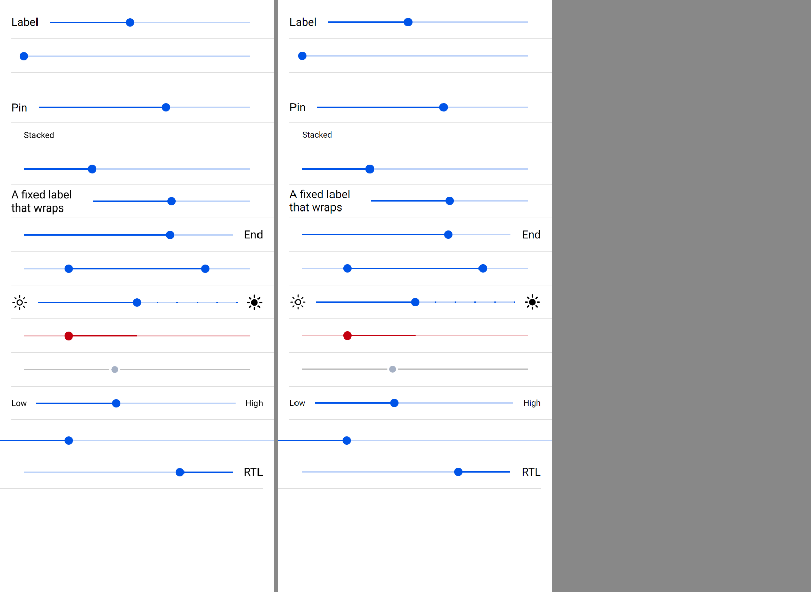
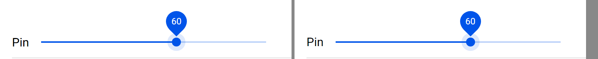

# ion-range — Comparison against the web component

> Ionic side: `node tools/ionic-ref/render.js ion-range --bare --html '<the snippet below>'` (Chromium, md, 390×844@2x) → [`ref/`](ref/).
> The snippet wraps itself in `ion-app`, with `position:static;display:block;contain:none;overflow:visible`. `ref/README.md` holds the
> exact command, and `ref/page.html` the page. The script at its end sets the dual range's `{ lower: 20, upper: 80 }`, which an
> attribute can't.
> Avonic side: `AVONIC_CAPTURE_DIR=… dotnet test` → `AvonicRangeCaptureTests.Reference_Page` and `.Focused_Pin` (headless Skia, 2×)
> → [`compare/`](compare/).
> Not tried in a real window, or on a device.

```html
<ion-app style="position:static;display:block;contain:none;overflow:visible"><ion-list>
<ion-item><ion-range label="Label" value="40"></ion-range></ion-item>
<ion-item><ion-range aria-label="No label" value="0"></ion-range></ion-item>
<ion-item><ion-range label="Pin" pin value="60"></ion-range></ion-item>
<ion-item><ion-range label="Stacked" label-placement="stacked" value="30"></ion-range></ion-item>
<ion-item><ion-range label="A fixed label that wraps" label-placement="fixed" value="50"></ion-range></ion-item>
<ion-item><ion-range label="End" label-placement="end" value="70"></ion-range></ion-item>
<ion-item><ion-range id="dual" aria-label="Dual" dual-knobs></ion-range></ion-item>
<ion-item><ion-range aria-label="Ticks" snaps step="10" value="50"><ion-icon slot="start" name="sunny-outline"></ion-icon><ion-icon slot="end" name="sunny"></ion-icon></ion-range></ion-item>
<ion-item><ion-range aria-label="Bar start" active-bar-start="50" value="20" color="danger"></ion-range></ion-item>
<ion-item><ion-range aria-label="Disabled" disabled value="40"></ion-range></ion-item>
<ion-item><ion-range aria-label="Text" value="40"><div slot="start">Low</div><div slot="end">High</div></ion-range></ion-item>
</ion-list>
<ion-range aria-label="Standalone" value="25"></ion-range>
<div dir="rtl"><ion-item><ion-range dir="rtl" label="RTL" value="25"></ion-range></ion-item></div>
<script>document.getElementById('dual').value={lower:20,upper:80}</script></ion-app>
```

(One line in the real command.) The pin frame is the first two rows of the same kind, with Tab pressed once, from a throwaway
Playwright script: `ion-list` of a pinned range at 60 and a plain one at 30.

The behaviours were measured with throwaway Playwright scripts against pages of ranges with ids: a mouse in a desktop context, CDP
touch events in a mobile one, and Chromium's accessibility tree through CDP. The numbers are in [PLAN.md](PLAN.md).

## Frames

Ionic on the left, Avonic on the right:



A keyboard-focused knob with a pin:



| Ionic | Avonic |
|---|---|
| [`ref/page.png`](ref/page.png) | [`compare/avonic-page.png`](compare/avonic-page.png) |
| [`compare/ionic-pin.png`](compare/ionic-pin.png) | [`compare/avonic-pin.png`](compare/avonic-pin.png) |

Every row lines up to the pixel at 2×, but for text: Skia and Chromium rasterise Roboto a little differently, so a label's line
can sit about 1 px apart. The rows are the same heights (48; 71 with a pin; 88 stacked), which
`Reference_Page` asserts.

## Behaviours

| # | Behaviour | Result |
|---|---|---|
| 1 | Knob at its ratio, the bar to it; a value out of range not clamped | Match. Positions within 0.5 px of the measured boxes |
| 2 | A value set in code: `IonInput` if it differs, never `IonChange`; none for the value it loads with | Match |
| 3 | A tap moves the knob to the release: start, input, change, end; change even at the same value | Match, events and order. Chromium also blurs the range for a press on the bar (`ionBlur`); Avalonia doesn't move focus for a press on something that can't take it. Deliberate: the platform's |
| 4 | A drag: capture at 10 px, input once a frame, change and end at the release, `:range-pressed` meanwhile | Match. Ionic's first `ionInput` is from the first frame after the capture, as here |
| 5 | Snaps and ticks | Match: 11 ticks, 6 active, as measured |
| 6 | Arrows step, no other key does, also at the limit and in RTL | Match |
| 7 | Two knobs: the nearer moves, B on a tie; crossing swaps lower and upper; a value set in code moves them least | Match, each case measured |
| 8 | `ActiveBarStart` | Match: from 20 % to 50 % in the frame |
| 9 | The pin: `Math.round`, scaled up and raised 24 px while pressed or focused, 28 px of room | Match; the pin frame lines up |
| 10 | Focus: tab stops A then B, one `IonFocus` in and one `IonBlur` out; `:ion-focused` by keyboard or code, not by a press | Match. **Deliberate difference:** a tap on a knob. Chromium focuses it from the compatibility mouse events after `pointerup`, so the knob looks keyboard-focused, pin up, until it's blurred (measured `release 500`). Avalonia focuses on the press with `NavigationMethod.Pointer`, so a tap is like a mouse click in Chromium, which doesn't show it |
| 11 | Disabled | Match: grey bar, knob at 0.55 in a white ring, label at 0.38. The ring is a 5 px spread shadow, which follows the corners as Chromium's outline does |
| 12 | In an item: `:in-item`, 18 px adjustments, an input to the item; `flex: 3` in a start or end slot | Match: `r1`, `r2`, `r6` boxes, and 265.5 px in the start slot |
| 13 | Label placements, a long label squeezing the slider, the slot's 200 px | Match: boxes within 1 px |
| 14 | Slots: 14 px gaps, 12 px text, 24 px icons | Match |
| 15 | RTL | Match in the frame; a press counts from the right. As in #116, `FlowDirection` inherits, where Ionic's `isRTL` reads only the range's own `dir` and the document's |
| 16 | `Color` | Match: danger in the frame |
| 17 | `Debounce` | Match: change at each key, one input 200 ms after the last |
| 18 | `ScrollY` off while dragging in an `AvonicContent`; a vertical drag doesn't capture | Match. **Deliberate difference:** Ionic's `onEnd` sets the content's `scrollY` back to true after a tap that never turned it off, so a tap turns on a scroll the app had off; here only a drag that turned it off turns it back |
| 19 | The halo | Match: 2× at 0.13 hovered or focused, 0.25 activated or pressed |
| 20 | Automation: a slider per knob, named as Chromium names it | Match for the five names measured. A screen reader's `SetValue` steps once toward the value, as Chromium turns an increment into an arrow key |
| 21 | `Min`, `Max`, `Step` | Match, with `roundToMaxDecimalPlaces` reading decimals as JavaScript writes them |
| 22 | Two knobs snap to their values at the release; one doesn't | Match |
| 23 | Host and knob classes | Match, as pseudoclasses |

## Known gaps and differences

- **`cursor: grab` / `grabbing`:** Avalonia has neither; `Hand` stands for both.
- **The `hover` part after a touch:** Ionic's follows `mouseenter`, which Chromium fires for a touch and leaves on; `:ion-hover` is
  mouse and pen only, as for every Avonic control.
- **Ticks:** Ionic hangs with `step` 0, or a step too small to move a large value; here there are none, or the loop stops.
- **A row that overflows:** the native wrapper keeps its slots' widths and the label takes what's left, where CSS would shrink both
  in proportion. Only a label longer than the row and slots together shows it.
- **The form input** (`name`) isn't reproduced: Avalonia has no form.
