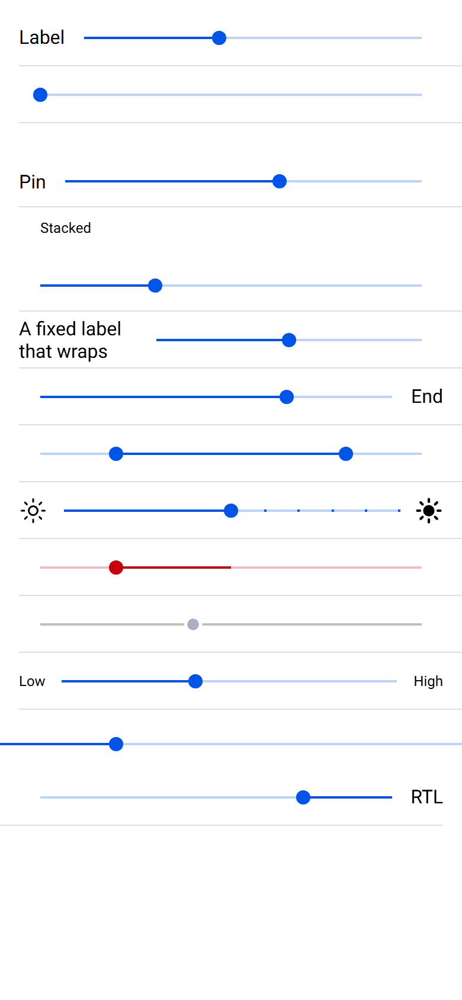
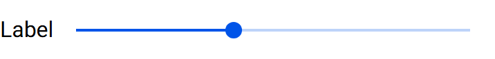

# ion-range — reference render (Ionic 8.8.1, md, 390×844@2x)

Generated by `node tools/ionic-ref/render.js ion-range --bare --html "<ion-app style=\"position:static;display:block;contain:none;overflow:visible\"><ion-list><ion-item><ion-range label=\"Label\" value=\"40\"></ion-range></ion-item><ion-item><ion-range aria-label=\"No label\" value=\"0\"></ion-range></ion-item><ion-item><ion-range label=\"Pin\" pin value=\"60\"></ion-range></ion-item><ion-item><ion-range label=\"Stacked\" label-placement=\"stacked\" value=\"30\"></ion-range></ion-item><ion-item><ion-range label=\"A fixed label that wraps\" label-placement=\"fixed\" value=\"50\"></ion-range></ion-item><ion-item><ion-range label=\"End\" label-placement=\"end\" value=\"70\"></ion-range></ion-item><ion-item><ion-range id=\"dual\" aria-label=\"Dual\" dual-knobs></ion-range></ion-item><ion-item><ion-range aria-label=\"Ticks\" snaps step=\"10\" value=\"50\"><ion-icon slot=\"start\" name=\"sunny-outline\"></ion-icon><ion-icon slot=\"end\" name=\"sunny\"></ion-icon></ion-range></ion-item><ion-item><ion-range aria-label=\"Bar start\" active-bar-start=\"50\" value=\"20\" color=\"danger\"></ion-range></ion-item><ion-item><ion-range aria-label=\"Disabled\" disabled value=\"40\"></ion-range></ion-item><ion-item><ion-range aria-label=\"Text\" value=\"40\"><div slot=\"start\">Low</div><div slot=\"end\">High</div></ion-range></ion-item></ion-list><ion-range aria-label=\"Standalone\" value=\"25\"></ion-range><div dir=\"rtl\"><ion-item><ion-range dir=\"rtl\" label=\"RTL\" value=\"25\"></ion-range></ion-item></div><script>document.getElementById('dual').value={lower:20,upper:80}</script></ion-app>"`

```html
<ion-app style="position:static;display:block;contain:none;overflow:visible"><ion-list><ion-item><ion-range label="Label" value="40"></ion-range></ion-item><ion-item><ion-range aria-label="No label" value="0"></ion-range></ion-item><ion-item><ion-range label="Pin" pin value="60"></ion-range></ion-item><ion-item><ion-range label="Stacked" label-placement="stacked" value="30"></ion-range></ion-item><ion-item><ion-range label="A fixed label that wraps" label-placement="fixed" value="50"></ion-range></ion-item><ion-item><ion-range label="End" label-placement="end" value="70"></ion-range></ion-item><ion-item><ion-range id="dual" aria-label="Dual" dual-knobs></ion-range></ion-item><ion-item><ion-range aria-label="Ticks" snaps step="10" value="50"><ion-icon slot="start" name="sunny-outline"></ion-icon><ion-icon slot="end" name="sunny"></ion-icon></ion-range></ion-item><ion-item><ion-range aria-label="Bar start" active-bar-start="50" value="20" color="danger"></ion-range></ion-item><ion-item><ion-range aria-label="Disabled" disabled value="40"></ion-range></ion-item><ion-item><ion-range aria-label="Text" value="40"><div slot="start">Low</div><div slot="end">High</div></ion-range></ion-item></ion-list><ion-range aria-label="Standalone" value="25"></ion-range><div dir="rtl"><ion-item><ion-range dir="rtl" label="RTL" value="25"></ion-range></ion-item></div><script>document.getElementById('dual').value={lower:20,upper:80}</script></ion-app>
```

 

## Element 1

- attributes: `{"label":"Label","value":"40","id":"ion-r-9","class":"md in-item range-label-placement-start range-item-end-adjustment hydrated"}`
- classes: `md in-item range-label-placement-start range-item-end-adjustment hydrated`
- rect: `{"x":16,"y":10.5,"w":358,"h":42}`

### CSS custom properties (resolved)

| var | value |
|---|---|
| `--bar-background` | `rgba(0,84,233, 0.26)` |
| `--bar-background-active` | `#0054e9` |
| `--bar-border-radius` | `0` |
| `--bar-height` | `2px` |
| `--height` | `42px` |
| `--knob-background` | `#0054e9` |
| `--knob-border-radius` | `50%` |
| `--knob-box-shadow` | `none` |
| `--knob-size` | `18px` |
| `--pin-background` | `#0054e9` |
| `--pin-color` | `#fff` |

### Host computed

| prop | value |
|---|---|
| display | `flex` |
| position | `relative` |
| box-sizing | `border-box` |
| width | `358px` |
| height | `42px` |
| min-height | `auto` |
| min-width | `auto` |
| padding | `0px 18px 0px 0px` |
| margin | `0px` |
| border | `0px none rgb(0, 0, 0)` |
| border-radius | `0px` |
| background-color | `rgba(0, 0, 0, 0)` |
| color | `rgb(0, 0, 0)` |
| font-size | `16px` |
| font-weight | `400` |
| font-family | `Roboto, "Helvetica Neue", sans-serif` |
| line-height | `normal` |
| letter-spacing | `normal` |
| text-transform | `none` |
| opacity | `1` |
| overflow | `visible` |
| contain | `none` |
| pointer-events | `auto` |
| transition | `all` |
| transform | `none` |
| box-shadow | `none` |
| outline | `rgb(0, 0, 0) none 0px` |
| cursor | `auto` |

### Shadow parts

#### part="label" (`div`) rect `{"x":16,"y":22,"w":38.69,"h":19}`

| prop | value |
|---|---|
| display | `block` |
| position | `static` |
| box-sizing | `content-box` |
| width | `38.6875px` |
| height | `19px` |
| min-height | `auto` |
| min-width | `auto` |
| padding | `0px` |
| margin | `0px 16px 0px 0px` |
| border | `0px none rgb(0, 0, 0)` |
| border-radius | `0px` |
| background-color | `rgba(0, 0, 0, 0)` |
| color | `rgb(0, 0, 0)` |
| font-size | `16px` |
| font-weight | `400` |
| font-family | `Roboto, "Helvetica Neue", sans-serif` |
| line-height | `normal` |
| letter-spacing | `normal` |
| text-transform | `none` |
| opacity | `1` |
| overflow | `visible` |
| contain | `none` |
| pointer-events | `auto` |
| transition | `all` |
| transform | `none` |
| box-shadow | `none` |
| outline | `rgb(0, 0, 0) none 0px` |
| cursor | `default` |

#### part="bar" (`div`) rect `{"x":70.69,"y":30.5,"w":285.31,"h":2}`

| prop | value |
|---|---|
| display | `block` |
| position | `absolute` |
| box-sizing | `content-box` |
| width | `285.312px` |
| height | `2px` |
| min-height | `0px` |
| min-width | `0px` |
| padding | `0px` |
| margin | `0px` |
| border | `0px none rgb(0, 0, 0)` |
| border-radius | `0px` |
| background-color | `rgba(0, 84, 233, 0.26)` |
| color | `rgb(0, 0, 0)` |
| font-size | `12px` |
| font-weight | `400` |
| font-family | `Roboto, "Helvetica Neue", sans-serif` |
| line-height | `normal` |
| letter-spacing | `normal` |
| text-transform | `none` |
| opacity | `1` |
| overflow | `visible` |
| contain | `none` |
| pointer-events | `none` |
| transition | `all` |
| transform | `none` |
| box-shadow | `none` |
| outline | `rgb(0, 0, 0) none 0px` |
| cursor | `grab` |

#### part="bar-active" (`div`) rect `{"x":70.69,"y":30.5,"w":114.13,"h":2}`

| prop | value |
|---|---|
| display | `block` |
| position | `absolute` |
| box-sizing | `content-box` |
| width | `114.125px` |
| height | `2px` |
| min-height | `0px` |
| min-width | `0px` |
| padding | `0px` |
| margin | `0px` |
| border | `0px none rgb(0, 0, 0)` |
| border-radius | `0px` |
| background-color | `rgb(0, 84, 233)` |
| color | `rgb(0, 0, 0)` |
| font-size | `12px` |
| font-weight | `400` |
| font-family | `Roboto, "Helvetica Neue", sans-serif` |
| line-height | `normal` |
| letter-spacing | `normal` |
| text-transform | `none` |
| opacity | `1` |
| overflow | `visible` |
| contain | `none` |
| pointer-events | `none` |
| transition | `all` |
| transform | `none` |
| box-shadow | `none` |
| outline | `rgb(0, 0, 0) none 0px` |
| cursor | `grab` |

#### part="knob-handle" (`div`) rect `{"x":166.81,"y":13.5,"w":36,"h":36}`

| prop | value |
|---|---|
| display | `flex` |
| position | `absolute` |
| box-sizing | `content-box` |
| width | `36px` |
| height | `36px` |
| min-height | `0px` |
| min-width | `0px` |
| padding | `0px` |
| margin | `0px 0px 0px -18px` |
| border | `0px none rgb(0, 0, 0)` |
| border-radius | `0px` |
| background-color | `rgba(0, 0, 0, 0)` |
| color | `rgb(0, 0, 0)` |
| font-size | `12px` |
| font-weight | `400` |
| font-family | `Roboto, "Helvetica Neue", sans-serif` |
| line-height | `normal` |
| letter-spacing | `normal` |
| text-transform | `none` |
| opacity | `1` |
| overflow | `visible` |
| contain | `none` |
| pointer-events | `auto` |
| transition | `all` |
| transform | `none` |
| box-shadow | `none` |
| outline | `rgb(0, 0, 0) none 0px` |
| cursor | `grab` |

#### part="knob" (`div`) rect `{"x":178.78,"y":25.47,"w":12.06,"h":12.06}`

| prop | value |
|---|---|
| display | `block` |
| position | `absolute` |
| box-sizing | `content-box` |
| width | `18px` |
| height | `18px` |
| min-height | `0px` |
| min-width | `0px` |
| padding | `0px` |
| margin | `0px` |
| border | `0px none rgb(0, 0, 0)` |
| border-radius | `50%` |
| background-color | `rgb(0, 84, 233)` |
| color | `rgb(0, 0, 0)` |
| font-size | `12px` |
| font-weight | `400` |
| font-family | `Roboto, "Helvetica Neue", sans-serif` |
| line-height | `normal` |
| letter-spacing | `normal` |
| text-transform | `none` |
| opacity | `1` |
| overflow | `visible` |
| contain | `none` |
| pointer-events | `none` |
| transition | `transform 0.12s, background-color 0.12s, border 0.12s, -webkit-transform 0.12s` |
| transform | `matrix(0.67, 0, 0, 0.67, 0, 0)` |
| box-shadow | `none` |
| outline | `rgb(0, 0, 0) none 0px` |
| cursor | `grab` |

### DOM tree

```
<ion-range>
  #shadow-root
    <label#range-label.range-wrapper>
      <div.label-text-wrapper part="label">
        <div.label-text>
      <div.native-wrapper>
        <slot name="start">
        <div.range-slider>
          <div.range-bar-container>
            <div.range-bar part="bar">
            <div.range-bar.range-bar-active part="bar-active">
          <div.range-knob-handle.range-knob-handle-a.ion-activatable.ion-focusable part="knob-handle">
            <div.range-knob part="knob">
        <slot name="end">
  <input.aux-input>
```

## Element 2

- attributes: `{"value":"0","id":"ion-r-12","class":"md in-item range-label-placement-start range-item-start-adjustment range-item-end-adjustment range-value-min hydrated"}`
- classes: `md in-item range-label-placement-start range-item-start-adjustment range-item-end-adjustment range-value-min hydrated`
- rect: `{"x":16,"y":58.5,"w":358,"h":42}`

### CSS custom properties (resolved)

| var | value |
|---|---|
| `--bar-background` | `rgba(0,84,233, 0.26)` |
| `--bar-background-active` | `#0054e9` |
| `--bar-border-radius` | `0` |
| `--bar-height` | `2px` |
| `--height` | `42px` |
| `--knob-background` | `#0054e9` |
| `--knob-border-radius` | `50%` |
| `--knob-box-shadow` | `none` |
| `--knob-size` | `18px` |
| `--pin-background` | `#0054e9` |
| `--pin-color` | `#fff` |

### Host computed

| prop | value |
|---|---|
| display | `flex` |
| position | `relative` |
| box-sizing | `border-box` |
| width | `358px` |
| height | `42px` |
| min-height | `auto` |
| min-width | `auto` |
| padding | `0px 18px` |
| margin | `0px` |
| border | `0px none rgb(0, 0, 0)` |
| border-radius | `0px` |
| background-color | `rgba(0, 0, 0, 0)` |
| color | `rgb(0, 0, 0)` |
| font-size | `16px` |
| font-weight | `400` |
| font-family | `Roboto, "Helvetica Neue", sans-serif` |
| line-height | `normal` |
| letter-spacing | `normal` |
| text-transform | `none` |
| opacity | `1` |
| overflow | `visible` |
| contain | `none` |
| pointer-events | `auto` |
| transition | `all` |
| transform | `none` |
| box-shadow | `none` |
| outline | `rgb(0, 0, 0) none 0px` |
| cursor | `auto` |

### Shadow parts

#### part="label" (`div`) rect `{"x":0,"y":0,"w":0,"h":0}`

| prop | value |
|---|---|
| display | `none` |
| position | `static` |
| box-sizing | `content-box` |
| width | `auto` |
| height | `auto` |
| min-height | `0px` |
| min-width | `0px` |
| padding | `0px` |
| margin | `0px 16px 0px 0px` |
| border | `0px none rgb(0, 0, 0)` |
| border-radius | `0px` |
| background-color | `rgba(0, 0, 0, 0)` |
| color | `rgb(0, 0, 0)` |
| font-size | `16px` |
| font-weight | `400` |
| font-family | `Roboto, "Helvetica Neue", sans-serif` |
| line-height | `normal` |
| letter-spacing | `normal` |
| text-transform | `none` |
| opacity | `1` |
| overflow | `visible` |
| contain | `none` |
| pointer-events | `auto` |
| transition | `all` |
| transform | `none` |
| box-shadow | `none` |
| outline | `rgb(0, 0, 0) none 0px` |
| cursor | `default` |

#### part="bar" (`div`) rect `{"x":34,"y":78.5,"w":322,"h":2}`

| prop | value |
|---|---|
| display | `block` |
| position | `absolute` |
| box-sizing | `content-box` |
| width | `322px` |
| height | `2px` |
| min-height | `0px` |
| min-width | `0px` |
| padding | `0px` |
| margin | `0px` |
| border | `0px none rgb(0, 0, 0)` |
| border-radius | `0px` |
| background-color | `rgba(0, 84, 233, 0.26)` |
| color | `rgb(0, 0, 0)` |
| font-size | `12px` |
| font-weight | `400` |
| font-family | `Roboto, "Helvetica Neue", sans-serif` |
| line-height | `normal` |
| letter-spacing | `normal` |
| text-transform | `none` |
| opacity | `1` |
| overflow | `visible` |
| contain | `none` |
| pointer-events | `none` |
| transition | `all` |
| transform | `none` |
| box-shadow | `none` |
| outline | `rgb(0, 0, 0) none 0px` |
| cursor | `grab` |

#### part="bar-active" (`div`) rect `{"x":34,"y":78.5,"w":0,"h":2}`

| prop | value |
|---|---|
| display | `block` |
| position | `absolute` |
| box-sizing | `content-box` |
| width | `0px` |
| height | `2px` |
| min-height | `0px` |
| min-width | `0px` |
| padding | `0px` |
| margin | `0px` |
| border | `0px none rgb(0, 0, 0)` |
| border-radius | `0px` |
| background-color | `rgb(0, 84, 233)` |
| color | `rgb(0, 0, 0)` |
| font-size | `12px` |
| font-weight | `400` |
| font-family | `Roboto, "Helvetica Neue", sans-serif` |
| line-height | `normal` |
| letter-spacing | `normal` |
| text-transform | `none` |
| opacity | `1` |
| overflow | `visible` |
| contain | `none` |
| pointer-events | `none` |
| transition | `all` |
| transform | `none` |
| box-shadow | `none` |
| outline | `rgb(0, 0, 0) none 0px` |
| cursor | `grab` |

#### part="knob-handle" (`div`) rect `{"x":16,"y":61.5,"w":36,"h":36}`

| prop | value |
|---|---|
| display | `flex` |
| position | `absolute` |
| box-sizing | `content-box` |
| width | `36px` |
| height | `36px` |
| min-height | `0px` |
| min-width | `0px` |
| padding | `0px` |
| margin | `0px 0px 0px -18px` |
| border | `0px none rgb(0, 0, 0)` |
| border-radius | `0px` |
| background-color | `rgba(0, 0, 0, 0)` |
| color | `rgb(0, 0, 0)` |
| font-size | `12px` |
| font-weight | `400` |
| font-family | `Roboto, "Helvetica Neue", sans-serif` |
| line-height | `normal` |
| letter-spacing | `normal` |
| text-transform | `none` |
| opacity | `1` |
| overflow | `visible` |
| contain | `none` |
| pointer-events | `auto` |
| transition | `all` |
| transform | `none` |
| box-shadow | `none` |
| outline | `rgb(0, 0, 0) none 0px` |
| cursor | `grab` |

#### part="knob" (`div`) rect `{"x":27.97,"y":73.47,"w":12.06,"h":12.06}`

| prop | value |
|---|---|
| display | `block` |
| position | `absolute` |
| box-sizing | `content-box` |
| width | `18px` |
| height | `18px` |
| min-height | `0px` |
| min-width | `0px` |
| padding | `0px` |
| margin | `0px` |
| border | `0px none rgb(0, 0, 0)` |
| border-radius | `50%` |
| background-color | `rgb(0, 84, 233)` |
| color | `rgb(0, 0, 0)` |
| font-size | `12px` |
| font-weight | `400` |
| font-family | `Roboto, "Helvetica Neue", sans-serif` |
| line-height | `normal` |
| letter-spacing | `normal` |
| text-transform | `none` |
| opacity | `1` |
| overflow | `visible` |
| contain | `none` |
| pointer-events | `none` |
| transition | `transform 0.12s, background-color 0.12s, border 0.12s, -webkit-transform 0.12s` |
| transform | `matrix(0.67, 0, 0, 0.67, 0, 0)` |
| box-shadow | `none` |
| outline | `rgb(0, 0, 0) none 0px` |
| cursor | `grab` |

### DOM tree

```
<ion-range>
  #shadow-root
    <label#range-label.range-wrapper>
      <div.label-text-wrapper.label-text-wrapper-hidden part="label">
        <slot name="label">
      <div.native-wrapper>
        <slot name="start">
        <div.range-slider>
          <div.range-bar-container>
            <div.range-bar part="bar">
            <div.range-bar.range-bar-active part="bar-active">
          <div.range-knob-handle.range-knob-handle-a.range-knob-min.ion-activatable.ion-focusable part="knob-handle">
            <div.range-knob part="knob">
        <slot name="end">
  <input.aux-input>
```

## Element 3

- attributes: `{"label":"Pin","pin":"","value":"60","id":"ion-r-5","class":"md in-item range-has-pin range-label-placement-start range-item-end-adjustment hydrated"}`
- classes: `md in-item range-has-pin range-label-placement-start range-item-end-adjustment hydrated`
- rect: `{"x":16,"y":104,"w":358,"h":70}`

### CSS custom properties (resolved)

| var | value |
|---|---|
| `--bar-background` | `rgba(0,84,233, 0.26)` |
| `--bar-background-active` | `#0054e9` |
| `--bar-border-radius` | `0` |
| `--bar-height` | `2px` |
| `--height` | `42px` |
| `--knob-background` | `#0054e9` |
| `--knob-border-radius` | `50%` |
| `--knob-box-shadow` | `none` |
| `--knob-size` | `18px` |
| `--pin-background` | `#0054e9` |
| `--pin-color` | `#fff` |

### Host computed

| prop | value |
|---|---|
| display | `flex` |
| position | `relative` |
| box-sizing | `border-box` |
| width | `358px` |
| height | `70px` |
| min-height | `auto` |
| min-width | `auto` |
| padding | `28px 18px 0px 0px` |
| margin | `0px` |
| border | `0px none rgb(0, 0, 0)` |
| border-radius | `0px` |
| background-color | `rgba(0, 0, 0, 0)` |
| color | `rgb(0, 0, 0)` |
| font-size | `16px` |
| font-weight | `400` |
| font-family | `Roboto, "Helvetica Neue", sans-serif` |
| line-height | `normal` |
| letter-spacing | `normal` |
| text-transform | `none` |
| opacity | `1` |
| overflow | `visible` |
| contain | `none` |
| pointer-events | `auto` |
| transition | `all` |
| transform | `none` |
| box-shadow | `none` |
| outline | `rgb(0, 0, 0) none 0px` |
| cursor | `auto` |

### Shadow parts

#### part="label" (`div`) rect `{"x":16,"y":143.5,"w":22.83,"h":19}`

| prop | value |
|---|---|
| display | `block` |
| position | `static` |
| box-sizing | `content-box` |
| width | `22.8281px` |
| height | `19px` |
| min-height | `auto` |
| min-width | `auto` |
| padding | `0px` |
| margin | `0px 16px 0px 0px` |
| border | `0px none rgb(0, 0, 0)` |
| border-radius | `0px` |
| background-color | `rgba(0, 0, 0, 0)` |
| color | `rgb(0, 0, 0)` |
| font-size | `16px` |
| font-weight | `400` |
| font-family | `Roboto, "Helvetica Neue", sans-serif` |
| line-height | `normal` |
| letter-spacing | `normal` |
| text-transform | `none` |
| opacity | `1` |
| overflow | `visible` |
| contain | `none` |
| pointer-events | `auto` |
| transition | `all` |
| transform | `none` |
| box-shadow | `none` |
| outline | `rgb(0, 0, 0) none 0px` |
| cursor | `default` |

#### part="bar" (`div`) rect `{"x":54.83,"y":152,"w":301.17,"h":2}`

| prop | value |
|---|---|
| display | `block` |
| position | `absolute` |
| box-sizing | `content-box` |
| width | `301.172px` |
| height | `2px` |
| min-height | `0px` |
| min-width | `0px` |
| padding | `0px` |
| margin | `0px` |
| border | `0px none rgb(0, 0, 0)` |
| border-radius | `0px` |
| background-color | `rgba(0, 84, 233, 0.26)` |
| color | `rgb(0, 0, 0)` |
| font-size | `12px` |
| font-weight | `400` |
| font-family | `Roboto, "Helvetica Neue", sans-serif` |
| line-height | `normal` |
| letter-spacing | `normal` |
| text-transform | `none` |
| opacity | `1` |
| overflow | `visible` |
| contain | `none` |
| pointer-events | `none` |
| transition | `all` |
| transform | `none` |
| box-shadow | `none` |
| outline | `rgb(0, 0, 0) none 0px` |
| cursor | `grab` |

#### part="bar-active" (`div`) rect `{"x":54.83,"y":152,"w":180.7,"h":2}`

| prop | value |
|---|---|
| display | `block` |
| position | `absolute` |
| box-sizing | `content-box` |
| width | `180.703px` |
| height | `2px` |
| min-height | `0px` |
| min-width | `0px` |
| padding | `0px` |
| margin | `0px` |
| border | `0px none rgb(0, 0, 0)` |
| border-radius | `0px` |
| background-color | `rgb(0, 84, 233)` |
| color | `rgb(0, 0, 0)` |
| font-size | `12px` |
| font-weight | `400` |
| font-family | `Roboto, "Helvetica Neue", sans-serif` |
| line-height | `normal` |
| letter-spacing | `normal` |
| text-transform | `none` |
| opacity | `1` |
| overflow | `visible` |
| contain | `none` |
| pointer-events | `none` |
| transition | `all` |
| transform | `none` |
| box-shadow | `none` |
| outline | `rgb(0, 0, 0) none 0px` |
| cursor | `grab` |

#### part="knob-handle" (`div`) rect `{"x":217.53,"y":135,"w":36,"h":36}`

| prop | value |
|---|---|
| display | `flex` |
| position | `absolute` |
| box-sizing | `content-box` |
| width | `36px` |
| height | `36px` |
| min-height | `0px` |
| min-width | `0px` |
| padding | `0px` |
| margin | `0px 0px 0px -18px` |
| border | `0px none rgb(0, 0, 0)` |
| border-radius | `0px` |
| background-color | `rgba(0, 0, 0, 0)` |
| color | `rgb(0, 0, 0)` |
| font-size | `12px` |
| font-weight | `400` |
| font-family | `Roboto, "Helvetica Neue", sans-serif` |
| line-height | `normal` |
| letter-spacing | `normal` |
| text-transform | `none` |
| opacity | `1` |
| overflow | `visible` |
| contain | `none` |
| pointer-events | `auto` |
| transition | `all` |
| transform | `none` |
| box-shadow | `none` |
| outline | `rgb(0, 0, 0) none 0px` |
| cursor | `grab` |

#### part="pin" (`div`) rect `{"x":235.39,"y":148.86,"w":0.28,"h":0.28}`

| prop | value |
|---|---|
| display | `flex` |
| position | `absolute` |
| box-sizing | `border-box` |
| width | `28px` |
| height | `28px` |
| min-height | `0px` |
| min-width | `0px` |
| padding | `8px 0px` |
| margin | `0px` |
| border | `0px none rgb(255, 255, 255)` |
| border-radius | `50%` |
| background-color | `rgb(0, 84, 233)` |
| color | `rgb(255, 255, 255)` |
| font-size | `12px` |
| font-weight | `400` |
| font-family | `Roboto, "Helvetica Neue", sans-serif` |
| line-height | `normal` |
| letter-spacing | `normal` |
| text-transform | `none` |
| opacity | `1` |
| overflow | `visible` |
| contain | `none` |
| pointer-events | `auto` |
| transition | `transform 0.12s, background 0.12s, -webkit-transform 0.12s` |
| transform | `matrix(0.01, 0, 0, 0.01, 0, 0)` |
| box-shadow | `none` |
| outline | `rgb(255, 255, 255) none 0px` |
| cursor | `grab` |

#### part="knob" (`div`) rect `{"x":229.5,"y":146.97,"w":12.06,"h":12.06}`

| prop | value |
|---|---|
| display | `block` |
| position | `absolute` |
| box-sizing | `content-box` |
| width | `18px` |
| height | `18px` |
| min-height | `0px` |
| min-width | `0px` |
| padding | `0px` |
| margin | `0px` |
| border | `0px none rgb(0, 0, 0)` |
| border-radius | `50%` |
| background-color | `rgb(0, 84, 233)` |
| color | `rgb(0, 0, 0)` |
| font-size | `12px` |
| font-weight | `400` |
| font-family | `Roboto, "Helvetica Neue", sans-serif` |
| line-height | `normal` |
| letter-spacing | `normal` |
| text-transform | `none` |
| opacity | `1` |
| overflow | `visible` |
| contain | `none` |
| pointer-events | `none` |
| transition | `transform 0.12s, background-color 0.12s, border 0.12s, -webkit-transform 0.12s` |
| transform | `matrix(0.67, 0, 0, 0.67, 0, 0)` |
| box-shadow | `none` |
| outline | `rgb(0, 0, 0) none 0px` |
| cursor | `grab` |

### DOM tree

```
<ion-range>
  #shadow-root
    <label#range-label.range-wrapper>
      <div.label-text-wrapper part="label">
        <div.label-text>
      <div.native-wrapper>
        <slot name="start">
        <div.range-slider>
          <div.range-bar-container>
            <div.range-bar part="bar">
            <div.range-bar.range-bar-active part="bar-active">
          <div.range-knob-handle.range-knob-handle-a.ion-activatable.ion-focusable part="knob-handle">
            <div.range-pin part="pin">
            <div.range-knob part="knob">
        <slot name="end">
  <input.aux-input>
```

## Element 4

- attributes: `{"label":"Stacked","label-placement":"stacked","value":"30","id":"ion-r-2","class":"md in-item range-label-placement-stacked range-item-start-adjustment range-item-end-adjustment hydrated"}`
- classes: `md in-item range-label-placement-stacked range-item-start-adjustment range-item-end-adjustment hydrated`
- rect: `{"x":16,"y":175,"w":358,"h":87}`

### CSS custom properties (resolved)

| var | value |
|---|---|
| `--bar-background` | `rgba(0,84,233, 0.26)` |
| `--bar-background-active` | `#0054e9` |
| `--bar-border-radius` | `0` |
| `--bar-height` | `2px` |
| `--height` | `42px` |
| `--knob-background` | `#0054e9` |
| `--knob-border-radius` | `50%` |
| `--knob-box-shadow` | `none` |
| `--knob-size` | `18px` |
| `--pin-background` | `#0054e9` |
| `--pin-color` | `#fff` |

### Host computed

| prop | value |
|---|---|
| display | `flex` |
| position | `relative` |
| box-sizing | `border-box` |
| width | `358px` |
| height | `87px` |
| min-height | `auto` |
| min-width | `auto` |
| padding | `0px 18px` |
| margin | `0px` |
| border | `0px none rgb(0, 0, 0)` |
| border-radius | `0px` |
| background-color | `rgba(0, 0, 0, 0)` |
| color | `rgb(0, 0, 0)` |
| font-size | `16px` |
| font-weight | `400` |
| font-family | `Roboto, "Helvetica Neue", sans-serif` |
| line-height | `normal` |
| letter-spacing | `normal` |
| text-transform | `none` |
| opacity | `1` |
| overflow | `visible` |
| contain | `none` |
| pointer-events | `auto` |
| transition | `all` |
| transform | `none` |
| box-shadow | `none` |
| outline | `rgb(0, 0, 0) none 0px` |
| cursor | `auto` |

### Shadow parts

#### part="label" (`div`) rect `{"x":34,"y":185,"w":241.5,"h":14.25}`

| prop | value |
|---|---|
| display | `block` |
| position | `static` |
| box-sizing | `content-box` |
| width | `322px` |
| height | `19px` |
| min-height | `auto` |
| min-width | `auto` |
| padding | `0px` |
| margin | `10px 0px 16px` |
| border | `0px none rgb(0, 0, 0)` |
| border-radius | `0px` |
| background-color | `rgba(0, 0, 0, 0)` |
| color | `rgb(0, 0, 0)` |
| font-size | `16px` |
| font-weight | `400` |
| font-family | `Roboto, "Helvetica Neue", sans-serif` |
| line-height | `normal` |
| letter-spacing | `normal` |
| text-transform | `none` |
| opacity | `1` |
| overflow | `visible` |
| contain | `none` |
| pointer-events | `auto` |
| transition | `all` |
| transform | `matrix(0.75, 0, 0, 0.75, 0, 0)` |
| box-shadow | `none` |
| outline | `rgb(0, 0, 0) none 0px` |
| cursor | `default` |

#### part="bar" (`div`) rect `{"x":34,"y":240,"w":322,"h":2}`

| prop | value |
|---|---|
| display | `block` |
| position | `absolute` |
| box-sizing | `content-box` |
| width | `322px` |
| height | `2px` |
| min-height | `0px` |
| min-width | `0px` |
| padding | `0px` |
| margin | `0px` |
| border | `0px none rgb(0, 0, 0)` |
| border-radius | `0px` |
| background-color | `rgba(0, 84, 233, 0.26)` |
| color | `rgb(0, 0, 0)` |
| font-size | `12px` |
| font-weight | `400` |
| font-family | `Roboto, "Helvetica Neue", sans-serif` |
| line-height | `normal` |
| letter-spacing | `normal` |
| text-transform | `none` |
| opacity | `1` |
| overflow | `visible` |
| contain | `none` |
| pointer-events | `none` |
| transition | `all` |
| transform | `none` |
| box-shadow | `none` |
| outline | `rgb(0, 0, 0) none 0px` |
| cursor | `grab` |

#### part="bar-active" (`div`) rect `{"x":34,"y":240,"w":96.61,"h":2}`

| prop | value |
|---|---|
| display | `block` |
| position | `absolute` |
| box-sizing | `content-box` |
| width | `96.6094px` |
| height | `2px` |
| min-height | `0px` |
| min-width | `0px` |
| padding | `0px` |
| margin | `0px` |
| border | `0px none rgb(0, 0, 0)` |
| border-radius | `0px` |
| background-color | `rgb(0, 84, 233)` |
| color | `rgb(0, 0, 0)` |
| font-size | `12px` |
| font-weight | `400` |
| font-family | `Roboto, "Helvetica Neue", sans-serif` |
| line-height | `normal` |
| letter-spacing | `normal` |
| text-transform | `none` |
| opacity | `1` |
| overflow | `visible` |
| contain | `none` |
| pointer-events | `none` |
| transition | `all` |
| transform | `none` |
| box-shadow | `none` |
| outline | `rgb(0, 0, 0) none 0px` |
| cursor | `grab` |

#### part="knob-handle" (`div`) rect `{"x":112.59,"y":223,"w":36,"h":36}`

| prop | value |
|---|---|
| display | `flex` |
| position | `absolute` |
| box-sizing | `content-box` |
| width | `36px` |
| height | `36px` |
| min-height | `0px` |
| min-width | `0px` |
| padding | `0px` |
| margin | `0px 0px 0px -18px` |
| border | `0px none rgb(0, 0, 0)` |
| border-radius | `0px` |
| background-color | `rgba(0, 0, 0, 0)` |
| color | `rgb(0, 0, 0)` |
| font-size | `12px` |
| font-weight | `400` |
| font-family | `Roboto, "Helvetica Neue", sans-serif` |
| line-height | `normal` |
| letter-spacing | `normal` |
| text-transform | `none` |
| opacity | `1` |
| overflow | `visible` |
| contain | `none` |
| pointer-events | `auto` |
| transition | `all` |
| transform | `none` |
| box-shadow | `none` |
| outline | `rgb(0, 0, 0) none 0px` |
| cursor | `grab` |

#### part="knob" (`div`) rect `{"x":124.56,"y":234.97,"w":12.06,"h":12.06}`

| prop | value |
|---|---|
| display | `block` |
| position | `absolute` |
| box-sizing | `content-box` |
| width | `18px` |
| height | `18px` |
| min-height | `0px` |
| min-width | `0px` |
| padding | `0px` |
| margin | `0px` |
| border | `0px none rgb(0, 0, 0)` |
| border-radius | `50%` |
| background-color | `rgb(0, 84, 233)` |
| color | `rgb(0, 0, 0)` |
| font-size | `12px` |
| font-weight | `400` |
| font-family | `Roboto, "Helvetica Neue", sans-serif` |
| line-height | `normal` |
| letter-spacing | `normal` |
| text-transform | `none` |
| opacity | `1` |
| overflow | `visible` |
| contain | `none` |
| pointer-events | `none` |
| transition | `transform 0.12s, background-color 0.12s, border 0.12s, -webkit-transform 0.12s` |
| transform | `matrix(0.67, 0, 0, 0.67, 0, 0)` |
| box-shadow | `none` |
| outline | `rgb(0, 0, 0) none 0px` |
| cursor | `grab` |

### DOM tree

```
<ion-range>
  #shadow-root
    <label#range-label.range-wrapper>
      <div.label-text-wrapper part="label">
        <div.label-text>
      <div.native-wrapper>
        <slot name="start">
        <div.range-slider>
          <div.range-bar-container>
            <div.range-bar part="bar">
            <div.range-bar.range-bar-active part="bar-active">
          <div.range-knob-handle.range-knob-handle-a.ion-activatable.ion-focusable part="knob-handle">
            <div.range-knob part="knob">
        <slot name="end">
  <input.aux-input>
```

## Element 5

- attributes: `{"label":"A fixed label that wraps","label-placement":"fixed","value":"50","id":"ion-r-0","class":"md in-item range-label-placement-fixed range-item-end-adjustment hydrated"}`
- classes: `md in-item range-label-placement-fixed range-item-end-adjustment hydrated`
- rect: `{"x":16,"y":265.5,"w":358,"h":42}`

### CSS custom properties (resolved)

| var | value |
|---|---|
| `--bar-background` | `rgba(0,84,233, 0.26)` |
| `--bar-background-active` | `#0054e9` |
| `--bar-border-radius` | `0` |
| `--bar-height` | `2px` |
| `--height` | `42px` |
| `--knob-background` | `#0054e9` |
| `--knob-border-radius` | `50%` |
| `--knob-box-shadow` | `none` |
| `--knob-size` | `18px` |
| `--pin-background` | `#0054e9` |
| `--pin-color` | `#fff` |

### Host computed

| prop | value |
|---|---|
| display | `flex` |
| position | `relative` |
| box-sizing | `border-box` |
| width | `358px` |
| height | `42px` |
| min-height | `auto` |
| min-width | `auto` |
| padding | `0px 18px 0px 0px` |
| margin | `0px` |
| border | `0px none rgb(0, 0, 0)` |
| border-radius | `0px` |
| background-color | `rgba(0, 0, 0, 0)` |
| color | `rgb(0, 0, 0)` |
| font-size | `16px` |
| font-weight | `400` |
| font-family | `Roboto, "Helvetica Neue", sans-serif` |
| line-height | `normal` |
| letter-spacing | `normal` |
| text-transform | `none` |
| opacity | `1` |
| overflow | `visible` |
| contain | `none` |
| pointer-events | `auto` |
| transition | `all` |
| transform | `none` |
| box-shadow | `none` |
| outline | `rgb(0, 0, 0) none 0px` |
| cursor | `auto` |

### Shadow parts

#### part="label" (`div`) rect `{"x":16,"y":267.5,"w":100,"h":38}`

| prop | value |
|---|---|
| display | `block` |
| position | `static` |
| box-sizing | `content-box` |
| width | `100px` |
| height | `38px` |
| min-height | `auto` |
| min-width | `100px` |
| padding | `0px` |
| margin | `0px 16px 0px 0px` |
| border | `0px none rgb(0, 0, 0)` |
| border-radius | `0px` |
| background-color | `rgba(0, 0, 0, 0)` |
| color | `rgb(0, 0, 0)` |
| font-size | `16px` |
| font-weight | `400` |
| font-family | `Roboto, "Helvetica Neue", sans-serif` |
| line-height | `normal` |
| letter-spacing | `normal` |
| text-transform | `none` |
| opacity | `1` |
| overflow | `visible` |
| contain | `none` |
| pointer-events | `auto` |
| transition | `all` |
| transform | `none` |
| box-shadow | `none` |
| outline | `rgb(0, 0, 0) none 0px` |
| cursor | `default` |

#### part="bar" (`div`) rect `{"x":132,"y":285.5,"w":224,"h":2}`

| prop | value |
|---|---|
| display | `block` |
| position | `absolute` |
| box-sizing | `content-box` |
| width | `224px` |
| height | `2px` |
| min-height | `0px` |
| min-width | `0px` |
| padding | `0px` |
| margin | `0px` |
| border | `0px none rgb(0, 0, 0)` |
| border-radius | `0px` |
| background-color | `rgba(0, 84, 233, 0.26)` |
| color | `rgb(0, 0, 0)` |
| font-size | `12px` |
| font-weight | `400` |
| font-family | `Roboto, "Helvetica Neue", sans-serif` |
| line-height | `normal` |
| letter-spacing | `normal` |
| text-transform | `none` |
| opacity | `1` |
| overflow | `visible` |
| contain | `none` |
| pointer-events | `none` |
| transition | `all` |
| transform | `none` |
| box-shadow | `none` |
| outline | `rgb(0, 0, 0) none 0px` |
| cursor | `grab` |

#### part="bar-active" (`div`) rect `{"x":132,"y":285.5,"w":112,"h":2}`

| prop | value |
|---|---|
| display | `block` |
| position | `absolute` |
| box-sizing | `content-box` |
| width | `112px` |
| height | `2px` |
| min-height | `0px` |
| min-width | `0px` |
| padding | `0px` |
| margin | `0px` |
| border | `0px none rgb(0, 0, 0)` |
| border-radius | `0px` |
| background-color | `rgb(0, 84, 233)` |
| color | `rgb(0, 0, 0)` |
| font-size | `12px` |
| font-weight | `400` |
| font-family | `Roboto, "Helvetica Neue", sans-serif` |
| line-height | `normal` |
| letter-spacing | `normal` |
| text-transform | `none` |
| opacity | `1` |
| overflow | `visible` |
| contain | `none` |
| pointer-events | `none` |
| transition | `all` |
| transform | `none` |
| box-shadow | `none` |
| outline | `rgb(0, 0, 0) none 0px` |
| cursor | `grab` |

#### part="knob-handle" (`div`) rect `{"x":226,"y":268.5,"w":36,"h":36}`

| prop | value |
|---|---|
| display | `flex` |
| position | `absolute` |
| box-sizing | `content-box` |
| width | `36px` |
| height | `36px` |
| min-height | `0px` |
| min-width | `0px` |
| padding | `0px` |
| margin | `0px 0px 0px -18px` |
| border | `0px none rgb(0, 0, 0)` |
| border-radius | `0px` |
| background-color | `rgba(0, 0, 0, 0)` |
| color | `rgb(0, 0, 0)` |
| font-size | `12px` |
| font-weight | `400` |
| font-family | `Roboto, "Helvetica Neue", sans-serif` |
| line-height | `normal` |
| letter-spacing | `normal` |
| text-transform | `none` |
| opacity | `1` |
| overflow | `visible` |
| contain | `none` |
| pointer-events | `auto` |
| transition | `all` |
| transform | `none` |
| box-shadow | `none` |
| outline | `rgb(0, 0, 0) none 0px` |
| cursor | `grab` |

#### part="knob" (`div`) rect `{"x":237.97,"y":280.47,"w":12.06,"h":12.06}`

| prop | value |
|---|---|
| display | `block` |
| position | `absolute` |
| box-sizing | `content-box` |
| width | `18px` |
| height | `18px` |
| min-height | `0px` |
| min-width | `0px` |
| padding | `0px` |
| margin | `0px` |
| border | `0px none rgb(0, 0, 0)` |
| border-radius | `50%` |
| background-color | `rgb(0, 84, 233)` |
| color | `rgb(0, 0, 0)` |
| font-size | `12px` |
| font-weight | `400` |
| font-family | `Roboto, "Helvetica Neue", sans-serif` |
| line-height | `normal` |
| letter-spacing | `normal` |
| text-transform | `none` |
| opacity | `1` |
| overflow | `visible` |
| contain | `none` |
| pointer-events | `none` |
| transition | `transform 0.12s, background-color 0.12s, border 0.12s, -webkit-transform 0.12s` |
| transform | `matrix(0.67, 0, 0, 0.67, 0, 0)` |
| box-shadow | `none` |
| outline | `rgb(0, 0, 0) none 0px` |
| cursor | `grab` |

### DOM tree

```
<ion-range>
  #shadow-root
    <label#range-label.range-wrapper>
      <div.label-text-wrapper part="label">
        <div.label-text>
      <div.native-wrapper>
        <slot name="start">
        <div.range-slider>
          <div.range-bar-container>
            <div.range-bar part="bar">
            <div.range-bar.range-bar-active part="bar-active">
          <div.range-knob-handle.range-knob-handle-a.ion-activatable.ion-focusable part="knob-handle">
            <div.range-knob part="knob">
        <slot name="end">
  <input.aux-input>
```

## Element 6

- attributes: `{"label":"End","label-placement":"end","value":"70","id":"ion-r-8","class":"md in-item range-label-placement-end range-item-start-adjustment hydrated"}`
- classes: `md in-item range-label-placement-end range-item-start-adjustment hydrated`
- rect: `{"x":16,"y":313.5,"w":358,"h":42}`

### CSS custom properties (resolved)

| var | value |
|---|---|
| `--bar-background` | `rgba(0,84,233, 0.26)` |
| `--bar-background-active` | `#0054e9` |
| `--bar-border-radius` | `0` |
| `--bar-height` | `2px` |
| `--height` | `42px` |
| `--knob-background` | `#0054e9` |
| `--knob-border-radius` | `50%` |
| `--knob-box-shadow` | `none` |
| `--knob-size` | `18px` |
| `--pin-background` | `#0054e9` |
| `--pin-color` | `#fff` |

### Host computed

| prop | value |
|---|---|
| display | `flex` |
| position | `relative` |
| box-sizing | `border-box` |
| width | `358px` |
| height | `42px` |
| min-height | `auto` |
| min-width | `auto` |
| padding | `0px 0px 0px 18px` |
| margin | `0px` |
| border | `0px none rgb(0, 0, 0)` |
| border-radius | `0px` |
| background-color | `rgba(0, 0, 0, 0)` |
| color | `rgb(0, 0, 0)` |
| font-size | `16px` |
| font-weight | `400` |
| font-family | `Roboto, "Helvetica Neue", sans-serif` |
| line-height | `normal` |
| letter-spacing | `normal` |
| text-transform | `none` |
| opacity | `1` |
| overflow | `visible` |
| contain | `none` |
| pointer-events | `auto` |
| transition | `all` |
| transform | `none` |
| box-shadow | `none` |
| outline | `rgb(0, 0, 0) none 0px` |
| cursor | `auto` |

### Shadow parts

#### part="label" (`div`) rect `{"x":347.05,"y":325,"w":26.95,"h":19}`

| prop | value |
|---|---|
| display | `block` |
| position | `static` |
| box-sizing | `content-box` |
| width | `26.9531px` |
| height | `19px` |
| min-height | `auto` |
| min-width | `auto` |
| padding | `0px` |
| margin | `0px 0px 0px 16px` |
| border | `0px none rgb(0, 0, 0)` |
| border-radius | `0px` |
| background-color | `rgba(0, 0, 0, 0)` |
| color | `rgb(0, 0, 0)` |
| font-size | `16px` |
| font-weight | `400` |
| font-family | `Roboto, "Helvetica Neue", sans-serif` |
| line-height | `normal` |
| letter-spacing | `normal` |
| text-transform | `none` |
| opacity | `1` |
| overflow | `visible` |
| contain | `none` |
| pointer-events | `auto` |
| transition | `all` |
| transform | `none` |
| box-shadow | `none` |
| outline | `rgb(0, 0, 0) none 0px` |
| cursor | `default` |

#### part="bar" (`div`) rect `{"x":34,"y":333.5,"w":297.05,"h":2}`

| prop | value |
|---|---|
| display | `block` |
| position | `absolute` |
| box-sizing | `content-box` |
| width | `297.047px` |
| height | `2px` |
| min-height | `0px` |
| min-width | `0px` |
| padding | `0px` |
| margin | `0px` |
| border | `0px none rgb(0, 0, 0)` |
| border-radius | `0px` |
| background-color | `rgba(0, 84, 233, 0.26)` |
| color | `rgb(0, 0, 0)` |
| font-size | `12px` |
| font-weight | `400` |
| font-family | `Roboto, "Helvetica Neue", sans-serif` |
| line-height | `normal` |
| letter-spacing | `normal` |
| text-transform | `none` |
| opacity | `1` |
| overflow | `visible` |
| contain | `none` |
| pointer-events | `none` |
| transition | `all` |
| transform | `none` |
| box-shadow | `none` |
| outline | `rgb(0, 0, 0) none 0px` |
| cursor | `grab` |

#### part="bar-active" (`div`) rect `{"x":34,"y":333.5,"w":207.94,"h":2}`

| prop | value |
|---|---|
| display | `block` |
| position | `absolute` |
| box-sizing | `content-box` |
| width | `207.938px` |
| height | `2px` |
| min-height | `0px` |
| min-width | `0px` |
| padding | `0px` |
| margin | `0px` |
| border | `0px none rgb(0, 0, 0)` |
| border-radius | `0px` |
| background-color | `rgb(0, 84, 233)` |
| color | `rgb(0, 0, 0)` |
| font-size | `12px` |
| font-weight | `400` |
| font-family | `Roboto, "Helvetica Neue", sans-serif` |
| line-height | `normal` |
| letter-spacing | `normal` |
| text-transform | `none` |
| opacity | `1` |
| overflow | `visible` |
| contain | `none` |
| pointer-events | `none` |
| transition | `all` |
| transform | `none` |
| box-shadow | `none` |
| outline | `rgb(0, 0, 0) none 0px` |
| cursor | `grab` |

#### part="knob-handle" (`div`) rect `{"x":223.92,"y":316.5,"w":36,"h":36}`

| prop | value |
|---|---|
| display | `flex` |
| position | `absolute` |
| box-sizing | `content-box` |
| width | `36px` |
| height | `36px` |
| min-height | `0px` |
| min-width | `0px` |
| padding | `0px` |
| margin | `0px 0px 0px -18px` |
| border | `0px none rgb(0, 0, 0)` |
| border-radius | `0px` |
| background-color | `rgba(0, 0, 0, 0)` |
| color | `rgb(0, 0, 0)` |
| font-size | `12px` |
| font-weight | `400` |
| font-family | `Roboto, "Helvetica Neue", sans-serif` |
| line-height | `normal` |
| letter-spacing | `normal` |
| text-transform | `none` |
| opacity | `1` |
| overflow | `visible` |
| contain | `none` |
| pointer-events | `auto` |
| transition | `all` |
| transform | `none` |
| box-shadow | `none` |
| outline | `rgb(0, 0, 0) none 0px` |
| cursor | `grab` |

#### part="knob" (`div`) rect `{"x":235.89,"y":328.47,"w":12.06,"h":12.06}`

| prop | value |
|---|---|
| display | `block` |
| position | `absolute` |
| box-sizing | `content-box` |
| width | `18px` |
| height | `18px` |
| min-height | `0px` |
| min-width | `0px` |
| padding | `0px` |
| margin | `0px` |
| border | `0px none rgb(0, 0, 0)` |
| border-radius | `50%` |
| background-color | `rgb(0, 84, 233)` |
| color | `rgb(0, 0, 0)` |
| font-size | `12px` |
| font-weight | `400` |
| font-family | `Roboto, "Helvetica Neue", sans-serif` |
| line-height | `normal` |
| letter-spacing | `normal` |
| text-transform | `none` |
| opacity | `1` |
| overflow | `visible` |
| contain | `none` |
| pointer-events | `none` |
| transition | `transform 0.12s, background-color 0.12s, border 0.12s, -webkit-transform 0.12s` |
| transform | `matrix(0.67, 0, 0, 0.67, 0, 0)` |
| box-shadow | `none` |
| outline | `rgb(0, 0, 0) none 0px` |
| cursor | `grab` |

### DOM tree

```
<ion-range>
  #shadow-root
    <label#range-label.range-wrapper>
      <div.label-text-wrapper part="label">
        <div.label-text>
      <div.native-wrapper>
        <slot name="start">
        <div.range-slider>
          <div.range-bar-container>
            <div.range-bar part="bar">
            <div.range-bar.range-bar-active part="bar-active">
          <div.range-knob-handle.range-knob-handle-a.ion-activatable.ion-focusable part="knob-handle">
            <div.range-knob part="knob">
        <slot name="end">
  <input.aux-input>
```

## Element 7

- attributes: `{"id":"dual","dual-knobs":"","class":"md in-item range-dual-knobs range-label-placement-start range-item-start-adjustment range-item-end-adjustment hydrated"}`
- classes: `md in-item range-dual-knobs range-label-placement-start range-item-start-adjustment range-item-end-adjustment hydrated`
- rect: `{"x":16,"y":361.5,"w":358,"h":42}`

### CSS custom properties (resolved)

| var | value |
|---|---|
| `--bar-background` | `rgba(0,84,233, 0.26)` |
| `--bar-background-active` | `#0054e9` |
| `--bar-border-radius` | `0` |
| `--bar-height` | `2px` |
| `--height` | `42px` |
| `--knob-background` | `#0054e9` |
| `--knob-border-radius` | `50%` |
| `--knob-box-shadow` | `none` |
| `--knob-size` | `18px` |
| `--pin-background` | `#0054e9` |
| `--pin-color` | `#fff` |

### Host computed

| prop | value |
|---|---|
| display | `flex` |
| position | `relative` |
| box-sizing | `border-box` |
| width | `358px` |
| height | `42px` |
| min-height | `auto` |
| min-width | `auto` |
| padding | `0px 18px` |
| margin | `0px` |
| border | `0px none rgb(0, 0, 0)` |
| border-radius | `0px` |
| background-color | `rgba(0, 0, 0, 0)` |
| color | `rgb(0, 0, 0)` |
| font-size | `16px` |
| font-weight | `400` |
| font-family | `Roboto, "Helvetica Neue", sans-serif` |
| line-height | `normal` |
| letter-spacing | `normal` |
| text-transform | `none` |
| opacity | `1` |
| overflow | `visible` |
| contain | `none` |
| pointer-events | `auto` |
| transition | `all` |
| transform | `none` |
| box-shadow | `none` |
| outline | `rgb(0, 0, 0) none 0px` |
| cursor | `auto` |

### Shadow parts

#### part="label" (`div`) rect `{"x":0,"y":0,"w":0,"h":0}`

| prop | value |
|---|---|
| display | `none` |
| position | `static` |
| box-sizing | `content-box` |
| width | `auto` |
| height | `auto` |
| min-height | `0px` |
| min-width | `0px` |
| padding | `0px` |
| margin | `0px 16px 0px 0px` |
| border | `0px none rgb(0, 0, 0)` |
| border-radius | `0px` |
| background-color | `rgba(0, 0, 0, 0)` |
| color | `rgb(0, 0, 0)` |
| font-size | `16px` |
| font-weight | `400` |
| font-family | `Roboto, "Helvetica Neue", sans-serif` |
| line-height | `normal` |
| letter-spacing | `normal` |
| text-transform | `none` |
| opacity | `1` |
| overflow | `visible` |
| contain | `none` |
| pointer-events | `auto` |
| transition | `all` |
| transform | `none` |
| box-shadow | `none` |
| outline | `rgb(0, 0, 0) none 0px` |
| cursor | `default` |

#### part="bar" (`div`) rect `{"x":34,"y":381.5,"w":322,"h":2}`

| prop | value |
|---|---|
| display | `block` |
| position | `absolute` |
| box-sizing | `content-box` |
| width | `322px` |
| height | `2px` |
| min-height | `0px` |
| min-width | `0px` |
| padding | `0px` |
| margin | `0px` |
| border | `0px none rgb(0, 0, 0)` |
| border-radius | `0px` |
| background-color | `rgba(0, 84, 233, 0.26)` |
| color | `rgb(0, 0, 0)` |
| font-size | `12px` |
| font-weight | `400` |
| font-family | `Roboto, "Helvetica Neue", sans-serif` |
| line-height | `normal` |
| letter-spacing | `normal` |
| text-transform | `none` |
| opacity | `1` |
| overflow | `visible` |
| contain | `none` |
| pointer-events | `none` |
| transition | `all` |
| transform | `none` |
| box-shadow | `none` |
| outline | `rgb(0, 0, 0) none 0px` |
| cursor | `grab` |

#### part="bar-active" (`div`) rect `{"x":98.39,"y":381.5,"w":193.22,"h":2}`

| prop | value |
|---|---|
| display | `block` |
| position | `absolute` |
| box-sizing | `content-box` |
| width | `193.219px` |
| height | `2px` |
| min-height | `0px` |
| min-width | `0px` |
| padding | `0px` |
| margin | `0px` |
| border | `0px none rgb(0, 0, 0)` |
| border-radius | `0px` |
| background-color | `rgb(0, 84, 233)` |
| color | `rgb(0, 0, 0)` |
| font-size | `12px` |
| font-weight | `400` |
| font-family | `Roboto, "Helvetica Neue", sans-serif` |
| line-height | `normal` |
| letter-spacing | `normal` |
| text-transform | `none` |
| opacity | `1` |
| overflow | `visible` |
| contain | `none` |
| pointer-events | `none` |
| transition | `all` |
| transform | `none` |
| box-shadow | `none` |
| outline | `rgb(0, 0, 0) none 0px` |
| cursor | `grab` |

#### part="knob-handle knob-handle-a knob-handle-lower" (`div`) rect `{"x":80.39,"y":364.5,"w":36,"h":36}`

| prop | value |
|---|---|
| display | `flex` |
| position | `absolute` |
| box-sizing | `content-box` |
| width | `36px` |
| height | `36px` |
| min-height | `0px` |
| min-width | `0px` |
| padding | `0px` |
| margin | `0px 0px 0px -18px` |
| border | `0px none rgb(0, 0, 0)` |
| border-radius | `0px` |
| background-color | `rgba(0, 0, 0, 0)` |
| color | `rgb(0, 0, 0)` |
| font-size | `12px` |
| font-weight | `400` |
| font-family | `Roboto, "Helvetica Neue", sans-serif` |
| line-height | `normal` |
| letter-spacing | `normal` |
| text-transform | `none` |
| opacity | `1` |
| overflow | `visible` |
| contain | `none` |
| pointer-events | `auto` |
| transition | `all` |
| transform | `none` |
| box-shadow | `none` |
| outline | `rgb(0, 0, 0) none 0px` |
| cursor | `grab` |

#### part="knob knob-a knob-lower" (`div`) rect `{"x":92.36,"y":376.47,"w":12.06,"h":12.06}`

| prop | value |
|---|---|
| display | `block` |
| position | `absolute` |
| box-sizing | `content-box` |
| width | `18px` |
| height | `18px` |
| min-height | `0px` |
| min-width | `0px` |
| padding | `0px` |
| margin | `0px` |
| border | `0px none rgb(0, 0, 0)` |
| border-radius | `50%` |
| background-color | `rgb(0, 84, 233)` |
| color | `rgb(0, 0, 0)` |
| font-size | `12px` |
| font-weight | `400` |
| font-family | `Roboto, "Helvetica Neue", sans-serif` |
| line-height | `normal` |
| letter-spacing | `normal` |
| text-transform | `none` |
| opacity | `1` |
| overflow | `visible` |
| contain | `none` |
| pointer-events | `none` |
| transition | `transform 0.12s, background-color 0.12s, border 0.12s, -webkit-transform 0.12s` |
| transform | `matrix(0.67, 0, 0, 0.67, 0, 0)` |
| box-shadow | `none` |
| outline | `rgb(0, 0, 0) none 0px` |
| cursor | `grab` |

#### part="knob-handle knob-handle-b knob-handle-upper" (`div`) rect `{"x":273.59,"y":364.5,"w":36,"h":36}`

| prop | value |
|---|---|
| display | `flex` |
| position | `absolute` |
| box-sizing | `content-box` |
| width | `36px` |
| height | `36px` |
| min-height | `0px` |
| min-width | `0px` |
| padding | `0px` |
| margin | `0px 0px 0px -18px` |
| border | `0px none rgb(0, 0, 0)` |
| border-radius | `0px` |
| background-color | `rgba(0, 0, 0, 0)` |
| color | `rgb(0, 0, 0)` |
| font-size | `12px` |
| font-weight | `400` |
| font-family | `Roboto, "Helvetica Neue", sans-serif` |
| line-height | `normal` |
| letter-spacing | `normal` |
| text-transform | `none` |
| opacity | `1` |
| overflow | `visible` |
| contain | `none` |
| pointer-events | `auto` |
| transition | `all` |
| transform | `none` |
| box-shadow | `none` |
| outline | `rgb(0, 0, 0) none 0px` |
| cursor | `grab` |

#### part="knob knob-b knob-upper" (`div`) rect `{"x":285.56,"y":376.47,"w":12.06,"h":12.06}`

| prop | value |
|---|---|
| display | `block` |
| position | `absolute` |
| box-sizing | `content-box` |
| width | `18px` |
| height | `18px` |
| min-height | `0px` |
| min-width | `0px` |
| padding | `0px` |
| margin | `0px` |
| border | `0px none rgb(0, 0, 0)` |
| border-radius | `50%` |
| background-color | `rgb(0, 84, 233)` |
| color | `rgb(0, 0, 0)` |
| font-size | `12px` |
| font-weight | `400` |
| font-family | `Roboto, "Helvetica Neue", sans-serif` |
| line-height | `normal` |
| letter-spacing | `normal` |
| text-transform | `none` |
| opacity | `1` |
| overflow | `visible` |
| contain | `none` |
| pointer-events | `none` |
| transition | `transform 0.12s, background-color 0.12s, border 0.12s, -webkit-transform 0.12s` |
| transform | `matrix(0.67, 0, 0, 0.67, 0, 0)` |
| box-shadow | `none` |
| outline | `rgb(0, 0, 0) none 0px` |
| cursor | `grab` |

### DOM tree

```
<ion-range>
  #shadow-root
    <label#range-label.range-wrapper>
      <div.label-text-wrapper.label-text-wrapper-hidden part="label">
        <slot name="label">
      <div.native-wrapper>
        <slot name="start">
        <div.range-slider>
          <div.range-bar-container>
            <div.range-bar part="bar">
            <div.range-bar.range-bar-active part="bar-active">
          <div.range-knob-handle.range-knob-handle-a.ion-activatable.ion-focusable part="knob-handle knob-handle-a knob-handle-lower">
            <div.range-knob part="knob knob-a knob-lower">
          <div.range-knob-handle.range-knob-handle-b.ion-activatable.ion-focusable part="knob-handle knob-handle-b knob-handle-upper">
            <div.range-knob part="knob knob-b knob-upper">
        <slot name="end">
  <input.aux-input>
```

## Element 8

- attributes: `{"snaps":"","step":"10","value":"50","id":"ion-r-1","class":"md in-item range-label-placement-start hydrated"}`
- classes: `md in-item range-label-placement-start hydrated`
- rect: `{"x":16,"y":409.5,"w":358,"h":42}`

### CSS custom properties (resolved)

| var | value |
|---|---|
| `--bar-background` | `rgba(0,84,233, 0.26)` |
| `--bar-background-active` | `#0054e9` |
| `--bar-border-radius` | `0` |
| `--bar-height` | `2px` |
| `--height` | `42px` |
| `--knob-background` | `#0054e9` |
| `--knob-border-radius` | `50%` |
| `--knob-box-shadow` | `none` |
| `--knob-size` | `18px` |
| `--pin-background` | `#0054e9` |
| `--pin-color` | `#fff` |

### Host computed

| prop | value |
|---|---|
| display | `flex` |
| position | `relative` |
| box-sizing | `border-box` |
| width | `358px` |
| height | `42px` |
| min-height | `auto` |
| min-width | `auto` |
| padding | `0px` |
| margin | `0px` |
| border | `0px none rgb(0, 0, 0)` |
| border-radius | `0px` |
| background-color | `rgba(0, 0, 0, 0)` |
| color | `rgb(0, 0, 0)` |
| font-size | `16px` |
| font-weight | `400` |
| font-family | `Roboto, "Helvetica Neue", sans-serif` |
| line-height | `normal` |
| letter-spacing | `normal` |
| text-transform | `none` |
| opacity | `1` |
| overflow | `visible` |
| contain | `none` |
| pointer-events | `auto` |
| transition | `all` |
| transform | `none` |
| box-shadow | `none` |
| outline | `rgb(0, 0, 0) none 0px` |
| cursor | `auto` |

### Shadow parts

#### part="label" (`div`) rect `{"x":0,"y":0,"w":0,"h":0}`

| prop | value |
|---|---|
| display | `none` |
| position | `static` |
| box-sizing | `content-box` |
| width | `auto` |
| height | `auto` |
| min-height | `0px` |
| min-width | `0px` |
| padding | `0px` |
| margin | `0px 16px 0px 0px` |
| border | `0px none rgb(0, 0, 0)` |
| border-radius | `0px` |
| background-color | `rgba(0, 0, 0, 0)` |
| color | `rgb(0, 0, 0)` |
| font-size | `16px` |
| font-weight | `400` |
| font-family | `Roboto, "Helvetica Neue", sans-serif` |
| line-height | `normal` |
| letter-spacing | `normal` |
| text-transform | `none` |
| opacity | `1` |
| overflow | `visible` |
| contain | `none` |
| pointer-events | `auto` |
| transition | `all` |
| transform | `none` |
| box-shadow | `none` |
| outline | `rgb(0, 0, 0) none 0px` |
| cursor | `default` |

#### part="tick-active" (`div`) rect `{"x":54,"y":429.5,"w":2,"h":2}`

| prop | value |
|---|---|
| display | `block` |
| position | `absolute` |
| box-sizing | `content-box` |
| width | `2px` |
| height | `2px` |
| min-height | `0px` |
| min-width | `0px` |
| padding | `0px` |
| margin | `0px` |
| border | `0px none rgb(0, 0, 0)` |
| border-radius | `0px` |
| background-color | `rgba(0, 0, 0, 0)` |
| color | `rgb(0, 0, 0)` |
| font-size | `12px` |
| font-weight | `400` |
| font-family | `Roboto, "Helvetica Neue", sans-serif` |
| line-height | `normal` |
| letter-spacing | `normal` |
| text-transform | `none` |
| opacity | `1` |
| overflow | `visible` |
| contain | `none` |
| pointer-events | `none` |
| transition | `all` |
| transform | `none` |
| box-shadow | `none` |
| outline | `rgb(0, 0, 0) none 0px` |
| cursor | `grab` |

#### part="tick-active" (`div`) rect `{"x":82.19,"y":429.5,"w":2,"h":2}`

| prop | value |
|---|---|
| display | `block` |
| position | `absolute` |
| box-sizing | `content-box` |
| width | `2px` |
| height | `2px` |
| min-height | `0px` |
| min-width | `0px` |
| padding | `0px` |
| margin | `0px` |
| border | `0px none rgb(0, 0, 0)` |
| border-radius | `0px` |
| background-color | `rgba(0, 0, 0, 0)` |
| color | `rgb(0, 0, 0)` |
| font-size | `12px` |
| font-weight | `400` |
| font-family | `Roboto, "Helvetica Neue", sans-serif` |
| line-height | `normal` |
| letter-spacing | `normal` |
| text-transform | `none` |
| opacity | `1` |
| overflow | `visible` |
| contain | `none` |
| pointer-events | `none` |
| transition | `all` |
| transform | `none` |
| box-shadow | `none` |
| outline | `rgb(0, 0, 0) none 0px` |
| cursor | `grab` |

#### part="tick-active" (`div`) rect `{"x":110.39,"y":429.5,"w":2,"h":2}`

| prop | value |
|---|---|
| display | `block` |
| position | `absolute` |
| box-sizing | `content-box` |
| width | `2px` |
| height | `2px` |
| min-height | `0px` |
| min-width | `0px` |
| padding | `0px` |
| margin | `0px` |
| border | `0px none rgb(0, 0, 0)` |
| border-radius | `0px` |
| background-color | `rgba(0, 0, 0, 0)` |
| color | `rgb(0, 0, 0)` |
| font-size | `12px` |
| font-weight | `400` |
| font-family | `Roboto, "Helvetica Neue", sans-serif` |
| line-height | `normal` |
| letter-spacing | `normal` |
| text-transform | `none` |
| opacity | `1` |
| overflow | `visible` |
| contain | `none` |
| pointer-events | `none` |
| transition | `all` |
| transform | `none` |
| box-shadow | `none` |
| outline | `rgb(0, 0, 0) none 0px` |
| cursor | `grab` |

#### part="tick-active" (`div`) rect `{"x":138.59,"y":429.5,"w":2,"h":2}`

| prop | value |
|---|---|
| display | `block` |
| position | `absolute` |
| box-sizing | `content-box` |
| width | `2px` |
| height | `2px` |
| min-height | `0px` |
| min-width | `0px` |
| padding | `0px` |
| margin | `0px` |
| border | `0px none rgb(0, 0, 0)` |
| border-radius | `0px` |
| background-color | `rgba(0, 0, 0, 0)` |
| color | `rgb(0, 0, 0)` |
| font-size | `12px` |
| font-weight | `400` |
| font-family | `Roboto, "Helvetica Neue", sans-serif` |
| line-height | `normal` |
| letter-spacing | `normal` |
| text-transform | `none` |
| opacity | `1` |
| overflow | `visible` |
| contain | `none` |
| pointer-events | `none` |
| transition | `all` |
| transform | `none` |
| box-shadow | `none` |
| outline | `rgb(0, 0, 0) none 0px` |
| cursor | `grab` |

#### part="tick-active" (`div`) rect `{"x":166.8,"y":429.5,"w":2,"h":2}`

| prop | value |
|---|---|
| display | `block` |
| position | `absolute` |
| box-sizing | `content-box` |
| width | `2px` |
| height | `2px` |
| min-height | `0px` |
| min-width | `0px` |
| padding | `0px` |
| margin | `0px` |
| border | `0px none rgb(0, 0, 0)` |
| border-radius | `0px` |
| background-color | `rgba(0, 0, 0, 0)` |
| color | `rgb(0, 0, 0)` |
| font-size | `12px` |
| font-weight | `400` |
| font-family | `Roboto, "Helvetica Neue", sans-serif` |
| line-height | `normal` |
| letter-spacing | `normal` |
| text-transform | `none` |
| opacity | `1` |
| overflow | `visible` |
| contain | `none` |
| pointer-events | `none` |
| transition | `all` |
| transform | `none` |
| box-shadow | `none` |
| outline | `rgb(0, 0, 0) none 0px` |
| cursor | `grab` |

#### part="tick-active" (`div`) rect `{"x":195,"y":429.5,"w":2,"h":2}`

| prop | value |
|---|---|
| display | `block` |
| position | `absolute` |
| box-sizing | `content-box` |
| width | `2px` |
| height | `2px` |
| min-height | `0px` |
| min-width | `0px` |
| padding | `0px` |
| margin | `0px` |
| border | `0px none rgb(0, 0, 0)` |
| border-radius | `0px` |
| background-color | `rgba(0, 0, 0, 0)` |
| color | `rgb(0, 0, 0)` |
| font-size | `12px` |
| font-weight | `400` |
| font-family | `Roboto, "Helvetica Neue", sans-serif` |
| line-height | `normal` |
| letter-spacing | `normal` |
| text-transform | `none` |
| opacity | `1` |
| overflow | `visible` |
| contain | `none` |
| pointer-events | `none` |
| transition | `all` |
| transform | `none` |
| box-shadow | `none` |
| outline | `rgb(0, 0, 0) none 0px` |
| cursor | `grab` |

#### part="tick" (`div`) rect `{"x":223.19,"y":429.5,"w":2,"h":2}`

| prop | value |
|---|---|
| display | `block` |
| position | `absolute` |
| box-sizing | `content-box` |
| width | `2px` |
| height | `2px` |
| min-height | `0px` |
| min-width | `0px` |
| padding | `0px` |
| margin | `0px` |
| border | `0px none rgb(0, 0, 0)` |
| border-radius | `0px` |
| background-color | `rgb(0, 84, 233)` |
| color | `rgb(0, 0, 0)` |
| font-size | `12px` |
| font-weight | `400` |
| font-family | `Roboto, "Helvetica Neue", sans-serif` |
| line-height | `normal` |
| letter-spacing | `normal` |
| text-transform | `none` |
| opacity | `1` |
| overflow | `visible` |
| contain | `none` |
| pointer-events | `none` |
| transition | `all` |
| transform | `none` |
| box-shadow | `none` |
| outline | `rgb(0, 0, 0) none 0px` |
| cursor | `grab` |

#### part="tick" (`div`) rect `{"x":251.39,"y":429.5,"w":2,"h":2}`

| prop | value |
|---|---|
| display | `block` |
| position | `absolute` |
| box-sizing | `content-box` |
| width | `2px` |
| height | `2px` |
| min-height | `0px` |
| min-width | `0px` |
| padding | `0px` |
| margin | `0px` |
| border | `0px none rgb(0, 0, 0)` |
| border-radius | `0px` |
| background-color | `rgb(0, 84, 233)` |
| color | `rgb(0, 0, 0)` |
| font-size | `12px` |
| font-weight | `400` |
| font-family | `Roboto, "Helvetica Neue", sans-serif` |
| line-height | `normal` |
| letter-spacing | `normal` |
| text-transform | `none` |
| opacity | `1` |
| overflow | `visible` |
| contain | `none` |
| pointer-events | `none` |
| transition | `all` |
| transform | `none` |
| box-shadow | `none` |
| outline | `rgb(0, 0, 0) none 0px` |
| cursor | `grab` |

#### part="tick" (`div`) rect `{"x":279.59,"y":429.5,"w":2,"h":2}`

| prop | value |
|---|---|
| display | `block` |
| position | `absolute` |
| box-sizing | `content-box` |
| width | `2px` |
| height | `2px` |
| min-height | `0px` |
| min-width | `0px` |
| padding | `0px` |
| margin | `0px` |
| border | `0px none rgb(0, 0, 0)` |
| border-radius | `0px` |
| background-color | `rgb(0, 84, 233)` |
| color | `rgb(0, 0, 0)` |
| font-size | `12px` |
| font-weight | `400` |
| font-family | `Roboto, "Helvetica Neue", sans-serif` |
| line-height | `normal` |
| letter-spacing | `normal` |
| text-transform | `none` |
| opacity | `1` |
| overflow | `visible` |
| contain | `none` |
| pointer-events | `none` |
| transition | `all` |
| transform | `none` |
| box-shadow | `none` |
| outline | `rgb(0, 0, 0) none 0px` |
| cursor | `grab` |

#### part="tick" (`div`) rect `{"x":307.8,"y":429.5,"w":2,"h":2}`

| prop | value |
|---|---|
| display | `block` |
| position | `absolute` |
| box-sizing | `content-box` |
| width | `2px` |
| height | `2px` |
| min-height | `0px` |
| min-width | `0px` |
| padding | `0px` |
| margin | `0px` |
| border | `0px none rgb(0, 0, 0)` |
| border-radius | `0px` |
| background-color | `rgb(0, 84, 233)` |
| color | `rgb(0, 0, 0)` |
| font-size | `12px` |
| font-weight | `400` |
| font-family | `Roboto, "Helvetica Neue", sans-serif` |
| line-height | `normal` |
| letter-spacing | `normal` |
| text-transform | `none` |
| opacity | `1` |
| overflow | `visible` |
| contain | `none` |
| pointer-events | `none` |
| transition | `all` |
| transform | `none` |
| box-shadow | `none` |
| outline | `rgb(0, 0, 0) none 0px` |
| cursor | `grab` |

#### part="tick" (`div`) rect `{"x":336,"y":429.5,"w":2,"h":2}`

| prop | value |
|---|---|
| display | `block` |
| position | `absolute` |
| box-sizing | `content-box` |
| width | `2px` |
| height | `2px` |
| min-height | `0px` |
| min-width | `0px` |
| padding | `0px` |
| margin | `0px` |
| border | `0px none rgb(0, 0, 0)` |
| border-radius | `0px` |
| background-color | `rgb(0, 84, 233)` |
| color | `rgb(0, 0, 0)` |
| font-size | `12px` |
| font-weight | `400` |
| font-family | `Roboto, "Helvetica Neue", sans-serif` |
| line-height | `normal` |
| letter-spacing | `normal` |
| text-transform | `none` |
| opacity | `1` |
| overflow | `visible` |
| contain | `none` |
| pointer-events | `none` |
| transition | `all` |
| transform | `none` |
| box-shadow | `none` |
| outline | `rgb(0, 0, 0) none 0px` |
| cursor | `grab` |

#### part="bar" (`div`) rect `{"x":54,"y":429.5,"w":282,"h":2}`

| prop | value |
|---|---|
| display | `block` |
| position | `absolute` |
| box-sizing | `content-box` |
| width | `282px` |
| height | `2px` |
| min-height | `0px` |
| min-width | `0px` |
| padding | `0px` |
| margin | `0px` |
| border | `0px none rgb(0, 0, 0)` |
| border-radius | `0px` |
| background-color | `rgba(0, 84, 233, 0.26)` |
| color | `rgb(0, 0, 0)` |
| font-size | `12px` |
| font-weight | `400` |
| font-family | `Roboto, "Helvetica Neue", sans-serif` |
| line-height | `normal` |
| letter-spacing | `normal` |
| text-transform | `none` |
| opacity | `1` |
| overflow | `visible` |
| contain | `none` |
| pointer-events | `none` |
| transition | `all` |
| transform | `none` |
| box-shadow | `none` |
| outline | `rgb(0, 0, 0) none 0px` |
| cursor | `grab` |

#### part="bar-active" (`div`) rect `{"x":54,"y":429.5,"w":141,"h":2}`

| prop | value |
|---|---|
| display | `block` |
| position | `absolute` |
| box-sizing | `content-box` |
| width | `141px` |
| height | `2px` |
| min-height | `0px` |
| min-width | `0px` |
| padding | `0px` |
| margin | `0px` |
| border | `0px none rgb(0, 0, 0)` |
| border-radius | `0px` |
| background-color | `rgb(0, 84, 233)` |
| color | `rgb(0, 0, 0)` |
| font-size | `12px` |
| font-weight | `400` |
| font-family | `Roboto, "Helvetica Neue", sans-serif` |
| line-height | `normal` |
| letter-spacing | `normal` |
| text-transform | `none` |
| opacity | `1` |
| overflow | `visible` |
| contain | `none` |
| pointer-events | `none` |
| transition | `all` |
| transform | `none` |
| box-shadow | `none` |
| outline | `rgb(0, 0, 0) none 0px` |
| cursor | `grab` |

#### part="knob-handle" (`div`) rect `{"x":177,"y":412.5,"w":36,"h":36}`

| prop | value |
|---|---|
| display | `flex` |
| position | `absolute` |
| box-sizing | `content-box` |
| width | `36px` |
| height | `36px` |
| min-height | `0px` |
| min-width | `0px` |
| padding | `0px` |
| margin | `0px 0px 0px -18px` |
| border | `0px none rgb(0, 0, 0)` |
| border-radius | `0px` |
| background-color | `rgba(0, 0, 0, 0)` |
| color | `rgb(0, 0, 0)` |
| font-size | `12px` |
| font-weight | `400` |
| font-family | `Roboto, "Helvetica Neue", sans-serif` |
| line-height | `normal` |
| letter-spacing | `normal` |
| text-transform | `none` |
| opacity | `1` |
| overflow | `visible` |
| contain | `none` |
| pointer-events | `auto` |
| transition | `all` |
| transform | `none` |
| box-shadow | `none` |
| outline | `rgb(0, 0, 0) none 0px` |
| cursor | `grab` |

#### part="knob" (`div`) rect `{"x":188.97,"y":424.47,"w":12.06,"h":12.06}`

| prop | value |
|---|---|
| display | `block` |
| position | `absolute` |
| box-sizing | `content-box` |
| width | `18px` |
| height | `18px` |
| min-height | `0px` |
| min-width | `0px` |
| padding | `0px` |
| margin | `0px` |
| border | `0px none rgb(0, 0, 0)` |
| border-radius | `50%` |
| background-color | `rgb(0, 84, 233)` |
| color | `rgb(0, 0, 0)` |
| font-size | `12px` |
| font-weight | `400` |
| font-family | `Roboto, "Helvetica Neue", sans-serif` |
| line-height | `normal` |
| letter-spacing | `normal` |
| text-transform | `none` |
| opacity | `1` |
| overflow | `visible` |
| contain | `none` |
| pointer-events | `none` |
| transition | `transform 0.12s, background-color 0.12s, border 0.12s, -webkit-transform 0.12s` |
| transform | `matrix(0.67, 0, 0, 0.67, 0, 0)` |
| box-shadow | `none` |
| outline | `rgb(0, 0, 0) none 0px` |
| cursor | `grab` |

### DOM tree

```
<ion-range>
  #shadow-root
    <label#range-label.range-wrapper>
      <div.label-text-wrapper.label-text-wrapper-hidden part="label">
        <slot name="label">
      <div.native-wrapper>
        <slot name="start">
        <div.range-slider>
          <div.range-tick.range-tick-active part="tick-active">
          <div.range-tick.range-tick-active part="tick-active">
          <div.range-tick.range-tick-active part="tick-active">
          <div.range-tick.range-tick-active part="tick-active">
          <div.range-tick.range-tick-active part="tick-active">
          <div.range-tick.range-tick-active part="tick-active">
          <div.range-tick part="tick">
          <div.range-tick part="tick">
          <div.range-tick part="tick">
          <div.range-tick part="tick">
          <div.range-tick part="tick">
          <div.range-bar-container>
            <div.range-bar part="bar">
            <div.range-bar.range-bar-active.has-ticks part="bar-active">
          <div.range-knob-handle.range-knob-handle-a.ion-activatable.ion-focusable part="knob-handle">
            <div.range-knob part="knob">
        <slot name="end">
  <ion-icon.md.hydrated slot="start">
    #shadow-root
      <div.icon-inner>
        <svg>
          <path>
          <circle>
  <ion-icon.md.hydrated slot="end">
    #shadow-root
      <div.icon-inner>
        <svg>
          <path>
  <input.aux-input>
```

## Element 9

- attributes: `{"active-bar-start":"50","value":"20","color":"danger","id":"ion-r-4","class":"ion-color ion-color-danger md in-item range-label-placement-start range-item-start-adjustment range-item-end-adjustment hydrated"}`
- classes: `ion-color ion-color-danger md in-item range-label-placement-start range-item-start-adjustment range-item-end-adjustment hydrated`
- rect: `{"x":16,"y":457.5,"w":358,"h":42}`

### CSS custom properties (resolved)

| var | value |
|---|---|
| `--bar-background` | `rgba(0,84,233, 0.26)` |
| `--bar-background-active` | `#0054e9` |
| `--bar-border-radius` | `0` |
| `--bar-height` | `2px` |
| `--height` | `42px` |
| `--knob-background` | `#0054e9` |
| `--knob-border-radius` | `50%` |
| `--knob-box-shadow` | `none` |
| `--knob-size` | `18px` |
| `--pin-background` | `#0054e9` |
| `--pin-color` | `#fff` |

### Host computed

| prop | value |
|---|---|
| display | `flex` |
| position | `relative` |
| box-sizing | `border-box` |
| width | `358px` |
| height | `42px` |
| min-height | `auto` |
| min-width | `auto` |
| padding | `0px 18px` |
| margin | `0px` |
| border | `0px none rgb(0, 0, 0)` |
| border-radius | `0px` |
| background-color | `rgba(0, 0, 0, 0)` |
| color | `rgb(0, 0, 0)` |
| font-size | `16px` |
| font-weight | `400` |
| font-family | `Roboto, "Helvetica Neue", sans-serif` |
| line-height | `normal` |
| letter-spacing | `normal` |
| text-transform | `none` |
| opacity | `1` |
| overflow | `visible` |
| contain | `none` |
| pointer-events | `auto` |
| transition | `all` |
| transform | `none` |
| box-shadow | `none` |
| outline | `rgb(0, 0, 0) none 0px` |
| cursor | `auto` |

### Shadow parts

#### part="label" (`div`) rect `{"x":0,"y":0,"w":0,"h":0}`

| prop | value |
|---|---|
| display | `none` |
| position | `static` |
| box-sizing | `content-box` |
| width | `auto` |
| height | `auto` |
| min-height | `0px` |
| min-width | `0px` |
| padding | `0px` |
| margin | `0px 16px 0px 0px` |
| border | `0px none rgb(0, 0, 0)` |
| border-radius | `0px` |
| background-color | `rgba(0, 0, 0, 0)` |
| color | `rgb(0, 0, 0)` |
| font-size | `16px` |
| font-weight | `400` |
| font-family | `Roboto, "Helvetica Neue", sans-serif` |
| line-height | `normal` |
| letter-spacing | `normal` |
| text-transform | `none` |
| opacity | `1` |
| overflow | `visible` |
| contain | `none` |
| pointer-events | `auto` |
| transition | `all` |
| transform | `none` |
| box-shadow | `none` |
| outline | `rgb(0, 0, 0) none 0px` |
| cursor | `default` |

#### part="bar" (`div`) rect `{"x":34,"y":477.5,"w":322,"h":2}`

| prop | value |
|---|---|
| display | `block` |
| position | `absolute` |
| box-sizing | `content-box` |
| width | `322px` |
| height | `2px` |
| min-height | `0px` |
| min-width | `0px` |
| padding | `0px` |
| margin | `0px` |
| border | `0px none rgb(0, 0, 0)` |
| border-radius | `0px` |
| background-color | `rgba(197, 0, 15, 0.26)` |
| color | `rgb(0, 0, 0)` |
| font-size | `12px` |
| font-weight | `400` |
| font-family | `Roboto, "Helvetica Neue", sans-serif` |
| line-height | `normal` |
| letter-spacing | `normal` |
| text-transform | `none` |
| opacity | `1` |
| overflow | `visible` |
| contain | `none` |
| pointer-events | `none` |
| transition | `all` |
| transform | `none` |
| box-shadow | `none` |
| outline | `rgb(0, 0, 0) none 0px` |
| cursor | `grab` |

#### part="bar-active" (`div`) rect `{"x":98.39,"y":477.5,"w":96.61,"h":2}`

| prop | value |
|---|---|
| display | `block` |
| position | `absolute` |
| box-sizing | `content-box` |
| width | `96.6094px` |
| height | `2px` |
| min-height | `0px` |
| min-width | `0px` |
| padding | `0px` |
| margin | `0px` |
| border | `0px none rgb(255, 255, 255)` |
| border-radius | `0px` |
| background-color | `rgb(197, 0, 15)` |
| color | `rgb(255, 255, 255)` |
| font-size | `12px` |
| font-weight | `400` |
| font-family | `Roboto, "Helvetica Neue", sans-serif` |
| line-height | `normal` |
| letter-spacing | `normal` |
| text-transform | `none` |
| opacity | `1` |
| overflow | `visible` |
| contain | `none` |
| pointer-events | `none` |
| transition | `all` |
| transform | `none` |
| box-shadow | `none` |
| outline | `rgb(255, 255, 255) none 0px` |
| cursor | `grab` |

#### part="knob-handle" (`div`) rect `{"x":80.39,"y":460.5,"w":36,"h":36}`

| prop | value |
|---|---|
| display | `flex` |
| position | `absolute` |
| box-sizing | `content-box` |
| width | `36px` |
| height | `36px` |
| min-height | `0px` |
| min-width | `0px` |
| padding | `0px` |
| margin | `0px 0px 0px -18px` |
| border | `0px none rgb(0, 0, 0)` |
| border-radius | `0px` |
| background-color | `rgba(0, 0, 0, 0)` |
| color | `rgb(0, 0, 0)` |
| font-size | `12px` |
| font-weight | `400` |
| font-family | `Roboto, "Helvetica Neue", sans-serif` |
| line-height | `normal` |
| letter-spacing | `normal` |
| text-transform | `none` |
| opacity | `1` |
| overflow | `visible` |
| contain | `none` |
| pointer-events | `auto` |
| transition | `all` |
| transform | `none` |
| box-shadow | `none` |
| outline | `rgb(0, 0, 0) none 0px` |
| cursor | `grab` |

#### part="knob" (`div`) rect `{"x":92.36,"y":472.47,"w":12.06,"h":12.06}`

| prop | value |
|---|---|
| display | `block` |
| position | `absolute` |
| box-sizing | `content-box` |
| width | `18px` |
| height | `18px` |
| min-height | `0px` |
| min-width | `0px` |
| padding | `0px` |
| margin | `0px` |
| border | `0px none rgb(255, 255, 255)` |
| border-radius | `50%` |
| background-color | `rgb(197, 0, 15)` |
| color | `rgb(255, 255, 255)` |
| font-size | `12px` |
| font-weight | `400` |
| font-family | `Roboto, "Helvetica Neue", sans-serif` |
| line-height | `normal` |
| letter-spacing | `normal` |
| text-transform | `none` |
| opacity | `1` |
| overflow | `visible` |
| contain | `none` |
| pointer-events | `none` |
| transition | `transform 0.12s, background-color 0.12s, border 0.12s, -webkit-transform 0.12s` |
| transform | `matrix(0.67, 0, 0, 0.67, 0, 0)` |
| box-shadow | `none` |
| outline | `rgb(255, 255, 255) none 0px` |
| cursor | `grab` |

### DOM tree

```
<ion-range>
  #shadow-root
    <label#range-label.range-wrapper>
      <div.label-text-wrapper.label-text-wrapper-hidden part="label">
        <slot name="label">
      <div.native-wrapper>
        <slot name="start">
        <div.range-slider>
          <div.range-bar-container>
            <div.range-bar part="bar">
            <div.range-bar.range-bar-active part="bar-active">
          <div.range-knob-handle.range-knob-handle-a.ion-activatable.ion-focusable part="knob-handle">
            <div.range-knob part="knob">
        <slot name="end">
  <input.aux-input>
```

## Element 10

- attributes: `{"disabled":"","value":"40","id":"ion-r-11","class":"md in-item range-disabled range-label-placement-start range-item-start-adjustment range-item-end-adjustment hydrated"}`
- classes: `md in-item range-disabled range-label-placement-start range-item-start-adjustment range-item-end-adjustment hydrated`
- rect: `{"x":16,"y":505.5,"w":358,"h":42}`

### CSS custom properties (resolved)

| var | value |
|---|---|
| `--bar-background` | `rgba(0,84,233, 0.26)` |
| `--bar-background-active` | `#0054e9` |
| `--bar-border-radius` | `0` |
| `--bar-height` | `2px` |
| `--height` | `42px` |
| `--knob-background` | `#0054e9` |
| `--knob-border-radius` | `50%` |
| `--knob-box-shadow` | `none` |
| `--knob-size` | `18px` |
| `--pin-background` | `#0054e9` |
| `--pin-color` | `#fff` |

### Host computed

| prop | value |
|---|---|
| display | `flex` |
| position | `relative` |
| box-sizing | `border-box` |
| width | `358px` |
| height | `42px` |
| min-height | `auto` |
| min-width | `auto` |
| padding | `0px 18px` |
| margin | `0px` |
| border | `0px none rgb(0, 0, 0)` |
| border-radius | `0px` |
| background-color | `rgba(0, 0, 0, 0)` |
| color | `rgb(0, 0, 0)` |
| font-size | `16px` |
| font-weight | `400` |
| font-family | `Roboto, "Helvetica Neue", sans-serif` |
| line-height | `normal` |
| letter-spacing | `normal` |
| text-transform | `none` |
| opacity | `1` |
| overflow | `visible` |
| contain | `none` |
| pointer-events | `none` |
| transition | `all` |
| transform | `none` |
| box-shadow | `none` |
| outline | `rgb(0, 0, 0) none 0px` |
| cursor | `auto` |

### Shadow parts

#### part="label" (`div`) rect `{"x":0,"y":0,"w":0,"h":0}`

| prop | value |
|---|---|
| display | `none` |
| position | `static` |
| box-sizing | `content-box` |
| width | `auto` |
| height | `auto` |
| min-height | `0px` |
| min-width | `0px` |
| padding | `0px` |
| margin | `0px 16px 0px 0px` |
| border | `0px none rgb(0, 0, 0)` |
| border-radius | `0px` |
| background-color | `rgba(0, 0, 0, 0)` |
| color | `rgb(0, 0, 0)` |
| font-size | `16px` |
| font-weight | `400` |
| font-family | `Roboto, "Helvetica Neue", sans-serif` |
| line-height | `normal` |
| letter-spacing | `normal` |
| text-transform | `none` |
| opacity | `0.38` |
| overflow | `visible` |
| contain | `none` |
| pointer-events | `none` |
| transition | `all` |
| transform | `none` |
| box-shadow | `none` |
| outline | `rgb(0, 0, 0) none 0px` |
| cursor | `default` |

#### part="bar" (`div`) rect `{"x":34,"y":525.5,"w":322,"h":2}`

| prop | value |
|---|---|
| display | `block` |
| position | `absolute` |
| box-sizing | `content-box` |
| width | `322px` |
| height | `2px` |
| min-height | `0px` |
| min-width | `0px` |
| padding | `0px` |
| margin | `0px` |
| border | `0px none rgb(0, 0, 0)` |
| border-radius | `0px` |
| background-color | `rgb(191, 191, 191)` |
| color | `rgb(0, 0, 0)` |
| font-size | `12px` |
| font-weight | `400` |
| font-family | `Roboto, "Helvetica Neue", sans-serif` |
| line-height | `normal` |
| letter-spacing | `normal` |
| text-transform | `none` |
| opacity | `1` |
| overflow | `visible` |
| contain | `none` |
| pointer-events | `none` |
| transition | `all` |
| transform | `none` |
| box-shadow | `none` |
| outline | `rgb(0, 0, 0) none 0px` |
| cursor | `grab` |

#### part="bar-active" (`div`) rect `{"x":34,"y":525.5,"w":128.81,"h":2}`

| prop | value |
|---|---|
| display | `block` |
| position | `absolute` |
| box-sizing | `content-box` |
| width | `128.812px` |
| height | `2px` |
| min-height | `0px` |
| min-width | `0px` |
| padding | `0px` |
| margin | `0px` |
| border | `0px none rgb(0, 0, 0)` |
| border-radius | `0px` |
| background-color | `rgb(191, 191, 191)` |
| color | `rgb(0, 0, 0)` |
| font-size | `12px` |
| font-weight | `400` |
| font-family | `Roboto, "Helvetica Neue", sans-serif` |
| line-height | `normal` |
| letter-spacing | `normal` |
| text-transform | `none` |
| opacity | `1` |
| overflow | `visible` |
| contain | `none` |
| pointer-events | `none` |
| transition | `all` |
| transform | `none` |
| box-shadow | `none` |
| outline | `rgb(0, 0, 0) none 0px` |
| cursor | `grab` |

#### part="knob-handle" (`div`) rect `{"x":144.8,"y":508.5,"w":36,"h":36}`

| prop | value |
|---|---|
| display | `flex` |
| position | `absolute` |
| box-sizing | `content-box` |
| width | `36px` |
| height | `36px` |
| min-height | `0px` |
| min-width | `0px` |
| padding | `0px` |
| margin | `0px 0px 0px -18px` |
| border | `0px none rgb(0, 0, 0)` |
| border-radius | `0px` |
| background-color | `rgba(0, 0, 0, 0)` |
| color | `rgb(0, 0, 0)` |
| font-size | `12px` |
| font-weight | `400` |
| font-family | `Roboto, "Helvetica Neue", sans-serif` |
| line-height | `normal` |
| letter-spacing | `normal` |
| text-transform | `none` |
| opacity | `1` |
| overflow | `visible` |
| contain | `none` |
| pointer-events | `none` |
| transition | `all` |
| transform | `none` |
| box-shadow | `none` |
| outline | `rgb(0, 0, 0) none 0px` |
| cursor | `grab` |

#### part="knob" (`div`) rect `{"x":157.85,"y":521.55,"w":9.9,"h":9.9}`

| prop | value |
|---|---|
| display | `block` |
| position | `absolute` |
| box-sizing | `content-box` |
| width | `18px` |
| height | `18px` |
| min-height | `0px` |
| min-width | `0px` |
| padding | `0px` |
| margin | `0px` |
| border | `0px none rgb(0, 0, 0)` |
| border-radius | `50%` |
| background-color | `rgb(191, 191, 191)` |
| color | `rgb(0, 0, 0)` |
| font-size | `12px` |
| font-weight | `400` |
| font-family | `Roboto, "Helvetica Neue", sans-serif` |
| line-height | `normal` |
| letter-spacing | `normal` |
| text-transform | `none` |
| opacity | `1` |
| overflow | `visible` |
| contain | `none` |
| pointer-events | `none` |
| transition | `transform 0.12s, background-color 0.12s, border 0.12s, -webkit-transform 0.12s` |
| transform | `matrix(0.55, 0, 0, 0.55, 0, 0)` |
| box-shadow | `none` |
| outline | `rgb(255, 255, 255) solid 5px` |
| cursor | `grab` |

### DOM tree

```
<ion-range>
  #shadow-root
    <label#range-label.range-wrapper>
      <div.label-text-wrapper.label-text-wrapper-hidden part="label">
        <slot name="label">
      <div.native-wrapper>
        <slot name="start">
        <div.range-slider>
          <div.range-bar-container>
            <div.range-bar part="bar">
            <div.range-bar.range-bar-active part="bar-active">
          <div.range-knob-handle.range-knob-handle-a.ion-activatable.ion-focusable part="knob-handle">
            <div.range-knob part="knob">
        <slot name="end">
  <input.aux-input>
```

## Element 11

- attributes: `{"value":"40","id":"ion-r-10","class":"md in-item range-label-placement-start hydrated"}`
- classes: `md in-item range-label-placement-start hydrated`
- rect: `{"x":16,"y":553.5,"w":358,"h":42}`

### CSS custom properties (resolved)

| var | value |
|---|---|
| `--bar-background` | `rgba(0,84,233, 0.26)` |
| `--bar-background-active` | `#0054e9` |
| `--bar-border-radius` | `0` |
| `--bar-height` | `2px` |
| `--height` | `42px` |
| `--knob-background` | `#0054e9` |
| `--knob-border-radius` | `50%` |
| `--knob-box-shadow` | `none` |
| `--knob-size` | `18px` |
| `--pin-background` | `#0054e9` |
| `--pin-color` | `#fff` |

### Host computed

| prop | value |
|---|---|
| display | `flex` |
| position | `relative` |
| box-sizing | `border-box` |
| width | `358px` |
| height | `42px` |
| min-height | `auto` |
| min-width | `auto` |
| padding | `0px` |
| margin | `0px` |
| border | `0px none rgb(0, 0, 0)` |
| border-radius | `0px` |
| background-color | `rgba(0, 0, 0, 0)` |
| color | `rgb(0, 0, 0)` |
| font-size | `16px` |
| font-weight | `400` |
| font-family | `Roboto, "Helvetica Neue", sans-serif` |
| line-height | `normal` |
| letter-spacing | `normal` |
| text-transform | `none` |
| opacity | `1` |
| overflow | `visible` |
| contain | `none` |
| pointer-events | `auto` |
| transition | `all` |
| transform | `none` |
| box-shadow | `none` |
| outline | `rgb(0, 0, 0) none 0px` |
| cursor | `auto` |

### Shadow parts

#### part="label" (`div`) rect `{"x":0,"y":0,"w":0,"h":0}`

| prop | value |
|---|---|
| display | `none` |
| position | `static` |
| box-sizing | `content-box` |
| width | `auto` |
| height | `auto` |
| min-height | `0px` |
| min-width | `0px` |
| padding | `0px` |
| margin | `0px 16px 0px 0px` |
| border | `0px none rgb(0, 0, 0)` |
| border-radius | `0px` |
| background-color | `rgba(0, 0, 0, 0)` |
| color | `rgb(0, 0, 0)` |
| font-size | `16px` |
| font-weight | `400` |
| font-family | `Roboto, "Helvetica Neue", sans-serif` |
| line-height | `normal` |
| letter-spacing | `normal` |
| text-transform | `none` |
| opacity | `1` |
| overflow | `visible` |
| contain | `none` |
| pointer-events | `auto` |
| transition | `all` |
| transform | `none` |
| box-shadow | `none` |
| outline | `rgb(0, 0, 0) none 0px` |
| cursor | `default` |

#### part="bar" (`div`) rect `{"x":52.33,"y":573.5,"w":282.84,"h":2}`

| prop | value |
|---|---|
| display | `block` |
| position | `absolute` |
| box-sizing | `content-box` |
| width | `282.844px` |
| height | `2px` |
| min-height | `0px` |
| min-width | `0px` |
| padding | `0px` |
| margin | `0px` |
| border | `0px none rgb(0, 0, 0)` |
| border-radius | `0px` |
| background-color | `rgba(0, 84, 233, 0.26)` |
| color | `rgb(0, 0, 0)` |
| font-size | `12px` |
| font-weight | `400` |
| font-family | `Roboto, "Helvetica Neue", sans-serif` |
| line-height | `normal` |
| letter-spacing | `normal` |
| text-transform | `none` |
| opacity | `1` |
| overflow | `visible` |
| contain | `none` |
| pointer-events | `none` |
| transition | `all` |
| transform | `none` |
| box-shadow | `none` |
| outline | `rgb(0, 0, 0) none 0px` |
| cursor | `grab` |

#### part="bar-active" (`div`) rect `{"x":52.33,"y":573.5,"w":113.14,"h":2}`

| prop | value |
|---|---|
| display | `block` |
| position | `absolute` |
| box-sizing | `content-box` |
| width | `113.141px` |
| height | `2px` |
| min-height | `0px` |
| min-width | `0px` |
| padding | `0px` |
| margin | `0px` |
| border | `0px none rgb(0, 0, 0)` |
| border-radius | `0px` |
| background-color | `rgb(0, 84, 233)` |
| color | `rgb(0, 0, 0)` |
| font-size | `12px` |
| font-weight | `400` |
| font-family | `Roboto, "Helvetica Neue", sans-serif` |
| line-height | `normal` |
| letter-spacing | `normal` |
| text-transform | `none` |
| opacity | `1` |
| overflow | `visible` |
| contain | `none` |
| pointer-events | `none` |
| transition | `all` |
| transform | `none` |
| box-shadow | `none` |
| outline | `rgb(0, 0, 0) none 0px` |
| cursor | `grab` |

#### part="knob-handle" (`div`) rect `{"x":147.45,"y":556.5,"w":36,"h":36}`

| prop | value |
|---|---|
| display | `flex` |
| position | `absolute` |
| box-sizing | `content-box` |
| width | `36px` |
| height | `36px` |
| min-height | `0px` |
| min-width | `0px` |
| padding | `0px` |
| margin | `0px 0px 0px -18px` |
| border | `0px none rgb(0, 0, 0)` |
| border-radius | `0px` |
| background-color | `rgba(0, 0, 0, 0)` |
| color | `rgb(0, 0, 0)` |
| font-size | `12px` |
| font-weight | `400` |
| font-family | `Roboto, "Helvetica Neue", sans-serif` |
| line-height | `normal` |
| letter-spacing | `normal` |
| text-transform | `none` |
| opacity | `1` |
| overflow | `visible` |
| contain | `none` |
| pointer-events | `auto` |
| transition | `all` |
| transform | `none` |
| box-shadow | `none` |
| outline | `rgb(0, 0, 0) none 0px` |
| cursor | `grab` |

#### part="knob" (`div`) rect `{"x":159.42,"y":568.47,"w":12.06,"h":12.06}`

| prop | value |
|---|---|
| display | `block` |
| position | `absolute` |
| box-sizing | `content-box` |
| width | `18px` |
| height | `18px` |
| min-height | `0px` |
| min-width | `0px` |
| padding | `0px` |
| margin | `0px` |
| border | `0px none rgb(0, 0, 0)` |
| border-radius | `50%` |
| background-color | `rgb(0, 84, 233)` |
| color | `rgb(0, 0, 0)` |
| font-size | `12px` |
| font-weight | `400` |
| font-family | `Roboto, "Helvetica Neue", sans-serif` |
| line-height | `normal` |
| letter-spacing | `normal` |
| text-transform | `none` |
| opacity | `1` |
| overflow | `visible` |
| contain | `none` |
| pointer-events | `none` |
| transition | `transform 0.12s, background-color 0.12s, border 0.12s, -webkit-transform 0.12s` |
| transform | `matrix(0.67, 0, 0, 0.67, 0, 0)` |
| box-shadow | `none` |
| outline | `rgb(0, 0, 0) none 0px` |
| cursor | `grab` |

### DOM tree

```
<ion-range>
  #shadow-root
    <label#range-label.range-wrapper>
      <div.label-text-wrapper.label-text-wrapper-hidden part="label">
        <slot name="label">
      <div.native-wrapper>
        <slot name="start">
        <div.range-slider>
          <div.range-bar-container>
            <div.range-bar part="bar">
            <div.range-bar.range-bar-active part="bar-active">
          <div.range-knob-handle.range-knob-handle-a.ion-activatable.ion-focusable part="knob-handle">
            <div.range-knob part="knob">
        <slot name="end">
  <div slot="start">
  <div slot="end">
  <input.aux-input>
```

## Element 12

- attributes: `{"value":"25","id":"ion-r-6","class":"md range-label-placement-start hydrated"}`
- classes: `md range-label-placement-start hydrated`
- rect: `{"x":0,"y":607,"w":390,"h":42}`

### CSS custom properties (resolved)

| var | value |
|---|---|
| `--bar-background` | `rgba(0,84,233, 0.26)` |
| `--bar-background-active` | `#0054e9` |
| `--bar-border-radius` | `0` |
| `--bar-height` | `2px` |
| `--height` | `42px` |
| `--knob-background` | `#0054e9` |
| `--knob-border-radius` | `50%` |
| `--knob-box-shadow` | `none` |
| `--knob-size` | `18px` |
| `--pin-background` | `#0054e9` |
| `--pin-color` | `#fff` |

### Host computed

| prop | value |
|---|---|
| display | `flex` |
| position | `relative` |
| box-sizing | `border-box` |
| width | `390px` |
| height | `42px` |
| min-height | `0px` |
| min-width | `0px` |
| padding | `0px` |
| margin | `0px` |
| border | `0px none rgb(0, 0, 0)` |
| border-radius | `0px` |
| background-color | `rgba(0, 0, 0, 0)` |
| color | `rgb(0, 0, 0)` |
| font-size | `16px` |
| font-weight | `400` |
| font-family | `Roboto, "Helvetica Neue", sans-serif` |
| line-height | `normal` |
| letter-spacing | `normal` |
| text-transform | `none` |
| opacity | `1` |
| overflow | `visible` |
| contain | `none` |
| pointer-events | `auto` |
| transition | `all` |
| transform | `none` |
| box-shadow | `none` |
| outline | `rgb(0, 0, 0) none 0px` |
| cursor | `auto` |

### Shadow parts

#### part="label" (`div`) rect `{"x":0,"y":0,"w":0,"h":0}`

| prop | value |
|---|---|
| display | `none` |
| position | `static` |
| box-sizing | `content-box` |
| width | `auto` |
| height | `auto` |
| min-height | `0px` |
| min-width | `0px` |
| padding | `0px` |
| margin | `0px 16px 0px 0px` |
| border | `0px none rgb(0, 0, 0)` |
| border-radius | `0px` |
| background-color | `rgba(0, 0, 0, 0)` |
| color | `rgb(0, 0, 0)` |
| font-size | `16px` |
| font-weight | `400` |
| font-family | `Roboto, "Helvetica Neue", sans-serif` |
| line-height | `normal` |
| letter-spacing | `normal` |
| text-transform | `none` |
| opacity | `1` |
| overflow | `visible` |
| contain | `none` |
| pointer-events | `auto` |
| transition | `all` |
| transform | `none` |
| box-shadow | `none` |
| outline | `rgb(0, 0, 0) none 0px` |
| cursor | `default` |

#### part="bar" (`div`) rect `{"x":0,"y":627,"w":390,"h":2}`

| prop | value |
|---|---|
| display | `block` |
| position | `absolute` |
| box-sizing | `content-box` |
| width | `390px` |
| height | `2px` |
| min-height | `0px` |
| min-width | `0px` |
| padding | `0px` |
| margin | `0px` |
| border | `0px none rgb(0, 0, 0)` |
| border-radius | `0px` |
| background-color | `rgba(0, 84, 233, 0.26)` |
| color | `rgb(0, 0, 0)` |
| font-size | `12px` |
| font-weight | `400` |
| font-family | `Roboto, "Helvetica Neue", sans-serif` |
| line-height | `normal` |
| letter-spacing | `normal` |
| text-transform | `none` |
| opacity | `1` |
| overflow | `visible` |
| contain | `none` |
| pointer-events | `none` |
| transition | `all` |
| transform | `none` |
| box-shadow | `none` |
| outline | `rgb(0, 0, 0) none 0px` |
| cursor | `grab` |

#### part="bar-active" (`div`) rect `{"x":0,"y":627,"w":97.5,"h":2}`

| prop | value |
|---|---|
| display | `block` |
| position | `absolute` |
| box-sizing | `content-box` |
| width | `97.5px` |
| height | `2px` |
| min-height | `0px` |
| min-width | `0px` |
| padding | `0px` |
| margin | `0px` |
| border | `0px none rgb(0, 0, 0)` |
| border-radius | `0px` |
| background-color | `rgb(0, 84, 233)` |
| color | `rgb(0, 0, 0)` |
| font-size | `12px` |
| font-weight | `400` |
| font-family | `Roboto, "Helvetica Neue", sans-serif` |
| line-height | `normal` |
| letter-spacing | `normal` |
| text-transform | `none` |
| opacity | `1` |
| overflow | `visible` |
| contain | `none` |
| pointer-events | `none` |
| transition | `all` |
| transform | `none` |
| box-shadow | `none` |
| outline | `rgb(0, 0, 0) none 0px` |
| cursor | `grab` |

#### part="knob-handle" (`div`) rect `{"x":79.5,"y":610,"w":36,"h":36}`

| prop | value |
|---|---|
| display | `flex` |
| position | `absolute` |
| box-sizing | `content-box` |
| width | `36px` |
| height | `36px` |
| min-height | `0px` |
| min-width | `0px` |
| padding | `0px` |
| margin | `0px 0px 0px -18px` |
| border | `0px none rgb(0, 0, 0)` |
| border-radius | `0px` |
| background-color | `rgba(0, 0, 0, 0)` |
| color | `rgb(0, 0, 0)` |
| font-size | `12px` |
| font-weight | `400` |
| font-family | `Roboto, "Helvetica Neue", sans-serif` |
| line-height | `normal` |
| letter-spacing | `normal` |
| text-transform | `none` |
| opacity | `1` |
| overflow | `visible` |
| contain | `none` |
| pointer-events | `auto` |
| transition | `all` |
| transform | `none` |
| box-shadow | `none` |
| outline | `rgb(0, 0, 0) none 0px` |
| cursor | `grab` |

#### part="knob" (`div`) rect `{"x":91.47,"y":621.97,"w":12.06,"h":12.06}`

| prop | value |
|---|---|
| display | `block` |
| position | `absolute` |
| box-sizing | `content-box` |
| width | `18px` |
| height | `18px` |
| min-height | `0px` |
| min-width | `0px` |
| padding | `0px` |
| margin | `0px` |
| border | `0px none rgb(0, 0, 0)` |
| border-radius | `50%` |
| background-color | `rgb(0, 84, 233)` |
| color | `rgb(0, 0, 0)` |
| font-size | `12px` |
| font-weight | `400` |
| font-family | `Roboto, "Helvetica Neue", sans-serif` |
| line-height | `normal` |
| letter-spacing | `normal` |
| text-transform | `none` |
| opacity | `1` |
| overflow | `visible` |
| contain | `none` |
| pointer-events | `none` |
| transition | `transform 0.12s, background-color 0.12s, border 0.12s, -webkit-transform 0.12s` |
| transform | `matrix(0.67, 0, 0, 0.67, 0, 0)` |
| box-shadow | `none` |
| outline | `rgb(0, 0, 0) none 0px` |
| cursor | `grab` |

### DOM tree

```
<ion-range>
  #shadow-root
    <label#range-label.range-wrapper>
      <div.label-text-wrapper.label-text-wrapper-hidden part="label">
        <slot name="label">
      <div.native-wrapper>
        <slot name="start">
        <div.range-slider>
          <div.range-bar-container>
            <div.range-bar part="bar">
            <div.range-bar.range-bar-active part="bar-active">
          <div.range-knob-handle.range-knob-handle-a.ion-activatable.ion-focusable part="knob-handle">
            <div.range-knob part="knob">
        <slot name="end">
  <input.aux-input>
```

## Element 13

- attributes: `{"dir":"rtl","label":"RTL","value":"25","id":"ion-r-7","class":"md in-item range-label-placement-start range-item-end-adjustment hydrated"}`
- classes: `md in-item range-label-placement-start range-item-end-adjustment hydrated`
- rect: `{"x":16,"y":651.5,"w":358,"h":42}`

### CSS custom properties (resolved)

| var | value |
|---|---|
| `--bar-background` | `rgba(0,84,233, 0.26)` |
| `--bar-background-active` | `#0054e9` |
| `--bar-border-radius` | `0` |
| `--bar-height` | `2px` |
| `--height` | `42px` |
| `--knob-background` | `#0054e9` |
| `--knob-border-radius` | `50%` |
| `--knob-box-shadow` | `none` |
| `--knob-size` | `18px` |
| `--pin-background` | `#0054e9` |
| `--pin-color` | `#fff` |

### Host computed

| prop | value |
|---|---|
| display | `flex` |
| position | `relative` |
| box-sizing | `border-box` |
| width | `358px` |
| height | `42px` |
| min-height | `auto` |
| min-width | `auto` |
| padding | `0px 0px 0px 18px` |
| margin | `0px` |
| border | `0px none rgb(0, 0, 0)` |
| border-radius | `0px` |
| background-color | `rgba(0, 0, 0, 0)` |
| color | `rgb(0, 0, 0)` |
| font-size | `16px` |
| font-weight | `400` |
| font-family | `Roboto, "Helvetica Neue", sans-serif` |
| line-height | `normal` |
| letter-spacing | `normal` |
| text-transform | `none` |
| opacity | `1` |
| overflow | `visible` |
| contain | `none` |
| pointer-events | `auto` |
| transition | `all` |
| transform | `none` |
| box-shadow | `none` |
| outline | `rgb(0, 0, 0) none 0px` |
| cursor | `auto` |

### Shadow parts

#### part="label" (`div`) rect `{"x":346.59,"y":663,"w":27.41,"h":19}`

| prop | value |
|---|---|
| display | `block` |
| position | `static` |
| box-sizing | `content-box` |
| width | `27.4062px` |
| height | `19px` |
| min-height | `auto` |
| min-width | `auto` |
| padding | `0px` |
| margin | `0px 0px 0px 16px` |
| border | `0px none rgb(0, 0, 0)` |
| border-radius | `0px` |
| background-color | `rgba(0, 0, 0, 0)` |
| color | `rgb(0, 0, 0)` |
| font-size | `16px` |
| font-weight | `400` |
| font-family | `Roboto, "Helvetica Neue", sans-serif` |
| line-height | `normal` |
| letter-spacing | `normal` |
| text-transform | `none` |
| opacity | `1` |
| overflow | `visible` |
| contain | `none` |
| pointer-events | `auto` |
| transition | `all` |
| transform | `none` |
| box-shadow | `none` |
| outline | `rgb(0, 0, 0) none 0px` |
| cursor | `default` |

#### part="bar" (`div`) rect `{"x":34,"y":671.5,"w":296.59,"h":2}`

| prop | value |
|---|---|
| display | `block` |
| position | `absolute` |
| box-sizing | `content-box` |
| width | `296.594px` |
| height | `2px` |
| min-height | `0px` |
| min-width | `0px` |
| padding | `0px` |
| margin | `0px` |
| border | `0px none rgb(0, 0, 0)` |
| border-radius | `0px` |
| background-color | `rgba(0, 84, 233, 0.26)` |
| color | `rgb(0, 0, 0)` |
| font-size | `12px` |
| font-weight | `400` |
| font-family | `Roboto, "Helvetica Neue", sans-serif` |
| line-height | `normal` |
| letter-spacing | `normal` |
| text-transform | `none` |
| opacity | `1` |
| overflow | `visible` |
| contain | `none` |
| pointer-events | `none` |
| transition | `all` |
| transform | `none` |
| box-shadow | `none` |
| outline | `rgb(0, 0, 0) none 0px` |
| cursor | `grab` |

#### part="bar-active" (`div`) rect `{"x":256.44,"y":671.5,"w":74.16,"h":2}`

| prop | value |
|---|---|
| display | `block` |
| position | `absolute` |
| box-sizing | `content-box` |
| width | `74.1562px` |
| height | `2px` |
| min-height | `0px` |
| min-width | `0px` |
| padding | `0px` |
| margin | `0px` |
| border | `0px none rgb(0, 0, 0)` |
| border-radius | `0px` |
| background-color | `rgb(0, 84, 233)` |
| color | `rgb(0, 0, 0)` |
| font-size | `12px` |
| font-weight | `400` |
| font-family | `Roboto, "Helvetica Neue", sans-serif` |
| line-height | `normal` |
| letter-spacing | `normal` |
| text-transform | `none` |
| opacity | `1` |
| overflow | `visible` |
| contain | `none` |
| pointer-events | `none` |
| transition | `all` |
| transform | `none` |
| box-shadow | `none` |
| outline | `rgb(0, 0, 0) none 0px` |
| cursor | `grab` |

#### part="knob-handle" (`div`) rect `{"x":238.45,"y":654.5,"w":36,"h":36}`

| prop | value |
|---|---|
| display | `flex` |
| position | `absolute` |
| box-sizing | `content-box` |
| width | `36px` |
| height | `36px` |
| min-height | `0px` |
| min-width | `0px` |
| padding | `0px` |
| margin | `0px -18px 0px 0px` |
| border | `0px none rgb(0, 0, 0)` |
| border-radius | `0px` |
| background-color | `rgba(0, 0, 0, 0)` |
| color | `rgb(0, 0, 0)` |
| font-size | `12px` |
| font-weight | `400` |
| font-family | `Roboto, "Helvetica Neue", sans-serif` |
| line-height | `normal` |
| letter-spacing | `normal` |
| text-transform | `none` |
| opacity | `1` |
| overflow | `visible` |
| contain | `none` |
| pointer-events | `auto` |
| transition | `all` |
| transform | `none` |
| box-shadow | `none` |
| outline | `rgb(0, 0, 0) none 0px` |
| cursor | `grab` |

#### part="knob" (`div`) rect `{"x":250.42,"y":666.47,"w":12.06,"h":12.06}`

| prop | value |
|---|---|
| display | `block` |
| position | `absolute` |
| box-sizing | `content-box` |
| width | `18px` |
| height | `18px` |
| min-height | `0px` |
| min-width | `0px` |
| padding | `0px` |
| margin | `0px` |
| border | `0px none rgb(0, 0, 0)` |
| border-radius | `50%` |
| background-color | `rgb(0, 84, 233)` |
| color | `rgb(0, 0, 0)` |
| font-size | `12px` |
| font-weight | `400` |
| font-family | `Roboto, "Helvetica Neue", sans-serif` |
| line-height | `normal` |
| letter-spacing | `normal` |
| text-transform | `none` |
| opacity | `1` |
| overflow | `visible` |
| contain | `none` |
| pointer-events | `none` |
| transition | `transform 0.12s, background-color 0.12s, border 0.12s, -webkit-transform 0.12s` |
| transform | `matrix(0.67, 0, 0, 0.67, 0, 0)` |
| box-shadow | `none` |
| outline | `rgb(0, 0, 0) none 0px` |
| cursor | `grab` |

### DOM tree

```
<ion-range>
  #shadow-root
    <label#range-label.range-wrapper>
      <div.label-text-wrapper part="label">
        <div.label-text>
      <div.native-wrapper>
        <slot name="start">
        <div.range-slider>
          <div.range-bar-container>
            <div.range-bar part="bar">
            <div.range-bar.range-bar-active part="bar-active">
          <div.range-knob-handle.range-knob-handle-a.ion-activatable.ion-focusable part="knob-handle">
            <div.range-knob part="knob">
        <slot name="end">
  <input.aux-input>
```
