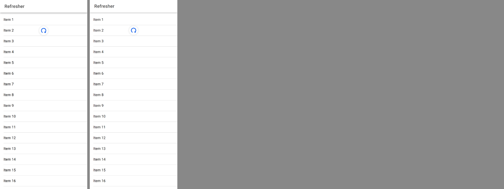
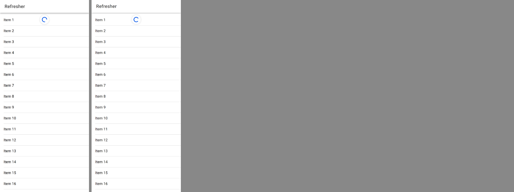

# ion-refresher — Comparison

Ionic 8.8.1, md, headless Chromium at 390 x 844, 2x, beside Avonic headless (Skia) at the same size and scale. The static render:

```
node tools/ionic-ref/render.js ion-refresher --bare --html '<ion-app><ion-header><ion-toolbar><ion-title>Refresher</ion-title></ion-toolbar></ion-header><ion-content><ion-refresher slot="fixed"><ion-refresher-content></ion-refresher-content></ion-refresher><ion-list><ion-item><ion-label>Item 1</ion-label></ion-item><ion-item><ion-label>Item 2</ion-label></ion-item><ion-item><ion-label>Item 3</ion-label></ion-item></ion-list></ion-content></ion-app>'
```

Inactive, the refresher shows nothing, so the pull is measured by a script, [`ref/measure.js.txt`](ref/measure.js.txt), run as
`node measure.js <repo> <out> [noheader] [short]`: the same page with twenty items, a mouse pressed at (195, 200) and dragged down in
6 px steps 16 ms apart, with every part's computed transform, the circle's `stroke-dasharray`, the boxes and the events recorded at
each step, after letting go, and after `complete()`. Its output is [`ref/measure-pull.json`](ref/measure-pull.json) (a pull to
0.5, a refresh, `complete()`), [`ref/measure-short.json`](ref/measure-short.json) (a pull to 0.3, let go) and
[`ref/measure-scale.json`](ref/measure-scale.json) (the same with no header). Avonic's frames are
`AvonicRefresherCaptureTests.Reference_Page`: the same scene, pulled 180 px past the capture, then refreshing.

Pulled to 0.5, Ionic on the left, Avonic on the right:



Refreshing:



## Visual

| | Ionic | Avonic | |
|---|---|---|---|
| The refresher | `{0, 56, 390, 60}`, `refresher-native` | the same (B18) | Match |
| Icon, unmoved | 42 x 42 at (174, 65): 9 down the 60 | the same (B3, B5) | Match |
| Icon pulled to 0.5 | y 115.49 (`translateY(50.49px)`) | 115.5 (the capture test) | Match |
| Pulling frame at any step | e.g. dash 53.5331, `translateY(1.71567px)`, turn 25.7°, arrow `matrix(0.342892, …, 0.799879, 0)` | the same to 3 places (B2) | Match |
| Scale type, no header | `matrix(0.452466, 0, 0, 0.452466, 0, 5.60811)` | the same (B2) | Match |
| Icon chrome | white, `1px solid rgb(236, 236, 236)`, `0 1px 6px rgba(0,0,0,.1)`, round | the same; the shadow's blur 9.4 | Match: every pixel sampled 1 to 13 px below and beside the icon is within 3 levels of 255 of Chromium's |
| Spinner colour | `rgb(0, 84, 233)`, primary | `Avonic.Color.PrimaryBrush` | Match |
| The arrow | `caret-back-sharp`, 12 px, 4 px below the spinner's box | the same | Match, by eye at 4x |
| Refreshing arc on showing | 655 ms into `spinner-circular-inner` | the same (B20) | Match |

## Behaviour

| Behaviour | Ionic | Avonic | |
|---|---|---|---|
| Events of a pull | `ionStart`, `ionPullStart` at the first move after the capture, then `ionPull` per frame | the same (B1) | Match |
| Progress | `deltaY / 360`, to 1 | the same | Match |
| Let go at 0.3 | plays back, `ionPullEnd` `cancel` about 163 ms later | 150 ms plus a frame (B6) | Match |
| Let go at 0.5 | snaps back 50 → 0 px, 0.4 px/ms; `ionRefresh` about 142 ms after | 16 + 125 ms, plus up to a frame (B5) | Match |
| `complete()` | `refresher-completing` after two frames; scale 0.4239 at about 88 ms; `ionPullEnd` `complete` about 235 ms after the call | two frames, then 200 ms `ease` (B7) | Match |
| `cancel()` | inactive after `transitionEndAsync`'s 700 ms fallback | 2 frames + 700 ms (B8) | Match, from `helpers.js`; not measured |
| Upward drag at the top | Chromium scrolls the content; the gesture cancels itself at its first move | the content scrolls; the gesture lets go at its threshold (B10) | Deliberate difference, below |
| `overflow: hidden` on the scroll while pulling | yes | no | Deliberate difference, below |

## Deliberate differences

- **An upward drag from the top.** In Chromium Ionic's passive gesture captures it and the browser scrolls anyway; the first move,
  with `velocityY < 0`, cancels the pull. Avalonia gives a pointer to one owner, so a captured gesture would stop the scroll: the
  refresher lets go of a press that goes up by its 5 px threshold before the gesture decides, and the `ScrollViewer`, which has
  followed the press, scrolls. Nothing is raised either way.
- **The scroll element isn't set to `overflow: hidden`** while pulling: the captured gesture already keeps the scroller off the
  pointer. A mouse wheel during a pull would still scroll.
- **The pulling animation is computed, not a Web Animation:** `RefresherPullFrame`, on `AvonicConfig`'s clock, as the spinner is.
  Its values are set on the template's parts at animation priority.

## Gaps

- **The legacy refresher**, which md uses only when `pullingIcon` is an icon rather than a spinner, or either spinner is null. With no
  spinner the refresher does nothing; `pullMin`, `pullMax`, `pullFactor`, `closeDuration`, `snapbackDuration`, `pullingText` and
  `refreshingText` aren't declared.
- **`checkNativeRefresher` on `componentDidUpdate`** isn't followed: the choice is made once, when the refresher is attached.
- **`fullscreen` content's `--offset-top`** is only in the legacy path.
- Not tried in a real window, nor on a device.
