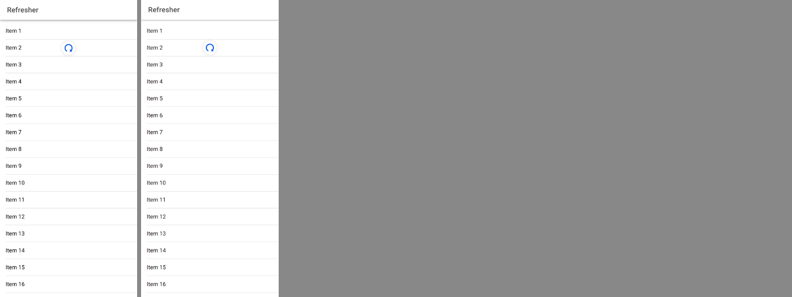
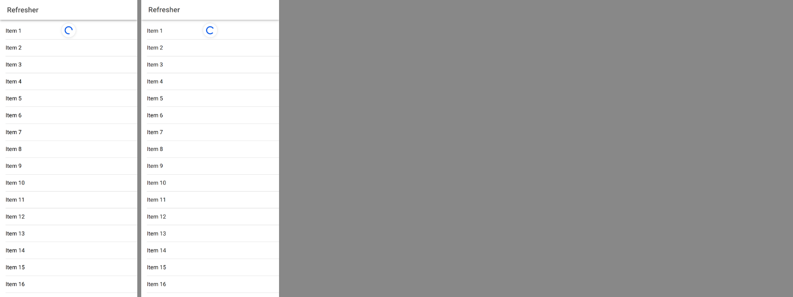
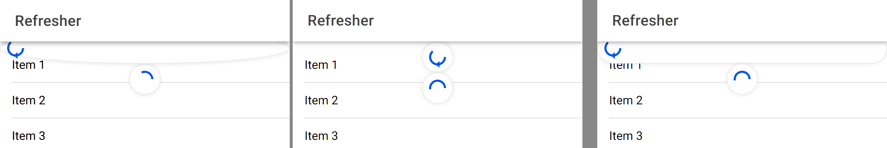
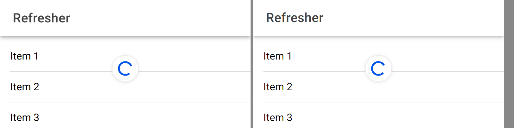

# ion-refresher — Comparison

Ionic 8.8.1, md, headless Chromium at 390 x 844, 2x, beside Avonic headless (Skia) at the same size and scale. The static render:

```
node tools/ionic-ref/render.js ion-refresher --bare --html '<ion-app><ion-header><ion-toolbar><ion-title>Refresher</ion-title></ion-toolbar></ion-header><ion-content><ion-refresher slot="fixed"><ion-refresher-content></ion-refresher-content></ion-refresher><ion-list><ion-item><ion-label>Item 1</ion-label></ion-item><ion-item><ion-label>Item 2</ion-label></ion-item><ion-item><ion-label>Item 3</ion-label></ion-item></ion-list></ion-content></ion-app>'
```

Inactive, the refresher shows nothing, so the pull is measured by a script, [`ref/measure.js.txt`](ref/measure.js.txt), run as
`node measure.js <repo> <out> [noheader] [short]`: the same page with twenty items, a mouse pressed at (195, 200) and dragged down in
6 px steps 16 ms apart, with every part's computed transform, the circle's `stroke-dasharray`, the boxes and the events recorded at
each step, after letting go, and after `complete()`. Its output is [`ref/measure-pull.json`](ref/measure-pull.json) (a pull to
0.5, a refresh, `complete()`), [`ref/measure-short.json`](ref/measure-short.json) (a pull to 0.3, let go) and
[`ref/measure-scale.json`](ref/measure-scale.json) (the same with no header). Avonic's frames are
`AvonicRefresherCaptureTests.Reference_Page`: the same scene, pulled 180 px past the capture, then refreshing.

Pulled to 0.5, Ionic on the left, Avonic on the right:



Refreshing:



## Visual

| | Ionic | Avonic | |
|---|---|---|---|
| The refresher | `{0, 56, 390, 60}`, `refresher-native` | the same (B18) | Match |
| Icon, unmoved | 42 x 42 at (174, 65): 9 down the 60 | the same (B3, B5) | Match |
| Icon pulled to 0.5 | y 115.49 (`translateY(50.49px)`) | 115.5 (the capture test) | Match |
| Pulling frame at any step | e.g. dash 53.5331, `translateY(1.71567px)`, turn 25.7°, arrow `matrix(0.342892, …, 0.799879, 0)` | the same to 3 places (B2) | Match |
| Scale type, no header | `matrix(0.452466, 0, 0, 0.452466, 0, 5.60811)` | the same (B2) | Match |
| Icon chrome | white, `1px solid rgb(236, 236, 236)`, `0 1px 6px rgba(0,0,0,.1)`, round | the same, CSS's numbers through `{b:CssShadow}` (blur 9.42; [#139](../../infra/box-shadow/README.md)) | Match: every pixel sampled 1 to 13 px below and beside the icon is within 3 levels of 255 of Chromium's, as with the 9.4 before |
| Spinner colour | `rgb(0, 84, 233)`, primary | `Avonic.Color.PrimaryBrush` | Match |
| The arrow | `caret-back-sharp`, 12 px, 4 px below the spinner's box | the same | Match, by eye at 4x |
| Refreshing arc on showing | 655 ms into `spinner-circular-inner` | the same (B20) | Match |

## Behaviour

| Behaviour | Ionic | Avonic | |
|---|---|---|---|
| Events of a pull | `ionStart`, `ionPullStart` at the first move after the capture, then `ionPull` per frame | the same (B1) | Match |
| Progress | `deltaY / 360`, to 1 | the same | Match |
| Let go at 0.3 | plays back, `ionPullEnd` `cancel` about 163 ms later | 150 ms plus a frame (B6) | Match |
| Let go at 0.5 | snaps back 50 → 0 px, 0.4 px/ms; `ionRefresh` about 142 ms after | 16 + 125 ms, plus up to a frame (B5) | Match |
| `complete()` | `refresher-completing` after two frames; scale 0.4239 at about 88 ms; `ionPullEnd` `complete` about 235 ms after the call | two frames, then 200 ms `ease` (B7) | Match |
| `cancel()` | inactive after `transitionEndAsync`'s 700 ms fallback | 2 frames + 700 ms (B8) | Match, measured since #167: still cancelling 650 ms after the call, inactive at 760 |
| `cancel()` during a refresh | both icons for the 700 ms: the pulling one `{0, 44, 390, 42}`, its spinner at (9, 53), the refreshing one at (174, 86); none after | the same boxes (C1, `Cancel_Frames`) | Match, but the pulling icon is a pill where Chromium's is an ellipse, below |
| `cancel()` with no pull | the refreshing icon at (174, 86); the pulling one at y -8, under the header | the same (C5) | Match |
| A short pull let go | one icon as it goes back, none after | the same (C4) | Match |
| A pull during cancelling | the icon follows the finger (`translateY` 24.8, then 55.2) | the same (C2) | Match since #167: it stayed at the held snap back |
| That pull overtaken by the cancel's end | the reset hides it and sets the progress to 0. Let go with no move since (F): nothing, and nothing pulls again (G). Moved on past 0.4 and let go (D): it refreshes | let go with no move since: nothing, and the next pull works (C3); past 0.4: it refreshes (C10) | **Deliberate difference** since #176: Ionic's bug fixed, below. C10 matches |
| A refresh begun during cancelling | `ionRefresh`, then the cancel's reset ends it, `ionPullEnd` `cancel`, while the app refreshes; a pull after refreshes | `ionRefresh`, and it goes on refreshing past the cancel's end until `Complete()`, then `ionPullEnd` `complete`; a pull after refreshes (C9) | **Deliberate difference** since #176: Ionic's bug fixed, below |
| Upward drag at the top | Chromium scrolls the content; the gesture cancels itself at its first move | the content scrolls; the gesture lets go at its threshold (B10) | Deliberate difference, below |
| `overflow: hidden` on the scroll while pulling | yes | no | Deliberate difference, below |

## After a cancel (#167)

Measured by [`ref/cancel.js.txt`](ref/cancel.js.txt), run as `node cancel.js <repo> <out>`. It uses the page above and does a refresh
then `cancel()` (A), a short pull (B), `cancel()` with no pull (C), pulls during cancelling (D, F and H, with G after F), and a refresh
and `complete()` after a cancel (E). The comment at its top says what each does.
Every probe is in [`ref/measure-cancel.json`](ref/measure-cancel.json). Avonic's frames are from `AvonicRefresherCaptureTests.Cancel_Frames`.

**Ionic shows both icons after `cancel()` during a refresh, for its 700 ms.** `.refresher-cancelling` shows `.refresher-pulling`,
as `display: block`, and also the native refresher's `.refresher-refreshing`. The pull's snap back has `fill: both` and is destroyed
only when the reset ends, so it holds the pulling icon at `translateY(0)`. `.refresher-cancelling .refresher-pulling-icon
{ transform: scale(0) }` loses to the native refresher's later `translateY` rule, which has the same specificity. In a block, the
icon is a block-level flex box with no width, so it fills the 390, with its spinner at the start. The column of both icons is 84 high
and is centred on the 60 px refresher, so it starts 12 above the refresher's top.

Avonic now does the same. The template's column is a `RefresherColumn`, centred both ways, where the `StackPanel` before it
overflowed only downward (the icons were at 56 and 98). In cancelling, the pulling icon stretches. Chromium is on the left, Avonic
before #167 in the middle, and Avonic after on the right. The refreshing spinner's arc differs, as each is caught at its own moment:



With no pull, only the refreshing icon shows below the header. The pulling one stays at its resting `translateY(-52px)`, above it:



## Deliberate differences

- **The pulling icon in cancelling is a pill,** 390 x 42 with a radius of 21, where Chromium's `border-radius: 100%` makes an
  ellipse of 195 by 21: a `CornerRadius` has one radius for each corner. For those 700 ms the pill covers the start of the first
  row's text, which shows under the ellipse's curve in Chromium.
- **Two of Ionic's own bugs are fixed** (#176; kept, as measured, by #167, then fixed at the user's decision, CLAUDE.md rule 8).
  Avalonia could copy both, and did, so this isn't a difference Avalonia forces: it's a bug a user would hit, with no way out but
  a page reload in Ionic's case.
  - **C3: a pull overtaken by the cancel's end, let go with no move since.** Measured in Chromium (F, G): `resetNativeRefresher`
    destroys every animation, including the new pull's, and sets the progress to 0, so letting go plays back a destroyed animation,
    whose `onFinish` never comes, and so neither does `gesture.enable(true)`: nothing pulls again, ever. Here, a pull's play back
    that is destroyed, before it starts or while it plays, turns the gesture back on as `IsEnabled` says, as the end of any pull
    does here (R3), so a refresher disabled meanwhile stays off. Nothing else changes: the reset has already made it inactive and
    raised `ionPullEnd` `cancel`, so nothing more is raised. `onMove` goes on setting the progress, so one moved on past 0.4
    refreshes when let go (D, C10), as in Ionic.
  - **C9: a refresh begun during cancelling.** Measured in Chromium (H): a pull let go past the threshold before the cancel's end
    refreshes (`ionRefresh` 416 ms after `cancel()`), and the reset then ends that refresh as cancelled (`ionPullEnd` `cancel` at
    733) while the app is still loading. Here a reset that a refresh has begun since does nothing: the refresh goes on until the
    app's `complete()`, whose own reset ends it with `ionPullEnd` `complete`. No `cancel` comes for the refresh the cancel ended, as
    the refresher never went back to inactive in between; a cancel with no refresh since still ends as before (B8, C1).

- **An upward drag from the top.** In Chromium Ionic's passive gesture captures it and the browser scrolls anyway; the first move,
  with `velocityY < 0`, cancels the pull. Avalonia gives a pointer to one owner, so a captured gesture would stop the scroll: the
  refresher's gesture lets go of a press that goes up by its 5 px threshold before it decides (`GestureConfig.ReleaseAgainstDirection`,
  since #131; before, a tunnel handler of the refresher's own), and the `ScrollViewer`, which has followed the press, scrolls.
  Nothing is raised either way.
- **The scroll element isn't set to `overflow: hidden`** while pulling: the captured gesture already keeps the scroller off the
  pointer. A mouse wheel during a pull would still scroll.
- **The animations aren't `AvonicAnimation`s.** `createPullingAnimation` is driven by `progressStart`, `progressStep` and
  `progressEnd`, and animates the circle's `stroke-dasharray`, and `AvonicAnimation` has neither, so the pulling frame is
  computed, as `RefresherPullFrame`, on `AvonicConfig`'s clock, as the spinner's are, and set on the template's parts at animation
  priority. The snap back and the completing transition are small loops on the same clock.
- **The refreshing circle is an `AvonicSpinner` with an internal `AnimationDelay`** of -655 ms, md's native refresher's
  `animation-delay`. Until #131 it was the refresher's own `RefresherCircle` in a running mode; the capture frames came out the same,
  pixel for pixel. Ionic sets the delay once, at `setupMDNativeRefresher`, on the host and the first `circle` of the refreshing
  spinner when both spinners have a `circle`, so a spinner changed later changes nothing (the same here, worked out when the
  refresher becomes native), which moves only `circular`'s animation: other refreshing spinners start from 0, as before, and so does `circular`
  after a pulling spinner of lines, which before #131 started 655 ms in. The new state's pseudoclass goes on before the old one's
  goes off, as a class list changes at once, so from refreshing to completing or cancelling the spinner carries on rather than
  start again, which another refreshing spinner did before #131.
- **`IsEnabled` is kept after a pull.** Ionic calls `gesture.enable(true)` once a pull has played back or refreshed, whatever
  `disabled` is, so a refresher disabled in its `ionRefresh` handler could be pulled again. Here it's `Enable(IsEnabled)` (R3).
- **The fixed slot can be shared through a panel**, as `AvonicContent.FixedContent` holds one child, where Ionic's slot holds an
  `ion-fab` beside the refresher (R2).
- **The pulling icon's resting place is `translateY(-52px)`** in the theme, which is `calc(-100% - 10px)` for its 42 px: an app that
  resizes the icon restyles that too.
- **A scroll host is looked for in `Content`, then `FixedContent`** (#155). Ionic's `querySelector('.ion-content-scroll-host')` takes
  the first in the markup, where `<ion-refresher slot="fixed">` is usually written before the list. Avalonia's two slots have no
  order between them, and a host in the fixed slot beside one in the content is unusual, so the content's, where a virtual scroller
  is, comes first. With one host, as an app has, the two agree.
- **A scroll host's scroller is the first `ScrollViewer` in it**, depth first, unless the host is one (#155). In a browser the
  element with the class scrolls itself; here only a `ScrollViewer` can, so a panel with the class around a `TextBox` and a list
  would give the text box's. Put the class on the control that scrolls.
- **A scroll host whose scroller isn't there yet is looked at again after each layout of the content** (#155), as Ionic waits for
  the content with `componentOnReady`: a `ListBox` that is styled only once it's in the tree has none when the fixed slot comes
  first, and a hidden one isn't templated until it shows. If the first layout gives none, the error is logged once, as the infinite
  scroll's is, and nothing pulls until there is one: Ionic's scroll element would be the host itself, which can't scroll here.

## Gaps

- **The legacy refresher**, which md uses only when `pullingIcon` is an icon rather than a spinner, or either spinner is null. With no
  spinner the refresher does nothing; `pullMin`, `pullMax`, `pullFactor`, `closeDuration`, `snapbackDuration`, `pullingText` and
  `refreshingText` aren't declared.
- **`checkNativeRefresher` on `componentDidUpdate`** isn't followed: the choice is made once, when the refresher is attached.
- **`fullscreen` content's `--offset-top`** is only in the legacy path.
- Not tried in a real window, nor on a device.
