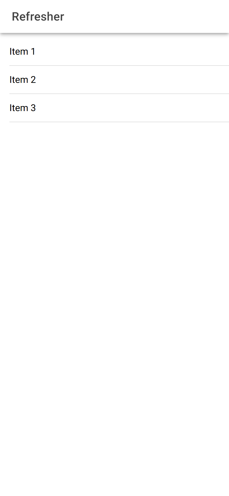
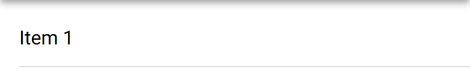

# ion-refresher — reference render (Ionic 8.8.1, md, 390×844@2x)

Generated by `node tools/ionic-ref/render.js ion-refresher --bare --html "<ion-app><ion-header><ion-toolbar><ion-title>Refresher</ion-title></ion-toolbar></ion-header><ion-content><ion-refresher slot=\"fixed\"><ion-refresher-content></ion-refresher-content></ion-refresher><ion-list><ion-item><ion-label>Item 1</ion-label></ion-item><ion-item><ion-label>Item 2</ion-label></ion-item><ion-item><ion-label>Item 3</ion-label></ion-item></ion-list></ion-content></ion-app>"`

```html
<ion-app><ion-header><ion-toolbar><ion-title>Refresher</ion-title></ion-toolbar></ion-header><ion-content><ion-refresher slot="fixed"><ion-refresher-content></ion-refresher-content></ion-refresher><ion-list><ion-item><ion-label>Item 1</ion-label></ion-item><ion-item><ion-label>Item 2</ion-label></ion-item><ion-item><ion-label>Item 3</ion-label></ion-item></ion-list></ion-content></ion-app>
```

 

## Element 1

- attributes: `{"slot":"fixed","class":"md refresher-md hydrated refresher-native"}`
- classes: `md refresher-md hydrated refresher-native`
- rect: `{"x":0,"y":56,"w":390,"h":60}`

### Host computed

| prop | value |
|---|---|
| display | `block` |
| position | `absolute` |
| box-sizing | `border-box` |
| width | `390px` |
| height | `60px` |
| min-height | `0px` |
| min-width | `0px` |
| padding | `0px` |
| margin | `0px` |
| border | `0px none rgb(0, 0, 0)` |
| border-radius | `0px` |
| background-color | `rgba(0, 0, 0, 0)` |
| color | `rgb(0, 0, 0)` |
| font-size | `16px` |
| font-weight | `400` |
| font-family | `Roboto, "Helvetica Neue", sans-serif` |
| line-height | `normal` |
| letter-spacing | `normal` |
| text-transform | `none` |
| opacity | `1` |
| overflow | `visible` |
| contain | `none` |
| pointer-events | `none` |
| transition | `all` |
| transform | `matrix(1, 0, 0, 1, 0, 0)` |
| box-shadow | `none` |
| outline | `rgb(0, 0, 0) none 0px` |
| cursor | `auto` |

### DOM tree

```
<ion-refresher>
  <ion-refresher-content.md.hydrated>
    <div.refresher-pulling>
      <div.refresher-pulling-icon>
        <div.spinner-arrow-container>
          <ion-spinner.md.spinner-circular.spinner-paused.hydrated>
            #shadow-root
              <svg>
                <circle>
          <div.arrow-container>
            <ion-icon.md.hydrated>
              #shadow-root
                <div.icon-inner>
                  <svg>
                    <path>
    <div.refresher-refreshing>
      <div.refresher-refreshing-icon>
        <ion-spinner.md.spinner-circular.hydrated>
          #shadow-root
            <svg>
              <circle>
```
