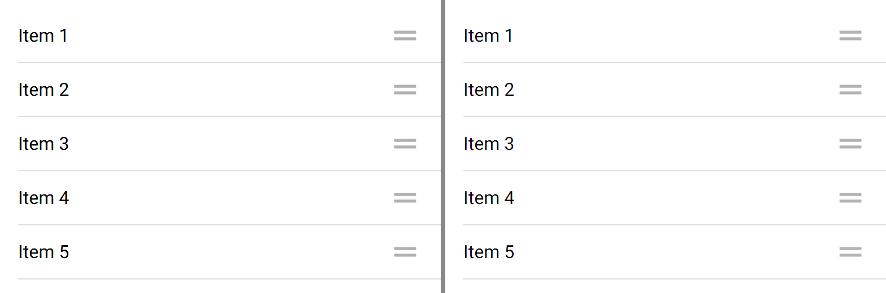
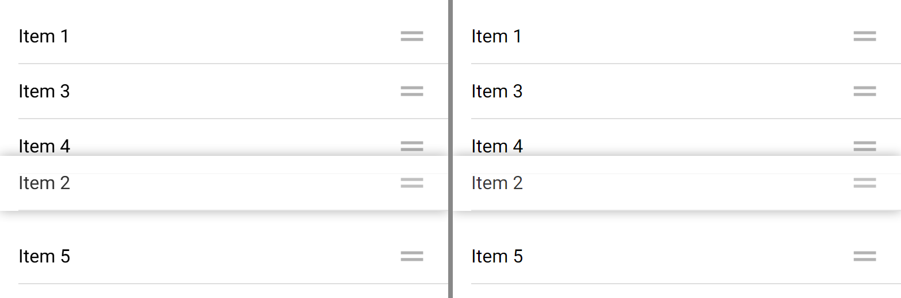

# ion-reorder, ion-reorder-group — Comparison

Ionic 8.8.1, md, headless Chromium, 390 x 844 at 2x, beside Avonic headless (Skia) at the same size and scale. Five items in a
list in a content, each with a handle in its end slot, in an enabled group. The reference frame:

```
node tools/ionic-ref/render.js ion-reorder --bare --html '<ion-app><ion-content><ion-list><ion-reorder-group disabled="false"><ion-item><ion-label>Item 1</ion-label><ion-reorder slot="end"></ion-reorder></ion-item><ion-item><ion-label>Item 2</ion-label><ion-reorder slot="end"></ion-reorder></ion-item><ion-item><ion-label>Item 3</ion-label><ion-reorder slot="end"></ion-reorder></ion-item><ion-item><ion-label>Item 4</ion-label><ion-reorder slot="end"></ion-reorder></ion-item><ion-item><ion-label>Item 5</ion-label><ion-reorder slot="end"></ion-reorder></ion-item></ion-reorder-group></ion-list></ion-content></ion-app>'
```

The drag, the frames and the timings are from a script kept out of the repo, which drives the same scene with CDP touch events
(a finger on the second handle, moved down in 8 px steps) and reads each child's transform every animation frame, into
[`ref/measurements.json`](ref/measurements.json); [`ref/lifted.png`](ref/lifted.png) is its frame 500 ms after the finger stopped
80 px down. Avonic's frames are `AvonicReorderCaptureTests.Reference_Page` and `Reference_Lifted`, the second driven the same way.

## Visual

At rest, and with the second item lifted 80 px, the siblings settled (the images are the top 260 px of each frame):





| What | Ionic | Avonic |
|---|---|---|
| Handle box | 31 x 31 at (343, 16), 16 px slot margin before it | the same (`B2_The_Handle_Is_31_Px…`) |
| Icon | `reorder-two-sharp`, black at 0.3: 177 at its bar | 179 |
| Lifted item | opacity 0.8, `box-shadow: 0 0 10px rgba(0,0,0,.4)` | the same, the shadow drawn by the group's `PART_Lift`; its fall-off within 1 of Chromium's at every pixel from 252 to 272 and 366 to 388, and there with any lines (`B14_The_Shadow_Shows_Whatever_The_Items_Lines`) |
| Siblings | item 3 and 4 at −48 | the same |
| Disabled group | slotted handles `display: none` | hidden |
| A custom icon in the handle | 16 px: the item's font size, as the `dynamic-font()` rule is invalid CSS | the icon's own size, from the font size it inherits |

## Behaviour

| # | Behaviour | Result |
|---|---|---|
| 1 | Slotted handle hidden unless an enabled group is around it, at any depth; one that wraps its item always shows | match |
| 2 | The icon is the slot's fallback | match |
| 3 | A click on the handle stops, unless its group is disabled; with no group it stops too; a keyboard click on a button inside too | match (the press, and Enter and Space, are handled, which an item and a `Button` ignore) |
| 4 | `cursor: grab` in an enabled group | deliberate difference: the hand cursor; Avalonia has no grab cursor |
| 5 | `disabled`, true by default, turns the gesture off | match |
| 6 | Starts at the press on a handle (threshold 0), never elsewhere | match |
| 7 | The item follows the finger, held inside the group; the siblings make room by its height | match: +80, −48, −48 |
| 8 | `ionReorderMove`'s `from` is the last `to` | match: 1>1, then 1>2, 2>2 and 2>3 as each middle is passed, as measured |
| 9 | Siblings ease over 300 ms (`ease`): −1.8 a frame in | match, on the clock (`B9`) |
| 10 | Auto-scroll: 10 px a move within 60 px of the content's edge, none when the finger is still | match: 10 per move, as measured |
| 11 | `ionItemReorder` only when moved, then `ionReorderEnd`; in place completes itself | match |
| 12 | `complete()` moves it, and clears every transform in the next frame, with no easing; `complete(false)` puts it back; `complete(array)` reorders the array and not the DOM | match: one frame unlifted with its transforms, then the new order |
| 13 | Not completed: lifted, no new drag; a `complete()` 500 ms later still moves it | match |
| 14 | `z-index: 100` over the siblings, and nothing clips it in the group; an `ion-list` around it clips it at the list's edge | match, for any type of child (the list's clip measured in #131's roll-up, see below) |
| 15 | Leaving the tree, or disabled, mid-drag: ends with its events | match |

## Deliberate differences

- **`disabled` isn't `IsEnabled`.** Ionic's `disabled` only hides the handles and turns the drag off; Avalonia's `IsEnabled` would
  disable every item in the group. It's `Disabled`, true by default, as Ionic's.
- **`ItemsSource`:** `Complete()` can't move an item in a source that is the app's, so it only clears, and the item shows where the
  source has it, as Ionic's `complete(array)` leaves the DOM to the framework. `Complete(list)` reorders the list given, with `Move` on
  an `ObservableCollection<T>`.
- **The cursor** is the hand in an enabled group, and nothing changes while dragging: Avalonia has no `grab` or `grabbing` cursor.
- **The lifted opacity applies to `AvonicItem` and to a handle that wraps its item.** Ionic's class can style any child; an app styles
  its own type with `:reorder-selected`. The z-index and the shadow work for any child: the shadow is the group's `PART_Lift`, a
  `Border` it puts over the dragged child, as only a `Border` has a box shadow, and Avalonia draws none for a border of uneven
  thickness, which an item with full lines has.
- **A press on a handle is handled**, where Ionic stops only the click: a text box inside a handle with no group, or one waiting for
  `Complete()`, isn't focused by a tap. In an enabled group Ionic's drag prevents the focus too.
- **A slot is an item's start or end**: in another host's named slot a handle isn't hidden.
- **The shadow's blur is 15.6 in the token**, which is CSS's 10: Avalonia's Skia turns a blur into a Gaussian differently. Measured
  equal.
- **The opacity fades each part of the item**, as Avalonia's `Opacity` does, not the item as one layer: the item's text shows a little
  of what's under its background. Over a white item, which is what's under it, the two are the same.
- **No haptics**: Ionic's are Capacitor's.

An earlier version of this page said `ion-list` doesn't clip a lifted item. It does, plain or inset: `list.md.css` gives every list
`contain: content`, which includes paint containment, and that clips as `overflow: hidden` does. Measured in Chromium (#131's
roll-up): an item lifted 30 px above a plain list's top is cut at the list's edge, and its shadow shows nowhere outside the list.
`AvonicList` clips too, so it matches.

## Not tried

Not tried in a real window (real-window run queued), and not on a device.
