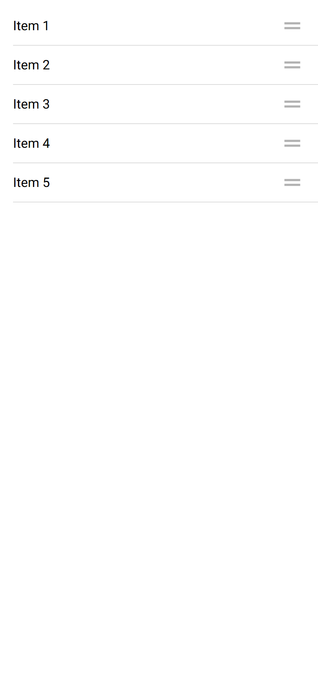

# ion-reorder — reference render (Ionic 8.8.1, md, 390×844@2x)

Generated by `node tools/ionic-ref/render.js ion-reorder --bare --html "<ion-app><ion-content><ion-list><ion-reorder-group disabled=\"false\"><ion-item><ion-label>Item 1</ion-label><ion-reorder slot=\"end\"></ion-reorder></ion-item><ion-item><ion-label>Item 2</ion-label><ion-reorder slot=\"end\"></ion-reorder></ion-item><ion-item><ion-label>Item 3</ion-label><ion-reorder slot=\"end\"></ion-reorder></ion-item><ion-item><ion-label>Item 4</ion-label><ion-reorder slot=\"end\"></ion-reorder></ion-item><ion-item><ion-label>Item 5</ion-label><ion-reorder slot=\"end\"></ion-reorder></ion-item></ion-reorder-group></ion-list></ion-content></ion-app>"`

```html
<ion-app><ion-content><ion-list><ion-reorder-group disabled="false"><ion-item><ion-label>Item 1</ion-label><ion-reorder slot="end"></ion-reorder></ion-item><ion-item><ion-label>Item 2</ion-label><ion-reorder slot="end"></ion-reorder></ion-item><ion-item><ion-label>Item 3</ion-label><ion-reorder slot="end"></ion-reorder></ion-item><ion-item><ion-label>Item 4</ion-label><ion-reorder slot="end"></ion-reorder></ion-item><ion-item><ion-label>Item 5</ion-label><ion-reorder slot="end"></ion-reorder></ion-item></ion-reorder-group></ion-list></ion-content></ion-app>
```

 

## Element 1

- attributes: `{"slot":"end","class":"md hydrated"}`
- classes: `md hydrated`
- rect: `{"x":343,"y":16,"w":31,"h":31}`

### Host computed

| prop | value |
|---|---|
| display | `block` |
| position | `static` |
| box-sizing | `border-box` |
| width | `31px` |
| height | `31px` |
| min-height | `auto` |
| min-width | `auto` |
| padding | `0px` |
| margin | `0px 0px 0px 16px` |
| border | `0px none rgb(0, 0, 0)` |
| border-radius | `0px` |
| background-color | `rgba(0, 0, 0, 0)` |
| color | `rgb(0, 0, 0)` |
| font-size | `16px` |
| font-weight | `400` |
| font-family | `Roboto, "Helvetica Neue", sans-serif` |
| line-height | `0px` |
| letter-spacing | `normal` |
| text-transform | `none` |
| opacity | `1` |
| overflow | `visible` |
| contain | `none` |
| pointer-events | `all` |
| transition | `all` |
| transform | `none` |
| box-shadow | `none` |
| outline | `rgb(0, 0, 0) none 0px` |
| cursor | `grab` |

### Shadow parts

#### part="icon" (`ion-icon`) rect `{"x":343,"y":16,"w":31,"h":31}`

| prop | value |
|---|---|
| display | `block` |
| position | `static` |
| box-sizing | `content-box` |
| width | `31px` |
| height | `31px` |
| min-height | `0px` |
| min-width | `0px` |
| padding | `0px` |
| margin | `0px` |
| border | `0px none rgb(0, 0, 0)` |
| border-radius | `0px` |
| background-color | `rgba(0, 0, 0, 0)` |
| color | `rgb(0, 0, 0)` |
| font-size | `31px` |
| font-weight | `400` |
| font-family | `Roboto, "Helvetica Neue", sans-serif` |
| line-height | `0px` |
| letter-spacing | `normal` |
| text-transform | `none` |
| opacity | `0.3` |
| overflow | `visible` |
| contain | `strict` |
| pointer-events | `all` |
| transition | `all` |
| transform | `none` |
| box-shadow | `none` |
| outline | `rgb(0, 0, 0) none 0px` |
| cursor | `grab` |

### DOM tree

```
<ion-reorder>
  #shadow-root
    <slot name="">
      <ion-icon.reorder-icon.md.hydrated part="icon">
        #shadow-root
          <div.icon-inner>
            <svg>
              <path>
```

## Element 2

- attributes: `{"slot":"end","class":"md hydrated"}`
- classes: `md hydrated`
- rect: `{"x":343,"y":64,"w":31,"h":31}`

### Host computed

| prop | value |
|---|---|
| display | `block` |
| position | `static` |
| box-sizing | `border-box` |
| width | `31px` |
| height | `31px` |
| min-height | `auto` |
| min-width | `auto` |
| padding | `0px` |
| margin | `0px 0px 0px 16px` |
| border | `0px none rgb(0, 0, 0)` |
| border-radius | `0px` |
| background-color | `rgba(0, 0, 0, 0)` |
| color | `rgb(0, 0, 0)` |
| font-size | `16px` |
| font-weight | `400` |
| font-family | `Roboto, "Helvetica Neue", sans-serif` |
| line-height | `0px` |
| letter-spacing | `normal` |
| text-transform | `none` |
| opacity | `1` |
| overflow | `visible` |
| contain | `none` |
| pointer-events | `all` |
| transition | `all` |
| transform | `none` |
| box-shadow | `none` |
| outline | `rgb(0, 0, 0) none 0px` |
| cursor | `grab` |

### Shadow parts

#### part="icon" (`ion-icon`) rect `{"x":343,"y":64,"w":31,"h":31}`

| prop | value |
|---|---|
| display | `block` |
| position | `static` |
| box-sizing | `content-box` |
| width | `31px` |
| height | `31px` |
| min-height | `0px` |
| min-width | `0px` |
| padding | `0px` |
| margin | `0px` |
| border | `0px none rgb(0, 0, 0)` |
| border-radius | `0px` |
| background-color | `rgba(0, 0, 0, 0)` |
| color | `rgb(0, 0, 0)` |
| font-size | `31px` |
| font-weight | `400` |
| font-family | `Roboto, "Helvetica Neue", sans-serif` |
| line-height | `0px` |
| letter-spacing | `normal` |
| text-transform | `none` |
| opacity | `0.3` |
| overflow | `visible` |
| contain | `strict` |
| pointer-events | `all` |
| transition | `all` |
| transform | `none` |
| box-shadow | `none` |
| outline | `rgb(0, 0, 0) none 0px` |
| cursor | `grab` |

### DOM tree

```
<ion-reorder>
  #shadow-root
    <slot name="">
      <ion-icon.reorder-icon.md.hydrated part="icon">
        #shadow-root
          <div.icon-inner>
            <svg>
              <path>
```

## Element 3

- attributes: `{"slot":"end","class":"md hydrated"}`
- classes: `md hydrated`
- rect: `{"x":343,"y":112,"w":31,"h":31}`

### Host computed

| prop | value |
|---|---|
| display | `block` |
| position | `static` |
| box-sizing | `border-box` |
| width | `31px` |
| height | `31px` |
| min-height | `auto` |
| min-width | `auto` |
| padding | `0px` |
| margin | `0px 0px 0px 16px` |
| border | `0px none rgb(0, 0, 0)` |
| border-radius | `0px` |
| background-color | `rgba(0, 0, 0, 0)` |
| color | `rgb(0, 0, 0)` |
| font-size | `16px` |
| font-weight | `400` |
| font-family | `Roboto, "Helvetica Neue", sans-serif` |
| line-height | `0px` |
| letter-spacing | `normal` |
| text-transform | `none` |
| opacity | `1` |
| overflow | `visible` |
| contain | `none` |
| pointer-events | `all` |
| transition | `all` |
| transform | `none` |
| box-shadow | `none` |
| outline | `rgb(0, 0, 0) none 0px` |
| cursor | `grab` |

### Shadow parts

#### part="icon" (`ion-icon`) rect `{"x":343,"y":112,"w":31,"h":31}`

| prop | value |
|---|---|
| display | `block` |
| position | `static` |
| box-sizing | `content-box` |
| width | `31px` |
| height | `31px` |
| min-height | `0px` |
| min-width | `0px` |
| padding | `0px` |
| margin | `0px` |
| border | `0px none rgb(0, 0, 0)` |
| border-radius | `0px` |
| background-color | `rgba(0, 0, 0, 0)` |
| color | `rgb(0, 0, 0)` |
| font-size | `31px` |
| font-weight | `400` |
| font-family | `Roboto, "Helvetica Neue", sans-serif` |
| line-height | `0px` |
| letter-spacing | `normal` |
| text-transform | `none` |
| opacity | `0.3` |
| overflow | `visible` |
| contain | `strict` |
| pointer-events | `all` |
| transition | `all` |
| transform | `none` |
| box-shadow | `none` |
| outline | `rgb(0, 0, 0) none 0px` |
| cursor | `grab` |

### DOM tree

```
<ion-reorder>
  #shadow-root
    <slot name="">
      <ion-icon.reorder-icon.md.hydrated part="icon">
        #shadow-root
          <div.icon-inner>
            <svg>
              <path>
```

## Element 4

- attributes: `{"slot":"end","class":"md hydrated"}`
- classes: `md hydrated`
- rect: `{"x":343,"y":160,"w":31,"h":31}`

### Host computed

| prop | value |
|---|---|
| display | `block` |
| position | `static` |
| box-sizing | `border-box` |
| width | `31px` |
| height | `31px` |
| min-height | `auto` |
| min-width | `auto` |
| padding | `0px` |
| margin | `0px 0px 0px 16px` |
| border | `0px none rgb(0, 0, 0)` |
| border-radius | `0px` |
| background-color | `rgba(0, 0, 0, 0)` |
| color | `rgb(0, 0, 0)` |
| font-size | `16px` |
| font-weight | `400` |
| font-family | `Roboto, "Helvetica Neue", sans-serif` |
| line-height | `0px` |
| letter-spacing | `normal` |
| text-transform | `none` |
| opacity | `1` |
| overflow | `visible` |
| contain | `none` |
| pointer-events | `all` |
| transition | `all` |
| transform | `none` |
| box-shadow | `none` |
| outline | `rgb(0, 0, 0) none 0px` |
| cursor | `grab` |

### Shadow parts

#### part="icon" (`ion-icon`) rect `{"x":343,"y":160,"w":31,"h":31}`

| prop | value |
|---|---|
| display | `block` |
| position | `static` |
| box-sizing | `content-box` |
| width | `31px` |
| height | `31px` |
| min-height | `0px` |
| min-width | `0px` |
| padding | `0px` |
| margin | `0px` |
| border | `0px none rgb(0, 0, 0)` |
| border-radius | `0px` |
| background-color | `rgba(0, 0, 0, 0)` |
| color | `rgb(0, 0, 0)` |
| font-size | `31px` |
| font-weight | `400` |
| font-family | `Roboto, "Helvetica Neue", sans-serif` |
| line-height | `0px` |
| letter-spacing | `normal` |
| text-transform | `none` |
| opacity | `0.3` |
| overflow | `visible` |
| contain | `strict` |
| pointer-events | `all` |
| transition | `all` |
| transform | `none` |
| box-shadow | `none` |
| outline | `rgb(0, 0, 0) none 0px` |
| cursor | `grab` |

### DOM tree

```
<ion-reorder>
  #shadow-root
    <slot name="">
      <ion-icon.reorder-icon.md.hydrated part="icon">
        #shadow-root
          <div.icon-inner>
            <svg>
              <path>
```

## Element 5

- attributes: `{"slot":"end","class":"md hydrated"}`
- classes: `md hydrated`
- rect: `{"x":343,"y":208,"w":31,"h":31}`

### Host computed

| prop | value |
|---|---|
| display | `block` |
| position | `static` |
| box-sizing | `border-box` |
| width | `31px` |
| height | `31px` |
| min-height | `auto` |
| min-width | `auto` |
| padding | `0px` |
| margin | `0px 0px 0px 16px` |
| border | `0px none rgb(0, 0, 0)` |
| border-radius | `0px` |
| background-color | `rgba(0, 0, 0, 0)` |
| color | `rgb(0, 0, 0)` |
| font-size | `16px` |
| font-weight | `400` |
| font-family | `Roboto, "Helvetica Neue", sans-serif` |
| line-height | `0px` |
| letter-spacing | `normal` |
| text-transform | `none` |
| opacity | `1` |
| overflow | `visible` |
| contain | `none` |
| pointer-events | `all` |
| transition | `all` |
| transform | `none` |
| box-shadow | `none` |
| outline | `rgb(0, 0, 0) none 0px` |
| cursor | `grab` |

### Shadow parts

#### part="icon" (`ion-icon`) rect `{"x":343,"y":208,"w":31,"h":31}`

| prop | value |
|---|---|
| display | `block` |
| position | `static` |
| box-sizing | `content-box` |
| width | `31px` |
| height | `31px` |
| min-height | `0px` |
| min-width | `0px` |
| padding | `0px` |
| margin | `0px` |
| border | `0px none rgb(0, 0, 0)` |
| border-radius | `0px` |
| background-color | `rgba(0, 0, 0, 0)` |
| color | `rgb(0, 0, 0)` |
| font-size | `31px` |
| font-weight | `400` |
| font-family | `Roboto, "Helvetica Neue", sans-serif` |
| line-height | `0px` |
| letter-spacing | `normal` |
| text-transform | `none` |
| opacity | `0.3` |
| overflow | `visible` |
| contain | `strict` |
| pointer-events | `all` |
| transition | `all` |
| transform | `none` |
| box-shadow | `none` |
| outline | `rgb(0, 0, 0) none 0px` |
| cursor | `grab` |

### DOM tree

```
<ion-reorder>
  #shadow-root
    <slot name="">
      <ion-icon.reorder-icon.md.hydrated part="icon">
        #shadow-root
          <div.icon-inner>
            <svg>
              <path>
```
