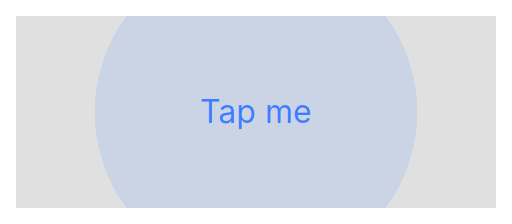

# ion-ripple-effect — Comparison against the web component

> Ionic side: `node tools/ionic-ref/render.js ion-ripple-effect --tap` (Chromium, md, 390×844@2x) → [`ref/`](ref/).
> Avonic side: `AVONIC_CAPTURE_DIR=… dotnet test` → `AvonicRippleEffectCaptureTests` (headless Skia, 2×) → [`compare/`](compare/).
> Both: a 240×96 activatable surface (#E0E0E0), primary #3880FF, pressed at its centre with real
> pointer input; frames at the same offsets from press and from release.

## Frames

| Offset | Ionic | Avonic | Verdict |
|---|---|---|---|
| press + 0 ms |  |  | match — nothing yet |
| press + 60 ms |  |  | match — still inside the 100 ms `tap-click` defer |
| press + 160 ms |  |  | match — circle expanding from the centre at 16 % primary. Ionic's is slightly larger: Chromium's `page.screenshot` costs ~30–50 ms per frame, so its "160 ms" is later than Avonic's exact 160 ms |
| press + 320 ms |  |  | match — fully expanded, uniform tint |
| release + 60 ms |  |  | match — still held: fade-out cannot start before 325 ms after the ripple began |
| release + 220 ms |  |  | match — all but gone. By the timeline (ripple from 100 ms, release at 330 ms, fade-out from 425 ms) this instant is 125 ms into the 150 ms fade: opacity ≈ 0.03, element removed 75 ms later |
| release + 420 ms |  |  | match — baseline |

The 320 ms tint is asserted numerically: pixel = `#E0E0E0` blended with `#3880FF` at 0.16 (±3).

## Behaviours

Each row is a test in `AvonicRippleEffectTests` (B) or `ActivatableTests` (A).

| # | Behaviour | Result |
|---|---|---|
| B1 | Fills parent; not hit-testable; presentation-only | match |
| B2 | Bounded clips to own bounds; Unbounded does not | match (`ClipToBounds` ⇔ `contain: strict`) |
| B3 | `initialSize = ⌊max(w,h)·0.5⌋`, `finalScale = maxRadius / initialSize`, `maxRadius = hypot + 10` (bounded) / `maxDim` (unbounded) | match |
| B4 | Origin = press point (bounded) / centre (unbounded); circle top-left = origin − size/2 | match |
| B5 | Drifts toward centre: `translateEnd = (w/2 − x, h/2 − y)` | match |
| B6 | Expand 225 ms cubic-bezier(.4,0,.2,1); fade-in 75 ms linear to 0.16 | match (`SplineEasing(0.4,0,0.2,1)`) |
| B7 | Colour = `currentColor` | match — fill is the inherited `Foreground` |
| B8 | Release cannot take effect before 325 ms | match |
| B9 | Fade-out 150 ms linear; removed 200 ms after it starts | match |
| B10 | Ripples are independent; never removed unasked | match |
| A1 | Press → 100 ms defer → activate; instant skips; only the secondary button ignored; innermost activatable wins | match |
| A2 | Ripple at the original press position | match |
| A3 | Release inside the defer activates then releases; the ripple starts at the **release** point | match |
| A4 | Release within 150 ms of activation clears `:activated` 150 ms after release; later/instant clears now; re-press drops pending state | match |
| A5 | Cancel clears immediately; no ripple if not yet activated | match — **deliberate difference in mechanism**, below |
| A6 | One active surface application-wide; further presses ignored | match |
| A7 | `rippleEffect`/`animated` config off → activated without ripple | match |

## Deliberate differences

| Ionic | Avonic | Why |
|---|---|---|
| `addRipple(x, y)` takes client coordinates and returns `Promise<() => void>` resolved after 325 ms | `AddRipple(x, y)` takes coordinates in the ripple's own space and returns `Action` immediately; the 325 ms minimum is enforced inside | Decision D3 — same observable timing, simpler caller |
| Cancellation = `pointercancel` / `ionGestureCaptured` on `document` | `PointerCaptureLost` on the pressed element (Avalonia routes it directly, never bubbled); the behaviour ensures the pressed element holds capture for the press | Avalonia's gesture recognisers signal "I took the pointer" exactly this way |
| Activation = `.ion-activated` class | `:activated` pseudoclass on the surface | Mapping rule for host classes |
| `ion-activatable` / `ion-activatable-instant` classes | `Activatable.IsEnabled` / `Activatable.IsInstant` attached properties | Mapping for behaviour markers |
| Ripple animation = CSS keyframes on the compositor | Same curve/timings driven by a 60 Hz UI-thread timer and drawn in `Render` | Keeps the timeline deterministic and testable; revisit if profiling shows jank on device |

## Gaps

None found.
