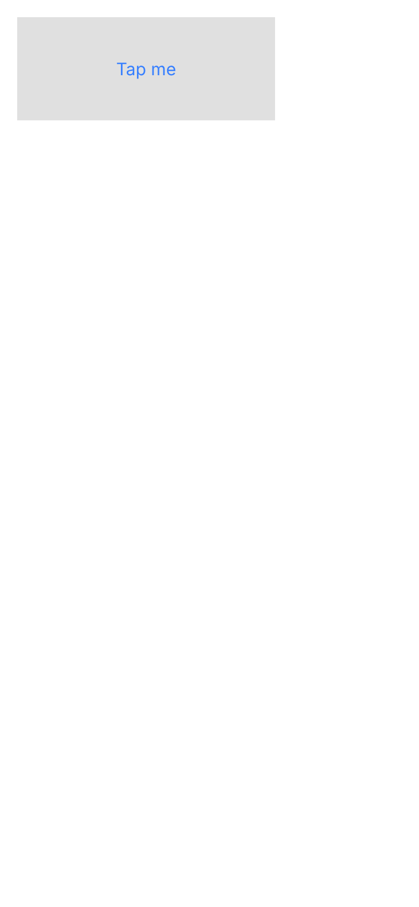
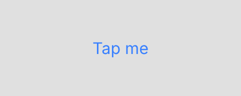
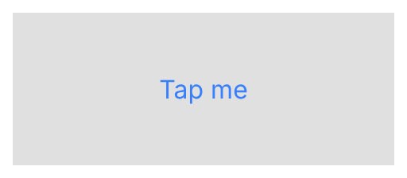
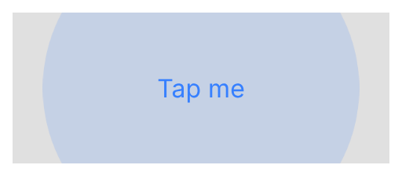
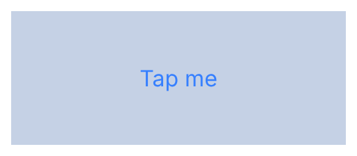

# ion-ripple-effect — reference render (Ionic 8.8.1, md, 390×844@2x)

Generated by `node tools/ionic-ref/render.js ion-ripple-effect --tap`

```html
<div class="ion-activatable" style="position:relative;overflow:hidden;width:240px;height:96px;display:flex;align-items:center;justify-content:center;background:#e0e0e0;color:#3880ff;user-select:none">Tap me<ion-ripple-effect></ion-ripple-effect></div>
```

 

## Press / release frames

      

## Element 1

- attributes: `{"role":"presentation","class":"md hydrated"}`
- classes: `md hydrated`
- rect: `{"x":16,"y":16,"w":240,"h":96}`

### Host computed

| prop | value |
|---|---|
| display | `block` |
| position | `absolute` |
| box-sizing | `border-box` |
| width | `240px` |
| height | `96px` |
| min-height | `0px` |
| min-width | `0px` |
| padding | `0px` |
| margin | `0px` |
| border | `0px none rgb(56, 128, 255)` |
| border-radius | `0px` |
| background-color | `rgba(0, 0, 0, 0)` |
| color | `rgb(56, 128, 255)` |
| font-size | `16px` |
| font-weight | `400` |
| font-family | `Roboto, "Helvetica Neue", sans-serif` |
| line-height | `normal` |
| letter-spacing | `normal` |
| text-transform | `none` |
| opacity | `1` |
| overflow | `visible` |
| contain | `strict` |
| pointer-events | `none` |
| transition | `all` |
| transform | `none` |
| box-shadow | `none` |
| outline | `rgb(56, 128, 255) none 0px` |
| cursor | `auto` |

### DOM tree

```
<ion-ripple-effect>
  #shadow-root
```
