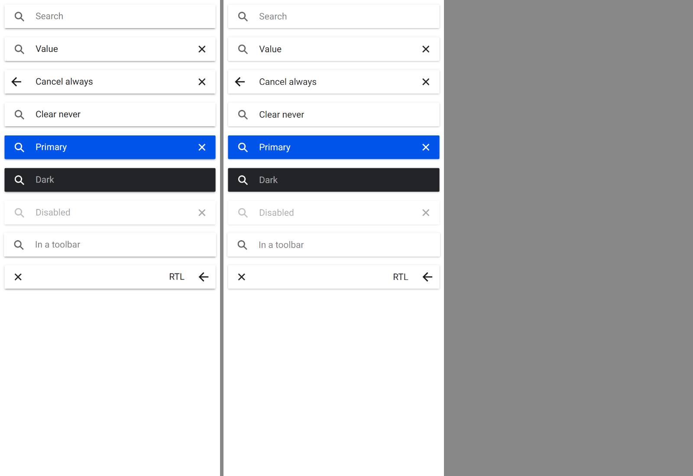
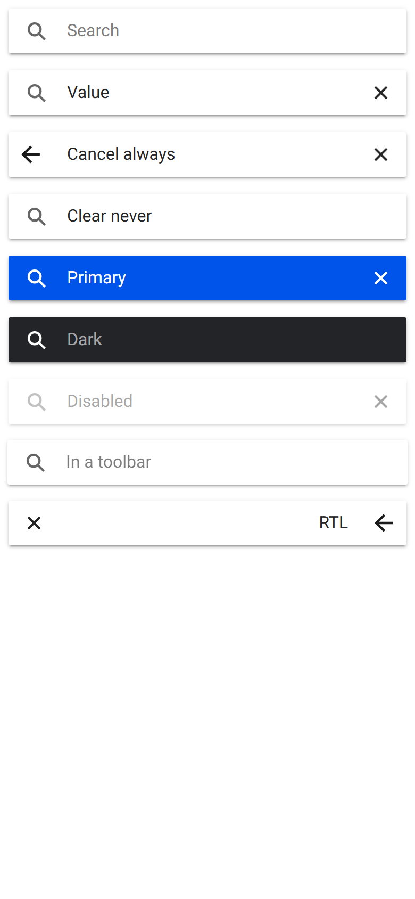

# ion-searchbar — Comparison against the web component

> Ionic side: `node tools/ionic-ref/render.js ion-searchbar --bare --html '<the snippet below>'` (Chromium, md, 390×844@2x) → [`ref/`](ref/).
> `ref/README.md` holds the exact command, and `ref/page.html` the page.
> Avonic side: `AVONIC_CAPTURE_DIR=… dotnet test` → `AvonicSearchbarCaptureTests.Reference_Page` (headless Skia, 2×) → [`compare/`](compare/).
> Not tried in a real window (queued), or on a device.

```html
<ion-app style="position:static;display:block;contain:none;overflow:visible">
<ion-searchbar></ion-searchbar>
<ion-searchbar value="Value"></ion-searchbar>
<ion-searchbar show-cancel-button="always" value="Cancel always"></ion-searchbar>
<ion-searchbar show-clear-button="never" value="Clear never"></ion-searchbar>
<ion-searchbar color="primary" value="Primary"></ion-searchbar>
<ion-searchbar color="dark" placeholder="Dark"></ion-searchbar>
<ion-searchbar disabled value="Disabled"></ion-searchbar>
<ion-toolbar><ion-searchbar placeholder="In a toolbar"></ion-searchbar></ion-toolbar>
<div dir="rtl"><ion-searchbar show-cancel-button="always" value="RTL"></ion-searchbar></div>
</ion-app>
```

(One line in the real command.) `Reference_Page` lays out the same content in a `StackPanel` with the page's 16 px Roboto; the
RTL row is `FlowDirection="RightToLeft"` on the searchbar, as `dir` on an ancestor.

The behaviours were measured with throwaway Playwright scripts against pages of searchbars with ids: in a desktop context (a mouse
and a keyboard) the events and their order and timing for typing, Enter, blur, values set in code before and after an edit, an
edit undone, the clear button focused and not, the cancel button focused and not, with and without a value, Tab to each button and
Enter on it, Escape in a search and a text field, `debounce`, `maxlength` and `show-*-button="focus"`; in a mobile context the
boxes and colours of every part, by default, with the cancel button, in a toolbar, in RTL and with `color="primary"`. The
numbers are in [PLAN.md](PLAN.md) and the tests.

## Frames

Ionic on the left, Avonic on the right:



| Ionic | Avonic |
|---|---|
|  |  |

Every row lines up. Measured on the two frames (the ink of each part, at 2×): the search, clear and cancel icons are on the same
pixels; the typed text and the placeholder are 0.5 px (one device pixel) lower in Avonic, both centred in the same 30 px line
(where the rounding differs isn't measured). 3.7 % of the pixels of the first two rows differ by more than 16 in a channel, mostly
anti-aliasing at the text and the shadow's edge.

## Behaviours

| # | Behaviour | Result |
|---|---|---|
| 1 | `IonFocus`, then `IonInput` per edit | Match |
| 2 | Enter commits `IonChange` once after an edit, a value set in code mid-edit included | Match |
| 3 | Blur: the native change before `IonBlur`, Ionic's own check after it; nothing for an edit undone or a value set back | Match, each measured case |
| 4 | A value set in code raises nothing; an `IonInput` handler can replace it | Match |
| 5 | `Debounce` | Match, on `AvonicConfig`'s clock |
| 6 | The clear button with a value, by `ShowClearButton` | Match |
| 7 | Clear: `IonClear` at once, `IonInput` `""` and focus 64 ms on; no focus taken by the press; a second click restarts | Match. Chromium's own timer ran 64 to 77 ms; here it's 64 exactly |
| 8 | Tab reaches the clear button, at 0.5; Enter clears and focuses | Match |
| 9 | The cancel button, by `ShowCancelButton` and focus, in place of the search icon | Match |
| 10 | Cancel on the press: `IonCancel`, `IonClear`, then `IonInput`, `IonChange` and the blur; Enter does nothing | Match |
| 11 | Escape clears a search field, not a text field; neither it nor Enter's change runs if a handler handled the key | Match for a tunnel handler; see below for a bubbling one |
| 12 | `SetFocus()`, `GetInputElement()` | Match |
| 13 | `item-searchbar`, and an item counting it as an input | Match |
| 14 | The layout: 58 high, 48 in a toolbar, the input 42, each icon and button box | Match to 0.6 px, RTL included |
| 15 | Colours, the placeholder, the background, corners and shadow, and `Color` | Match |
| 16 | Disabled: 0.4 as a group, nothing focusable | Match |
| 17 | Type and hints reach `TextInputOptions`; password masks; `Maxlength` | Set and tested on the `TextBox`. **Not tried with a soft keyboard**: there's no device |
| 18 | Automation: the search landmark and each name | Match |
| 19 | `Animated`'s classes | Match; md has no rule on them, so an app's style is what reads them |
| 20 | A detach drops a pending clear; removing a focused searchbar raises `IonChange` (after an edit) and `IonBlur` | Match: measured in Chromium, both on removal, and nothing when it's added back |
| 21 | The icons and their defaults; the default arrow isn't mirrored in RTL | Match: measured, Ionic's default arrow (its SVG, not a name) points left in RTL |

## Deliberate differences and gaps

- **`dir` on the searchbar itself** mirrors everything here; Ionic moves it to the native input, so only the text turns
  (measured in the first render, before the RTL row was wrapped). `lang` has no counterpart.
- **The cancel button's default icon** is `null`, meaning md's `arrow-back-sharp`, where Ionic's default is
  `config.get('backButtonIcon', arrowBackSharp)`: Avonic has no `backButtonIcon` config yet.
- **The typed text** sits 0.5 px lower (above).
- **A bubbling key handler on the searchbar or an ancestor** that handles Escape or Enter comes after the default action here,
  where a `keydown` listener anywhere comes before it in Chromium. A tunnel handler, as an app's `KeyDown` preview, stops it,
  as `preventDefault()` does.
- **`background: inherit`** on the host is left transparent, which shows the same thing.
- **The soft keyboard, IME composition, and haptics** are untested: there's no device here.
