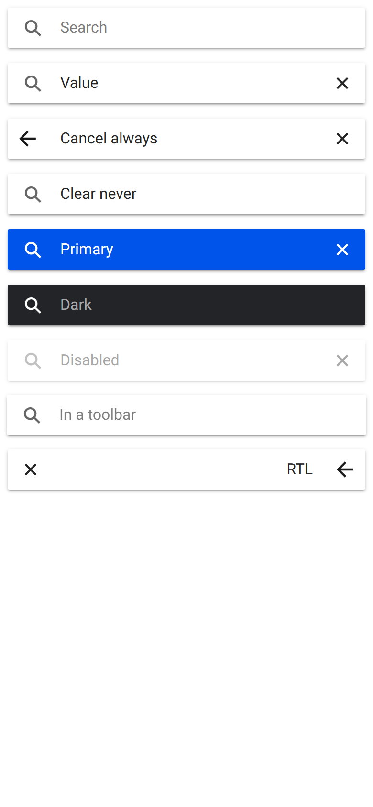
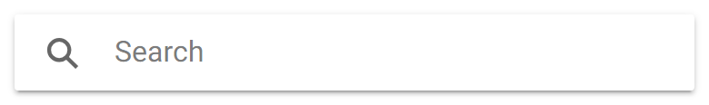

# ion-searchbar — reference render (Ionic 8.8.1, md, 390×844@2x)

Generated by `node tools/ionic-ref/render.js ion-searchbar --bare --html "<ion-app style=\"position:static;display:block;contain:none;overflow:visible\"><ion-searchbar></ion-searchbar><ion-searchbar value=\"Value\"></ion-searchbar><ion-searchbar show-cancel-button=\"always\" value=\"Cancel always\"></ion-searchbar><ion-searchbar show-clear-button=\"never\" value=\"Clear never\"></ion-searchbar><ion-searchbar color=\"primary\" value=\"Primary\"></ion-searchbar><ion-searchbar color=\"dark\" placeholder=\"Dark\"></ion-searchbar><ion-searchbar disabled value=\"Disabled\"></ion-searchbar><ion-toolbar><ion-searchbar placeholder=\"In a toolbar\"></ion-searchbar></ion-toolbar><div dir=\"rtl\"><ion-searchbar show-cancel-button=\"always\" value=\"RTL\"></ion-searchbar></div></ion-app>"`

```html
<ion-app style="position:static;display:block;contain:none;overflow:visible"><ion-searchbar></ion-searchbar><ion-searchbar value="Value"></ion-searchbar><ion-searchbar show-cancel-button="always" value="Cancel always"></ion-searchbar><ion-searchbar show-clear-button="never" value="Clear never"></ion-searchbar><ion-searchbar color="primary" value="Primary"></ion-searchbar><ion-searchbar color="dark" placeholder="Dark"></ion-searchbar><ion-searchbar disabled value="Disabled"></ion-searchbar><ion-toolbar><ion-searchbar placeholder="In a toolbar"></ion-searchbar></ion-toolbar><div dir="rtl"><ion-searchbar show-cancel-button="always" value="RTL"></ion-searchbar></div></ion-app>
```

 

## Element 1

- attributes: `{"class":"sc-ion-searchbar-md-h md searchbar-left-aligned searchbar-should-show-clear sc-ion-searchbar-md hydrated","role":"search"}`
- classes: `sc-ion-searchbar-md-h md searchbar-left-aligned searchbar-should-show-clear sc-ion-searchbar-md hydrated`
- rect: `{"x":0,"y":0,"w":390,"h":58}`

### CSS custom properties (resolved)

| var | value |
|---|---|
| `--background` | `#fff` |
| `--border-radius` | `2px` |
| `--box-shadow` | `0 2px 2px 0 rgba(0, 0, 0, 0.14), 0 3px 1px -2px rgba(0, 0, 0, 0.2), 0 1px 5px 0 rgba(0, 0, 0, 0.12)` |
| `--cancel-button-color` | `#1a1a1a` |
| `--clear-button-color` | `(unset)` |
| `--color` | `#262626` |
| `--icon-color` | `#666666` |
| `--placeholder-color` | `(unset)` |
| `--placeholder-font-style` | `(unset)` |
| `--placeholder-font-weight` | `(unset)` |
| `--placeholder-opacity` | `0.6` |

### Host computed

| prop | value |
|---|---|
| display | `flex` |
| position | `relative` |
| box-sizing | `border-box` |
| width | `390px` |
| height | `58px` |
| min-height | `0px` |
| min-width | `0px` |
| padding | `8px` |
| margin | `0px` |
| border | `0px none rgb(38, 38, 38)` |
| border-radius | `0px` |
| background-color | `rgba(0, 0, 0, 0)` |
| color | `rgb(38, 38, 38)` |
| font-size | `16px` |
| font-weight | `400` |
| font-family | `Roboto, "Helvetica Neue", sans-serif` |
| line-height | `normal` |
| letter-spacing | `normal` |
| text-transform | `none` |
| opacity | `1` |
| overflow | `visible` |
| contain | `none` |
| pointer-events | `auto` |
| transition | `all` |
| transform | `none` |
| box-shadow | `none` |
| outline | `rgb(38, 38, 38) none 0px` |
| cursor | `auto` |

### DOM tree

```
<ion-searchbar>
  <div.searchbar-input-container.sc-ion-searchbar-md>
    <input.searchbar-input.sc-ion-searchbar-md>
    <ion-icon.searchbar-search-icon.sc-ion-searchbar-md.md.hydrated>
      #shadow-root
        <div.icon-inner>
          <svg>
            <path>
    <button.searchbar-clear-button.sc-ion-searchbar-md>
      <ion-icon.searchbar-clear-icon.sc-ion-searchbar-md.md.hydrated>
        #shadow-root
          <div.icon-inner>
            <svg>
              <path>
```

## Element 2

- attributes: `{"value":"Value","class":"sc-ion-searchbar-md-h md searchbar-has-value searchbar-left-aligned searchbar-should-show-clear sc-ion-searchbar-md hydrated","role":"search"}`
- classes: `sc-ion-searchbar-md-h md searchbar-has-value searchbar-left-aligned searchbar-should-show-clear sc-ion-searchbar-md hydrated`
- rect: `{"x":0,"y":58,"w":390,"h":58}`

### CSS custom properties (resolved)

| var | value |
|---|---|
| `--background` | `#fff` |
| `--border-radius` | `2px` |
| `--box-shadow` | `0 2px 2px 0 rgba(0, 0, 0, 0.14), 0 3px 1px -2px rgba(0, 0, 0, 0.2), 0 1px 5px 0 rgba(0, 0, 0, 0.12)` |
| `--cancel-button-color` | `#1a1a1a` |
| `--clear-button-color` | `(unset)` |
| `--color` | `#262626` |
| `--icon-color` | `#666666` |
| `--placeholder-color` | `(unset)` |
| `--placeholder-font-style` | `(unset)` |
| `--placeholder-font-weight` | `(unset)` |
| `--placeholder-opacity` | `0.6` |

### Host computed

| prop | value |
|---|---|
| display | `flex` |
| position | `relative` |
| box-sizing | `border-box` |
| width | `390px` |
| height | `58px` |
| min-height | `0px` |
| min-width | `0px` |
| padding | `8px` |
| margin | `0px` |
| border | `0px none rgb(38, 38, 38)` |
| border-radius | `0px` |
| background-color | `rgba(0, 0, 0, 0)` |
| color | `rgb(38, 38, 38)` |
| font-size | `16px` |
| font-weight | `400` |
| font-family | `Roboto, "Helvetica Neue", sans-serif` |
| line-height | `normal` |
| letter-spacing | `normal` |
| text-transform | `none` |
| opacity | `1` |
| overflow | `visible` |
| contain | `none` |
| pointer-events | `auto` |
| transition | `all` |
| transform | `none` |
| box-shadow | `none` |
| outline | `rgb(38, 38, 38) none 0px` |
| cursor | `auto` |

### DOM tree

```
<ion-searchbar>
  <div.searchbar-input-container.sc-ion-searchbar-md>
    <input.searchbar-input.sc-ion-searchbar-md>
    <ion-icon.searchbar-search-icon.sc-ion-searchbar-md.md.hydrated>
      #shadow-root
        <div.icon-inner>
          <svg>
            <path>
    <button.searchbar-clear-button.sc-ion-searchbar-md>
      <ion-icon.searchbar-clear-icon.sc-ion-searchbar-md.md.hydrated>
        #shadow-root
          <div.icon-inner>
            <svg>
              <path>
```

## Element 3

- attributes: `{"show-cancel-button":"always","value":"Cancel always","class":"sc-ion-searchbar-md-h md searchbar-has-value searchbar-left-aligned searchbar-should-show-clear searchbar-should-show-cancel sc-ion-searchbar-md hydrated","role":"search"}`
- classes: `sc-ion-searchbar-md-h md searchbar-has-value searchbar-left-aligned searchbar-should-show-clear searchbar-should-show-cancel sc-ion-searchbar-md hydrated`
- rect: `{"x":0,"y":116,"w":390,"h":58}`

### CSS custom properties (resolved)

| var | value |
|---|---|
| `--background` | `#fff` |
| `--border-radius` | `2px` |
| `--box-shadow` | `0 2px 2px 0 rgba(0, 0, 0, 0.14), 0 3px 1px -2px rgba(0, 0, 0, 0.2), 0 1px 5px 0 rgba(0, 0, 0, 0.12)` |
| `--cancel-button-color` | `#1a1a1a` |
| `--clear-button-color` | `(unset)` |
| `--color` | `#262626` |
| `--icon-color` | `#666666` |
| `--placeholder-color` | `(unset)` |
| `--placeholder-font-style` | `(unset)` |
| `--placeholder-font-weight` | `(unset)` |
| `--placeholder-opacity` | `0.6` |

### Host computed

| prop | value |
|---|---|
| display | `flex` |
| position | `relative` |
| box-sizing | `border-box` |
| width | `390px` |
| height | `58px` |
| min-height | `0px` |
| min-width | `0px` |
| padding | `8px` |
| margin | `0px` |
| border | `0px none rgb(38, 38, 38)` |
| border-radius | `0px` |
| background-color | `rgba(0, 0, 0, 0)` |
| color | `rgb(38, 38, 38)` |
| font-size | `16px` |
| font-weight | `400` |
| font-family | `Roboto, "Helvetica Neue", sans-serif` |
| line-height | `normal` |
| letter-spacing | `normal` |
| text-transform | `none` |
| opacity | `1` |
| overflow | `visible` |
| contain | `none` |
| pointer-events | `auto` |
| transition | `all` |
| transform | `none` |
| box-shadow | `none` |
| outline | `rgb(38, 38, 38) none 0px` |
| cursor | `auto` |

### DOM tree

```
<ion-searchbar>
  <div.searchbar-input-container.sc-ion-searchbar-md>
    <input.searchbar-input.sc-ion-searchbar-md>
    <button.searchbar-cancel-button.sc-ion-searchbar-md>
      <div.sc-ion-searchbar-md>
        <ion-icon.sc-ion-searchbar-md.md.hydrated>
          #shadow-root
            <div.icon-inner>
              <svg>
                <path>
    <ion-icon.searchbar-search-icon.sc-ion-searchbar-md.md.hydrated>
      #shadow-root
        <div.icon-inner>
          <svg>
            <path>
    <button.searchbar-clear-button.sc-ion-searchbar-md>
      <ion-icon.searchbar-clear-icon.sc-ion-searchbar-md.md.hydrated>
        #shadow-root
          <div.icon-inner>
            <svg>
              <path>
```

## Element 4

- attributes: `{"show-clear-button":"never","value":"Clear never","class":"sc-ion-searchbar-md-h md searchbar-has-value searchbar-left-aligned sc-ion-searchbar-md hydrated","role":"search"}`
- classes: `sc-ion-searchbar-md-h md searchbar-has-value searchbar-left-aligned sc-ion-searchbar-md hydrated`
- rect: `{"x":0,"y":174,"w":390,"h":58}`

### CSS custom properties (resolved)

| var | value |
|---|---|
| `--background` | `#fff` |
| `--border-radius` | `2px` |
| `--box-shadow` | `0 2px 2px 0 rgba(0, 0, 0, 0.14), 0 3px 1px -2px rgba(0, 0, 0, 0.2), 0 1px 5px 0 rgba(0, 0, 0, 0.12)` |
| `--cancel-button-color` | `#1a1a1a` |
| `--clear-button-color` | `(unset)` |
| `--color` | `#262626` |
| `--icon-color` | `#666666` |
| `--placeholder-color` | `(unset)` |
| `--placeholder-font-style` | `(unset)` |
| `--placeholder-font-weight` | `(unset)` |
| `--placeholder-opacity` | `0.6` |

### Host computed

| prop | value |
|---|---|
| display | `flex` |
| position | `relative` |
| box-sizing | `border-box` |
| width | `390px` |
| height | `58px` |
| min-height | `0px` |
| min-width | `0px` |
| padding | `8px` |
| margin | `0px` |
| border | `0px none rgb(38, 38, 38)` |
| border-radius | `0px` |
| background-color | `rgba(0, 0, 0, 0)` |
| color | `rgb(38, 38, 38)` |
| font-size | `16px` |
| font-weight | `400` |
| font-family | `Roboto, "Helvetica Neue", sans-serif` |
| line-height | `normal` |
| letter-spacing | `normal` |
| text-transform | `none` |
| opacity | `1` |
| overflow | `visible` |
| contain | `none` |
| pointer-events | `auto` |
| transition | `all` |
| transform | `none` |
| box-shadow | `none` |
| outline | `rgb(38, 38, 38) none 0px` |
| cursor | `auto` |

### DOM tree

```
<ion-searchbar>
  <div.searchbar-input-container.sc-ion-searchbar-md>
    <input.searchbar-input.sc-ion-searchbar-md>
    <ion-icon.searchbar-search-icon.sc-ion-searchbar-md.md.hydrated>
      #shadow-root
        <div.icon-inner>
          <svg>
            <path>
    <button.searchbar-clear-button.sc-ion-searchbar-md>
      <ion-icon.searchbar-clear-icon.sc-ion-searchbar-md.md.hydrated>
        #shadow-root
          <div.icon-inner>
            <svg>
              <path>
```

## Element 5

- attributes: `{"color":"primary","value":"Primary","class":"sc-ion-searchbar-md-h ion-color ion-color-primary md searchbar-has-value searchbar-left-aligned searchbar-should-show-clear sc-ion-searchbar-md hydrated","role":"search"}`
- classes: `sc-ion-searchbar-md-h ion-color ion-color-primary md searchbar-has-value searchbar-left-aligned searchbar-should-show-clear sc-ion-searchbar-md hydrated`
- rect: `{"x":0,"y":232,"w":390,"h":58}`

### CSS custom properties (resolved)

| var | value |
|---|---|
| `--background` | `#fff` |
| `--border-radius` | `2px` |
| `--box-shadow` | `0 2px 2px 0 rgba(0, 0, 0, 0.14), 0 3px 1px -2px rgba(0, 0, 0, 0.2), 0 1px 5px 0 rgba(0, 0, 0, 0.12)` |
| `--cancel-button-color` | `#1a1a1a` |
| `--clear-button-color` | `(unset)` |
| `--color` | `#262626` |
| `--icon-color` | `#666666` |
| `--placeholder-color` | `(unset)` |
| `--placeholder-font-style` | `(unset)` |
| `--placeholder-font-weight` | `(unset)` |
| `--placeholder-opacity` | `0.6` |

### Host computed

| prop | value |
|---|---|
| display | `flex` |
| position | `relative` |
| box-sizing | `border-box` |
| width | `390px` |
| height | `58px` |
| min-height | `0px` |
| min-width | `0px` |
| padding | `8px` |
| margin | `0px` |
| border | `0px none rgb(255, 255, 255)` |
| border-radius | `0px` |
| background-color | `rgba(0, 0, 0, 0)` |
| color | `rgb(255, 255, 255)` |
| font-size | `16px` |
| font-weight | `400` |
| font-family | `Roboto, "Helvetica Neue", sans-serif` |
| line-height | `normal` |
| letter-spacing | `normal` |
| text-transform | `none` |
| opacity | `1` |
| overflow | `visible` |
| contain | `none` |
| pointer-events | `auto` |
| transition | `all` |
| transform | `none` |
| box-shadow | `none` |
| outline | `rgb(255, 255, 255) none 0px` |
| cursor | `auto` |

### DOM tree

```
<ion-searchbar>
  <div.searchbar-input-container.sc-ion-searchbar-md>
    <input.searchbar-input.sc-ion-searchbar-md>
    <ion-icon.searchbar-search-icon.sc-ion-searchbar-md.md.hydrated>
      #shadow-root
        <div.icon-inner>
          <svg>
            <path>
    <button.searchbar-clear-button.sc-ion-searchbar-md>
      <ion-icon.searchbar-clear-icon.sc-ion-searchbar-md.md.hydrated>
        #shadow-root
          <div.icon-inner>
            <svg>
              <path>
```

## Element 6

- attributes: `{"color":"dark","placeholder":"Dark","class":"sc-ion-searchbar-md-h ion-color ion-color-dark md searchbar-left-aligned searchbar-should-show-clear sc-ion-searchbar-md hydrated","role":"search"}`
- classes: `sc-ion-searchbar-md-h ion-color ion-color-dark md searchbar-left-aligned searchbar-should-show-clear sc-ion-searchbar-md hydrated`
- rect: `{"x":0,"y":290,"w":390,"h":58}`

### CSS custom properties (resolved)

| var | value |
|---|---|
| `--background` | `#fff` |
| `--border-radius` | `2px` |
| `--box-shadow` | `0 2px 2px 0 rgba(0, 0, 0, 0.14), 0 3px 1px -2px rgba(0, 0, 0, 0.2), 0 1px 5px 0 rgba(0, 0, 0, 0.12)` |
| `--cancel-button-color` | `#1a1a1a` |
| `--clear-button-color` | `(unset)` |
| `--color` | `#262626` |
| `--icon-color` | `#666666` |
| `--placeholder-color` | `(unset)` |
| `--placeholder-font-style` | `(unset)` |
| `--placeholder-font-weight` | `(unset)` |
| `--placeholder-opacity` | `0.6` |

### Host computed

| prop | value |
|---|---|
| display | `flex` |
| position | `relative` |
| box-sizing | `border-box` |
| width | `390px` |
| height | `58px` |
| min-height | `0px` |
| min-width | `0px` |
| padding | `8px` |
| margin | `0px` |
| border | `0px none rgb(255, 255, 255)` |
| border-radius | `0px` |
| background-color | `rgba(0, 0, 0, 0)` |
| color | `rgb(255, 255, 255)` |
| font-size | `16px` |
| font-weight | `400` |
| font-family | `Roboto, "Helvetica Neue", sans-serif` |
| line-height | `normal` |
| letter-spacing | `normal` |
| text-transform | `none` |
| opacity | `1` |
| overflow | `visible` |
| contain | `none` |
| pointer-events | `auto` |
| transition | `all` |
| transform | `none` |
| box-shadow | `none` |
| outline | `rgb(255, 255, 255) none 0px` |
| cursor | `auto` |

### DOM tree

```
<ion-searchbar>
  <div.searchbar-input-container.sc-ion-searchbar-md>
    <input.searchbar-input.sc-ion-searchbar-md>
    <ion-icon.searchbar-search-icon.sc-ion-searchbar-md.md.hydrated>
      #shadow-root
        <div.icon-inner>
          <svg>
            <path>
    <button.searchbar-clear-button.sc-ion-searchbar-md>
      <ion-icon.searchbar-clear-icon.sc-ion-searchbar-md.md.hydrated>
        #shadow-root
          <div.icon-inner>
            <svg>
              <path>
```

## Element 7

- attributes: `{"disabled":"","value":"Disabled","class":"sc-ion-searchbar-md-h md searchbar-disabled searchbar-has-value searchbar-left-aligned searchbar-should-show-clear sc-ion-searchbar-md hydrated","role":"search","aria-disabled":"true"}`
- classes: `sc-ion-searchbar-md-h md searchbar-disabled searchbar-has-value searchbar-left-aligned searchbar-should-show-clear sc-ion-searchbar-md hydrated`
- rect: `{"x":0,"y":348,"w":390,"h":58}`

### CSS custom properties (resolved)

| var | value |
|---|---|
| `--background` | `#fff` |
| `--border-radius` | `2px` |
| `--box-shadow` | `0 2px 2px 0 rgba(0, 0, 0, 0.14), 0 3px 1px -2px rgba(0, 0, 0, 0.2), 0 1px 5px 0 rgba(0, 0, 0, 0.12)` |
| `--cancel-button-color` | `#1a1a1a` |
| `--clear-button-color` | `(unset)` |
| `--color` | `#262626` |
| `--icon-color` | `#666666` |
| `--placeholder-color` | `(unset)` |
| `--placeholder-font-style` | `(unset)` |
| `--placeholder-font-weight` | `(unset)` |
| `--placeholder-opacity` | `0.6` |

### Host computed

| prop | value |
|---|---|
| display | `flex` |
| position | `relative` |
| box-sizing | `border-box` |
| width | `390px` |
| height | `58px` |
| min-height | `0px` |
| min-width | `0px` |
| padding | `8px` |
| margin | `0px` |
| border | `0px none rgb(38, 38, 38)` |
| border-radius | `0px` |
| background-color | `rgba(0, 0, 0, 0)` |
| color | `rgb(38, 38, 38)` |
| font-size | `16px` |
| font-weight | `400` |
| font-family | `Roboto, "Helvetica Neue", sans-serif` |
| line-height | `normal` |
| letter-spacing | `normal` |
| text-transform | `none` |
| opacity | `0.4` |
| overflow | `visible` |
| contain | `none` |
| pointer-events | `none` |
| transition | `all` |
| transform | `none` |
| box-shadow | `none` |
| outline | `rgb(38, 38, 38) none 0px` |
| cursor | `default` |

### DOM tree

```
<ion-searchbar>
  <div.searchbar-input-container.sc-ion-searchbar-md>
    <input.searchbar-input.sc-ion-searchbar-md>
    <ion-icon.searchbar-search-icon.sc-ion-searchbar-md.md.hydrated>
      #shadow-root
        <div.icon-inner>
          <svg>
            <path>
    <button.searchbar-clear-button.sc-ion-searchbar-md>
      <ion-icon.searchbar-clear-icon.sc-ion-searchbar-md.md.hydrated>
        #shadow-root
          <div.icon-inner>
            <svg>
              <path>
```

## Element 8

- attributes: `{"placeholder":"In a toolbar","class":"sc-ion-searchbar-md-h md searchbar-left-aligned searchbar-should-show-clear sc-ion-searchbar-md hydrated","role":"search"}`
- classes: `sc-ion-searchbar-md-h md searchbar-left-aligned searchbar-should-show-clear sc-ion-searchbar-md hydrated`
- rect: `{"x":0,"y":410,"w":390,"h":48}`

### CSS custom properties (resolved)

| var | value |
|---|---|
| `--background` | `#fff` |
| `--border-radius` | `2px` |
| `--box-shadow` | `0 2px 2px 0 rgba(0, 0, 0, 0.14), 0 3px 1px -2px rgba(0, 0, 0, 0.2), 0 1px 5px 0 rgba(0, 0, 0, 0.12)` |
| `--cancel-button-color` | `#1a1a1a` |
| `--clear-button-color` | `(unset)` |
| `--color` | `#262626` |
| `--icon-color` | `#666666` |
| `--placeholder-color` | `(unset)` |
| `--placeholder-font-style` | `(unset)` |
| `--placeholder-font-weight` | `(unset)` |
| `--placeholder-opacity` | `0.6` |

### Host computed

| prop | value |
|---|---|
| display | `flex` |
| position | `relative` |
| box-sizing | `border-box` |
| width | `390px` |
| height | `48px` |
| min-height | `0px` |
| min-width | `0px` |
| padding | `3px 7px` |
| margin | `0px` |
| border | `0px none rgb(38, 38, 38)` |
| border-radius | `0px` |
| background-color | `rgba(0, 0, 0, 0)` |
| color | `rgb(38, 38, 38)` |
| font-size | `16px` |
| font-weight | `400` |
| font-family | `Roboto, "Helvetica Neue", sans-serif` |
| line-height | `normal` |
| letter-spacing | `normal` |
| text-transform | `none` |
| opacity | `1` |
| overflow | `visible` |
| contain | `none` |
| pointer-events | `auto` |
| transition | `all` |
| transform | `none` |
| box-shadow | `none` |
| outline | `rgb(38, 38, 38) none 0px` |
| cursor | `auto` |

### DOM tree

```
<ion-searchbar>
  <div.searchbar-input-container.sc-ion-searchbar-md>
    <input.searchbar-input.sc-ion-searchbar-md>
    <ion-icon.searchbar-search-icon.sc-ion-searchbar-md.md.hydrated>
      #shadow-root
        <div.icon-inner>
          <svg>
            <path>
    <button.searchbar-clear-button.sc-ion-searchbar-md>
      <ion-icon.searchbar-clear-icon.sc-ion-searchbar-md.md.hydrated>
        #shadow-root
          <div.icon-inner>
            <svg>
              <path>
```

## Element 9

- attributes: `{"show-cancel-button":"always","value":"RTL","class":"sc-ion-searchbar-md-h md searchbar-has-value searchbar-left-aligned searchbar-should-show-clear searchbar-should-show-cancel sc-ion-searchbar-md hydrated","role":"search"}`
- classes: `sc-ion-searchbar-md-h md searchbar-has-value searchbar-left-aligned searchbar-should-show-clear searchbar-should-show-cancel sc-ion-searchbar-md hydrated`
- rect: `{"x":0,"y":462,"w":390,"h":58}`

### CSS custom properties (resolved)

| var | value |
|---|---|
| `--background` | `#fff` |
| `--border-radius` | `2px` |
| `--box-shadow` | `0 2px 2px 0 rgba(0, 0, 0, 0.14), 0 3px 1px -2px rgba(0, 0, 0, 0.2), 0 1px 5px 0 rgba(0, 0, 0, 0.12)` |
| `--cancel-button-color` | `#1a1a1a` |
| `--clear-button-color` | `(unset)` |
| `--color` | `#262626` |
| `--icon-color` | `#666666` |
| `--placeholder-color` | `(unset)` |
| `--placeholder-font-style` | `(unset)` |
| `--placeholder-font-weight` | `(unset)` |
| `--placeholder-opacity` | `0.6` |

### Host computed

| prop | value |
|---|---|
| display | `flex` |
| position | `relative` |
| box-sizing | `border-box` |
| width | `390px` |
| height | `58px` |
| min-height | `0px` |
| min-width | `0px` |
| padding | `8px` |
| margin | `0px` |
| border | `0px none rgb(38, 38, 38)` |
| border-radius | `0px` |
| background-color | `rgba(0, 0, 0, 0)` |
| color | `rgb(38, 38, 38)` |
| font-size | `16px` |
| font-weight | `400` |
| font-family | `Roboto, "Helvetica Neue", sans-serif` |
| line-height | `normal` |
| letter-spacing | `normal` |
| text-transform | `none` |
| opacity | `1` |
| overflow | `visible` |
| contain | `none` |
| pointer-events | `auto` |
| transition | `all` |
| transform | `none` |
| box-shadow | `none` |
| outline | `rgb(38, 38, 38) none 0px` |
| cursor | `auto` |

### DOM tree

```
<ion-searchbar>
  <div.searchbar-input-container.sc-ion-searchbar-md>
    <input.searchbar-input.sc-ion-searchbar-md>
    <button.searchbar-cancel-button.sc-ion-searchbar-md>
      <div.sc-ion-searchbar-md>
        <ion-icon.sc-ion-searchbar-md.md.hydrated>
          #shadow-root
            <div.icon-inner>
              <svg>
                <path>
    <ion-icon.searchbar-search-icon.sc-ion-searchbar-md.md.hydrated>
      #shadow-root
        <div.icon-inner>
          <svg>
            <path>
    <button.searchbar-clear-button.sc-ion-searchbar-md>
      <ion-icon.searchbar-clear-icon.sc-ion-searchbar-md.md.hydrated>
        #shadow-root
          <div.icon-inner>
            <svg>
              <path>
```
