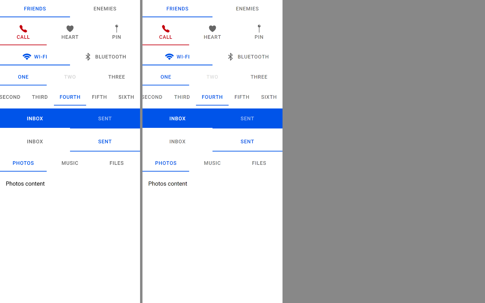

# ion-segment family — Comparison against the web component

> Ionic side: `node tools/ionic-ref/render.js ion-segment --bare --html '<the snippet below>'` (Chromium, md, 390×844@2x) → [`ref/`](ref/).
> `ref/README.md` holds the exact command, and `ref/page.html` the page.
> Avonic side: `AVONIC_CAPTURE_DIR=… dotnet test` → `AvonicSegmentCaptureTests.Reference_Page` (headless Skia, 2×) → [`compare/`](compare/).
> Not tried in a real window (real-window run queued), and not tried on a device.

```html
<ion-app style="position:static;display:block;contain:none;overflow:visible"><div style="display:flex;flex-direction:column;gap:8px">
<ion-segment value="a"><ion-segment-button value="a"><ion-label>Friends</ion-label></ion-segment-button><ion-segment-button value="b"><ion-label>Enemies</ion-label></ion-segment-button></ion-segment>
<ion-segment value="call" color="danger"><ion-segment-button value="call"><ion-label>Call</ion-label><ion-icon name="call"></ion-icon></ion-segment-button><ion-segment-button value="heart"><ion-label>Heart</ion-label><ion-icon name="heart"></ion-icon></ion-segment-button><ion-segment-button value="pin"><ion-label>Pin</ion-label><ion-icon name="pin"></ion-icon></ion-segment-button></ion-segment>
<ion-segment value="wifi"><ion-segment-button value="wifi" layout="icon-start"><ion-label>Wi-Fi</ion-label><ion-icon name="wifi"></ion-icon></ion-segment-button><ion-segment-button value="bt" layout="icon-start"><ion-label>Bluetooth</ion-label><ion-icon name="bluetooth"></ion-icon></ion-segment-button></ion-segment>
<ion-segment value="1"><ion-segment-button value="1"><ion-label>One</ion-label></ion-segment-button><ion-segment-button value="2" disabled><ion-label>Two</ion-label></ion-segment-button><ion-segment-button value="3"><ion-label>Three</ion-label></ion-segment-button></ion-segment>
<ion-segment scrollable value="s4"><ion-segment-button value="s1"><ion-label>First</ion-label></ion-segment-button><ion-segment-button value="s2"><ion-label>Second</ion-label></ion-segment-button><ion-segment-button value="s3"><ion-label>Third</ion-label></ion-segment-button><ion-segment-button value="s4"><ion-label>Fourth</ion-label></ion-segment-button><ion-segment-button value="s5"><ion-label>Fifth</ion-label></ion-segment-button><ion-segment-button value="s6"><ion-label>Sixth</ion-label></ion-segment-button></ion-segment>
<ion-toolbar color="primary"><ion-segment value="t1"><ion-segment-button value="t1"><ion-label>Inbox</ion-label></ion-segment-button><ion-segment-button value="t2"><ion-label>Sent</ion-label></ion-segment-button></ion-segment></ion-toolbar>
<ion-toolbar><ion-segment value="t2"><ion-segment-button value="t1"><ion-label>Inbox</ion-label></ion-segment-button><ion-segment-button value="t2"><ion-label>Sent</ion-label></ion-segment-button></ion-segment></ion-toolbar>
<ion-segment value="v1"><ion-segment-button value="v1" content-id="v1"><ion-label>Photos</ion-label></ion-segment-button><ion-segment-button value="v2" content-id="v2"><ion-label>Music</ion-label></ion-segment-button><ion-segment-button value="v3" content-id="v3"><ion-label>Files</ion-label></ion-segment-button></ion-segment>
<ion-segment-view style="height:64px"><ion-segment-content id="v1"><p style="margin:16px">Photos content</p></ion-segment-content><ion-segment-content id="v2"><p style="margin:16px">Music content</p></ion-segment-content><ion-segment-content id="v3"><p style="margin:16px">Files content</p></ion-segment-content></ion-segment-view>
</div></ion-app>
```

(One line in the real command.) `Reference_Page` lays out the same content in a `StackPanel` with a spacing of 8; the `<p>` is a
`TextBlock` with a margin of 16 at 16 px.

The behaviours were measured with throwaway Playwright scripts on the same page, at 390 wide, with a mouse: a tap on Enemies with
the indicator's transform sampled every 50 ms; a slow drag from the checked button; a drag from an unchecked one released below the
segment; a release past the end; a tap on a disabled button and a drag across one; a press held for 600 ms with the ripple read
every 100; Tab, Shift+Tab, the arrows, Enter, Space, Home and End, with and without `selectOnFocus`; `scrollLeft` sampled every
frame while a scrollable segment and the view scrolled smoothly over 84, 390 and 780 px; and `scrollLeft` set on the view by hand.
A second page measured the grid with one button, five, a `min-width: 150px` button, a scrollable pair and a text node.

## Frames

Ionic on the left, Avonic on the right:



They match row for row, to the pixel in the boxes the tests assert: 48 high with the label 22 high at 13, 70 with an icon on top,
48 for icon-start with the label 8 after the icon, 56 in a toolbar, 195 or 130 wide columns, and the scrollable row centred on
Fourth. The colours match the resolved ones in `ref/dump.json`: the primary and `rgba(0, 0, 0, 0.6)`, danger's `rgb(197, 0, 15)`,
and white and `rgba(255, 255, 255, 0.6)` in the coloured toolbar, with a white indicator. Text is antialiased differently, as
everywhere in Avonic.

## Behaviours

| # | Behaviour | Ionic | Avonic | |
|---|---|---|---|---|
| S1 | Checked by `===`; code raises no `ionChange` | yes | yes | match |
| S2 | A tap checks at the release, one `ionChange` | `a` at the press, `b` at the release | the same | match |
| S3 | The held indicator moves past each edge; not onto a disabled button | `b` at 196, `a` at 190; stuck at One until the release | the same | match |
| S4 | From an unchecked button, the release checks by its x | `b` | `b` | match |
| S5 | A release past the end changes nothing | no change | no change | match |
| S6 | Nothing checked: the press checks | yes | yes | match |
| S7 | A press on a disabled button | nothing | nothing | match |
| S8 | With the gesture off, a click checks with the slide | yes | yes | match |
| S9 | The slide: from `translateX(−195px)`, 250 ms, `cubic-bezier(0.4, 0, 0.2, 1)` | −185.3 at 54 ms, −75.2 at 112, −24.2 at 162, −9.2 at 208 | the same curve, from the next frame | match |
| S10 | Keys | arrows focus and wrap, Enter and Space check, Home, End; `selectOnFocus` checks; every button a tab stop | the same, and RTL swaps the arrows | match |
| S11 | Scrollable: content-width columns, the checked one centred at load | Fourth centred, `scrollLeft` 92 | centred | match |
| S12 | Smooth scroll | 84 px in ~150 ms, 390 in ~330, 780 in ~460, eased in and out | √d / 60 s, `cubic-bezier(0.42, 0, 0.58, 1)`: 2.5 px off on average over the 780 px run | match, fitted |
| S13 | Columns grow equally to 360, centred | 360 at 15; 90 each from −30; 225 and 165; 195 each | the same | match |
| S14 | Disabling disables every button; enabling enables them all | yes | yes | match |
| S15 | `segment-button-after-checked` | the button after the checked one | `:after-checked` | match |
| S16 | In a toolbar: 56 high | 56 | 56 | match |
| S17 | A button added later is checked if it matches | yes | yes | match |
| S18 | `ionStyle` `segment` to an item | `item-segment` | `:item-segment` | match |
| B1 | Layouts, icons first | icon above in `call`, before in `wifi` | the same | match |
| B3 | The press ripples, and the capture cancels it | ripple at 0.16, gone by 600 ms held, `ion-activated` never stays | the same | match |
| B5 | Disabled at 0.3 | 0.3 | 0.3 | match |
| B6 | `role="tab"`, `aria-selected`, in a `tablist` | yes | `TabItem`, selection, in a `Tab` | match |
| B7 | Labels upper case, one line, an ellipsis | yes | yes | match |
| B8 | A button with a content id can't be disabled | warning, enabled | warning in the log, enabled | match |
| V1 | `setContent` scrolls smoothly; no pointer events until 100 ms after | `segment-view-scroll-disabled` on, then off | no hit testing, then back | match |
| V2 | `ionSegmentViewScroll` with `isManualScroll` false meanwhile | yes | yes | match |
| V3 | A person's scroll moves the checked button | `manual 600` → `v3` | the same; the first one always raises `ionChange` | match |
| V4 | The view follows taps and code, and jumps to the value at load | yes | yes | match |
| V5 | A finger pages the view | `scroll-snap-type: x mandatory`, `scroll-snap-stop: always` | Avalonia's `MandatorySingle` snap points | deliberate difference |
| V6 | Each content is the view's size | 390 × 64 | 390 × 64 | match |
| V7 | Disabling the segment disables the view | yes | yes | match |

## Deliberate differences

- **A vertical drag that starts on a segment doesn't scroll the page around it.** The gesture captures at the press, threshold 0, as
  Ionic's does, and Avonic's gesture utility keeps a scroller off a captured pointer; Chromium scrolls the page anyway, as the
  gesture's listener never calls `preventDefault`. A segment is 48 high, so a page can still be scrolled from anywhere else.
- **A fling on the view snaps by Avalonia's rules** (`MandatorySingle`), not Chromium's, which aren't public. Both stop at the next
  content and never skip one.
- **`Scrollable` changing after load turns the gesture on or off.** Ionic has no watcher on it, so its gesture keeps what it read at
  load; a scrollable segment whose gesture still runs would fight its own scroller.
- **`prefers-reduced-motion`** isn't read: Avalonia has no such setting, so the indicator always slides.
- **A label's or icon's `hasLabel` and `hasIcon`** follow the button's children as they change. Ionic reads them only when it renders.
- **The view keeps its content in view when it's resized,** a step after the layout, as Chromium's snap does in the same frame.

## Known gaps

- **`--ion-toolbar-segment-*` aren't mapped** (five global variables for a segment in a toolbar without a colour). Unset, as Ionic
  leaves them, they give what the button has anywhere else.
- **`--border-style`** isn't mapped: Avalonia draws only solid borders. A width of 0 is `none`, which is md's.
- **Not tried in a real window or on a device.**
